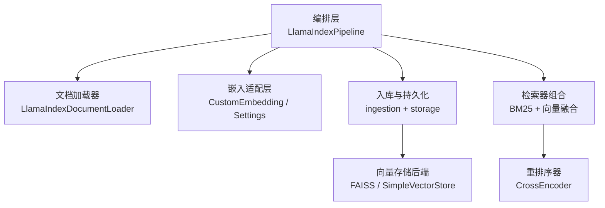
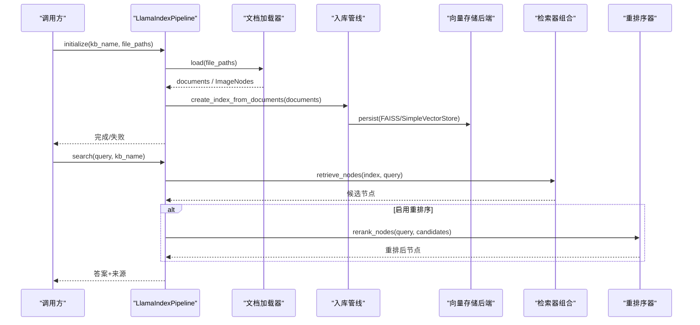
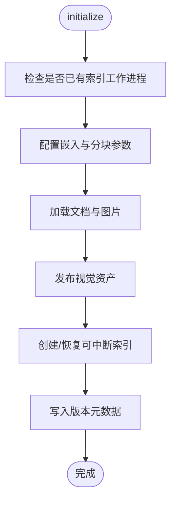
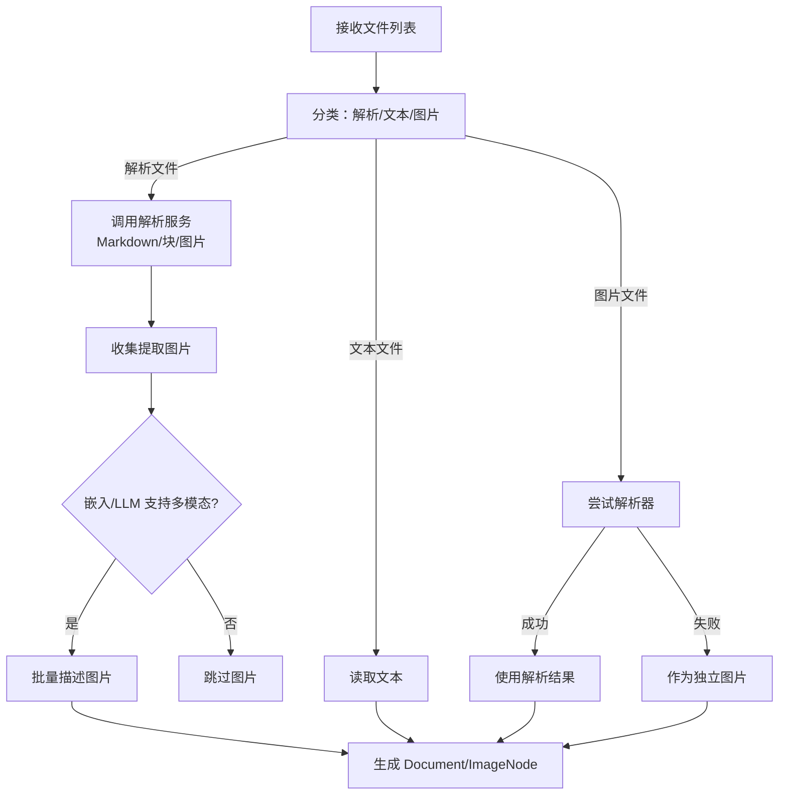
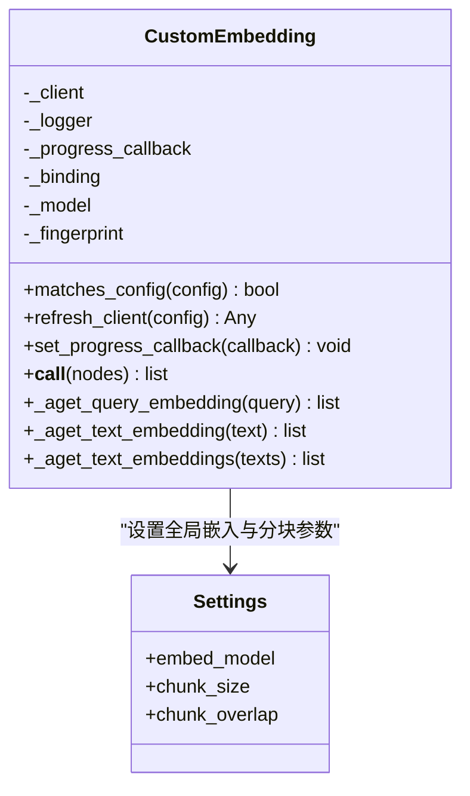
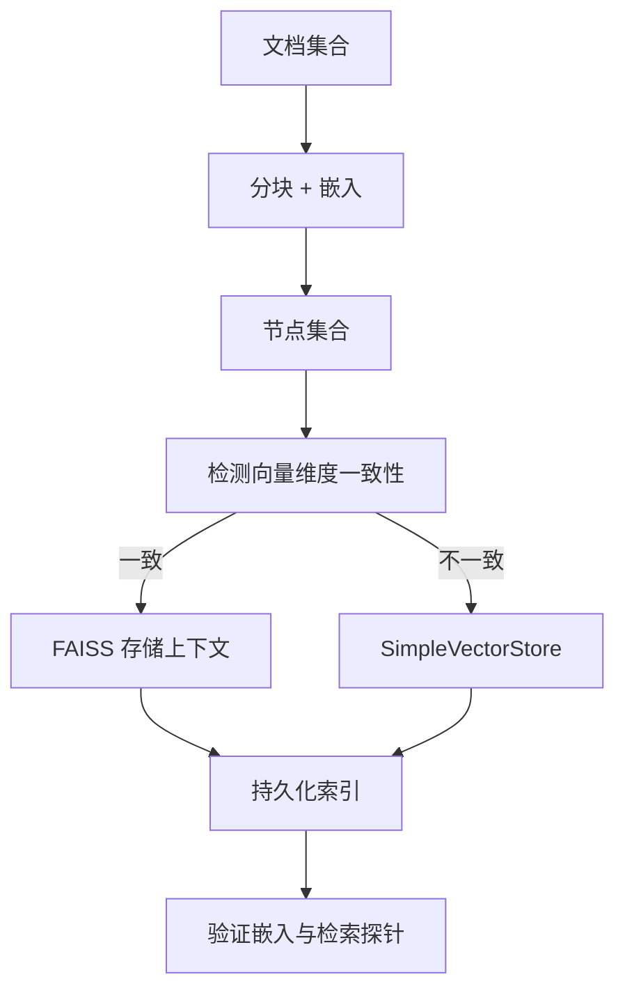
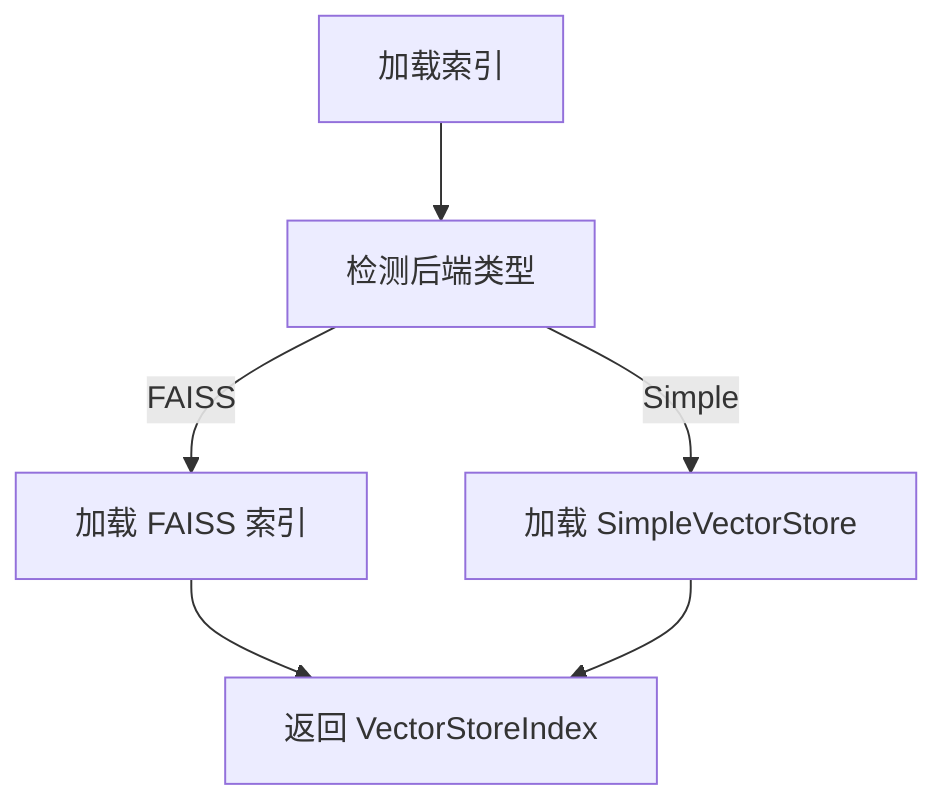
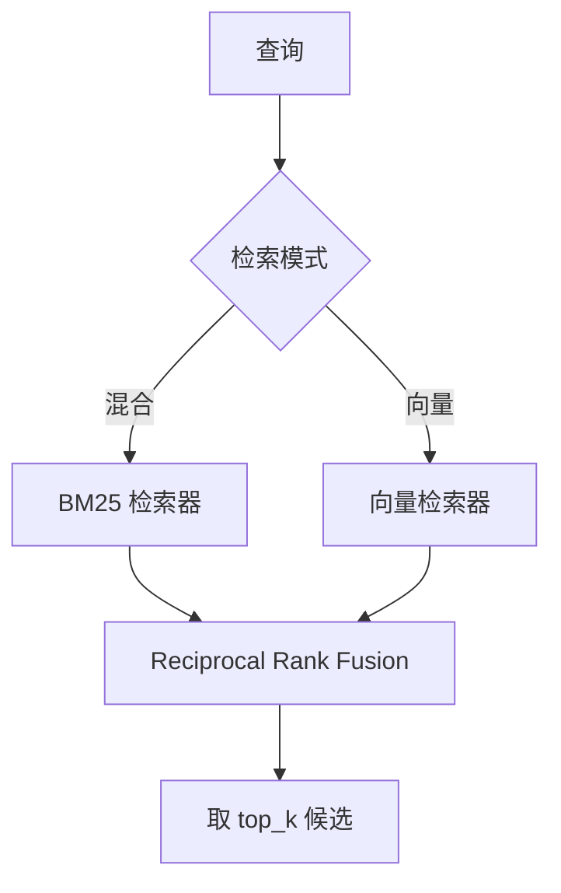
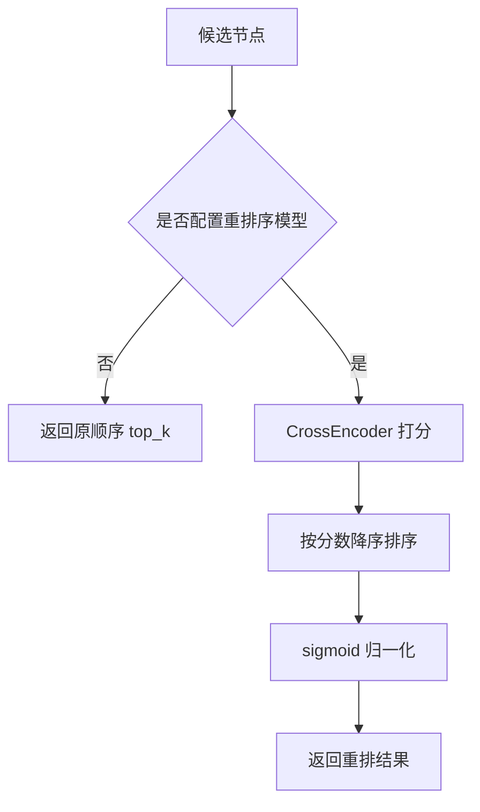
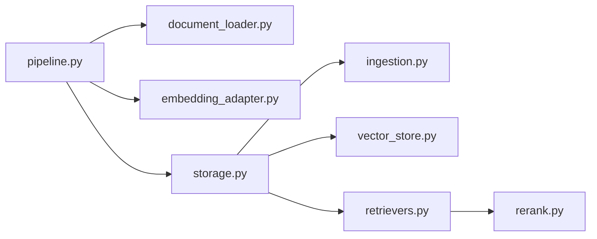

# LlamaIndex 管道实现

<cite>
**本文引用的文件**   
- [pipeline.py](file://deeptutor/services/rag/pipelines/llamaindex/pipeline.py)
- [config.py](file://deeptutor/services/rag/pipelines/llamaindex/config.py)
- [document_loader.py](file://deeptutor/services/rag/pipelines/llamaindex/document_loader.py)
- [embedding_adapter.py](file://deeptutor/services/rag/pipelines/llamaindex/embedding_adapter.py)
- [vector_store.py](file://deeptutor/services/rag/pipelines/llamaindex/vector_store.py)
- [retrievers.py](file://deeptutor/services/rag/pipelines/llamaindex/retrievers.py)
- [rerank.py](file://deeptutor/services/rag/pipelines/llamaindex/rerank.py)
- [ingestion.py](file://deeptutor/services/rag/pipelines/llamaindex/ingestion.py)
- [storage.py](file://deeptutor/services/rag/pipelines/llamaindex/storage.py)
- [preflight.py](file://deeptutor/services/rag/preflight.py)
- [factory.py](file://deeptutor/services/rag/factory.py)
</cite>

## 目录
1. [简介](#简介)
2. [项目结构](#项目结构)
3. [核心组件](#核心组件)
4. [架构总览](#架构总览)
5. [详细组件分析](#详细组件分析)
6. [依赖关系分析](#依赖关系分析)
7. [性能与调优](#性能与调优)
8. [故障排查指南](#故障排查指南)
9. [结论](#结论)
10. [附录：配置示例与最佳实践](#附录配置示例与最佳实践)

## 简介
本文件系统性梳理 DeepTutor 中基于 LlamaIndex 的 RAG 管道实现，覆盖文档加载、嵌入适配、向量存储后端选择、检索器组合与重排序机制，并给出索引构建流程、查询处理路径、错误处理与缓存策略。该实现以 FAISS 为默认高性能本地向量后端，兼容旧版 SimpleVectorStore；支持可选 BM25 混合检索与交叉编码器重排序；通过统一的嵌入适配器对接 DeepTutor 的嵌入服务，从而可灵活切换不同绑定与模型。

## 项目结构
LlamaIndex 管道位于 `deeptutor/services/rag/pipelines/llamaindex`，围绕“编排—加载—嵌入—入库—检索—重排”的职责分层组织：

**图表来源** 
- [pipeline.py:181-320](file://deeptutor/services/rag/pipelines/llamaindex/pipeline.py#L181-L320)
- [document_loader.py:69-216](file://deeptutor/services/rag/pipelines/llamaindex/document_loader.py#L69-L216)
- [embedding_adapter.py:54-245](file://deeptutor/services/rag/pipelines/llamaindex/embedding_adapter.py#L54-L245)
- [ingestion.py:22-112](file://deeptutor/services/rag/pipelines/llamaindex/ingestion.py#L22-L112)
- [vector_store.py:170-274](file://deeptutor/services/rag/pipelines/llamaindex/vector_store.py#L170-L274)
- [retrievers.py:192-260](file://deeptutor/services/rag/pipelines/llamaindex/retrievers.py#L192-L260)
- [rerank.py:84-127](file://deeptutor/services/rag/pipelines/llamaindex/rerank.py#L84-L127)

**章节来源**
- [pipeline.py:181-320](file://deeptutor/services/rag/pipelines/llamaindex/pipeline.py#L181-L320)
- [config.py:30-148](file://deeptutor/services/rag/pipelines/llamaindex/config.py#L30-L148)

## 核心组件
- 编排器：负责初始化、增量添加、搜索、删除等高层 API，协调进度、工作锁、版本元数据与可视化资源发布。
- 文档加载器：统一走解析桥接层，支持 PDF/Office/e-book 文本、纯文本、图片（多模态）与源图注信息。
- 嵌入适配：将 LlamaIndex 的嵌入接口桥接到 DeepTutor 的嵌入客户端，支持批量进度上报与连接性探测。
- 入库与持久化：使用 LlamaIndex IngestionPipeline 进行分块与嵌入，按源粒度断点续建，快照原子替换。
- 向量存储后端：优先 FAISS（余弦相似度），回退到 SimpleVectorStore；自动检测与迁移。
- 检索器：支持纯向量、BM25 混合（可选）、Reciprocal Rank Fusion 融合；支持按文档键范围检索。
- 重排序：可选 SentenceTransformers CrossEncoder 对候选结果做二次打分与稳定归一化。

**章节来源**
- [pipeline.py:181-593](file://deeptutor/services/rag/pipelines/llamaindex/pipeline.py#L181-L593)
- [document_loader.py:69-649](file://deeptutor/services/rag/pipelines/llamaindex/document_loader.py#L69-L649)
- [embedding_adapter.py:54-274](file://deeptutor/services/rag/pipelines/llamaindex/embedding_adapter.py#L54-L274)
- [ingestion.py:22-130](file://deeptutor/services/rag/pipelines/llamaindex/ingestion.py#L22-L130)
- [vector_store.py:1-289](file://deeptutor/services/rag/pipelines/llamaindex/vector_store.py#L1-L289)
- [retrievers.py:1-412](file://deeptutor/services/rag/pipelines/llamaindex/retrievers.py#L1-L412)
- [rerank.py:1-131](file://deeptutor/services/rag/pipelines/llamaindex/rerank.py#L1-L131)

## 架构总览
下图展示一次典型“索引构建—检索—重排”的端到端调用链。

**图表来源** 
- [pipeline.py:230-320](file://deeptutor/services/rag/pipelines/llamaindex/pipeline.py#L230-L320)
- [pipeline.py:322-418](file://deeptutor/services/rag/pipelines/llamaindex/pipeline.py#L322-L418)
- [ingestion.py:91-112](file://deeptutor/services/rag/pipelines/llamaindex/ingestion.py#L91-L112)
- [vector_store.py:249-274](file://deeptutor/services/rag/pipelines/llamaindex/vector_store.py#L249-L274)
- [retrievers.py:235-260](file://deeptutor/services/rag/pipelines/llamaindex/retrievers.py#L235-L260)
- [rerank.py:84-127](file://deeptutor/services/rag/pipelines/llamaindex/rerank.py#L84-L127)

## 详细组件分析

### 编排层：LlamaIndexPipeline
职责
- 初始化知识库：校验嵌入连通性、加载文档、发布视觉资产、创建或恢复可中断索引、写入版本元数据。
- 搜索：定位已发布索引、执行检索与可选重排序、组装答案与来源。
- 增量添加：在现有索引上插入新文档或重建新索引。
- 删除：清理知识库目录。

关键特性
- 并发与工作锁：同一知识库禁止重复索引任务，避免竞态。
- 停滞保护：嵌入阶段若长时间无进度心跳，抛出明确错误，防止线程永久阻塞。
- 版本与恢复：根据嵌入签名与来源哈希，支持中断后的断点续建与原子发布。

**图表来源** 
- [pipeline.py:78-104](file://deeptutor/services/rag/pipelines/llamaindex/pipeline.py#L78-L104)
- [pipeline.py:106-179](file://deeptutor/services/rag/pipelines/llamaindex/pipeline.py#L106-L179)
- [pipeline.py:230-320](file://deeptutor/services/rag/pipelines/llamaindex/pipeline.py#L230-L320)

**章节来源**
- [pipeline.py:67-179](file://deeptutor/services/rag/pipelines/llamaindex/pipeline.py#L67-L179)
- [pipeline.py:181-320](file://deeptutor/services/rag/pipelines/llamaindex/pipeline.py#L181-L320)
- [pipeline.py:492-593](file://deeptutor/services/rag/pipelines/llamaindex/pipeline.py#L492-L593)

### 文档加载器：LlamaIndexDocumentLoader
支持的输入类型
- 解析型文件：PDF/Office/e-book，经共享解析桥接层输出 Markdown、结构化块与提取图片。
- 纯文本文件：直接读取。
- 图片文件：若解析器支持则走解析路径，否则作为独立图片进入多模态路径。

多模态能力
- 当嵌入与 LLM 均支持多模态时，图片被描述为文本并生成 ImageNode，附带图像 embedding。
- 支持批量化图片描述与并发控制，超时与异常隔离，不影响其他图片。

扫描 PDF 回退
- 若当前引擎未提取到文本但存在图片，尝试 LiteParse OCR 回退；仍失败则记录告警。

**图表来源** 
- [document_loader.py:77-216](file://deeptutor/services/rag/pipelines/llamaindex/document_loader.py#L77-L216)
- [document_loader.py:364-578](file://deeptutor/services/rag/pipelines/llamaindex/document_loader.py#L364-L578)

**章节来源**
- [document_loader.py:1-649](file://deeptutor/services/rag/pipelines/llamaindex/document_loader.py#L1-L649)

### 嵌入适配：CustomEmbedding 与 Settings
要点
- 通过 `Settings.embed_model` 注入自定义嵌入适配器，统一接入 DeepTutor 的嵌入客户端。
- 支持按操作上下文绑定适配器，避免跨请求污染。
- 批量嵌入时计算 provider 批次大小与外层 chunk 批次，上报进度回调。
- 提供连接性探测，提前发现网络/配置问题。

**图表来源** 
- [embedding_adapter.py:54-245](file://deeptutor/services/rag/pipelines/llamaindex/embedding_adapter.py#L54-L245)

**章节来源**
- [embedding_adapter.py:54-274](file://deeptutor/services/rag/pipelines/llamaindex/embedding_adapter.py#L54-L274)

### 入库与持久化：IngestionPipeline 与 Storage
- 分块与嵌入：使用 LlamaIndex 的 `SentenceSplitter` 与当前嵌入模型，预嵌入节点（如 ImageNode）直接透传。
- 向量存储选择：若所有节点维度一致且 FAISS 可用，则使用 FAISS；否则回退 SimpleVectorStore。
- 断点续建：按源分组，逐个源构建并写快照，支持中断恢复与原子替换。
- 验证：持久化后校验嵌入向量可用性，确保索引可检索。

**图表来源** 
- [ingestion.py:65-112](file://deeptutor/services/rag/pipelines/llamaindex/ingestion.py#L65-L112)
- [vector_store.py:170-235](file://deeptutor/services/rag/pipelines/llamaindex/vector_store.py#L170-L235)
- [storage.py:335-388](file://deeptutor/services/rag/pipelines/llamaindex/storage.py#L335-L388)
- [storage.py:506-521](file://deeptutor/services/rag/pipelines/llamaindex/storage.py#L506-L521)

**章节来源**
- [ingestion.py:22-130](file://deeptutor/services/rag/pipelines/llamaindex/ingestion.py#L22-L130)
- [storage.py:335-421](file://deeptutor/services/rag/pipelines/llamaindex/storage.py#L335-L421)
- [storage.py:506-521](file://deeptutor/services/rag/pipelines/llamaindex/storage.py#L506-L521)

### 向量存储后端：FAISS 与 SimpleVectorStore
- 自动检测：根据默认 store 文件首字节判断 FAISS 二进制或 JSON。
- 余弦相似度：对 FAISS 内部向量 L2 归一化，使内积等价于余弦相似度，保持与旧后端一致的排序行为。
- 兼容性：旧 SimpleVectorStore 仍可读取；重新索引会迁移至 FAISS。
- Windows 路径安全：序列化/反序列化绕过 SWIG 窄路径问题。

**图表来源** 
- [vector_store.py:238-274](file://deeptutor/services/rag/pipelines/llamaindex/vector_store.py#L238-L274)

**章节来源**
- [vector_store.py:1-289](file://deeptutor/services/rag/pipelines/llamaindex/vector_store.py#L1-L289)

### 检索器组合：向量 + BM25 + 融合
- 模式：纯向量检索或混合检索（BM25 + 向量）。
- 融合：使用 Reciprocal Rank Fusion，由 MockLLM 驱动，避免真实 LLM 开销。
- BM25 持久化：侧边索引可复用，提升混合检索速度；缺失可选依赖时降级为向量检索。
- 范围检索：可按 document_keys 过滤子集，适用于题目编号等结构化场景。

**图表来源** 
- [retrievers.py:192-260](file://deeptutor/services/rag/pipelines/llamaindex/retrievers.py#L192-L260)
- [retrievers.py:108-189](file://deeptutor/services/rag/pipelines/llamaindex/retrievers.py#L108-L189)

**章节来源**
- [retrievers.py:1-412](file://deeptutor/services/rag/pipelines/llamaindex/retrievers.py#L1-L412)

### 重排序：CrossEncoder
- 可选启用：通过配置指定模型名；未安装依赖或模型加载失败时不阻断检索。
- 稳定性：对 logits 做 sigmoid 归一化，过滤非有限分数。
- 缓存：进程内小缓存减少模型加载开销。

**图表来源** 
- [rerank.py:84-127](file://deeptutor/services/rag/pipelines/llamaindex/rerank.py#L84-L127)

**章节来源**
- [rerank.py:1-131](file://deeptutor/services/rag/pipelines/llamaindex/rerank.py#L1-L131)

## 依赖关系分析
- 外部依赖
  - LlamaIndex：核心索引、检索、嵌入与 IngestionPipeline。
  - FAISS：高性能向量检索（可选，缺失时回退 SimpleVectorStore）。
  - BM25 检索器：可选依赖，缺失时混合检索降级为向量检索。
  - SentenceTransformers：可选依赖，用于 CrossEncoder 重排序。
- 内部耦合
  - Pipeline 依赖 document_loader、embedding_adapter、ingestion、vector_store、retrievers、rerank。
  - storage 模块聚合 ingestion、retrievers、vector_store，并提供索引缓存与校验。

**图表来源** 
- [pipeline.py:27-37](file://deeptutor/services/rag/pipelines/llamaindex/pipeline.py#L27-L37)
- [storage.py:28-29](file://deeptutor/services/rag/pipelines/llamaindex/storage.py#L28-L29)

**章节来源**
- [factory.py:37-65](file://deeptutor/services/rag/factory.py#L37-L65)
- [preflight.py:53-78](file://deeptutor/services/rag/preflight.py#L53-L78)

## 性能与调优
- 向量索引类型
  - 默认精确平铺 IndexFlatIP；大语料可切换到 HNSW，调整 m、efConstruction、efSearch 平衡召回与延迟。
- 检索策略
  - 混合检索（BM25 + 向量）通常优于纯向量；BM25 侧边索引可持久化加速。
  - 可调融合候选数、向量/BM25 倍数、融合查询次数。
- 分块几何
  - 可通过设置调整 chunk_size 与 chunk_overlap，影响语义切分质量与检索精度。
- 图片描述
  - 控制并发与单图超时，批量描述可减少 LLM 往返；过大图片会被拒绝。
- 索引缓存
  - 进程内缓存最近使用的索引，按文件 mtime 失效，降低重复加载成本。
- 停滞保护
  - 嵌入阶段长时间无心跳即报错，避免线程永久阻塞。

**章节来源**
- [config.py:30-148](file://deeptutor/services/rag/pipelines/llamaindex/config.py#L30-L148)
- [vector_store.py:188-217](file://deeptutor/services/rag/pipelines/llamaindex/vector_store.py#L188-L217)
- [retrievers.py:108-189](file://deeptutor/services/rag/pipelines/llamaindex/retrievers.py#L108-L189)
- [storage.py:529-602](file://deeptutor/services/rag/pipelines/llamaindex/storage.py#L529-L602)
- [pipeline.py:106-179](file://deeptutor/services/rag/pipelines/llamaindex/pipeline.py#L106-L179)

## 故障排查指南
常见问题与定位
- 嵌入 API 不可达
  - 现象：初始化前连接性探测失败。
  - 处理：检查嵌入绑定、模型、URL、API Key 与网络连通性。
- 混合检索未生效
  - 现象：配置为 hybrid 但实际为 vector-only。
  - 处理：安装 `llama-index-retrievers-bm25`；查看预检状态。
- 图片未索引
  - 现象：日志提示缺少多模态嵌入或 LLM 支持。
  - 处理：确认嵌入与 LLM 同时支持多模态；检查图片尺寸与格式。
- 索引损坏或向量无效
  - 现象：验证阶段抛错，提示重建索引。
  - 处理：对知识库执行“重建索引”，确保使用当前嵌入模型。
- 中文/日文检索效果差
  - 现象：BM25 可能因分词产生长 token，返回低分结果。
  - 处理：使用混合检索或调整 token_pattern；必要时仅用向量检索。

相关代码位置
- 嵌入连通性探测：[embedding_adapter.py:253-274](file://deeptutor/services/rag/pipelines/llamaindex/embedding_adapter.py#L253-L274)
- BM25 可用性检测与降级：[retrievers.py:77-97](file://deeptutor/services/rag/pipelines/llamaindex/retrievers.py#L77-L97)
- 图片描述失败与跳过：[document_loader.py:364-578](file://deeptutor/services/rag/pipelines/llamaindex/document_loader.py#L364-L578)
- 嵌入向量校验与错误提示：[storage.py:506-521](file://deeptutor/services/rag/pipelines/llamaindex/storage.py#L506-L521)
- 预检状态：[preflight.py:53-78](file://deeptutor/services/rag/preflight.py#L53-L78)

**章节来源**
- [embedding_adapter.py:253-274](file://deeptutor/services/rag/pipelines/llamaindex/embedding_adapter.py#L253-L274)
- [retrievers.py:77-97](file://deeptutor/services/rag/pipelines/llamaindex/retrievers.py#L77-L97)
- [document_loader.py:364-578](file://deeptutor/services/rag/pipelines/llamaindex/document_loader.py#L364-L578)
- [storage.py:506-521](file://deeptutor/services/rag/pipelines/llamaindex/storage.py#L506-L521)
- [preflight.py:53-78](file://deeptutor/services/rag/preflight.py#L53-L78)

## 结论
DeepTutor 的 LlamaIndex RAG 管道以“可插拔嵌入 + 本地高性能向量存储 + 可选混合检索与重排序”为核心设计，兼顾易用性与可扩展性。通过统一的嵌入适配与解析桥接，用户可在不改动上层逻辑的前提下切换不同嵌入模型与解析引擎；通过 FAISS 与 BM25 的组合，获得稳定的检索性能与召回质量；通过断点续建、原子发布与索引缓存，保障生产环境的可靠性与吞吐。

## 附录：配置示例与最佳实践

- 连接不同的向量数据库
  - 当前实现默认使用本地 FAISS 或 SimpleVectorStore，不涉及 Pinecone/Weaviate/Chroma 等远程向量库。如需扩展，可在 vector_store 抽象处新增后端实现，并在 storage_context_for_nodes 中返回对应 StorageContext。
  - 参考位置：[vector_store.py:202-235](file://deeptutor/services/rag/pipelines/llamaindex/vector_store.py#L202-L235)

- 配置自定义嵌入模型
  - 通过 DeepTutor 的嵌入配置中心设置 binding、model、dim、base_url/api_version 等字段；管道会自动注入 Settings.embed_model 并校验连通性。
  - 参考位置：[embedding_adapter.py:215-245](file://deeptutor/services/rag/pipelines/llamaindex/embedding_adapter.py#L215-L245)

- 优化检索性能
  - 启用混合检索：安装 BM25 依赖，并将检索 profile 设为 hybrid。
  - 调整融合候选数与倍数：通过 settings 中的 vector_top_k_multiplier、bm25_top_k_multiplier、fusion_num_queries。
  - 使用 HNSW：在 settings 中设置 vector_index_type=hnsw，并调参 hnsw_m、hnsw_ef_construction、hnsw_ef_search。
  - 参考位置：[config.py:30-148](file://deeptutor/services/rag/pipelines/llamaindex/config.py#L30-L148)

- 错误处理与健壮性
  - 嵌入连接性探测：初始化前快速失败，避免长时间等待。
  - 停滞保护：嵌入阶段长时间无进度心跳即报错。
  - 索引校验：持久化后校验嵌入向量与检索探针，尽早发现问题。
  - 参考位置：[embedding_adapter.py:253-274](file://deeptutor/services/rag/pipelines/llamaindex/embedding_adapter.py#L253-L274)、[pipeline.py:106-179](file://deeptutor/services/rag/pipelines/llamaindex/pipeline.py#L106-L179)、[storage.py:506-521](file://deeptutor/services/rag/pipelines/llamaindex/storage.py#L506-L521)

- 缓存策略
  - 索引缓存：进程内缓存最近使用的索引，按文件 mtime 失效，限制最大数量与空闲时间。
  - 重排序模型缓存：进程内小缓存减少 CrossEncoder 加载开销。
  - 参考位置：[storage.py:529-602](file://deeptutor/services/rag/pipelines/llamaindex/storage.py#L529-L602)、[rerank.py:15-65](file://deeptutor/services/rag/pipelines/llamaindex/rerank.py#L15-L65)

- 支持的文档格式
  - 解析型：PDF/Office/e-book（经解析桥接层）。
  - 文本：任意纯文本文件。
  - 图片：JPG/PNG 等常见图片格式（需多模态嵌入与 LLM 支持）。
  - 参考位置：[document_loader.py:77-216](file://deeptutor/services/rag/pipelines/llamaindex/document_loader.py#L77-L216)

- 支持的嵌入模型类型
  - 通过 embedding 配置中心的 binding/model/dim 决定；管道自动适配。
  - 参考位置：[embedding_adapter.py:42-88](file://deeptutor/services/rag/pipelines/llamaindex/embedding_adapter.py#L42-L88)

- 向量数据库选项
  - 本地：FAISS（默认）、SimpleVectorStore（兼容旧索引）。
  - 远程：当前未内置 Pinecone/Weaviate/Chroma；如需扩展，请实现新的向量存储后端。
  - 参考位置：[vector_store.py:1-289](file://deeptutor/services/rag/pipelines/llamaindex/vector_store.py#L1-L289)