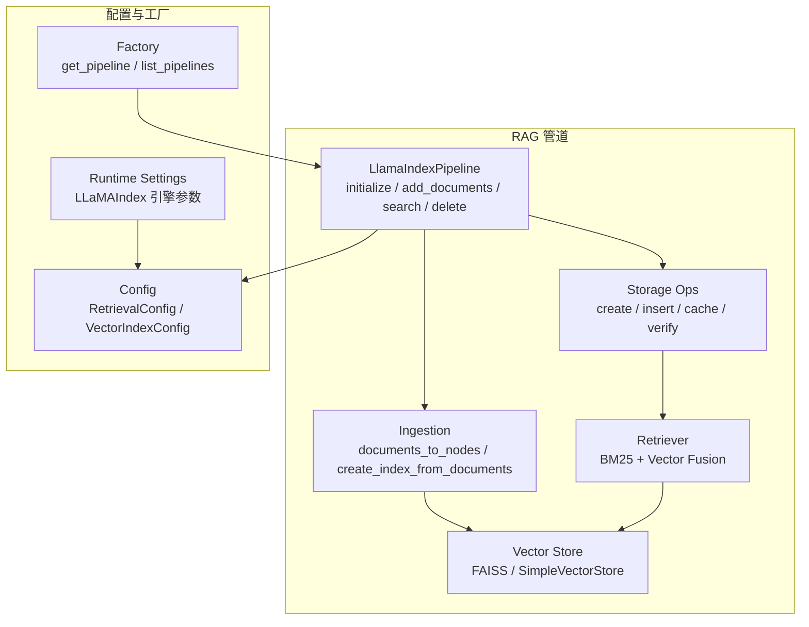
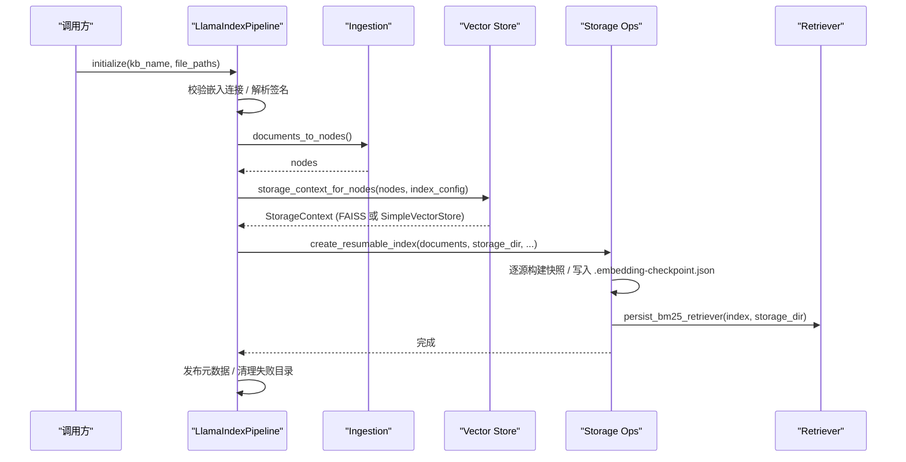
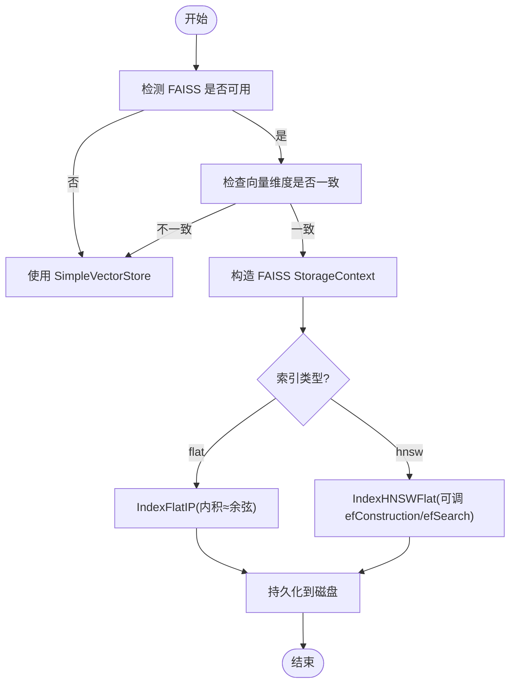
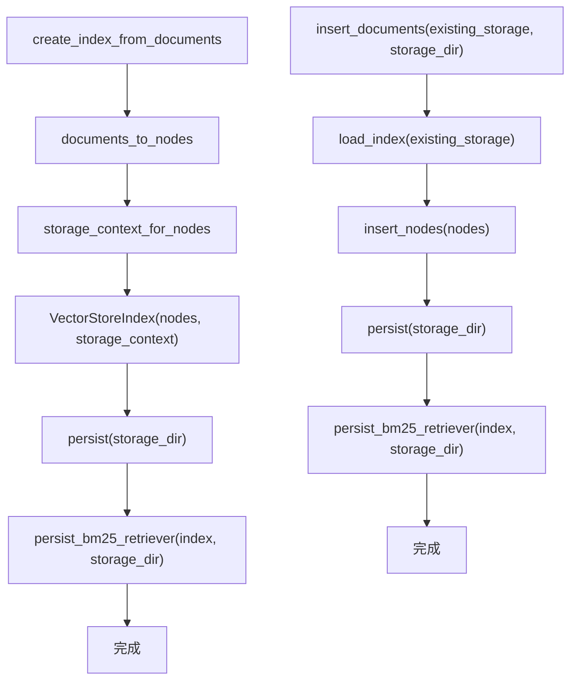
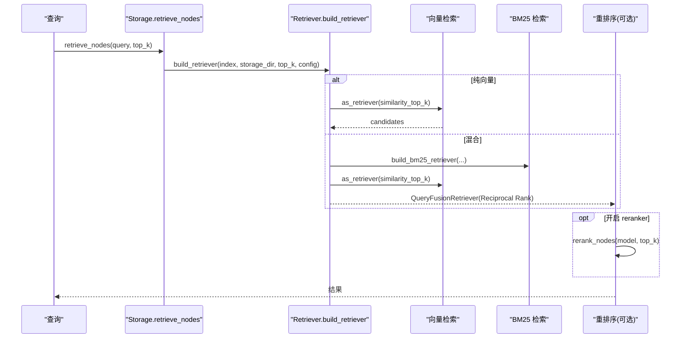
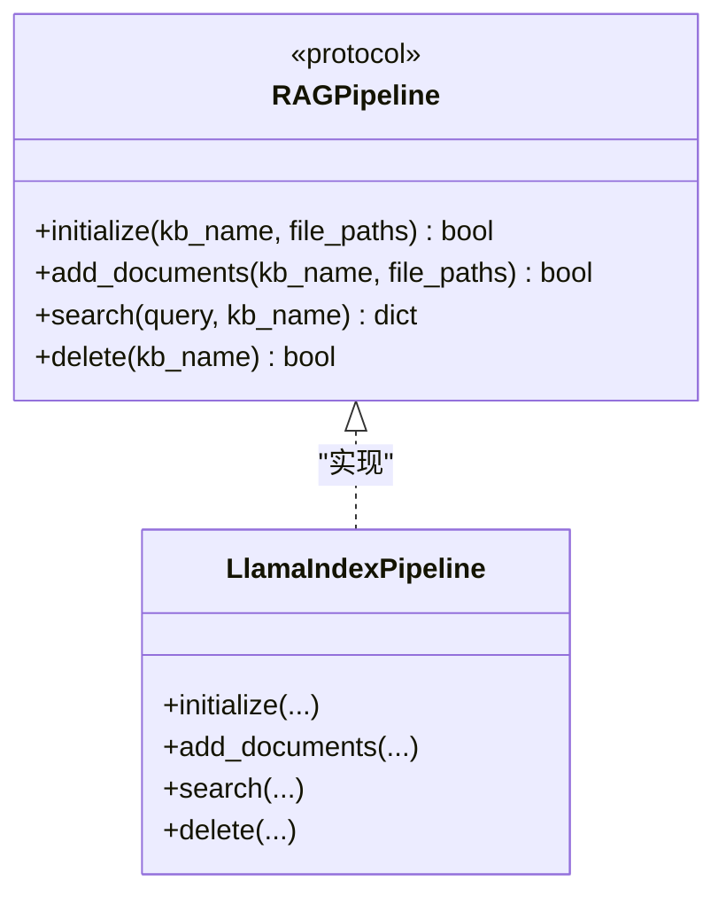
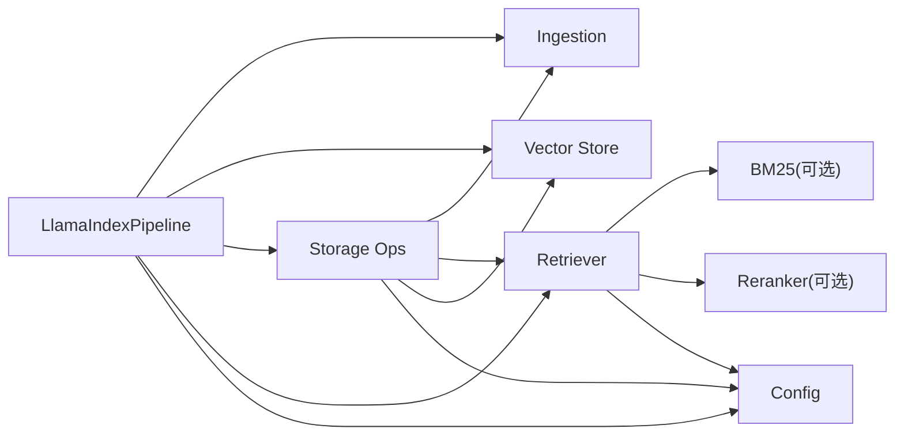

# 向量存储后端

<cite>
**本文引用的文件**   
- [vector_store.py](file://deeptutor/services/rag/pipelines/llamaindex/vector_store.py)
- [ingestion.py](file://deeptutor/services/rag/pipelines/llamaindex/ingestion.py)
- [retrievers.py](file://deeptutor/services/rag/pipelines/llamaindex/retrievers.py)
- [pipeline.py](file://deeptutor/services/rag/pipelines/llamaindex/pipeline.py)
- [storage.py](file://deeptutor/services/rag/pipelines/llamaindex/storage.py)
- [config.py](file://deeptutor/services/rag/pipelines/llamaindex/config.py)
- [base.py](file://deeptutor/services/rag/pipelines/base.py)
- [factory.py](file://deeptutor/services/rag/factory.py)
- [runtime_settings.py](file://deeptutor/services/config/runtime_settings.py)
</cite>

## 目录
1. [简介](#简介)
2. [项目结构](#项目结构)
3. [核心组件](#核心组件)
4. [架构总览](#架构总览)
5. [详细组件分析](#详细组件分析)
6. [依赖关系分析](#依赖关系分析)
7. [性能与优化](#性能与优化)
8. [故障排查](#故障排查)
9. [结论](#结论)
10. [附录：配置与运维清单](#附录配置与运维清单)

## 简介
本文件面向 DeepTutor 中基于 LlamaIndex 的向量检索后端，聚焦以下目标：
- 解释当前实现的向量存储架构、数据持久化机制与 FAISS 后端选择逻辑。
- 说明索引创建、增量写入、查询接口与批量操作流程。
- 文档化连接配置、认证机制（嵌入模型）、以及本地 FAISS 与 BM25 侧车索引的部署要点。
- 提供可操作的代码路径指引，帮助初学者快速搭建，并为高级用户提供扩展自定义存储后端的参考。
- 给出数据迁移、备份恢复与监控告警策略建议。

需要特别说明的是：当前仓库中的 LlamaIndex RAG 管道默认使用本地 FAISS 或 SimpleVectorStore；并未直接集成 Pinecone、Weaviate、Chroma 等远程向量数据库。若需接入这些服务，可在现有“向量存储适配层”基础上扩展新的后端实现。

## 项目结构
LlamaIndex 相关代码集中在 services/rag/pipelines/llamaindex 下，围绕“摄取—存储—检索—编排”分层组织：
- 摄取 ingestion.py：将文档切分为节点并调用嵌入模型生成向量。
- 存储 vector_store.py：决定使用 FAISS 还是 SimpleVectorStore，负责 FAISS 读写、余弦相似度对齐与上下文构造。
- 检索 retrievers.py：组合向量检索与 BM25 检索，支持混合模式与可选重排序。
- 编排 pipeline.py：对外暴露 initialize/add_documents/search/delete 等统一接口，管理版本、进度与错误。
- 持久化 storage.py：封装索引构建、增量插入、缓存、校验与发布流程。
- 配置 config.py：定义检索配置、FAISS 索引类型与参数、分块几何等。
- 协议 base.py：定义所有 RAG 管道的统一契约。
- 工厂 factory.py：按 provider 名称选择具体管道（默认 llamaindex）。
- 运行时设置 runtime_settings.py：持久化的引擎参数（检索模式、top_k、chunk 几何、HNSW 参数等）。

图表来源
- [pipeline.py:181-593](file://deeptutor/services/rag/pipelines/llamaindex/pipeline.py#L181-L593)
- [ingestion.py:22-129](file://deeptutor/services/rag/pipelines/llamaindex/ingestion.py#L22-L129)
- [vector_store.py:55-288](file://deeptutor/services/rag/pipelines/llamaindex/vector_store.py#L55-L288)
- [retrievers.py:192-260](file://deeptutor/services/rag/pipelines/llamaindex/retrievers.py#L192-L260)
- [storage.py:335-421](file://deeptutor/services/rag/pipelines/llamaindex/storage.py#L335-L421)
- [config.py:30-139](file://deeptutor/services/rag/pipelines/llamaindex/config.py#L30-L139)
- [factory.py:136-209](file://deeptutor/services/rag/factory.py#L136-L209)
- [runtime_settings.py:327-373](file://deeptutor/services/config/runtime_settings.py#L327-L373)

章节来源
- [pipeline.py:181-593](file://deeptutor/services/rag/pipelines/llamaindex/pipeline.py#L181-L593)
- [ingestion.py:22-129](file://deeptutor/services/rag/pipelines/llamaindex/ingestion.py#L22-L129)
- [vector_store.py:55-288](file://deeptutor/services/rag/pipelines/llamaindex/vector_store.py#L55-L288)
- [retrievers.py:192-260](file://deeptutor/services/rag/pipelines/llamaindex/retrievers.py#L192-L260)
- [storage.py:335-421](file://deeptutor/services/rag/pipelines/llamaindex/storage.py#L335-L421)
- [config.py:30-139](file://deeptutor/services/rag/pipelines/llamaindex/config.py#L30-L139)
- [factory.py:136-209](file://deeptutor/services/rag/factory.py#L136-L209)
- [runtime_settings.py:327-373](file://deeptutor/services/config/runtime_settings.py#L327-L373)

## 核心组件
- LlamaIndexPipeline：对外统一入口，负责初始化知识库、增量添加文档、搜索与删除；处理嵌入模型连接校验、进度心跳、失败清理与版本发布。
- Ingestion：将文档转换为节点，必要时执行分块与嵌入；支持预嵌入节点（如图像节点）直通。
- Vector Store：在 FAISS 与 SimpleVectorStore 之间切换；为 FAISS 提供余弦相似度对齐、Unicode 路径安全读写、维度一致性检查与 StorageContext 构造。
- Retriever：组合向量检索与 BM25 检索，支持混合模式、候选数量放大、BM25 持久化与可选交叉编码器重排序。
- Storage Ops：封装可恢复索引构建、增量插入、索引缓存、嵌入向量校验、持久化验证与 KB 目录删除。
- Config：定义检索配置（profile、top_k、multiplier、reranker）与 FAISS 索引类型（flat/hnsw）及 HNSW 参数。
- Factory：根据 provider 名称返回对应管道实例（默认 llamaindex），并提供可用管道列表。
- Runtime Settings：持久化 LLaMAIndex 引擎参数，包括检索模式、top_k、chunk 几何、HNSW 参数与图像描述并发/超时等。

章节来源
- [pipeline.py:181-593](file://deeptutor/services/rag/pipelines/llamaindex/pipeline.py#L181-L593)
- [ingestion.py:22-129](file://deeptutor/services/rag/pipelines/llamaindex/ingestion.py#L22-L129)
- [vector_store.py:55-288](file://deeptutor/services/rag/pipelines/llamaindex/vector_store.py#L55-L288)
- [retrievers.py:192-260](file://deeptutor/services/rag/pipelines/llamaindex/retrievers.py#L192-L260)
- [storage.py:335-421](file://deeptutor/services/rag/pipelines/llamaindex/storage.py#L335-L421)
- [config.py:30-139](file://deeptutor/services/rag/pipelines/llamaindex/config.py#L30-L139)
- [factory.py:136-209](file://deeptutor/services/rag/factory.py#L136-L209)
- [runtime_settings.py:327-373](file://deeptutor/services/config/runtime_settings.py#L327-L373)

## 架构总览
下图展示一次“初始化知识库”的关键调用链：从 Pipeline 到 Ingestion，再到 Vector Store 与 Storage Ops，最终完成索引持久化与 BM25 侧车索引构建。

图表来源
- [pipeline.py:230-310](file://deeptutor/services/rag/pipelines/llamaindex/pipeline.py#L230-L310)
- [ingestion.py:65-112](file://deeptutor/services/rag/pipelines/llamaindex/ingestion.py#L65-L112)
- [vector_store.py:220-235](file://deeptutor/services/rag/pipelines/llamaindex/vector_store.py#L220-L235)
- [storage.py:335-388](file://deeptutor/services/rag/pipelines/llamaindex/storage.py#L335-L388)
- [retrievers.py:154-189](file://deeptutor/services/rag/pipelines/llamaindex/retrievers.py#L154-L189)

## 详细组件分析

### 向量存储后端选择与 FAISS 适配
- 自动检测 FAISS 可用性；不可用时回退到 SimpleVectorStore。
- 对 FAISS 进行余弦相似度对齐：在写入时对向量做 L2 归一化，查询时也对 query_embedding 归一化，保证与 SimpleVectorStore 行为一致。
- Unicode 路径安全：通过 Python 字节流序列化/反序列化 FAISS 索引，避免 Windows 上非 ASCII 路径崩溃。
- 维度一致性检查：仅当所有节点共享同一向量维度时才启用 FAISS；否则回退。
- 支持两种 FAISS 索引类型：exact flat（默认）与 HNSW（适合大规模语料，近似召回换取速度）。

图表来源
- [vector_store.py:55-111](file://deeptutor/services/rag/pipelines/llamaindex/vector_store.py#L55-L111)
- [vector_store.py:114-167](file://deeptutor/services/rag/pipelines/llamaindex/vector_store.py#L114-L167)
- [vector_store.py:170-235](file://deeptutor/services/rag/pipelines/llamaindex/vector_store.py#L170-L235)
- [vector_store.py:188-217](file://deeptutor/services/rag/pipelines/llamaindex/vector_store.py#L188-L217)

章节来源
- [vector_store.py:55-288](file://deeptutor/services/rag/pipelines/llamaindex/vector_store.py#L55-L288)

### 索引创建与增量写入
- 全量创建：Ingestion 将文档转为节点，Vector Store 选择合适存储上下文，VectorStoreIndex 构建并持久化。
- 增量写入：加载已有索引，insert_nodes 后持久化到新目录，并重建 BM25 侧车索引。
- 可恢复构建：按源文件分组，逐个源构建并写快照；中断后可恢复，避免重复计算。

图表来源
- [ingestion.py:91-121](file://deeptutor/services/rag/pipelines/llamaindex/ingestion.py#L91-L121)
- [storage.py:391-421](file://deeptutor/services/rag/pipelines/llamaindex/storage.py#L391-L421)
- [retrievers.py:154-189](file://deeptutor/services/rag/pipelines/llamaindex/retrievers.py#L154-L189)

章节来源
- [ingestion.py:65-129](file://deeptutor/services/rag/pipelines/llamaindex/ingestion.py#L65-L129)
- [storage.py:335-421](file://deeptutor/services/rag/pipelines/llamaindex/storage.py#L335-L421)

### 查询接口与混合检索
- 检索配置：支持“纯向量”和“混合（BM25+向量融合）”两种 profile；缺失 BM25 依赖时自动降级为纯向量。
- 候选放大：通过 multiplier 控制子检索器候选数，再融合重排到 top_k。
- BM25 侧车：持久化 BM25 检索器以加速混合检索；token_pattern 固定以保证跨版本兼容。
- 可选重排序：支持 cross-encoder reranker，先取候选再精排。

图表来源
- [retrievers.py:192-260](file://deeptutor/services/rag/pipelines/llamaindex/retrievers.py#L192-L260)
- [retrievers.py:108-151](file://deeptutor/services/rag/pipelines/llamaindex/retrievers.py#L108-L151)
- [config.py:30-51](file://deeptutor/services/rag/pipelines/llamaindex/config.py#L30-L51)

章节来源
- [retrievers.py:1-260](file://deeptutor/services/rag/pipelines/llamaindex/retrievers.py#L1-L260)
- [config.py:30-139](file://deeptutor/services/rag/pipelines/llamaindex/config.py#L30-L139)

### 统一管道契约与工厂
- 统一契约：所有 RAG 管道实现 initialize/add_documents/search/delete，便于替换不同引擎。
- 工厂选择：根据 provider 名称返回对应管道实例；默认 llamaindex，其他如 pageindex/graphrag/lightrag/weknora 等由工厂分发。

图表来源
- [base.py:16-41](file://deeptutor/services/rag/pipelines/base.py#L16-L41)
- [pipeline.py:181-593](file://deeptutor/services/rag/pipelines/llamaindex/pipeline.py#L181-L593)

章节来源
- [base.py:1-42](file://deeptutor/services/rag/pipelines/base.py#L1-L42)
- [factory.py:1-209](file://deeptutor/services/rag/factory.py#L1-L209)

## 依赖关系分析
- LlamaIndexPipeline 依赖 Ingestion、Vector Store、Storage Ops、Retriever 与 Embedding 适配器。
- Vector Store 依赖 FAISS（可选）与 LlamaIndex StorageContext。
- Retriever 依赖 LlamaIndex BM25 检索器（可选）与可选 reranker。
- Storage Ops 依赖 Ingestion、Retriever、Vector Store 与文件 IO。
- Config 被多个模块读取，作为统一的参数来源。
- Factory 动态导入各管道实现，避免不必要的依赖加载。

图表来源
- [pipeline.py:181-593](file://deeptutor/services/rag/pipelines/llamaindex/pipeline.py#L181-L593)
- [storage.py:335-421](file://deeptutor/services/rag/pipelines/llamaindex/storage.py#L335-L421)
- [retrievers.py:192-260](file://deeptutor/services/rag/pipelines/llamaindex/retrievers.py#L192-L260)
- [vector_store.py:55-288](file://deeptutor/services/rag/pipelines/llamaindex/vector_store.py#L55-L288)
- [config.py:30-139](file://deeptutor/services/rag/pipelines/llamaindex/config.py#L30-L139)

章节来源
- [pipeline.py:181-593](file://deeptutor/services/rag/pipelines/llamaindex/pipeline.py#L181-L593)
- [storage.py:335-421](file://deeptutor/services/rag/pipelines/llamaindex/storage.py#L335-L421)
- [retrievers.py:192-260](file://deeptutor/services/rag/pipelines/llamaindex/retrievers.py#L192-L260)
- [vector_store.py:55-288](file://deeptutor/services/rag/pipelines/llamaindex/vector_store.py#L55-L288)
- [config.py:30-139](file://deeptutor/services/rag/pipelines/llamaindex/config.py#L30-L139)

## 性能与优化
- 向量索引类型
  - exact flat：精确匹配，适合中小规模知识库。
  - HNSW：近似搜索，适合大规模语料，可通过 hnsw_m、hnsw_ef_construction、hnsw_ef_search 调优召回与延迟。
- 混合检索
  - 安装 llama-index-retrievers-bm25 以启用 BM25；缺失时会降级为纯向量并记录警告。
  - 使用 candidate_top_k 与 multiplier 平衡候选数量与融合质量。
- 重排序
  - 启用 reranker_model 可获得更高质量结果，但会增加耗时；建议仅在关键场景开启。
- 索引缓存
  - 已加载索引会被缓存一段时间，减少重复加载与校验开销；键包含存储目录 mtime 与嵌入配置身份，确保密钥轮换后失效旧缓存。
- 分块几何
  - chunk_size 与 chunk_overlap 影响检索粒度；变更需重新索引才生效。
- 图像描述并发
  - image_description_concurrency 与 timeout_seconds 控制多模态文档索引时的并发与超时上限。

章节来源
- [config.py:30-139](file://deeptutor/services/rag/pipelines/llamaindex/config.py#L30-L139)
- [retrievers.py:77-97](file://deeptutor/services/rag/pipelines/llamaindex/retrievers.py#L77-L97)
- [storage.py:529-602](file://deeptutor/services/rag/pipelines/llamaindex/storage.py#L529-L602)
- [runtime_settings.py:327-373](file://deeptutor/services/config/runtime_settings.py#L327-L373)

## 故障排查
- FAISS 未安装或维度不一致
  - 现象：无法使用 FAISS，回退到 SimpleVectorStore；或构建失败。
  - 处理：安装 faiss-cpu 与 llama-index-vector-stores-faiss；确保所有节点向量维度一致。
- 非 ASCII 路径写入失败
  - 现象：Windows 上中文路径导致 FAISS 写入失败。
  - 处理：使用内置的 Unicode 安全写入路径；保持 on-disk 格式与标准 FAISS 兼容。
- BM25 缺失导致混合检索降级
  - 现象：日志中出现 BM25 包缺失警告，检索变为纯向量。
  - 处理：安装 llama-index-retrievers-bm25；或显式将检索 profile 设为 vector。
- 嵌入模型连接问题
  - 现象：索引卡住或无进度。
  - 处理：Pipeline 会校验嵌入连接；若长时间无心跳，抛出“停滞”错误；检查嵌入端点与网络。
- 索引损坏或向量无效
  - 现象：加载索引时报错或检索探针失败。
  - 处理：运行“重建索引”；不要仅重新上传文档，因为损坏的向量存储在增量写入中会被复用。
- 版本不匹配
  - 现象：当前嵌入模型与索引使用的模型不一致。
  - 处理：提示需要重建索引；或在 UI 中选择匹配的 embedding model。

章节来源
- [vector_store.py:249-274](file://deeptutor/services/rag/pipelines/llamaindex/vector_store.py#L249-L274)
- [retrievers.py:108-151](file://deeptutor/services/rag/pipelines/llamaindex/retrievers.py#L108-L151)
- [pipeline.py:106-179](file://deeptutor/services/rag/pipelines/llamaindex/pipeline.py#L106-L179)
- [storage.py:424-521](file://deeptutor/services/rag/pipelines/llamaindex/storage.py#L424-L521)
- [pipeline.py:420-438](file://deeptutor/services/rag/pipelines/llamaindex/pipeline.py#L420-L438)

## 结论
DeepTutor 的 LlamaIndex RAG 管道通过清晰的职责分离与可选依赖设计，实现了高性能、可扩展且稳健的本地向量检索：
- 默认使用 FAISS 或 SimpleVectorStore，兼顾速度与兼容性。
- 提供混合检索与可选重排序，满足多样检索需求。
- 通过可恢复索引构建、索引缓存与严格校验，提升鲁棒性与吞吐。
- 以统一管道契约与工厂机制，便于扩展更多检索引擎。

对于需要 Pinecone、Weaviate、Chroma 等远程向量数据库的场景，建议在 vector_store.py 的适配层新增后端实现，并在 storage_context_for_nodes 中按需返回相应 StorageContext；同时确保 FAISS 不可用时的回退路径仍然有效。

## 附录：配置与运维清单

### 支持的向量数据库类型与现状
- 当前默认后端：FAISS（本地）或 SimpleVectorStore（JSON）。
- 远程向量数据库（Pinecone、Weaviate、Chroma 等）：未在默认管道中实现；可按“向量存储适配层”扩展。

章节来源
- [vector_store.py:1-26](file://deeptutor/services/rag/pipelines/llamaindex/vector_store.py#L1-L26)
- [vector_store.py:55-68](file://deeptutor/services/rag/pipelines/llamaindex/vector_store.py#L55-L68)

### 连接配置与认证机制
- 嵌入模型连接：Pipeline 在初始化与搜索前校验嵌入连接；失败时给出明确错误。
- 认证信息：嵌入模型凭据由上层 embedding 配置注入；缓存键包含凭据摘要，防止密钥轮换后重用旧客户端。

章节来源
- [pipeline.py:196-206](file://deeptutor/services/rag/pipelines/llamaindex/pipeline.py#L196-L206)
- [storage.py:572-581](file://deeptutor/services/rag/pipelines/llamaindex/storage.py#L572-L581)

### 集群部署支持
- 当前 FAISS 后端仅支持本地文件系统；不支持分布式对象存储。
- 如需集群部署，建议使用外部检索服务（如 LightRAG Server、WeKnora、PageIndex Cloud）或自托管 WeKnora，无需本地索引。

章节来源
- [vector_store.py:150-164](file://deeptutor/services/rag/pipelines/llamaindex/vector_store.py#L150-L164)
- [factory.py:136-189](file://deeptutor/services/rag/factory.py#L136-L189)

### 索引创建、写入与查询接口
- 初始化：initialize(file_paths) 构建新索引，支持可恢复构建与进度回调。
- 增量写入：add_documents(file_paths) 加载已有索引并插入新节点，随后持久化。
- 查询：search(query, top_k) 返回 context 与 sources，支持文档范围过滤与 exercise 精确查找。

章节来源
- [pipeline.py:230-310](file://deeptutor/services/rag/pipelines/llamaindex/pipeline.py#L230-L310)
- [pipeline.py:492-556](file://deeptutor/services/rag/pipelines/llamaindex/pipeline.py#L492-L556)
- [pipeline.py:322-418](file://deeptutor/services/rag/pipelines/llamaindex/pipeline.py#L322-L418)

### 批量操作
- 批量文档转节点：documents_to_nodes 支持预嵌入节点直通。
- 批量插入：insert_documents_into_index 一次性插入多个节点。

章节来源
- [ingestion.py:65-88](file://deeptutor/services/rag/pipelines/llamaindex/ingestion.py#L65-L88)
- [ingestion.py:115-121](file://deeptutor/services/rag/pipelines/llamaindex/ingestion.py#L115-L121)

### 数据迁移与备份恢复
- 迁移：Legacy SimpleVectorStore 仍可读取；重建索引可迁移至 FAISS。
- 备份：KB 目录即完整索引与元数据；可直接复制备份。
- 恢复：恢复目录后，Pipeline 会自动加载对应版本；若嵌入模型变化，需重建索引。

章节来源
- [vector_store.py:238-274](file://deeptutor/services/rag/pipelines/llamaindex/vector_store.py#L238-L274)
- [storage.py:628-632](file://deeptutor/services/rag/pipelines/llamaindex/storage.py#L628-L632)

### 监控与告警
- 进度心跳：Pipeline 监控嵌入进度，长时间无心跳则抛出停滞错误。
- 日志告警：BM25 缺失、检索降级、索引校验失败等均有日志输出。
- 健康检查：verify_persisted_index 对索引结构与检索探针进行检查。

章节来源
- [pipeline.py:106-179](file://deeptutor/services/rag/pipelines/llamaindex/pipeline.py#L106-L179)
- [retrievers.py:108-151](file://deeptutor/services/rag/pipelines/llamaindex/retrievers.py#L108-L151)
- [storage.py:635-656](file://deeptutor/services/rag/pipelines/llamaindex/storage.py#L635-L656)