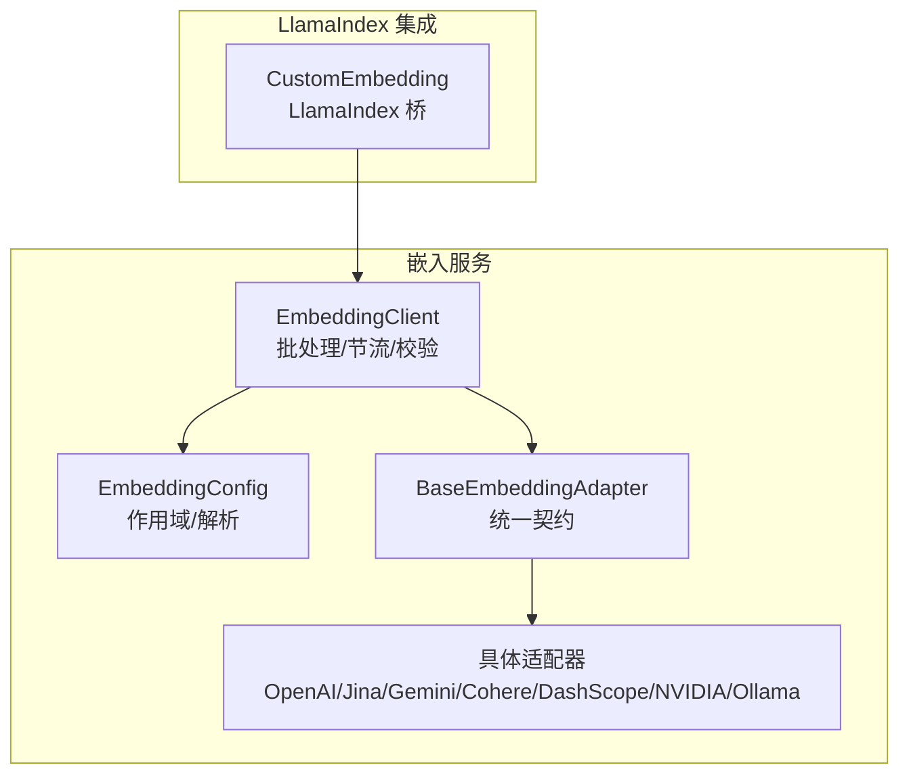
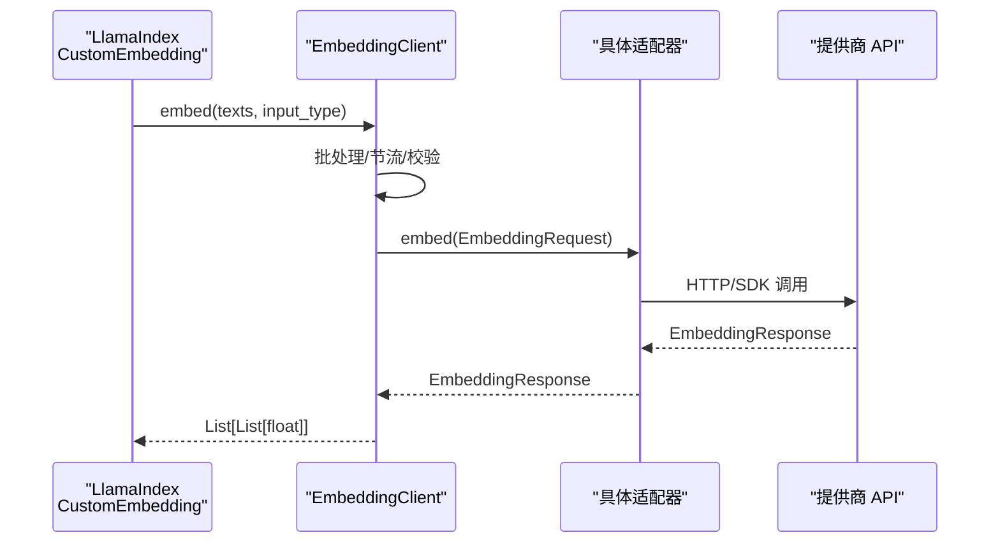
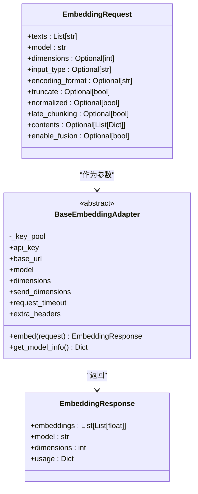
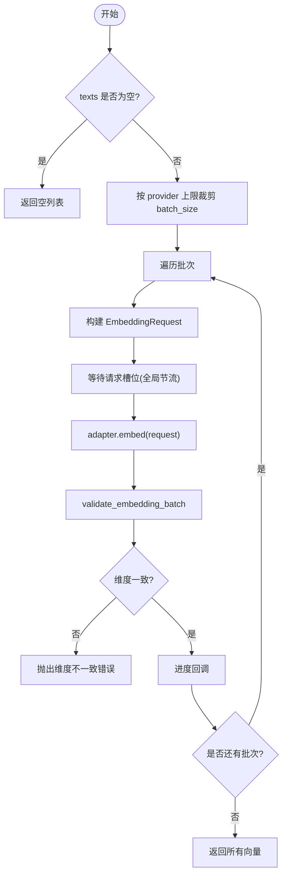
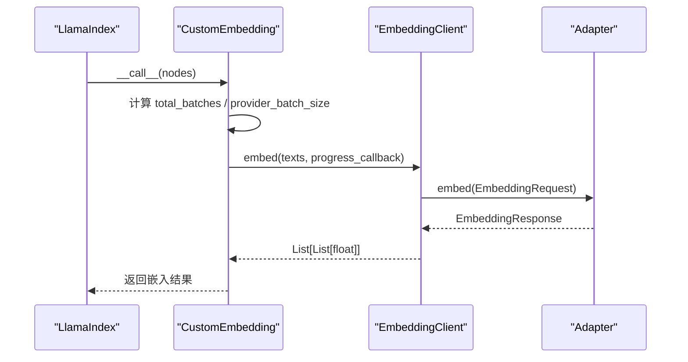
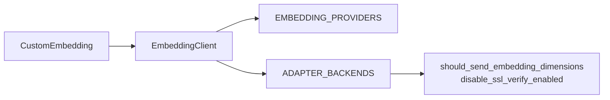

# 嵌入模型适配器

<cite>
**本文引用的文件**   
- [deeptutor/services/embedding/adapters/base.py](file://deeptutor/services/embedding/adapters/base.py)
- [deeptutor/services/embedding/client.py](file://deeptutor/services/embedding/client.py)
- [deeptutor/services/embedding/config.py](file://deeptutor/services/embedding/config.py)
- [deeptutor/services/rag/pipelines/llamaindex/embedding_adapter.py](file://deeptutor/services/rag/pipelines/llamaindex/embedding_adapter.py)
- [deeptutor/services/embedding/adapters/openai_compatible.py](file://deeptutor/services/embedding/adapters/openai_compatible.py)
- [deeptutor/services/embedding/adapters/openai_sdk.py](file://deeptutor/services/embedding/adapters/openai_sdk.py)
- [deeptutor/services/embedding/adapters/jina.py](file://deeptutor/services/embedding/adapters/jina.py)
- [deeptutor/services/embedding/adapters/gemini.py](file://deeptutor/services/embedding/adapters/gemini.py)
- [deeptutor/services/embedding/adapters/cohere.py](file://deeptutor/services/embedding/adapters/cohere.py)
- [deeptutor/services/embedding/adapters/dashscope_native.py](file://deeptutor/services/embedding/adapters/dashscope_native.py)
- [deeptutor/services/embedding/adapters/nvidia_nim.py](file://deeptutor/services/embedding/adapters/nvidia_nim.py)
- [deeptutor/services/embedding/adapters/ollama.py](file://deeptutor/services/embedding/adapters/ollama.py)
</cite>

## 目录
1. [简介](#简介)
2. [项目结构](#项目结构)
3. [核心组件](#核心组件)
4. [架构总览](#架构总览)
5. [详细组件分析](#详细组件分析)
6. [依赖关系分析](#依赖关系分析)
7. [性能与批处理](#性能与批处理)
8. [错误重试与降级策略](#错误重试与降级策略)
9. [故障排查指南](#故障排查指南)
10. [结论](#结论)

## 简介
本文面向 DeepTutor 的 LlamaIndex 嵌入模型适配层，系统性说明支持的嵌入模型类型、适配器模式、模型切换机制、向量维度配置、批处理大小与节流、缓存策略、初始化流程、API 密钥管理、连接池与并发控制，以及错误重试和降级策略。文档既帮助初学者快速集成 OpenAI、本地 Ollama、Jina、Gemini、Cohere、DashScope、NVIDIA NIM 等嵌入服务，也为高级用户提供自定义适配器的扩展指南。

## 项目结构
嵌入能力集中在 services/embedding 目录，并通过 LlamaIndex 适配桥接至检索管线：
- 适配器基类与统一请求/响应契约定义在 adapters/base.py
- 各提供商适配器位于 adapters 子目录（OpenAI 兼容、OpenAI SDK、Jina、Gemini、Cohere、DashScope、NVIDIA NIM、Ollama）
- 统一客户端 EmbeddingClient 负责批处理、维度校验、进度回调与跨线程节流
- 配置解析与上下文作用域在 config.py
- LlamaIndex 桥接在 services/rag/pipelines/llamaindex/embedding_adapter.py

**图示来源**
- [deeptutor/services/rag/pipelines/llamaindex/embedding_adapter.py:54-95](file://deeptutor/services/rag/pipelines/llamaindex/embedding_adapter.py#L54-L95)
- [deeptutor/services/embedding/client.py:39-116](file://deeptutor/services/embedding/client.py#L39-L116)
- [deeptutor/services/embedding/config.py:13-31](file://deeptutor/services/embedding/config.py#L13-L31)
- [deeptutor/services/embedding/adapters/base.py:130-198](file://deeptutor/services/embedding/adapters/base.py#L130-L198)

**章节来源**
- [deeptutor/services/embedding/adapters/base.py:130-198](file://deeptutor/services/embedding/adapters/base.py#L130-L198)
- [deeptutor/services/embedding/client.py:39-116](file://deeptutor/services/embedding/client.py#L39-L116)
- [deeptutor/services/embedding/config.py:13-31](file://deeptutor/services/embedding/config.py#L13-L31)
- [deeptutor/services/rag/pipelines/llamaindex/embedding_adapter.py:54-95](file://deeptutor/services/rag/pipelines/llamaindex/embedding_adapter.py#L54-L95)

## 核心组件
- 统一契约
  - EmbeddingRequest：文本、模型名、可选维度、输入角色、编码格式、截断、归一化、多模态内容、融合开关等
  - EmbeddingResponse：向量列表、模型名、实际维度、用量信息
  - BaseEmbeddingAdapter：抽象 embed() 与 get_model_info()，内置 KeyPool 密钥轮换、超时、额外头、dimensions 发送策略
- 统一客户端
  - EmbeddingClient：按 provider 最大项数裁剪 batch_size；跨线程全局节流；逐批校验维度一致性；进度回调；支持文本与多模态内容
- 配置与作用域
  - EmbeddingConfig：binding、model、dim、send_dimensions、batch_size、batch_delay、request_timeout、extra_headers 等
  - embedding_config_scope：为一次操作绑定一个已解析的配置，供工作线程继承
- LlamaIndex 桥
  - CustomEmbedding：封装 EmbeddingClient，提供查询/文档嵌入接口，计算并上报索引进度，支持设置刷新与连通性探测

**章节来源**
- [deeptutor/services/embedding/adapters/base.py:33-87](file://deeptutor/services/embedding/adapters/base.py#L33-L87)
- [deeptutor/services/embedding/adapters/base.py:130-198](file://deeptutor/services/embedding/adapters/base.py#L130-L198)
- [deeptutor/services/embedding/client.py:39-116](file://deeptutor/services/embedding/client.py#L39-L116)
- [deeptutor/services/embedding/config.py:13-31](file://deeptutor/services/embedding/config.py#L13-L31)
- [deeptutor/services/rag/pipelines/llamaindex/embedding_adapter.py:54-95](file://deeptutor/services/rag/pipelines/llamaindex/embedding_adapter.py#L54-L95)

## 架构总览
下图展示从 LlamaIndex 到具体提供商的调用链与职责边界。

**图示来源**
- [deeptutor/services/rag/pipelines/llamaindex/embedding_adapter.py:136-182](file://deeptutor/services/rag/pipelines/llamaindex/embedding_adapter.py#L136-L182)
- [deeptutor/services/embedding/client.py:118-218](file://deeptutor/services/embedding/client.py#L118-L218)
- [deeptutor/services/embedding/adapters/openai_compatible.py:209-391](file://deeptutor/services/embedding/adapters/openai_compatible.py#L209-L391)

## 详细组件分析

### 适配器基类与统一契约
- EmbeddingRequest/EmbeddingResponse 定义了跨提供商的统一数据结构，包含文本、模型、维度、输入角色、编码格式、截断、归一化、多模态内容与融合开关等字段
- BaseEmbeddingAdapter 提供：
  - 密钥池 KeyPool 管理（支持多 key 轮换）
  - base_url、api_version、model、dimensions、send_dimensions、request_timeout、extra_headers
  - 抽象方法 embed() 与 get_model_info()
  - 结构化异常 EmbeddingProviderError，携带 status/body/model/url/provider 便于诊断

**图示来源**
- [deeptutor/services/embedding/adapters/base.py:33-87](file://deeptutor/services/embedding/adapters/base.py#L33-L87)
- [deeptutor/services/embedding/adapters/base.py:130-198](file://deeptutor/services/embedding/adapters/base.py#L130-L198)

**章节来源**
- [deeptutor/services/embedding/adapters/base.py:33-87](file://deeptutor/services/embedding/adapters/base.py#L33-L87)
- [deeptutor/services/embedding/adapters/base.py:130-198](file://deeptutor/services/embedding/adapters/base.py#L130-L198)

### 统一客户端 EmbeddingClient
- 构造时根据 binding 解析适配器类，注入 api_key、base_url/effective_url、api_version、model、dim、send_dimensions、request_timeout、extra_headers
- embed() 流程：
  - 按 provider 最大项数裁剪 batch_size
  - 对每个批次构建 EmbeddingRequest，调用 adapter.embed()
  - 校验每批向量数量与维度一致性
  - 通过进度回调报告批次完成
  - 使用全局线程锁进行跨事件循环的请求间隔控制
- supports_multimodal_contents() 与 embed_contents() 支持多模态内容（text/image/video），按 provider 能力路由
- embed_sync() 兼容同步调用场景

**图示来源**
- [deeptutor/services/embedding/client.py:118-218](file://deeptutor/services/embedding/client.py#L118-L218)

**章节来源**
- [deeptutor/services/embedding/client.py:39-116](file://deeptutor/services/embedding/client.py#L39-L116)
- [deeptutor/services/embedding/client.py:118-218](file://deeptutor/services/embedding/client.py#L118-L218)
- [deeptutor/services/embedding/client.py:220-304](file://deeptutor/services/embedding/client.py#L220-L304)

### 配置与作用域
- EmbeddingConfig 聚合 model、api_key、base_url/effective_url、binding、provider_name/mode、api_version、extra_headers、dim、send_dimensions、request_timeout、batch_size、batch_delay
- get_embedding_config() 从运行时解析器加载，校验 model、effective_url、非 local 模式的 api_key
- embedding_config_scope() 将配置绑定到当前上下文，确保工作线程也使用该配置

**章节来源**
- [deeptutor/services/embedding/config.py:13-31](file://deeptutor/services/embedding/config.py#L13-L31)
- [deeptutor/services/embedding/config.py:50-114](file://deeptutor/services/embedding/config.py#L50-L114)

### LlamaIndex 桥接 CustomEmbedding
- 封装 EmbeddingClient，提供 _aget_text_embedding/_aget_query_embedding/_aget_text_embeddings
- 计算 provider 批次规模与外层 split 批次规模，汇总 total_batches，通过 ContextVar 传递进度回调
- matches_config()/refresh_client() 支持运行期配置变更时刷新客户端
- configure_llamaindex_settings() 设置 Settings.embed_model 与 chunk 几何参数
- verify_embedding_connectivity() 执行连通性探测

**图示来源**
- [deeptutor/services/rag/pipelines/llamaindex/embedding_adapter.py:101-122](file://deeptutor/services/rag/pipelines/llamaindex/embedding_adapter.py#L101-L122)
- [deeptutor/services/rag/pipelines/llamaindex/embedding_adapter.py:156-182](file://deeptutor/services/rag/pipelines/llamaindex/embedding_adapter.py#L156-L182)
- [deeptutor/services/embedding/client.py:118-218](file://deeptutor/services/embedding/client.py#L118-L218)

**章节来源**
- [deeptutor/services/rag/pipelines/llamaindex/embedding_adapter.py:54-95](file://deeptutor/services/rag/pipelines/llamaindex/embedding_adapter.py#L54-L95)
- [deeptutor/services/rag/pipelines/llamaindex/embedding_adapter.py:101-122](file://deeptutor/services/rag/pipelines/llamaindex/embedding_adapter.py#L101-L122)
- [deeptutor/services/rag/pipelines/llamaindex/embedding_adapter.py:136-194](file://deeptutor/services/rag/pipelines/llamaindex/embedding_adapter.py#L136-L194)
- [deeptutor/services/rag/pipelines/llamaindex/embedding_adapter.py:215-274](file://deeptutor/services/rag/pipelines/llamaindex/embedding_adapter.py#L215-L274)

### 具体适配器实现要点

#### OpenAI 兼容适配器（OpenAI/Azure/HF/LM Studio 等）
- 统一构建 payload，支持 encoding_format 与 dimensions 的“显式/自动”策略
- 对网关拒绝 encoding_format 的情况进行自适应重试
- 限流 429 重试与 KeyPool 轮换，网络传输错误指数退避重试
- get_model_info() 暴露默认维度、可变维度与多模态能力

**章节来源**
- [deeptutor/services/embedding/adapters/openai_compatible.py:47-207](file://deeptutor/services/embedding/adapters/openai_compatible.py#L47-L207)
- [deeptutor/services/embedding/adapters/openai_compatible.py:209-391](file://deeptutor/services/embedding/adapters/openai_compatible.py#L209-L391)
- [deeptutor/services/embedding/adapters/openai_compatible.py:393-413](file://deeptutor/services/embedding/adapters/openai_compatible.py#L393-L413)

#### OpenAI SDK 适配器（历史兼容）
- 使用 AsyncOpenAI，固定 encoding_format=float
- 对 APIStatusError/APIConnectionError/APIError 包装为 EmbeddingProviderError
- 不支持多模态 contents

**章节来源**
- [deeptutor/services/embedding/adapters/openai_sdk.py:28-151](file://deeptutor/services/embedding/adapters/openai_sdk.py#L28-L151)

#### Jina 适配器
- 支持任务感知 embeddings（search_document/query/classification/clustering/text-matching）
- 支持 late_chunking 与 normalized
- v4 支持多模态，v3 仅文本
- 对 Matryoshka 维度支持列表进行校验与告警

**章节来源**
- [deeptutor/services/embedding/adapters/jina.py:16-65](file://deeptutor/services/embedding/adapters/jina.py#L16-L65)
- [deeptutor/services/embedding/adapters/jina.py:66-162](file://deeptutor/services/embedding/adapters/jina.py#L66-L162)

#### Gemini 适配器
- 原生 batchEmbedContents 路径与 OpenAI 兼容路径并存
- Embedding 2 系列使用提示前缀区分 query/document
- 多模态内容映射 inlineData，支持 enable_fusion
- 限流 429 与网络错误重试，敏感信息脱敏日志

**章节来源**
- [deeptutor/services/embedding/adapters/gemini.py:28-116](file://deeptutor/services/embedding/adapters/gemini.py#L28-L116)
- [deeptutor/services/embedding/adapters/gemini.py:198-254](file://deeptutor/services/embedding/adapters/gemini.py#L198-L254)
- [deeptutor/services/embedding/adapters/gemini.py:256-425](file://deeptutor/services/embedding/adapters/gemini.py#L256-L425)
- [deeptutor/services/embedding/adapters/gemini.py:427-463](file://deeptutor/services/embedding/adapters/gemini.py#L427-L463)

#### Cohere 适配器
- v1/v2 双协议，v2 支持多模态
- input_type 映射 search_document/query 等
- 输出维度可配置（v2 output_dimension）

**章节来源**
- [deeptutor/services/embedding/adapters/cohere.py:15-53](file://deeptutor/services/embedding/adapters/cohere.py#L15-L53)
- [deeptutor/services/embedding/adapters/cohere.py:55-162](file://deeptutor/services/embedding/adapters/cohere.py#L55-L162)
- [deeptutor/services/embedding/adapters/cohere.py:164-177](file://deeptutor/services/embedding/adapters/cohere.py#L164-L177)

#### DashScope 适配器（阿里云百炼）
- 多模态与文本两条 SDK 路径，按模型名路由
- 支持 dimension 与 enable_fusion
- 同步 SDK 调用通过线程池避免阻塞事件循环

**章节来源**
- [deeptutor/services/embedding/adapters/dashscope_native.py:36-99](file://deeptutor/services/embedding/adapters/dashscope_native.py#L36-L99)
- [deeptutor/services/embedding/adapters/dashscope_native.py:101-166](file://deeptutor/services/embedding/adapters/dashscope_native.py#L101-L166)
- [deeptutor/services/embedding/adapters/dashscope_native.py:181-243](file://deeptutor/services/embedding/adapters/dashscope_native.py#L181-L243)

#### NVIDIA NIM 适配器
- 基于 OpenAI 兼容适配器，但强制 input_type=passage/query 与 encoding_format=float
- 对 Nemotron 3.5 Embed 8B 做维度范围校验
- 恢复输入顺序并校验 index 连续性

**章节来源**
- [deeptutor/services/embedding/adapters/nvidia_nim.py:13-53](file://deeptutor/services/embedding/adapters/nvidia_nim.py#L13-L53)
- [deeptutor/services/embedding/adapters/nvidia_nim.py:55-106](file://deeptutor/services/embedding/adapters/nvidia_nim.py#L55-L106)

#### Ollama 适配器（本地模型）
- 直接 POST 到 base_url，keep_alive=5m
- 404 时尝试 /api/tags 列出可用模型并给出下载建议
- 连接超时/HTTP 错误分别抛出 ConnectionError/TimeoutError/HTTPError

**章节来源**
- [deeptutor/services/embedding/adapters/ollama.py:16-36](file://deeptutor/services/embedding/adapters/ollama.py#L16-L36)
- [deeptutor/services/embedding/adapters/ollama.py:38-135](file://deeptutor/services/embedding/adapters/ollama.py#L38-L135)
- [deeptutor/services/embedding/adapters/ollama.py:137-146](file://deeptutor/services/embedding/adapters/ollama.py#L137-L146)

## 依赖关系分析
- EmbeddingClient 依赖 EMBEDDING_PROVIDERS 注册表与 ADAPTER_BACKENDS 适配器后端
- 各适配器依赖 httpx/SDK 与通用工具（如 should_send_embedding_dimensions、disable_ssl_verify_enabled）
- LlamaIndex 桥依赖 EmbeddingClient 与 EMBEDDING_PROVIDERS 以计算批次规模

**图示来源**
- [deeptutor/services/embedding/client.py:23-36](file://deeptutor/services/embedding/client.py#L23-L36)
- [deeptutor/services/rag/pipelines/llamaindex/embedding_adapter.py:16-21](file://deeptutor/services/rag/pipelines/llamaindex/embedding_adapter.py#L16-L21)
- [deeptutor/services/embedding/adapters/openai_compatible.py:9-11](file://deeptutor/services/embedding/adapters/openai_compatible.py#L9-L11)

**章节来源**
- [deeptutor/services/embedding/client.py:23-36](file://deeptutor/services/embedding/client.py#L23-L36)
- [deeptutor/services/rag/pipelines/llamaindex/embedding_adapter.py:16-21](file://deeptutor/services/rag/pipelines/llamaindex/embedding_adapter.py#L16-L21)

## 性能与批处理
- 批处理大小
  - EmbeddingClient 将配置的 batch_size 与 provider 最大项数取最小值，防止批量过大导致失败
  - LlamaIndex 桥同时考虑外层 split 批次与 provider 批次，准确统计 total_batches
- 请求节流
  - 全局线程级锁 + 单调时钟，避免跨 event loop 竞态；batch_delay 控制请求起始间隔
- 连接与超时
  - 各适配器使用 httpx.Timeout(connect/read/write/pool)，request_timeout 至少 60s
- 进度反馈
  - 进度回调为 best-effort，失败仅记录日志不影响嵌入主流程

优化建议
- 合理设置 batch_size：小模型/高延迟环境适当减小，提高吞吐稳定性
- 开启 batch_delay：在高并发 reindex 场景中降低瞬时压力
- 使用 KeyPool：多 key 轮换缓解限流
- 选择合适维度：仅在支持可变维度的模型上启用 send_dimensions

**章节来源**
- [deeptutor/services/embedding/client.py:42-87](file://deeptutor/services/embedding/client.py#L42-L87)
- [deeptutor/services/embedding/client.py:134-145](file://deeptutor/services/embedding/client.py#L134-L145)
- [deeptutor/services/rag/pipelines/llamaindex/embedding_adapter.py:101-122](file://deeptutor/services/rag/pipelines/llamaindex/embedding_adapter.py#L101-L122)
- [deeptutor/services/embedding/adapters/openai_compatible.py:230-235](file://deeptutor/services/embedding/adapters/openai_compatible.py#L230-L235)

## 错误重试与降级策略
- OpenAI 兼容适配器
  - 429 限流：最多 8 轮滑动窗口重试，优先读取 Retry-After；KeyPool 轮换后继续
  - 网络错误：指数退避重试（_MAX_RETRIES）
  - 网关缺少 encoding_format：自动补全并重试一次
- Gemini 适配器
  - 429 限流：指数退避重试
  - 网络错误：指数退避重试
  - 敏感信息脱敏日志
- Cohere/Jina/Ollama/DashScope/NVIDIA NIM
  - 明确的结构化错误与日志，部分适配器提供特定错误提示（如 Ollama 模型不存在、NVIDIA NIM 维度范围校验）

降级策略
- 当多模态不可用时，文本路径仍可使用 text-only 适配器
- 当某 provider 持续限流或不可用，可通过 KeyPool 轮换或多 provider 配置切换
- LlamaIndex 桥支持 refresh_client() 在运行期切换到新配置

**章节来源**
- [deeptutor/services/embedding/adapters/openai_compatible.py:241-363](file://deeptutor/services/embedding/adapters/openai_compatible.py#L241-L363)
- [deeptutor/services/embedding/adapters/gemini.py:303-387](file://deeptutor/services/embedding/adapters/gemini.py#L303-L387)
- [deeptutor/services/embedding/adapters/ollama.py:72-109](file://deeptutor/services/embedding/adapters/ollama.py#L72-L109)
- [deeptutor/services/embedding/adapters/nvidia_nim.py:41-53](file://deeptutor/services/embedding/adapters/nvidia_nim.py#L41-L53)

## 故障排查指南
常见问题与定位要点
- 未设置 embedding model 或 effective_url
  - 现象：初始化时报错
  - 处理：在 Settings > Embedding models 中配置 active profile 与 endpoint
- API key 缺失或非 local 模式无 key
  - 现象：配置校验失败
  - 处理：在 Settings 中配置 active profile 的 api_key
- 模型名不匹配或端点 URL 不正确
  - 现象：HTTP 400/HTML 响应、非 JSON 响应
  - 处理：核对 visible Endpoint URL 与所选模型；检查网关是否暴露 /v1/embeddings
- 维度不一致
  - 现象：不同批次返回维度不同
  - 处理：使用单一 embedding 模型/维度并重建索引
- 本地 Ollama 模型未找到
  - 现象：404 或模型不存在
  - 处理：使用 ollama pull 拉取模型，或更换 base_url
- 多模态内容不被支持
  - 现象：抛出 ValueError
  - 处理：选择支持多模态的模型（如 gemini-embedding-2、cohere embed-v4.0、dashscope qwen3-vl-embedding）

连通性测试
- 使用 verify_embedding_connectivity() 快速验证 API 可达性与基本响应

**章节来源**
- [deeptutor/services/embedding/config.py:85-97](file://deeptutor/services/embedding/config.py#L85-L97)
- [deeptutor/services/embedding/client.py:91-99](file://deeptutor/services/embedding/client.py#L91-L99)
- [deeptutor/services/embedding/client.py:186-196](file://deeptutor/services/embedding/client.py#L186-L196)
- [deeptutor/services/embedding/adapters/ollama.py:72-109](file://deeptutor/services/embedding/adapters/ollama.py#L72-L109)
- [deeptutor/services/rag/pipelines/llamaindex/embedding_adapter.py:253-274](file://deeptutor/services/rag/pipelines/llamaindex/embedding_adapter.py#L253-L274)

## 结论
DeepTutor 的嵌入适配层通过统一的契约、客户端与 LlamaIndex 桥，将多种提供商嵌入服务整合为一套稳定、可扩展、可观测的能力。它提供了完善的批处理、节流、维度校验、进度回调、密钥轮换与错误重试机制，既能满足初学者快速接入主流嵌入服务，也能支撑高级用户自定义适配器与运行期模型切换。在生产环境中，建议结合业务负载合理配置 batch_size、batch_delay 与 request_timeout，并在需要时启用 KeyPool 与多 provider 配置以提升鲁棒性与吞吐。