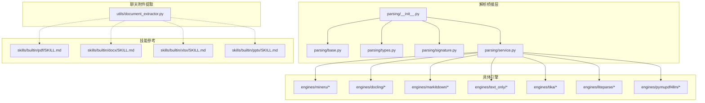
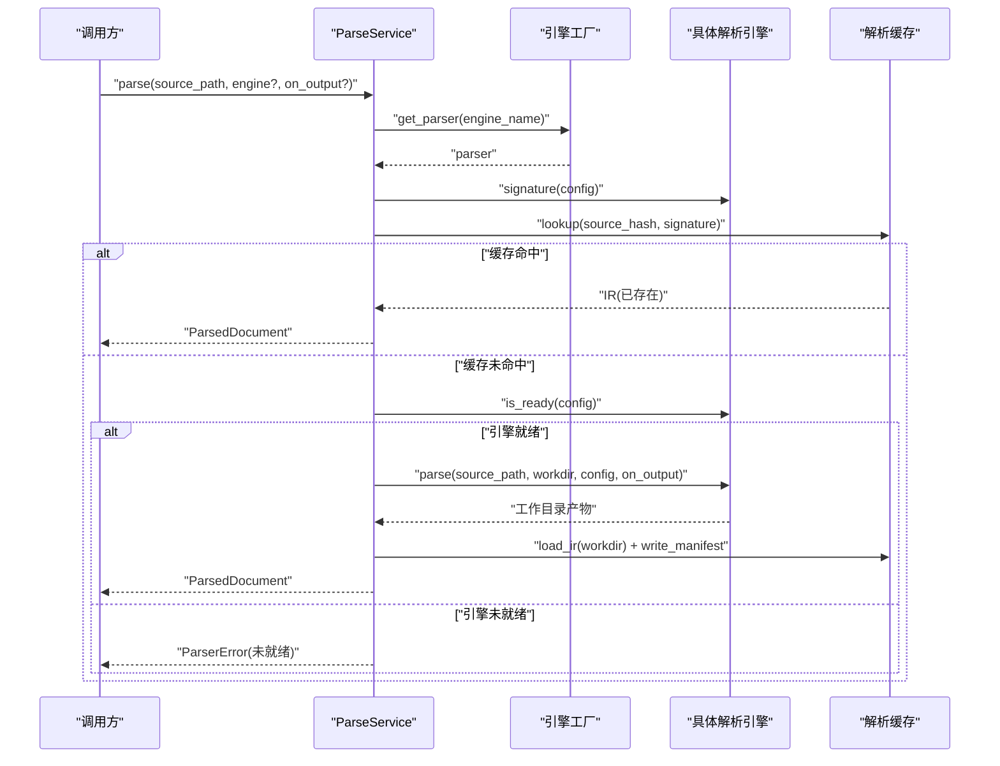
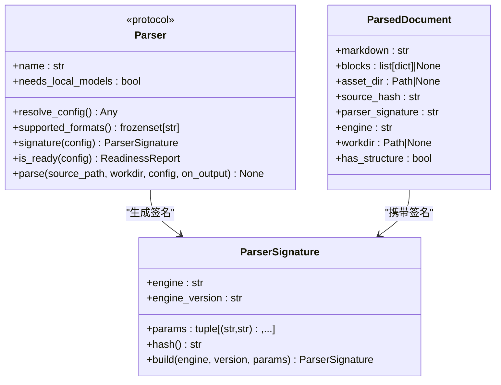
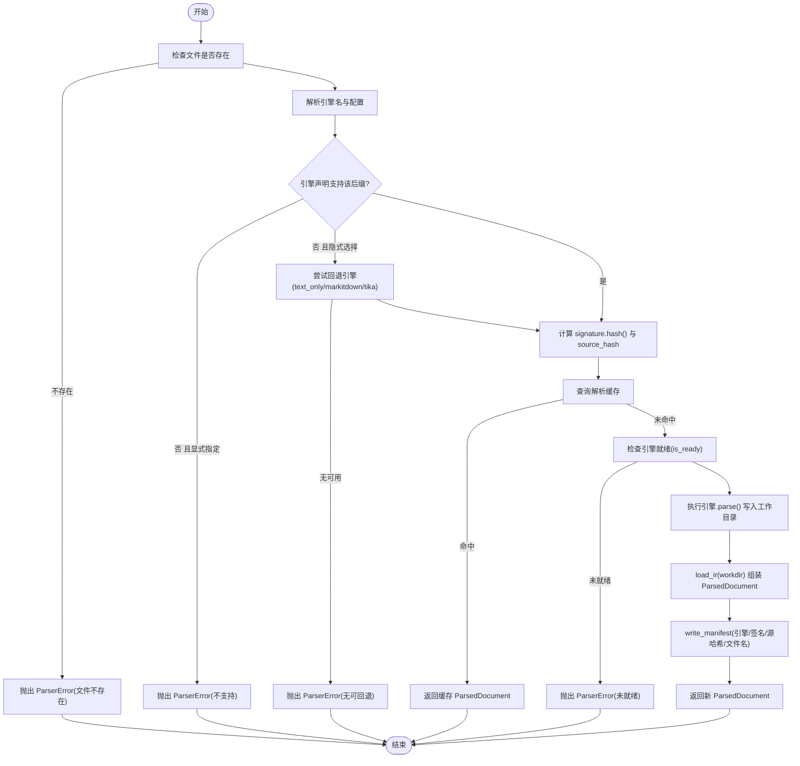
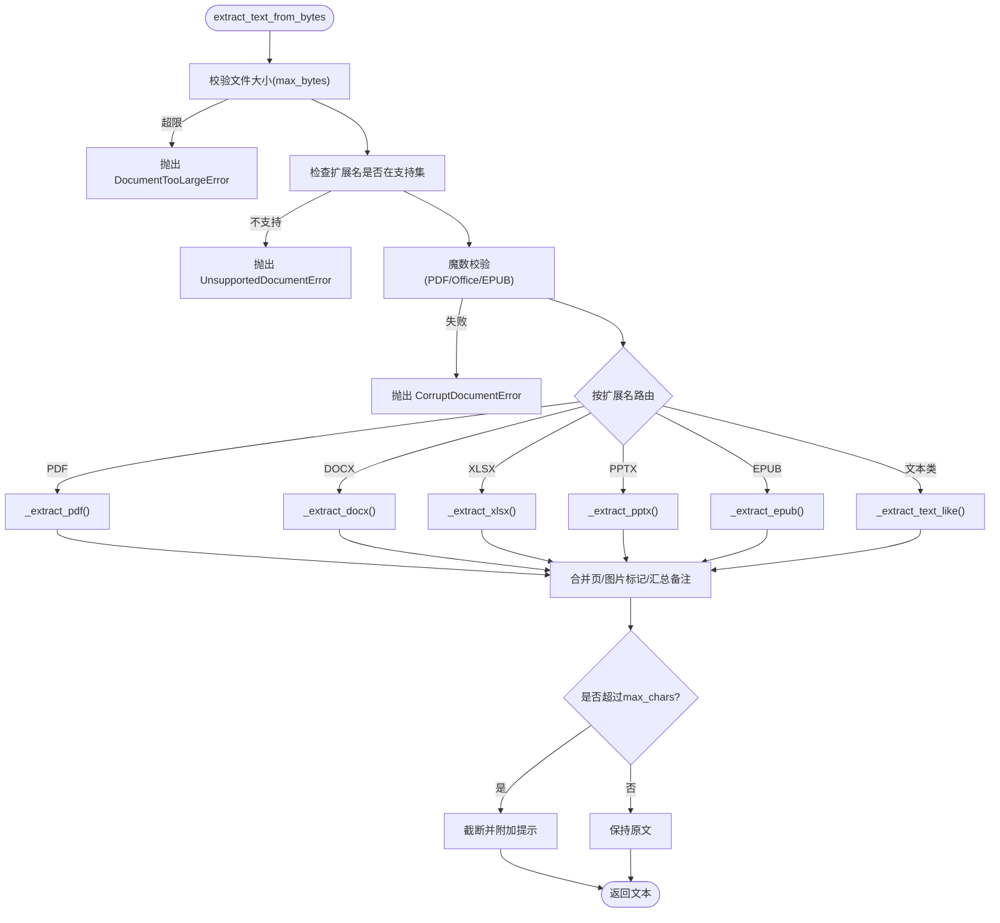
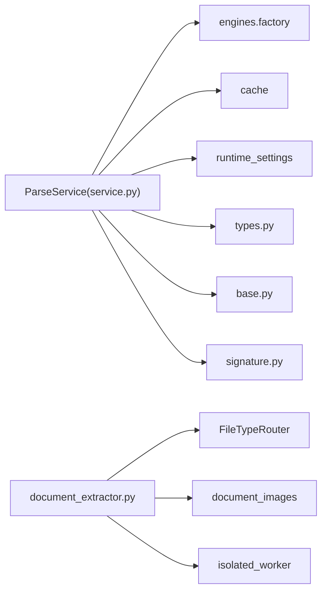

# 文档加载器

<cite>
**本文引用的文件**   
- [deeptutor/services/parsing/__init__.py](file://deeptutor/services/parsing/__init__.py)
- [deeptutor/services/parsing/base.py](file://deeptutor/services/parsing/base.py)
- [deeptutor/services/parsing/types.py](file://deeptutor/services/parsing/types.py)
- [deeptutor/services/parsing/signature.py](file://deeptutor/services/parsing/signature.py)
- [deeptutor/services/parsing/service.py](file://deeptutor/services/parsing/service.py)
- [deeptutor/utils/document_extractor.py](file://deeptutor/utils/document_extractor.py)
- [deeptutor/skills/builtin/pdf/SKILL.md](file://deeptutor/skills/builtin/pdf/SKILL.md)
- [deeptutor/skills/builtin/docx/SKILL.md](file://deeptutor/skills/builtin/docx/SKILL.md)
- [deeptutor/skills/builtin/xlsx/SKILL.md](file://deeptutor/skills/builtin/xlsx/SKILL.md)
- [deeptutor/skills/builtin/pptx/SKILL.md](file://deeptutor/skills/builtin/pptx/SKILL.md)
</cite>

## 目录
1. [简介](#简介)
2. [项目结构](#项目结构)
3. [核心组件](#核心组件)
4. [架构总览](#架构总览)
5. [详细组件分析](#详细组件分析)
6. [依赖关系分析](#依赖关系分析)
7. [性能与内存管理](#性能与内存管理)
8. [故障排查指南](#故障排查指南)
9. [结论](#结论)
10. [附录：代码示例路径](#附录代码示例路径)

## 简介
本文件面向 DeepTutor 的“文档加载/解析”能力，聚焦于两类实现：
- 面向知识库索引、问答抽取等后端的可插拔解析层（services/parsing）：以引擎为抽象，统一输出结构化 IR（ParsedDocument），支持 PDF、Word、Excel、PPT、Markdown、HTML、EPUB、文本类格式等。
- 面向聊天附件的轻量文本提取（utils/document_extractor）：将二进制或路径输入转为纯文本，用于即时注入到 LLM 上下文。

文档将解释支持的格式、解析流程、预处理步骤、配置与元数据保留机制、批量处理、错误恢复、进度跟踪，以及大文件、内存与并发优化实践；同时提供初学者入门和高级用户自定义解析器的开发指引。

## 项目结构
DeepTutor 中与文档加载相关的主要模块如下：
- services/parsing：解析桥接层，定义 Parser 协议、IR 类型、签名与缓存、服务入口与引擎工厂。
- services/parsing/engines/*：具体解析引擎（如 MinerU、Docling、markitdown、text_only、tika、liteparse、pymupdf4llm 等）。
- utils/document_extractor：聊天附件场景下的纯文本提取器，直接对字节流进行格式路由与解码。
- skills/builtin/*：针对 PDF/DOCX/XLSX/PPTX 的操作技能说明，体现各格式的读取、提取与编辑要点。

图表来源
- [deeptutor/services/parsing/__init__.py:1-35](file://deeptutor/services/parsing/__init__.py#L1-L35)
- [deeptutor/services/parsing/base.py:1-85](file://deeptutor/services/parsing/base.py#L1-L85)
- [deeptutor/services/parsing/types.py:1-53](file://deeptutor/services/parsing/types.py#L1-L53)
- [deeptutor/services/parsing/signature.py:1-51](file://deeptutor/services/parsing/signature.py#L1-L51)
- [deeptutor/services/parsing/service.py:1-257](file://deeptutor/services/parsing/service.py#L1-L257)
- [deeptutor/utils/document_extractor.py:1-800](file://deeptutor/utils/document_extractor.py#L1-L800)
- [deeptutor/skills/builtin/pdf/SKILL.md:1-280](file://deeptutor/skills/builtin/pdf/SKILL.md#L1-L280)
- [deeptutor/skills/builtin/docx/SKILL.md:1-235](file://deeptutor/skills/builtin/docx/SKILL.md#L1-L235)
- [deeptutor/skills/builtin/xlsx/SKILL.md:1-212](file://deeptutor/skills/builtin/xlsx/SKILL.md#L1-L212)
- [deeptutor/skills/builtin/pptx/SKILL.md:1-251](file://deeptutor/skills/builtin/pptx/SKILL.md#L1-L251)

章节来源
- [deeptutor/services/parsing/__init__.py:1-35](file://deeptutor/services/parsing/__init__.py#L1-L35)
- [deeptutor/services/parsing/service.py:1-257](file://deeptutor/services/parsing/service.py#L1-L257)
- [deeptutor/utils/document_extractor.py:1-800](file://deeptutor/utils/document_extractor.py#L1-L800)

## 核心组件
- Parser 协议：定义解析引擎的统一接口，包括名称、是否需要本地模型、配置解析、支持格式、签名、就绪检查与 parse 方法。
- ParsedDocument：统一的解析结果 IR，包含 markdown、blocks（可选的结构化内容）、资源目录、源哈希、解析签名、引擎名与工作目录。
- ParserSignature：稳定标识（引擎、版本、影响输出的参数），用于内容寻址缓存命中。
- ParseService：公共入口，负责选择活跃引擎、计算缓存键、命中则返回缓存 IR，未命中则执行引擎并写入缓存。
- document_extractor：聊天附件场景的纯文本提取器，按扩展名路由到 PDF/DOCX/XLSX/PPTX/EPUB/文本类格式，并进行魔数校验、编码回退、截断与异常分类。

章节来源
- [deeptutor/services/parsing/base.py:1-85](file://deeptutor/services/parsing/base.py#L1-L85)
- [deeptutor/services/parsing/types.py:1-53](file://deeptutor/services/parsing/types.py#L1-L53)
- [deeptutor/services/parsing/signature.py:1-51](file://deeptutor/services/parsing/signature.py#L1-L51)
- [deeptutor/services/parsing/service.py:74-257](file://deeptutor/services/parsing/service.py#L74-L257)
- [deeptutor/utils/document_extractor.py:1-800](file://deeptutor/utils/document_extractor.py#L1-L800)

## 架构总览
下图展示从调用方到解析结果的端到端流程：调用 ParseService，选择引擎，命中缓存则直接返回；否则检查引擎就绪、执行解析、产出 IR 并写缓存。

图表来源
- [deeptutor/services/parsing/service.py:104-242](file://deeptutor/services/parsing/service.py#L104-L242)
- [deeptutor/services/parsing/base.py:30-81](file://deeptutor/services/parsing/base.py#L30-L81)
- [deeptutor/services/parsing/types.py:16-53](file://deeptutor/services/parsing/types.py#L16-L53)

## 详细组件分析

### 解析协议与类型
- Parser 协议要求每个引擎实现：
  - name、needs_local_models
  - resolve_config()
  - supported_formats()
  - signature(config) -> ParserSignature
  - is_ready(config) -> ReadinessReport
  - parse(source_path, workdir, *, config, on_output=None)
- ParsedDocument 是跨引擎的统一 IR，markdown 始终存在，blocks 为可选的结构化块（例如 MinerU content_list 映射），asset_dir/workdir 指向资源与原始产物。
- ParserSignature 仅纳入影响输出的参数，保证相同内容与配置的幂等缓存命中。

图表来源
- [deeptutor/services/parsing/base.py:19-81](file://deeptutor/services/parsing/base.py#L19-L81)
- [deeptutor/services/parsing/types.py:16-53](file://deeptutor/services/parsing/types.py#L16-L53)
- [deeptutor/services/parsing/signature.py:17-51](file://deeptutor/services/parsing/signature.py#L17-L51)

章节来源
- [deeptutor/services/parsing/base.py:1-85](file://deeptutor/services/parsing/base.py#L1-L85)
- [deeptutor/services/parsing/types.py:1-53](file://deeptutor/services/parsing/types.py#L1-L53)
- [deeptutor/services/parsing/signature.py:1-51](file://deeptutor/services/parsing/signature.py#L1-L51)

### 解析服务与缓存策略
- ParseService.active_engine() 读取当前设置中的默认引擎。
- supports() 快速判断某引擎是否声明支持该后缀（不读文件、不初始化模型）。
- parse() 主流程：
  - 若显式指定引擎且不支持该后缀，抛出 ParserError。
  - 若隐式选择引擎且不支持，尝试回退引擎（text_only → markitdown → tika）。
  - 基于 source_hash + signature 查找缓存；命中则直接返回 ParsedDocument。
  - 未命中则检查 is_ready；通过后在临时工作目录执行引擎解析，再 load_ir 并写 manifest。
  - 失败时清理工作目录，向上抛出 ParserError。
- 进度与阶段：通过 current_run().phase/document 记录解析阶段、活动日志与成功/失败状态。

图表来源
- [deeptutor/services/parsing/service.py:28-71](file://deeptutor/services/parsing/service.py#L28-L71)
- [deeptutor/services/parsing/service.py:104-242](file://deeptutor/services/parsing/service.py#L104-L242)

章节来源
- [deeptutor/services/parsing/service.py:1-257](file://deeptutor/services/parsing/service.py#L1-L257)

### 聊天附件文本提取器
document_extractor 提供两种入口：
- extract_text_from_bytes(filename, data, max_bytes, max_chars)：从字节流提取文本，按扩展名路由到 PDF/DOCX/XLSX/PPTX/EPUB/文本类格式。
- extract_text_from_path(file_path, filename_hint, ...)：从路径读取字节后委托给 bytes 入口。
- extract_text_from_path_isolated(...)：在隔离进程中执行，避免阻塞主事件循环，并将远程异常映射为本地 DocumentExtractionError 子类。

关键特性：
- 魔数校验：PDF 头 %PDF-；Office/EPUB 头 PK\x03\x04。
- 大小与字符上限：max_bytes/max_chars 可配置，超出抛错或截断。
- 编码回退：文本类格式使用 FileTypeRouter.decode_bytes 的多编码回退链。
- 图片标记：PDF/DOCX/PPTX 会嵌入图片占位标记，便于后续多模态消费。
- 异常分类：EmptyDocumentError、UnsupportedDocumentError、CorruptDocumentError、DocumentTooLargeError。

图表来源
- [deeptutor/utils/document_extractor.py:239-310](file://deeptutor/utils/document_extractor.py#L239-L310)
- [deeptutor/utils/document_extractor.py:369-614](file://deeptutor/utils/document_extractor.py#L369-L614)

章节来源
- [deeptutor/utils/document_extractor.py:1-800](file://deeptutor/utils/document_extractor.py#L1-L800)

### 支持的文档格式与解析策略
- PDF：优先 pymupdf(fitz)，失败回退 pypdf；支持加密检测、逐页文本、图片标记与摘要备注。
- Word(.docx)：优先 rich OOXML 提取（含表格/图片位置），失败回退 python-docx，再回退 raw OOXML。
- Excel(.xlsx)：优先 openpyxl(read_only/data_only)，失败回退 raw OOXML；按 sheet 组织文本。
- PowerPoint(.pptx)：优先 rich 提取（幻灯片+备注+图片标记），失败回退 python-pptx，再回退 raw OOXML。
- EPUB：ZIP 内 OPF spine 顺序读取 XHTML，容错 HTML 解析，过滤脚本/样式，段落级换行。
- 文本类：Markdown/HTML/CSV/JSON/XML/源码等，统一编码回退解码。

章节来源
- [deeptutor/utils/document_extractor.py:369-614](file://deeptutor/utils/document_extractor.py#L369-L614)
- [deeptutor/utils/document_extractor.py:616-800](file://deeptutor/utils/document_extractor.py#L616-L800)

### 引擎注册与回退机制
- engines/factory.get_parser(name)：根据引擎名获取实例。
- ParseService._find_fallback_engine：当主引擎不支持某后缀时，按 text_only → markitdown → tika 的顺序尝试已安装引擎。
- 引擎可通过 supported_formats() 声明支持的后缀集合（可为空表示运行时内容检测）。

章节来源
- [deeptutor/services/parsing/service.py:43-71](file://deeptutor/services/parsing/service.py#L43-L71)
- [deeptutor/services/parsing/base.py:48-55](file://deeptutor/services/parsing/base.py#L48-L55)

### 元数据与结构化内容
- ParsedDocument.blocks：承载 richer 的结构化内容（例如 MinerU content_list 映射），供需要多模态结构的消费者优先使用；若无 blocks，则回退到 markdown 分块。
- asset_dir/workdir：指向引擎产物的资源目录与工作目录，供需要访问原始资源的消费者使用。
- ParserSignature：仅包含影响输出的参数，确保不同后端/版本/参数变更触发重新解析。

章节来源
- [deeptutor/services/parsing/types.py:23-53](file://deeptutor/services/parsing/types.py#L23-L53)
- [deeptutor/services/parsing/signature.py:17-51](file://deeptutor/services/parsing/signature.py#L17-L51)

### 进度跟踪与错误恢复
- 解析阶段：current_run().phase("parsing", source=..., activity=...) 记录阶段与活动日志。
- 文档状态：run.document(source, "parsed"/"failed", ...) 记录成功/失败及原因。
- 失败清理：_parse 中捕获异常后清理未完成的工作目录，避免脏缓存。
- 聊天附件隔离执行：extract_text_from_path_isolated 将异常映射为本地错误类型，避免进程崩溃影响主循环。

章节来源
- [deeptutor/services/parsing/service.py:104-130](file://deeptutor/services/parsing/service.py#L104-L130)
- [deeptutor/services/parsing/service.py:215-242](file://deeptutor/services/parsing/service.py#L215-L242)
- [deeptutor/utils/document_extractor.py:312-366](file://deeptutor/utils/document_extractor.py#L312-L366)

## 依赖关系分析
- 解析桥接层依赖：
  - base.types.signature：协议、IR、签名。
  - engines.factory：引擎实例化。
  - cache：内容寻址缓存（由 service 调用）。
  - runtime_settings：读取默认引擎与解析设置。
- 聊天附件提取器依赖：
  - file_types.FileTypeRouter：扩展名与编码回退。
  - document_images：图片提取与标记。
  - isolated_worker：隔离进程执行。

图表来源
- [deeptutor/services/parsing/service.py:1-257](file://deeptutor/services/parsing/service.py#L1-L257)
- [deeptutor/utils/document_extractor.py:1-800](file://deeptutor/utils/document_extractor.py#L1-L800)

章节来源
- [deeptutor/services/parsing/service.py:1-257](file://deeptutor/services/parsing/service.py#L1-L257)
- [deeptutor/utils/document_extractor.py:1-800](file://deeptutor/utils/document_extractor.py#L1-L800)

## 性能与内存管理
- 大文件处理
  - 聊天附件：MAX_DOC_BYTES/MAX_TOTAL_DOC_BYTES 限制单文件与单次请求总量；MAX_EXTRACTED_CHARS_PER_DOC/TOTAL 控制提取字符上限。
  - EPUB：成员数量与解压大小上限、压缩比限制，防止恶意包耗尽内存。
  - Office 文件：openpyxl read_only/streaming 模式减少内存占用；python-pptx/python-docx 优先 rich 提取，失败回退 raw OOXML。
- 缓存加速
  - 内容寻址缓存：source_hash + signature 命中即跳过解析，显著降低重复解析开销。
  - 无效缓存自愈：若缓存产物为空或损坏，自动删除 manifest 并重试。
- 并发与隔离
  - 聊天附件使用隔离进程执行，避免阻塞事件循环；超时保护与远程异常映射。
  - 解析服务本身为同步 API，建议在批处理任务中使用线程池/进程池并行调用，结合 on_output 回调上报进度。

章节来源
- [deeptutor/utils/document_extractor.py:61-82](file://deeptutor/utils/document_extractor.py#L61-L82)
- [deeptutor/utils/document_extractor.py:112-118](file://deeptutor/utils/document_extractor.py#L112-L118)
- [deeptutor/utils/document_extractor.py:239-310](file://deeptutor/utils/document_extractor.py#L239-L310)
- [deeptutor/utils/document_extractor.py:312-366](file://deeptutor/utils/document_extractor.py#L312-L366)
- [deeptutor/services/parsing/service.py:180-207](file://deeptutor/services/parsing/service.py#L180-L207)

## 故障排查指南
- 常见错误与定位
  - 文件不存在：ParserError(文件不存在)。
  - 引擎不支持该后缀：ParserError(引擎不支持)，若隐式选择引擎则尝试回退；若显式指定引擎则直接报错。
  - 引擎未就绪：ParserError(引擎未就绪)，需检查本地模型/CLI/云端配置。
  - 解析结果为空：ParserError(引擎未产生内容)，检查引擎配置与文件格式。
  - 聊天附件过大/为空/损坏：DocumentTooLargeError/EmptyDocumentError/CorruptDocumentError。
- 建议排查步骤
  - 确认 active_engine 与 supports() 行为是否符合预期。
  - 查看 is_ready 报告 reason/message，补齐缺失依赖或配置。
  - 检查工作目录产物与 manifest 是否完整。
  - 对于聊天附件，检查隔离进程日志与超时时间。

章节来源
- [deeptutor/services/parsing/service.py:146-179](file://deeptutor/services/parsing/service.py#L146-L179)
- [deeptutor/services/parsing/service.py:209-242](file://deeptutor/services/parsing/service.py#L209-L242)
- [deeptutor/utils/document_extractor.py:150-171](file://deeptutor/utils/document_extractor.py#L150-L171)
- [deeptutor/utils/document_extractor.py:239-310](file://deeptutor/utils/document_extractor.py#L239-L310)

## 结论
DeepTutor 的文档加载体系分为两条主线：面向后端的可插拔解析层（services/parsing）与面向前端的聊天附件文本提取器（utils/document_extractor）。前者通过 Parser 协议与 ParsedDocument IR 解耦具体引擎，配合内容寻址缓存与引擎就绪检查，提供稳定、可扩展、可观测的解析能力；后者在聊天场景中提供高效、健壮的纯文本提取，覆盖主流办公与文本格式，并提供隔离执行与错误分类。两者共同支撑知识库构建、问答抽取与实时对话增强。

## 附录：代码示例路径
以下为常用操作对应的代码片段路径（不包含具体代码内容）：
- 使用 ParseService 解析文档并获取 IR
  - [deeptutor/services/parsing/service.py:104-242](file://deeptutor/services/parsing/service.py#L104-L242)
- 检查引擎支持与回退逻辑
  - [deeptutor/services/parsing/service.py:28-71](file://deeptutor/services/parsing/service.py#L28-L71)
- 聊天附件文本提取（字节流）
  - [deeptutor/utils/document_extractor.py:239-310](file://deeptutor/utils/document_extractor.py#L239-L310)
- 聊天附件文本提取（路径，隔离进程）
  - [deeptutor/utils/document_extractor.py:290-366](file://deeptutor/utils/document_extractor.py#L290-L366)
- PDF 读取与图片标记
  - [deeptutor/utils/document_extractor.py:369-446](file://deeptutor/utils/document_extractor.py#L369-L446)
- DOCX 富文本与 OOXML 回退
  - [deeptutor/utils/document_extractor.py:448-510](file://deeptutor/utils/document_extractor.py#L448-L510)
- XLSX 读取与 OOXML 回退
  - [deeptutor/utils/document_extractor.py:512-548](file://deeptutor/utils/document_extractor.py#L512-L548)
- PPTX 富文本与 OOXML 回退
  - [deeptutor/utils/document_extractor.py:550-599](file://deeptutor/utils/document_extractor.py#L550-L599)
- EPUB 章节顺序与容错解析
  - [deeptutor/utils/document_extractor.py:616-800](file://deeptutor/utils/document_extractor.py#L616-L800)
- PDF/DOCX/XLSX/PPTX 技能参考（读取/创建/编辑要点）
  - [deeptutor/skills/builtin/pdf/SKILL.md:1-280](file://deeptutor/skills/builtin/pdf/SKILL.md#L1-L280)
  - [deeptutor/skills/builtin/docx/SKILL.md:1-235](file://deeptutor/skills/builtin/docx/SKILL.md#L1-L235)
  - [deeptutor/skills/builtin/xlsx/SKILL.md:1-212](file://deeptutor/skills/builtin/xlsx/SKILL.md#L1-L212)
  - [deeptutor/skills/builtin/pptx/SKILL.md:1-251](file://deeptutor/skills/builtin/pptx/SKILL.md#L1-L251)