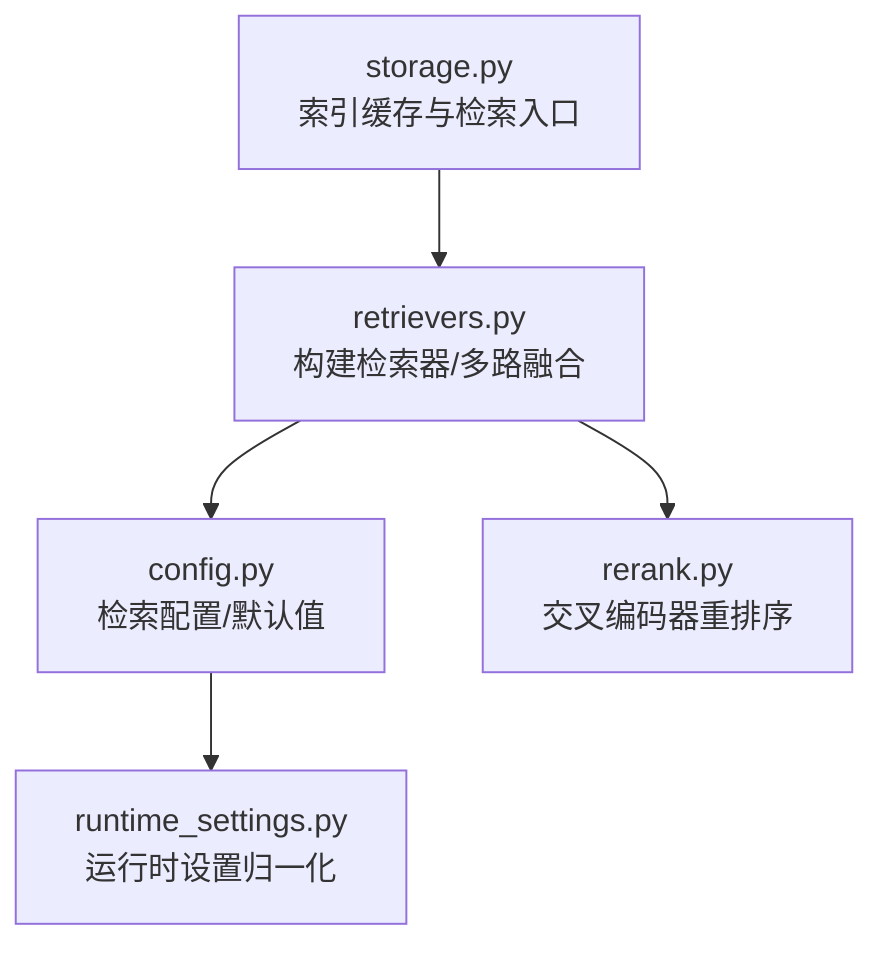
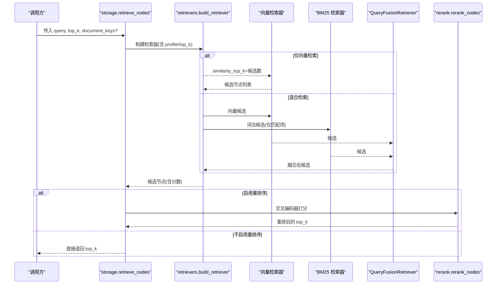
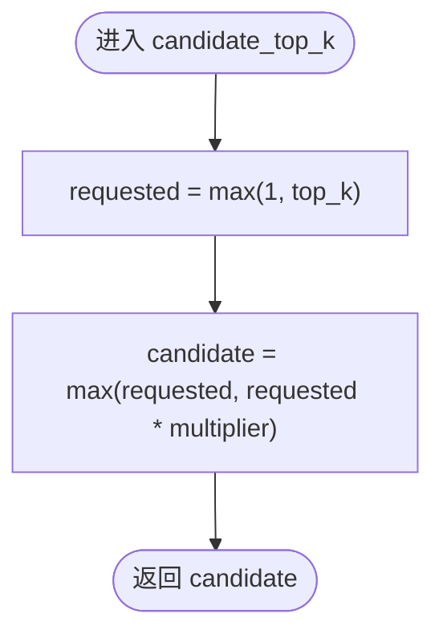
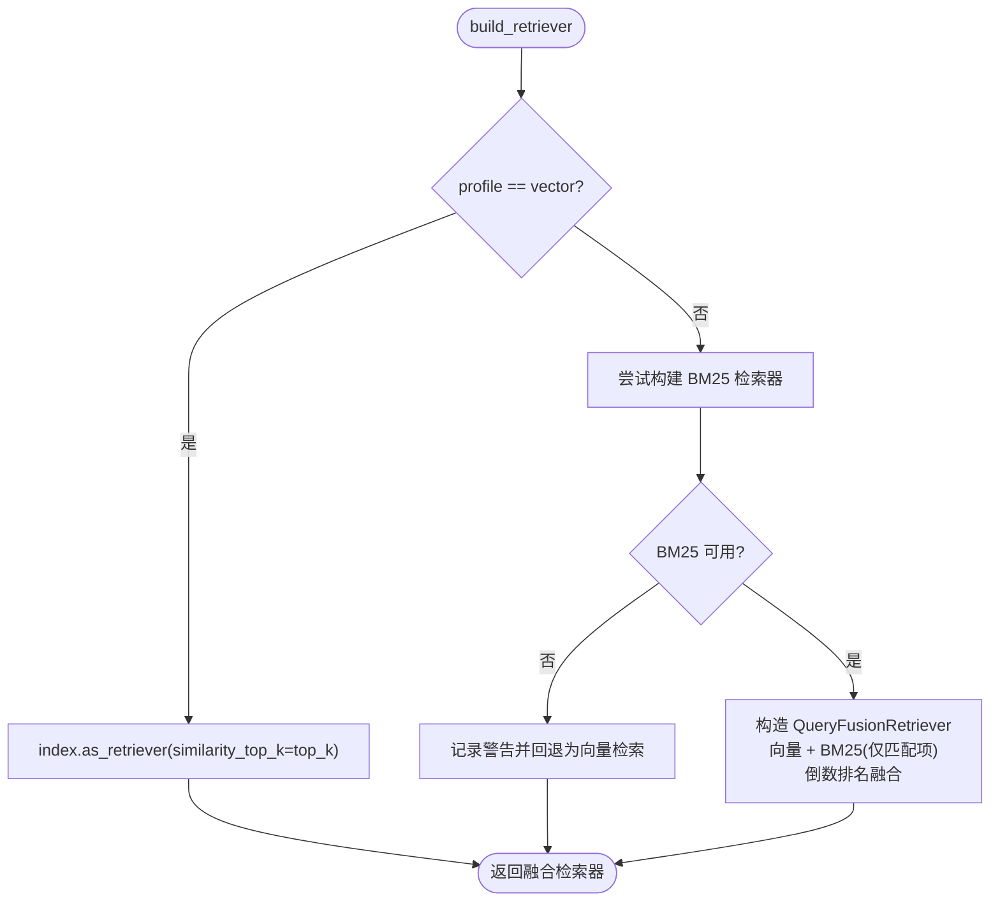
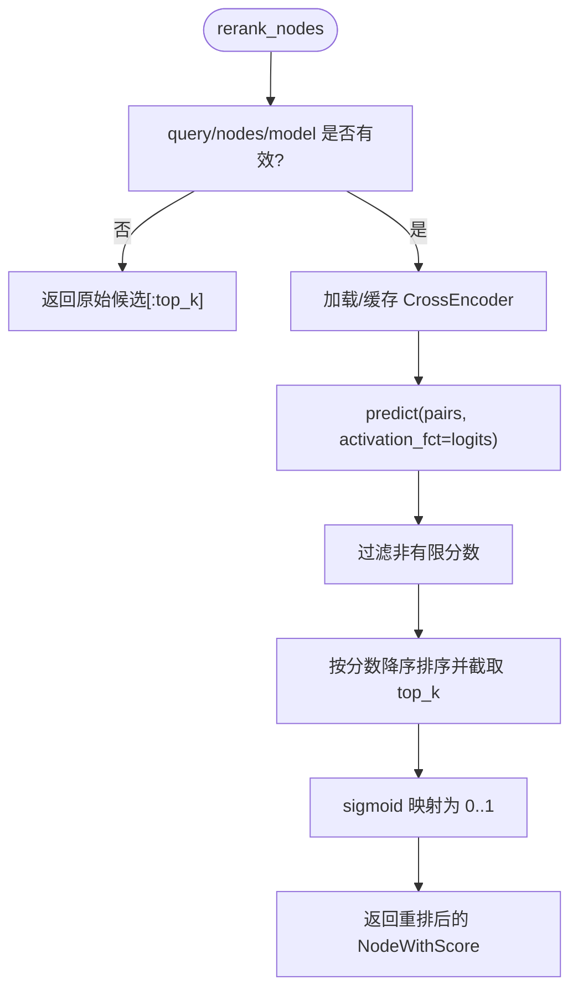
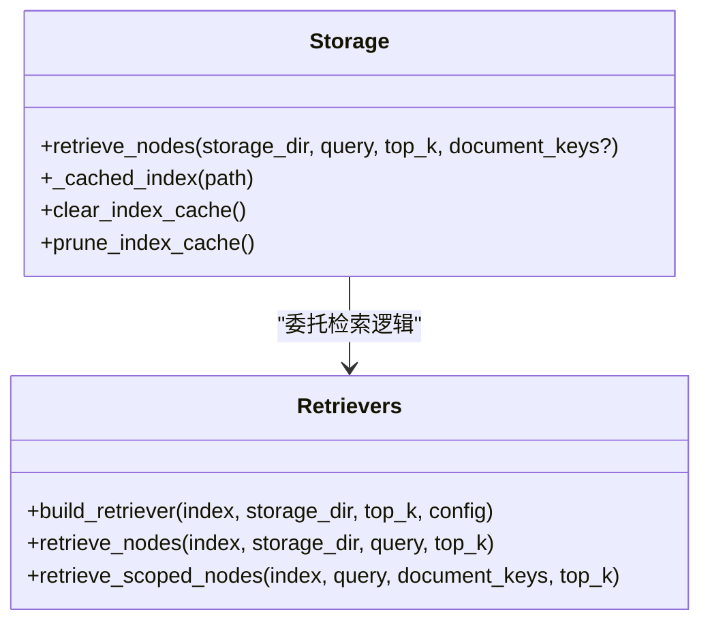
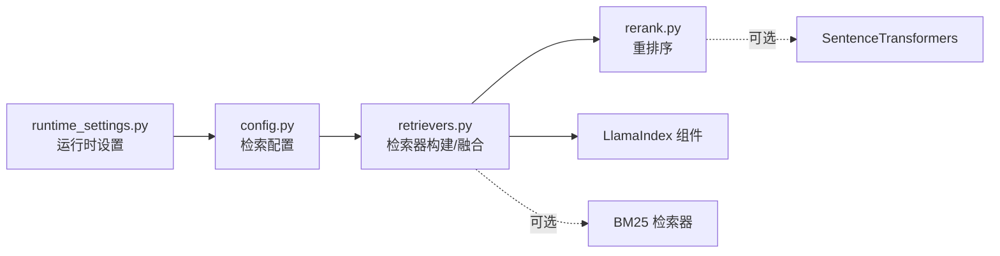

# 检索器组件

<cite>
**本文引用的文件**   
- [retrievers.py](file://deeptutor/services/rag/pipelines/llamaindex/retrievers.py)
- [config.py](file://deeptutor/services/rag/pipelines/llamaindex/config.py)
- [rerank.py](file://deeptutor/services/rag/pipelines/llamaindex/rerank.py)
- [storage.py](file://deeptutor/services/rag/pipelines/llamaindex/storage.py)
- [runtime_settings.py](file://deeptutor/services/config/runtime_settings.py)
- [test_llamaindex_settings.py](file://tests/services/config/test_llamaindex_settings.py)
</cite>

## 目录
1. [简介](#简介)
2. [项目结构](#项目结构)
3. [核心组件](#核心组件)
4. [架构总览](#架构总览)
5. [详细组件分析](#详细组件分析)
6. [依赖关系分析](#依赖关系分析)
7. [性能与缓存](#性能与缓存)
8. [故障排查](#故障排查)
9. [结论](#结论)
10. [附录：配置参数速查](#附录配置参数速查)

## 简介
本文件面向 DeepTutor 中基于 LlamaIndex 的检索器组件，系统性说明支持的检索算法（相似度搜索、混合检索、重排序）、检索策略与结果过滤机制，并给出检索参数配置、相关性评分与排序逻辑、多路检索、查询重写与上下文增强、性能调优、缓存策略以及结果去重的实现要点。文档既适合初学者理解基础检索概念，也为高级用户提供扩展与自定义检索器的参考路径。

## 项目结构
LlamaIndex 检索相关代码集中在 services/rag/pipelines/llamaindex 下，主要包含：
- 检索组合与多路融合：retrievers.py
- 检索配置与默认值：config.py
- 交叉编码器重排序：rerank.py
- 索引缓存与对外检索入口：storage.py
- 运行时设置归一化：services/config/runtime_settings.py

**图表来源**
- [storage.py:619-625](file://deeptutor/services/rag/pipelines/llamaindex/storage.py#L619-L625)
- [retrievers.py:192-260](file://deeptutor/services/rag/pipelines/llamaindex/retrievers.py#L192-L260)
- [config.py:30-51](file://deeptutor/services/rag/pipelines/llamaindex/config.py#L30-L51)
- [rerank.py:84-127](file://deeptutor/services/rag/pipelines/llamaindex/rerank.py#L84-L127)
- [runtime_settings.py:1087-1128](file://deeptutor/services/config/runtime_settings.py#L1087-L1128)

**章节来源**
- [storage.py:619-625](file://deeptutor/services/rag/pipelines/llamaindex/storage.py#L619-L625)
- [retrievers.py:192-260](file://deeptutor/services/rag/pipelines/llamaindex/retrievers.py#L192-L260)
- [config.py:30-51](file://deeptutor/services/rag/pipelines/llamaindex/config.py#L30-L51)
- [rerank.py:84-127](file://deeptutor/services/rag/pipelines/llamaindex/rerank.py#L84-L127)
- [runtime_settings.py:1087-1128](file://deeptutor/services/config/runtime_settings.py#L1087-L1128)

## 核心组件
- 检索配置 RetrievalConfig：定义检索模式、候选召回数量倍数、重排序模型与候选上限等。
- 检索器构建 build_retriever：根据 profile 选择向量检索或混合检索；缺失 BM25 时自动降级为向量检索。
- 多路融合 QueryFusionRetriever：将向量检索与 BM25 检索按倒数排名融合，支持 num_queries 控制查询生成次数。
- 重排序 rerank_nodes：可选的 SentenceTransformers 交叉编码器对候选进行二次打分与排序。
- 索引缓存 _cached_index：进程内缓存已加载索引，减少重复 IO 和重建成本。
- 运行期设置归一化：从持久化设置与环境变量统一解析检索参数。

**章节来源**
- [config.py:30-51](file://deeptutor/services/rag/pipelines/llamaindex/config.py#L30-L51)
- [retrievers.py:192-260](file://deeptutor/services/rag/pipelines/llamaindex/retrievers.py#L192-L260)
- [rerank.py:84-127](file://deeptutor/services/rag/pipelines/llamaindex/rerank.py#L84-L127)
- [storage.py:619-625](file://deeptutor/services/rag/pipelines/llamaindex/storage.py#L619-L625)
- [runtime_settings.py:1087-1128](file://deeptutor/services/config/runtime_settings.py#L1087-L1128)

## 架构总览
下图展示一次典型检索请求在系统中的调用链路与关键决策点。

**图表来源**
- [storage.py:619-625](file://deeptutor/services/rag/pipelines/llamaindex/storage.py#L619-L625)
- [retrievers.py:192-260](file://deeptutor/services/rag/pipelines/llamaindex/retrievers.py#L192-L260)
- [rerank.py:84-127](file://deeptutor/services/rag/pipelines/llamaindex/rerank.py#L84-L127)

## 详细组件分析

### 检索配置 RetrievalConfig
- 字段含义
  - profile：检索模式，支持 vector 与 hybrid。
  - vector_top_k_multiplier / bm25_top_k_multiplier：子检索器候选召回倍数。
  - fusion_num_queries：融合检索时的查询生成次数（由 MockLLM 驱动）。
  - reranker_model：交叉编码器模型名，空字符串表示禁用重排序。
  - rerank_top_k：重排序候选上限（最多 100）。
- 计算方法
  - candidate_top_k(top_k, multiplier)：保证至少返回 requested，且不小于 requested × multiplier。
  - rerank_candidate_top_k(top_k)：若启用重排序，则取 requested 与配置的 rerank_top_k 的上限（不超过 100）。

**图表来源**
- [config.py:41-44](file://deeptutor/services/rag/pipelines/llamaindex/config.py#L41-L44)

**章节来源**
- [config.py:30-51](file://deeptutor/services/rag/pipelines/llamaindex/config.py#L30-L51)

### 检索器构建与多路融合
- 模式选择
  - 当 profile=vector：直接使用 index.as_retriever(similarity_top_k=top_k)。
  - 当 profile=hybrid：同时构建向量检索与 BM25 检索，并通过 QueryFusionRetriever 以倒数排名融合。
- BM25 可用性检测与降级
  - 若 BM25 包不可用，会记录警告并回退到向量检索。
  - effective_retrieval_profile 可提前判断实际生效的 profile。
- 候选数量控制
  - 先通过 config.candidate_top_k 计算各子检索器的候选数，再融合得到最终候选集。
- 过滤零分 BM25 命中
  - 使用包装检索器仅保留 score > 0 的 BM25 命中，避免无意义召回影响融合排序。

**图表来源**
- [retrievers.py:88-97](file://deeptutor/services/rag/pipelines/llamaindex/retrievers.py#L88-L97)
- [retrievers.py:108-151](file://deeptutor/services/rag/pipelines/llamaindex/retrievers.py#L108-L151)
- [retrievers.py:192-232](file://deeptutor/services/rag/pipelines/llamaindex/retrievers.py#L192-L232)

**章节来源**
- [retrievers.py:88-97](file://deeptutor/services/rag/pipelines/llamaindex/retrievers.py#L88-L97)
- [retrievers.py:108-151](file://deeptutor/services/rag/pipelines/llamaindex/retrievers.py#L108-L151)
- [retrievers.py:192-232](file://deeptutor/services/rag/pipelines/llamaindex/retrievers.py#L192-L232)

### 重排序（交叉编码器）
- 触发条件
  - 当 reranker_model 非空时，先以候选上限（不超过 100）召回，再进行交叉编码器打分。
- 打分与排序
  - 使用 SentenceTransformers CrossEncoder 获取 logits，过滤非有限分数后降序排序，取前 top_k。
  - 将 logits 经 sigmoid 映射为 0..1 的可解释分数。
- 容错与降级
  - 缺少 sentence-transformers 或模型加载失败时，记录警告并退回第一阶段的嵌入检索顺序。
- 缓存
  - 进程内有序字典缓存最近使用的重排序模型（最多 2 个），并提供 clear_reranker_cache 用于测试与配置变更场景。

**图表来源**
- [rerank.py:84-127](file://deeptutor/services/rag/pipelines/llamaindex/rerank.py#L84-L127)
- [rerank.py:15-24](file://deeptutor/services/rag/pipelines/llamaindex/rerank.py#L15-L24)

**章节来源**
- [rerank.py:15-24](file://deeptutor/services/rag/pipelines/llamaindex/rerank.py#L15-L24)
- [rerank.py:84-127](file://deeptutor/services/rag/pipelines/llamaindex/rerank.py#L84-L127)

### 索引缓存与范围检索
- 索引缓存
  - storage._cached_index 使用进程内 LRU 缓存已加载的索引，降低重复 IO 与重建开销。
  - 提供 clear_index_cache 与 prune_index_cache 管理缓存生命周期。
- 范围检索 retrieve_scoped_nodes
  - 当指定 document_keys 时，先在内存中筛选出允许文档的节点，再执行向量+BM25 融合检索，最后按 node_id 去重并限制数量。
  - 该路径确保不会混入其他来源的节点，保障数据隔离。

**图表来源**
- [storage.py:619-625](file://deeptutor/services/rag/pipelines/llamaindex/storage.py#L619-L625)
- [retrievers.py:310-336](file://deeptutor/services/rag/pipelines/llamaindex/retrievers.py#L310-L336)

**章节来源**
- [storage.py:619-625](file://deeptutor/services/rag/pipelines/llamaindex/storage.py#L619-L625)
- [retrievers.py:310-336](file://deeptutor/services/rag/pipelines/llamaindex/retrievers.py#L310-L336)

### 查询重写与上下文增强
- 查询重写
  - 融合检索中的 QueryFusionRetriever 支持 num_queries 控制查询生成次数；当前实现使用 MockLLM，因此用户不可直接调节该行为。
- 上下文增强
  - 上层工具（如 RAGTool）可将检索到的上下文注入到提示词中，作为生成阶段的增强信息。
  - 业务侧对 RAG 返回结果进行错误态检查，避免将错误消息误当作证据。

**章节来源**
- [retrievers.py:218-230](file://deeptutor/services/rag/pipelines/llamaindex/retrievers.py#L218-L230)
- [book/blocks/_rag_helpers.py:114-142](file://deeptutor/book/blocks/_rag_helpers.py#L114-L142)

## 依赖关系分析
- 模块耦合
  - storage.py 负责索引缓存与对外检索接口，内部委托 retrievers.py 完成具体检索策略。
  - retrievers.py 依赖 config.py 提供的检索配置，并在需要时调用 rerank.py 进行二次排序。
  - runtime_settings.py 提供统一的运行时设置归一化，供 config.py 读取。
- 外部依赖
  - LlamaIndex：向量检索、QueryFusionRetriever、NodeWithScore 等。
  - BM25：可选依赖 llama-index-retrievers-bm25；不可用时自动降级。
  - SentenceTransformers：可选依赖，用于交叉编码器重排序。

**图表来源**
- [runtime_settings.py:1087-1128](file://deeptutor/services/config/runtime_settings.py#L1087-L1128)
- [config.py:30-51](file://deeptutor/services/rag/pipelines/llamaindex/config.py#L30-L51)
- [retrievers.py:192-260](file://deeptutor/services/rag/pipelines/llamaindex/retrievers.py#L192-L260)
- [rerank.py:84-127](file://deeptutor/services/rag/pipelines/llamaindex/rerank.py#L84-L127)

**章节来源**
- [runtime_settings.py:1087-1128](file://deeptutor/services/config/runtime_settings.py#L1087-L1128)
- [config.py:30-51](file://deeptutor/services/rag/pipelines/llamaindex/config.py#L30-L51)
- [retrievers.py:192-260](file://deeptutor/services/rag/pipelines/llamaindex/retrievers.py#L192-L260)
- [rerank.py:84-127](file://deeptutor/services/rag/pipelines/llamaindex/rerank.py#L84-L127)

## 性能与缓存
- 索引缓存
  - 进程内 LRU 缓存已加载索引，避免重复 IO 与重建；可通过 clear_index_cache 与 prune_index_cache 清理。
- 重排序模型缓存
  - 进程内有序字典缓存最近使用的 CrossEncoder 模型（最多 2 个），减少模型加载开销；提供 clear_reranker_cache 重置。
- BM25 持久化
  - 支持将 BM25 侧边索引持久化到磁盘，加速后续混合检索；token_pattern 一致性校验保证兼容性。
- 候选数量与融合
  - 通过 vector_top_k_multiplier 与 bm25_top_k_multiplier 控制子检索器候选规模，平衡召回率与延迟。
- 向量索引类型
  - 支持 flat 与 hnsw 两种 FAISS 索引类型，配合 HNSW 参数（m、ef_construction、ef_search）调整近似搜索精度与速度。

**章节来源**
- [storage.py:600-616](file://deeptutor/services/rag/pipelines/llamaindex/storage.py#L600-L616)
- [rerank.py:15-24](file://deeptutor/services/rag/pipelines/llamaindex/rerank.py#L15-L24)
- [retrievers.py:154-189](file://deeptutor/services/rag/pipelines/llamaindex/retrievers.py#L154-L189)
- [config.py:54-62](file://deeptutor/services/rag/pipelines/llamaindex/config.py#L54-L62)
- [runtime_settings.py:1112-1116](file://deeptutor/services/config/runtime_settings.py#L1112-L1116)

## 故障排查
- BM25 未安装导致混合检索降级
  - 现象：日志中出现 BM25 包不可用的警告，检索回退为向量检索。
  - 处理：安装 llama-index-retrievers-bm25 或将 retrieval_profile 设置为 vector。
- 重排序模型加载失败
  - 现象：日志提示 sentence-transformers 未安装或模型加载失败，继续使用第一阶段排序。
  - 处理：安装 sentence-transformers 或修正 reranker_model；必要时清空重排序缓存。
- 持久化索引验证失败
  - 现象：verify_persisted_index 抛出“无可检索节点”或“向量探针失败”等异常。
  - 处理：重新构建索引，检查 embedding 与 docstore 完整性。
- 小语料库 BM25 越界
  - 现象：similarity_top_k 超过语料大小时报错。
  - 处理：代码已内置对 corpus_size 的 clamp；若仍出现，检查索引构建与 BM25 初始化流程。

**章节来源**
- [retrievers.py:108-151](file://deeptutor/services/rag/pipelines/llamaindex/retrievers.py#L108-L151)
- [rerank.py:43-58](file://deeptutor/services/rag/pipelines/llamaindex/rerank.py#L43-L58)
- [storage.py:635-655](file://deeptutor/services/rag/pipelines/llamaindex/storage.py#L635-L655)

## 结论
DeepTutor 的 LlamaIndex 检索器组件提供了灵活的检索策略组合：默认混合检索结合向量与 BM25，通过倒数排名融合提升召回质量；可选的交叉编码器重排序进一步提升相关性。系统通过多层缓存（索引、重排序模型、BM25 持久化）与严格的参数归一化，兼顾性能与稳定性。对于生产环境，建议优先使用 hybrid 模式并开启重排序，同时根据知识库规模与延迟要求调节候选倍数与 HNSW 参数。

## 附录：配置参数速查
- 检索模式
  - retrieval_profile：vector | hybrid（默认 hybrid）
- 候选数量
  - top_k：最终返回条数（默认 5）
  - vector_top_k_multiplier：向量子检索器候选倍数（默认 2）
  - bm25_top_k_multiplier：BM25 子检索器候选倍数（默认 2）
- 重排序
  - reranker_model：CrossEncoder 模型名（空表示禁用）
  - rerank_top_k：重排序候选上限（默认 50，最大 100）
- 向量索引
  - vector_index_type：flat | hnsw（默认 flat）
  - hnsw_m：HNSW 连接度（默认 32）
  - hnsw_ef_construction：构建 ef（默认 200）
  - hnsw_ef_search：搜索 ef（默认 64）
- 分块几何
  - chunk_size：分块大小（默认 512）
  - chunk_overlap：分块重叠（默认 50）

**章节来源**
- [runtime_settings.py:1087-1128](file://deeptutor/services/config/runtime_settings.py#L1087-L1128)
- [test_llamaindex_settings.py:10-26](file://tests/services/config/test_llamaindex_settings.py#L10-L26)
- [config.py:30-62](file://deeptutor/services/rag/pipelines/llamaindex/config.py#L30-L62)