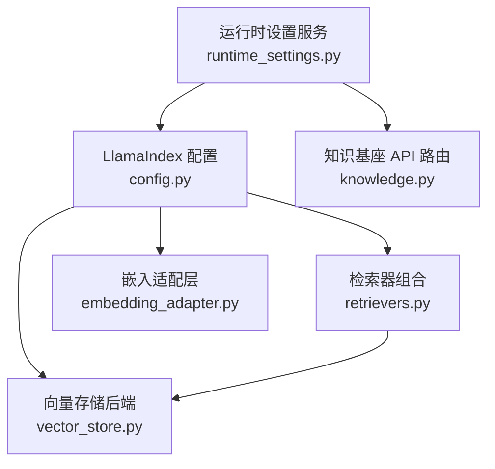
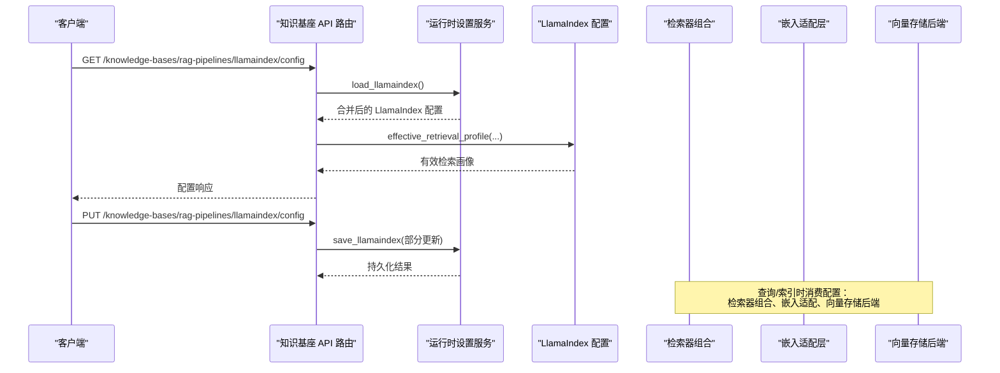
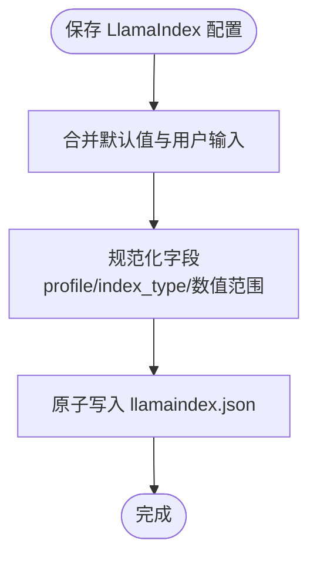
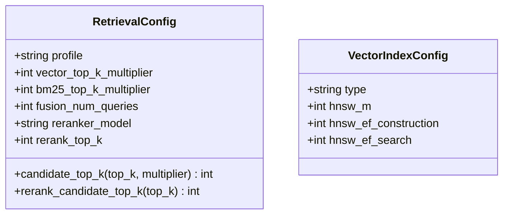
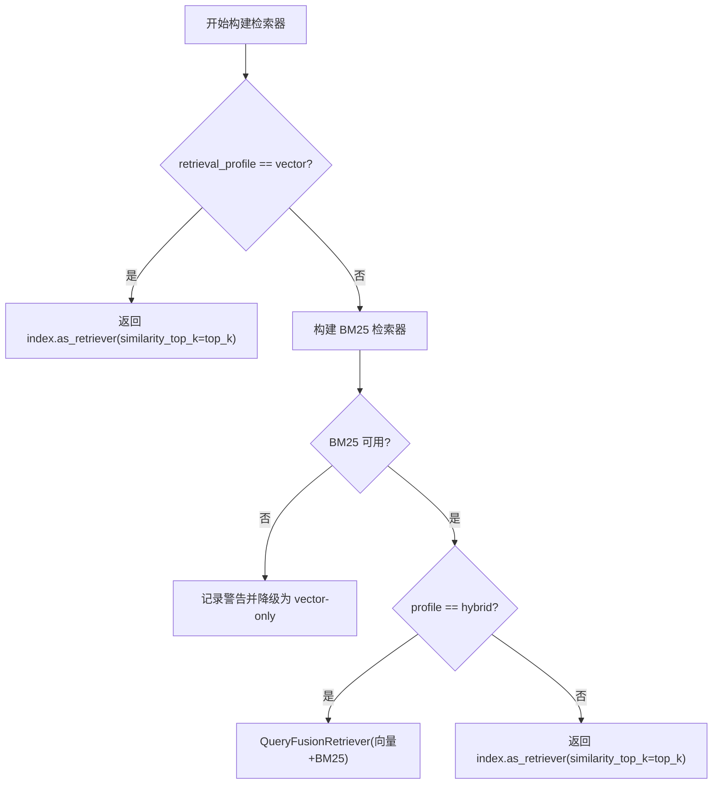
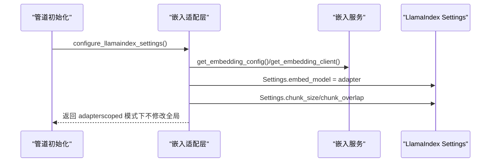
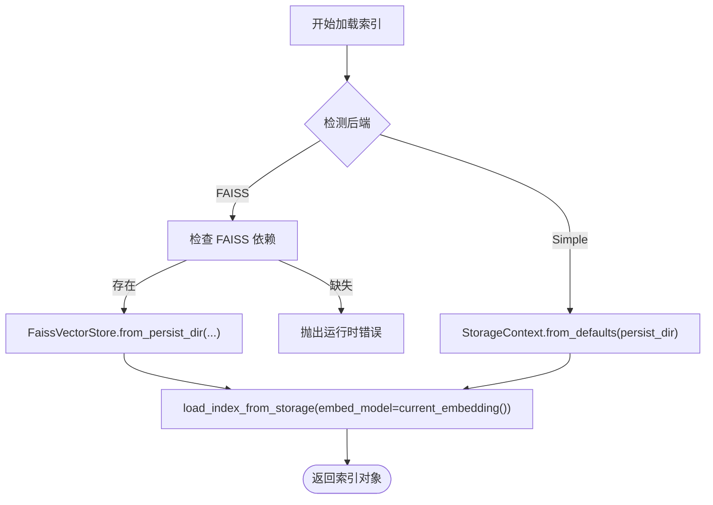
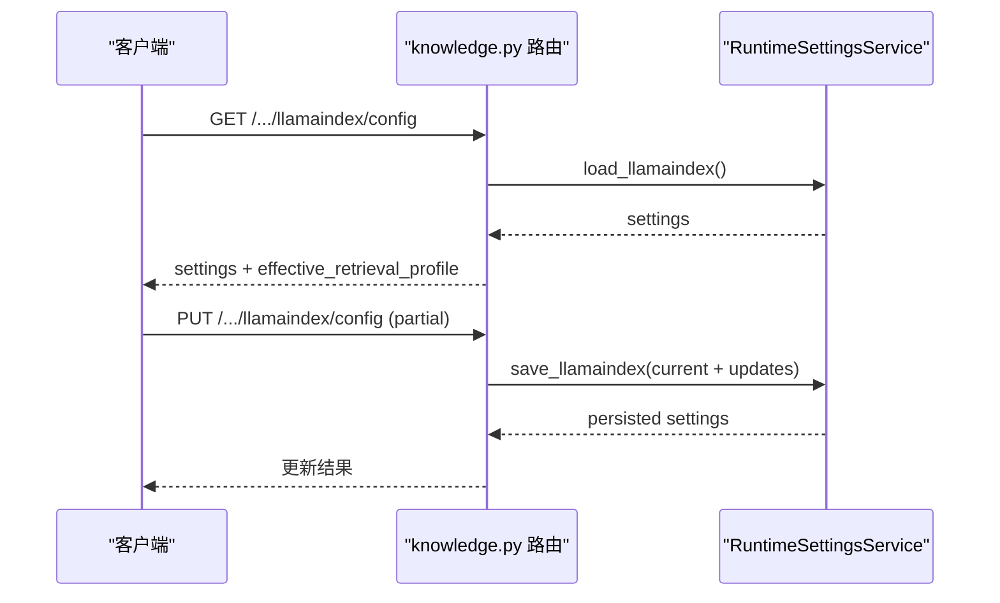
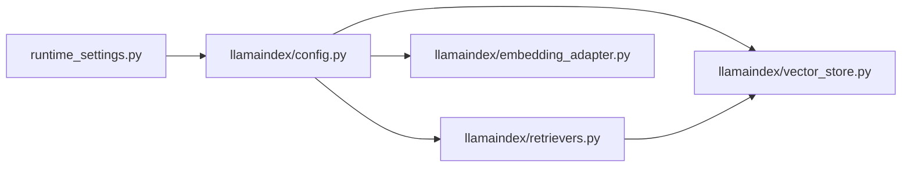

# 管道配置管理

<cite>
**本文引用的文件**   
- [deeptutor/services/config/runtime_settings.py](file://deeptutor/services/config/runtime_settings.py)
- [deeptutor/services/rag/pipelines/llamaindex/config.py](file://deeptutor/services/rag/pipelines/llamaindex/config.py)
- [deeptutor/services/rag/pipelines/llamaindex/retrievers.py](file://deeptutor/services/rag/pipelines/llamaindex/retrievers.py)
- [deeptutor/services/rag/pipelines/llamaindex/embedding_adapter.py](file://deeptutor/services/rag/pipelines/llamaindex/embedding_adapter.py)
- [deeptutor/services/rag/pipelines/llamaindex/vector_store.py](file://deeptutor/services/rag/pipelines/llamaindex/vector_store.py)
- [deeptutor/api/routers/knowledge.py](file://deeptutor/api/routers/knowledge.py)
- [tests/services/config/test_llamaindex_settings.py](file://tests/services/config/test_llamaindex_settings.py)
</cite>

## 目录
1. [简介](#简介)
2. [项目结构](#项目结构)
3. [核心组件](#核心组件)
4. [架构总览](#架构总览)
5. [详细组件分析](#详细组件分析)
6. [依赖关系分析](#依赖关系分析)
7. [性能与调优](#性能与调优)
8. [故障排查指南](#故障排查指南)
9. [结论](#结论)
10. [附录：配置项速查](#附录配置项速查)

## 简介
本文面向 DeepTutor 中基于 LlamaIndex 的检索增强生成（RAG）管道的配置管理，系统性说明以下主题：
- 配置结构与默认值机制
- 参数校验、范围约束与降级策略
- 嵌入模型配置、向量存储后端选择、检索器参数调优
- 配置文件加载流程、环境变量注入与动态更新
- 不同场景（本地开发、生产部署）的配置示例
- 配置验证规则、错误处理与迁移策略

本指南既适合初学者理解基础概念，也为高级用户提供深度定制指导。

## 项目结构
围绕 LlamaIndex 管道配置的关键代码分布在以下模块：
- 运行时设置服务：集中定义默认值、持久化、规范化与环境覆盖
- LlamaIndex 管道配置：检索配置、分块几何、图像描述并发等
- 检索器组合：BM25 + 向量融合、重排序、有效检索画像
- 嵌入适配层：对接 DeepTutor 嵌入服务，设置全局 chunk 参数
- 向量存储后端：FAISS 与 SimpleVectorStore 自动切换
- API 路由：对外暴露读取/更新 LlamaIndex 引擎配置的接口

**图表来源**
- [deeptutor/services/config/runtime_settings.py:356-373](file://deeptutor/services/config/runtime_settings.py#L356-L373)
- [deeptutor/services/rag/pipelines/llamaindex/config.py:30-62](file://deeptutor/services/rag/pipelines/llamaindex/config.py#L30-L62)
- [deeptutor/services/rag/pipelines/llamaindex/retrievers.py:192-232](file://deeptutor/services/rag/pipelines/llamaindex/retrievers.py#L192-L232)
- [deeptutor/services/rag/pipelines/llamaindex/embedding_adapter.py:215-245](file://deeptutor/services/rag/pipelines/llamaindex/embedding_adapter.py#L215-L245)
- [deeptutor/services/rag/pipelines/llamaindex/vector_store.py:238-274](file://deeptutor/services/rag/pipelines/llamaindex/vector_store.py#L238-L274)
- [deeptutor/api/routers/knowledge.py:1606-1649](file://deeptutor/api/routers/knowledge.py#L1606-L1649)

**章节来源**
- [deeptutor/services/config/runtime_settings.py:356-373](file://deeptutor/services/config/runtime_settings.py#L356-L373)
- [deeptutor/services/rag/pipelines/llamaindex/config.py:30-62](file://deeptutor/services/rag/pipelines/llamaindex/config.py#L30-L62)
- [deeptutor/services/rag/pipelines/llamaindex/retrievers.py:192-232](file://deeptutor/services/rag/pipelines/llamaindex/retrievers.py#L192-L232)
- [deeptutor/services/rag/pipelines/llamaindex/embedding_adapter.py:215-245](file://deeptutor/services/rag/pipelines/llamaindex/embedding_adapter.py#L215-L245)
- [deeptutor/services/rag/pipelines/llamaindex/vector_store.py:238-274](file://deeptutor/services/rag/pipelines/llamaindex/vector_store.py#L238-L274)
- [deeptutor/api/routers/knowledge.py:1606-1649](file://deeptutor/api/routers/knowledge.py#L1606-L1649)

## 核心组件
- 运行时设置服务（RuntimeSettingsService）
  - 提供 LlamaIndex 引擎的默认配置、持久化读写、规范化与进程级环境变量覆盖
  - 关键方法：load_llamaindex/save_llamaindex、ensure_defaults、_normalize_llamaindex
- LlamaIndex 配置（config.py）
  - 定义检索配置数据类、索引类型常量、归一化函数与从环境/设置构建配置的函数
- 检索器组合（retrievers.py）
  - 根据配置构建 BM25 + 向量融合检索器；支持重排序；计算“有效检索画像”
- 嵌入适配层（embedding_adapter.py）
  - 将 DeepTutor 嵌入服务接入 LlamaIndex Settings；设置 chunk_size/chunk_overlap
- 向量存储后端（vector_store.py）
  - FAISS 与 SimpleVectorStore 自动选择；检测已持久化后端并加载
- API 路由（knowledge.py）
  - 暴露 LlamaIndex 引擎配置的 GET/PUT 接口，返回 effective_retrieval_profile

**章节来源**
- [deeptutor/services/config/runtime_settings.py:695-708](file://deeptutor/services/config/runtime_settings.py#L695-L708)
- [deeptutor/services/config/runtime_settings.py:1087-1111](file://deeptutor/services/config/runtime_settings.py#L1087-L1111)
- [deeptutor/services/rag/pipelines/llamaindex/config.py:30-62](file://deeptutor/services/rag/pipelines/llamaindex/config.py#L30-L62)
- [deeptutor/services/rag/pipelines/llamaindex/retrievers.py:88-97](file://deeptutor/services/rag/pipelines/llamaindex/retrievers.py#L88-L97)
- [deeptutor/services/rag/pipelines/llamaindex/embedding_adapter.py:215-245](file://deeptutor/services/rag/pipelines/llamaindex/embedding_adapter.py#L215-L245)
- [deeptutor/services/rag/pipelines/llamaindex/vector_store.py:238-274](file://deeptutor/services/rag/pipelines/llamaindex/vector_store.py#L238-L274)
- [deeptutor/api/routers/knowledge.py:1606-1649](file://deeptutor/api/routers/knowledge.py#L1606-L1649)

## 架构总览
下图展示配置加载、生效与回写的主流程：API 请求触发配置读取/更新，运行时设置服务负责合并默认值、规范化与环境覆盖，LlamaIndex 管道在查询或索引时消费这些配置。

**图表来源**
- [deeptutor/api/routers/knowledge.py:1606-1649](file://deeptutor/api/routers/knowledge.py#L1606-L1649)
- [deeptutor/services/config/runtime_settings.py:695-708](file://deeptutor/services/config/runtime_settings.py#L695-L708)
- [deeptutor/services/rag/pipelines/llamaindex/retrievers.py:88-97](file://deeptutor/services/rag/pipelines/llamaindex/retrievers.py#L88-L97)
- [deeptutor/services/rag/pipelines/llamaindex/embedding_adapter.py:215-245](file://deeptutor/services/rag/pipelines/llamaindex/embedding_adapter.py#L215-L245)
- [deeptutor/services/rag/pipelines/llamaindex/vector_store.py:238-274](file://deeptutor/services/rag/pipelines/llamaindex/vector_store.py#L238-L274)

## 详细组件分析

### 运行时设置服务（LlamaIndex 引擎配置）
- 默认值与字段
  - retrieval_profile：hybrid 或 vector
  - top_k：默认 5
  - vector_top_k_multiplier/bm25_top_k_multiplier：候选扩展倍数
  - reranker_model/rerank_top_k：可选交叉编码器重排
  - vector_index_type：flat/hnsw
  - hnsw_m/hnsw_ef_construction/hnsw_ef_search：HNSW 构造/搜索参数
  - chunk_size/chunk_overlap：分块几何
  - image_description_concurrency/batch_size/timeout_seconds：图像描述并发与超时
- 规范化与校验
  - 未知 profile 回退到 hybrid
  - 未知 vector_index_type 回退到 flat
  - chunk_overlap 被钳制为小于 chunk_size
  - 数值型字段通过范围钳制（如 top_k、multiplier、hnsw_*、rerank_top_k）
- 持久化与覆盖
  - 独立 JSON 文件 llamaindex.json
  - load_llamaindex/save_llamaindex 支持 include_process_overrides 以应用进程环境变量覆盖
  - ensure_defaults 初始化所有默认设置

**图表来源**
- [deeptutor/services/config/runtime_settings.py:356-373](file://deeptutor/services/config/runtime_settings.py#L356-L373)
- [deeptutor/services/config/runtime_settings.py:1087-1111](file://deeptutor/services/config/runtime_settings.py#L1087-L1111)
- [deeptutor/services/config/runtime_settings.py:695-708](file://deeptutor/services/config/runtime_settings.py#L695-L708)

**章节来源**
- [deeptutor/services/config/runtime_settings.py:356-373](file://deeptutor/services/config/runtime_settings.py#L356-L373)
- [deeptutor/services/config/runtime_settings.py:1087-1111](file://deeptutor/services/config/runtime_settings.py#L1087-L1111)
- [deeptutor/services/config/runtime_settings.py:695-708](file://deeptutor/services/config/runtime_settings.py#L695-L708)
- [tests/services/config/test_llamaindex_settings.py:10-26](file://tests/services/config/test_llamaindex_settings.py#L10-L26)
- [tests/services/config/test_llamaindex_settings.py:57-91](file://tests/services/config/test_llamaindex_settings.py#L57-L91)

### LlamaIndex 配置与检索配置
- 检索配置数据类 RetrievalConfig
  - profile、vector_top_k_multiplier、bm25_top_k_multiplier、fusion_num_queries、reranker_model、rerank_top_k
  - candidate_top_k/rerank_candidate_top_k 计算候选数量
- 向量索引配置 VectorIndexConfig
  - type、hnsw_m、hnsw_ef_construction、hnsw_ef_search
- 归一化函数
  - normalize_retrieval_profile：未知值回退 hybrid
  - normalize_reranker_model：截断至 200 字符
  - normalize_vector_index_type：未知值回退 flat
- 从环境与设置构建
  - retrieval_config_from_env：优先 DEEPTUTOR_RAG_RETRIEVAL_PROFILE，其次 RAG_RETRIEVAL_PROFILE
  - retrieval_config_from_settings：从运行时设置加载，异常时回退默认
  - vector_index_config_from_settings：加载 FAISS 构造参数
  - default_top_k/chunk_geometry/image_description_batch_size/image_description_limits：安全读取并钳制

**图表来源**
- [deeptutor/services/rag/pipelines/llamaindex/config.py:30-62](file://deeptutor/services/rag/pipelines/llamaindex/config.py#L30-L62)
- [deeptutor/services/rag/pipelines/llamaindex/config.py:64-82](file://deeptutor/services/rag/pipelines/llamaindex/config.py#L64-L82)
- [deeptutor/services/rag/pipelines/llamaindex/config.py:85-139](file://deeptutor/services/rag/pipelines/llamaindex/config.py#L85-L139)
- [deeptutor/services/rag/pipelines/llamaindex/config.py:142-179](file://deeptutor/services/rag/pipelines/llamaindex/config.py#L142-L179)

**章节来源**
- [deeptutor/services/rag/pipelines/llamaindex/config.py:30-62](file://deeptutor/services/rag/pipelines/llamaindex/config.py#L30-L62)
- [deeptutor/services/rag/pipelines/llamaindex/config.py:64-82](file://deeptutor/services/rag/pipelines/llamaindex/config.py#L64-L82)
- [deeptutor/services/rag/pipelines/llamaindex/config.py:85-139](file://deeptutor/services/rag/pipelines/llamaindex/config.py#L85-L139)
- [deeptutor/services/rag/pipelines/llamaindex/config.py:142-179](file://deeptutor/services/rag/pipelines/llamaindex/config.py#L142-L179)

### 检索器组合与有效检索画像
- 有效检索画像 effective_retrieval_profile
  - 若配置为 hybrid 但 BM25 包不可用，则降级为 vector
- BM25 可用性检测与持久化
  - build_bm25_retriever：尝试加载持久化 BM25 侧车索引，失败则重建
  - persist_bm25_retriever：持久化 BM25 侧车索引
- 构建检索器
  - build_retriever：按 profile 构建纯向量检索器或 QueryFusionRetriever（向量+BM25）
  - retrieve_nodes：先阶段检索后，可选 rerank
- 受限检索
  - retrieve_scoped_nodes：按 document_keys 限制语料后再检索

**图表来源**
- [deeptutor/services/rag/pipelines/llamaindex/retrievers.py:77-97](file://deeptutor/services/rag/pipelines/llamaindex/retrievers.py#L77-L97)
- [deeptutor/services/rag/pipelines/llamaindex/retrievers.py:108-151](file://deeptutor/services/rag/pipelines/llamaindex/retrievers.py#L108-L151)
- [deeptutor/services/rag/pipelines/llamaindex/retrievers.py:192-232](file://deeptutor/services/rag/pipelines/llamaindex/retrievers.py#L192-L232)
- [deeptutor/services/rag/pipelines/llamaindex/retrievers.py:235-260](file://deeptutor/services/rag/pipelines/llamaindex/retrievers.py#L235-L260)
- [deeptutor/services/rag/pipelines/llamaindex/retrievers.py:310-336](file://deeptutor/services/rag/pipelines/llamaindex/retrievers.py#L310-L336)

**章节来源**
- [deeptutor/services/rag/pipelines/llamaindex/retrievers.py:77-97](file://deeptutor/services/rag/pipelines/llamaindex/retrievers.py#L77-L97)
- [deeptutor/services/rag/pipelines/llamaindex/retrievers.py:108-151](file://deeptutor/services/rag/pipelines/llamaindex/retrievers.py#L108-L151)
- [deeptutor/services/rag/pipelines/llamaindex/retrievers.py:192-232](file://deeptutor/services/rag/pipelines/llamaindex/retrievers.py#L192-L232)
- [deeptutor/services/rag/pipelines/llamaindex/retrievers.py:235-260](file://deeptutor/services/rag/pipelines/llamaindex/retrievers.py#L235-L260)
- [deeptutor/services/rag/pipelines/llamaindex/retrievers.py:310-336](file://deeptutor/services/rag/pipelines/llamaindex/retrievers.py#L310-L336)

### 嵌入模型配置与全局设置
- CustomEmbedding 适配器
  - 封装 DeepTutor 嵌入客户端，支持批量进度回调、上下文绑定
  - matches_config/refresh_client 用于配置变更时刷新客户端
- 配置 LlamaIndex 全局 Settings
  - configure_llamaindex_settings：设置 embed_model、chunk_size、chunk_overlap
  - verify_embedding_connectivity：连通性冒烟测试
- 操作级嵌入绑定
  - bind_operation_embedding/current_embedding：支持 scoped 配置下的操作级嵌入替换

**图表来源**
- [deeptutor/services/rag/pipelines/llamaindex/embedding_adapter.py:54-95](file://deeptutor/services/rag/pipelines/llamaindex/embedding_adapter.py#L54-L95)
- [deeptutor/services/rag/pipelines/llamaindex/embedding_adapter.py:215-245](file://deeptutor/services/rag/pipelines/llamaindex/embedding_adapter.py#L215-L245)
- [deeptutor/services/rag/pipelines/llamaindex/embedding_adapter.py:253-273](file://deeptutor/services/rag/pipelines/llamaindex/embedding_adapter.py#L253-L273)

**章节来源**
- [deeptutor/services/rag/pipelines/llamaindex/embedding_adapter.py:54-95](file://deeptutor/services/rag/pipelines/llamaindex/embedding_adapter.py#L54-L95)
- [deeptutor/services/rag/pipelines/llamaindex/embedding_adapter.py:215-245](file://deeptutor/services/rag/pipelines/llamaindex/embedding_adapter.py#L215-L245)
- [deeptutor/services/rag/pipelines/llamaindex/embedding_adapter.py:253-273](file://deeptutor/services/rag/pipelines/llamaindex/embedding_adapter.py#L253-L273)

### 向量存储后端选择与加载
- 后端检测与选择
  - detect_backend：根据默认存储文件首字节判断 FAISS 或 Simple
  - storage_context_for_nodes/new_faiss_storage_context：当维度一致且 FAISS 可用时使用 FAISS
- FAISS 包装
  - _cosine_faiss_cls：对 add/query 进行 L2 归一化，使内积等价于余弦相似度
  - faiss_write_index/faiss_read_index：绕过 Windows 路径问题，保证跨平台兼容
- 加载索引
  - load_index：根据后端类型加载对应索引；缺失 FAISS 依赖时报错提示

**图表来源**
- [deeptutor/services/rag/pipelines/llamaindex/vector_store.py:238-274](file://deeptutor/services/rag/pipelines/llamaindex/vector_store.py#L238-L274)
- [deeptutor/services/rag/pipelines/llamaindex/vector_store.py:114-167](file://deeptutor/services/rag/pipelines/llamaindex/vector_store.py#L114-L167)
- [deeptutor/services/rag/pipelines/llamaindex/vector_store.py:188-217](file://deeptutor/services/rag/pipelines/llamaindex/vector_store.py#L188-L217)

**章节来源**
- [deeptutor/services/rag/pipelines/llamaindex/vector_store.py:238-274](file://deeptutor/services/rag/pipelines/llamaindex/vector_store.py#L238-L274)
- [deeptutor/services/rag/pipelines/llamaindex/vector_store.py:114-167](file://deeptutor/services/rag/pipelines/llamaindex/vector_store.py#L114-L167)
- [deeptutor/services/rag/pipelines/llamaindex/vector_store.py:188-217](file://deeptutor/services/rag/pipelines/llamaindex/vector_store.py#L188-L217)

### API 配置接口与动态更新
- GET /knowledge-bases/rag-pipelines/llamaindex/config
  - 返回当前配置与 effective_retrieval_profile
- PUT /knowledge-bases/rag-pipelines/llamaindex/config
  - 支持部分更新（仅提交字段），内部合并 current + updates 后持久化
- 错误处理
  - 统一捕获异常并返回 500 状态码

**图表来源**
- [deeptutor/api/routers/knowledge.py:1606-1649](file://deeptutor/api/routers/knowledge.py#L1606-L1649)
- [deeptutor/services/config/runtime_settings.py:695-708](file://deeptutor/services/config/runtime_settings.py#L695-L708)

**章节来源**
- [deeptutor/api/routers/knowledge.py:1606-1649](file://deeptutor/api/routers/knowledge.py#L1606-L1649)
- [deeptutor/services/config/runtime_settings.py:695-708](file://deeptutor/services/config/runtime_settings.py#L695-L708)

## 依赖关系分析
- 运行时设置服务依赖
  - 默认值常量（DEFAULT_LLAMAINDEX_SETTINGS）
  - 规范化函数（_normalize_llamaindex）
  - 原子写入工具（atomic_write_json）
- LlamaIndex 配置依赖
  - 常量与归一化函数（config.py）
  - 运行时设置服务（load_llamaindex_settings）
- 检索器组合依赖
  - LlamaIndex 官方检索器（BM25Retriever、QueryFusionRetriever）
  - 配置模块（config.py）
  - 重排序模块（rerank.py）
- 嵌入适配层依赖
  - DeepTutor 嵌入服务（get_embedding_client/get_embedding_config）
  - 配置模块（chunk_geometry）
- 向量存储后端依赖
  - FAISS 与 LlamaIndex FAISS 集成（可选）
  - LlamaIndex StorageContext/load_index_from_storage

**图表来源**
- [deeptutor/services/config/runtime_settings.py:356-373](file://deeptutor/services/config/runtime_settings.py#L356-L373)
- [deeptutor/services/rag/pipelines/llamaindex/config.py:100-104](file://deeptutor/services/rag/pipelines/llamaindex/config.py#L100-L104)
- [deeptutor/services/rag/pipelines/llamaindex/retrievers.py:15-22](file://deeptutor/services/rag/pipelines/llamaindex/retrievers.py#L15-L22)
- [deeptutor/services/rag/pipelines/llamaindex/embedding_adapter.py:16-21](file://deeptutor/services/rag/pipelines/llamaindex/embedding_adapter.py#L16-L21)
- [deeptutor/services/rag/pipelines/llamaindex/vector_store.py:36-41](file://deeptutor/services/rag/pipelines/llamaindex/vector_store.py#L36-L41)

**章节来源**
- [deeptutor/services/config/runtime_settings.py:356-373](file://deeptutor/services/config/runtime_settings.py#L356-L373)
- [deeptutor/services/rag/pipelines/llamaindex/config.py:100-104](file://deeptutor/services/rag/pipelines/llamaindex/config.py#L100-L104)
- [deeptutor/services/rag/pipelines/llamaindex/retrievers.py:15-22](file://deeptutor/services/rag/pipelines/llamaindex/retrievers.py#L15-L22)
- [deeptutor/services/rag/pipelines/llamaindex/embedding_adapter.py:16-21](file://deeptutor/services/rag/pipelines/llamaindex/embedding_adapter.py#L16-L21)
- [deeptutor/services/rag/pipelines/llamaindex/vector_store.py:36-41](file://deeptutor/services/rag/pipelines/llamaindex/vector_store.py#L36-L41)

## 性能与调优
- 检索性能
  - 使用 FAISS 替代 SimpleVectorStore，避免 O(N) 全量扫描
  - 启用 HNSW 索引类型可提升大规模语料的近似检索速度（需权衡召回率）
  - 合理设置 vector_top_k_multiplier/bm25_top_k_multiplier 以平衡候选数量与融合效果
- 重排序
  - 开启 reranker_model 可提升最终排序质量，但增加延迟与资源消耗
- 分块几何
  - chunk_size 与 chunk_overlap 影响索引大小与检索精度；overlap 必须小于 chunk_size
- 图像描述
  - image_description_concurrency/batch_size/timeout_seconds 控制多模态文档索引时的并发与超时
- BM25 可用性
  - 未安装 llama-index-retrievers-bm25 时，hybrid 配置会降级为 vector-only；建议安装以恢复混合检索

[本节为通用性能指导，无需具体文件引用]

## 故障排查指南
- 配置无效或行为异常
  - 检查 effective_retrieval_profile 是否为预期值；若 BM25 缺失，hybrid 会降级为 vector
  - 确认 llamaindex.json 是否存在且可读；必要时调用 ensure_defaults 初始化
- 检索速度慢
  - 确认是否使用 FAISS 后端；若为 SimpleVectorStore，考虑重新索引
  - 调整 top_k 与 multipliers，避免过大候选集
- 索引失败或报错
  - 检查 embedding 连通性（verify_embedding_connectivity）
  - 若 FAISS 依赖缺失，安装 faiss-cpu 或重新索引为 SimpleVectorStore
- API 更新失败
  - 查看 PUT 接口返回的错误信息；确保只提交需要更新的字段

**章节来源**
- [deeptutor/services/rag/pipelines/llamaindex/retrievers.py:120-129](file://deeptutor/services/rag/pipelines/llamaindex/retrievers.py#L120-L129)
- [deeptutor/services/rag/pipelines/llamaindex/vector_store.py:259-266](file://deeptutor/services/rag/pipelines/llamaindex/vector_store.py#L259-L266)
- [deeptutor/services/rag/pipelines/llamaindex/embedding_adapter.py:253-273](file://deeptutor/services/rag/pipelines/llamaindex/embedding_adapter.py#L253-L273)
- [deeptutor/api/routers/knowledge.py:1632-1649](file://deeptutor/api/routers/knowledge.py#L1632-L1649)

## 结论
DeepTutor 的 LlamaIndex 管道配置通过运行时设置服务统一管理默认值、规范化与环境覆盖，结合检索器组合、嵌入适配与向量存储后端选择，形成稳定、可扩展且高性能的 RAG 配置体系。通过 API 暴露的配置接口，可在运行期动态调整检索与索引参数，同时内置多种降级与校验机制保障系统鲁棒性。

[本节为总结性内容，无需具体文件引用]

## 附录：配置项速查
- 检索画像
  - retrieval_profile：hybrid（默认）或 vector
  - effective_retrieval_profile：实际生效画像（受 BM25 可用性影响）
- 候选与融合
  - top_k：默认 5
  - vector_top_k_multiplier：默认 2
  - bm25_top_k_multiplier：默认 2
- 重排序
  - reranker_model：空字符串表示禁用
  - rerank_top_k：默认 50
- 向量索引
  - vector_index_type：flat（默认）或 hnsw
  - hnsw_m：默认 32
  - hnsw_ef_construction：默认 200
  - hnsw_ef_search：默认 64
- 分块几何
  - chunk_size：默认 512
  - chunk_overlap：默认 50（被钳制为小于 chunk_size）
- 图像描述
  - image_description_concurrency：默认 4
  - image_description_batch_size：默认 1
  - image_description_timeout_seconds：默认 60

**章节来源**
- [deeptutor/services/config/runtime_settings.py:356-373](file://deeptutor/services/config/runtime_settings.py#L356-L373)
- [deeptutor/services/rag/pipelines/llamaindex/config.py:30-62](file://deeptutor/services/rag/pipelines/llamaindex/config.py#L30-L62)
- [tests/services/config/test_llamaindex_settings.py:10-26](file://tests/services/config/test_llamaindex_settings.py#L10-L26)