# RAG 管道架构设计

<cite>
**本文引用的文件**   
- [deeptutor/services/rag/service.py](file://deeptutor/services/rag/service.py)
- [deeptutor/services/rag/factory.py](file://deeptutor/services/rag/factory.py)
- [deeptutor/services/rag/pipelines/base.py](file://deeptutor/services/rag/pipelines/base.py)
- [deeptutor/services/rag/pipelines/modes.py](file://deeptutor/services/rag/pipelines/modes.py)
- [deeptutor/services/rag/pipelines/llamaindex/pipeline.py](file://deeptutor/services/rag/pipelines/llamaindex/pipeline.py)
- [deeptutor/services/rag/pipelines/lightrag/pipeline.py](file://deeptutor/services/rag/pipelines/lightrag/pipeline.py)
- [deeptutor/services/rag/pipelines/graphrag/pipeline.py](file://deeptutor/services/rag/pipelines/graphrag/pipeline.py)
- [deeptutor/services/rag/pipelines/pageindex/pipeline.py](file://deeptutor/services/rag/pipelines/pageindex/pipeline.py)
- [deeptutor/tools/rag_tool.py](file://deeptutor/tools/rag_tool.py)
</cite>

## 目录
1. [引言](#引言)
2. [项目结构](#项目结构)
3. [核心组件](#核心组件)
4. [架构总览](#架构总览)
5. [详细组件分析](#详细组件分析)
6. [依赖关系分析](#依赖关系分析)
7. [性能与可扩展性](#性能与可扩展性)
8. [故障排查指南](#故障排查指南)
9. [结论](#结论)
10. [附录：扩展指南](#附录扩展指南)

## 引言
本文件面向初学者与高级开发者，系统性梳理 DeepTutor 中 RAG（检索增强生成）管道的架构设计与实现。重点包括：
- 管道抽象层、工厂模式与模式切换机制
- 不同 RAG 提供商的统一接口设计
- 文档加载器、嵌入适配器、向量存储与检索器的标准化职责
- 管道生命周期管理、错误处理策略与性能监控
- 如何扩展新的 RAG 提供商、自定义管道组件和集成第三方服务

DeepTutor 的 RAG 子系统以“统一服务 + 管道协议 + 工厂选择”的方式，将多种后端（LlamaIndex、LightRAG、GraphRAG、PageIndex、IMA、WeKnora、Kiwix 等）封装为一致的索引、增量添加、检索与删除能力，同时提供查询重写、日志捕获、版本化索引、嵌入签名绑定等工程化能力。

## 项目结构
RAG 相关代码主要位于 `deeptutor/services/rag`，并以 `pipelines` 子目录组织各提供商的具体实现；工具入口在 `deeptutor/tools/rag_tool.py`，上层 API 通过 `RAGService` 暴露统一能力。

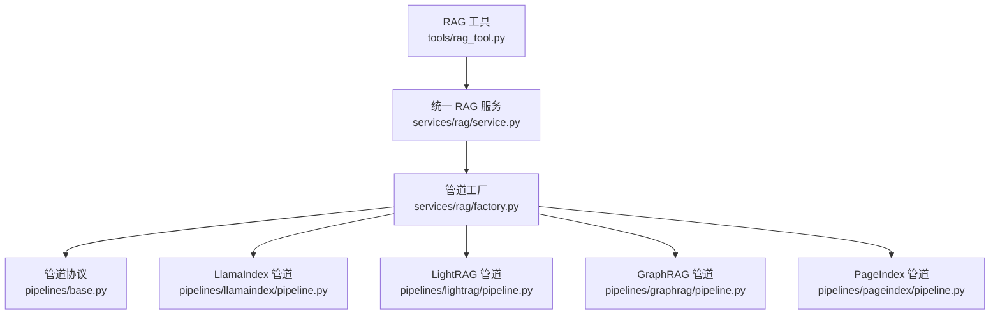

**图表来源**
- [deeptutor/tools/rag_tool.py:15-51](file://deeptutor/tools/rag_tool.py#L15-L51)
- [deeptutor/services/rag/service.py:22-65](file://deeptutor/services/rag/service.py#L22-L65)
- [deeptutor/services/rag/factory.py:136-209](file://deeptutor/services/rag/factory.py#L136-L209)
- [deeptutor/services/rag/pipelines/base.py:16-38](file://deeptutor/services/rag/pipelines/base.py#L16-L38)

**章节来源**
- [deeptutor/services/rag/__init__.py:1-21](file://deeptutor/services/rag/__init__.py#L1-L21)
- [deeptutor/tools/rag_tool.py:1-111](file://deeptutor/tools/rag_tool.py#L1-L111)

## 核心组件
- **统一 RAG 服务**：对外暴露 `initialize`、`add_documents`、`search`、`delete`、`smart_retrieve` 等方法，负责按 KB 解析 provider、调用具体管道、包装结果、记录事件与日志。
- **管道协议**：使用 Protocol 定义最小契约，要求每个管道实现 `initialize`、`add_documents`、`search`、`delete`。
- **管道工厂**：根据 provider 名称创建对应管道实例，支持缓存、配置探测、模式列表与可用性描述。
- **模式解析器**：为 LightRAG、GraphRAG 等模式感知型引擎提供统一的 mode 解析顺序。
- **各提供商管道**：LlamaIndex、LightRAG、GraphRAG、PageIndex 等各自实现索引、检索、删除逻辑，并遵循统一返回结构。

**章节来源**
- [deeptutor/services/rag/service.py:22-65](file://deeptutor/services/rag/service.py#L22-L65)
- [deeptutor/services/rag/pipelines/base.py:16-38](file://deeptutor/services/rag/pipelines/base.py#L16-L38)
- [deeptutor/services/rag/factory.py:37-61](file://deeptutor/services/rag/factory.py#L37-L61)
- [deeptutor/services/rag/pipelines/modes.py:1-49](file://deeptutor/services/rag/pipelines/modes.py#L1-L49)

## 架构总览
下图展示从工具到服务的调用链，以及服务如何通过工厂选择具体管道。

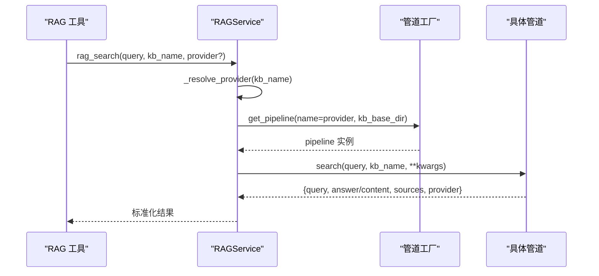

**图表来源**
- [deeptutor/tools/rag_tool.py:15-51](file://deeptutor/tools/rag_tool.py#L15-L51)
- [deeptutor/services/rag/service.py:127-200](file://deeptutor/services/rag/service.py#L127-L200)
- [deeptutor/services/rag/factory.py:193-209](file://deeptutor/services/rag/factory.py#L193-L209)

## 详细组件分析

### 统一 RAG 服务（RAGService）
RAGService 是 RAG 能力的统一入口，承担以下职责：
- 按 KB 解析 provider：优先使用构造时传入的 provider，否则读取 KB 绑定配置。
- 获取或缓存管道实例：通过 `_get_pipeline` 复用同一 provider 的管道对象。
- 索引流程封装：`initialize` 与 `add_documents` 统一走 `_index`，结合 `IndexingRun` 跟踪进度、阶段、可用版本。
- 检索流程封装：`search` 执行查询重写、原始日志捕获、调用管道、标准化结果、写入内存 trace。
- 删除流程封装：优先调用管道的 `delete`，否则回退到删除 KB 目录。
- 智能检索：`smart_retrieve` 委托给 `SmartRetriever`。

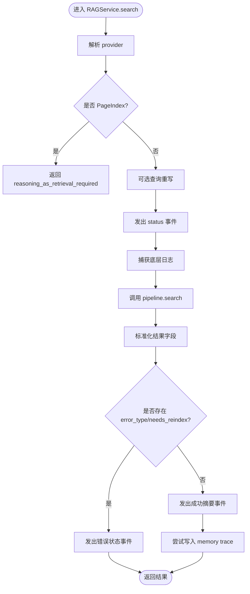

**图表来源**
- [deeptutor/services/rag/service.py:127-250](file://deeptutor/services/rag/service.py#L127-L250)

关键行为说明：
- Provider 解析：若显式传入 provider，则始终使用该 provider；否则通过 `resolve_bound_provider` 读取 KB 绑定。
- PageIndex 限制：直接返回“需要推理即检索”的错误提示，避免误用。
- 查询重写：通过 `maybe_rewrite` 进行可选改写，并在结果中附加 rewrite 信息。
- 日志捕获：对第三方库（lightrag、graphrag 等）的日志进行桥接，过滤噪音后作为 raw_log 事件输出。
- 结果标准化：确保包含 `query`、`answer`/`content`、`sources`、`provider`，必要时覆盖 provider 为当前 KB 绑定的值。

**章节来源**
- [deeptutor/services/rag/service.py:22-65](file://deeptutor/services/rag/service.py#L22-L65)
- [deeptutor/services/rag/service.py:75-124](file://deeptutor/services/rag/service.py#L75-L124)
- [deeptutor/services/rag/service.py:127-250](file://deeptutor/services/rag/service.py#L127-L250)
- [deeptutor/services/rag/service.py:252-333](file://deeptutor/services/rag/service.py#L252-L333)
- [deeptutor/services/rag/service.py:335-380](file://deeptutor/services/rag/service.py#L335-L380)

### 管道协议（RAGPipeline）
所有管道必须实现的最小契约：
- `initialize(kb_name, file_paths, **kwargs)`：从零构建索引。
- `add_documents(kb_name, file_paths, **kwargs)`：增量添加文档。
- `search(query, kb_name, **kwargs)`：检索上下文，返回结构化结果。
- `delete(kb_name, **kwargs)`：删除 KB 及其引擎侧资源。

该协议采用 Python `Protocol`，便于类型检查并保持向后兼容；RAGService 仍通过 `hasattr` 容忍部分实现。

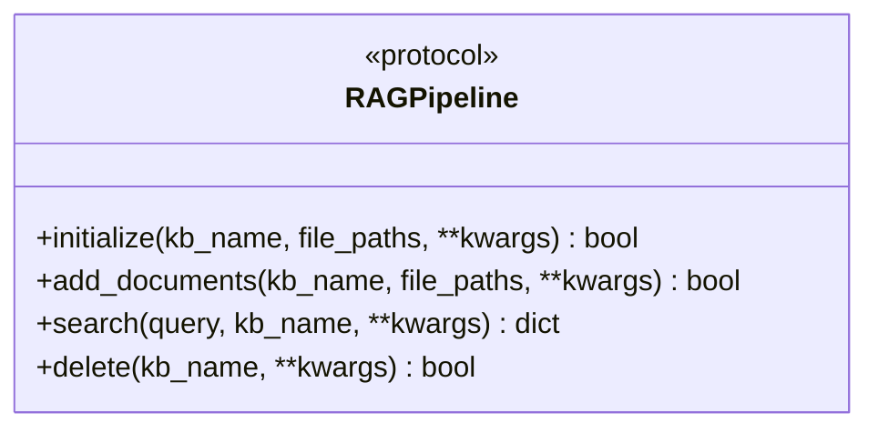

**图表来源**
- [deeptutor/services/rag/pipelines/base.py:16-38](file://deeptutor/services/rag/pipelines/base.py#L16-L38)

**章节来源**
- [deeptutor/services/rag/pipelines/base.py:1-42](file://deeptutor/services/rag/pipelines/base.py#L1-L42)

### 管道工厂（Provider 工厂与模式列表）
工厂负责：
- 规范化 provider 名称，未知字符串回退到默认 provider。
- 根据 provider 动态导入并创建对应管道实例。
- 缓存无自定义参数的管道实例，提升重复调用性能。
- 提供 `list_pipelines`，探测各 provider 的配置就绪状态、API Key 需求、模式列表与默认模式。

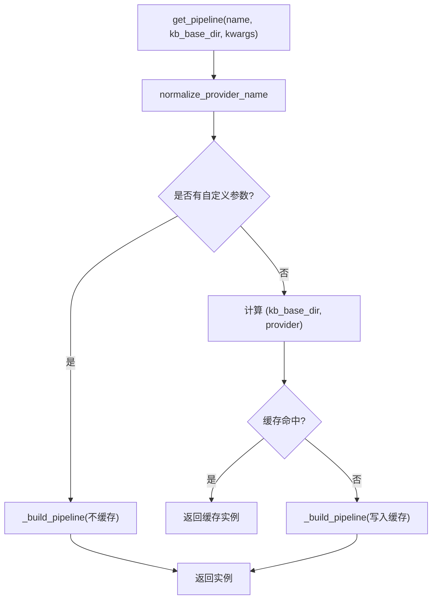

**图表来源**
- [deeptutor/services/rag/factory.py:67-75](file://deeptutor/services/rag/factory.py#L67-L75)
- [deeptutor/services/rag/factory.py:136-209](file://deeptutor/services/rag/factory.py#L136-L209)

**章节来源**
- [deeptutor/services/rag/factory.py:37-61](file://deeptutor/services/rag/factory.py#L37-L61)
- [deeptutor/services/rag/factory.py:67-75](file://deeptutor/services/rag/factory.py#L67-L75)
- [deeptutor/services/rag/factory.py:136-209](file://deeptutor/services/rag/factory.py#L136-L209)
- [deeptutor/services/rag/factory.py:212-348](file://deeptutor/services/rag/factory.py#L212-L348)

### 模式切换机制（modes）
对于 LightRAG、GraphRAG 等模式感知型引擎，mode 解析顺序如下：
1. 显式传入的 `mode` 参数（单次搜索覆盖）。
2. KB 自身的 `search_mode`（来自 `kb_config.json`）。
3. 引擎全局默认模式（来自 `defaults.provider_modes[provider]`）。
4. 引擎内置默认模式。

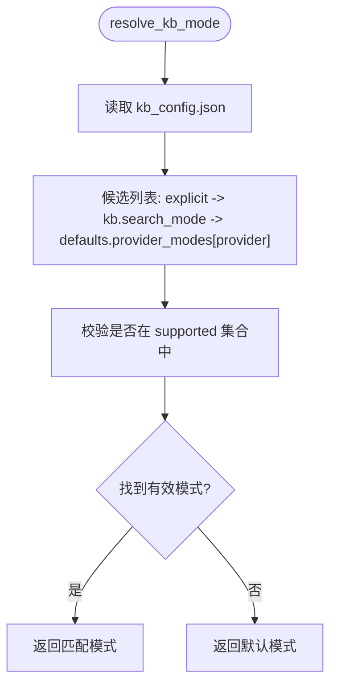

**图表来源**
- [deeptutor/services/rag/pipelines/modes.py:19-45](file://deeptutor/services/rag/pipelines/modes.py#L19-L45)

**章节来源**
- [deeptutor/services/rag/pipelines/modes.py:1-49](file://deeptutor/services/rag/pipelines/modes.py#L1-L49)

### LlamaIndex 管道
LlamaIndexPipeline 的职责包括：
- 配置嵌入适配器与设置，验证连接。
- 文档加载、视觉资产发布、索引创建/追加、可恢复重建。
- 查询时根据 embedding signature 选择已发布的索引目录，执行检索并组装结果。
- 失败清理、工作线程占用保护、停滞检测。

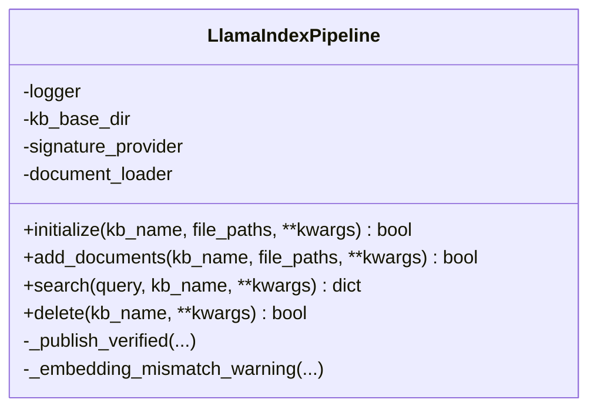

**图表来源**
- [deeptutor/services/rag/pipelines/llamaindex/pipeline.py:181-230](file://deeptutor/services/rag/pipelines/llamaindex/pipeline.py#L181-L230)
- [deeptutor/services/rag/pipelines/llamaindex/pipeline.py:230-320](file://deeptutor/services/rag/pipelines/llamaindex/pipeline.py#L230-L320)
- [deeptutor/services/rag/pipelines/llamaindex/pipeline.py:322-418](file://deeptutor/services/rag/pipelines/llamaindex/pipeline.py#L322-L418)
- [deeptutor/services/rag/pipelines/llamaindex/pipeline.py:492-593](file://deeptutor/services/rag/pipelines/llamaindex/pipeline.py#L492-L593)

关键点：
- 索引路径按 embedding signature 版本化，避免模型变更导致索引不可读。
- 查询时若未找到匹配索引，返回 `needs_reindex=True` 并给出提示。
- 通过 `_run_with_stall_guard` 防止同步阻塞导致的无限等待。

**章节来源**
- [deeptutor/services/rag/pipelines/llamaindex/pipeline.py:181-593](file://deeptutor/services/rag/pipelines/llamaindex/pipeline.py#L181-L593)

### LightRAG 管道
LightRagPipeline 的职责包括：
- 校验 LightRAG 是否安装，解析 mode。
- 文档预处理、入队、状态轮询、批量结果收敛。
- 新建或追加索引，发布元数据与嵌入绑定。
- 查询时构建 RAG 引擎，执行带来源的检索。

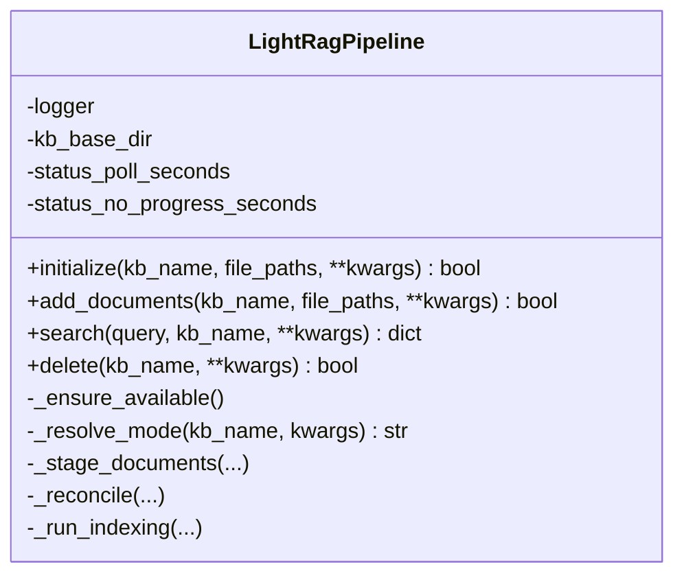

**图表来源**
- [deeptutor/services/rag/pipelines/lightrag/pipeline.py:98-123](file://deeptutor/services/rag/pipelines/lightrag/pipeline.py#L98-L123)
- [deeptutor/services/rag/pipelines/lightrag/pipeline.py:124-153](file://deeptutor/services/rag/pipelines/lightrag/pipeline.py#L124-L153)
- [deeptutor/services/rag/pipelines/lightrag/pipeline.py:154-279](file://deeptutor/services/rag/pipelines/lightrag/pipeline.py#L154-L279)
- [deeptutor/services/rag/pipelines/lightrag/pipeline.py:280-372](file://deeptutor/services/rag/pipelines/lightrag/pipeline.py#L280-L372)
- [deeptutor/services/rag/pipelines/lightrag/pipeline.py:382-478](file://deeptutor/services/rag/pipelines/lightrag/pipeline.py#L382-L478)
- [deeptutor/services/rag/pipelines/lightrag/pipeline.py:479-590](file://deeptutor/services/rag/pipelines/lightrag/pipeline.py#L479-L590)
- [deeptutor/services/rag/pipelines/lightrag/pipeline.py:609-684](file://deeptutor/services/rag/pipelines/lightrag/pipeline.py#L609-L684)

关键点：
- 批量任务通过 track_id 轮询状态，区分 processed/failed/nonterminal/missing。
- 新增文档时若存在已发布索引，需保证嵌入兼容性；否则抛出需要重建的错误。
- 查询失败时返回结构化错误类型，如 `not_configured`、`embedding_mismatch`、`retrieval_error`。

**章节来源**
- [deeptutor/services/rag/pipelines/lightrag/pipeline.py:98-693](file://deeptutor/services/rag/pipelines/lightrag/pipeline.py#L98-L693)

### GraphRAG 管道
GraphRagPipeline 的职责包括：
- 校验 GraphRAG 是否安装。
- 准备输入文本、写入 settings、构建索引或增量更新。
- 查询时读取已发布版本，执行搜索并映射上下文为来源。

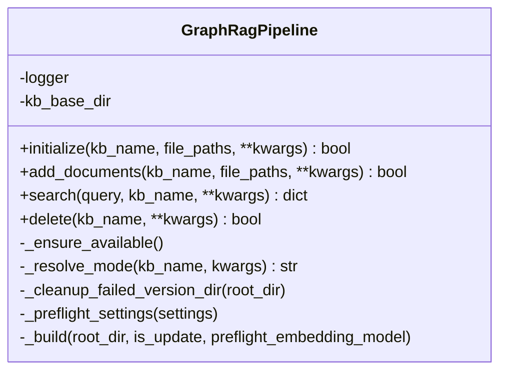

**图表来源**
- [deeptutor/services/rag/pipelines/graphrag/pipeline.py:39-65](file://deeptutor/services/rag/pipelines/graphrag/pipeline.py#L39-L65)
- [deeptutor/services/rag/pipelines/graphrag/pipeline.py:67-85](file://deeptutor/services/rag/pipelines/graphrag/pipeline.py#L67-L85)
- [deeptutor/services/rag/pipelines/graphrag/pipeline.py:88-121](file://deeptutor/services/rag/pipelines/graphrag/pipeline.py#L88-L121)
- [deeptutor/services/rag/pipelines/graphrag/pipeline.py:123-185](file://deeptutor/services/rag/pipelines/graphrag/pipeline.py#L123-L185)
- [deeptutor/services/rag/pipelines/graphrag/pipeline.py:189-251](file://deeptutor/services/rag/pipelines/graphrag/pipeline.py#L189-L251)

关键点：
- 增量更新前会预检 settings，避免坏配置覆盖工作目录。
- 查询若无已发布索引，返回 `needs_reindex=True`。
- 错误统一通过 `_error_result` 返回结构化错误。

**章节来源**
- [deeptutor/services/rag/pipelines/graphrag/pipeline.py:39-285](file://deeptutor/services/rag/pipelines/graphrag/pipeline.py#L39-L285)

### PageIndex 管道
PageIndexPipeline 的职责包括：
- 支持云端与本地 OSS 两种模式。
- 文档提交、清单管理与元数据写入。
- 明确禁止通过 `search()` 直接回答，要求通过 Agent 工具进行“推理即检索”。

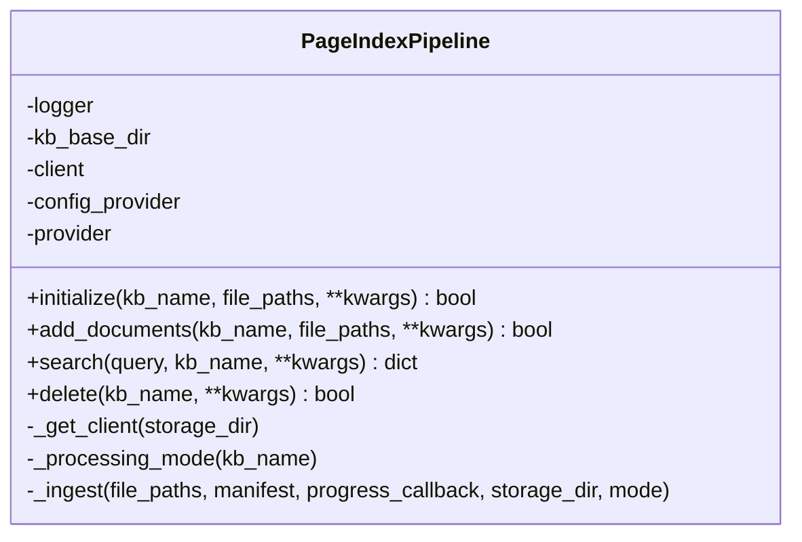

**图表来源**
- [deeptutor/services/rag/pipelines/pageindex/pipeline.py:57-84](file://deeptutor/services/rag/pipelines/pageindex/pipeline.py#L57-L84)
- [deeptutor/services/rag/pipelines/pageindex/pipeline.py:109-143](file://deeptutor/services/rag/pipelines/pageindex/pipeline.py#L109-L143)
- [deeptutor/services/rag/pipelines/pageindex/pipeline.py:145-176](file://deeptutor/services/rag/pipelines/pageindex/pipeline.py#L145-L176)
- [deeptutor/services/rag/pipelines/pageindex/pipeline.py:178-207](file://deeptutor/services/rag/pipelines/pageindex/pipeline.py#L178-L207)
- [deeptutor/services/rag/pipelines/pageindex/pipeline.py:211-224](file://deeptutor/services/rag/pipelines/pageindex/pipeline.py#L211-L224)
- [deeptutor/services/rag/pipelines/pageindex/pipeline.py:243-263](file://deeptutor/services/rag/pipelines/pageindex/pipeline.py#L243-L263)

关键点：
- 云端模式删除时会尝试远程删除文档 ID。
- OSS 模式保留本地存储目录。
- `search()` 固定返回“需要推理即检索”的错误类型。

**章节来源**
- [deeptutor/services/rag/pipelines/pageindex/pipeline.py:57-314](file://deeptutor/services/rag/pipelines/pageindex/pipeline.py#L57-L314)

### 工具入口（rag_tool）
`rag_tool.py` 提供面向外部调用的异步函数：
- `rag_search`：校验参数、解析 KB 路径、构造 `RAGService` 并调用 `search`。
- `initialize_rag` / `delete_rag`：封装索引与删除操作。
- `get_available_providers` / `get_current_provider`：暴露 provider 列表与当前全局默认 provider。

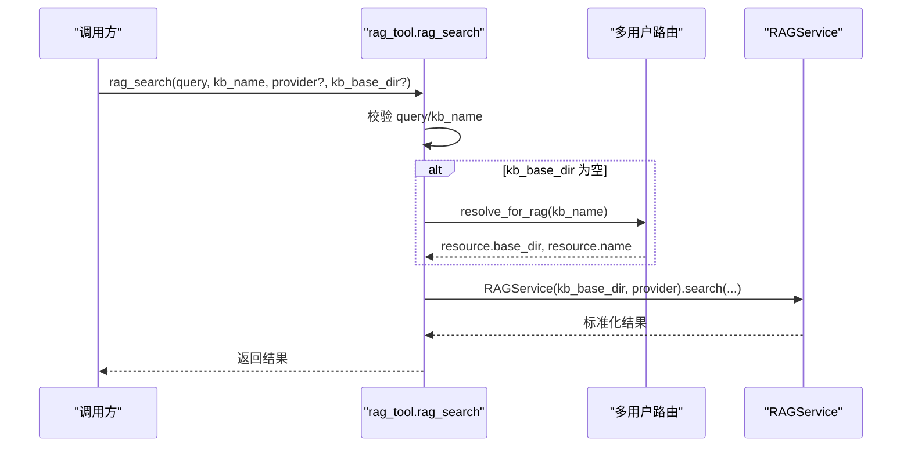

**图表来源**
- [deeptutor/tools/rag_tool.py:15-51](file://deeptutor/tools/rag_tool.py#L15-L51)

**章节来源**
- [deeptutor/tools/rag_tool.py:1-111](file://deeptutor/tools/rag_tool.py#L1-L111)

## 依赖关系分析
RAG 子系统的关键依赖关系如下：
- `RAGService` 依赖 `factory.get_pipeline` 获取具体管道。
- `factory` 依赖各 `pipelines.*.pipeline` 模块，按需导入以避免不必要的依赖加载。
- `RAGService.search` 依赖 `query_rewrite.maybe_rewrite` 进行查询重写。
- `RAGService._capture_raw_logs` 依赖 logging 与进程日志桥接，捕获第三方库日志。
- 各管道依赖各自的配置、客户端、存储与引擎模块。

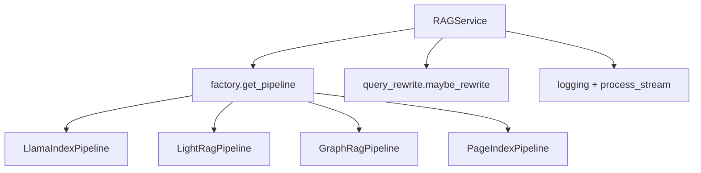

**图表来源**
- [deeptutor/services/rag/service.py:15-17](file://deeptutor/services/rag/service.py#L15-L17)
- [deeptutor/services/rag/service.py:156-171](file://deeptutor/services/rag/service.py#L156-L171)
- [deeptutor/services/rag/service.py:263-333](file://deeptutor/services/rag/service.py#L263-L333)
- [deeptutor/services/rag/factory.py:136-209](file://deeptutor/services/rag/factory.py#L136-L209)

**章节来源**
- [deeptutor/services/rag/service.py:15-17](file://deeptutor/services/rag/service.py#L15-L17)
- [deeptutor/services/rag/service.py:156-171](file://deeptutor/services/rag/service.py#L156-L171)
- [deeptutor/services/rag/service.py:263-333](file://deeptutor/services/rag/service.py#L263-L333)
- [deeptutor/services/rag/factory.py:136-209](file://deeptutor/services/rag/factory.py#L136-L209)

## 性能与可扩展性
- **管道缓存**：工厂在无自定义参数时使用 `(kb_base_dir, provider)` 作为键缓存实例，减少重复构建开销。
- **嵌入签名版本化**：LlamaIndex 管道按 embedding signature 选择索引目录，避免模型变更后索引不可用。
- **停滞检测**：LlamaIndex 管道通过 `_run_with_stall_guard` 监控同步步骤的进度心跳，超时抛出明确错误。
- **模式解析**：LightRAG/GraphRAG 通过 `resolve_kb_mode` 提供一致的模式优先级，便于配置驱动的行为切换。
- **可扩展性**：新增 provider 只需实现 `RAGPipeline` 协议并在工厂中注册，即可被 `RAGService` 透明调用。

建议实践：
- 对长耗时索引操作，尽量使用 `progress_callback` 与 `indexed_file_callback` 反馈进度与已索引文件。
- 对第三方库日志，优先使用 `RAGService._capture_raw_logs` 捕获并过滤噪音。
- 对模式感知型引擎，优先通过 `kb_config.json` 配置 `search_mode`，避免每次调用都传参。

[本节为通用指导，不直接分析具体文件]

## 故障排查指南
常见错误与定位方法：
- **未安装可选依赖**：LightRAG/GraphRAG 在未安装时会抛出明确的 `NotAvailableError`，提示安装命令。
- **索引缺失或不匹配**：LlamaIndex 查询时若找不到匹配索引，返回 `needs_reindex=True` 与提示消息。
- **PageIndex 误用**：直接调用 `search()` 会返回 `reasoning_as_retrieval_required`，应改用 Agent 工具。
- **嵌入模型变更**：LlamaIndex 管道可能产生 `embedding_mismatch` 警告，建议重建索引。
- **LightRAG 追加失败**：若目标索引为旧版或未发布，会抛出需要重建的错误。

建议步骤：
1. 确认 provider 是否正确绑定到 KB。
2. 检查对应 provider 的安装与配置就绪状态（可通过 `list_pipelines` 探测）。
3. 查看 `RAGService.search` 返回的 `error_type` 与 `needs_reindex`。
4. 查看日志中的 raw_log 事件，定位第三方库报错。
5. 对 LlamaIndex/LightRAG/GraphRAG，检查索引目录与元数据是否完整。

**章节来源**
- [deeptutor/services/rag/pipelines/lightrag/pipeline.py:105-110](file://deeptutor/services/rag/pipelines/lightrag/pipeline.py#L105-L110)
- [deeptutor/services/rag/pipelines/graphrag/pipeline.py:48-53](file://deeptutor/services/rag/pipelines/graphrag/pipeline.py#L48-L53)
- [deeptutor/services/rag/pipelines/llamaindex/pipeline.py:357-372](file://deeptutor/services/rag/pipelines/llamaindex/pipeline.py#L357-L372)
- [deeptutor/services/rag/pipelines/pageindex/pipeline.py:211-224](file://deeptutor/services/rag/pipelines/pageindex/pipeline.py#L211-L224)

## 结论
DeepTutor 的 RAG 子系统通过统一服务、管道协议与工厂模式，实现了多提供商的可插拔架构。服务层负责 provider 解析、结果标准化、日志捕获与事件输出；工厂层负责实例化与缓存；各管道层专注自身引擎的细节实现。该设计既保证了易用性与一致性，也为扩展新 provider 与集成第三方服务提供了清晰的扩展点。

[本节为总结，不直接分析具体文件]

## 附录：扩展指南

### 扩展新的 RAG 提供商
步骤：
1. 在 `pipelines/<new_provider>` 下实现一个类，满足 `RAGPipeline` 协议（`initialize`、`add_documents`、`search`、`delete`）。
2. 在 `factory._build_pipeline` 中添加 provider 分支，返回新管道实例。
3. 在 `factory.list_pipelines` 中描述新 provider 的名称、描述、是否需 API Key、模式列表与默认模式。
4. 如需模式解析，参考 `modes.resolve_kb_mode` 的实现。

注意事项：
- 返回结果需包含 `query`、`answer`/`content`、`sources`、`provider`。
- 若需要错误类型，返回 `error_type` 字段以便上层统一处理。
- 若需要进度回调，支持 `progress_callback` 与 `indexed_file_callback`。

**章节来源**
- [deeptutor/services/rag/pipelines/base.py:16-38](file://deeptutor/services/rag/pipelines/base.py#L16-L38)
- [deeptutor/services/rag/factory.py:136-209](file://deeptutor/services/rag/factory.py#L136-L209)
- [deeptutor/services/rag/factory.py:212-348](file://deeptutor/services/rag/factory.py#L212-L348)
- [deeptutor/services/rag/pipelines/modes.py:19-45](file://deeptutor/services/rag/pipelines/modes.py#L19-L45)

### 自定义管道组件
- **文档加载器**：参考 LlamaIndex 的 `LlamaIndexDocumentLoader`，实现文件解析与视觉资产收集。
- **嵌入适配器**：参考 LlamaIndex 的 `embedding_adapter`，配置嵌入模型与连接验证。
- **向量存储**：参考 LlamaIndex 的 `storage`，实现索引创建、追加、检索与删除。
- **检索器**：参考 LlamaIndex 的 `retrievers`，实现混合 BM25/向量融合或其他检索策略。

**章节来源**
- [deeptutor/services/rag/pipelines/llamaindex/pipeline.py:27-37](file://deeptutor/services/rag/pipelines/llamaindex/pipeline.py#L27-L37)

### 集成第三方服务
- **LightRAG Server**：通过 HTTP 客户端连接外部服务，无需本地索引。
- **IMA/WeKnora/Kiwix**：通过各自 SDK/REST API 连接外部知识库，KB 仅保存连接指针。
- **PageIndex Cloud/OSS**：云端模式通过 SDK 提交文档，OSS 模式使用本地库。

**章节来源**
- [deeptutor/services/rag/factory.py:158-184](file://deeptutor/services/rag/factory.py#L158-L184)
- [deeptutor/services/rag/pipelines/pageindex/pipeline.py:57-84](file://deeptutor/services/rag/pipelines/pageindex/pipeline.py#L57-L84)