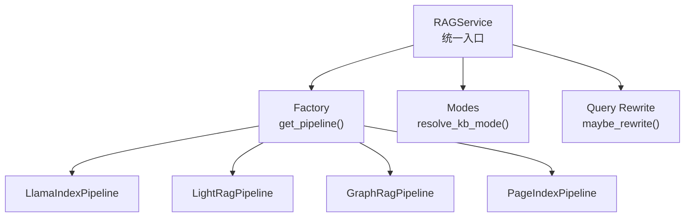
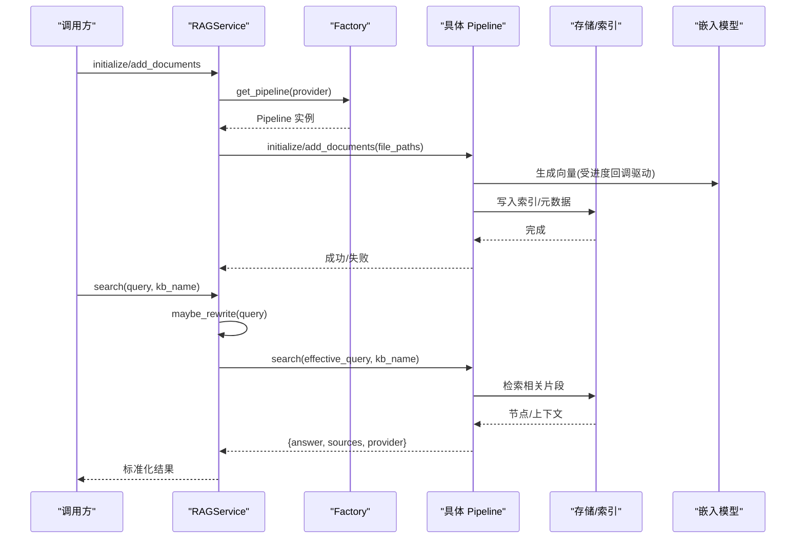
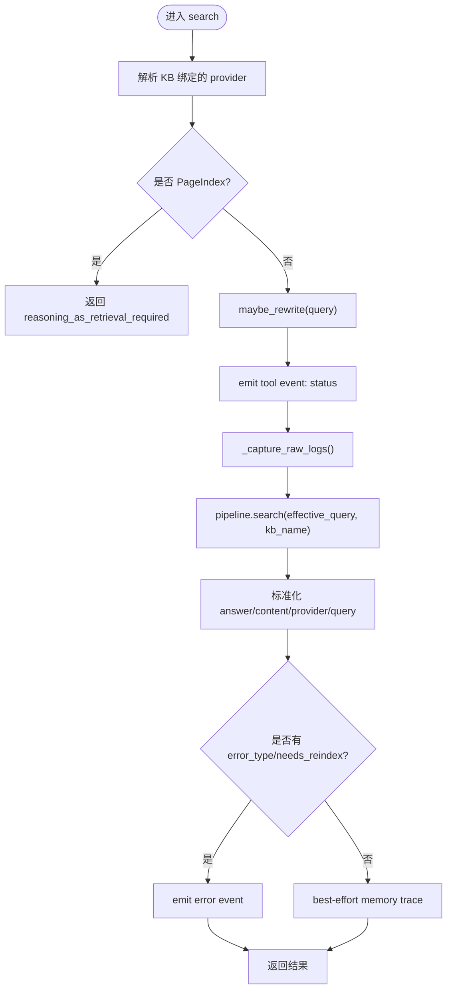
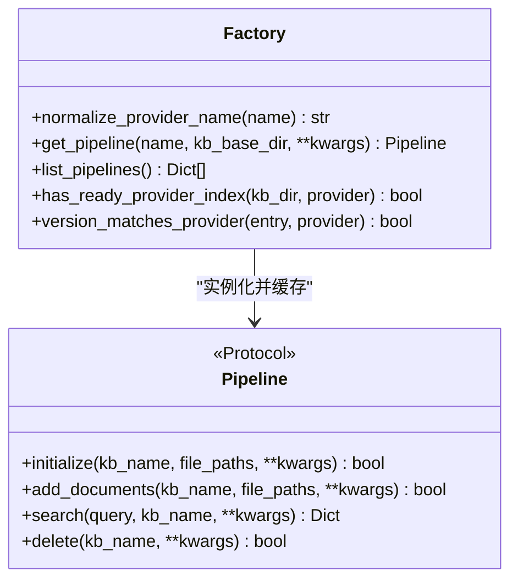
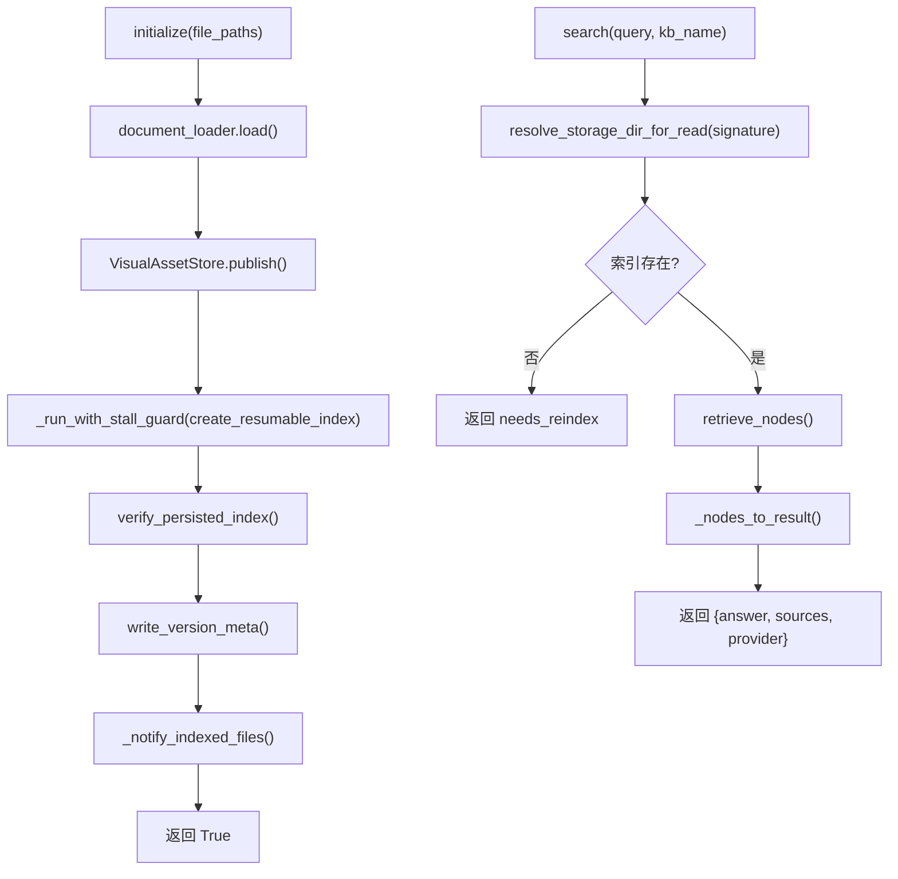
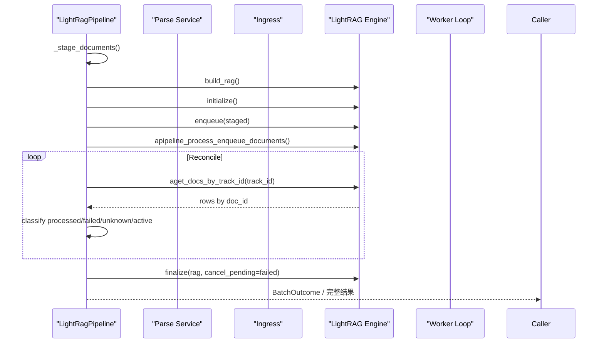
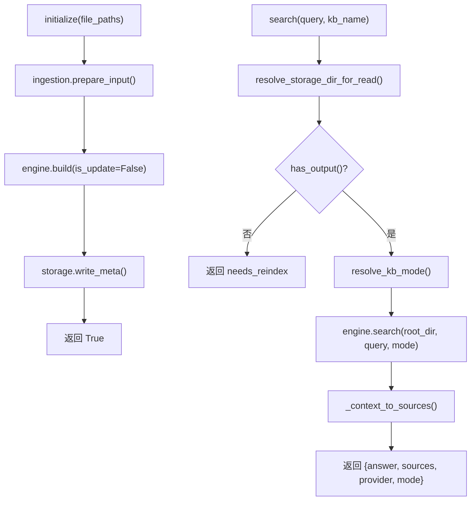
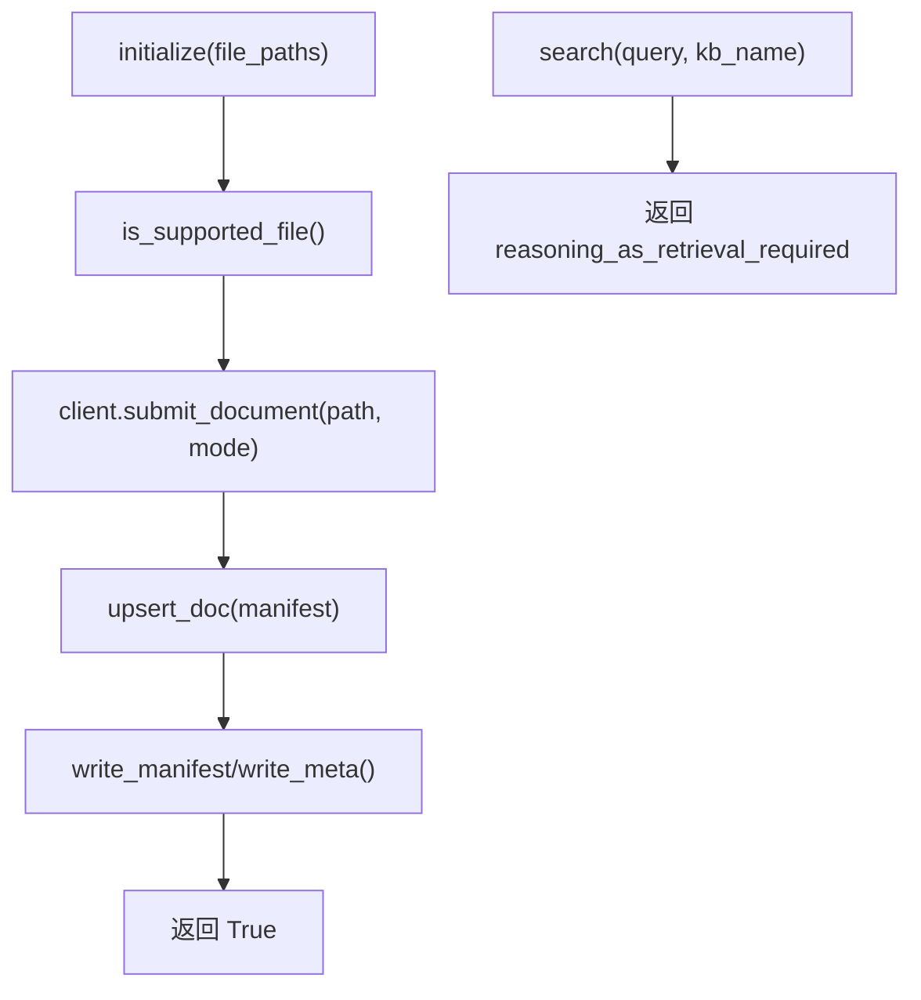
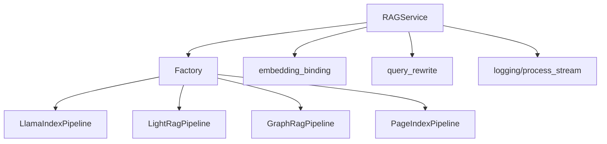

# RAG 管道系统

<cite>
**本文引用的文件**   
- [service.py](file://deeptutor/services/rag/service.py)
- [factory.py](file://deeptutor/services/rag/factory.py)
- [base.py](file://deeptutor/services/rag/pipelines/base.py)
- [modes.py](file://deeptutor/services/rag/pipelines/modes.py)
- [llamaindex_pipeline.py](file://deeptutor/services/rag/pipelines/llamaindex/pipeline.py)
- [lightrag_pipeline.py](file://deeptutor/services/rag/pipelines/lightrag/pipeline.py)
- [graphrag_pipeline.py](file://deeptutor/services/rag/pipelines/graphrag/pipeline.py)
- [pageindex_pipeline.py](file://deeptutor/services/rag/pipelines/pageindex/pipeline.py)
- [initializer.py](file://deeptutor/knowledge/initializer.py)
</cite>

## 目录
1. [简介](#简介)
2. [项目结构](#项目结构)
3. [核心组件](#核心组件)
4. [架构总览](#架构总览)
5. [详细组件分析](#详细组件分析)
6. [依赖关系分析](#依赖关系分析)
7. [性能与可观测性](#性能与可观测性)
8. [故障排查指南](#故障排查指南)
9. [结论](#结论)
10. [附录：扩展与自定义指南](#附录扩展与自定义指南)

## 简介
本文件面向 DeepTutor 的检索增强生成（RAG）管道系统，系统性说明其整体架构、文档解析与向量化流程、索引构建与语义检索路径、不同 RAG 提供商的实现差异与配置方式，以及生命周期管理、错误处理、性能优化和调试方法。读者可从初学者视角理解“文档如何变成向量、如何被检索、如何用于回答”，同时也能获得高级用户需要的扩展点、实现细节和排错建议。

## 项目结构
DeepTutor 的 RAG 能力集中在 `deeptutor/services/rag` 下，采用“统一服务 + 工厂 + 多管道”的结构：
- 统一入口：`RAGService` 负责按知识库绑定选择具体管道、封装查询重写、日志捕获、进度追踪等横切逻辑。
- 工厂层：`factory.get_pipeline` 根据 provider 名称实例化对应管道，并缓存实例。
- 管道契约：`pipelines.base.RAGPipeline` 定义统一的异步接口，所有后端必须实现初始化、增量添加、搜索、删除等方法。
- 各提供商实现：LlamaIndex、LightRAG、GraphRAG、PageIndex、IMA、WeKnora、Kiwix 等分别位于各自子包中。

**图示来源**
- [service.py:22-65](file://deeptutor/services/rag/service.py#L22-L65)
- [factory.py:136-209](file://deeptutor/services/rag/factory.py#L136-L209)
- [base.py:16-38](file://deeptutor/services/rag/pipelines/base.py#L16-L38)
- [modes.py:19-45](file://deeptutor/services/rag/pipelines/modes.py#L19-L45)

**章节来源**
- [service.py:1-65](file://deeptutor/services/rag/service.py#L1-L65)
- [factory.py:1-30](file://deeptutor/services/rag/factory.py#L1-L30)
- [base.py:1-41](file://deeptutor/services/rag/pipelines/base.py#L1-L41)

## 核心组件
- RAGService：统一编排知识库的索引、增量添加、检索、删除；按 KB 绑定选择 provider；封装查询重写、原始日志捕获、内存 trace、事件输出。
- Factory：provider 名称标准化、管道实例缓存、可用管道列表描述、版本匹配与就绪检查工具函数。
- RAGPipeline 协议：强制每个后端提供 initialize/add_documents/search/delete 四个异步方法，保证上层调用一致。
- Modes：为 LightRAG、GraphRAG 等模式感知型引擎提供统一的 mode 解析策略。

关键职责边界：
- Service 不关心底层如何实现检索，只关注结果字段规范、错误类型、事件与日志。
- Factory 屏蔽 provider 差异，对外暴露 get_pipeline(name, kb_base_dir)。
- Pipeline 实现具体的文档加载、分块、嵌入、索引、检索、清理。

**章节来源**
- [service.py:22-124](file://deeptutor/services/rag/service.py#L22-L124)
- [factory.py:37-108](file://deeptutor/services/rag/factory.py#L37-L108)
- [base.py:16-38](file://deeptutor/services/rag/pipelines/base.py#L16-L38)
- [modes.py:1-49](file://deeptutor/services/rag/pipelines/modes.py#L1-L49)

## 架构总览
下图展示一次典型的知识库构建与检索请求在系统中的流转：

**图示来源**
- [service.py:67-250](file://deeptutor/services/rag/service.py#L67-L250)
- [factory.py:193-209](file://deeptutor/services/rag/factory.py#L193-L209)
- [llamaindex_pipeline.py:230-310](file://deeptutor/services/rag/pipelines/llamaindex/pipeline.py#L230-L310)
- [lightrag_pipeline.py:382-468](file://deeptutor/services/rag/pipelines/lightrag/pipeline.py#L382-L468)
- [graphrag_pipeline.py:88-121](file://deeptutor/services/rag/pipelines/graphrag/pipeline.py#L88-L121)
- [pageindex_pipeline.py:109-143](file://deeptutor/services/rag/pipelines/pageindex/pipeline.py#L109-L143)

## 详细组件分析

### RAGService：统一入口与横切逻辑
- Provider 解析：优先使用构造时传入的 provider，否则从知识库绑定读取。
- 索引编排：initialize/add_documents 统一走 `_index`，包装 IndexingRun、进度回调、文档状态、版本就绪检查。
- 检索编排：search 支持 query rewrite、事件输出、raw log 捕获、memory trace、错误类型透传。
- 删除与智能检索：delete 委托 pipeline 或回退到目录删除；smart_retrieve 基于多查询提示进行多次检索聚合。

**图示来源**
- [service.py:126-250](file://deeptutor/services/rag/service.py#L126-L250)
- [service.py:252-333](file://deeptutor/services/rag/service.py#L252-L333)

**章节来源**
- [service.py:22-124](file://deeptutor/services/rag/service.py#L22-L124)
- [service.py:126-333](file://deeptutor/services/rag/service.py#L126-L333)

### Factory：Provider 路由与管道缓存
- 已知 provider 集合：包含 llamaindex、pageindex、pageindex-oss、graphrag、lightrag、lightrag-server、ima、weknora、kiwix。
- normalize_provider_name：未知字符串回退默认 provider，避免旧配置导致不可用。
- get_pipeline：按 (kb_base_dir, provider) 缓存实例；带自定义参数时跳过缓存。
- list_pipelines：探测各 provider 可用性并向 UI 暴露描述信息。

**图示来源**
- [factory.py:37-108](file://deeptutor/services/rag/factory.py#L37-L108)
- [factory.py:136-209](file://deeptutor/services/rag/factory.py#L136-L209)
- [factory.py:212-348](file://deeptutor/services/rag/factory.py#L212-L348)
- [base.py:16-38](file://deeptutor/services/rag/pipelines/base.py#L16-L38)

**章节来源**
- [factory.py:37-108](file://deeptutor/services/rag/factory.py#L37-L108)
- [factory.py:136-209](file://deeptutor/services/rag/factory.py#L136-L209)
- [factory.py:212-348](file://deeptutor/services/rag/factory.py#L212-L348)

### LlamaIndexPipeline：本地向量检索与混合 BM25
- 文档加载：通过 LlamaIndexDocumentLoader 解析多种格式，收集视觉资产候选。
- 索引构建：计算 embedding signature，创建可恢复的候选目录，执行 chunking+embedding，持久化索引，发布版本元数据。
- 检索路径：按 embedding signature 选择已发布索引，执行 retrieve_nodes，组装 sources 与 answer。
- 健壮性：worker 锁防止同 KB 并发索引；stall guard 检测长时间无进展；失败目录清理；exercise 精确查找。

**图示来源**
- [llamaindex_pipeline.py:230-310](file://deeptutor/services/rag/pipelines/llamaindex/pipeline.py#L230-L310)
- [llamaindex_pipeline.py:322-418](file://deeptutor/services/rag/pipelines/llamaindex/pipeline.py#L322-L418)
- [llamaindex_pipeline.py:440-490](file://deeptutor/services/rag/pipelines/llamaindex/pipeline.py#L440-L490)

**章节来源**
- [llamaindex_pipeline.py:181-310](file://deeptutor/services/rag/pipelines/llamaindex/pipeline.py#L181-L310)
- [llamaindex_pipeline.py:322-490](file://deeptutor/services/rag/pipelines/llamaindex/pipeline.py#L322-L490)

### LightRagPipeline：图+向量检索与原生文档管线
- 可用性检查：未安装 rag-lightrag 时抛出明确错误。
- 文档阶段化：parse_service.parse -> ingress.freeze_document，支持图像分析开关。
- 批处理协调：enqueue -> apipeline_process_enqueue_documents -> reconcile 轮询 track_id 状态，统计 processed/failed/nonterminal/missing。
- 版本与策略：保存 indexing_policy、embedding_config，支持追加更新与新建版本。
- 检索：latest_published_root -> engine.query_with_sources(mode)，返回 answer/sources/provider/mode。

**图示来源**
- [lightrag_pipeline.py:124-152](file://deeptutor/services/rag/pipelines/lightrag/pipeline.py#L124-L152)
- [lightrag_pipeline.py:154-279](file://deeptutor/services/rag/pipelines/lightrag/pipeline.py#L154-L279)
- [lightrag_pipeline.py:280-372](file://deeptutor/services/rag/pipelines/lightrag/pipeline.py#L280-L372)
- [lightrag_pipeline.py:609-667](file://deeptutor/services/rag/pipelines/lightrag/pipeline.py#L609-L667)

**章节来源**
- [lightrag_pipeline.py:98-123](file://deeptutor/services/rag/pipelines/lightrag/pipeline.py#L98-L123)
- [lightrag_pipeline.py:124-372](file://deeptutor/services/rag/pipelines/lightrag/pipeline.py#L124-L372)
- [lightrag_pipeline.py:382-590](file://deeptutor/services/rag/pipelines/lightrag/pipeline.py#L382-L590)
- [lightrag_pipeline.py:609-677](file://deeptutor/services/rag/pipelines/lightrag/pipeline.py#L609-L677)

### GraphRagPipeline：本地知识图谱检索
- 可选依赖：未安装 graphrag 时抛出结构化错误。
- 输入准备：DeepTutor 先解析为文本，GraphRAG 仅接收 .txt。
- 构建流程：写 settings.yaml -> prepare_input -> engine.build -> write_meta。
- 检索：latest published root -> engine.search(root_dir, query, mode) -> 映射 context_data 为 sources。

**图示来源**
- [graphrag_pipeline.py:88-121](file://deeptutor/services/rag/pipelines/graphrag/pipeline.py#L88-L121)
- [graphrag_pipeline.py:189-231](file://deeptutor/services/rag/pipelines/graphrag/pipeline.py#L189-L231)
- [graphrag_pipeline.py:254-281](file://deeptutor/services/rag/pipelines/graphrag/pipeline.py#L254-L281)

**章节来源**
- [graphrag_pipeline.py:39-65](file://deeptutor/services/rag/pipelines/graphrag/pipeline.py#L39-L65)
- [graphrag_pipeline.py:88-121](file://deeptutor/services/rag/pipelines/graphrag/pipeline.py#L88-L121)
- [graphrag_pipeline.py:189-231](file://deeptutor/services/rag/pipelines/graphrag/pipeline.py#L189-L231)

### PageIndexPipeline：云端/本地 SDK 编排
- 不支持直接 search：返回 reasoning_as_retrieval_required，要求通过 agent loop 中的 PageIndex tools 读取。
- 索引编排：submit_document -> manifest 记录 doc_id -> write_manifest/write_meta。
- 删除：云端尝试删除远程文档，再删除本地 KB 目录。
- OSS 模式：支持本地 Local Library 路径，mode 可为 flash/standard。

**图示来源**
- [pageindex_pipeline.py:109-143](file://deeptutor/services/rag/pipelines/pageindex/pipeline.py#L109-L143)
- [pageindex_pipeline.py:178-207](file://deeptutor/services/rag/pipelines/pageindex/pipeline.py#L178-L207)
- [pageindex_pipeline.py:211-224](file://deeptutor/services/rag/pipelines/pageindex/pipeline.py#L211-L224)

**章节来源**
- [pageindex_pipeline.py:57-106](file://deeptutor/services/rag/pipelines/pageindex/pipeline.py#L57-L106)
- [pageindex_pipeline.py:109-176](file://deeptutor/services/rag/pipelines/pageindex/pipeline.py#L109-L176)
- [pageindex_pipeline.py:211-224](file://deeptutor/services/rag/pipelines/pageindex/pipeline.py#L211-L224)

### 知识库初始化入口
知识库初始化器会收集支持的文件、创建 RAGService、调用 initialize/add_documents，并通过 progress_tracker 上报进度。

**章节来源**
- [initializer.py:190-227](file://deeptutor/knowledge/initializer.py#L190-L227)

## 依赖关系分析
- RAGService 依赖 factory.get_pipeline 获取具体管道；依赖 embedding_binding.with_kb_embedding 装饰器注入 embedding 上下文；依赖 query_rewrite.maybe_rewrite 做查询改写；依赖 logging/process_stream 捕获 raw_log。
- Factory 依赖各 provider 的 config 模块探测可用性，并返回 UI 可用的管道清单。
- 各 Pipeline 依赖各自的 storage/engine/client/config 模块，但对外都遵循 RAGPipeline 协议。

**图示来源**
- [service.py:15-17](file://deeptutor/services/rag/service.py#L15-L17)
- [service.py:156-170](file://deeptutor/services/rag/service.py#L156-L170)
- [service.py:263-333](file://deeptutor/services/rag/service.py#L263-L333)
- [factory.py:136-209](file://deeptutor/services/rag/factory.py#L136-L209)

**章节来源**
- [service.py:15-17](file://deeptutor/services/rag/service.py#L15-L17)
- [service.py:156-170](file://deeptutor/services/rag/service.py#L156-L170)
- [service.py:263-333](file://deeptutor/services/rag/service.py#L263-L333)
- [factory.py:136-209](file://deeptutor/services/rag/factory.py#L136-L209)

## 性能与可观测性
- 并发与阻塞防护：
  - LlamaIndexPipeline 使用 worker 锁与 stall guard，防止同一 KB 并发索引与长时间无进展。
  - LightRagPipeline 使用 OwnerLoopBridge 与 run_in_worker_loop，隔离工作循环，避免阻塞主事件循环。
- 进度与可观测性：
  - Service 通过 indexed_file_callback、progress_callback 将进度与完成状态上报给 IndexingRun。
  - Service 捕获 lightrag/graphrag 等第三方 logger 的 INFO 日志，过滤噪音后以 raw_log 事件输出。
  - Memory trace 在检索成功后 best-effort 记录 KB 查询事件。
- 索引版本与兼容性：
  - LlamaIndex 使用 embedding signature 选择/重建索引；GraphRAG/LightRAG 使用 provider signature 与 embedding_config 校验兼容性。
  - modes.resolve_kb_mode 提供 KB 级、全局默认、内置默认的 mode 优先级。

**章节来源**
- [llamaindex_pipeline.py:106-179](file://deeptutor/services/rag/pipelines/llamaindex/pipeline.py#L106-L179)
- [lightrag_pipeline.py:296-372](file://deeptutor/services/rag/pipelines/lightrag/pipeline.py#L296-L372)
- [service.py:84-124](file://deeptutor/services/rag/service.py#L84-L124)
- [service.py:263-333](file://deeptutor/services/rag/service.py#L263-L333)
- [modes.py:19-45](file://deeptutor/services/rag/pipelines/modes.py#L19-L45)

## 故障排查指南
- “需要重新索引”类错误：
  - LlamaIndex：当当前 embedding signature 没有匹配索引时返回 needs_reindex。
  - LightRAG：当 latest_published_root 为空或需重建原生管线时返回 needs_reindex。
  - GraphRAG：当 no index yet 时返回 needs_reindex。
- Provider 未安装或未配置：
  - LightRAG：抛出 LightRagNotAvailableError，提示安装 rag-lightrag。
  - GraphRAG：抛出 GraphRagNotAvailableError，提示安装 graphrag。
  - PageIndex：search 直接返回 reasoning_as_retrieval_required，应改用 agent loop 中的 PageIndex tools。
- 索引卡住或无进展：
  - LlamaIndex：IndexingStallError 表示 embedding 长时间无进展，需检查嵌入端点或等待 worker 结束。
  - LightRAG：reconcile 超时返回 nonterminal/active 状态，需检查 LightRAG 进程与 VLM 能力。
- 日志与事件：
  - 使用 Service 的 event_sink 查看 status/raw_log 事件，定位 provider、kb_name、error_type、trace_layer。
  - 过滤 nano-vectordb 与 embedding 生成日志噪音，聚焦关键错误。

**章节来源**
- [llamaindex_pipeline.py:357-372](file://deeptutor/services/rag/pipelines/llamaindex/pipeline.py#L357-L372)
- [lightrag_pipeline.py:609-623](file://deeptutor/services/rag/pipelines/lightrag/pipeline.py#L609-L623)
- [graphrag_pipeline.py:189-206](file://deeptutor/services/rag/pipelines/graphrag/pipeline.py#L189-L206)
- [pageindex_pipeline.py:211-224](file://deeptutor/services/rag/pipelines/pageindex/pipeline.py#L211-L224)
- [service.py:263-333](file://deeptutor/services/rag/service.py#L263-L333)

## 结论
DeepTutor 的 RAG 管道系统通过统一服务与工厂抽象，将多种后端（LlamaIndex、LightRAG、GraphRAG、PageIndex 等）纳入一致的索引与检索契约。Service 层负责 provider 选择、查询重写、日志与事件、进度与版本就绪检查；各 Pipeline 实现具体的文档解析、向量化、索引构建与检索逻辑。系统在并发控制、进度反馈、错误分类与可观测性方面提供了完善的工程保障，便于初学者快速上手，也为高级用户提供清晰的扩展点与优化空间。

## 附录：扩展与自定义指南

### 如何自定义 RAG 管道
- 实现 RAGPipeline 协议：提供 initialize/add_documents/search/delete 四个异步方法，确保返回结果包含 query、answer/content、sources、provider。
- 注册新 provider：在 factory._build_pipeline 中添加分支，返回你的 Pipeline 实例；必要时在 list_pipelines 中暴露描述信息。
- 与 Service 集成：无需修改 Service 调用路径，只要符合协议即可被 RAGService 使用。

参考位置：
- [base.py:16-38](file://deeptutor/services/rag/pipelines/base.py#L16-L38)
- [factory.py:136-209](file://deeptutor/services/rag/factory.py#L136-L209)

### 如何集成新的嵌入模型
- LlamaIndex：通过 embedding_adapter.configure_llamaindex_settings 与 verify_embedding_connectivity 接入；signature_from_embedding_config 决定索引版本。
- LightRAG/GraphRAG：通过 embedding_config 与 require_compatible_embedding 校验兼容性；可在 indexing_snapshot 中固定 embedding 配置。
- Service 层：with_kb_embedding 装饰器确保 embedding 上下文在索引与检索期间可用。

参考位置：
- [llamaindex_pipeline.py:30-36](file://deeptutor/services/rag/pipelines/llamaindex/pipeline.py#L30-L36)
- [lightrag_pipeline.py:296-372](file://deeptutor/services/rag/pipelines/lightrag/pipeline.py#L296-L372)
- [graphrag_pipeline.py:172-185](file://deeptutor/services/rag/pipelines/graphrag/pipeline.py#L172-L185)
- [service.py:67-73](file://deeptutor/services/rag/service.py#L67-L73)

### 如何集成新的向量数据库
- LlamaIndex：vector_store.py 与 storage.py 负责持久化与检索；可按需替换底层存储实现。
- LightRAG/GraphRAG：各自 storage/engine 模块封装了底层存储；保持 API 契约即可替换。
- 注意版本与签名：新增存储时需考虑 embedding signature 与 provider signature 对索引版本的影响。

参考位置：
- [llamaindex_pipeline.py:27-36](file://deeptutor/services/rag/pipelines/llamaindex/pipeline.py#L27-L36)
- [lightrag_pipeline.py:24-33](file://deeptutor/services/rag/pipelines/lightrag/pipeline.py#L24-L33)
- [graphrag_pipeline.py:31-33](file://deeptutor/services/rag/pipelines/graphrag/pipeline.py#L31-L33)

### 监控与调试技巧
- 使用 event_sink 订阅 status/raw_log 事件，观察 query、provider、kb_name、error_type、trace_layer。
- 关注 IndexingRun 的 phase 与 document 状态，确认 embedding 阶段与最终版本。
- 对于 LightRAG，关注 reconcile 的 processed/failed/nonterminal/missing 统计，定位卡住文档。
- 对于 LlamaIndex，关注 stall guard 抛出的 IndexingStallError，检查嵌入端点与 worker 占用。

参考位置：
- [service.py:156-170](file://deeptutor/services/rag/service.py#L156-L170)
- [service.py:263-333](file://deeptutor/services/rag/service.py#L263-L333)
- [lightrag_pipeline.py:154-279](file://deeptutor/services/rag/pipelines/lightrag/pipeline.py#L154-L279)
- [llamaindex_pipeline.py:106-179](file://deeptutor/services/rag/pipelines/llamaindex/pipeline.py#L106-L179)