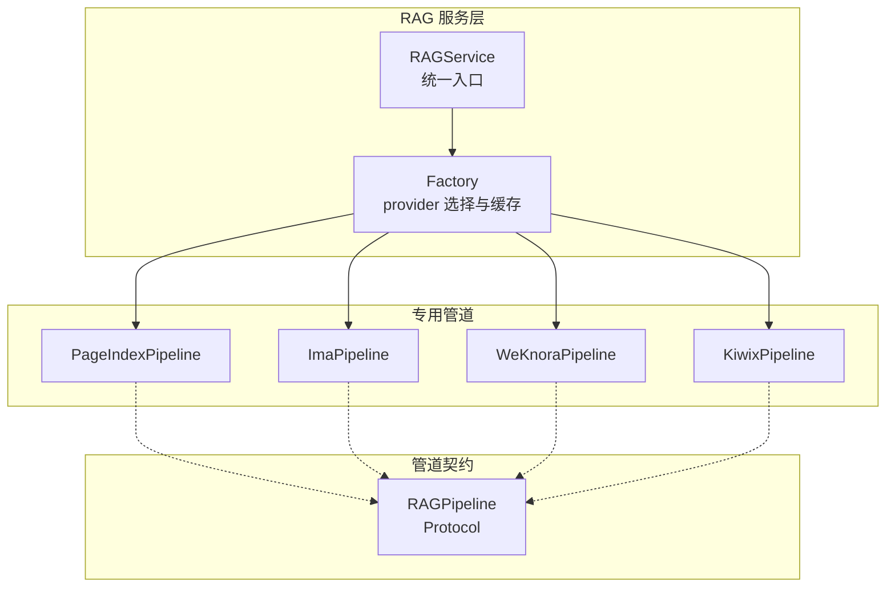
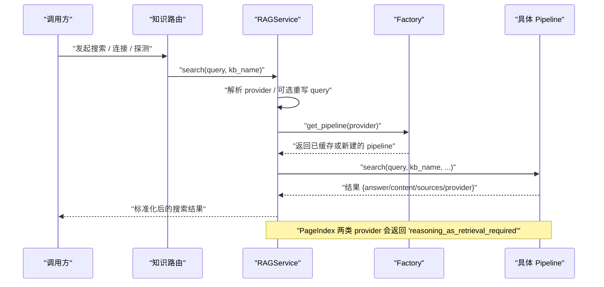
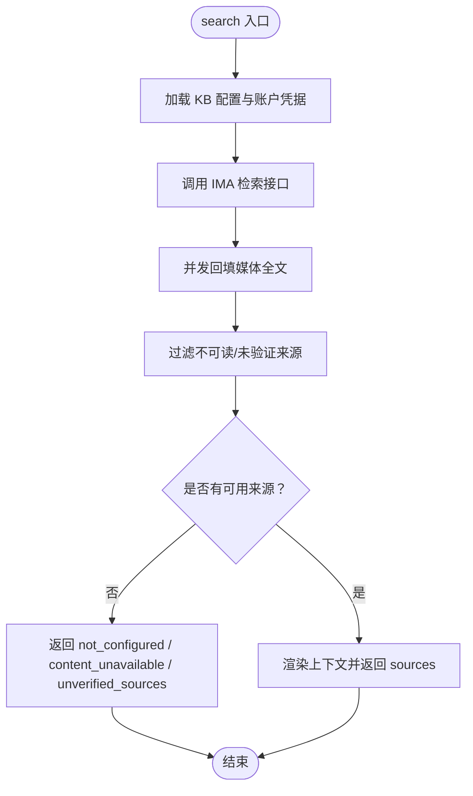
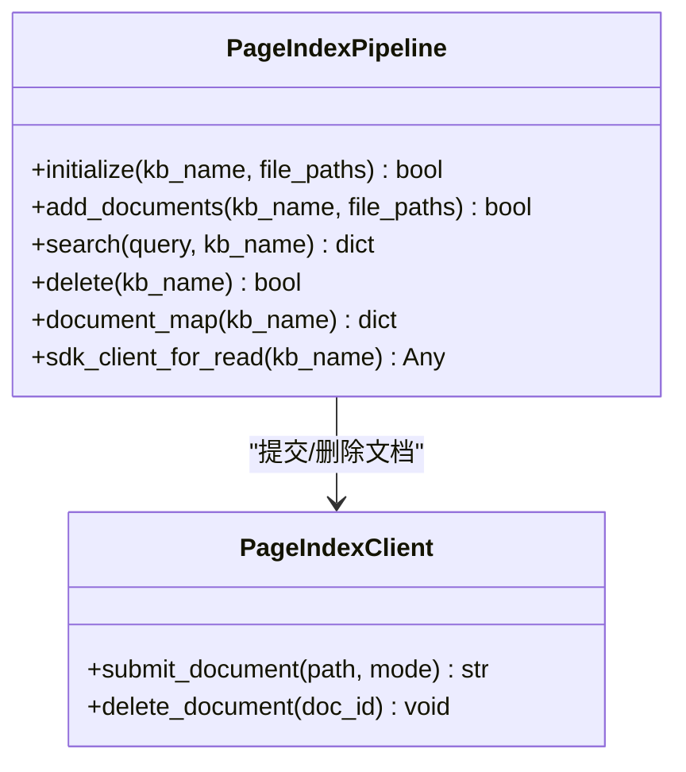
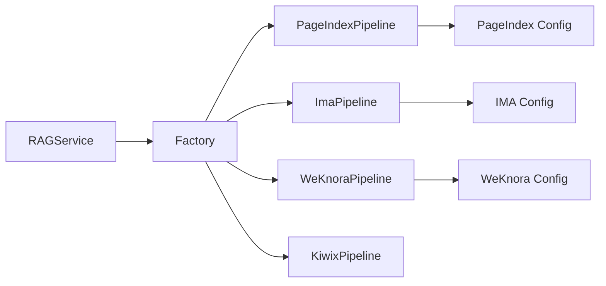

# 专用管道实现

<cite>
**本文引用的文件**   
- [deeptutor/services/rag/factory.py](file://deeptutor/services/rag/factory.py)
- [deeptutor/services/rag/service.py](file://deeptutor/services/rag/service.py)
- [deeptutor/services/rag/pipelines/base.py](file://deeptutor/services/rag/pipelines/base.py)
- [deeptutor/services/rag/pipelines/modes.py](file://deeptutor/services/rag/pipelines/modes.py)
- [deeptutor/services/rag/pipelines/pageindex/pipeline.py](file://deeptutor/services/rag/pipelines/pageindex/pipeline.py)
- [deeptutor/services/rag/pipelines/pageindex/config.py](file://deeptutor/services/rag/pipelines/pageindex/config.py)
- [deeptutor/services/rag/pipelines/ima/pipeline.py](file://deeptutor/services/rag/pipelines/ima/pipeline.py)
- [deeptutor/services/rag/pipelines/ima/config.py](file://deeptutor/services/rag/pipelines/ima/config.py)
- [deeptutor/services/rag/pipelines/weknora/pipeline.py](file://deeptutor/services/rag/pipelines/weknora/pipeline.py)
- [deeptutor/services/rag/pipelines/weknora/config.py](file://deeptutor/services/rag/pipelines/weknora/config.py)
- [deeptutor/services/rag/pipelines/kiwix/pipeline.py](file://deeptutor/services/rag/pipelines/kiwix/pipeline.py)
- [deeptutor/api/routers/knowledge.py](file://deeptutor/api/routers/knowledge.py)
</cite>

## 目录
1. [引言](#引言)
2. [项目结构](#项目结构)
3. [核心组件](#核心组件)
4. [架构总览](#架构总览)
5. [详细组件分析](#详细组件分析)
6. [依赖关系分析](#依赖关系分析)
7. [性能与容量特性](#性能与容量特性)
8. [故障排查指南](#故障排查指南)
9. [结论](#结论)
10. [附录：选择与迁移建议](#附录选择与迁移建议)

## 引言
本文件面向需要为特定业务场景选择并集成 RAG（检索增强生成）管道的工程师与产品人员，聚焦以下专用管道：
- IMA（图像媒体分析）：对接腾讯 IMA 知识库，零本地索引，按库查询并回填媒体内容。
- PageIndex（页面索引）：云端或本地 OSS 模式，文档由 SDK 管理；回答通过“以推理为检索”在智能体循环中使用工具完成。
- Kiwix（离线知识库）：对接已部署的 kiwix-serve ZIM 归档，仅拉取命中文章片段。
- WeKnora（中文优化）：对接自托管 WeKnora 实例，零本地索引，REST API 检索。

文档将说明各管道的职责边界、适用场景、配置方式、与通用管道的差异、性能特点、集成点与排错方法，并提供选型与迁移建议。

## 项目结构
RAG 子系统采用“统一服务 + 工厂 + 多管道”的结构：
- 统一入口：RAGService 负责按 KB 解析 provider、注入 query rewrite、事件与日志、以及调用具体 pipeline。
- 工厂：根据 provider 名称创建对应 pipeline 实例，并对可选能力进行探测与描述。
- 管道契约：所有 pipeline 实现统一的 RAGPipeline Protocol（initialize/add_documents/search/delete）。
- 专用管道：IMA、PageIndex、Kiwix、WeKnora 等各自位于 pipelines 子包内，提供连接配置、客户端与检索逻辑。

图表来源
- [deeptutor/services/rag/service.py:22-65](file://deeptutor/services/rag/service.py#L22-L65)
- [deeptutor/services/rag/factory.py:136-209](file://deeptutor/services/rag/factory.py#L136-L209)
- [deeptutor/services/rag/pipelines/base.py:16-38](file://deeptutor/services/rag/pipelines/base.py#L16-L38)

章节来源
- [deeptutor/services/rag/service.py:22-65](file://deeptutor/services/rag/service.py#L22-L65)
- [deeptutor/services/rag/factory.py:1-30](file://deeptutor/services/rag/factory.py#L1-L30)

## 核心组件
- RAGPipeline 契约：定义 initialize/add_documents/search/delete 四个异步方法，确保不同引擎可被统一调度。
- RAGService：
  - 按 KB 解析 provider（支持构造时覆盖），缓存 pipeline 实例。
  - search 流程包含 query rewrite、事件上报、raw log 捕获、错误类型标准化。
  - 对 PageIndex 两类 provider 直接返回“需使用智能体工具检索”的错误提示。
- Factory：
  - 维护已知 provider 集合，normalize 未知名回退默认。
  - 按 provider 延迟加载并构建 pipeline，支持 kb_base_dir 透传。
  - list_pipelines 暴露 UI 所需的能力、是否需 API Key、modes 等信息。

章节来源
- [deeptutor/services/rag/pipelines/base.py:1-42](file://deeptutor/services/rag/pipelines/base.py#L1-L42)
- [deeptutor/services/rag/service.py:56-124](file://deeptutor/services/rag/service.py#L56-L124)
- [deeptutor/services/rag/service.py:127-250](file://deeptutor/services/rag/service.py#L127-L250)
- [deeptutor/services/rag/factory.py:67-108](file://deeptutor/services/rag/factory.py#L67-L108)
- [deeptutor/services/rag/factory.py:136-209](file://deeptutor/services/rag/factory.py#L136-L209)
- [deeptutor/services/rag/factory.py:212-348](file://deeptutor/services/rag/factory.py#L212-L348)

## 架构总览
下图展示一次典型搜索请求从 HTTP 路由到具体 pipeline 的调用链，以及 PageIndex 的特殊路径。

图表来源
- [deeptutor/services/rag/service.py:127-250](file://deeptutor/services/rag/service.py#L127-L250)
- [deeptutor/services/rag/factory.py:193-209](file://deeptutor/services/rag/factory.py#L193-L209)
- [deeptutor/services/rag/pipelines/pageindex/pipeline.py:211-224](file://deeptutor/services/rag/pipelines/pageindex/pipeline.py#L211-L224)

## 详细组件分析

### IMA（图像媒体分析）管道
- 定位：纯检索型管道，不持有本地索引；KB 是 IMA 库的连接指针。
- 关键行为：
  - initialize/add_documents 抛出明确异常，强调文档应在 IMA 中管理。
  - delete 为空操作，避免误删用户 IMA 库。
  - search 读取 KB 配置与账户级凭据，调用 IMA OpenAPI 获取 passage，再并发回填媒体全文。
  - 对认证失败、限流、超时、网络错误进行分类 error_type 输出。
- 配置要点：
  - 账户级凭据（client_id/api_key）与 per-KB 的 knowledge_base_id；per-KB 字段优先。
  - SUPPORTED_MODES 为空元组，无搜索模式切换。
- 适用场景：
  - 已有 IMA 知识库，希望零拷贝接入 DeepTutor 检索，且需要图片/PDF 等多媒体内容回填。

图表来源
- [deeptutor/services/rag/pipelines/ima/pipeline.py:74-146](file://deeptutor/services/rag/pipelines/ima/pipeline.py#L74-L146)
- [deeptutor/services/rag/pipelines/ima/pipeline.py:148-195](file://deeptutor/services/rag/pipelines/ima/pipeline.py#L148-L195)
- [deeptutor/services/rag/pipelines/ima/config.py:61-127](file://deeptutor/services/rag/pipelines/ima/config.py#L61-L127)

章节来源
- [deeptutor/services/rag/pipelines/ima/pipeline.py:1-46](file://deeptutor/services/rag/pipelines/ima/pipeline.py#L1-L46)
- [deeptutor/services/rag/pipelines/ima/pipeline.py:74-243](file://deeptutor/services/rag/pipelines/ima/pipeline.py#L74-L243)
- [deeptutor/services/rag/pipelines/ima/config.py:1-141](file://deeptutor/services/rag/pipelines/ima/config.py#L1-L141)

### PageIndex（页面索引）管道
- 定位：文档生命周期由 PageIndex SDK 管理；回答通过“以推理为检索”，在智能体循环中使用 PageIndex 工具完成，而非 RAGService.search。
- 关键行为：
  - initialize/add_documents：校验扩展名、提交文档、写入 manifest/meta，支持 Cloud/OSS 两种模式。
  - search：直接返回 reasoning_as_retrieval_required，引导上层走智能体工具路径。
  - document_map/sdk_client_for_read：供上层注入文档列表与读取 SDK client。
- 配置要点：
  - Cloud 模式：全局 API Key；OSS 模式：本地 Local Library 路径。
  - 支持的文件格式：Cloud 支持 PDF/Office/文本/Markdown 等；OSS 当前仅 PDF。
- 适用场景：
  - 希望托管式向量无关检索（Cloud），或使用本地 LLM 的无向量化索引（OSS）。

图表来源
- [deeptutor/services/rag/pipelines/pageindex/pipeline.py:57-84](file://deeptutor/services/rag/pipelines/pageindex/pipeline.py#L57-L84)
- [deeptutor/services/rag/pipelines/pageindex/pipeline.py:109-207](file://deeptutor/services/rag/pipelines/pageindex/pipeline.py#L109-L207)
- [deeptutor/services/rag/pipelines/pageindex/pipeline.py:211-296](file://deeptutor/services/rag/pipelines/pageindex/pipeline.py#L211-L296)

章节来源
- [deeptutor/services/rag/pipelines/pageindex/pipeline.py:1-55](file://deeptutor/services/rag/pipelines/pageindex/pipeline.py#L1-L55)
- [deeptutor/services/rag/pipelines/pageindex/pipeline.py:109-207](file://deeptutor/services/rag/pipelines/pageindex/pipeline.py#L109-L207)
- [deeptutor/services/rag/pipelines/pageindex/pipeline.py:211-314](file://deeptutor/services/rag/pipelines/pageindex/pipeline.py#L211-L314)
- [deeptutor/services/rag/pipelines/pageindex/config.py:1-50](file://deeptutor/services/rag/pipelines/pageindex/config.py#L1-L50)

### Kiwix（离线知识库）管道
- 定位：对接已运行的 kiwix-serve 实例，只拉取匹配文章片段，不复制 ZIM 或重建索引。
- 关键行为：
  - search：校验 KB 类型为 kiwix，构造客户端并检索，组装 sources 与上下文。
  - initialize/add_documents：抛错，强调内容由外部 ZIM 管理。
  - delete：空操作，不触碰用户归档。
- 适用场景：
  - 已有离线百科/文档集（ZIM），需要快速接入检索而不引入额外存储。

章节来源
- [deeptutor/services/rag/pipelines/kiwix/pipeline.py:1-76](file://deeptutor/services/rag/pipelines/kiwix/pipeline.py#L1-L76)

### WeKnora（中文优化）管道
- 定位：对接自托管 WeKnora 实例，零本地索引，REST API 检索。
- 关键行为：
  - search：读取 per-KB 配置（base_url/api_key/knowledge_base_id），调用 WeKnora 检索接口，拼接 chunks。
  - initialize/add_documents：抛错，强调文档由 WeKnora 管理。
  - delete：空操作。
- 配置要点：
  - base_url 必须为 http/https 且不含敏感信息；api_key 与 knowledge_base_id 必填。
- 适用场景：
  - 已有 WeKnora 部署，希望以最小改动接入 DeepTutor 检索链路。

章节来源
- [deeptutor/services/rag/pipelines/weknora/pipeline.py:1-75](file://deeptutor/services/rag/pipelines/weknora/pipeline.py#L1-L75)
- [deeptutor/services/rag/pipelines/weknora/config.py:1-57](file://deeptutor/services/rag/pipelines/weknora/config.py#L1-L57)

## 依赖关系分析
- RAGService 依赖 Factory 解析 provider 并获取 pipeline；同时依赖 provider_binding 与 index_versioning 等基础设施。
- 各专用管道依赖各自的 config 模块解析凭据与连接参数，并通过 HTTP 客户端访问外部服务。
- PageIndex 与 IMA 在 API 层有额外的探测/连接端点，便于 UI 预检查。

图表来源
- [deeptutor/services/rag/service.py:15-17](file://deeptutor/services/rag/service.py#L15-L17)
- [deeptutor/services/rag/factory.py:136-209](file://deeptutor/services/rag/factory.py#L136-L209)
- [deeptutor/services/rag/pipelines/ima/config.py:61-127](file://deeptutor/services/rag/pipelines/ima/config.py#L61-L127)
- [deeptutor/services/rag/pipelines/weknora/config.py:33-48](file://deeptutor/services/rag/pipelines/weknora/config.py#L33-L48)
- [deeptutor/services/rag/pipelines/pageindex/config.py:19-42](file://deeptutor/services/rag/pipelines/pageindex/config.py#L19-L42)

章节来源
- [deeptutor/services/rag/service.py:127-250](file://deeptutor/services/rag/service.py#L127-L250)
- [deeptutor/services/rag/factory.py:212-348](file://deeptutor/services/rag/factory.py#L212-L348)

## 性能与容量特性
- IMA：
  - 检索阶段并发回填媒体全文，降低多次往返延迟；但受限于 IMA 服务端速率限制与媒体可读性。
  - top_k 上限受保护（默认较小，最大限制），避免过度填充 prompt。
- PageIndex：
  - Cloud/OSS 均不在 DeepTutor 侧维护向量索引；索引与检索由 SDK 处理。
  - search 不走 RAGService.search，而是通过智能体工具完成，适合复杂推理与文档导航。
- Kiwix：
  - 仅拉取命中文章片段，开销取决于 kiwix-serve 响应与文章内容大小。
- WeKnora：
  - 轻量 REST 检索，性能取决于后端实现与 chunk 数量。

[本节为通用指导，不直接分析具体文件]

## 故障排查指南
- IMA：
  - not_configured：缺少 client_id/api_key/knowledge_base_id。
  - authentication_error：凭据无效或权限不足。
  - rate_limited：达到 IMA 限流阈值，稍后重试。
  - timeout/network_error：网络不可达或超时。
  - unverified_sources/content_unavailable：命中但无法读取正文或来源不可信。
- PageIndex：
  - reasoning_as_retrieval_required：应改用智能体工具读取 KB，不要直接调用 rag search。
  - 初始化失败：检查文件格式、SDK 配置（Cloud key 或 OSS Local Library 路径）。
- Kiwix：
  - not_configured：KB 类型不是 kiwix 或缺少 server_url/zim_name。
  - retrieval_error：kiwix-serve 不可达或 ZIM 不可读。
- WeKnora：
  - not_configured：缺少 base_url/api_key/knowledge_base_id 或 URL 非法。
  - retrieval_error：WeKnora 服务不可用或鉴权失败。

章节来源
- [deeptutor/services/rag/pipelines/ima/pipeline.py:197-243](file://deeptutor/services/rag/pipelines/ima/pipeline.py#L197-L243)
- [deeptutor/services/rag/pipelines/pageindex/pipeline.py:211-224](file://deeptutor/services/rag/pipelines/pageindex/pipeline.py#L211-L224)
- [deeptutor/services/rag/pipelines/kiwix/pipeline.py:20-30](file://deeptutor/services/rag/pipelines/kiwix/pipeline.py#L20-L30)
- [deeptutor/services/rag/pipelines/weknora/pipeline.py:31-59](file://deeptutor/services/rag/pipelines/weknora/pipeline.py#L31-L59)

## 结论
- 若已有 IMA 知识库且需要多媒体内容回填，优先选择 IMA 管道。
- 若希望托管式检索或本地无向量索引，选择 PageIndex（注意通过智能体工具检索）。
- 若已有离线 ZIM 资源，选择 Kiwix 以最小成本接入检索。
- 若已有自托管 WeKnora 服务，选择 WeKnora 以获得轻量 REST 检索体验。
- 通用 LlamaIndex 管道仍可作为默认本地向量+BM25 方案，但在上述专用场景中，专用管道提供更清晰的职责边界与更低的运维复杂度。

[本节为总结性内容，不直接分析具体文件]

## 附录：选择与迁移建议

### 各管道优缺点对比
- IMA
  - 优点：零本地索引；支持多媒体回填；错误分类清晰。
  - 缺点：依赖 IMA 服务与配额；部分媒体可能不可读。
- PageIndex
  - 优点：托管/本地双模式；无需维护向量索引；适合复杂检索任务。
  - 缺点：不能通过 RAGService.search 直接回答；需智能体工具配合。
- Kiwix
  - 优点：完全离线；无需复制 ZIM；接入简单。
  - 缺点：依赖外部 kiwix-serve；内容更新在外部完成。
- WeKnora
  - 优点：自托管；轻量 REST；易于集成现有系统。
  - 缺点：性能与质量取决于后端实现。

### 与通用管道的差异点
- 通用 LlamaIndex 管道在本地维护向量与 BM25 索引；专用管道多为“连接指针 + 远程检索”。
- PageIndex 明确禁止通过 RAGService.search 回答，要求走智能体工具。
- IMA/Kiwix/WeKnora 的 initialize/add_documents 均为非职责范围，抛错或空操作。

### 迁移建议
- 从通用 LlamaIndex 迁移到 IMA：
  - 在 IMA 中维护文档；DeepTutor 侧仅绑定 library id 与凭据。
  - 关注 top_k 与媒体可读性；必要时调整检索策略。
- 迁移到 PageIndex：
  - 配置 Cloud API Key 或 OSS Local Library。
  - 将“直接搜索”改为“在智能体循环中使用 PageIndex 工具”。
- 迁移到 Kiwix：
  - 部署 kiwix-serve 并准备 ZIM；在 KB 配置中填写 server_url 与 zim_name。
- 迁移到 WeKnora：
  - 部署 WeKnora；在 KB 配置中填写 base_url、api_key、knowledge_base_id。

### 使用示例（概念性步骤）
- IMA：
  - 在 IMA 平台上传/管理文档。
  - 在 DeepTutor 中创建 KB，选择 IMA 引擎，填入 account 凭据与 knowledge_base_id。
  - 调用 RAGService.search；如出现 partial/unverified，检查媒体可读性与来源可信度。
- PageIndex：
  - 配置 Cloud Key 或 OSS Local Library。
  - 初始化/添加文档；不要调用 RAGService.search，改用智能体工具读取 KB。
- Kiwix：
  - 启动 kiwix-serve 并加载 ZIM。
  - 在 DeepTutor 中创建 KB，选择 Kiwix，填入 server_url 与 zim_name。
  - 调用 RAGService.search 获取文章片段。
- WeKnora：
  - 部署 WeKnora 并创建知识库。
  - 在 DeepTutor 中创建 KB，选择 WeKnora，填入 base_url、api_key、knowledge_base_id。
  - 调用 RAGService.search 获取 chunks。

[本节为概念性指导，不直接分析具体文件]