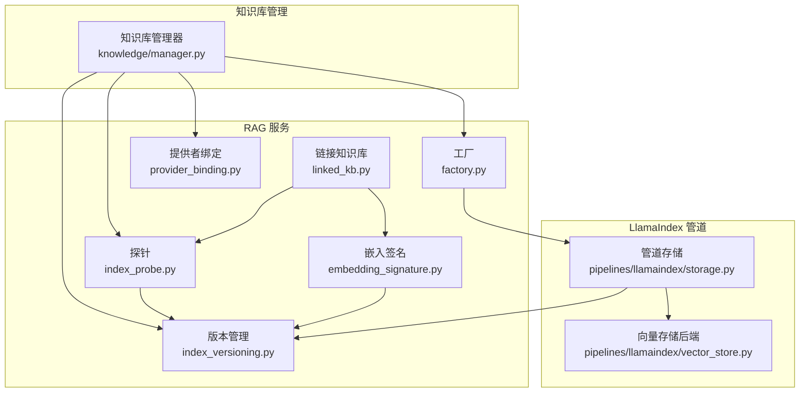
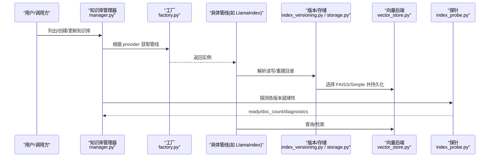
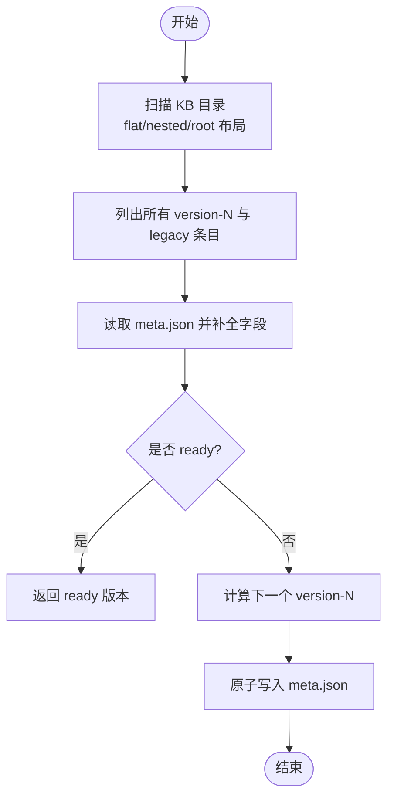
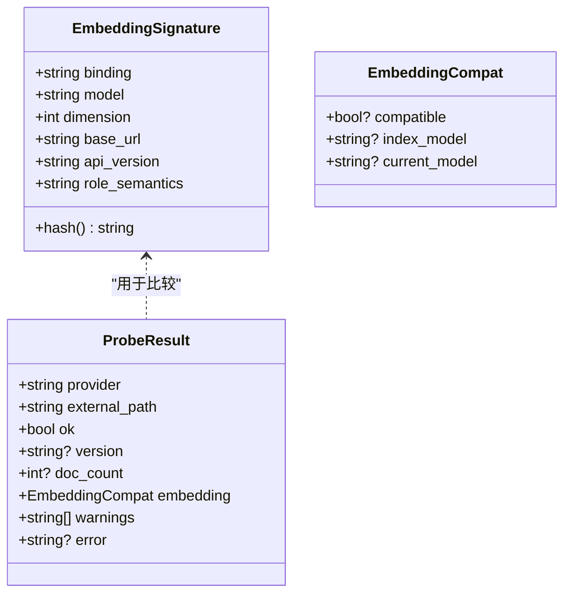
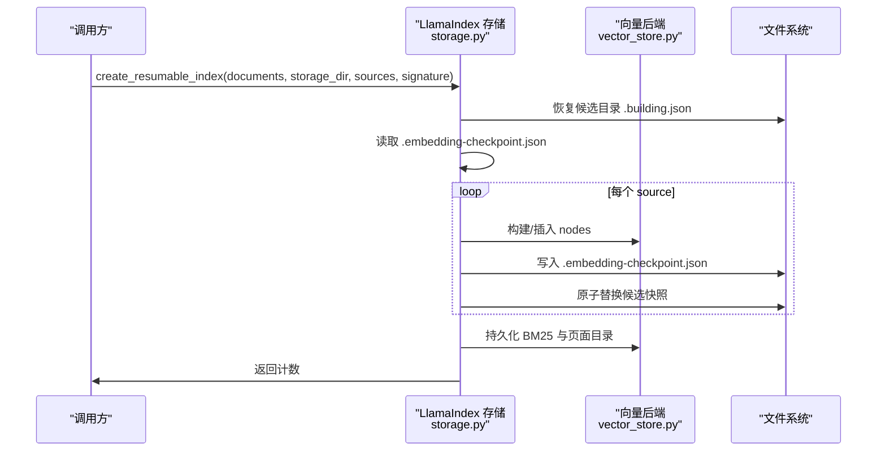
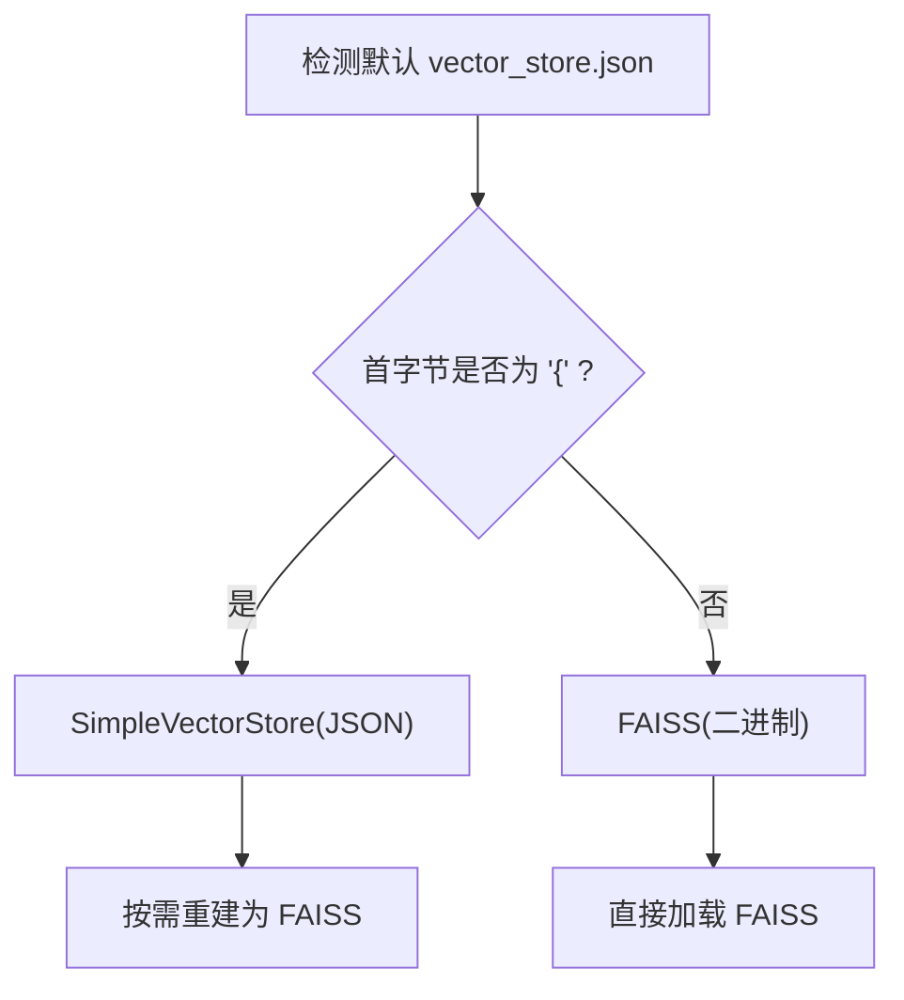
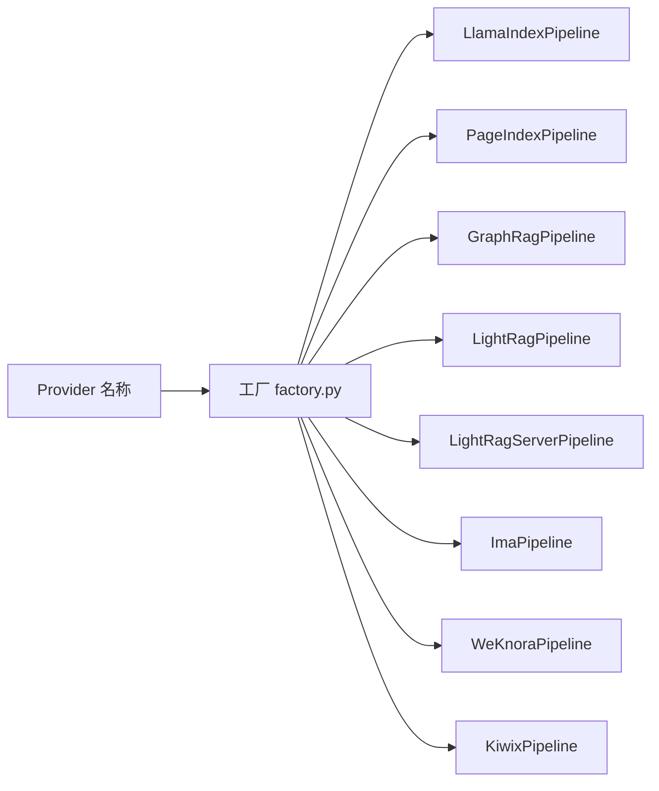
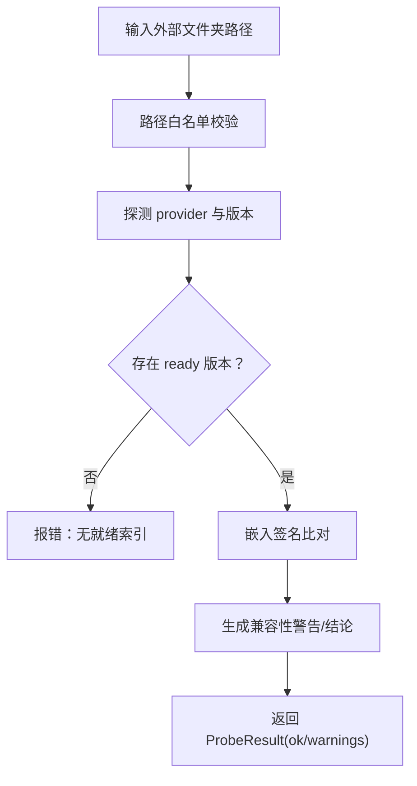
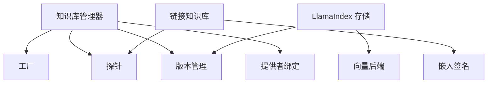

# 向量索引管理

<cite>
**本文引用的文件**   
- [index_versioning.py](file://deeptutor/services/rag/index_versioning.py)
- [embedding_signature.py](file://deeptutor/services/rag/embedding_signature.py)
- [linked_kb.py](file://deeptutor/services/rag/linked_kb.py)
- [storage.py](file://deeptutor/services/rag/pipelines/llamaindex/storage.py)
- [vector_store.py](file://deeptutor/services/rag/pipelines/llamaindex/vector_store.py)
- [factory.py](file://deeptutor/services/rag/factory.py)
- [index_probe.py](file://deeptutor/services/rag/index_probe.py)
- [provider_binding.py](file://deeptutor/services/rag/provider_binding.py)
- [manager.py](file://deeptutor/knowledge/manager.py)
</cite>

## 目录
1. [引言](#引言)
2. [项目结构](#项目结构)
3. [核心组件](#核心组件)
4. [架构总览](#架构总览)
5. [详细组件分析](#详细组件分析)
6. [依赖关系分析](#依赖关系分析)
7. [性能与扩展性](#性能与扩展性)
8. [运维指南：健康检查、备份恢复与故障排除](#运维指南健康检查备份恢复与故障排除)
9. [结论](#结论)
10. [附录：配置与选型建议](#附录配置与选型建议)

## 引言
本文面向“向量索引管理”的完整生命周期，覆盖向量数据的存储结构、版本管理、索引构建流程、嵌入签名机制、索引兼容性检查、版本迁移策略，以及不同 RAG 后端（LlamaIndex/FAISS、PageIndex、GraphRAG、LightRAG、WeKnora、IMA、Kiwix）的适配层实现。文档同时给出分片策略、增量更新与全量重建的处理逻辑，并提供面向初学者的概念说明和面向运维人员的部署维护指南。

## 项目结构
本仓库中与向量索引管理直接相关的代码集中在以下模块：
- 版本与元数据：`services/rag/index_versioning.py`
- 嵌入签名与兼容性：`services/rag/embedding_signature.py`、`services/rag/linked_kb.py`
- LlamaIndex 管道与存储：`services/rag/pipelines/llamaindex/storage.py`、`services/rag/pipelines/llamaindex/vector_store.py`
- 后端工厂与探测：`services/rag/factory.py`、`services/rag/index_probe.py`
- 提供者绑定与知识库管理：`services/rag/provider_binding.py`、`knowledge/manager.py`

**图表来源**
- [factory.py:37-107](file://deeptutor/services/rag/factory.py#L37-L107)
- [index_probe.py:40-108](file://deeptutor/services/rag/index_probe.py#L40-L108)
- [index_versioning.py:46-65](file://deeptutor/services/rag/index_versioning.py#L46-L65)
- [embedding_signature.py:13-30](file://deeptutor/services/rag/embedding_signature.py#L13-L30)
- [linked_kb.py:120-174](file://deeptutor/services/rag/linked_kb.py#L120-L174)
- [provider_binding.py:45-63](file://deeptutor/services/rag/provider_binding.py#L45-L63)
- [storage.py:164-170](file://deeptutor/services/rag/pipelines/llamaindex/storage.py#L164-L170)
- [vector_store.py:238-264](file://deeptutor/services/rag/pipelines/llamaindex/vector_store.py#L238-L264)

**章节来源**
- [factory.py:1-30](file://deeptutor/services/rag/factory.py#L1-L30)
- [index_probe.py:1-25](file://deeptutor/services/rag/index_probe.py#L1-L25)
- [index_versioning.py:1-23](file://deeptutor/services/rag/index_versioning.py#L1-L23)

## 核心组件
- 版本与布局：扁平化 `version-N` 目录 + `meta.json`；兼容旧版嵌套布局与根级单存储。
- 嵌入签名：基于绑定、模型、维度、基础 URL、API 版本等生成稳定哈希，用于选择/校验索引版本。
- 后端工厂：按 provider 名称选择 LlamaIndex、PageIndex、GraphRAG、LightRAG、WeKnora、IMA、Kiwix 等管线。
- 探针：对每个 provider 的真实产物进行就绪性检测，返回 ready/doc_count/diagnostics。
- LlamaIndex 存储：支持 FAISS 或 SimpleVectorStore，提供增量插入、可恢复重建、缓存加载与健康校验。
- 链接知识库：对外部已构建索引进行安全路径校验与嵌入兼容性检查。
- 知识库管理器：统一注册、状态同步、嵌入标志对齐与 UI 展示所需元数据。

**章节来源**
- [index_versioning.py:46-65](file://deeptutor/services/rag/index_versioning.py#L46-L65)
- [embedding_signature.py:13-30](file://deeptutor/services/rag/embedding_signature.py#L13-L30)
- [factory.py:37-107](file://deeptutor/services/rag/factory.py#L37-L107)
- [index_probe.py:40-108](file://deeptutor/services/rag/index_probe.py#L40-L108)
- [storage.py:335-401](file://deeptutor/services/rag/pipelines/llamaindex/storage.py#L335-L401)
- [vector_store.py:238-264](file://deeptutor/services/rag/pipelines/llamaindex/vector_store.py#L238-L264)
- [linked_kb.py:120-174](file://deeptutor/services/rag/linked_kb.py#L120-L174)
- [manager.py:158-319](file://deeptutor/knowledge/manager.py#L158-L319)

## 架构总览
系统以“知识库”为中心，围绕“提供者管线”“版本管理”“向量存储后端”“探针与兼容性检查”展开。

**图表来源**
- [manager.py:322-457](file://deeptutor/knowledge/manager.py#L322-L457)
- [factory.py:136-209](file://deeptutor/services/rag/factory.py#L136-L209)
- [index_versioning.py:309-387](file://deeptutor/services/rag/index_versioning.py#L309-L387)
- [storage.py:335-401](file://deeptutor/services/rag/pipelines/llamaindex/storage.py#L335-L401)
- [vector_store.py:238-264](file://deeptutor/services/rag/pipelines/llamaindex/vector_store.py#L238-L264)
- [index_probe.py:77-108](file://deeptutor/services/rag/index_probe.py#L77-L108)

## 详细组件分析

### 版本管理与存储布局
- 新布局：`data/knowledge_bases/<kb_name>/raw/` 存放源文件；`version-1/`、`version-2/` 等扁平目录存放 LlamaIndex 存储文件与 `meta.json`。
- 旧布局兼容：根级 `llamaindex_storage/` 与 `index_versions/<signature>/llamaindex_storage` 仍可读取。
- 关键能力：
  - 按 embedding signature 查找/写入版本目录。
  - 原子写入 `meta.json`，标记 layout、state、created_at。
  - 识别 LightRAG 原生输出就绪性。
  - 为全量重建分配独立目录，避免覆盖已发布版本。

**图表来源**
- [index_versioning.py:107-119](file://deeptutor/services/rag/index_versioning.py#L107-L119)
- [index_versioning.py:141-170](file://deeptutor/services/rag/index_versioning.py#L141-L170)
- [index_versioning.py:309-326](file://deeptutor/services/rag/index_versioning.py#L309-L326)
- [index_versioning.py:364-387](file://deeptutor/services/rag/index_versioning.py#L364-L387)

**章节来源**
- [index_versioning.py:1-23](file://deeptutor/services/rag/index_versioning.py#L1-L23)
- [index_versioning.py:107-119](file://deeptutor/services/rag/index_versioning.py#L107-L119)
- [index_versioning.py:141-170](file://deeptutor/services/rag/index_versioning.py#L141-L170)
- [index_versioning.py:309-326](file://deeptutor/services/rag/index_versioning.py#L309-L326)
- [index_versioning.py:364-387](file://deeptutor/services/rag/index_versioning.py#L364-L387)

### 嵌入签名与兼容性检查
- 嵌入签名由绑定、模型、维度、base_url、api_version 等构成稳定哈希，用于匹配/选择索引版本。
- 针对 GraphRAG/LightRAG 等图引擎，额外在 `meta.json` 中写入 `embedding_signature`、`embedding_model`、`embedding_dim`，以便链接外部索引时做兼容性校验。
- 链接知识库流程会对比当前配置的签名与索引记录的签名，若不一致则给出明确警告。

**图表来源**
- [embedding_signature.py:13-30](file://deeptutor/services/rag/embedding_signature.py#L13-L30)
- [embedding_signature.py:47-63](file://deeptutor/services/rag/embedding_signature.py#L47-L63)
- [linked_kb.py:47-68](file://deeptutor/services/rag/linked_kb.py#L47-L68)
- [linked_kb.py:177-215](file://deeptutor/services/rag/linked_kb.py#L177-L215)

**章节来源**
- [embedding_signature.py:13-30](file://deeptutor/services/rag/embedding_signature.py#L13-L30)
- [embedding_signature.py:47-63](file://deeptutor/services/rag/embedding_signature.py#L47-L63)
- [linked_kb.py:177-215](file://deeptutor/services/rag/linked_kb.py#L177-L215)

### LlamaIndex 管道：增量更新与可恢复重建
- 增量添加：
  - 选择现有可读存储目录作为基线，新建一个候选目录用于增量写入。
  - 按 source 分组文档，逐个 source 构建节点并插入索引，每完成一个 source 即写一次快照。
- 可恢复重建：
  - 使用 `.building.json` 与 `.embedding-checkpoint.json` 记录构建状态与已完成 source。
  - 崩溃后可恢复未完成的重建，校验签名与 source hash 一致性后继续。
- 发布与回滚：
  - 将候选快照原子替换到目标 `version-N`，保留历史备份目录，清理临时 checkpoint。
  - 发布前执行持久化验证（docstore、index_struct、向量样本检索）。

**图表来源**
- [storage.py:335-388](file://deeptutor/services/rag/pipelines/llamaindex/storage.py#L335-L388)
- [storage.py:291-333](file://deeptutor/services/rag/pipelines/llamaindex/storage.py#L291-L333)
- [storage.py:271-289](file://deeptutor/services/rag/pipelines/llamaindex/storage.py#L271-L289)

**章节来源**
- [storage.py:109-170](file://deeptutor/services/rag/pipelines/llamaindex/storage.py#L109-L170)
- [storage.py:291-333](file://deeptutor/services/rag/pipelines/llamaindex/storage.py#L291-L333)
- [storage.py:335-401](file://deeptutor/services/rag/pipelines/llamaindex/storage.py#L335-L401)

### 向量存储后端：FAISS 与 SimpleVectorStore
- 自动检测：通过默认 vector store 文件首字节判断 FAISS 二进制或 JSON。
- 写入策略：
  - 若可用且维度一致，优先使用 FAISS（Inner Product，等价余弦排序），否则回退 SimpleVectorStore。
  - HNSW 可选参数控制构建与搜索效率。
- 读取策略：
  - FAISS 二进制直读；SimpleJSON 走 LlamaIndex 默认加载。
  - 未安装 faiss-cpu 但索引为 FAISS 时会抛出明确错误提示。

**图表来源**
- [vector_store.py:238-264](file://deeptutor/services/rag/pipelines/llamaindex/vector_store.py#L238-L264)
- [vector_store.py:188-217](file://deeptutor/services/rag/pipelines/llamaindex/vector_store.py#L188-L217)

**章节来源**
- [vector_store.py:1-26](file://deeptutor/services/rag/pipelines/llamaindex/vector_store.py#L1-L26)
- [vector_store.py:238-264](file://deeptutor/services/rag/pipelines/llamaindex/vector_store.py#L238-L264)

### 多后端适配层：Provider 工厂与探针
- 支持的 provider：
  - LlamaIndex（默认，本地向量+BM25）
  - PageIndex Cloud/OSS（云端或本地 SDK）
  - GraphRAG（本地知识图谱）
  - LightRAG/LightRAG Server（图+向量/远程服务）
  - IMA（腾讯 IMA 知识库）
  - WeKnora（自托管 WeKnora）
  - Kiwix（ZIM 离线百科）
- 工厂职责：
  - 规范化 provider 名称，未知值回退默认。
  - 按 provider 延迟加载对应管线类。
  - 暴露列表接口供 UI 显示可用后端及就绪状态。
- 探针职责：
  - 对每个 provider 的真实产物进行检查，返回 ready/doc_count/diagnostics。
  - 区分 LlamaIndex/PageIndex/GraphRAG/LightRAG 的具体判定规则。

**图表来源**
- [factory.py:37-61](file://deeptutor/services/rag/factory.py#L37-L61)
- [factory.py:136-190](file://deeptutor/services/rag/factory.py#L136-L190)
- [index_probe.py:40-54](file://deeptutor/services/rag/index_probe.py#L40-L54)

**章节来源**
- [factory.py:1-30](file://deeptutor/services/rag/factory.py#L1-L30)
- [factory.py:136-209](file://deeptutor/services/rag/factory.py#L136-L209)
- [index_probe.py:40-108](file://deeptutor/services/rag/index_probe.py#L40-L108)

### 链接知识库与外部索引挂载
- 安全检查：
  - 可选允许根目录白名单，防止越权访问其他用户或系统路径。
  - 仅支持本地可挂载的 provider（LlamaIndex、GraphRAG、LightRAG）。
- 就绪性与兼容性：
  - 复用标准版本发现逻辑，要求至少一个 ready 版本。
  - 对比当前嵌入签名与索引记录签名，不一致时给出明确警告。

**图表来源**
- [linked_kb.py:75-110](file://deeptutor/services/rag/linked_kb.py#L75-L110)
- [linked_kb.py:120-174](file://deeptutor/services/rag/linked_kb.py#L120-L174)
- [linked_kb.py:177-215](file://deeptutor/services/rag/linked_kb.py#L177-L215)

**章节来源**
- [linked_kb.py:1-18](file://deeptutor/services/rag/linked_kb.py#L1-L18)
- [linked_kb.py:75-110](file://deeptutor/services/rag/linked_kb.py#L75-L110)
- [linked_kb.py:120-174](file://deeptutor/services/rag/linked_kb.py#L120-L174)
- [linked_kb.py:177-215](file://deeptutor/services/rag/linked_kb.py#L177-L215)

### 知识库管理器：状态、标志与 UI 元数据
- 负责：
  - 加载/保存 kb_config.json（原子写入）。
  - 清理孤儿条目、自动注册发现的 KB。
  - 对齐 per-KB 的嵌入标志（needs_reindex、embedding_mismatch）。
  - 刷新 index_versions 列表与 last_completed_at/last_indexed_at 等指标。
- 特殊处理：
  - PageIndex 不记录 embedding_* 字段。
  - LightRAG 绑定配置与 published root 的嵌入匹配检查。

**章节来源**
- [manager.py:322-457](file://deeptutor/knowledge/manager.py#L322-L457)
- [manager.py:500-625](file://deeptutor/knowledge/manager.py#L500-L625)
- [manager.py:651-740](file://deeptutor/knowledge/manager.py#L651-L740)
- [manager.py:742-800](file://deeptutor/knowledge/manager.py#L742-L800)

## 依赖关系分析
- 耦合点：
  - 知识库管理器依赖工厂、探针、版本管理、提供者绑定。
  - LlamaIndex 管道依赖版本管理（读写目录）、向量后端（FAISS/Simple）。
  - 链接知识库依赖嵌入签名与探针。
- 潜在循环：
  - 工厂与管线之间为延迟导入，避免启动期强依赖。
  - 探针与版本管理解耦，只读探测真实产物。

**图表来源**
- [manager.py:322-457](file://deeptutor/knowledge/manager.py#L322-L457)
- [factory.py:136-209](file://deeptutor/services/rag/factory.py#L136-L209)
- [index_probe.py:40-108](file://deeptutor/services/rag/index_probe.py#L40-L108)
- [index_versioning.py:309-387](file://deeptutor/services/rag/index_versioning.py#L309-L387)
- [storage.py:164-170](file://deeptutor/services/rag/pipelines/llamaindex/storage.py#L164-L170)
- [vector_store.py:238-264](file://deeptutor/services/rag/pipelines/llamaindex/vector_store.py#L238-L264)
- [linked_kb.py:120-174](file://deeptutor/services/rag/linked_kb.py#L120-L174)
- [embedding_signature.py:13-30](file://deeptutor/services/rag/embedding_signature.py#L13-L30)

**章节来源**
- [manager.py:322-457](file://deeptutor/knowledge/manager.py#L322-L457)
- [factory.py:136-209](file://deeptutor/services/rag/factory.py#L136-L209)
- [index_probe.py:40-108](file://deeptutor/services/rag/index_probe.py#L40-L108)
- [index_versioning.py:309-387](file://deeptutor/services/rag/index_versioning.py#L309-L387)
- [storage.py:164-170](file://deeptutor/services/rag/pipelines/llamaindex/storage.py#L164-L170)
- [vector_store.py:238-264](file://deeptutor/services/rag/pipelines/llamaindex/vector_store.py#L238-L264)
- [linked_kb.py:120-174](file://deeptutor/services/rag/linked_kb.py#L120-L174)
- [embedding_signature.py:13-30](file://deeptutor/services/rag/embedding_signature.py#L13-L30)

## 性能与扩展性
- 向量检索性能：
  - FAISS 替代 SimpleVectorStore，避免 O(N) Python 扫描，显著降低 CPU 占用与查询耗时。
  - 支持 HNSW 参数调优，平衡构建时间与近似召回质量。
- 索引加载缓存：
  - 按存储目录与文件 mtime 生成新鲜度令牌，缓存已验证索引，减少重复加载与校验开销。
  - 空闲超时回收，避免长期驻留大对象。
- 大规模数据集：
  - 增量插入按 source 分组，逐步构建并持续落盘快照，降低内存峰值。
  - 全量重建采用独立候选目录，失败不影响已发布版本。

**章节来源**
- [vector_store.py:1-26](file://deeptutor/services/rag/pipelines/llamaindex/vector_store.py#L1-L26)
- [vector_store.py:188-217](file://deeptutor/services/rag/pipelines/llamaindex/vector_store.py#L188-L217)
- [storage.py:529-617](file://deeptutor/services/rag/pipelines/llamaindex/storage.py#L529-L617)
- [storage.py:335-401](file://deeptutor/services/rag/pipelines/llamaindex/storage.py#L335-L401)

## 运维指南：健康检查、备份恢复与故障排除

### 健康检查
- 版本就绪性：
  - 使用探针检查各 provider 的真实产物（docstore、index_store、vector_store 文件、GraphRAG parquet、LightRAG 输出等）。
  - LlamaIndex 候选目录需具备 `.building.json` 且 meta.state=published 且 readiness_verified=true。
- 嵌入向量校验：
  - 加载索引后校验持久化的 embedding_dict 是否合法，失败时提示重建。
  - 对磁盘上的 SimpleVectorStore JSON 也进行采样校验。

**章节来源**
- [index_probe.py:136-184](file://deeptutor/services/rag/index_probe.py#L136-L184)
- [index_probe.py:228-260](file://deeptutor/services/rag/index_probe.py#L228-L260)
- [storage.py:506-527](file://deeptutor/services/rag/pipelines/llamaindex/storage.py#L506-L527)

### 备份与恢复
- 备份：
  - 直接复制整个 KB 目录（包含 raw/ 与多个 version-N/）。
  - 注意 `.building.json` 与 `.embedding-checkpoint.json` 的存在表示正在构建，应等待完成后再备份。
- 恢复：
  - 恢复后重新运行探针，确认 ready 版本。
  - 若 LlamaIndex 索引损坏，触发“重建”动作；增量添加无法修复已损坏的向量数据。

**章节来源**
- [index_versioning.py:309-326](file://deeptutor/services/rag/index_versioning.py#L309-L326)
- [storage.py:635-656](file://deeptutor/services/rag/pipelines/llamaindex/storage.py#L635-L656)

### 故障排除
- 常见症状与建议：
  - “缺少 docstore.json/index_store.json”：说明 LlamaIndex 存储不完整，需要重建。
  - “候选索引未通过持久化验证”：检查 `.building.json` 与 meta.state。
  - “嵌入向量无效”：使用知识库的“重建索引”操作，确保使用当前嵌入模型/维度。
  - “PageIndex OSS 缺失文档工件”：补齐 docs/doc.json/tree.json/pages.json。
  - “GraphRAG 缺少核心 parquet 表”：重新运行 GraphRAG 构建流程。
  - “LightRAG 无输出”：查看 failure_summary 并检查 LightRAG 服务端或本地模式日志。

**章节来源**
- [index_probe.py:136-184](file://deeptutor/services/rag/index_probe.py#L136-L184)
- [index_probe.py:187-225](file://deeptutor/services/rag/index_probe.py#L187-L225)
- [index_probe.py:228-260](file://deeptutor/services/rag/index_probe.py#L228-L260)
- [storage.py:506-527](file://deeptutor/services/rag/pipelines/llamaindex/storage.py#L506-L527)

## 结论
该向量索引管理体系通过“扁平版本目录 + 嵌入签名 + 多后端探针”的组合，实现了跨 provider 的统一索引治理。LlamaIndex 管道在 FAISS 加速与可恢复重建方面提供了生产可用的健壮性；链接知识库与兼容性检查降低了误用风险；知识库管理器将状态、标志与 UI 元数据保持一致，便于运维监控与排障。对于大规模数据，推荐优先启用 FAISS/HNSW，并结合增量更新与定期全量重建保障数据新鲜度与检索性能。

## 附录：配置与选型建议

### 如何选择向量存储后端
- 本地小/中型知识库：
  - 首选 LlamaIndex + FAISS（默认 Inner Product，等价余弦排序）。
  - 如需更高吞吐与更低延迟，可开启 HNSW 并调整 hnsw_m/hnsw_ef_construction/hnsw_ef_search。
- 云端/免向量检索：
  - PageIndex Cloud/OSS 适合无需本地向量的场景，OSS 模式使用本地 LLM 进行文档解析。
- 知识图谱增强：
  - GraphRAG 提供全局/局部/漂移/基础模式，适合复杂实体关系推理。
  - LightRAG 提供图+向量混合检索，支持多模态。
- 第三方平台集成：
  - IMA/WeKnora/Kiwix 分别对接腾讯 IMA、自托管 WeKnora 与 ZIM 离线百科。

**章节来源**
- [factory.py:1-30](file://deeptutor/services/rag/factory.py#L1-L30)
- [factory.py:212-348](file://deeptutor/services/rag/factory.py#L212-L348)

### 优化索引性能的建议
- 启用 FAISS 并确保安装 faiss-cpu。
- 对大规模语料启用 HNSW，合理设置 efConstruction 与 efSearch。
- 使用增量添加减少重复构建成本。
- 利用索引缓存减少重复加载与校验。

**章节来源**
- [vector_store.py:188-217](file://deeptutor/services/rag/pipelines/llamaindex/vector_store.py#L188-L217)
- [storage.py:529-617](file://deeptutor/services/rag/pipelines/llamaindex/storage.py#L529-L617)

### 处理大规模数据集的流程建议
- 初始阶段：全量重建，确保 FAISS 索引与 BM25 检索器持久化。
- 日常更新：增量添加，按 source 分组，持续落盘快照。
- 周期维护：定期全量重建，保证索引与嵌入模型/维度一致。
- 健康巡检：运行探针与嵌入校验，及时发现问题。

**章节来源**
- [storage.py:335-401](file://deeptutor/services/rag/pipelines/llamaindex/storage.py#L335-L401)
- [index_probe.py:77-108](file://deeptutor/services/rag/index_probe.py#L77-L108)
- [storage.py:506-527](file://deeptutor/services/rag/pipelines/llamaindex/storage.py#L506-L527)