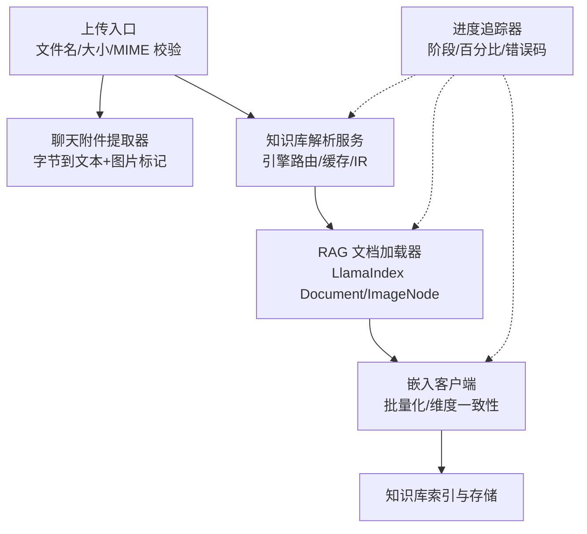
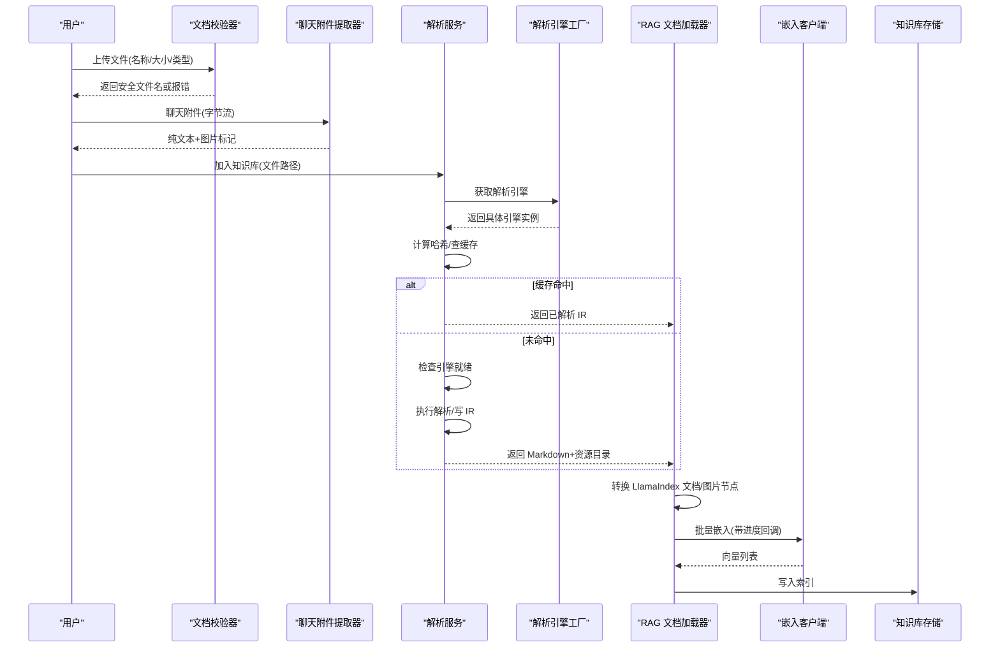
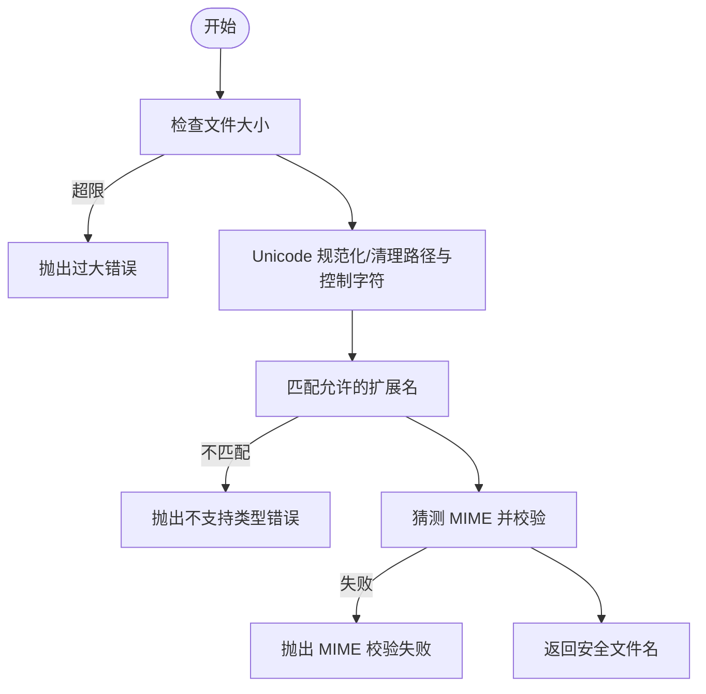
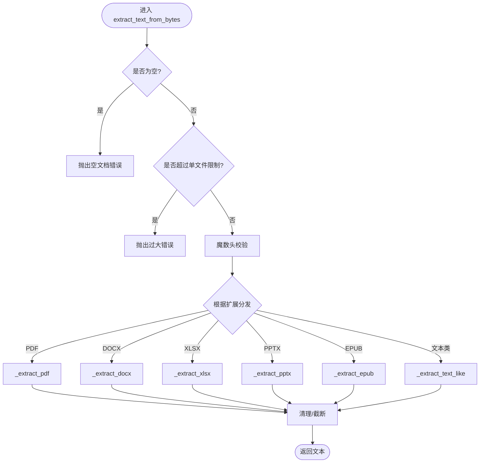
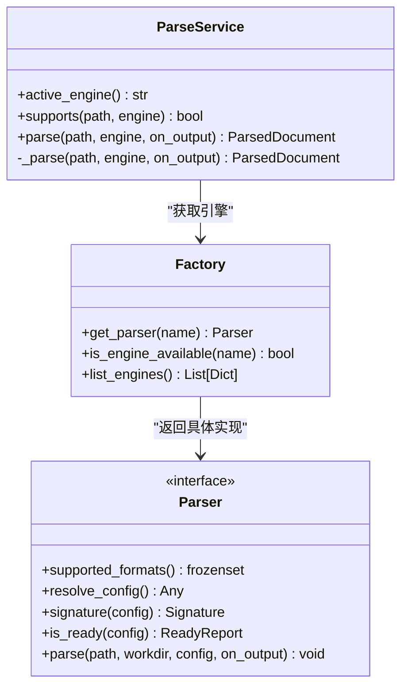
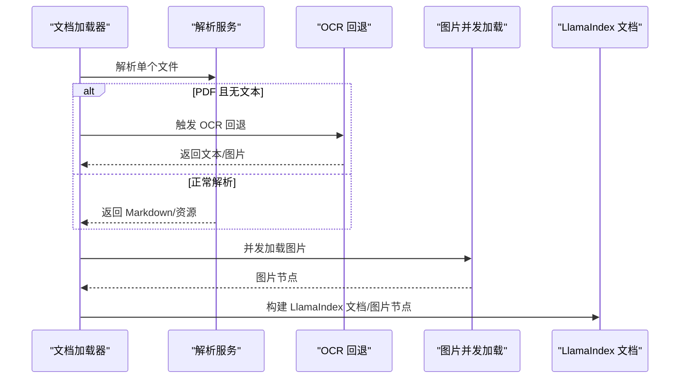
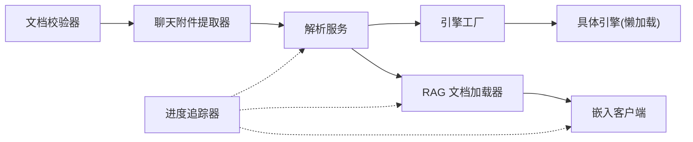

# 文档处理引擎

<cite>
**本文引用的文件**   
- [document_extractor.py](file://deeptutor/utils/document_extractor.py)
- [document_validator.py](file://deeptutor/utils/document_validator.py)
- [service.py](file://deeptutor/services/parsing/service.py)
- [factory.py](file://deeptutor/services/parsing/engines/factory.py)
- [pipeline.py](file://deeptutor/services/rag/pipelines/llamaindex/pipeline.py)
- [document_loader.py](file://deeptutor/services/rag/pipelines/llamaindex/document_loader.py)
- [progress_tracker.py](file://deeptutor/knowledge/progress_tracker.py)
- [client.py](file://deeptutor/services/embedding/client.py)
- [SKILL.md（PDF）](file://deeptutor/skills/builtin/pdf/SKILL.md)
- [SKILL.md（DOCX）](file://deeptutor/skills/builtin/docx/SKILL.md)
- [SKILL.md（XLSX）](file://deeptutor/skills/builtin/xlsx/SKILL.md)
- [SKILL.md（PPTX）](file://deeptutor/skills/builtin/pptx/SKILL.md)
</cite>

## 目录
1. [简介](#简介)
2. [项目结构](#项目结构)
3. [核心组件](#核心组件)
4. [架构总览](#架构总览)
5. [详细组件分析](#详细组件分析)
6. [依赖关系分析](#依赖关系分析)
7. [性能与扩展性](#性能与扩展性)
8. [故障排查指南](#故障排查指南)
9. [结论](#结论)
10. [附录：配置与扩展示例](#附录配置与扩展示例)

## 简介
本文件面向“文档处理引擎”的完整技术说明，覆盖以下目标：
- 支持的文档格式与解析策略：PDF、Word、Excel、PowerPoint、EPUB、网页与文本类格式。
- 文档提取、清洗、分块与元数据提取的核心算法与流程。
- 多语言文档、数学公式、表格与图像内容的特殊处理逻辑。
- 文档验证、错误恢复与批量处理的实现机制。
- 如何添加新格式支持、自定义解析规则与优化性能。
- 进度跟踪、错误日志与性能监控方法。

该文档既适合初学者理解文档处理的基本概念，也为开发者提供深入扩展与排障指南。

## 项目结构
本项目将“文档处理”拆分为多个层次：
- 上传与校验层：负责文件名安全、大小限制、MIME 类型与扩展名白名单校验。
- 聊天附件快速提取层：面向对话场景，从字节流中直接提取纯文本与图片标记。
- 知识库解析服务层：面向知识索引，选择解析引擎、缓存中间结果、输出结构化 Markdown 与资源目录。
- RAG 管道层：将解析结果转换为 LlamaIndex 文档对象，进行 OCR 回退、并发加载与进度上报。
- 嵌入与索引层：对分块文本调用嵌入模型，生成向量并写入后端存储。
- 进度与日志层：统一记录任务阶段、文件级状态、错误码与可重试标志。

**图表来源**
- [document_validator.py:13-151](file://deeptutor/utils/document_validator.py#L13-L151)
- [document_extractor.py:239-310](file://deeptutor/utils/document_extractor.py#L239-L310)
- [service.py:74-242](file://deeptutor/services/parsing/service.py#L74-L242)
- [document_loader.py:69-125](file://deeptutor/services/rag/pipelines/llamaindex/document_loader.py#L69-L125)
- [client.py:120-150](file://deeptutor/services/embedding/client.py#L120-L150)
- [progress_tracker.py:40-171](file://deeptutor/knowledge/progress_tracker.py#L40-L171)

**章节来源**
- [document_validator.py:13-151](file://deeptutor/utils/document_validator.py#L13-L151)
- [document_extractor.py:239-310](file://deeptutor/utils/document_extractor.py#L239-L310)
- [service.py:74-242](file://deeptutor/services/parsing/service.py#L74-L242)
- [document_loader.py:69-125](file://deeptutor/services/rag/pipelines/llamaindex/document_loader.py#L69-L125)
- [client.py:120-150](file://deeptutor/services/embedding/client.py#L120-L150)
- [progress_tracker.py:40-171](file://deeptutor/knowledge/progress_tracker.py#L40-L171)

## 核心组件
- 文档校验器：统一校验上传文件的安全性与合法性，包括最大文件大小、扩展名白名单、MIME 类型检测与文件名净化。
- 聊天附件提取器：面向对话场景，从字节流中提取 PDF/Office/EPUB/文本类格式的纯文本，并在 Word/PPT/PDF 中插入图片占位标记。
- 解析服务：面向知识库索引，选择解析引擎、计算内容哈希、命中缓存、执行解析、写出 IR（Markdown + 资源目录）。
- 解析引擎工厂：注册多种解析引擎（Text-only、MinerU、Docling、MarkItDown、PyMuPDF4LLM、LiteParse、Tika），按需懒加载第三方依赖。
- RAG 文档加载器：将源文件转为 LlamaIndex 文档对象，必要时触发扫描型 PDF 的 OCR 回退，并发加载图片，上报进度。
- 嵌入客户端：按提供者上限切分批次，保证维度一致，支持输入角色标注。
- 进度追踪器：以阶段、百分比、当前/总数、错误码等字段持久化与广播进度。

**章节来源**
- [document_validator.py:13-151](file://deeptutor/utils/document_validator.py#L13-L151)
- [document_extractor.py:239-310](file://deeptutor/utils/document_extractor.py#L239-L310)
- [service.py:74-242](file://deeptutor/services/parsing/service.py#L74-L242)
- [factory.py:69-146](file://deeptutor/services/parsing/engines/factory.py#L69-L146)
- [document_loader.py:69-125](file://deeptutor/services/rag/pipelines/llamaindex/document_loader.py#L69-L125)
- [client.py:120-150](file://deeptutor/services/embedding/client.py#L120-L150)
- [progress_tracker.py:40-171](file://deeptutor/knowledge/progress_tracker.py#L40-L171)

## 架构总览
下图展示从“上传”到“索引”的关键路径，以及各层的职责边界。

**图表来源**
- [document_validator.py:72-151](file://deeptutor/utils/document_validator.py#L72-L151)
- [document_extractor.py:239-310](file://deeptutor/utils/document_extractor.py#L239-L310)
- [service.py:104-242](file://deeptutor/services/parsing/service.py#L104-L242)
- [factory.py:153-175](file://deeptutor/services/parsing/engines/factory.py#L153-L175)
- [document_loader.py:77-125](file://deeptutor/services/rag/pipelines/llamaindex/document_loader.py#L77-L125)
- [client.py:120-150](file://deeptutor/services/embedding/client.py#L120-L150)

## 详细组件分析

### 文档校验器
- 功能要点
  - 限制最大文件大小（默认 200MB）。
  - 维护扩展名白名单与 MIME 类型白名单。
  - 净化文件名：去除路径、控制字符、危险字符，规范化 Unicode。
  - 支持“允许任意扩展名”模式，用于远程 Tika 等基于内容检测的场景。
- 关键接口
  - `validate_upload_safety`：校验大小、净化文件名、校验扩展名与 MIME。
  - `get_file_info`：返回扩展名、大小、是否允许等信息。
  - `validate_file`：校验文件存在、可读、大小合法，并复用上传安全校验。

**图表来源**
- [document_validator.py:72-151](file://deeptutor/utils/document_validator.py#L72-L151)

**章节来源**
- [document_validator.py:13-151](file://deeptutor/utils/document_validator.py#L13-L151)

### 聊天附件提取器
- 功能要点
  - 支持二进制 Office（PDF/DOCX/XLSX/PPTX）、EPUB、文本类格式（由 KB 路由器的扩展集同步）。
  - 通过魔数头校验防止扩展名欺骗。
  - PDF：优先 pymupdf，失败回退 pypdf；提取页级文本与图片标记。
  - DOCX：优先富解析（保留表格/数学/图片位置），失败回退 python-docx 与原始 OOXML。
  - XLSX：优先 openpyxl，失败回退原始 OOXML。
  - PPTX：优先富解析（幻灯片+图片标记），失败回退 python-pptx 与原始 OOXML。
  - EPUB：按 spine 顺序读取 XHTML，容错 HTML 解析。
  - 文本类：使用统一的编码回退链解码。
- 关键接口
  - `extract_text_from_bytes`：从字节流提取文本，支持单文件/总字符上限。
  - `extract_text_from_path` / `extract_text_from_path_isolated`：从路径或隔离进程提取。

**图表来源**
- [document_extractor.py:239-310](file://deeptutor/utils/document_extractor.py#L239-L310)
- [document_extractor.py:369-613](file://deeptutor/utils/document_extractor.py#L369-L613)

**章节来源**
- [document_extractor.py:239-310](file://deeptutor/utils/document_extractor.py#L239-L310)
- [document_extractor.py:369-613](file://deeptutor/utils/document_extractor.py#L369-L613)

### 解析服务与引擎工厂
- 解析服务
  - 选择活动引擎（可从设置读取），若显式指定则强制使用该引擎。
  - 当主引擎不支持某后缀时，自动尝试回退引擎序列（text_only → markitdown → tika）。
  - 基于源文件哈希与引擎签名做内容地址缓存，避免重复解析。
  - 产出结构化 IR：Markdown、可选 blocks、资源目录、引擎签名与工作目录。
- 引擎工厂
  - 注册多种引擎：Text-only、MinerU、Docling、MarkItDown、PyMuPDF4LLM、LiteParse、Tika。
  - 懒加载第三方依赖，避免导入失败影响整体启动。
  - 提供引擎可用性检查与 UI 描述信息。

**图表来源**
- [service.py:74-242](file://deeptutor/services/parsing/service.py#L74-L242)
- [factory.py:69-175](file://deeptutor/services/parsing/engines/factory.py#L69-L175)

**章节来源**
- [service.py:74-242](file://deeptutor/services/parsing/service.py#L74-L242)
- [factory.py:69-175](file://deeptutor/services/parsing/engines/factory.py#L69-L175)

### RAG 文档加载器与 OCR 回退
- 功能要点
  - 将源文件分类为“解析器文件”，逐个解析。
  - 对 PDF 且无文本的情况，自动触发 OCR 回退引擎。
  - 并发加载图片，控制并发度，避免阻塞事件循环。
  - 将解析结果转换为 LlamaIndex 文档对象，附带 file_path 等元数据。
- 关键接口
  - `load(file_paths, image_progress_callback, kb_dir, visual_candidates)`：批量加载并返回文档集合。

**图表来源**
- [document_loader.py:77-125](file://deeptutor/services/rag/pipelines/llamaindex/document_loader.py#L77-L125)

**章节来源**
- [document_loader.py:69-125](file://deeptutor/services/rag/pipelines/llamaindex/document_loader.py#L69-L125)

### 嵌入客户端与批处理
- 功能要点
  - 根据提供者限制裁剪 batch_size，避免第二批次失败。
  - 支持 input_type 角色标注（仅适配者启用）。
  - 累计所有批次结果，保持维度一致性。
- 关键接口
  - `embed(texts, progress_callback, input_type)`：批量嵌入并回调进度。

**章节来源**
- [client.py:120-150](file://deeptutor/services/embedding/client.py#L120-L150)

### 进度追踪与错误上报
- 功能要点
  - 定义阶段枚举：初始化、处理文档、处理文件、完成、错误。
  - 通过回调通知前端，同时持久化到 kb_config.json。
  - 携带 message_key/message_params 以便前端本地化渲染。
  - 在服务器模式下广播进度事件，供 WebSocket 订阅者消费。
- 关键接口
  - `ProgressTracker`：注册/移除回调、保存快照、更新知识库状态。

**章节来源**
- [progress_tracker.py:40-171](file://deeptutor/knowledge/progress_tracker.py#L40-L171)

## 依赖关系分析
- 组件耦合
  - 解析服务强依赖引擎工厂；引擎工厂懒加载具体引擎模块。
  - RAG 文档加载器依赖解析服务与 LlamaIndex 生态。
  - 嵌入客户端依赖配置与提供者规格。
  - 进度追踪器与上层服务解耦，通过回调与文件持久化协作。
- 外部依赖
  - PDF：pymupdf、pypdf。
  - Office：python-docx、openpyxl、python-pptx。
  - 其他引擎：MinerU、Docling、MarkItDown、LiteParse、Tika。
- 潜在循环依赖
  - 通过延迟导入与工厂模式避免导入期失败。

**图表来源**
- [document_validator.py:13-151](file://deeptutor/utils/document_validator.py#L13-L151)
- [document_extractor.py:239-310](file://deeptutor/utils/document_extractor.py#L239-L310)
- [service.py:74-242](file://deeptutor/services/parsing/service.py#L74-L242)
- [factory.py:69-175](file://deeptutor/services/parsing/engines/factory.py#L69-L175)
- [document_loader.py:69-125](file://deeptutor/services/rag/pipelines/llamaindex/document_loader.py#L69-L125)
- [client.py:120-150](file://deeptutor/services/embedding/client.py#L120-L150)
- [progress_tracker.py:40-171](file://deeptutor/knowledge/progress_tracker.py#L40-L171)

**章节来源**
- [document_validator.py:13-151](file://deeptutor/utils/document_validator.py#L13-L151)
- [document_extractor.py:239-310](file://deeptutor/utils/document_extractor.py#L239-L310)
- [service.py:74-242](file://deeptutor/services/parsing/service.py#L74-L242)
- [factory.py:69-175](file://deeptutor/services/parsing/engines/factory.py#L69-L175)
- [document_loader.py:69-125](file://deeptutor/services/rag/pipelines/llamaindex/document_loader.py#L69-L125)
- [client.py:120-150](file://deeptutor/services/embedding/client.py#L120-L150)
- [progress_tracker.py:40-171](file://deeptutor/knowledge/progress_tracker.py#L40-L171)

## 性能与扩展性
- 性能特性
  - 解析缓存：基于源文件哈希与引擎签名，避免重复解析。
  - 惰性加载：引擎与第三方库按需导入，降低冷启动成本。
  - 并发控制：图片加载并发度可调，避免阻塞事件循环。
  - 批处理嵌入：按提供者上限切分批次，减少请求失败风险。
- 可扩展点
  - 新增解析引擎：在工厂注册，实现 Parser 接口，声明 supported_formats 与 is_ready。
  - 新增聊天附件格式：在提取器中添加分支，遵循魔数头校验与错误语义。
  - 调整限制参数：聊天附件的单文件/总字符限制可通过运行时设置注入。
  - 进度与日志：通过回调与持久化文件暴露给前端与运维。

[本节为通用指导，不直接分析具体文件]

## 故障排查指南
- 常见错误与定位
  - 文件过大：校验器会拒绝超大文件；检查 MAX_FILE_SIZE 与业务限制。
  - 不支持的文件类型：扩展名不在白名单或 MIME 校验失败；检查 ALLOWED_EXTENSIONS 与 ALLOWED_MIME_TYPES。
  - 解析失败：解析服务会记录失败原因与错误码；检查引擎是否就绪、是否支持该后缀。
  - PDF 加密：提取器会抛出加密不可读错误；需解密后重试。
  - 扫描型 PDF 无文本：RAG 加载器会触发 OCR 回退；确认 OCR 引擎可用。
- 建议步骤
  - 查看知识库进度快照与错误码，确认失败阶段。
  - 切换解析引擎（如 MinerU → MarkItDown → Text-only）对比效果。
  - 对大文档分批入库，观察嵌入批大小与提供者限制。
  - 检查系统工具（LibreOffice、Tika 服务等）是否安装并可访问。

**章节来源**
- [document_validator.py:72-151](file://deeptutor/utils/document_validator.py#L72-L151)
- [document_extractor.py:369-445](file://deeptutor/utils/document_extractor.py#L369-L445)
- [service.py:104-242](file://deeptutor/services/parsing/service.py#L104-L242)
- [document_loader.py:92-125](file://deeptutor/services/rag/pipelines/llamaindex/document_loader.py#L92-L125)
- [progress_tracker.py:133-171](file://deeptutor/knowledge/progress_tracker.py#L133-L171)

## 结论
本引擎通过分层设计实现了从“上传校验”到“解析缓存”再到“RAG 文档加载与嵌入”的完整链路。其优势在于：
- 多引擎可插拔，兼顾高保真与轻量解析。
- 聊天附件与知识库解析双通道，分别优化体验与质量。
- 完善的错误语义、进度追踪与缓存机制，便于生产环境运维。
- 清晰的扩展点，便于接入新格式与新解析能力。

[本节为总结性内容，不直接分析具体文件]

## 附录：配置与扩展示例

### 添加新的文档格式支持（聊天附件）
- 步骤
  - 在提取器中增加对应扩展名的分支，实现 `_extract_xxx` 函数。
  - 如需魔数头校验，在 `_check_magic` 中补充。
  - 确保错误语义符合 `DocumentExtractionError` 子类约定。
  - 若需要图片标记，参考 PDF/DOCX/PPTX 的图片标记方式。
- 参考路径
  - [document_extractor.py:239-310](file://deeptutor/utils/document_extractor.py#L239-L310)
  - [document_extractor.py:369-613](file://deeptutor/utils/document_extractor.py#L369-L613)

### 添加新的解析引擎（知识库）
- 步骤
  - 在工厂中注册新引擎，实现懒加载。
  - 实现 Parser 接口：supported_formats、resolve_config、signature、is_ready、parse。
  - 在 UI 元数据中描述引擎用途与是否需要本地模型。
- 参考路径
  - [factory.py:69-175](file://deeptutor/services/parsing/engines/factory.py#L69-L175)

### 自定义解析规则与优化性能
- 调整聊天附件限制
  - 通过运行时设置注入 max_file_bytes、max_total_bytes、max_chars_per_doc、max_chars_total。
  - 参考路径：[document_extractor.py:84-106](file://deeptutor/utils/document_extractor.py#L84-L106)
- 调整嵌入批大小
  - 根据提供者限制裁剪 batch_size，避免第二批次失败。
  - 参考路径：[client.py:134-145](file://deeptutor/services/embedding/client.py#L134-L145)
- 调整图片并发
  - 在文档加载器中调整 image_concurrency。
  - 参考路径：[document_loader.py:72-74](file://deeptutor/services/rag/pipelines/llamaindex/document_loader.py#L72-L74)

### 多语言、数学公式、表格与图像的处理要点
- 多语言
  - 文本类解码使用统一编码回退链，兼容 GBK、UTF-8-BOM 等。
  - PDF 生成非拉丁字体需注册 CJK TrueType 字体（技能文档中有详细说明）。
  - 参考路径：
    - [document_extractor.py:601-613](file://deeptutor/utils/document_extractor.py#L601-L613)
    - [SKILL.md（PDF）:157-199](file://deeptutor/skills/builtin/pdf/SKILL.md#L157-L199)
- 数学公式
  - DOCX 富解析与 OOXML 回退路径能更好地保留原生数学内容。
  - 参考路径：[document_extractor.py:448-509](file://deeptutor/utils/document_extractor.py#L448-L509)
- 表格
  - XLSX 逐行转制表符分隔文本；PDF 可使用 pdfplumber 提取布局感知表格（技能文档）。
  - 参考路径：
    - [document_extractor.py:512-547](file://deeptutor/utils/document_extractor.py#L512-L547)
    - [SKILL.md（PDF）:28-74](file://deeptutor/skills/builtin/pdf/SKILL.md#L28-L74)
- 图像
  - PDF/DOCX/PPTX 富解析会收集图片并生成标记；RAG 加载器并发加载图片。
  - 参考路径：
    - [document_extractor.py:369-403](file://deeptutor/utils/document_extractor.py#L369-L403)
    - [document_extractor.py:448-468](file://deeptutor/utils/document_extractor.py#L448-L468)
    - [document_extractor.py:550-568](file://deeptutor/utils/document_extractor.py#L550-L568)
    - [document_loader.py:77-125](file://deeptutor/services/rag/pipelines/llamaindex/document_loader.py#L77-L125)

### 文档验证、错误恢复与批量处理
- 文档验证
  - 使用 `DocumentValidator.validate_upload_safety` 与 `validate_file`。
  - 参考路径：[document_validator.py:72-151](file://deeptutor/utils/document_validator.py#L72-L151)
- 错误恢复
  - 解析服务在引擎不支持时自动回退；RAG 加载器对扫描型 PDF 触发 OCR 回退。
  - 参考路径：
    - [service.py:154-178](file://deeptutor/services/parsing/service.py#L154-L178)
    - [document_loader.py:92-125](file://deeptutor/services/rag/pipelines/llamaindex/document_loader.py#L92-L125)
- 批量处理
  - 解析服务按文件逐个解析并缓存；RAG 加载器并发加载图片；嵌入客户端按批次提交。
  - 参考路径：
    - [service.py:180-242](file://deeptutor/services/parsing/service.py#L180-L242)
    - [document_loader.py:77-125](file://deeptutor/services/rag/pipelines/llamaindex/document_loader.py#L77-L125)
    - [client.py:120-150](file://deeptutor/services/embedding/client.py#L120-L150)

### 进度跟踪、错误日志与性能监控
- 进度跟踪
  - 使用 `ProgressTracker` 注册回调，持久化进度快照，广播事件。
  - 参考路径：[progress_tracker.py:40-171](file://deeptutor/knowledge/progress_tracker.py#L40-L171)
- 错误日志
  - 解析服务在失败时记录错误码与脱敏详情；RAG 加载器对扫描型 PDF 无 OCR 情况记录日志。
  - 参考路径：
    - [service.py:127-130](file://deeptutor/services/parsing/service.py#L127-L130)
    - [document_loader.py:117-125](file://deeptutor/services/rag/pipelines/llamaindex/document_loader.py#L117-L125)
- 性能监控
  - 关注解析缓存命中率、嵌入批大小与提供者限制、图片并发度。
  - 参考路径：
    - [service.py:180-207](file://deeptutor/services/parsing/service.py#L180-L207)
    - [client.py:134-150](file://deeptutor/services/embedding/client.py#L134-L150)
    - [document_loader.py:72-74](file://deeptutor/services/rag/pipelines/llamaindex/document_loader.py#L72-L74)