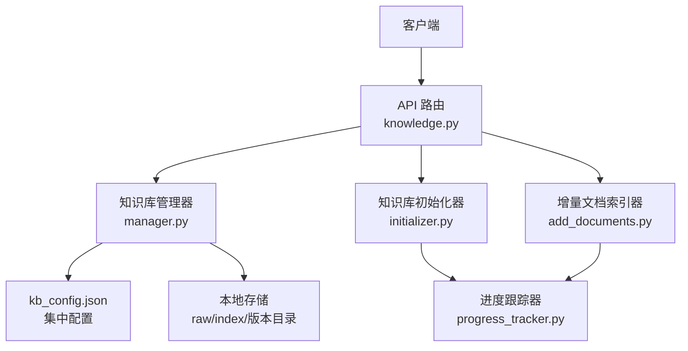
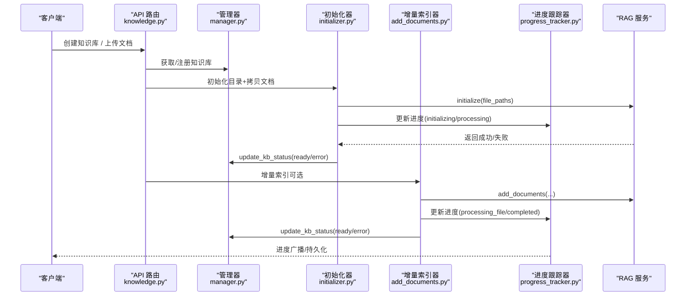
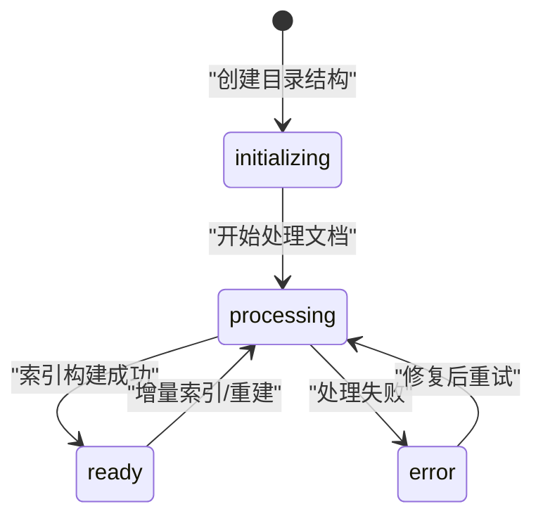
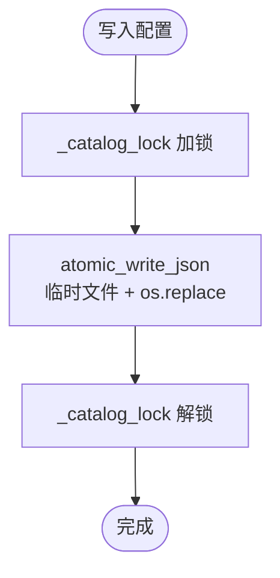
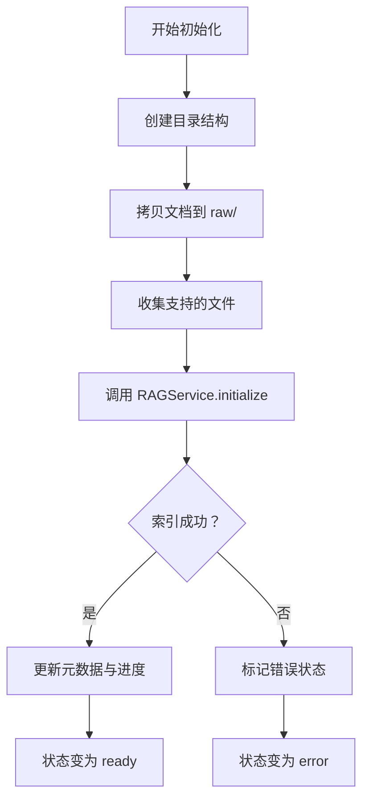
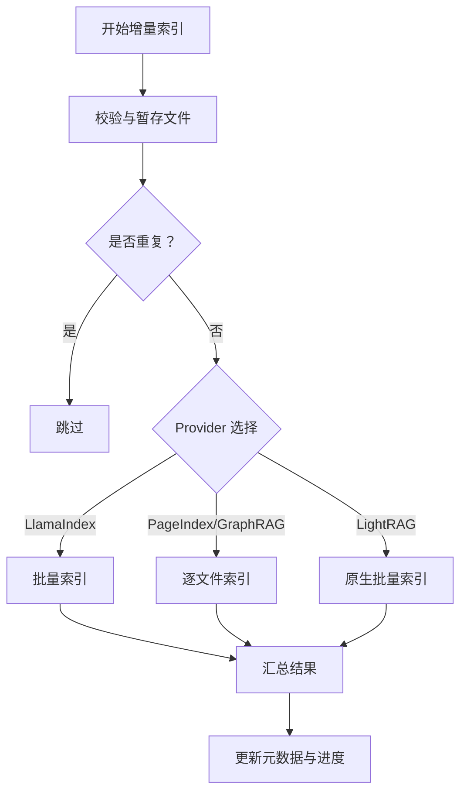
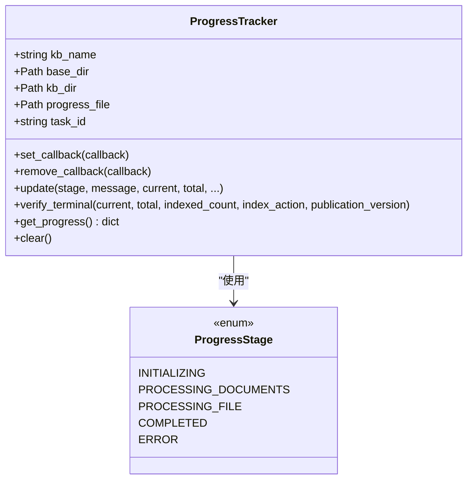
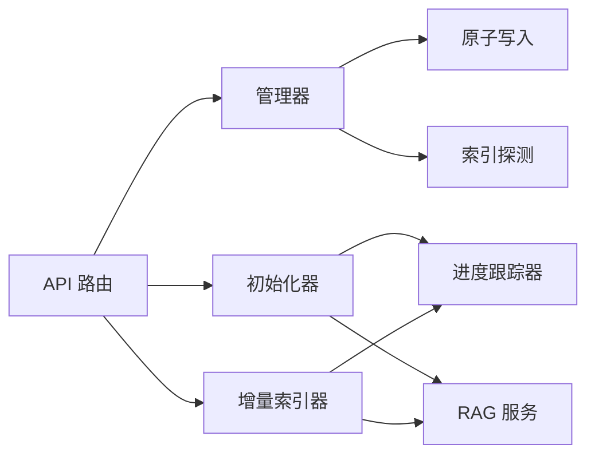

# 知识库生命周期

<cite>
**本文引用的文件**   
- [knowledge.py](file://deeptutor/api/routers/knowledge.py)
- [manager.py](file://deeptutor/knowledge/manager.py)
- [initializer.py](file://deeptutor/knowledge/initializer.py)
- [add_documents.py](file://deeptutor/knowledge/add_documents.py)
- [progress_tracker.py](file://deeptutor/knowledge/progress_tracker.py)
</cite>

## 目录
1. [简介](#简介)
2. [项目结构](#项目结构)
3. [核心组件](#核心组件)
4. [架构总览](#架构总览)
5. [详细组件分析](#详细组件分析)
6. [依赖关系分析](#依赖关系分析)
7. [性能与容量规划](#性能与容量规划)
8. [故障排查指南](#故障排查指南)
9. [结论](#结论)

## 简介
本文面向 DeepTutor 的知识库（Knowledge Base）全生命周期管理，覆盖从创建、初始化、索引到维护的完整流程。文档重点说明：
- 知识库状态机设计：initializing、processing、ready、error 等状态转换逻辑。
- 并发访问控制、事务性写入与数据一致性保障机制。
- 增量文档添加、备份恢复、迁移与清理策略。
- 操作示例：创建、删除、更新、监控知识库。
- 性能监控、容量规划与扩容建议。

本指南既适合初学者快速上手，也为管理员提供深入的运维与排障参考。

## 项目结构
知识库相关代码主要分布在以下模块：
- API 路由层：对外暴露知识库创建、上传、同步、删除、默认库设置等接口。
- 管理器层：负责知识库注册、配置持久化、状态更新、列表扫描与自动发现。
- 初始化器：负责目录结构创建、文档拷贝、调用 RAG 服务完成首次索引。
- 增量索引器：负责将新文档加入现有知识库，支持批量与逐文件两种路径。
- 进度跟踪器：统一记录并广播进度，映射为知识库状态与持久化快照。

**图示来源**
- [knowledge.py:138-179](file://deeptutor/api/routers/knowledge.py#L138-L179)
- [manager.py:322-340](file://deeptutor/knowledge/manager.py#L322-L340)
- [initializer.py:35-63](file://deeptutor/knowledge/initializer.py#L35-L63)
- [add_documents.py:162-246](file://deeptutor/knowledge/add_documents.py#L162-L246)
- [progress_tracker.py:71-80](file://deeptutor/knowledge/progress_tracker.py#L71-L80)

**章节来源**
- [knowledge.py:138-179](file://deeptutor/api/routers/knowledge.py#L138-L179)
- [manager.py:322-340](file://deeptutor/knowledge/manager.py#L322-L340)

## 核心组件
- API 路由层（knowledge.py）
  - 负责接收前端请求，进行权限校验、参数校验、Provider 预检查、任务 ID 生成、后台任务调度、进度广播与错误处理。
  - 关键能力：创建知识库、上传与解压 ZIP、保存原始文件、触发初始化或增量索引、删除知识库、设置默认库、列出知识库。
- 知识库管理器（manager.py）
  - 负责 kb_config.json 的加载、缓存、原子写入、多进程并发保护、状态更新、列表扫描与孤儿清理、连接型知识库注册（Obsidian、Linked、LightRAG Server、IMA、WeKnora、Kiwix、Subagent）。
- 初始化器（initializer.py）
  - 负责创建目录结构、拷贝文档、调用 RAGService.initialize 完成首次索引，并在完成后更新元数据与状态。
- 增量索引器（add_documents.py）
  - 负责校验与暂存文档、去重、按 Provider 选择批量或逐文件索引路径、记录已索引哈希、失败汇总与重试降级。
- 进度跟踪器（progress_tracker.py）
  - 负责阶段枚举、消息模板渲染、持久化 .progress.json、映射到 kb_config.json 的状态字段、向 WebSocket/事件总线广播进度。

**章节来源**
- [knowledge.py:261-310](file://deeptutor/api/routers/knowledge.py#L261-L310)
- [manager.py:322-470](file://deeptutor/knowledge/manager.py#L322-L470)
- [initializer.py:35-153](file://deeptutor/knowledge/initializer.py#L35-L153)
- [add_documents.py:162-335](file://deeptutor/knowledge/add_documents.py#L162-L335)
- [progress_tracker.py:40-80](file://deeptutor/knowledge/progress_tracker.py#L40-L80)

## 架构总览
知识库的生命周期由 API 路由驱动，内部通过管理器、初始化器与增量索引器协作，最终由 RAG 服务完成索引构建与发布。进度跟踪器贯穿始终，确保 UI 可观测。

**图示来源**
- [knowledge.py:261-310](file://deeptutor/api/routers/knowledge.py#L261-L310)
- [initializer.py:179-323](file://deeptutor/knowledge/initializer.py#L179-L323)
- [add_documents.py:266-335](file://deeptutor/knowledge/add_documents.py#L266-L335)
- [progress_tracker.py:176-281](file://deeptutor/knowledge/progress_tracker.py#L176-L281)
- [manager.py:500-625](file://deeptutor/knowledge/manager.py#L500-L625)

## 详细组件分析

### 知识库状态机与转换逻辑
知识库状态包括 initializing、processing、ready、error，以及 needs_reindex（用于提示需要重建索引）。状态转换由进度跟踪器和管理器共同维护：
- initializing：初始化器创建目录结构并注册到配置。
- processing：文档处理中（包含 embedding 批次、图片描述、单文件索引等）。
- ready：索引构建成功，清理临时进度，记录最后完成时间与索引统计。
- error：发生异常时记录错误信息与时间戳。

**图示来源**
- [progress_tracker.py:114-163](file://deeptutor/knowledge/progress_tracker.py#L114-L163)
- [manager.py:500-625](file://deeptutor/knowledge/manager.py#L500-L625)
- [initializer.py:64-89](file://deeptutor/knowledge/initializer.py#L64-L89)

**章节来源**
- [progress_tracker.py:114-163](file://deeptutor/knowledge/progress_tracker.py#L114-L163)
- [manager.py:500-625](file://deeptutor/knowledge/manager.py#L500-L625)
- [initializer.py:64-89](file://deeptutor/knowledge/initializer.py#L64-L89)

### 并发访问控制与事务性写入
- 配置文件的并发安全
  - 使用线程锁 _catalog_lock 串行化配置加载与保存。
  - 所有写操作通过 atomic_write_json（临时文件 + os.replace）实现原子替换，避免读者看到半写文件。
  - 在 Linux 上对读取使用共享锁 file_lock_shared；Windows 下由于 msvcrt 限制，采用原子写保证一致性。
- 目录与文件写入
  - 数据卷可写性检查 ensure_data_volume_writable，捕获 Unraid 等挂载场景的权限问题。
  - ZIP 解压与文件保存均做大小与扩展名校验，防止 Zip Slip 与炸弹攻击。
- 外部引擎锁定
  - LightRAG 通过 write_ownership 与 IndexingPolicySnapshot 冻结写入目标，避免并发覆盖。

**图示来源**
- [manager.py:322-340](file://deeptutor/knowledge/manager.py#L322-L340)
- [manager.py:459-470](file://deeptutor/knowledge/manager.py#L459-L470)
- [manager.py:125-145](file://deeptutor/knowledge/manager.py#L125-L145)
- [knowledge.py:286-310](file://deeptutor/api/routers/knowledge.py#L286-L310)

**章节来源**
- [manager.py:322-340](file://deeptutor/knowledge/manager.py#L322-L340)
- [manager.py:459-470](file://deeptutor/knowledge/manager.py#L459-L470)
- [manager.py:125-145](file://deeptutor/knowledge/manager.py#L125-L145)
- [knowledge.py:286-310](file://deeptutor/api/routers/knowledge.py#L286-L310)

### 初始化流程与索引构建
- 初始化器步骤
  - 创建目录结构（raw/），写入 metadata.json，注册到 kb_config.json。
  - 拷贝文档到 raw/，收集支持的文件类型。
  - 调用 RAGService.initialize 执行首次索引，支持进度回调与图片描述进度。
  - 成功后更新元数据（provider、计数、动作），并通过进度跟踪器标记 completed。
- 空知识库引导
  - 若知识库为空且无索引，增量索引器会回退到 bootstrap_index_from_files，用首批文件构建初始索引。

**图示来源**
- [initializer.py:132-153](file://deeptutor/knowledge/initializer.py#L132-L153)
- [initializer.py:179-323](file://deeptutor/knowledge/initializer.py#L179-L323)
- [add_documents.py:589-671](file://deeptutor/knowledge/add_documents.py#L589-L671)

**章节来源**
- [initializer.py:132-153](file://deeptutor/knowledge/initializer.py#L132-L153)
- [initializer.py:179-323](file://deeptutor/knowledge/initializer.py#L179-L323)
- [add_documents.py:589-671](file://deeptutor/knowledge/add_documents.py#L589-L671)

### 增量索引与去重机制
- 文档暂存与去重
  - add_documents 校验源文件，计算内容哈希，跳过已索引的重复文件。
  - 保留文件夹相对路径，避免不同子目录同名文件冲突。
- 索引路径选择
  - LlamaIndex：优先批量 publish，失败时回退到逐文件。
  - PageIndex/GraphRAG：逐文件索引。
  - LightRAG：持有原生写入所有权，批量提交，before_publish 钩子更新进度。
- 结果汇总
  - DocumentIndexResult 明确区分 processed_files 与 failures，便于 UI 展示与重试。

**图示来源**
- [add_documents.py:266-335](file://deeptutor/knowledge/add_documents.py#L266-L335)
- [add_documents.py:337-493](file://deeptutor/knowledge/add_documents.py#L337-L493)
- [add_documents.py:495-547](file://deeptutor/knowledge/add_documents.py#L495-L547)

**章节来源**
- [add_documents.py:266-335](file://deeptutor/knowledge/add_documents.py#L266-L335)
- [add_documents.py:337-493](file://deeptutor/knowledge/add_documents.py#L337-L493)
- [add_documents.py:495-547](file://deeptutor/knowledge/add_documents.py#L495-L547)

### 进度跟踪与可视化
- 阶段枚举
  - INITIALIZING、PROCESSING_DOCUMENTS、PROCESSING_FILE、COMPLETED、ERROR。
- 消息模板
  - 使用 i18next 风格 {{name}} 模板，后端携带 message_key 与 message_params，前端翻译显示。
- 持久化与广播
  - 每次更新写入 .progress.json，同时映射到 kb_config.json 的 status 与 progress。
  - 服务器模式下异步广播进度事件，供 WebSocket 订阅者消费。

**图示来源**
- [progress_tracker.py:40-80](file://deeptutor/knowledge/progress_tracker.py#L40-L80)
- [progress_tracker.py:176-281](file://deeptutor/knowledge/progress_tracker.py#L176-L281)
- [progress_tracker.py:283-322](file://deeptutor/knowledge/progress_tracker.py#L283-L322)

**章节来源**
- [progress_tracker.py:40-80](file://deeptutor/knowledge/progress_tracker.py#L40-L80)
- [progress_tracker.py:176-281](file://deeptutor/knowledge/progress_tracker.py#L176-L281)
- [progress_tracker.py:283-322](file://deeptutor/knowledge/progress_tracker.py#L283-L322)

### 连接型知识库与外部指针
- 支持 Obsidian vault、Linked 外部索引、LightRAG Server、IMA、WeKnora、Kiwix、Subagent 等连接型知识库。
- 这些类型不创建本地 KB 目录，也不运行索引流水线，仅记录外部指针与只读统计。
- 管理器提供 register_* 方法注册不同类型，并在 get_info 中暴露 type、external_path、server_url 等字段。

**章节来源**
- [manager.py:860-1251](file://deeptutor/knowledge/manager.py#L860-L1251)

## 依赖关系分析
- API 路由依赖管理器、初始化器、增量索引器、进度跟踪器与 RAG 服务工厂。
- 管理器依赖文件 IO 原子写入、嵌入签名、索引版本探测与 Provider 归一化。
- 初始化器与增量索引器依赖 RAGService 与 FileTypeRouter。
- 进度跟踪器依赖管理器与事件广播（WebSocket/任务日志流）。

**图示来源**
- [knowledge.py:45-55](file://deeptutor/api/routers/knowledge.py#L45-L55)
- [manager.py:37-57](file://deeptutor/knowledge/manager.py#L37-L57)
- [initializer.py:18-30](file://deeptutor/knowledge/initializer.py#L18-L30)
- [add_documents.py:15-33](file://deeptutor/knowledge/add_documents.py#L15-L33)

**章节来源**
- [knowledge.py:45-55](file://deeptutor/api/routers/knowledge.py#L45-L55)
- [manager.py:37-57](file://deeptutor/knowledge/manager.py#L37-L57)
- [initializer.py:18-30](file://deeptutor/knowledge/initializer.py#L18-L30)
- [add_documents.py:15-33](file://deeptutor/knowledge/add_documents.py#L15-L33)

## 性能与容量规划
- 并发与阻塞
  - 大文件上传与 ZIP 解压在 worker 线程执行，避免阻塞事件循环。
  - 增量索引中的哈希计算与文件 IO 也通过 asyncio.to_thread 卸载到线程池。
- 索引批处理
  - LlamaIndex 优先批量 publish，减少版本碎片；LightRAG 使用原生批量提交，提升吞吐。
- 容量规划
  - 关注 raw/ 目录体积与索引版本数量；定期清理历史版本与无用 KB。
  - 监控 Provider 预检失败（如 PageIndex API Key、GraphRAG 包缺失）以避免创建失败。
- 扩容策略
  - 横向扩展：增加 Worker 线程数与磁盘 I/O 带宽。
  - 纵向扩展：升级 CPU/GPU 以加速 Embedding 与图片描述。
  - 分库分表：按业务域拆分知识库，降低单库规模。

[本节为通用指导，不直接分析具体文件]

## 故障排查指南
- 常见错误与定位
  - 权限错误：DataVolumePermissionError，检查数据卷 UID/GID 与挂载点权限。
  - Provider 未就绪：PageIndex API Key 未配置、GraphRAG 未安装，需先完成环境预检。
  - 索引不完整：needs_reindex 或 embedding_mismatch，需重建索引或切换回匹配的嵌入模型。
  - 进度卡住：检查 .progress.json 与 kb_config.json 的一致性，必要时清理残留状态。
- 恢复步骤
  - 清理错误状态：删除 .progress.json，重新触发初始化或增量索引。
  - 重建索引：根据 needs_reindex 标志执行重建，确认索引版本 ready。
  - 权限修复：修正数据卷权限后重试。

**章节来源**
- [add_documents.py:376-387](file://deeptutor/knowledge/add_documents.py#L376-L387)
- [knowledge.py:764-820](file://deeptutor/api/routers/knowledge.py#L764-L820)
- [manager.py:1505-1567](file://deeptutor/knowledge/manager.py#L1505-L1567)

## 结论
DeepTutor 的知识库生命周期通过 API 路由、管理器、初始化器、增量索引器与进度跟踪器的协同工作，实现了从创建、初始化、索引到维护的全流程管理。系统在设计上强调：
- 清晰的状态机与进度可视化。
- 强一致性的配置持久化与并发控制。
- 灵活的 Provider 支持与连接型知识库集成。
- 完善的错误处理与恢复机制。

管理员应重点关注权限、Provider 预检、索引版本与容量规划，以确保知识库稳定高效运行。