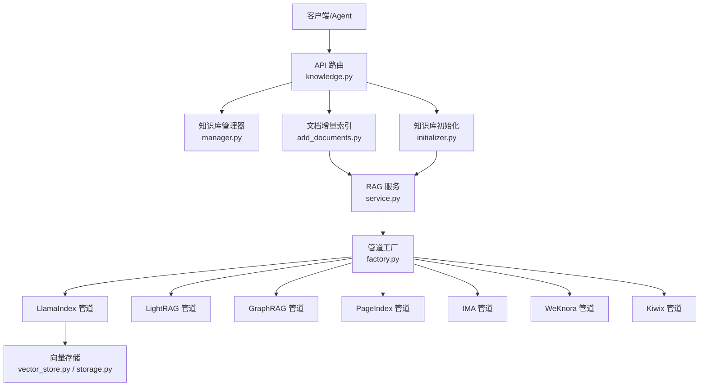
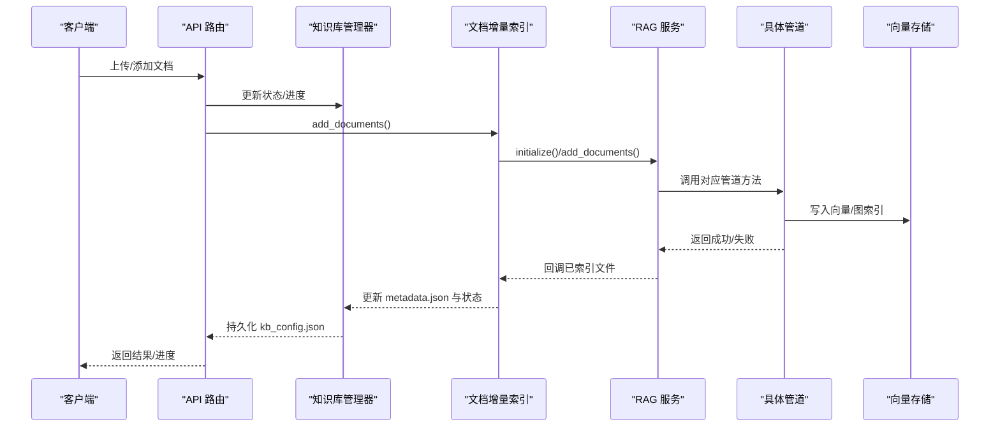
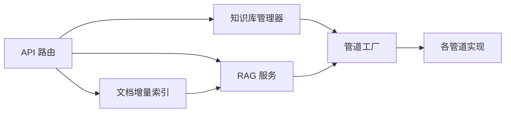
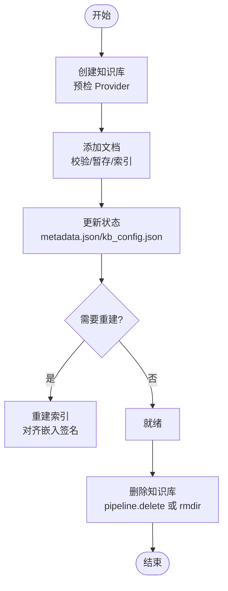
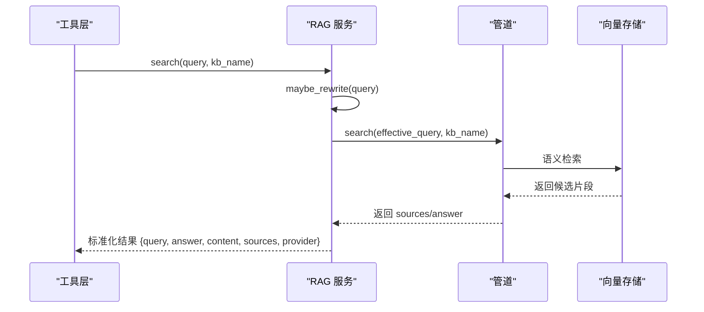

# 知识管理系统

<cite>
**本文引用的文件**   
- [deeptutor/api/routers/knowledge.py](file://deeptutor/api/routers/knowledge.py)
- [deeptutor/knowledge/manager.py](file://deeptutor/knowledge/manager.py)
- [deeptutor/knowledge/add_documents.py](file://deeptutor/knowledge/add_documents.py)
- [deeptutor/knowledge/initializer.py](file://deeptutor/knowledge/initializer.py)
- [deeptutor/services/rag/service.py](file://deeptutor/services/rag/service.py)
- [deeptutor/services/rag/factory.py](file://deeptutor/services/rag/factory.py)
- [deeptutor/services/rag/pipelines/llamaindex/vector_store.py](file://deeptutor/services/rag/pipelines/llamaindex/vector_store.py)
- [deeptutor/services/rag/pipelines/llamaindex/storage.py](file://deeptutor/services/rag/pipelines/llamaindex/storage.py)
- [deeptutor/tools/rag_tool.py](file://deeptutor/tools/rag_tool.py)
</cite>

## 目录
1. [简介](#简介)
2. [项目结构](#项目结构)
3. [核心组件](#核心组件)
4. [架构总览](#架构总览)
5. [详细组件分析](#详细组件分析)
6. [依赖关系分析](#依赖关系分析)
7. [性能与扩展性](#性能与扩展性)
8. [配置示例：嵌入模型与向量数据库](#配置示例嵌入模型与向量数据库)
9. [生命周期管理](#生命周期管理)
10. [RAG 工作原理](#rag-工作原理)
11. [故障排除指南](#故障排除指南)
12. [结论](#结论)

## 简介
本文件系统性地梳理 DeepTutor 的知识管理系统，重点覆盖以下方面：
- 知识库的架构设计与多引擎（LlamaIndex、LightRAG、GraphRAG、PageIndex、IMA、WeKnora、Kiwix）抽象。
- 文档处理流程：上传、校验、分块、向量化、索引构建与增量更新。
- 向量索引机制：本地 FAISS/SimpleVectorStore、版本化存储、嵌入签名与回退策略。
- RAG（检索增强生成）工作流：查询重写、语义搜索、来源溯源与工具事件输出。
- 知识库生命周期：创建、添加、更新、删除、版本控制与权限隔离。
- 配置与集成：如何接入不同嵌入模型与向量数据库。
- 性能调优、扩展开发指南与常见问题排查。

该文档既适合初学者理解基本概念，也为高级用户提供实现细节和架构图。

## 项目结构
DeepTutor 的知识管理相关代码主要分布在以下模块：
- API 路由层：负责接收前端请求、参数校验、任务调度与状态广播。
- 知识库管理器：维护 kb_config.json、发现/注册知识库、状态与进度持久化。
- 文档增量索引：负责文件校验、去重、暂存、调用 RAGService 进行索引。
- RAG 服务与工厂：统一入口、按知识库绑定选择具体管道（pipeline）。
- 向量存储与版本：FAISS/SimpleVectorStore、版本目录、嵌入签名匹配。
- 工具层：为 Agent 提供 RAG 查询、初始化、删除等能力。

**图表来源**
- [deeptutor/api/routers/knowledge.py:1-120](file://deeptutor/api/routers/knowledge.py#L1-L120)
- [deeptutor/knowledge/manager.py:322-376](file://deeptutor/knowledge/manager.py#L322-L376)
- [deeptutor/knowledge/add_documents.py:162-248](file://deeptutor/knowledge/add_documents.py#L162-L248)
- [deeptutor/knowledge/initializer.py:179-227](file://deeptutor/knowledge/initializer.py#L179-L227)
- [deeptutor/services/rag/service.py:22-65](file://deeptutor/services/rag/service.py#L22-L65)
- [deeptutor/services/rag/factory.py:136-209](file://deeptutor/services/rag/factory.py#L136-L209)

**章节来源**
- [deeptutor/api/routers/knowledge.py:1-120](file://deeptutor/api/routers/knowledge.py#L1-L120)
- [deeptutor/knowledge/manager.py:322-376](file://deeptutor/knowledge/manager.py#L322-L376)
- [deeptutor/services/rag/factory.py:1-30](file://deeptutor/services/rag/factory.py#L1-L30)

## 核心组件
- API 路由层（knowledge.py）：暴露知识库 CRUD、文件上传、Zip 解压、链接文件夹同步、状态广播、预检（如 PageIndex OSS 预检、GraphRAG 可用性检查）、嵌入模型选项接口。
- 知识库管理器（manager.py）：集中管理 kb_config.json，负责加载/保存、孤儿清理、自动注册、Provider 归一化、嵌入指纹与版本对齐、PocketBase 同步。
- 文档增量索引（add_documents.py）：DocumentAdder 类负责校验、去重、暂存 raw/、按 Provider 批量或逐文件索引，记录 file_hashes 并更新 metadata.json。
- RAG 服务（service.py）：统一入口，封装 initialize/add_documents/search/delete/smart_retrieve，按 KB 绑定解析 Provider，注入 IndexingRun 追踪与日志捕获。
- 管道工厂（factory.py）：根据 provider 名称实例化具体管道，缓存实例，列出可用管道及其就绪状态。
- 向量存储（vector_store.py, storage.py）：FAISS 检测与后端选择、SimpleVectorStore 兼容、版本目录解析、增量存储计划。

**章节来源**
- [deeptutor/api/routers/knowledge.py:118-120](file://deeptutor/api/routers/knowledge.py#L118-L120)
- [deeptutor/knowledge/manager.py:322-376](file://deeptutor/knowledge/manager.py#L322-L376)
- [deeptutor/knowledge/add_documents.py:162-248](file://deeptutor/knowledge/add_documents.py#L162-L248)
- [deeptutor/services/rag/service.py:22-65](file://deeptutor/services/rag/service.py#L22-L65)
- [deeptutor/services/rag/factory.py:136-209](file://deeptutor/services/rag/factory.py#L136-L209)
- [deeptutor/services/rag/pipelines/llamaindex/vector_store.py:226-264](file://deeptutor/services/rag/pipelines/llamaindex/vector_store.py#L226-L264)
- [deeptutor/services/rag/pipelines/llamaindex/storage.py:148-176](file://deeptutor/services/rag/pipelines/llamaindex/storage.py#L148-L176)

## 架构总览
知识管理系统采用“路由层 + 管理器 + 增量索引 + RAG 服务 + 管道工厂”的分层架构。API 路由负责输入校验、安全与并发控制；管理器负责元数据与状态；增量索引负责文件级处理；RAG 服务统一编排；工厂按需选择具体引擎。

**图表来源**
- [deeptutor/api/routers/knowledge.py:267-310](file://deeptutor/api/routers/knowledge.py#L267-L310)
- [deeptutor/knowledge/add_documents.py:266-335](file://deeptutor/knowledge/add_documents.py#L266-L335)
- [deeptutor/services/rag/service.py:67-124](file://deeptutor/services/rag/service.py#L67-L124)
- [deeptutor/services/rag/factory.py:136-209](file://deeptutor/services/rag/factory.py#L136-L209)

## 详细组件分析

### API 路由层（knowledge.py）
职责：
- 定义知识库路由与 WebSocket 路由。
- 校验 Provider（normalize_provider_name），预检 PageIndex OSS 与 GraphRAG 可用性。
- 保存上传文件到 raw/，支持 Zip 解压、路径净化、大小限制、重复名检查。
- 标记 KB 进入 processing 状态，并通过 ProgressBroadcaster 推送进度。
- 暴露模型选项接口（embedding model options）。

关键实现点：
- _validate_registered_provider：将未知/遗留 Provider 归一化为默认值，避免选择缺失管道。
- _freeze_append_indexing/_freeze_default_indexing_llm：冻结 LightRAG 写入快照，确保并发写一致性。
- _assert_provider_ready：在创建 KB 前检查外部依赖（PageIndex API Key、GraphRAG 安装）。
- _save_uploaded_files/_save_uploaded_files_off_loop：线程外执行 IO，避免阻塞事件循环。
- _task_log/_server_task_trace：统一任务日志与堆栈记录。

**章节来源**
- [deeptutor/api/routers/knowledge.py:714-724](file://deeptutor/api/routers/knowledge.py#L714-L724)
- [deeptutor/api/routers/knowledge.py:726-761](file://deeptutor/api/routers/knowledge.py#L726-L761)
- [deeptutor/api/routers/knowledge.py:764-820](file://deeptutor/api/routers/knowledge.py#L764-L820)
- [deeptutor/api/routers/knowledge.py:429-558](file://deeptutor/api/routers/knowledge.py#L429-L558)
- [deeptutor/api/routers/knowledge.py:680-711](file://deeptutor/api/routers/knowledge.py#L680-L711)
- [deeptutor/api/routers/knowledge.py:1903-1913](file://deeptutor/api/routers/knowledge.py#L1903-L1913)

### 知识库管理器（manager.py）
职责：
- 加载/保存 kb_config.json，原子写入避免竞态。
- 列表/发现/注册知识库，清理孤儿条目。
- Provider 归一化与兼容性迁移（legacy rag_storage -> new versions）。
- 嵌入指纹与版本对齐（_reconcile_embedding_flags），标记 needs_reindex/embedding_mismatch。
- 同步 PocketBase（可选）。

关键实现点：
- _load_config/_read_and_reconcile_config：带共享锁与缓存，周期刷新。
- list_knowledge_bases/_list_knowledge_bases：孤儿清理与自动注册。
- update_kb_status：状态持久化、索引计数与时间戳记录。
- _sync_kb_to_pb：异步镜像到 PocketBase。

**章节来源**
- [deeptutor/knowledge/manager.py:322-376](file://deeptutor/knowledge/manager.py#L322-L376)
- [deeptutor/knowledge/manager.py:378-457](file://deeptutor/knowledge/manager.py#L378-L457)
- [deeptutor/knowledge/manager.py:459-499](file://deeptutor/knowledge/manager.py#L459-L499)
- [deeptutor/knowledge/manager.py:500-625](file://deeptutor/knowledge/manager.py#L500-L625)
- [deeptutor/knowledge/manager.py:651-740](file://deeptutor/knowledge/manager.py#L651-L740)

### 文档增量索引（add_documents.py）
职责：
- DocumentAdder：校验、去重、暂存 raw/，按 Provider 批量或逐文件索引。
- process_new_documents：LlamaIndex 批量 publish，LightRAG 独占写快照，其他 Provider 逐文件。
- _process_llamaindex_batch：一次 publish，失败回退逐文件。
- _process_provider_files_one_by_one：逐文件索引，记录 hash，更新进度。
- _bootstrap_index_from_files：空 KB 首次索引。
- add_documents：CLI 包装，状态更新与错误处理。

关键实现点：
- get_ingested_hashes/hashes_for_indexed_files：基于 raw/ 相对路径的稳定键。
- remove_raw_document：删除原始文件并清理 indexed-hash 记录。
- update_metadata：记录 last_updated/last_indexed_at/count/action/update_history。

**章节来源**
- [deeptutor/knowledge/add_documents.py:162-248](file://deeptutor/knowledge/add_documents.py#L162-L248)
- [deeptutor/knowledge/add_documents.py:266-335](file://deeptutor/knowledge/add_documents.py#L266-L335)
- [deeptutor/knowledge/add_documents.py:337-425](file://deeptutor/knowledge/add_documents.py#L337-L425)
- [deeptutor/knowledge/add_documents.py:427-493](file://deeptutor/knowledge/add_documents.py#L427-L493)
- [deeptutor/knowledge/add_documents.py:495-547](file://deeptutor/knowledge/add_documents.py#L495-L547)
- [deeptutor/knowledge/add_documents.py:589-671](file://deeptutor/knowledge/add_documents.py#L589-L671)
- [deeptutor/knowledge/add_documents.py:674-791](file://deeptutor/knowledge/add_documents.py#L674-L791)

### RAG 服务（service.py）
职责：
- 统一入口：initialize/add_documents/search/delete/smart_retrieve。
- 按 KB 绑定解析 Provider，缓存管道实例。
- IndexingRun 追踪文档状态与阶段（embedding），回调 indexed_file_callback。
- search 中注入 query rewrite、raw log 捕获、memory trace。

关键实现点：
- _resolve_provider：优先使用构造时 provider，否则从绑定解析。
- _index：封装 operation 调用，检查 usable_version，finish 状态。
- search：PageIndex 走 Reasoning as Retrieval，普通管道走 pipeline.search。
- delete：优先调用 pipeline.delete，否则删除目录。

**章节来源**
- [deeptutor/services/rag/service.py:22-65](file://deeptutor/services/rag/service.py#L22-L65)
- [deeptutor/services/rag/service.py:67-124](file://deeptutor/services/rag/service.py#L67-L124)
- [deeptutor/services/rag/service.py:126-250](file://deeptutor/services/rag/service.py#L126-L250)
- [deeptutor/services/rag/service.py:335-348](file://deeptutor/services/rag/service.py#L335-L348)

### 管道工厂（factory.py）
职责：
- 根据 provider 名称实例化具体管道（LlamaIndex、LightRAG、GraphRAG、PageIndex、IMA、WeKnora、Kiwix）。
- 缓存管道实例，提供 list_pipelines 描述可用管道及就绪状态。
- normalize_provider_name 与 provider_uses_embedding_versions 辅助函数。

关键实现点：
- _build_pipeline：按 provider 分支实例化。
- get_pipeline：无自定义 kwargs 时使用缓存。
- list_pipelines：探测各管道的配置就绪情况。

**章节来源**
- [deeptutor/services/rag/factory.py:1-30](file://deeptutor/services/rag/factory.py#L1-L30)
- [deeptutor/services/rag/factory.py:136-209](file://deeptutor/services/rag/factory.py#L136-L209)
- [deeptutor/services/rag/factory.py:212-348](file://deeptutor/services/rag/factory.py#L212-L348)

### 向量存储与版本（vector_store.py, storage.py）
职责：
- 检测 FAISS 后端，若不可用则回退 SimpleVectorStore。
- detect_backend/load_index：根据默认存储文件头判断后端类型，加载索引。
- resolve_add_storage_plan：选择现有/新存储目录用于增量添加。
- EmbeddingSignature 与 source_records 校验，确保版本一致性与来源完整性。

关键实现点：
- detect_backend：读取 DEFAULT_VECTOR_STORE_FILENAME 首字节判断 FAISS。
- load_index：FAISS 直接加载二进制索引，Legacy SimpleVectorStore 保持兼容。
- resolve_add_storage_plan：existing_storage 与 storage_dir 分离，publication_guard 保护发布。

**章节来源**
- [deeptutor/services/rag/pipelines/llamaindex/vector_store.py:226-264](file://deeptutor/services/rag/pipelines/llamaindex/vector_store.py#L226-L264)
- [deeptutor/services/rag/pipelines/llamaindex/storage.py:148-176](file://deeptutor/services/rag/pipelines/llamaindex/storage.py#L148-L176)

## 依赖关系分析
- API 路由依赖：KnowledgeBaseManager、DocumentAdder、RAGService、ProgressBroadcaster、TaskIDManager、DocumentValidator、FileTypeRouter。
- 管理器依赖：RAGFactory、IndexProbe、FileTypes、Workspace/Knowledge Access。
- 增量索引依赖：RAGService、Staging、DataVolumePermissionError。
- RAG 服务依赖：EmbeddingBinding、ProviderBinding、IndexingRun、QueryRewrite、MemoryTrace。
- 管道工厂依赖：各管道实现（LlamaIndex、LightRAG、GraphRAG、PageIndex、IMA、WeKnora、Kiwix）。

**图表来源**
- [deeptutor/api/routers/knowledge.py:40-110](file://deeptutor/api/routers/knowledge.py#L40-L110)
- [deeptutor/knowledge/manager.py:24-57](file://deeptutor/knowledge/manager.py#L24-L57)
- [deeptutor/knowledge/add_documents.py:15-33](file://deeptutor/knowledge/add_documents.py#L15-L33)
- [deeptutor/services/rag/service.py:13-17](file://deeptutor/services/rag/service.py#L13-L17)
- [deeptutor/services/rag/factory.py:136-209](file://deeptutor/services/rag/factory.py#L136-L209)

**章节来源**
- [deeptutor/api/routers/knowledge.py:40-110](file://deeptutor/api/routers/knowledge.py#L40-L110)
- [deeptutor/knowledge/manager.py:24-57](file://deeptutor/knowledge/manager.py#L24-L57)
- [deeptutor/knowledge/add_documents.py:15-33](file://deeptutor/knowledge/add_documents.py#L15-L33)
- [deeptutor/services/rag/service.py:13-17](file://deeptutor/services/rag/service.py#L13-L17)
- [deeptutor/services/rag/factory.py:136-209](file://deeptutor/services/rag/factory.py#L136-L209)

## 性能与扩展性
- 并发与阻塞：上传与索引 IO 通过 asyncio.to_thread 或 BackgroundTasks 移出事件循环，避免阻塞 WebSockets 与其他请求。
- 索引稳定性：LightRAG 使用 write snapshot 与 bind_target 保证并发写一致性；LlamaIndex 批量 publish 失败回退逐文件。
- 向量后端优化：FAISS 优先，若不可用回退 SimpleVectorStore；detect_backend 自动识别。
- 版本与嵌入签名：manager._reconcile_embedding_flags 对齐 active embedding signature，标记 needs_reindex/embedding_mismatch。
- 扩展点：新增管道需在 factory._build_pipeline 中添加分支，并在 list_pipelines 中暴露就绪状态。

**章节来源**
- [deeptutor/api/routers/knowledge.py:561-588](file://deeptutor/api/routers/knowledge.py#L561-L588)
- [deeptutor/knowledge/add_documents.py:337-425](file://deeptutor/knowledge/add_documents.py#L337-L425)
- [deeptutor/services/rag/pipelines/llamaindex/vector_store.py:226-264](file://deeptutor/services/rag/pipelines/llamaindex/vector_store.py#L226-L264)
- [deeptutor/knowledge/manager.py:158-319](file://deeptutor/knowledge/manager.py#L158-L319)
- [deeptutor/services/rag/factory.py:136-209](file://deeptutor/services/rag/factory.py#L136-L209)

## 配置示例：嵌入模型与向量数据库
- 嵌入模型选项接口：GET /knowledge-bases/rag-pipelines/model-options，返回配置的模型（secret-free），供前端选择。
- 嵌入模型选择：对于非 PageIndex 管道，manager.update_kb_status 会记录 embedding_model/embedding_dim/signature，并与 active embedding fingerprint 对齐。
- 向量数据库：LlamaIndex 默认使用 SimpleVectorStore，若 faiss-cpu 可用则切换 FAISS；PageIndex/GraphRAG/LightRAG 各有独立存储与索引格式。

建议步骤：
1. 在设置中配置嵌入模型（profile_id/model_id/base_url）。
2. 创建知识库时选择管道（默认 LlamaIndex）。
3. 上传文档后，系统自动向量化并写入向量存储。
4. 如需切换嵌入模型，触发 reindex 以重建索引。

**章节来源**
- [deeptutor/api/routers/knowledge.py:1903-1913](file://deeptutor/api/routers/knowledge.py#L1903-L1913)
- [deeptutor/knowledge/manager.py:586-625](file://deeptutor/knowledge/manager.py#L586-L625)
- [deeptutor/services/rag/pipelines/llamaindex/vector_store.py:226-264](file://deeptutor/services/rag/pipelines/llamaindex/vector_store.py#L226-L264)

## 生命周期管理
- 创建：API 路由预检 Provider，创建目录结构，写入 kb_config.json，状态设为 initializing。
- 添加：DocumentAdder 校验/暂存/索引，RAGService 调用管道，更新 metadata.json 与状态。
- 更新：增量添加或全量重建，manager._reconcile_embedding_flags 对齐嵌入签名。
- 删除：RAGService.delete 优先调用 pipeline.delete，否则删除目录。
- 版本控制：version-N 目录、embedding_signature、index_versions 列表，UI 可展示版本芯片。

**图表来源**
- [deeptutor/api/routers/knowledge.py:764-820](file://deeptutor/api/routers/knowledge.py#L764-L820)
- [deeptutor/knowledge/add_documents.py:266-335](file://deeptutor/knowledge/add_documents.py#L266-L335)
- [deeptutor/knowledge/manager.py:158-319](file://deeptutor/knowledge/manager.py#L158-L319)
- [deeptutor/services/rag/service.py:335-348](file://deeptutor/services/rag/service.py#L335-L348)

**章节来源**
- [deeptutor/api/routers/knowledge.py:764-820](file://deeptutor/api/routers/knowledge.py#L764-L820)
- [deeptutor/knowledge/add_documents.py:266-335](file://deeptutor/knowledge/add_documents.py#L266-L335)
- [deeptutor/knowledge/manager.py:158-319](file://deeptutor/knowledge/manager.py#L158-L319)
- [deeptutor/services/rag/service.py:335-348](file://deeptutor/services/rag/service.py#L335-L348)

## RAG 工作原理
RAG（检索增强生成）在系统中由 RAGService 统一编排：
- 查询重写：maybe_rewrite 可选改写查询，附带 trace 信息。
- 语义搜索：调用 pipeline.search，返回 answer/content/sources/provider。
- 来源溯源：sources 包含 title/content/source/page/chunk_id/score，便于引用。
- 工具事件：status/raw_log/memory trace 输出，便于调试与审计。

**图表来源**
- [deeptutor/services/rag/service.py:126-250](file://deeptutor/services/rag/service.py#L126-L250)
- [deeptutor/tools/rag_tool.py:45-51](file://deeptutor/tools/rag_tool.py#L45-L51)

**章节来源**
- [deeptutor/services/rag/service.py:126-250](file://deeptutor/services/rag/service.py#L126-L250)
- [deeptutor/tools/rag_tool.py:45-51](file://deeptutor/tools/rag_tool.py#L45-L51)

## 故障排除指南
- 上传失败：检查文件大小、扩展名、Zip 解压、路径净化；查看 HTTPException detail。
- 索引失败：检查 Provider 就绪状态、嵌入签名是否匹配、FAISS 是否安装；查看 manager._reconcile_embedding_flags 标记。
- 查询失败：检查 PageIndex 是否需 Reasoning as Retrieval；查看 service.search 返回 error_type/needs_reindex。
- 权限问题：DataVolumePermissionError 提示数据卷权限不足；检查 kb_dir 可写性。
- 日志与追踪：使用 TaskIDManager 与 ProcessLogHandler 捕获 raw_log 与堆栈。

**章节来源**
- [deeptutor/api/routers/knowledge.py:312-384](file://deeptutor/api/routers/knowledge.py#L312-L384)
- [deeptutor/knowledge/manager.py:158-319](file://deeptutor/knowledge/manager.py#L158-L319)
- [deeptutor/services/rag/service.py:126-250](file://deeptutor/services/rag/service.py#L126-L250)
- [deeptutor/knowledge/add_documents.py:427-493](file://deeptutor/knowledge/add_documents.py#L427-L493)

## 结论
DeepTutor 的知识管理系统通过分层架构与多管道抽象，实现了灵活的文档处理、向量索引与 RAG 检索。API 路由负责输入与安全，管理器负责元数据与状态，增量索引负责文件级处理，RAG 服务统一编排，工厂按需选择具体引擎。系统支持多种嵌入模型与向量数据库，具备版本控制、权限隔离与性能优化能力。通过本文档的架构说明、流程图与故障排除指南，用户可快速上手并深入定制。