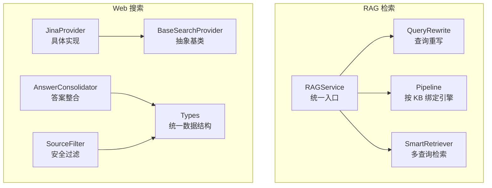
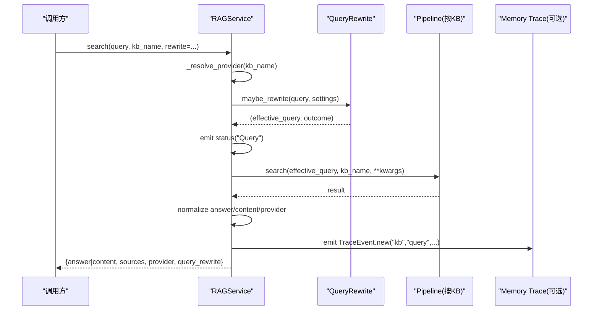
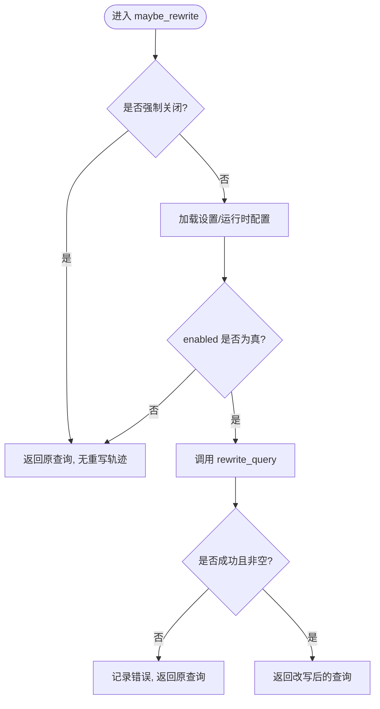
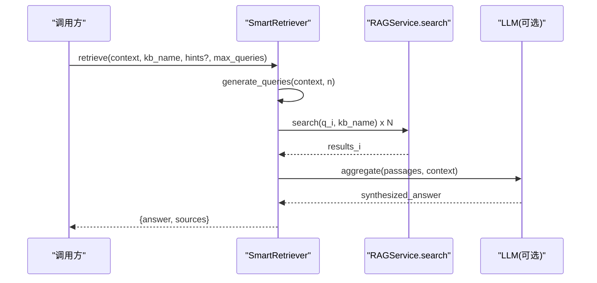
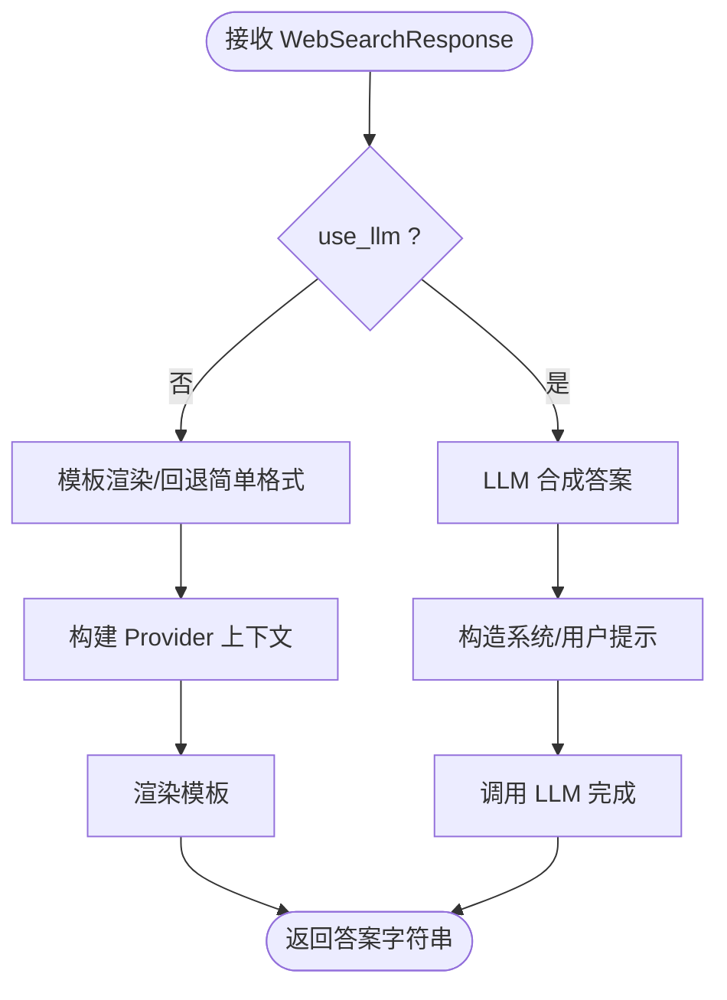
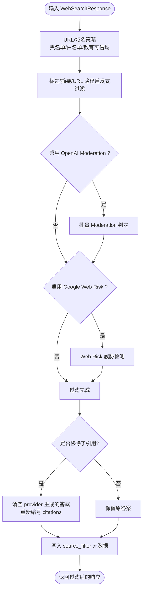
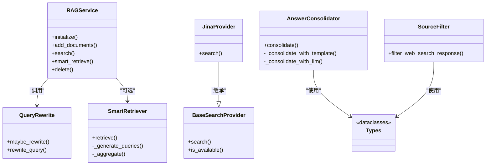

# 语义搜索服务

<cite>
**本文引用的文件**   
- [services/rag/service.py](file://deeptutor/services/rag/service.py)
- [services/rag/query_rewrite.py](file://deeptutor/services/rag/query_rewrite.py)
- [services/rag/smart_retriever.py](file://deeptutor/services/rag/smart_retriever.py)
- [services/search/base.py](file://deeptutor/services/search/base.py)
- [services/search/types.py](file://deeptutor/services/search/types.py)
- [services/search/consolidation.py](file://deeptutor/services/search/consolidation.py)
- [services/search/source_filter.py](file://deeptutor/services/search/source_filter.py)
- [services/search/providers/jina.py](file://deeptutor/services/search/providers/jina.py)
</cite>

## 目录
1. [简介](#简介)
2. [项目结构](#项目结构)
3. [核心组件](#核心组件)
4. [架构总览](#架构总览)
5. [详细组件分析](#详细组件分析)
6. [依赖关系分析](#依赖关系分析)
7. [性能与缓存](#性能与缓存)
8. [配置与策略](#配置与策略)
9. [API 调用示例](#api-调用示例)
10. [日志、诊断与排障](#日志诊断与排障)
11. [结论](#结论)

## 简介
本文件面向应用开发者，系统性说明 DeepTutor 中的“语义搜索服务”实现。内容覆盖：
- 查询重写：将口语化、指代性查询改写为更利于检索的关键词式查询。
- 多路召回与重排序：通过智能检索器并行生成多个查询并聚合结果；结合模板或 LLM 进行答案整合。
- 混合搜索模式：在 RAG 检索之外，提供 Web 搜索能力，支持多种提供商（如 Jina、Serper 等）。
- 安全过滤与来源治理：对搜索结果和引用进行域名白/黑名单、内容启发式过滤、Moderation 与 Web Risk 校验。
- 结果格式化与可观测性：统一响应类型、结构化摘要、原始日志捕获与事件上报。

该文档既适合初学者理解语义检索的工作流程，也为开发者提供集成、定制与调优指南。

## 项目结构
语义搜索相关代码主要分布在两个子系统中：
- RAG 知识库检索：负责向量/图索引检索、查询重写、智能多查询检索与结果聚合。
- Web 搜索：提供统一的 Web 搜索抽象、标准化响应类型、模板/LLM 答案整合与安全过滤。

**图表来源**
- [services/rag/service.py:127-250](file://deeptutor/services/rag/service.py#L127-L250)
- [services/rag/query_rewrite.py:75-176](file://deeptutor/services/rag/query_rewrite.py#L75-L176)
- [services/rag/smart_retriever.py:16-86](file://deeptutor/services/rag/smart_retriever.py#L16-L86)
- [services/search/base.py:20-86](file://deeptutor/services/search/base.py#L20-L86)
- [services/search/consolidation.py:138-190](file://deeptutor/services/search/consolidation.py#L138-L190)
- [services/search/source_filter.py:352-536](file://deeptutor/services/search/source_filter.py#L352-L536)
- [services/search/types.py:12-111](file://deeptutor/services/search/types.py#L12-L111)

**章节来源**
- [services/rag/service.py:22-65](file://deeptutor/services/rag/service.py#L22-L65)
- [services/search/base.py:20-86](file://deeptutor/services/search/base.py#L20-L86)

## 核心组件
- RAGService：统一检索入口，负责解析 KB 绑定提供者、执行查询重写、调用底层 Pipeline 检索、附加元数据与日志。
- QueryRewrite：将用户查询改写为独立、关键词导向的检索语句，支持开关、超时、最小长度等策略。
- SmartRetriever：基于上下文生成多个查询，并发检索并聚合结果，必要时用 LLM 合成摘要。
- BaseSearchProvider / JinaProvider：Web 搜索抽象与具体实现，封装不同搜索引擎 API。
- AnswerConsolidator：将原始 SERP 结果渲染为可读答案，支持模板与 LLM 两种路径。
- SourceFilter：对搜索结果与引用进行 URL/域名/内容/Moderation/Web Risk 多级过滤。
- Types：统一 Citation、SearchResult、WebSearchResponse 数据结构。

**章节来源**
- [services/rag/service.py:127-250](file://deeptutor/services/rag/service.py#L127-L250)
- [services/rag/query_rewrite.py:75-176](file://deeptutor/services/rag/query_rewrite.py#L75-L176)
- [services/rag/smart_retriever.py:16-86](file://deeptutor/services/rag/smart_retriever.py#L16-L86)
- [services/search/base.py:20-86](file://deeptutor/services/search/base.py#L20-L86)
- [services/search/consolidation.py:138-190](file://deeptutor/services/search/consolidation.py#L138-L190)
- [services/search/source_filter.py:352-536](file://deeptutor/services/search/source_filter.py#L352-L536)
- [services/search/types.py:12-111](file://deeptutor/services/search/types.py#L12-L111)

## 架构总览
下图展示一次典型 RAG 检索请求的处理链路：从入口到查询重写、管道检索、结果包装与事件上报。

**图表来源**
- [services/rag/service.py:127-250](file://deeptutor/services/rag/service.py#L127-L250)
- [services/rag/query_rewrite.py:138-176](file://deeptutor/services/rag/query_rewrite.py#L138-L176)

## 详细组件分析

### RAGService：统一检索入口
职责与要点：
- 根据 KB 名称解析实际 Provider，避免硬编码。
- 在执行检索前插入查询重写层，记录重写轨迹。
- 调用底层 Pipeline 执行检索，并对返回字段做兼容处理（answer/content）。
- 注入 provider 信息、错误状态、是否需要重建索引等元数据。
- 通过 event_sink 上报状态与原始日志，便于前端与监控消费。
- 暴露 smart_retrieve 以启用多查询智能检索。

关键流程片段参考：
- 检索主流程与事件上报：[services/rag/service.py:127-250](file://deeptutor/services/rag/service.py#L127-L250)
- 原始日志捕获与过滤：[services/rag/service.py:263-333](file://deeptutor/services/rag/service.py#L263-L333)
- 智能检索入口：[services/rag/service.py:350-364](file://deeptutor/services/rag/service.py#L350-L364)

**章节来源**
- [services/rag/service.py:127-250](file://deeptutor/services/rag/service.py#L127-L250)
- [services/rag/service.py:263-333](file://deeptutor/services/rag/service.py#L263-L333)
- [services/rag/service.py:350-364](file://deeptutor/services/rag/service.py#L350-L364)

### QueryRewrite：查询重写
设计原则：
- 默认策略 standalone：单次 LLM 调用，输出一个自包含、关键词导向的查询。
- 失败开放：任何异常或空输出均回退到原查询，确保检索不中断。
- 可配置项：enabled、strategy、min_query_chars、timeout_seconds、model。
- 可观测性：返回 RewriteOutcome，包含 original、rewritten、strategy、latency_ms、error。

核心函数参考：
- rewrite_query：[services/rag/query_rewrite.py:75-135](file://deeptutor/services/rag/query_rewrite.py#L75-L135)
- maybe_rewrite：[services/rag/query_rewrite.py:138-176](file://deeptutor/services/rag/query_rewrite.py#L138-L176)

**图表来源**
- [services/rag/query_rewrite.py:75-176](file://deeptutor/services/rag/query_rewrite.py#L75-L176)

**章节来源**
- [services/rag/query_rewrite.py:75-176](file://deeptutor/services/rag/query_rewrite.py#L75-L176)

### SmartRetriever：多路召回与聚合
功能概述：
- 基于上下文生成多个查询（可由 LLM 生成），并发检索。
- 聚合各路结果，必要时使用 LLM 合成摘要。
- 若所有查询均失败或无内容，返回空答案与空来源。

关键流程参考：
- retrieve 主流程：[services/rag/smart_retriever.py:22-51](file://deeptutor/services/rag/smart_retriever.py#L22-L51)
- 查询生成与聚合：[services/rag/smart_retriever.py:53-86](file://deeptutor/services/rag/smart_retriever.py#L53-L86)

**图表来源**
- [services/rag/smart_retriever.py:22-86](file://deeptutor/services/rag/smart_retriever.py#L22-L86)

**章节来源**
- [services/rag/smart_retriever.py:22-86](file://deeptutor/services/rag/smart_retriever.py#L22-L86)

### Web 搜索：BaseSearchProvider 与 JinaProvider
- BaseSearchProvider：定义统一接口 search()、可用性检查 is_available()、凭据读取逻辑。
- JinaProvider：实现 Jina Reader 的 SERP 与内容抽取能力，支持 enrich/no-content 模式。

关键点：
- 凭据优先从当前 Provider 的配置中读取，避免借用其他厂商密钥。
- JinaProvider 支持控制是否抓取页面全文与图片摘要，并通过 X-Engine/X-With-Images-Summary 等头控制行为。

参考实现：
- BaseSearchProvider：[services/search/base.py:20-86](file://deeptutor/services/search/base.py#L20-L86)
- JinaProvider：[services/search/providers/jina.py:29-79](file://deeptutor/services/search/providers/jina.py#L29-L79)

**章节来源**
- [services/search/base.py:20-86](file://deeptutor/services/search/base.py#L20-L86)
- [services/search/providers/jina.py:29-79](file://deeptutor/services/search/providers/jina.py#L29-L79)

### AnswerConsolidator：结果融合与答案生成
目标：
- 将原始 SERP 结果渲染为结构化答案，支持模板渲染与 LLM 合成两条路径。
- 针对特定 Provider（如 serper、jina）提供专用模板，否则回退通用格式。

核心逻辑：
- consolidate：选择 LLM 或模板路径。
- _build_provider_context：提取 Provider 特有字段（知识图谱、问答框、链接、图片等）。
- _consolidate_with_llm：构造 system/user prompt 并调用 LLM。
- _format_simple_results：无模板时的简单文本拼接。

参考实现：
- AnswerConsolidator 主流程：[services/search/consolidation.py:138-190](file://deeptutor/services/search/consolidation.py#L138-L190)
- 模板与上下文构建：[services/search/consolidation.py:192-264](file://deeptutor/services/search/consolidation.py#L192-L264)
- LLM 合成与简单格式化：[services/search/consolidation.py:294-369](file://deeptutor/services/search/consolidation.py#L294-L369)

**图表来源**
- [services/search/consolidation.py:138-190](file://deeptutor/services/search/consolidation.py#L138-L190)
- [services/search/consolidation.py:192-369](file://deeptutor/services/search/consolidation.py#L192-L369)

**章节来源**
- [services/search/consolidation.py:138-369](file://deeptutor/services/search/consolidation.py#L138-L369)

### SourceFilter：安全过滤与来源治理
目标：
- 对搜索结果与引用进行 URL/域名/内容/Moderation/Web Risk 多级过滤。
- 当移除部分引用时，重新编号保留的引用，保证答案与引用序号一致。
- 提供可配置的白名单/黑名单、教育可信域扩展、Moderation 与 Web Risk 开关。

关键流程：
- filter_web_search_response：串联 URL 清洗、域名策略、内容启发式、Moderation、Web Risk。
- 移除引用后重置 answer 并重新编号 citations。
- 记录 source_filter 元数据，便于审计与调试。

参考实现：
- 主过滤流程：[services/search/source_filter.py:352-536](file://deeptutor/services/search/source_filter.py#L352-L536)
- Moderation 与 Web Risk 辅助函数：[services/search/source_filter.py:216-345](file://deeptutor/services/search/source_filter.py#L216-L345)

**图表来源**
- [services/search/source_filter.py:352-536](file://deeptutor/services/search/source_filter.py#L352-L536)
- [services/search/source_filter.py:216-345](file://deeptutor/services/search/source_filter.py#L216-L345)

**章节来源**
- [services/search/source_filter.py:352-536](file://deeptutor/services/search/source_filter.py#L352-L536)

### Types：统一数据结构
- Citation：引用条目，含 id、reference、url、title、snippet、date、source、content 等。
- SearchResult：单条搜索结果，含 title、url、snippet、score、sitelinks、attributes 等。
- WebSearchResponse：统一响应体，含 query、answer、provider、timestamp、model、citations、search_results、usage、metadata。

参考实现：
- 数据结构定义与 to_dict：[services/search/types.py:12-111](file://deeptutor/services/search/types.py#L12-L111)

**章节来源**
- [services/search/types.py:12-111](file://deeptutor/services/search/types.py#L12-L111)

## 依赖关系分析
- RAGService 依赖 QueryRewrite 与 Pipeline；同时可选择性地调用 SmartRetriever 进行多查询检索。
- Web 搜索模块由 BaseSearchProvider 抽象出统一接口，JinaProvider 作为具体实现之一。
- AnswerConsolidator 依赖 LLM 客户端与 Jinja2 模板环境。
- SourceFilter 依赖外部 Moderation 与 Web Risk API（可选），并在内存中进行轻量缓存与去重。

**图表来源**
- [services/rag/service.py:22-65](file://deeptutor/services/rag/service.py#L22-L65)
- [services/rag/query_rewrite.py:75-176](file://deeptutor/services/rag/query_rewrite.py#L75-L176)
- [services/rag/smart_retriever.py:16-86](file://deeptutor/services/rag/smart_retriever.py#L16-L86)
- [services/search/base.py:20-86](file://deeptutor/services/search/base.py#L20-L86)
- [services/search/providers/jina.py:29-79](file://deeptutor/services/search/providers/jina.py#L29-L79)
- [services/search/consolidation.py:138-369](file://deeptutor/services/search/consolidation.py#L138-L369)
- [services/search/source_filter.py:352-536](file://deeptutor/services/search/source_filter.py#L352-L536)
- [services/search/types.py:12-111](file://deeptutor/services/search/types.py#L12-L111)

**章节来源**
- [services/rag/service.py:22-65](file://deeptutor/services/rag/service.py#L22-L65)
- [services/search/base.py:20-86](file://deeptutor/services/search/base.py#L20-L86)

## 性能与缓存
- 并发检索：SmartRetriever 使用 asyncio.gather 并发执行多个查询，提升吞吐。
- 日志过滤：RAGService 捕获第三方库日志并过滤高频噪音（如向量库初始化日志），减少 I/O 压力。
- Web Risk 缓存：SourceFilter 对 Web Risk 检测结果进行短时缓存与并发限流，降低外部 API 压力。
- 结果截断：JinaProvider 在 enrich 模式下限制返回结果数量，避免模型上下文过载。

优化建议：
- 合理设置 SmartRetriever.max_queries，平衡召回率与延迟。
- 在低延迟场景下关闭 LLM 合成路径，优先使用模板渲染。
- 谨慎开启 Moderation/Web Risk，仅在合规要求严格的环境启用。

**章节来源**
- [services/rag/smart_retriever.py:22-51](file://deeptutor/services/rag/smart_retriever.py#L22-L51)
- [services/rag/service.py:263-333](file://deeptutor/services/rag/service.py#L263-L333)
- [services/search/source_filter.py:282-345](file://deeptutor/services/search/source_filter.py#L282-L345)
- [services/search/providers/jina.py:37-79](file://deeptutor/services/search/providers/jina.py#L37-L79)

## 配置与策略
- 查询重写策略：
  - enabled：是否启用重写。
  - strategy：当前仅支持 standalone。
  - min_query_chars：最短字符数阈值，低于阈值直接跳过。
  - timeout_seconds：LLM 调用超时。
  - model：指定重写模型。
- Web 搜索策略：
  - Provider 凭据：每个 Provider 从自身配置读取 API Key。
  - JinaProvider：enrich 模式控制是否抓取全文与图片摘要。
- 安全过滤策略：
  - enabled：是否启用过滤。
  - blocked_domains/trusted_domains：域名黑白名单。
  - content_filtering：标题/摘要/URL 启发式过滤。
  - use_educational_trusted_domains：扩展教育可信域。
  - use_moderation/moderation_api_key：OpenAI Moderation。
  - use_web_risk/web_risk_api_key：Google Web Risk。

参考位置：
- 查询重写配置与行为：[services/rag/query_rewrite.py:75-176](file://deeptutor/services/rag/query_rewrite.py#L75-L176)
- Web 搜索 Provider 凭据读取：[services/search/base.py:48-58](file://deeptutor/services/search/base.py#L48-L58)
- JinaProvider 行为控制：[services/search/providers/jina.py:37-79](file://deeptutor/services/search/providers/jina.py#L37-L79)
- SourceFilter 配置解析：[services/search/source_filter.py:557-578](file://deeptutor/services/search/source_filter.py#L557-L578)

**章节来源**
- [services/rag/query_rewrite.py:75-176](file://deeptutor/services/rag/query_rewrite.py#L75-L176)
- [services/search/base.py:48-58](file://deeptutor/services/search/base.py#L48-L58)
- [services/search/providers/jina.py:37-79](file://deeptutor/services/search/providers/jina.py#L37-L79)
- [services/search/source_filter.py:557-578](file://deeptutor/services/search/source_filter.py#L557-L578)

## API 调用示例
以下为常见调用方式的概念性示例（不包含具体代码内容）：
- 文本搜索（RAG）：
  - 调用 RAGService.search，传入 query 与 kb_name。
  - 可选开启 rewrite=True 以强制启用查询重写。
  - 返回中包含 answer/content、sources、provider、query_rewrite 等字段。
- 图像搜索（Web 搜索）：
  - 使用 JinaProvider.search，设置 enrich=True 以获取图片摘要。
  - 返回 WebSearchResponse，其中 search_results 包含图片链接与描述。
- 多模态检索（RAG + Web）：
  - 先通过 RAGService.smart_retrieve 生成多路查询并聚合知识库内容。
  - 再调用 JinaProvider.search 获取网页与图片补充材料。
  - 使用 AnswerConsolidator 将两类结果合并为最终答案。

注意：
- 所有 Web 搜索结果应经过 SourceFilter 过滤，以确保合规与安全。
- 对于需要高可靠性的场景，建议开启 Moderation/Web Risk。

**章节来源**
- [services/rag/service.py:127-250](file://deeptutor/services/rag/service.py#L127-L250)
- [services/rag/smart_retriever.py:22-86](file://deeptutor/services/rag/smart_retriever.py#L22-L86)
- [services/search/providers/jina.py:37-79](file://deeptutor/services/search/providers/jina.py#L37-L79)
- [services/search/consolidation.py:138-369](file://deeptutor/services/search/consolidation.py#L138-L369)
- [services/search/source_filter.py:352-536](file://deeptutor/services/search/source_filter.py#L352-L536)

## 日志、诊断与排障
- 事件上报：RAGService 通过 event_sink 上报 status 与 raw_log，便于前端与监控系统消费。
- 原始日志捕获：捕获 lightrag/graphrag/graphrag_llm 等第三方库日志，过滤噪音后转发。
- 查询重写轨迹：返回 RewriteOutcome，包含 original、rewritten、strategy、latency_ms、error。
- 安全过滤审计：SourceFilter 在 metadata.source_filter 中记录 removed_citations、removed_search_results、rejected_hosts、rejected_reasons 等。

常见问题与排查：
- 检索结果为空：
  - 检查 KB 是否已正确索引与可用。
  - 查看 RAGService 返回的 error_type 与 needs_reindex。
- 重写未生效：
  - 确认 query_rewrite.enabled 为真，且 query 长度满足 min_query_chars。
  - 查看 RewriteOutcome.error 是否为 empty_rewrite 或 LLM 异常。
- Web 搜索结果被过滤：
  - 检查 blocked_domains/trusted_domains 配置。
  - 查看 metadata.source_filter.rejected_reasons 与 rejected_hosts。
  - 若启用了 Moderation/Web Risk，检查对应 API Key 与配额。

**章节来源**
- [services/rag/service.py:127-250](file://deeptutor/services/rag/service.py#L127-L250)
- [services/rag/service.py:263-333](file://deeptutor/services/rag/service.py#L263-L333)
- [services/rag/query_rewrite.py:40-63](file://deeptutor/services/rag/query_rewrite.py#L40-L63)
- [services/search/source_filter.py:498-536](file://deeptutor/services/search/source_filter.py#L498-L536)

## 结论
DeepTutor 的语义搜索服务通过 RAG 与 Web 搜索双通道，结合查询重写、多路召回、模板/LLM 答案整合与安全过滤，提供了灵活、可扩展且安全的检索能力。开发者可根据业务需求调整查询重写策略、多查询数量、安全过滤强度与日志可见性，以实现性能与质量的平衡。