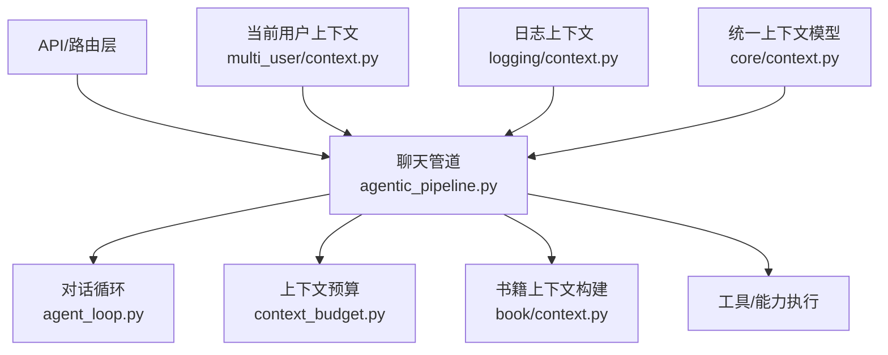
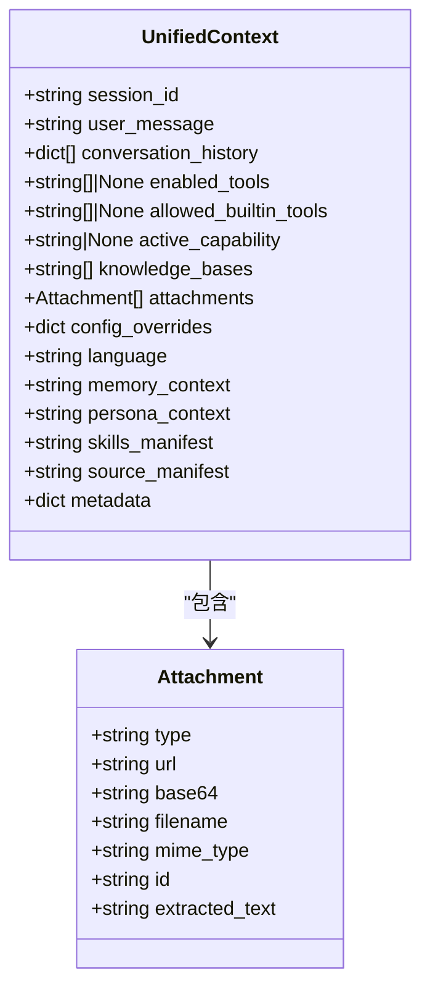
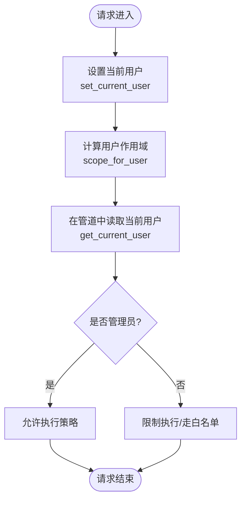
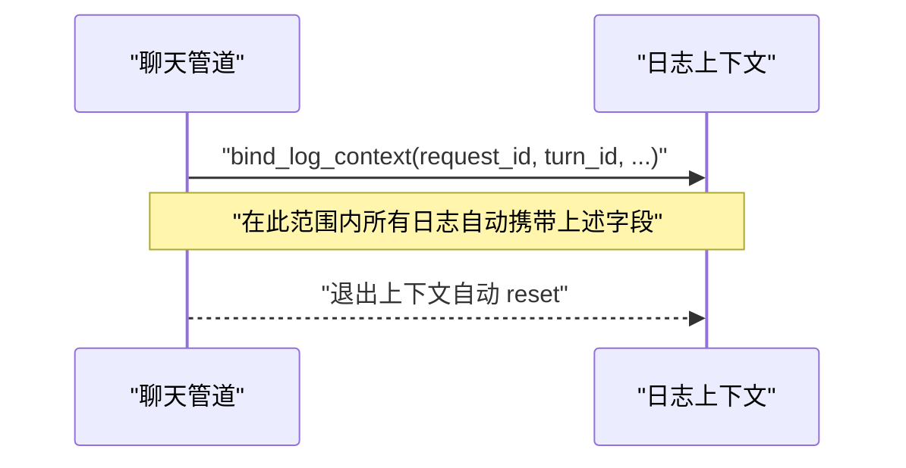
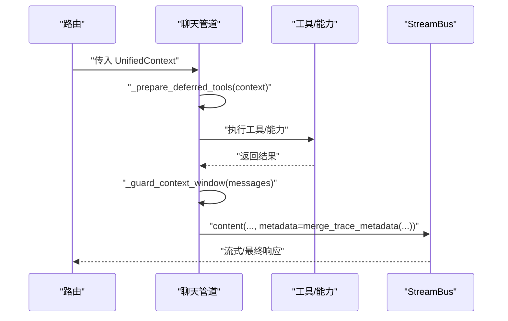
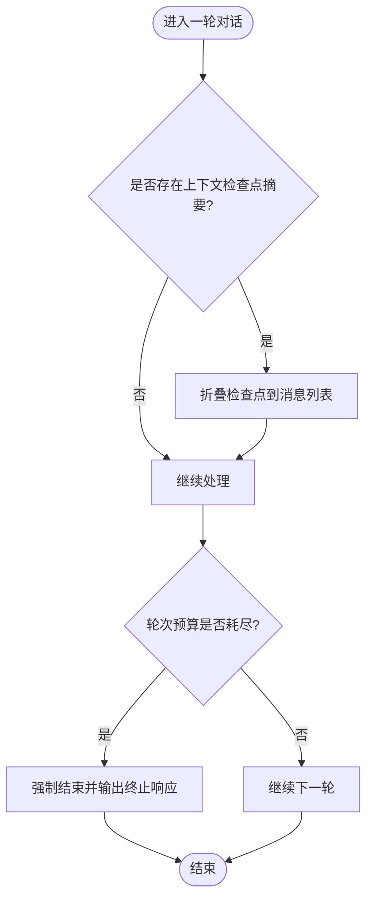
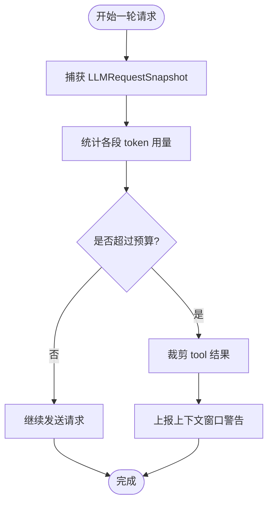
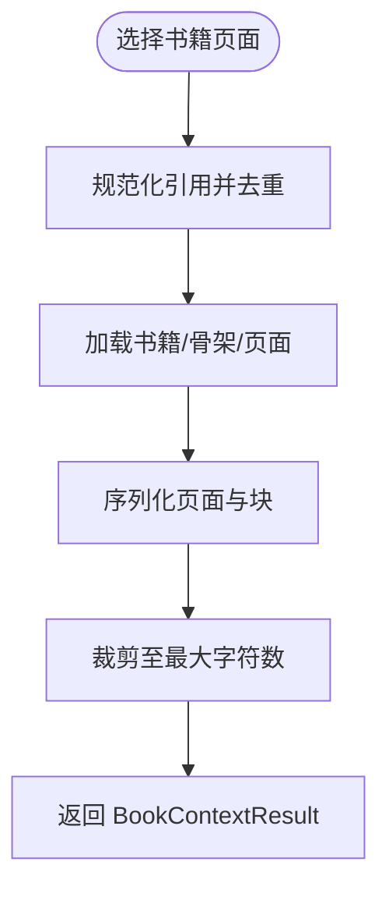
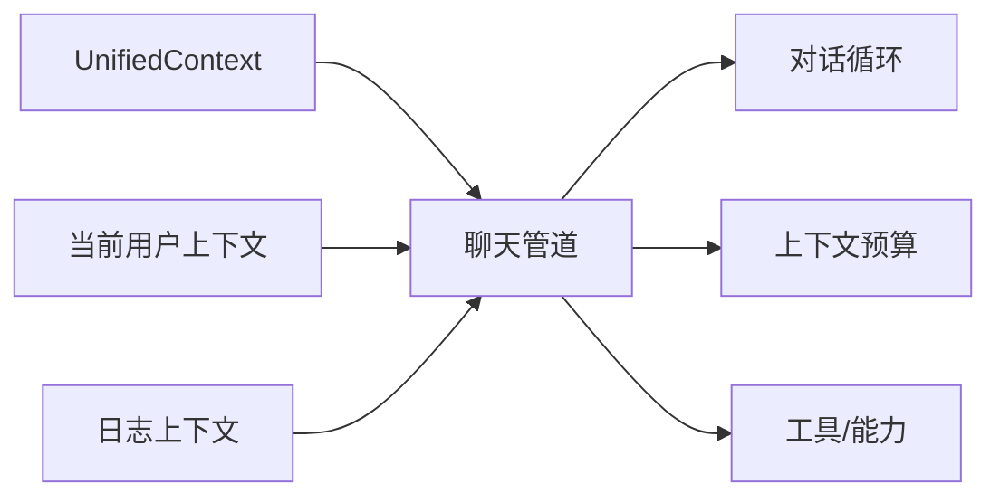

# 上下文传播

<cite>
**本文引用的文件**
- [deeptutor/core/context.py](file://deeptutor/core/context.py)
- [deeptutor/multi_user/context.py](file://deeptutor/multi_user/context.py)
- [deeptutor/logging/context.py](file://deeptutor/logging/context.py)
- [deeptutor/agents/chat/agentic_pipeline.py](file://deeptutor/agents/chat/agentic_pipeline.py)
- [deeptutor/agents/chat/agent_loop.py](file://deeptutor/agents/chat/agent_loop.py)
- [deeptutor/agents/chat/context_budget.py](file://deeptutor/agents/chat/context_budget.py)
- [deeptutor/book/context.py](file://deeptutor/book/context.py)
- [tests/core/test_context.py](file://tests/core/test_context.py)
</cite>

## 目录
1. [简介](#简介)
2. [项目结构](#项目结构)
3. [核心组件](#核心组件)
4. [架构总览](#架构总览)
5. [详细组件分析](#详细组件分析)
6. [依赖关系分析](#依赖关系分析)
7. [性能考虑](#性能考虑)
8. [故障排查指南](#故障排查指南)
9. [结论](#结论)
10. [附录](#附录)

## 简介
本文件系统化阐述 DeepTutor 在分布式与异步环境中的“上下文传播”机制。上下文用于在一次用户请求（turn）的生命周期内，稳定传递用户身份、会话标识、追踪信息、能力开关、知识库范围、附件、语言偏好、系统提示片段等关键信息，确保跨模块、跨工具、跨子代理的调用链具备一致性与可观测性。文档覆盖：
- 上下文对象设计与实现：线程安全、异步安全、序列化友好
- 上下文传播技术：上下文变量、拦截器/装饰器模式、管道装配
- 多用户隔离：用户边界、租户隔离、资源访问控制
- 日志上下文集成：结构化日志与追踪字段自动注入
- 最佳实践与性能优化：内存占用与传播开销控制

## 项目结构
围绕上下文传播的关键代码分布在以下位置：
- 统一上下文数据模型：core/context.py
- 请求级当前用户上下文：multi_user/context.py
- 请求级结构化日志上下文：logging/context.py
- 聊天智能体管道与上下文窗口保护：agents/chat/agentic_pipeline.py
- 对话循环与上下文检查点折叠：agents/chat/agent_loop.py
- 每轮上下文预算统计：agents/chat/context_budget.py
- 书籍内容到聊天上下文的转换：book/context.py
- 单元测试验证默认值与可变字段独立性：tests/core/test_context.py



图表来源
- [deeptutor/agents/chat/agentic_pipeline.py:459-584](file://deeptutor/agents/chat/agentic_pipeline.py#L459-L584)
- [deeptutor/agents/chat/agent_loop.py:348-377](file://deeptutor/agents/chat/agent_loop.py#L348-L377)
- [deeptutor/agents/chat/context_budget.py:1-71](file://deeptutor/agents/chat/context_budget.py#L1-L71)
- [deeptutor/book/context.py:91-139](file://deeptutor/book/context.py#L91-L139)
- [deeptutor/core/context.py:33-84](file://deeptutor/core/context.py#L33-L84)
- [deeptutor/multi_user/context.py:11-46](file://deeptutor/multi_user/context.py#L11-L46)
- [deeptutor/logging/context.py:10-39](file://deeptutor/logging/context.py#L10-L39)

章节来源
- [deeptutor/core/context.py:33-84](file://deeptutor/core/context.py#L33-L84)
- [deeptutor/multi_user/context.py:11-46](file://deeptutor/multi_user/context.py#L11-L46)
- [deeptutor/logging/context.py:10-39](file://deeptutor/logging/context.py#L10-L39)
- [deeptutor/agents/chat/agentic_pipeline.py:459-584](file://deeptutor/agents/chat/agentic_pipeline.py#L459-L584)
- [deeptutor/agents/chat/agent_loop.py:348-377](file://deeptutor/agents/chat/agent_loop.py#L348-L377)
- [deeptutor/agents/chat/context_budget.py:1-71](file://deeptutor/agents/chat/context_budget.py#L1-L71)
- [deeptutor/book/context.py:91-139](file://deeptutor/book/context.py#L91-L139)

## 核心组件
- 统一上下文 UnifiedContext：承载一次 turn 的全部必要信息，包括会话、消息、历史、工具开关、能力、知识库、附件、配置覆盖、语言、记忆/角色人设上下文、技能清单、来源清单以及扩展元数据。
- 当前用户上下文：基于 contextvars 的请求级上下文，提供 set/get/reset 接口，支持单用户本地运行时回退为本地管理员。
- 日志上下文：基于 contextvars 的请求级结构化日志字段绑定，支持 request_id、turn_id、session_id、task_id、capability、stage、sink 等字段的自动注入。
- 聊天管道与循环：负责组装上下文、执行能力与工具、维护上下文窗口、生成追踪元数据、输出最终响应。
- 上下文预算：对每轮实际发送给模型的上下文进行计量，便于前端展示与策略控制。
- 书籍上下文：将选定的书籍页面转换为紧凑的 LLM 上下文文本，供聊天能力使用。

章节来源
- [deeptutor/core/context.py:33-84](file://deeptutor/core/context.py#L33-L84)
- [deeptutor/multi_user/context.py:11-46](file://deeptutor/multi_user/context.py#L11-L46)
- [deeptutor/logging/context.py:10-39](file://deeptutor/logging/context.py#L10-L39)
- [deeptutor/agents/chat/agentic_pipeline.py:459-584](file://deeptutor/agents/chat/agentic_pipeline.py#L459-L584)
- [deeptutor/agents/chat/context_budget.py:1-71](file://deeptutor/agents/chat/context_budget.py#L1-L71)
- [deeptutor/book/context.py:91-139](file://deeptutor/book/context.py#L91-L139)

## 架构总览
下图展示了从 API 进入后，上下文如何在聊天管道中传播，并贯穿工具执行、日志记录与追踪。

```mermaid
sequenceDiagram
participant Client as "客户端"
participant API as "FastAPI 路由"
participant Pipe as "聊天管道<br/>agentic_pipeline.py"
participant Loop as "对话循环<br/>agent_loop.py"
participant LogCtx as "日志上下文<br/>logging/context.py"
participant UserCtx as "当前用户上下文<br/>multi_user/context.py"
participant Budget as "上下文预算<br/>context_budget.py"
Client->>API : "发起请求"
API->>UserCtx : "设置当前用户"
API->>LogCtx : "绑定 request_id/turn_id/session_id"
API->>Pipe : "传入 UnifiedContext"
Pipe->>Loop : "执行业务循环"
Loop->>Budget : "测量上下文窗口"
Loop->>LogCtx : "记录阶段/能力/任务"
Pipe-->>Client : "流式/最终响应"
```

图表来源
- [deeptutor/agents/chat/agentic_pipeline.py:459-584](file://deeptutor/agents/chat/agentic_pipeline.py#L459-L584)
- [deeptutor/agents/chat/agent_loop.py:348-377](file://deeptutor/agents/chat/agent_loop.py#L348-L377)
- [deeptutor/logging/context.py:10-39](file://deeptutor/logging/context.py#L10-L39)
- [deeptutor/multi_user/context.py:11-46](file://deeptutor/multi_user/context.py#L11-L46)
- [deeptutor/agents/chat/context_budget.py:1-71](file://deeptutor/agents/chat/context_budget.py#L1-L71)

## 详细组件分析

### 统一上下文 UnifiedContext
- 设计要点
  - 以 dataclass 定义，字段具有明确默认值，避免共享可变状态导致的并发污染。
  - 包含会话、消息、历史、工具白名单、能力、知识库、附件、配置覆盖、语言、记忆/角色人设、技能清单、来源清单、扩展元数据等。
  - 通过 metadata 字段承载能力特定扩展信息，保持向后兼容与可扩展性。
- 线程与异步安全
  - 不可变默认值与独立实例构造保证多线程/协程间不会意外共享可变状态。
  - 测试覆盖了默认值独立性与完整构造场景。
- 序列化友好
  - 纯数据类结构，适合 JSON 化传输或持久化；附件携带 id/url/base64/filename/mime_type 等标准字段。



图表来源
- [deeptutor/core/context.py:15-84](file://deeptutor/core/context.py#L15-L84)

章节来源
- [deeptutor/core/context.py:33-84](file://deeptutor/core/context.py#L33-L84)
- [tests/core/test_context.py:53-102](file://tests/core/test_context.py#L53-L102)

### 当前用户上下文（多用户隔离）
- 设计要点
  - 使用 contextvars 存储当前请求的用户对象，提供 set_current_user、reset_current_user、get_current_user、get_current_user_or_none。
  - 当无有效载荷时回退为本地管理员，保证单用户本地运行时的可用性。
  - 根据用户 ID 与角色计算 scope，支撑路径与服务访问隔离。
- 隔离与权限
  - 结合 multi_user 的路径与授权模块，实现用户边界、租户隔离与资源访问控制。
  - 在管道中通过 get_current_user() 判断是否为管理员，从而决定 exec 策略等敏感行为。



图表来源
- [deeptutor/multi_user/context.py:11-46](file://deeptutor/multi_user/context.py#L11-L46)
- [deeptutor/agents/chat/agentic_pipeline.py:557-584](file://deeptutor/agents/chat/agentic_pipeline.py#L557-L584)

章节来源
- [deeptutor/multi_user/context.py:11-46](file://deeptutor/multi_user/context.py#L11-L46)
- [deeptutor/agents/chat/agentic_pipeline.py:557-584](file://deeptutor/agents/chat/agentic_pipeline.py#L557-L584)

### 日志上下文（结构化日志与追踪）
- 设计要点
  - 使用 contextvars.ContextVar 保存请求级日志字段字典，提供 bind_log_context 上下文管理器临时绑定字段。
  - 支持的字段包括 request_id、turn_id、session_id、task_id、capability、stage、sink。
- 自动注入
  - 在管道各阶段通过 bind_log_context 绑定字段，所有下游日志记录自动携带这些字段，便于追踪与聚合。
- 线程/异步安全
  - ContextVar 天然支持协程隔离，不同协程互不干扰。



图表来源
- [deeptutor/logging/context.py:10-39](file://deeptutor/logging/context.py#L10-L39)

章节来源
- [deeptutor/logging/context.py:10-39](file://deeptutor/logging/context.py#L10-L39)

### 聊天管道与上下文传播
- 上下文装配
  - 管道接收 UnifiedContext，并根据其 metadata 判断是否为 partner 转发的合成用户上下文，从而采用不同的工具挂载与执行策略。
  - 通过 _prepare_deferred_tools 解析外部提供者（MCP/CLI）工具表面，并结合当前用户上下文决定 exec 策略。
- 上下文窗口保护
  - 估算消息 token 数，超过阈值时对 tool 结果进行裁剪，并通过 stream.progress 上报警告。
- 追踪元数据
  - 针对不同工具（如 rag、imagegen、videogen、consult_subagent）生成统一的追踪元数据，便于前端渲染与链路追踪。
- 最终响应
  - 合并追踪元数据并通过 StreamBus 输出最终文本，附带 trace_kind 等元信息。



图表来源
- [deeptutor/agents/chat/agentic_pipeline.py:459-584](file://deeptutor/agents/chat/agentic_pipeline.py#L459-L584)
- [deeptutor/agents/chat/agentic_pipeline.py:1232-1270](file://deeptutor/agents/chat/agentic_pipeline.py#L1232-L1270)
- [deeptutor/agents/chat/agentic_pipeline.py:1049-1199](file://deeptutor/agents/chat/agentic_pipeline.py#L1049-L1199)

章节来源
- [deeptutor/agents/chat/agentic_pipeline.py:459-584](file://deeptutor/agents/chat/agentic_pipeline.py#L459-L584)
- [deeptutor/agents/chat/agentic_pipeline.py:1049-1199](file://deeptutor/agents/chat/agentic_pipeline.py#L1049-L1199)
- [deeptutor/agents/chat/agentic_pipeline.py:1232-1270](file://deeptutor/agents/chat/agentic_pipeline.py#L1232-L1270)

### 对话循环与上下文检查点
- 上下文检查点折叠
  - 在对话循环中，若存在上下文检查点摘要，将其作为 system 消息插入消息列表，帮助模型维持长对话一致性。
- 强制结束
  - 当轮次预算耗尽且仍在请求工具时，强制结束并输出终止响应。



图表来源
- [deeptutor/agents/chat/agent_loop.py:348-377](file://deeptutor/agents/chat/agent_loop.py#L348-L377)

章节来源
- [deeptutor/agents/chat/agent_loop.py:348-377](file://deeptutor/agents/chat/agent_loop.py#L348-L377)

### 上下文预算与窗口管理
- 预算统计
  - 对每轮实际发送给模型的 messages 与 tool_schemas 进行快照，按段统计 token 用量，便于前端展示与策略控制。
- 窗口保护
  - 根据模型上下文窗口与 max_tokens 计算有效窗口，超出预算时对 tool 结果进行裁剪，并上报警告。
- 计数器延迟加载
  - 为避免循环导入，token 计数器延迟加载，降低启动成本。



图表来源
- [deeptutor/agents/chat/context_budget.py:1-71](file://deeptutor/agents/chat/context_budget.py#L1-L71)
- [deeptutor/agents/chat/agentic_pipeline.py:1232-1270](file://deeptutor/agents/chat/agentic_pipeline.py#L1232-L1270)

章节来源
- [deeptutor/agents/chat/context_budget.py:1-71](file://deeptutor/agents/chat/context_budget.py#L1-L71)
- [deeptutor/agents/chat/agentic_pipeline.py:1232-1270](file://deeptutor/agents/chat/agentic_pipeline.py#L1232-L1270)

### 书籍上下文到聊天上下文
- 功能概述
  - 将用户选择的书籍页面序列化为紧凑的 LLM 上下文文本，包含书籍头、章节摘要、学习目标、页面内容与错误信息等。
- 上下文裁剪
  - 对过长文本进行裁剪，避免超出模型上下文限制。
- 用途
  - 被聊天能力消费，用于在系统提示中附加“已附来源”等信息，增强回答准确性。



图表来源
- [deeptutor/book/context.py:91-139](file://deeptutor/book/context.py#L91-L139)
- [deeptutor/book/context.py:419-424](file://deeptutor/book/context.py#L419-L424)

章节来源
- [deeptutor/book/context.py:91-139](file://deeptutor/book/context.py#L91-L139)
- [deeptutor/book/context.py:419-424](file://deeptutor/book/context.py#L419-L424)

## 依赖关系分析
- 低耦合高内聚
  - UnifiedContext 仅作为数据载体，不包含业务逻辑，便于在各层之间传递。
  - 当前用户上下文与日志上下文均基于 contextvars，解耦于具体框架，易于替换与测试。
- 直接依赖
  - 聊天管道依赖当前用户上下文与日志上下文，用于权限判定与结构化日志。
  - 对话循环依赖上下文预算模块，用于窗口保护与统计。
- 潜在风险
  - 若上下文过大（如过长的 conversation_history 或附件），可能影响内存与网络传输；需配合预算与裁剪策略。
  - 过度频繁的上下文切换（频繁 bind/unbind）会增加开销，应合理批量处理。



图表来源
- [deeptutor/core/context.py:33-84](file://deeptutor/core/context.py#L33-L84)
- [deeptutor/multi_user/context.py:11-46](file://deeptutor/multi_user/context.py#L11-L46)
- [deeptutor/logging/context.py:10-39](file://deeptutor/logging/context.py#L10-L39)
- [deeptutor/agents/chat/agentic_pipeline.py:459-584](file://deeptutor/agents/chat/agentic_pipeline.py#L459-L584)
- [deeptutor/agents/chat/agent_loop.py:348-377](file://deeptutor/agents/chat/agent_loop.py#L348-L377)
- [deeptutor/agents/chat/context_budget.py:1-71](file://deeptutor/agents/chat/context_budget.py#L1-L71)

章节来源
- [deeptutor/core/context.py:33-84](file://deeptutor/core/context.py#L33-L84)
- [deeptutor/multi_user/context.py:11-46](file://deeptutor/multi_user/context.py#L11-L46)
- [deeptutor/logging/context.py:10-39](file://deeptutor/logging/context.py#L10-L39)
- [deeptutor/agents/chat/agentic_pipeline.py:459-584](file://deeptutor/agents/chat/agentic_pipeline.py#L459-L584)
- [deeptutor/agents/chat/agent_loop.py:348-377](file://deeptutor/agents/chat/agent_loop.py#L348-L377)
- [deeptutor/agents/chat/context_budget.py:1-71](file://deeptutor/agents/chat/context_budget.py#L1-L71)

## 性能考虑
- 内存使用
  - 控制 conversation_history 长度与附件大小，避免一次性加载过多内容。
  - 使用上下文预算与裁剪策略，减少不必要的 token 消耗。
- 传播开销
  - 合理使用 bind_log_context，避免在高频路径中频繁创建/销毁上下文。
  - 将大对象（如长文本）尽量以引用或 ID 形式传递，按需加载。
- 异步安全
  - 利用 contextvars 的协程隔离特性，避免跨协程共享可变状态。
  - 在异步管道中，确保上下文对象的构造与传递是无副作用的。

[本节为通用指导，无需列出具体文件来源]

## 故障排查指南
- 常见问题
  - 上下文丢失：检查是否在异步边界正确传递 UnifiedContext，以及是否在工具/能力中重新构造了上下文。
  - 用户身份错乱：确认当前用户上下文是否正确设置与重置，避免跨请求污染。
  - 日志缺失追踪字段：确认 bind_log_context 是否正确包裹了相关逻辑。
  - 上下文窗口超限：检查对话历史与工具结果长度，启用裁剪与预算统计。
- 定位方法
  - 通过日志上下文中的 request_id/turn_id/session_id 关联同一请求的日志。
  - 使用上下文预算统计定位具体段落（system_prompt、memory、tools 等）的 token 占比。
  - 在管道中打印 UnifiedContext.metadata 与当前用户上下文，确认权限与来源。

章节来源
- [deeptutor/logging/context.py:10-39](file://deeptutor/logging/context.py#L10-L39)
- [deeptutor/agents/chat/context_budget.py:1-71](file://deeptutor/agents/chat/context_budget.py#L1-L71)
- [deeptutor/agents/chat/agentic_pipeline.py:1232-1270](file://deeptutor/agents/chat/agentic_pipeline.py#L1232-L1270)

## 结论
DeepTutor 的上下文传播机制以 UnifiedContext 为核心，结合请求级的当前用户上下文与日志上下文，实现了在多用户、异步、分布式环境下的稳定传播与隔离。通过聊天管道的工具装配、上下文窗口保护与预算统计，系统在保障功能的同时兼顾了性能与可观测性。遵循本文的最佳实践，可进一步提升系统的稳定性、可维护性与用户体验。

[本节为总结，无需列出具体文件来源]

## 附录
- 术语
  - Turn：一次用户请求的处理单元
  - 上下文：在一次 turn 生命周期内传递的状态与信息集合
  - 上下文变量：基于 contextvars 的协程隔离存储
  - 预算：对上下文大小的限制与统计
- 参考
  - 统一上下文模型：[deeptutor/core/context.py:33-84](file://deeptutor/core/context.py#L33-L84)
  - 当前用户上下文：[deeptutor/multi_user/context.py:11-46](file://deeptutor/multi_user/context.py#L11-L46)
  - 日志上下文：[deeptutor/logging/context.py:10-39](file://deeptutor/logging/context.py#L10-L39)
  - 聊天管道：[deeptutor/agents/chat/agentic_pipeline.py:459-584](file://deeptutor/agents/chat/agentic_pipeline.py#L459-L584)
  - 对话循环：[deeptutor/agents/chat/agent_loop.py:348-377](file://deeptutor/agents/chat/agent_loop.py#L348-L377)
  - 上下文预算：[deeptutor/agents/chat/context_budget.py:1-71](file://deeptutor/agents/chat/context_budget.py#L1-L71)
  - 书籍上下文：[deeptutor/book/context.py:91-139](file://deeptutor/book/context.py#L91-L139)