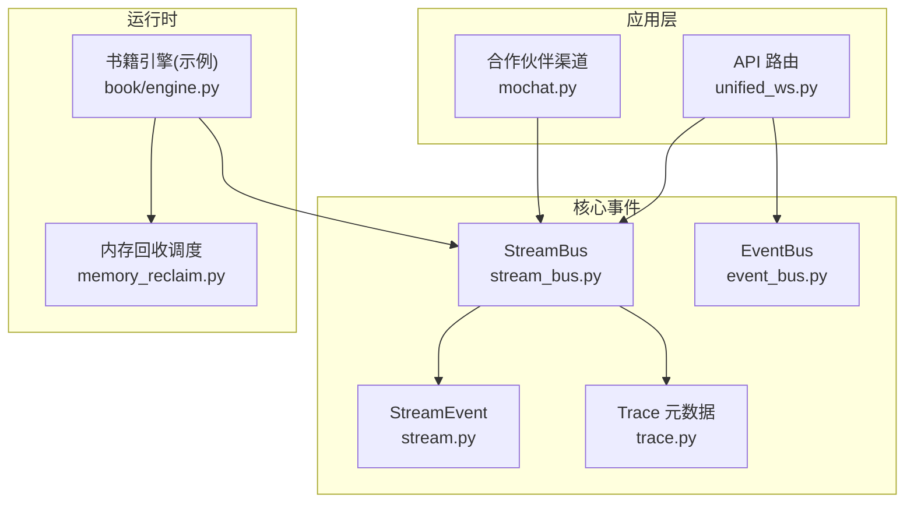
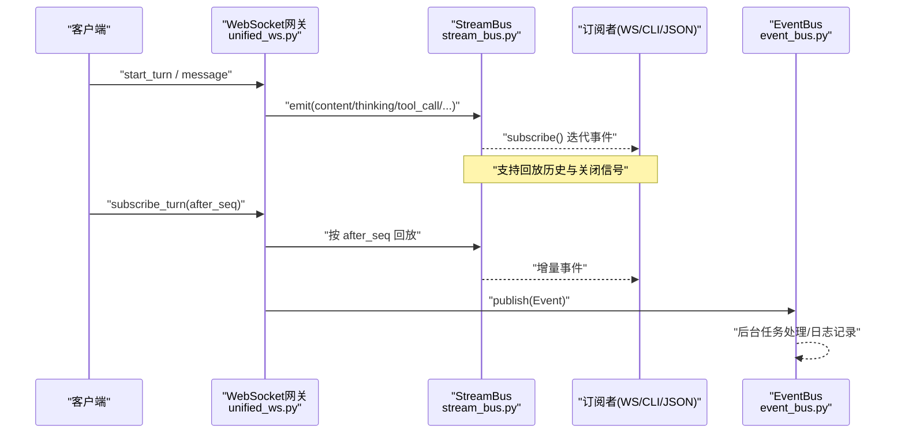
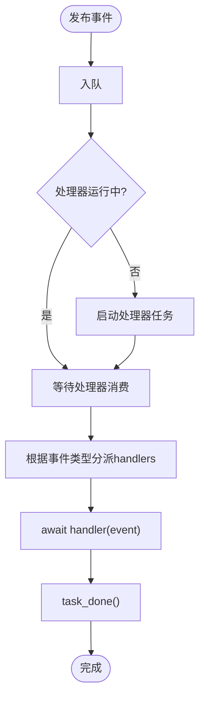
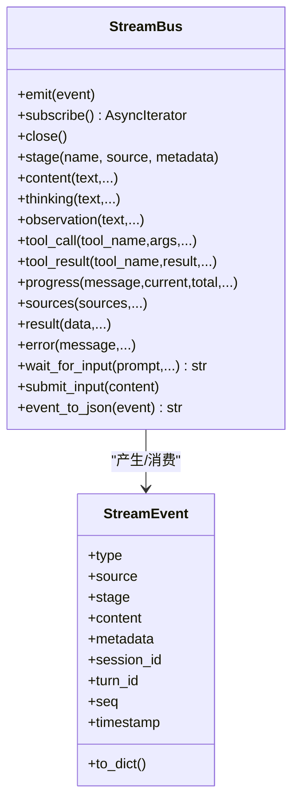
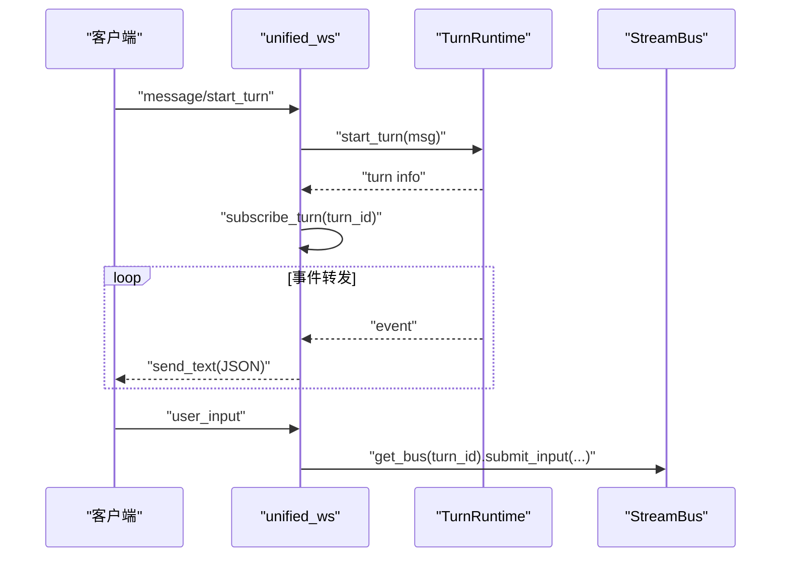
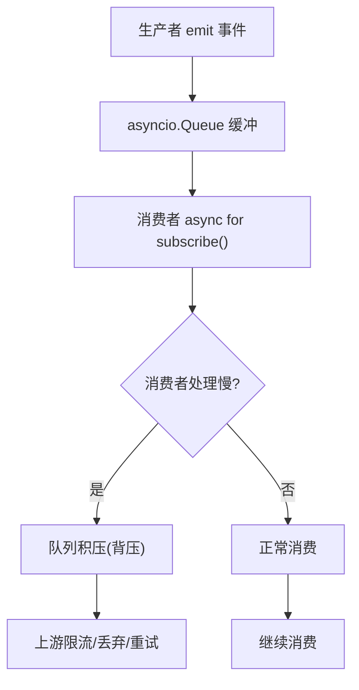
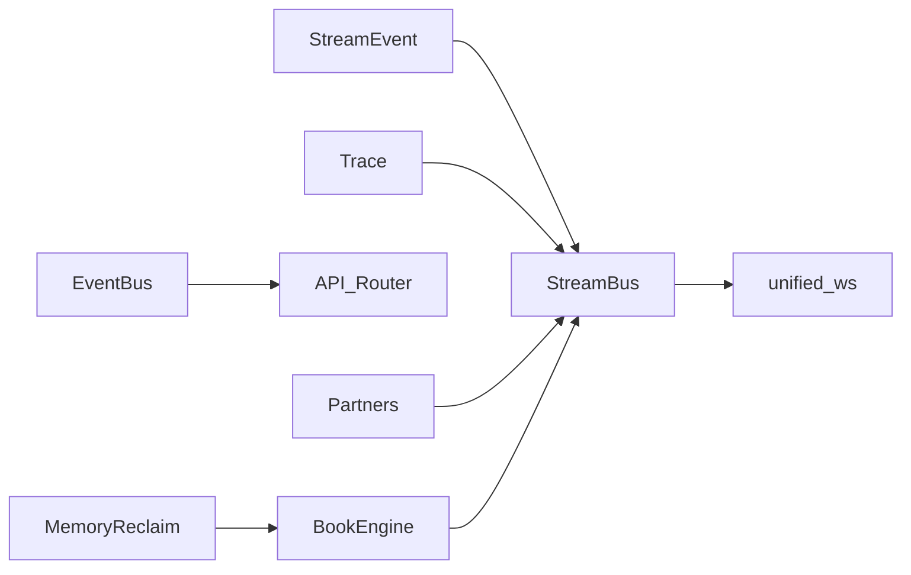

# 事件驱动架构

<cite>
**本文引用的文件**
- [deeptutor/events/event_bus.py](file://deeptutor/events/event_bus.py)
- [deeptutor/core/stream.py](file://deeptutor/core/stream.py)
- [deeptutor/core/stream_bus.py](file://deeptutor/core/stream_bus.py)
- [deeptutor/api/routers/unified_ws.py](file://deeptutor/api/routers/unified_ws.py)
- [deeptutor/core/trace.py](file://deeptutor/core/trace.py)
- [deeptutor/core/errors.py](file://deeptutor/core/errors.py)
- [tests/core/test_stream_bus.py](file://tests/core/test_stream_bus.py)
- [deeptutor/partners/channels/mochat.py](file://deeptutor/partners/channels/mochat.py)
- [deeptutor/book/engine.py](file://deeptutor/book/engine.py)
- [deeptutor/runtime/memory_reclaim.py](file://deeptutor/runtime/memory_reclaim.py)
</cite>

## 目录
1. [简介](#简介)
2. [项目结构](#项目结构)
3. [核心组件](#核心组件)
4. [架构总览](#架构总览)
5. [详细组件分析](#详细组件分析)
6. [依赖关系分析](#依赖关系分析)
7. [性能考量](#性能考量)
8. [故障排查指南](#故障排查指南)
9. [结论](#结论)
10. [附录](#附录)

## 简介
本文件围绕 DeepTutor 中的事件驱动架构进行系统化说明，重点覆盖：
- 事件驱动设计的核心理念与优势（解耦、可扩展性、实时通信）
- 事件总线设计与实现（发布订阅、过滤与路由）
- 流式事件处理（实时数据流、背压、错误恢复）
- 事件的序列化与反序列化（跨语言与版本兼容）
- 事件溯源与审计（事件历史、状态重建、调试支持）
- 设计模式与最佳实践（事件命名规范、错误处理、性能优化）

## 项目结构
DeepTutor 的事件体系由“应用级事件总线”和“会话级流式通道”两部分组成：
- 应用级事件总线：用于模块间异步通信，采用单例 EventBus + 队列 + 后台处理器。
- 会话级流式通道：面向单次对话轮次（turn）的 fan-out 事件流，提供事件回放、阶段标记、工具调用/结果、进度、结果、错误等统一事件协议。

图表来源
- [deeptutor/api/routers/unified_ws.py:44-325](file://deeptutor/api/routers/unified_ws.py#L44-L325)
- [deeptutor/core/stream_bus.py:31-326](file://deeptutor/core/stream_bus.py#L31-L326)
- [deeptutor/core/stream.py:17-73](file://deeptutor/core/stream.py#L17-L73)
- [deeptutor/core/trace.py:14-82](file://deeptutor/core/trace.py#L14-L82)
- [deeptutor/events/event_bus.py:61-205](file://deeptutor/events/event_bus.py#L61-L205)
- [deeptutor/partners/channels/mochat.py:735-756](file://deeptutor/partners/channels/mochat.py#L735-L756)
- [deeptutor/book/engine.py:773-853](file://deeptutor/book/engine.py#L773-L853)
- [deeptutor/runtime/memory_reclaim.py:44-73](file://deeptutor/runtime/memory_reclaim.py#L44-L73)

章节来源
- [deeptutor/api/routers/unified_ws.py:44-325](file://deeptutor/api/routers/unified_ws.py#L44-L325)
- [deeptutor/core/stream_bus.py:31-326](file://deeptutor/core/stream_bus.py#L31-L326)
- [deeptutor/core/stream.py:17-73](file://deeptutor/core/stream.py#L17-L73)
- [deeptutor/events/event_bus.py:61-205](file://deeptutor/events/event_bus.py#L61-L205)
- [deeptutor/partners/channels/mochat.py:735-756](file://deeptutor/partners/channels/mochat.py#L735-L756)
- [deeptutor/book/engine.py:773-853](file://deeptutor/book/engine.py#L773-L853)
- [deeptutor/runtime/memory_reclaim.py:44-73](file://deeptutor/runtime/memory_reclaim.py#L44-L73)

## 核心组件
- 事件类型与事件模型
  - 应用级事件类型定义于 EventType，包含任务完成类事件；事件模型 Event 携带任务ID、输入输出、工具使用、成功标志、元数据、时间戳等，并提供 to_dict 序列化能力。
  - 流式事件类型定义于 StreamEventType，涵盖阶段开始/结束、思考、观察、内容、工具调用/结果、进度、来源、结果、错误、会话、完成、等待用户输入等。
- 事件总线（EventBus）
  - 单例异步事件总线，基于 asyncio.Queue 与后台任务处理，支持 subscribe/publish/unsubscribe/start/stop/flush/reset。
- 流式总线（StreamBus）
  - 针对单个 turn 的 fan-out 通道，维护事件历史并支持 late subscriber 回放；提供 stage/content/thinking/observation/tool_call/tool_result/progress/sources/result/error/wait_for_input/submit_input 等便捷方法；支持 event_to_json 序列化为 NDJSON。
- WebSocket 网关（unified_ws）
  - 统一入口 /api/v1/ws，负责认证、消息分发、订阅/取消订阅、重连续传、用户输入投递、心跳、错误返回等。
- 追踪元数据（trace）
  - 统一的 trace 元数据构建与合并工具，便于在 UI 中渲染结构化执行时间线。
- 错误模型（errors）
  - 应用级异常基类与分层异常，便于统一错误分类与处理。

章节来源
- [deeptutor/events/event_bus.py:22-58](file://deeptutor/events/event_bus.py#L22-L58)
- [deeptutor/core/stream.py:17-73](file://deeptutor/core/stream.py#L17-L73)
- [deeptutor/core/stream_bus.py:31-326](file://deeptutor/core/stream_bus.py#L31-L326)
- [deeptutor/api/routers/unified_ws.py:44-325](file://deeptutor/api/routers/unified_ws.py#L44-L325)
- [deeptutor/core/trace.py:14-82](file://deeptutor/core/trace.py#L14-L82)
- [deeptutor/core/errors.py:10-58](file://deeptutor/core/errors.py#L10-L58)

## 架构总览
下图展示了从客户端到后端的核心事件流转路径：客户端通过 WebSocket 发起请求或订阅，服务端将事件写入 StreamBus，消费者（CLI、WebSocket 推送、JSON 写入器）消费事件；同时应用级事件通过 EventBus 进行模块间异步通知。

图表来源
- [deeptutor/api/routers/unified_ws.py:79-133](file://deeptutor/api/routers/unified_ws.py#L79-L133)
- [deeptutor/core/stream_bus.py:40-75](file://deeptutor/core/stream_bus.py#L40-L75)
- [deeptutor/events/event_bus.py:101-151](file://deeptutor/events/event_bus.py#L101-L151)

## 详细组件分析

### 事件总线（EventBus）
- 设计理念
  - 单例 + 非阻塞发布：publish 仅入队，后台任务循环消费并调用已注册的 handler。
  - 生命周期管理：start/stop/flush/reset 保证进程启动与优雅退出。
  - 容错：handler 异常被捕获并记录，不影响其他 handler 执行。
- 关键流程
  - publish -> 入队 -> 首次发布时启动处理器 -> 处理器循环取事件 -> 查找对应 EventType 的 handlers -> await 每个 handler -> task_done。
  - flush 等待队列清空，stop 等待队列并取消处理器任务。
- 适用场景
  - 模块间解耦通知（如能力完成、问题完成、求解完成）。
  - 与业务逻辑弱耦合的副作用（统计、审计、缓存更新）。

图表来源
- [deeptutor/events/event_bus.py:101-151](file://deeptutor/events/event_bus.py#L101-L151)

章节来源
- [deeptutor/events/event_bus.py:61-205](file://deeptutor/events/event_bus.py#L61-L205)

### 流式事件协议与总线（StreamEvent + StreamBus）
- 事件协议
  - StreamEvent 统一描述一次流式事件：类型、来源、阶段、内容、元数据、会话/轮次标识、序列号、时间戳；to_dict 用于序列化。
- 总线特性
  - Fan-out：一个生产者 emit，多个订阅者 receive。
  - 历史回放：late subscriber 可获取已发生事件，避免丢失。
  - 阶段化：stage 上下文管理器自动发出 STAGE_START/STAGE_END。
  - 交互暂停：wait_for_input 允许能力执行暂停，等待前端用户输入后继续。
  - 关闭语义：close 向所有订阅者发送终止信号。
- 典型用法
  - 工具/能力侧：content/thinking/observation/tool_call/tool_result/progress/sources/result/error。
  - 消费侧：async for bus.subscribe() 消费事件流。

图表来源
- [deeptutor/core/stream.py:17-73](file://deeptutor/core/stream.py#L17-L73)
- [deeptutor/core/stream_bus.py:31-326](file://deeptutor/core/stream_bus.py#L31-L326)

章节来源
- [deeptutor/core/stream.py:17-73](file://deeptutor/core/stream.py#L17-L73)
- [deeptutor/core/stream_bus.py:31-326](file://deeptutor/core/stream_bus.py#L31-L326)
- [tests/core/test_stream_bus.py:48-135](file://tests/core/test_stream_bus.py#L48-L135)

### WebSocket 网关（unified_ws）
- 职责
  - 认证与会话绑定：ws_require_auth、reset_current_user。
  - 消息路由：start_turn、subscribe_turn/session、resume_from、unsubscribe、cancel_turn、regenerate、user_input、ping/pong。
  - 安全发送：safe_send 对 JSON 序列化失败做兜底，防止污染推送通道。
  - 错误上报：将异常转换为标准 error 事件格式。
- 与 StreamBus 集成
  - user_input 消息通过 get_bus(turn_id).submit_input(...) 投递给等待的用户输入。
  - 订阅 turn/session 通过 runtime.subscribe_turn/subscribe_session 拉取事件流。

图表来源
- [deeptutor/api/routers/unified_ws.py:44-325](file://deeptutor/api/routers/unified_ws.py#L44-L325)
- [deeptutor/core/stream_bus.py:308-326](file://deeptutor/core/stream_bus.py#L308-L326)

章节来源
- [deeptutor/api/routers/unified_ws.py:44-325](file://deeptutor/api/routers/unified_ws.py#L44-L325)

### 事件溯源与审计
- 事件历史
  - StreamBus 内部维护 _history，late subscriber 可回放历史，确保不丢事件。
  - unified_ws 支持 after_seq 增量回放，适合断线重连。
- 元数据与追踪
  - trace 工具为事件附加 call_id、phase、label、call_kind、trace_id 等，便于 UI 渲染执行时间线与定位问题。
- 状态重建
  - 通过事件序列（含 seq、timestamp、turn_id）可重建某 turn 的状态演进，辅助调试与复盘。
- 审计
  - 应用级 EventBus 的 EventType 可用于记录关键业务完成事件，配合日志与外部系统实现审计。

章节来源
- [deeptutor/core/stream_bus.py:31-75](file://deeptutor/core/stream_bus.py#L31-L75)
- [deeptutor/api/routers/unified_ws.py:79-100](file://deeptutor/api/routers/unified_ws.py#L79-L100)
- [deeptutor/core/trace.py:14-82](file://deeptutor/core/trace.py#L14-L82)
- [deeptutor/events/event_bus.py:22-58](file://deeptutor/events/event_bus.py#L22-L58)

### 事件序列化与反序列化
- 序列化
  - StreamEvent.to_dict 输出标准化字典；StreamBus.event_to_json 输出单行 JSON（NDJSON），便于流式传输。
  - unified_ws 使用 json.dumps(..., default=str) 保证不可序列化字段不会中断推送。
- 反序列化
  - 客户端通过 JSON 解析消息；服务端的 user_input 支持 text 与 answers 两种格式以兼容旧版与新协议。
- 跨语言与版本兼容
  - 事件协议以字符串枚举与字典为主，易于跨语言解析；after_seq 机制支持增量同步，降低版本差异带来的影响。

章节来源
- [deeptutor/core/stream.py:61-73](file://deeptutor/core/stream.py#L61-L73)
- [deeptutor/core/stream_bus.py:302-305](file://deeptutor/core/stream_bus.py#L302-L305)
- [deeptutor/api/routers/unified_ws.py:57-68](file://deeptutor/api/routers/unified_ws.py#L57-L68)
- [deeptutor/api/routers/unified_ws.py:225-259](file://deeptutor/api/routers/unified_ws.py#L225-L259)

### 流式事件处理：实时数据流、背压与错误恢复
- 实时数据流
  - StreamBus 的 async for subscribe() 提供流式消费；unified_ws 将事件推送到 WebSocket。
- 背压处理
  - 使用 asyncio.Queue 作为缓冲；当消费者处理慢时，Queue 增长形成自然背压；必要时可在上层限流或丢弃策略。
  - partners 渠道（如 mochat）使用去重集合与延迟缓冲，控制事件吞吐与重复。
- 错误恢复
  - EventBus 的 handler 异常被捕获并记录，不影响其他 handler。
  - unified_ws 的 safe_send 对发送异常做兜底，避免连接冻结。
  - 断线重连：after_seq 支持增量回放，结合 done/complete 事件判断结束。

图表来源
- [deeptutor/core/stream_bus.py:40-75](file://deeptutor/core/stream_bus.py#L40-L75)
- [deeptutor/partners/channels/mochat.py:829-875](file://deeptutor/partners/channels/mochat.py#L829-L875)
- [deeptutor/events/event_bus.py:108-144](file://deeptutor/events/event_bus.py#L108-L144)
- [deeptutor/api/routers/unified_ws.py:57-68](file://deeptutor/api/routers/unified_ws.py#L57-L68)

章节来源
- [deeptutor/core/stream_bus.py:40-75](file://deeptutor/core/stream_bus.py#L40-L75)
- [deeptutor/partners/channels/mochat.py:829-875](file://deeptutor/partners/channels/mochat.py#L829-L875)
- [deeptutor/events/event_bus.py:108-144](file://deeptutor/events/event_bus.py#L108-L144)
- [deeptutor/api/routers/unified_ws.py:57-68](file://deeptutor/api/routers/unified_ws.py#L57-L68)

### 设计模式与最佳实践
- 事件命名规范
  - 应用级事件使用大写常量（SOLVE_COMPLETE、QUESTION_COMPLETE、CAPABILITY_COMPLETE）。
  - 流式事件使用小写字符串枚举（stage_start、content、tool_call、done 等）。
- 错误处理
  - 使用 errors 中的分层异常进行分类；在网关层将异常转为标准 error 事件。
  - 在 EventBus 中捕获 handler 异常，避免级联失败。
- 性能优化
  - 使用 asyncio.Queue 与后台任务实现非阻塞处理。
  - 合理设置 flush/stop 超时，避免长时间阻塞。
  - 使用 memory_reclaim 在空闲时释放内存，减少峰值占用。
  - 在 partners 渠道中使用去重与延迟缓冲，降低风暴压力。

章节来源
- [deeptutor/events/event_bus.py:22-28](file://deeptutor/events/event_bus.py#L22-L28)
- [deeptutor/core/stream.py:17-35](file://deeptutor/core/stream.py#L17-L35)
- [deeptutor/core/errors.py:10-58](file://deeptutor/core/errors.py#L10-L58)
- [deeptutor/runtime/memory_reclaim.py:44-73](file://deeptutor/runtime/memory_reclaim.py#L44-L73)
- [deeptutor/partners/channels/mochat.py:829-875](file://deeptutor/partners/channels/mochat.py#L829-L875)

## 依赖关系分析
- 松耦合
  - 事件总线与流式总线解耦了生产者和消费者，支持横向扩展。
  - WebSocket 网关仅负责协议转换与路由，不承载复杂业务。
- 直接依赖
  - StreamBus 依赖 StreamEvent 与 trace 元数据。
  - unified_ws 依赖 StreamBus 注册表与 TurnRuntime（通过 services.session 间接访问）。
  - EventBus 依赖 asyncio 队列与日志。
- 潜在循环依赖
  - 当前实现未见明显循环导入；各模块职责清晰。

图表来源
- [deeptutor/core/stream.py:17-73](file://deeptutor/core/stream.py#L17-L73)
- [deeptutor/core/stream_bus.py:31-326](file://deeptutor/core/stream_bus.py#L31-L326)
- [deeptutor/core/trace.py:14-82](file://deeptutor/core/trace.py#L14-L82)
- [deeptutor/api/routers/unified_ws.py:44-325](file://deeptutor/api/routers/unified_ws.py#L44-L325)
- [deeptutor/events/event_bus.py:61-205](file://deeptutor/events/event_bus.py#L61-L205)
- [deeptutor/partners/channels/mochat.py:735-756](file://deeptutor/partners/channels/mochat.py#L735-L756)
- [deeptutor/book/engine.py:773-853](file://deeptutor/book/engine.py#L773-L853)
- [deeptutor/runtime/memory_reclaim.py:44-73](file://deeptutor/runtime/memory_reclaim.py#L44-L73)

章节来源
- [deeptutor/core/stream_bus.py:31-326](file://deeptutor/core/stream_bus.py#L31-L326)
- [deeptutor/api/routers/unified_ws.py:44-325](file://deeptutor/api/routers/unified_ws.py#L44-L325)
- [deeptutor/events/event_bus.py:61-205](file://deeptutor/events/event_bus.py#L61-L205)

## 性能考量
- 背压与缓冲
  - asyncio.Queue 天然提供背压；在高并发场景下需监控队列长度，必要时在上游限流。
- 内存管理
  - 使用 memory_reclaim 在空闲时释放未引用对象，降低内存峰值。
  - BookEngine 在空队列时清理运行时资源，避免长期驻留。
- 网络 I/O
  - unified_ws 使用 safe_send 避免 JSON 序列化异常导致连接冻结；心跳 ping/pong 维持连接活性。
- 批处理与节流
  - partners 渠道使用去重与延迟缓冲，减少下游压力。

[本节为通用指导，不直接分析具体文件]

## 故障排查指南
- 常见问题
  - 事件丢失：检查 StreamBus 是否 close；确认 after_seq 是否正确；验证订阅是否在 close 前建立。
  - 连接冻结：检查 unified_ws 的 safe_send 是否抛出异常；确认客户端是否及时处理消息。
  - 处理器卡住：检查 EventBus 的 flush/stop 超时；确认 handler 是否长时间阻塞。
- 诊断步骤
  - 查看事件历史与元数据（trace），定位问题阶段。
  - 使用测试用例复现（test_stream_bus）验证回放与关闭行为。
  - 在 partners 渠道中检查去重与延迟缓冲配置。
- 恢复策略
  - 使用 resume_from + after_seq 重连续传。
  - 对失败 handler 增加重试与退避策略。
  - 对慢消费者实施限流或降级。

章节来源
- [tests/core/test_stream_bus.py:48-135](file://tests/core/test_stream_bus.py#L48-L135)
- [deeptutor/api/routers/unified_ws.py:57-68](file://deeptutor/api/routers/unified_ws.py#L57-L68)
- [deeptutor/events/event_bus.py:153-185](file://deeptutor/events/event_bus.py#L153-L185)
- [deeptutor/partners/channels/mochat.py:829-875](file://deeptutor/partners/channels/mochat.py#L829-L875)

## 结论
DeepTutor 的事件驱动架构通过“应用级事件总线”与“会话级流式通道”的组合，实现了高内聚、低耦合的实时通信与异步处理能力。其设计兼顾了解耦、可扩展性与实时性，并通过事件历史、元数据与标准化协议提供了良好的可观测性与可维护性。在生产环境中，建议结合背压控制、内存回收与错误恢复策略，进一步提升系统的稳定性与性能。

[本节为总结性内容，不直接分析具体文件]

## 附录
- 术语
  - 事件总线：模块间异步通信的基础设施。
  - 流式通道：面向单次对话轮次的 fan-out 事件流。
  - 回溯回放：late subscriber 获取历史事件的能力。
  - 背压：当消费者处理慢时，通过缓冲限制生产者速率。
- 参考实现
  - 事件类型与模型：[deeptutor/events/event_bus.py](file://deeptutor/events/event_bus.py)
  - 流式协议与总线：[deeptutor/core/stream.py](file://deeptutor/core/stream.py), [deeptutor/core/stream_bus.py](file://deeptutor/core/stream_bus.py)
  - WebSocket 网关：[deeptutor/api/routers/unified_ws.py](file://deeptutor/api/routers/unified_ws.py)
  - 追踪元数据：[deeptutor/core/trace.py](file://deeptutor/core/trace.py)
  - 错误模型：[deeptutor/core/errors.py](file://deeptutor/core/errors.py)
  - 渠道与缓冲：[deeptutor/partners/channels/mochat.py](file://deeptutor/partners/channels/mochat.py)
  - 内存回收：[deeptutor/runtime/memory_reclaim.py](file://deeptutor/runtime/memory_reclaim.py)

[本节为补充信息，不直接分析具体文件]