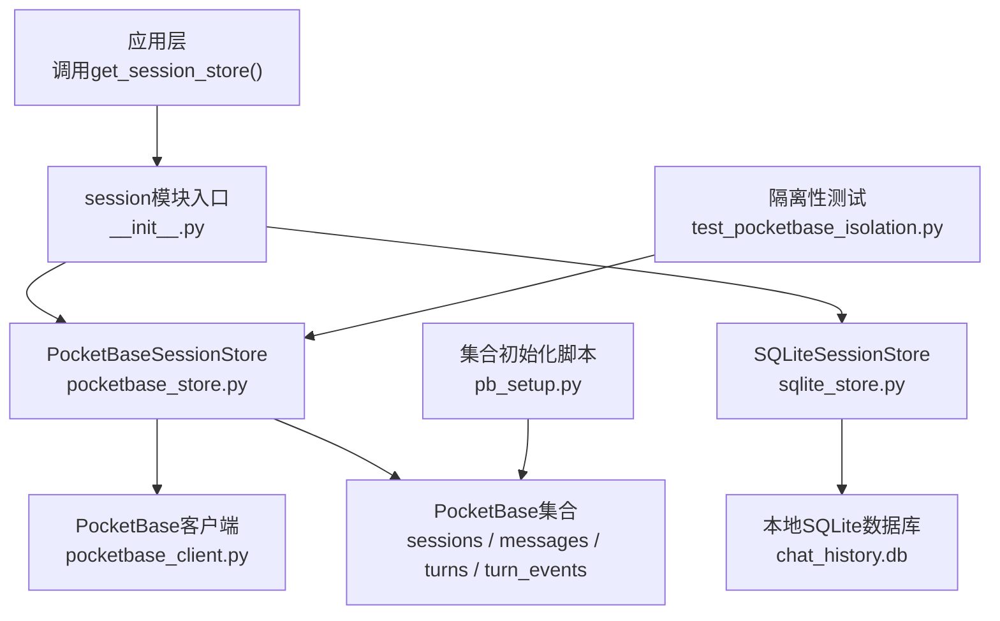
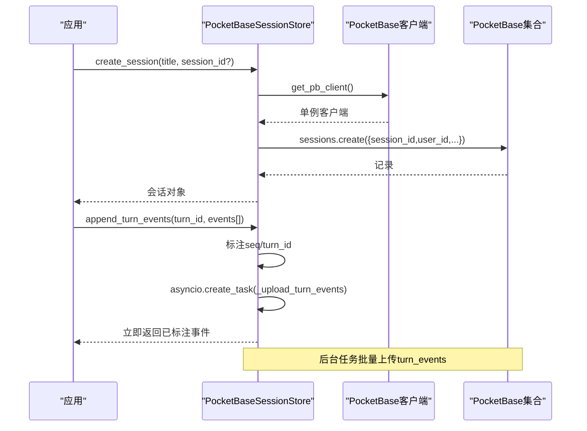
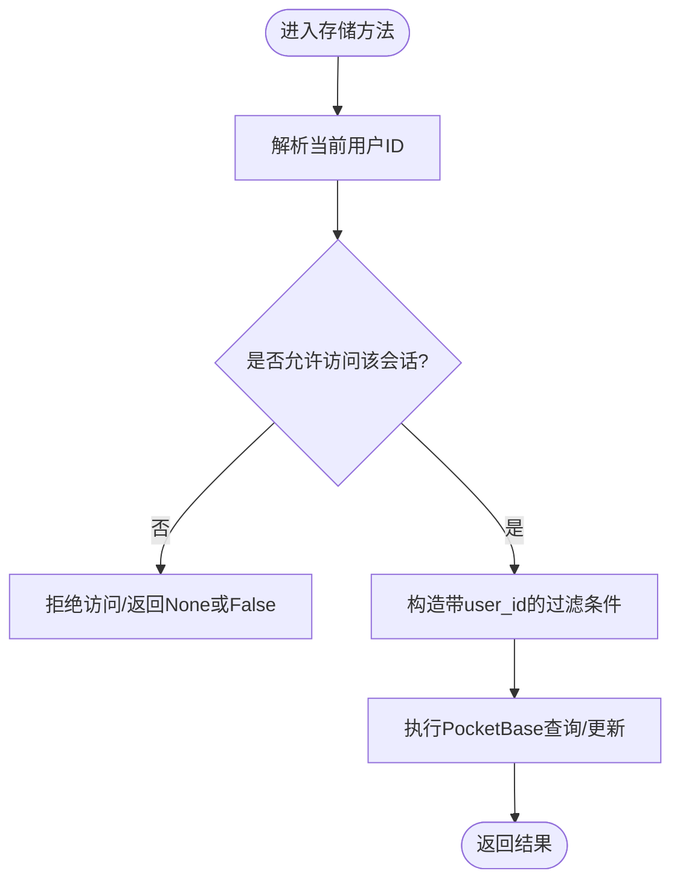
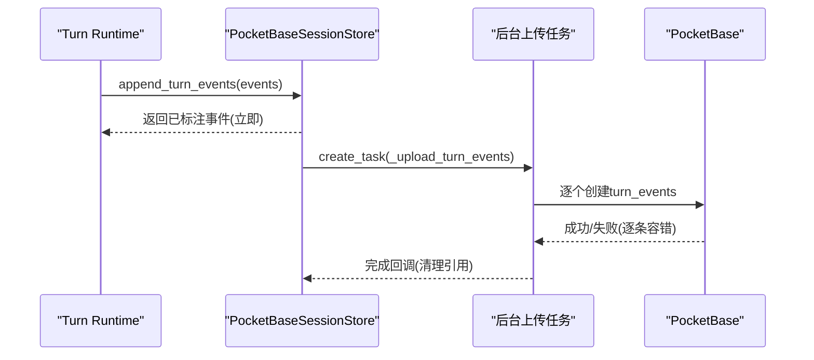
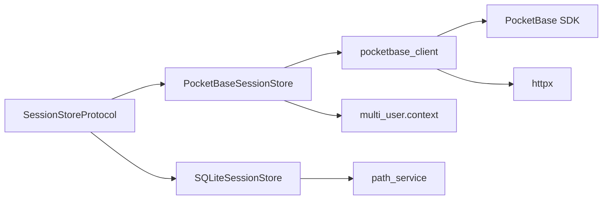

# PocketBase远程存储

<cite>
**本文引用的文件**
- [pocketbase_store.py](file://deeptutor/services/session/pocketbase_store.py)
- [sqlite_store.py](file://deeptutor/services/session/sqlite_store.py)
- [protocol.py](file://deeptutor/services/session/protocol.py)
- [pocketbase_client.py](file://deeptutor/services/pocketbase_client.py)
- [__init__.py](file://deeptutor/services/session/__init__.py)
- [pb_setup.py](file://scripts/pb_setup.py)
- [test_pocketbase_isolation.py](file://tests/services/session/test_pocketbase_isolation.py)
</cite>

## 目录
1. [简介](#简介)
2. [项目结构](#项目结构)
3. [核心组件](#核心组件)
4. [架构总览](#架构总览)
5. [详细组件分析](#详细组件分析)
6. [依赖关系分析](#依赖关系分析)
7. [性能与网络配置建议](#性能与网络配置建议)
8. [故障排查指南](#故障排查指南)
9. [结论](#结论)
10. [附录：API调用示例与集成模式](#附录api调用示例与集成模式)

## 简介
本文件面向DeepTutor后端中基于PocketBase的远程会话存储实现，重点说明PocketBaseSessionStore的设计与行为、与SQLite实现的接口一致性保证、远程数据通信机制、数据同步策略与离线处理方案、用户隔离与权限控制、连接与错误处理策略，以及本地与远程数据的迁移与同步方法。文档同时提供网络配置、超时设置和性能优化建议，并给出具体API调用示例与集成模式。

## 项目结构
围绕PocketBase远程存储的关键代码位于services/session与services/pocketbase_client，配合脚本与测试完成集合初始化与隔离性验证。

图表来源
- [__init__.py:33-47](file://deeptutor/services/session/__init__.py#L33-L47)
- [pocketbase_store.py:103-112](file://deeptutor/services/session/pocketbase_store.py#L103-L112)
- [sqlite_store.py:96-106](file://deeptutor/services/session/sqlite_store.py#L96-L106)
- [pocketbase_client.py:56-108](file://deeptutor/services/pocketbase_client.py#L56-L108)
- [pb_setup.py:77-107](file://scripts/pb_setup.py#L77-L107)
- [test_pocketbase_isolation.py:105-175](file://tests/services/session/test_pocketbase_isolation.py#L105-L175)

章节来源
- [__init__.py:33-47](file://deeptutor/services/session/__init__.py#L33-L47)
- [pocketbase_store.py:1-21](file://deeptutor/services/session/pocketbase_store.py#L1-L21)
- [pocketbase_client.py:1-21](file://deeptutor/services/pocketbase_client.py#L1-L21)

## 核心组件
- SessionStoreProtocol：定义统一的会话存储接口，确保SQLite与PocketBase两种实现可互换。
- SQLiteSessionStore：本地SQLite实现，具备完整的事务、索引与迁移能力。
- PocketBaseSessionStore：远程PocketBase实现，通过HTTP访问sessions/messages/turns/turn_events集合，保持与协议一致。
- PocketBase客户端：单例管理、管理员认证、令牌校验缓存与健康检查。
- 会话选择器：根据配置自动返回PocketBase或SQLite实现。

章节来源
- [protocol.py:1-83](file://deeptutor/services/session/protocol.py#L1-L83)
- [sqlite_store.py:96-106](file://deeptutor/services/session/sqlite_store.py#L96-L106)
- [pocketbase_store.py:103-112](file://deeptutor/services/session/pocketbase_store.py#L103-L112)
- [pocketbase_client.py:56-108](file://deeptutor/services/pocketbase_client.py#L56-L108)
- [__init__.py:33-47](file://deeptutor/services/session/__init__.py#L33-L47)

## 架构总览
PocketBaseSessionStore通过统一协议暴露会话、消息、回合（turn）与事件等能力；底层使用PocketBase SDK进行HTTP请求。所有写操作在后台线程执行以避免阻塞异步事件循环；高频的事件写入采用“先标注、后异步上传”的策略，保证主流程低延迟。

图表来源
- [pocketbase_store.py:117-146](file://deeptutor/services/session/pocketbase_store.py#L117-L146)
- [pocketbase_store.py:616-643](file://deeptutor/services/session/pocketbase_store.py#L616-L643)
- [pocketbase_store.py:645-673](file://deeptutor/services/session/pocketbase_store.py#L645-L673)
- [pocketbase_client.py:56-108](file://deeptutor/services/pocketbase_client.py#L56-L108)

## 详细组件分析

### 接口一致性保证（SQLite vs PocketBase）
- 两者均实现SessionStoreProtocol，对外暴露相同的异步方法集，包括会话创建/查询/更新/删除、消息增删查、回合生命周期管理、事件追加与回放、列表分页等。
- PocketBaseSessionStore在内部对每个会话操作附加user_id过滤，确保多租户隔离；SQLite则通过每用户独立数据库文件实现隔离。
- 字段映射与类型转换在各自实现中完成，上层无需关心差异。

章节来源
- [protocol.py:14-83](file://deeptutor/services/session/protocol.py#L14-L83)
- [sqlite_store.py:96-106](file://deeptutor/services/session/sqlite_store.py#L96-L106)
- [pocketbase_store.py:103-112](file://deeptutor/services/session/pocketbase_store.py#L103-L112)

### 用户隔离、权限控制与数据安全
- 当前用户ID从请求级上下文获取，并在每次会话查询/更新时作为过滤器注入，防止跨用户读取或修改。
- 所有会话行都带有user_id标记；列表与详情查询均按user_id过滤。
- 集合规则在脚本中留空，因为后端以单一管理员身份访问，真正的隔离由应用层保证。

图表来源
- [pocketbase_store.py:69-87](file://deeptutor/services/session/pocketbase_store.py#L69-L87)
- [pocketbase_store.py:90-100](file://deeptutor/services/session/pocketbase_store.py#L90-L100)
- [pb_setup.py:86-92](file://scripts/pb_setup.py#L86-L92)

章节来源
- [pocketbase_store.py:69-87](file://deeptutor/services/session/pocketbase_store.py#L69-L87)
- [pocketbase_store.py:90-100](file://deeptutor/services/session/pocketbase_store.py#L90-L100)
- [pb_setup.py:86-92](file://scripts/pb_setup.py#L86-L92)
- [test_pocketbase_isolation.py:105-175](file://tests/services/session/test_pocketbase_isolation.py#L105-L175)

### 网络通信机制与数据同步策略
- 通信方式：通过PocketBase SDK发起HTTP请求，读写sessions/messages/turns/turn_events集合。
- 同步策略：
  - 会话/消息/回合状态变更：直接同步调用，失败时记录日志并返回降级值。
  - 回合事件：先标注并立即返回，后台任务异步上传至turn_events集合，实现最终一致性，避免阻塞流式结束。
- 健康检查：启动时探测PocketBase可用性，不可用时记录警告，不影响服务启动。

图表来源
- [pocketbase_store.py:616-643](file://deeptutor/services/session/pocketbase_store.py#L616-L643)
- [pocketbase_store.py:645-673](file://deeptutor/services/session/pocketbase_store.py#L645-L673)
- [pocketbase_client.py:164-196](file://deeptutor/services/pocketbase_client.py#L164-L196)

章节来源
- [pocketbase_store.py:616-673](file://deeptutor/services/session/pocketbase_store.py#L616-L673)
- [pocketbase_client.py:164-196](file://deeptutor/services/pocketbase_client.py#L164-L196)

### 离线处理与回退策略
- 当PocketBase未配置或不可达时，系统可通过配置开关回退到SQLite本地存储，保证基本功能可用。
- 健康检查失败不会抛出异常，仅记录警告；上层可根据需要决定降级路径。
- 注意：当前PocketBaseSessionStore未内置本地队列与重试持久化，离线场景下的事件暂存需在上层扩展。

章节来源
- [__init__.py:33-47](file://deeptutor/services/session/__init__.py#L33-L47)
- [pocketbase_client.py:164-196](file://deeptutor/services/pocketbase_client.py#L164-L196)

### 连接池管理、请求重试与错误处理
- 连接池：PocketBase SDK内部维护连接；本实现未显式配置连接池参数。
- 重试：当前实现未包含指数退避或自动重试逻辑；单个事件上传失败会记录调试日志并继续后续事件。
- 错误处理：
  - 关键方法捕获异常并返回降级值（如False或空列表），避免影响主流程。
  - 标题/摘要/消息内容等字符串长度限制，防止过大负载。
  - 令牌校验使用服务端auth-refresh端点并缓存结果，减少网络开销。

章节来源
- [pocketbase_store.py:199-233](file://deeptutor/services/session/pocketbase_store.py#L199-L233)
- [pocketbase_store.py:254-302](file://deeptutor/services/session/pocketbase_store.py#L254-L302)
- [pocketbase_store.py:323-367](file://deeptutor/services/session/pocketbase_store.py#L323-L367)
- [pocketbase_store.py:562-590](file://deeptutor/services/session/pocketbase_store.py#L562-L590)
- [pocketbase_store.py:645-673](file://deeptutor/services/session/pocketbase_store.py#L645-L673)
- [pocketbase_client.py:111-161](file://deeptutor/services/pocketbase_client.py#L111-L161)

### 与本地存储的数据迁移与同步
- 本地迁移：SQLite实现包含表结构初始化与历史字段迁移逻辑（如preferences_json、parent_message_id、notebook相关字段）。
- 远程集合初始化：通过脚本创建sessions/messages/turns/turn_events等集合，并声明必要字段。
- 双向同步：当前实现未提供自动双向同步；如需将SQLite数据迁移到PocketBase，可在上层编排批量导入任务，遵循相同字段映射与user_id隔离策略。

章节来源
- [sqlite_store.py:119-281](file://deeptutor/services/session/sqlite_store.py#L119-L281)
- [pb_setup.py:77-107](file://scripts/pb_setup.py#L77-L107)

## 依赖关系分析
- 模块耦合：
  - PocketBaseSessionStore依赖pocketbase_client获取单例客户端，并通过ContextVar获取当前用户ID。
  - session模块入口根据配置动态选择实现，屏蔽后端差异。
- 外部依赖：
  - pocketbase SDK用于HTTP交互。
  - httpx用于健康检查。
- 潜在风险：
  - 若PocketBase不可用且未启用SQLite回退，部分功能可能降级为无持久化。
  - 事件上传失败仅记录日志，不阻塞主流程，但可能导致回放数据缺失。

图表来源
- [protocol.py:14-83](file://deeptutor/services/session/protocol.py#L14-L83)
- [pocketbase_store.py:55-87](file://deeptutor/services/session/pocketbase_store.py#L55-L87)
- [sqlite_store.py:20-21](file://deeptutor/services/session/sqlite_store.py#L20-L21)
- [pocketbase_client.py:56-108](file://deeptutor/services/pocketbase_client.py#L56-L108)
- [pocketbase_client.py:164-196](file://deeptutor/services/pocketbase_client.py#L164-L196)

章节来源
- [protocol.py:14-83](file://deeptutor/services/session/protocol.py#L14-L83)
- [pocketbase_store.py:55-87](file://deeptutor/services/session/pocketbase_store.py#L55-L87)
- [sqlite_store.py:20-21](file://deeptutor/services/session/sqlite_store.py#L20-L21)
- [pocketbase_client.py:56-108](file://deeptutor/services/pocketbase_client.py#L56-L108)
- [pocketbase_client.py:164-196](file://deeptutor/services/pocketbase_client.py#L164-L196)

## 性能与网络配置建议
- 网络配置
  - 确保integrations.pocketbase_url正确指向可用的PocketBase实例。
  - 配置管理员邮箱与密码以启用集合管理功能；否则仅能进行数据读写。
- 超时设置
  - 健康检查使用固定超时；SDK默认超时未在此处显式配置，建议在SDK层面按需调整。
- 性能优化
  - 事件上传采用后台任务，避免阻塞流式结束；在高吞吐场景下关注服务器端写入瓶颈。
  - 令牌校验结果内存缓存60秒，减少重复鉴权开销。
  - 列表查询使用分页与排序，避免全量拉取。
- 监控与可观测性
  - 关注健康检查日志与异常日志，及时定位网络或服务端问题。
  - 对事件上传成功率进行统计，必要时引入重试与告警。

[本节为通用指导，不直接分析具体文件]

## 故障排查指南
- 常见问题
  - PocketBase未配置：调用get_pb_client会抛出运行时错误；请检查配置项。
  - 管理员认证失败：检查邮箱与密码是否正确，确认PocketBase服务可达。
  - 健康检查失败：服务仍可启动，但会话功能可能不可用；检查容器与URL。
  - 事件上传失败：查看调试日志，确认turn_events集合存在且字段匹配。
- 诊断步骤
  - 使用健康检查接口验证连通性。
  - 通过隔离性测试验证user_id过滤是否生效。
  - 检查集合schema是否与代码期望一致。

章节来源
- [pocketbase_client.py:56-108](file://deeptutor/services/pocketbase_client.py#L56-L108)
- [pocketbase_client.py:164-196](file://deeptutor/services/pocketbase_client.py#L164-L196)
- [test_pocketbase_isolation.py:105-175](file://tests/services/session/test_pocketbase_isolation.py#L105-L175)
- [pb_setup.py:77-107](file://scripts/pb_setup.py#L77-L107)

## 结论
PocketBaseSessionStore通过统一协议与SQLite实现保持一致的API，结合用户级隔离、后台事件上传与健康检查，提供了稳定可靠的远程会话存储能力。对于高并发与弱网环境，建议在上层补充重试与离线队列，并结合监控指标持续优化。

[本节为总结，不直接分析具体文件]

## 附录：API调用示例与集成模式
- 获取会话存储实例
  - 根据配置自动选择PocketBase或SQLite实现。
- 创建与会话管理
  - 创建会话、获取会话、更新标题、删除会话、列出会话。
- 消息与回合
  - 添加消息、获取最后一条消息、获取消息列表。
  - 创建回合、获取活跃回合、更新回合状态。
- 事件追加与回放
  - 追加事件（立即返回，后台上传）、按序列回放事件。
- 集成模式
  - 在应用启动时进行健康检查，根据结果决定是否启用远程存储。
  - 在业务层对用户ID进行上下文绑定，确保隔离性。
  - 对关键操作增加重试与降级逻辑，提升鲁棒性。

章节来源
- [__init__.py:33-47](file://deeptutor/services/session/__init__.py#L33-L47)
- [pocketbase_store.py:117-146](file://deeptutor/services/session/pocketbase_store.py#L117-L146)
- [pocketbase_store.py:148-171](file://deeptutor/services/session/pocketbase_store.py#L148-L171)
- [pocketbase_store.py:199-233](file://deeptutor/services/session/pocketbase_store.py#L199-L233)
- [pocketbase_store.py:235-252](file://deeptutor/services/session/pocketbase_store.py#L235-L252)
- [pocketbase_store.py:323-367](file://deeptutor/services/session/pocketbase_store.py#L323-L367)
- [pocketbase_store.py:380-429](file://deeptutor/services/session/pocketbase_store.py#L380-L429)
- [pocketbase_store.py:461-508](file://deeptutor/services/session/pocketbase_store.py#L461-L508)
- [pocketbase_store.py:510-560](file://deeptutor/services/session/pocketbase_store.py#L510-L560)
- [pocketbase_store.py:562-590](file://deeptutor/services/session/pocketbase_store.py#L562-L590)
- [pocketbase_store.py:616-673](file://deeptutor/services/session/pocketbase_store.py#L616-L673)