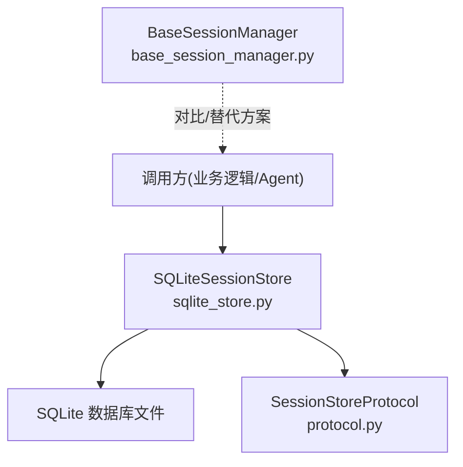
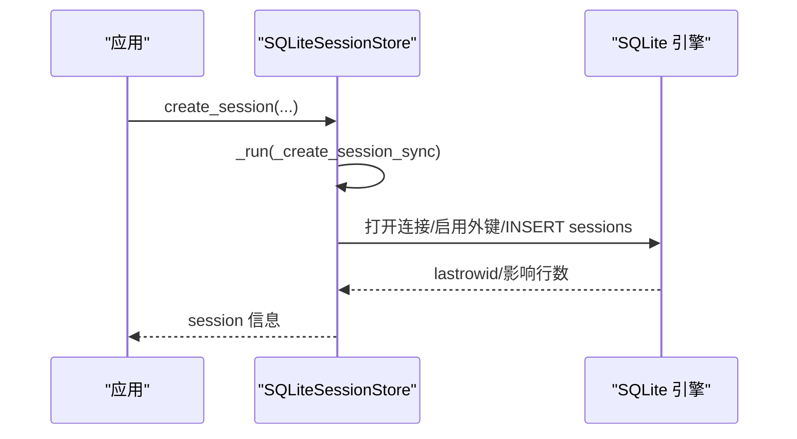
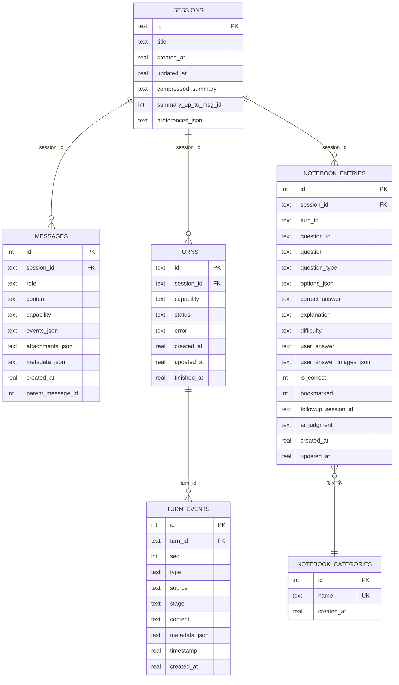
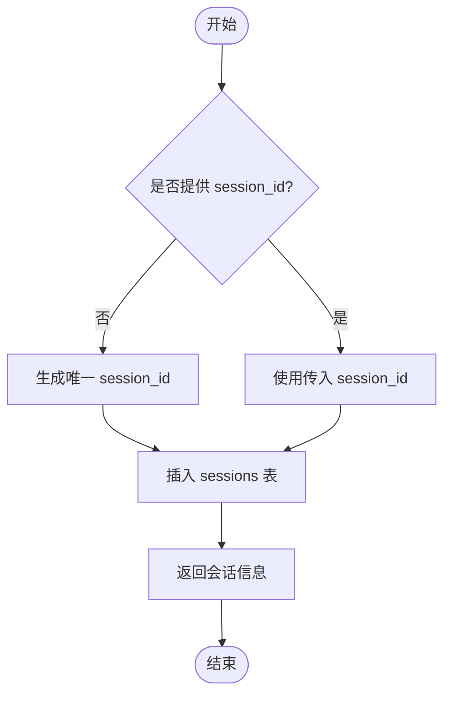
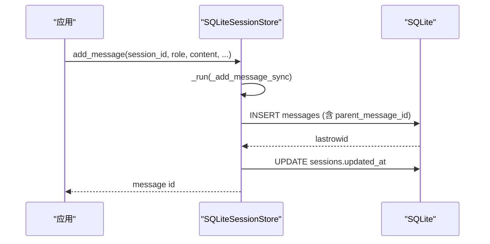
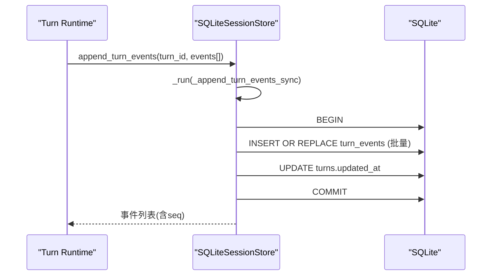
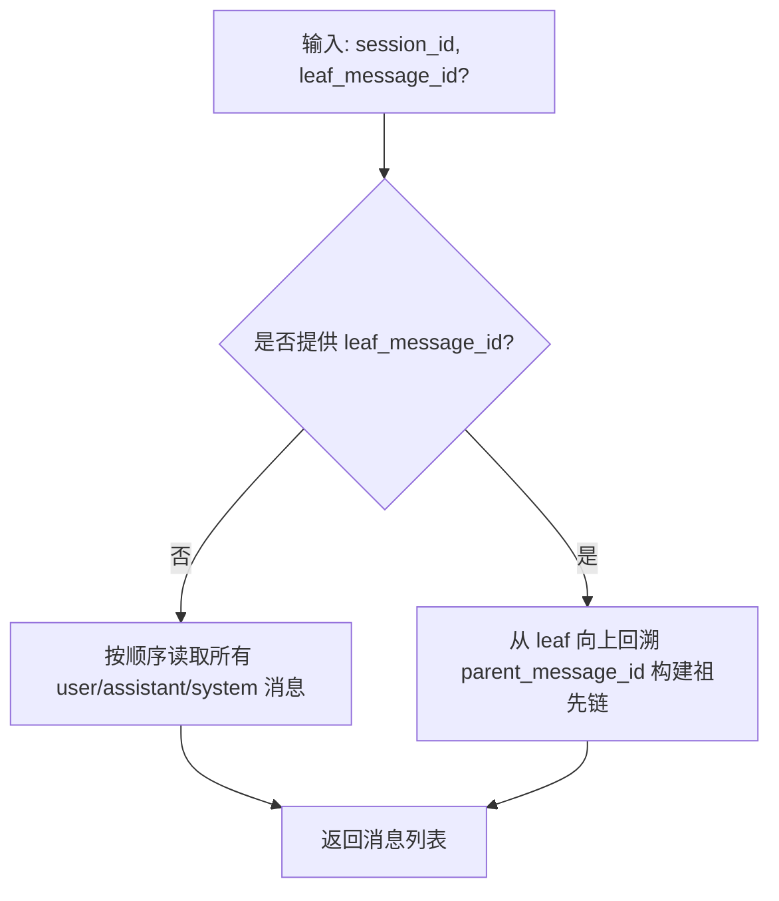
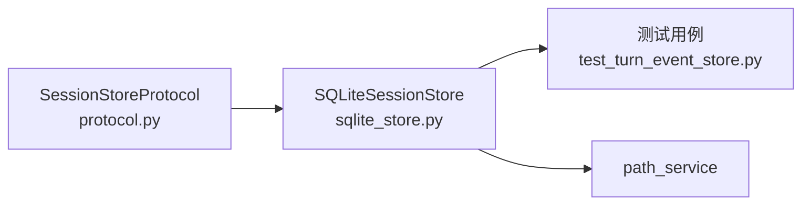

# SQLite本地存储

<cite>
**本文引用的文件**
- [sqlite_store.py](file://deeptutor/services/session/sqlite_store.py)
- [protocol.py](file://deeptutor/services/session/protocol.py)
- [base_session_manager.py](file://deeptutor/services/session/base_session_manager.py)
- [test_turn_event_store.py](file://tests/core/test_turn_event_store.py)
</cite>

## 目录
1. [简介](#简介)
2. [项目结构](#项目结构)
3. [核心组件](#核心组件)
4. [架构总览](#架构总览)
5. [详细组件分析](#详细组件分析)
6. [依赖关系分析](#依赖关系分析)
7. [性能与索引优化](#性能与索引优化)
8. [并发控制与事务管理](#并发控制与事务管理)
9. [数据迁移机制](#数据迁移机制)
10. [配置选项、监控与故障恢复](#配置选项监控与故障恢复)
11. [使用示例与最佳实践](#使用示例与最佳实践)
12. [结论](#结论)

## 简介
本文件系统性说明 DeepTutor 的 SQLite 本地会话存储实现，围绕 SQLiteSessionStore 类展开，覆盖数据库表结构设计（sessions、messages、turns、turn_events 等）、索引优化策略、查询性能调优、会话创建与消息持久化流程、回合事件记录流程、数据迁移机制、并发控制与事务管理，以及配置、监控与故障恢复的最佳实践。内容基于源码逐层解析，并辅以流程图与时序图帮助理解。

## 项目结构
SQLite 会话存储位于 services/session 模块中，核心为 sqlite_store.py；同时提供统一的存储协议 protocol.py，以及一个基于文件的通用会话管理器 base_session_manager.py（用于其他场景）。测试用例在 tests/core/test_turn_event_store.py 中验证了关键行为。

图表来源
- [sqlite_store.py:96-106](file://deeptutor/services/session/sqlite_store.py#L96-L106)
- [protocol.py:13-83](file://deeptutor/services/session/protocol.py#L13-L83)
- [base_session_manager.py:23-55](file://deeptutor/services/session/base_session_manager.py#L23-L55)

章节来源
- [sqlite_store.py:96-106](file://deeptutor/services/session/sqlite_store.py#L96-L106)
- [protocol.py:13-83](file://deeptutor/services/session/protocol.py#L13-L83)
- [base_session_manager.py:23-55](file://deeptutor/services/session/base_session_manager.py#L23-L55)

## 核心组件
- SQLiteSessionStore：基于 SQLite 的统一会话存储实现，负责会话、消息、回合及回合事件的增删改查、导入、摘要更新、笔记条目管理等。
- SessionStoreProtocol：定义存储抽象接口，使上层对具体存储实现无感知。
- BaseSessionManager：基于 JSON 文件的轻量会话管理基类（非 SQLite），用于对比或兼容旧路径。

章节来源
- [sqlite_store.py:96-106](file://deeptutor/services/session/sqlite_store.py#L96-L106)
- [protocol.py:13-83](file://deeptutor/services/session/protocol.py#L13-L83)
- [base_session_manager.py:23-55](file://deeptutor/services/session/base_session_manager.py#L23-L55)

## 架构总览
SQLiteSessionStore 通过异步锁将同步的 sqlite3 操作封装到线程执行，保证单进程内并发安全；每次连接启用外键约束并使用上下文管理器确保事务提交/回滚与连接关闭。初始化时自动创建表结构并执行向后兼容的字段迁移。

图表来源
- [sqlite_store.py:398-417](file://deeptutor/services/session/sqlite_store.py#L398-L417)
- [sqlite_store.py:419-454](file://deeptutor/services/session/sqlite_store.py#L419-L454)

章节来源
- [sqlite_store.py:398-417](file://deeptutor/services/session/sqlite_store.py#L398-L417)
- [sqlite_store.py:419-454](file://deeptutor/services/session/sqlite_store.py#L419-L454)

## 详细组件分析

### 数据库表结构与关系
- sessions：会话元数据（标题、时间戳、压缩摘要、偏好设置等）
- messages：消息树（支持编辑分支，parent_message_id 指向父消息）
- turns：回合状态（能力、状态、错误、时间戳）
- turn_events：回合事件流（有序 seq，类型、来源、阶段、内容、元数据、时间戳）
- notebook_entries / categories：问答与分类（扩展功能）

图表来源
- [sqlite_store.py:119-233](file://deeptutor/services/session/sqlite_store.py#L119-L233)

章节来源
- [sqlite_store.py:119-233](file://deeptutor/services/session/sqlite_store.py#L119-L233)

### 会话创建流程
- 生成或接收 session_id，写入 sessions 表，返回统一结构。
- 若未传入 session_id，则按时间戳+随机串生成。

图表来源
- [sqlite_store.py:419-454](file://deeptutor/services/session/sqlite_store.py#L419-L454)

章节来源
- [sqlite_store.py:419-454](file://deeptutor/services/session/sqlite_store.py#L419-L454)

### 消息持久化与分支支持
- add_message 支持显式指定 parent_message_id 或默认追加到会话末尾，形成消息树。
- 支持 events、attachments、metadata 的 JSON 序列化存储。
- 删除消息时联动清理关联附件与可能受影响的摘要范围。

图表来源
- [sqlite_store.py:829-921](file://deeptutor/services/session/sqlite_store.py#L829-L921)

章节来源
- [sqlite_store.py:829-921](file://deeptutor/services/session/sqlite_store.py#L829-L921)

### 回合事件记录流程
- append_turn_event/append_turn_events：为某个 turn 追加事件，维护严格递增的 seq，并批量写入以提升性能。
- get_turn_events：按 after_seq 增量拉取事件，配合 UI 实时回放。

图表来源
- [sqlite_store.py:706-771](file://deeptutor/services/session/sqlite_store.py#L706-L771)
- [sqlite_store.py:773-802](file://deeptutor/services/session/sqlite_store.py#L773-L802)

章节来源
- [sqlite_store.py:706-771](file://deeptutor/services/session/sqlite_store.py#L706-L771)
- [sqlite_store.py:773-802](file://deeptutor/services/session/sqlite_store.py#L773-L802)

### 查询与上下文构建
- get_messages_for_context：当提供 leaf_message_id 时，沿 parent_message_id 回溯祖先链，仅包含当前分支的消息，避免兄弟分支污染 LLM 上下文。
- list_sessions/get_session_with_messages：聚合会话统计、活跃回合、消息列表等。

图表来源
- [sqlite_store.py:1281-1337](file://deeptutor/services/session/sqlite_store.py#L1281-L1337)

章节来源
- [sqlite_store.py:1281-1337](file://deeptutor/services/session/sqlite_store.py#L1281-L1337)

## 依赖关系分析
- SQLiteSessionStore 实现 SessionStoreProtocol，使上层代码可替换存储后端。
- 通过 path_service 获取数据库路径，并在初始化时迁移旧版数据库位置。
- 测试用例验证了回合事件持久化、消息元数据持久化等行为。

图表来源
- [protocol.py:13-83](file://deeptutor/services/session/protocol.py#L13-L83)
- [sqlite_store.py:96-106](file://deeptutor/services/session/sqlite_store.py#L96-L106)
- [test_turn_event_store.py:8-85](file://tests/core/test_turn_event_store.py#L8-L85)

章节来源
- [protocol.py:13-83](file://deeptutor/services/session/protocol.py#L13-L83)
- [sqlite_store.py:96-106](file://deeptutor/services/session/sqlite_store.py#L96-L106)
- [test_turn_event_store.py:8-85](file://tests/core/test_turn_event_store.py#L8-L85)

## 性能与索引优化
- 索引设计
  - messages: idx_messages_session_created 加速按会话和时间排序的消息列表。
  - messages: idx_messages_parent 加速按父消息查找子消息（用于分支回溯）。
  - sessions: idx_sessions_updated_at 加速会话列表排序。
  - turns: idx_turns_session_updated / idx_turns_session_status 加速查询活跃/最近回合。
  - turn_events: idx_turn_events_turn_seq 加速按 turn 和 seq 增量读取。
  - notebook_entries: 针对 session_id、bookmarked 的索引提升筛选与分页效率。
- 批量写入
  - append_turn_events 使用 executemany 在一个事务中批量插入事件，减少 fsync 次数，显著降低尾延迟。
- 只读路径优化
  - get_messages_for_context 在分支模式下仅读取必要字段，减少 IO。
- 建议
  - 对高频查询列保持索引命中（如 session_id、updated_at、turn_id、seq）。
  - 大消息体尽量使用外部存储，数据库中仅保留引用与元数据。
  - 定期 VACUUM/ANALYZE 以维护统计信息（视部署环境而定）。

章节来源
- [sqlite_store.py:119-233](file://deeptutor/services/session/sqlite_store.py#L119-L233)
- [sqlite_store.py:706-771](file://deeptutor/services/session/sqlite_store.py#L706-L771)
- [sqlite_store.py:1281-1337](file://deeptutor/services/session/sqlite_store.py#L1281-L1337)

## 并发控制与事务管理
- 异步锁
  - 使用 asyncio.Lock 串行化所有写操作，避免多线程竞争同一 SQLite 连接。
  - 所有写方法通过 _run(fn, *args) 在独立线程执行，防止阻塞事件循环。
- 事务管理
  - 每个连接开启后设置 PRAGMA foreign_keys = ON，确保外键约束生效。
  - 使用 sqlite3.Connection 的上下文管理器，异常时自动回滚，正常退出提交。
  - 批量写入（如 append_turn_events）在单个事务中完成，提高一致性与吞吐。
- 注意事项
  - 读多写少场景下，合理拆分读写路径，避免长事务持有锁过久。
  - 高并发写入时，优先使用批量接口以减少锁竞争与磁盘同步开销。

章节来源
- [sqlite_store.py:398-417](file://deeptutor/services/session/sqlite_store.py#L398-L417)
- [sqlite_store.py:706-771](file://deeptutor/services/session/sqlite_store.py#L706-L771)

## 数据迁移机制
- 旧库迁移
  - 启动时将 legacy data/chat_history.db 移动到新的用户数据目录，失败则保留原位置并继续初始化空库。
- 表结构演进
  - 新增/修复字段：preferences_json、metadata_json、parent_message_id、user_answer_images_json、ai_judgment 等。
  - 重建唯一约束：notebook_entries 的 UNIQUE 从 (session_id, question_id) 升级为 (session_id, turn_id, question_id)，避免同会话不同回合的 quiz 冲突。
  - 回填历史数据：为旧消息链补全 parent_message_id，使其形成线性路径。
- 兼容性处理
  - 通过 PRAGMA table_info 检测列是否存在再决定是否 ALTER TABLE。
  - 对不支持 DROP COLUMN 的旧版本 SQLite 进行容错处理。

章节来源
- [sqlite_store.py:107-118](file://deeptutor/services/session/sqlite_store.py#L107-L118)
- [sqlite_store.py:235-281](file://deeptutor/services/session/sqlite_store.py#L235-L281)
- [sqlite_store.py:283-397](file://deeptutor/services/session/sqlite_store.py#L283-L397)

## 配置选项、监控与故障恢复
- 配置项
  - 数据库路径由 path_service 提供，可通过运行时路径服务调整。
  - 会话标题长度限制、消息内容默认值等由写入逻辑内部保护。
- 监控建议
  - 记录 append_turn_events 批次大小与耗时，评估批处理效果。
  - 关注 get_turn_events 的 after_seq 增量拉取延迟，必要时增加索引或分片。
- 故障恢复
  - 外键约束保障级联删除一致性。
  - 异常时事务自动回滚，避免部分写入导致的数据不一致。
  - 导入会话具备幂等性，重复导入不会重复创建会话，仅合并元数据。

章节来源
- [sqlite_store.py:957-1046](file://deeptutor/services/session/sqlite_store.py#L957-L1046)
- [sqlite_store.py:402-417](file://deeptutor/services/session/sqlite_store.py#L402-L417)

## 使用示例与最佳实践
- 基本用法
  - 创建会话、创建回合、追加事件、查询事件、更新回合状态、获取会话详情与消息。
  - 参考测试用例中的典型调用序列，验证事件序号、活跃回合、会话状态等。
- 最佳实践
  - 使用 append_turn_events 批量写入事件，减少事务开销。
  - 在需要精确上下文的场景，使用 get_messages_for_context(leaf_message_id) 构建分支感知的上下文。
  - 对敏感或大体积内容使用外部存储，仅在消息中保存引用与元数据。
  - 利用 update_session_preferences 维护会话偏好，便于个性化与重导入时的元数据合并。

章节来源
- [test_turn_event_store.py:8-85](file://tests/core/test_turn_event_store.py#L8-L85)
- [sqlite_store.py:706-771](file://deeptutor/services/session/sqlite_store.py#L706-L771)
- [sqlite_store.py:1281-1337](file://deeptutor/services/session/sqlite_store.py#L1281-L1337)

## 结论
SQLiteSessionStore 提供了稳定、可扩展且高性能的本地会话存储能力。通过合理的表结构设计与索引优化、严格的并发控制与事务管理、完善的向后兼容迁移机制，能够支撑复杂的多轮对话、分支编辑与事件回放场景。结合批量写入、分支感知上下文构建与幂等导入等特性，可在单机环境下获得接近分布式存储的一致性与可用性体验。建议在大规模部署中结合外部存储与监控指标，持续优化吞吐与延迟。