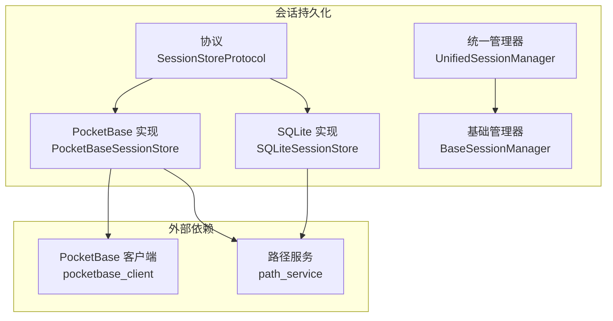
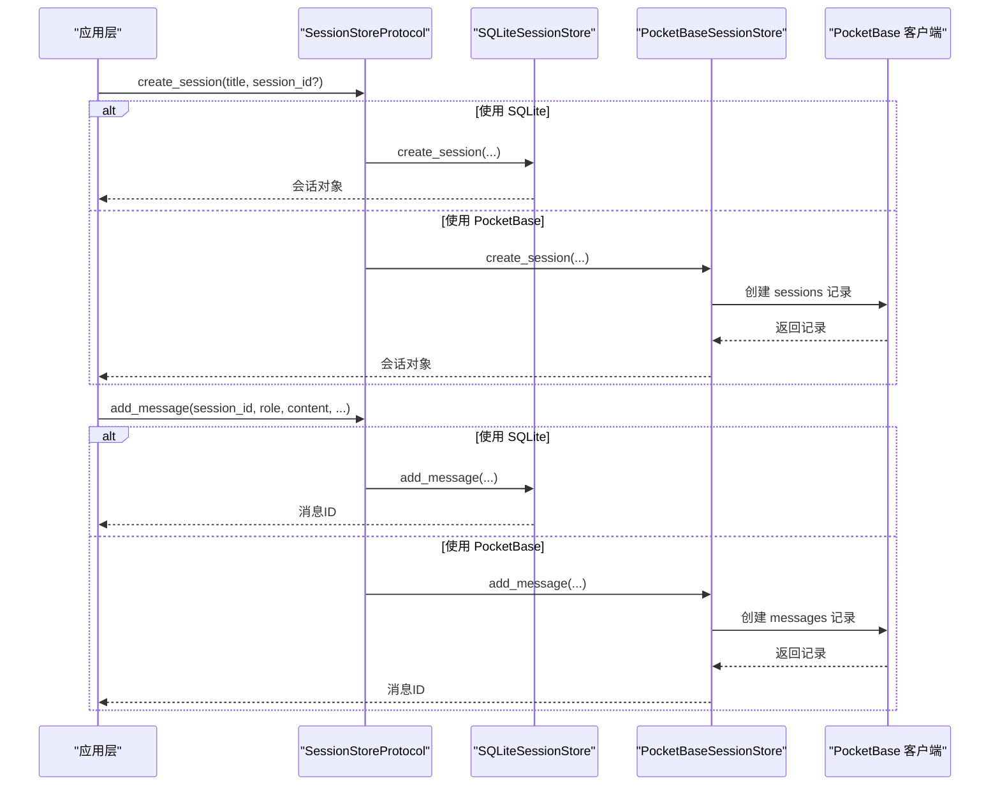
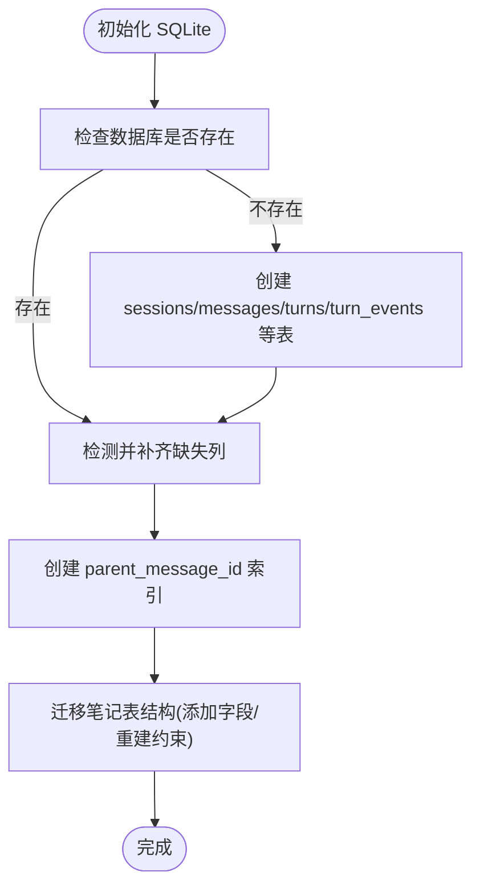
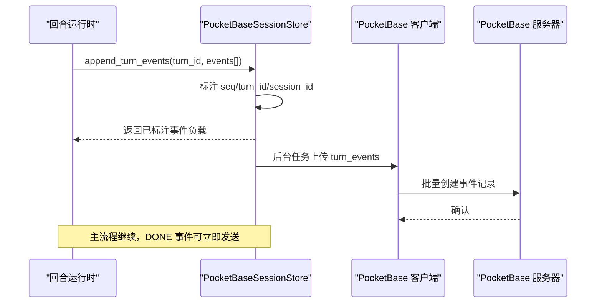
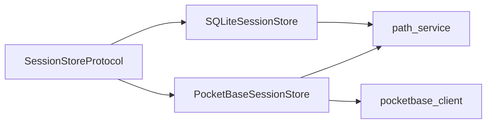

# 会话持久化

<cite>
**本文引用的文件**
- [base_session_manager.py](file://deeptutor/services/session/base_session_manager.py)
- [sqlite_store.py](file://deeptutor/services/session/sqlite_store.py)
- [pocketbase_store.py](file://deeptutor/services/session/pocketbase_store.py)
- [protocol.py](file://deeptutor/services/session/protocol.py)
- [unified_session_manager.py](file://deeptutor/services/session/unified_session_manager.py)
- [pocketbase_client.py](file://deeptutor/services/pocketbase_client.py)
- [path_service.py](file://deeptutor/services/path_service.py)
</cite>

## 目录
1. [简介](#简介)
2. [项目结构](#项目结构)
3. [核心组件](#核心组件)
4. [架构总览](#架构总览)
5. [详细组件分析](#详细组件分析)
6. [依赖关系分析](#依赖关系分析)
7. [性能考量](#性能考量)
8. [故障恢复与数据修复](#故障恢复与数据修复)
9. [结论](#结论)
10. [附录：配置与迁移要点](#附录：配置与迁移要点)

## 简介
本文件面向“会话持久化系统”，系统性说明本地 SQLite 存储与远程 PocketBase 存储两种后端的设计、数据模型、索引策略、查询优化、迁移机制、备份恢复与一致性保证，并给出配置选项与性能对比。目标是帮助读者在不深入源码的情况下理解系统如何可靠地保存会话、消息、回合（turn）与事件，并在不同部署环境下保持一致的接口行为。

## 项目结构
会话持久化位于 services/session 目录下，采用“协议 + 多实现”的分层设计：
- 协议层：定义统一的 SessionStoreProtocol，屏蔽底层差异。
- 本地实现：SQLiteSessionStore，使用 SQLite 数据库文件持久化会话、消息、回合与事件。
- 远程实现：PocketBaseSessionStore，通过 HTTP 调用 PocketBase 集合进行持久化。
- 通用管理：BaseSessionManager 与 UnifiedSessionManager，提供基于 JSON 文件的轻量会话管理（用于旧版或特定模块）。
- 客户端与路径：pocketbase_client 提供共享的 PocketBase 客户端；path_service 提供数据库与文件路径解析。

图表来源
- [protocol.py:14-83](file://deeptutor/services/session/protocol.py#L14-L83)
- [sqlite_store.py:96-118](file://deeptutor/services/session/sqlite_store.py#L96-L118)
- [pocketbase_store.py:103-112](file://deeptutor/services/session/pocketbase_store.py#L103-L112)
- [unified_session_manager.py:16-36](file://deeptutor/services/session/unified_session_manager.py#L16-L36)
- [base_session_manager.py:23-55](file://deeptutor/services/session/base_session_manager.py#L23-L55)
- [pocketbase_client.py:42-108](file://deeptutor/services/pocketbase_client.py#L42-L108)
- [path_service.py:129-135](file://deeptutor/services/path_service.py#L129-L135)

章节来源
- [protocol.py:14-83](file://deeptutor/services/session/protocol.py#L14-L83)
- [sqlite_store.py:96-118](file://deeptutor/services/session/sqlite_store.py#L96-L118)
- [pocketbase_store.py:103-112](file://deeptutor/services/session/pocketbase_store.py#L103-L112)
- [unified_session_manager.py:16-36](file://deeptutor/services/session/unified_session_manager.py#L16-L36)
- [base_session_manager.py:23-55](file://deeptutor/services/session/base_session_manager.py#L23-L55)
- [pocketbase_client.py:42-108](file://deeptutor/services/pocketbase_client.py#L42-L108)
- [path_service.py:129-135](file://deeptutor/services/path_service.py#L129-L135)

## 核心组件
- 协议层（SessionStoreProtocol）：定义创建会话、获取会话、创建回合、追加事件、更新状态、消息读写等统一接口，使上层代码不感知具体存储。
- SQLite 实现（SQLiteSessionStore）：以 SQLite 文件为后端，维护 sessions、messages、turns、turn_events、notebook_entries 等表，提供事务、并发锁、迁移与索引优化。
- PocketBase 实现（PocketBaseSessionStore）：通过 PocketBase SDK 操作 sessions、messages、turns、turn_events 集合，采用后台任务异步上传事件，保障主流程低延迟。
- 基础/统一管理器（BaseSessionManager / UnifiedSessionManager）：提供基于 JSON 文件的会话管理，适用于轻量场景或多模块统一存储。

章节来源
- [protocol.py:14-83](file://deeptutor/services/session/protocol.py#L14-L83)
- [sqlite_store.py:96-118](file://deeptutor/services/session/sqlite_store.py#L96-L118)
- [pocketbase_store.py:103-112](file://deeptutor/services/session/pocketbase_store.py#L103-L112)
- [base_session_manager.py:23-55](file://deeptutor/services/session/base_session_manager.py#L23-L55)
- [unified_session_manager.py:16-36](file://deeptutor/services/session/unified_session_manager.py#L16-L36)

## 架构总览
系统通过协议抽象出会话、消息、回合与事件的 CRUD 能力，SQLite 与 PocketBase 分别实现这些能力。SQLite 适合单机/本地部署，具备强一致性与高性能；PocketBase 适合多实例/云端部署，具备跨进程共享与可扩展性。两者在用户隔离、会话生命周期、消息追加、回合状态流转上保持语义一致。

图表来源
- [protocol.py:14-83](file://deeptutor/services/session/protocol.py#L14-L83)
- [sqlite_store.py:419-454](file://deeptutor/services/session/sqlite_store.py#L419-L454)
- [pocketbase_store.py:117-147](file://deeptutor/services/session/pocketbase_store.py#L117-L147)
- [pocketbase_client.py:56-108](file://deeptutor/services/pocketbase_client.py#L56-L108)

## 详细组件分析

### SQLite 本地存储
- 数据模型
  - sessions：会话元信息（标题、时间戳、摘要、偏好等）。
  - messages：消息内容、角色、能力、附件、元数据、父消息指针（支持编辑分支）。
  - turns：回合生命周期（状态、错误、时间戳）。
  - turn_events：回合内的事件流（类型、阶段、内容、元数据、序列号）。
  - notebook_entries/notebook_categories：笔记条目与分类（扩展功能）。
- 索引策略
  - 按会话+时间排序的消息索引，提升列表与上下文构建效率。
  - 会话更新时间倒序索引，加速最近会话列表。
  - 回合按会话+更新时间倒序、会话+状态+更新时间倒序索引，支撑活跃回合查询。
  - 事件按 turn_id+seq 有序索引，支持增量拉取。
  - 笔记条目按会话+时间、收藏标记+时间索引。
- 查询优化
  - 会话详情一次性 JOIN 获取活跃回合与能力，减少多次往返。
  - 事件追加采用批量写入（executemany），降低 fsync 次数，避免慢盘导致的尾部延迟。
  - 连接上下文自动提交/回滚，避免资源泄漏。
- 并发与一致性
  - asyncio.Lock 串行化写操作，避免并发写冲突。
  - 外键约束开启，删除会话级联清理消息与事件。
  - 迁移脚本确保字段存在与兼容旧库结构。
- 迁移机制
  - 启动时执行 _initialize，检测缺失列并 ALTER TABLE。
  - 将 legacy data/chat_history.db 移动到 user 目录下的新路径。
  - 为 messages.parent_message_id 回填线性路径，确保旧数据可用。
  - 为 notebook_entries 添加 turn_id、user_answer_images_json、ai_judgment 并重建唯一约束。

图表来源
- [sqlite_store.py:119-281](file://deeptutor/services/session/sqlite_store.py#L119-L281)
- [sqlite_store.py:283-397](file://deeptutor/services/session/sqlite_store.py#L283-L397)

章节来源
- [sqlite_store.py:96-118](file://deeptutor/services/session/sqlite_store.py#L96-L118)
- [sqlite_store.py:119-281](file://deeptutor/services/session/sqlite_store.py#L119-L281)
- [sqlite_store.py:283-397](file://deeptutor/services/session/sqlite_store.py#L283-L397)
- [sqlite_store.py:398-418](file://deeptutor/services/session/sqlite_store.py#L398-L418)
- [sqlite_store.py:419-454](file://deeptutor/services/session/sqlite_store.py#L419-L454)
- [sqlite_store.py:538-579](file://deeptutor/services/session/sqlite_store.py#L538-L579)
- [sqlite_store.py:657-771](file://deeptutor/services/session/sqlite_store.py#L657-L771)

### PocketBase 远程存储
- 数据模型
  - sessions：会话记录，包含 session_id、user_id、标题、摘要、偏好、能力、状态等。
  - messages：消息记录，包含角色、内容、能力、事件快照、附件、元数据、创建时间。
  - turns：回合记录，包含 turn_id、session_id、能力、状态、错误、时间戳。
  - turn_events：事件记录，包含类型、阶段、内容、元数据、序列号、时间戳。
- 用户隔离
  - 所有会话查询通过 user_id 过滤，防止跨用户访问。
  - 当前用户 ID 从请求上下文获取，与 SQLite 的路径隔离保持一致。
- 事件上传与最终一致性
  - append_turn_events 立即返回已标注的事件负载，后台任务异步上传至 turn_events 集合。
  - 主流程不等待每个事件的 HTTP 往返，保证 DONE 事件及时到达前端。
  - 可靠性由 assistant 消息中的 events_json 与任务本地 events.jsonl 共同兜底。
- 查询与分页
  - list_sessions 支持分页与排序（按更新时间倒序）。
  - get_messages_for_context 在当前实现中为线性视图（不支持分支 leaf_message_id）。
- 健康检查与容错
  - pocketbase_client 提供 ping_pocketbase 健康检查，失败时不影响服务启动。
  - 各方法捕获异常并记录日志，必要时降级返回空结果。

图表来源
- [pocketbase_store.py:616-673](file://deeptutor/services/session/pocketbase_store.py#L616-L673)
- [pocketbase_client.py:164-197](file://deeptutor/services/pocketbase_client.py#L164-L197)

章节来源
- [pocketbase_store.py:103-112](file://deeptutor/services/session/pocketbase_store.py#L103-L112)
- [pocketbase_store.py:117-147](file://deeptutor/services/session/pocketbase_store.py#L117-L147)
- [pocketbase_store.py:235-252](file://deeptutor/services/session/pocketbase_store.py#L235-L252)
- [pocketbase_store.py:323-367](file://deeptutor/services/session/pocketbase_store.py#L323-L367)
- [pocketbase_store.py:409-455](file://deeptutor/services/session/pocketbase_store.py#L409-L455)
- [pocketbase_store.py:461-508](file://deeptutor/services/session/pocketbase_store.py#L461-L508)
- [pocketbase_store.py:522-560](file://deeptutor/services/session/pocketbase_store.py#L522-L560)
- [pocketbase_store.py:562-590](file://deeptutor/services/session/pocketbase_store.py#L562-L590)
- [pocketbase_store.py:616-673](file://deeptutor/services/session/pocketbase_store.py#L616-L673)
- [pocketbase_store.py:675-708](file://deeptutor/services/session/pocketbase_store.py#L675-L708)
- [pocketbase_client.py:42-108](file://deeptutor/services/pocketbase_client.py#L42-L108)
- [pocketbase_client.py:164-197](file://deeptutor/services/pocketbase_client.py#L164-L197)

### 基础/统一管理器（JSON 文件）
- BaseSessionManager
  - 提供会话 CRUD、消息追加、列表限制、自动排序、默认标题生成等通用逻辑。
  - 文件结构包含 version、sessions 数组，便于版本演进。
- UnifiedSessionManager
  - 将多种模式（chat、deep_solve、deep_question 等）统一到一个文件中，通过 mode 字段区分。
  - 提供模块特定的会话数据结构与摘要生成。

章节来源
- [base_session_manager.py:23-55](file://deeptutor/services/session/base_session_manager.py#L23-L55)
- [base_session_manager.py:56-110](file://deeptutor/services/session/base_session_manager.py#L56-L110)
- [base_session_manager.py:115-183](file://deeptutor/services/session/base_session_manager.py#L115-L183)
- [base_session_manager.py:185-243](file://deeptutor/services/session/base_session_manager.py#L185-L243)
- [unified_session_manager.py:16-66](file://deeptutor/services/session/unified_session_manager.py#L16-L66)

## 依赖关系分析
- 协议解耦：上层仅依赖 SessionStoreProtocol，可自由切换 SQLite 或 PocketBase。
- 路径服务：SQLite 通过 path_service 解析 chat_history.db 路径；JSON 管理器通过 path_service 解析模块会话文件。
- 用户隔离：PocketBase 通过 user_id 过滤；SQLite 通过 per-user 数据库文件隔离。
- 客户端缓存：PocketBase 客户端单例化，token 校验结果缓存 60 秒，降低网络开销。

图表来源
- [protocol.py:14-83](file://deeptutor/services/session/protocol.py#L14-L83)
- [sqlite_store.py:96-118](file://deeptutor/services/session/sqlite_store.py#L96-L118)
- [pocketbase_store.py:103-112](file://deeptutor/services/session/pocketbase_store.py#L103-L112)
- [pocketbase_client.py:42-108](file://deeptutor/services/pocketbase_client.py#L42-L108)
- [path_service.py:129-135](file://deeptutor/services/path_service.py#L129-L135)

章节来源
- [protocol.py:14-83](file://deeptutor/services/session/protocol.py#L14-L83)
- [sqlite_store.py:96-118](file://deeptutor/services/session/sqlite_store.py#L96-L118)
- [pocketbase_store.py:103-112](file://deeptutor/services/session/pocketbase_store.py#L103-L112)
- [pocketbase_client.py:42-108](file://deeptutor/services/pocketbase_client.py#L42-L108)
- [path_service.py:129-135](file://deeptutor/services/path_service.py#L129-L135)

## 性能考量
- SQLite
  - 批量事件写入显著降低 fsync 次数，避免慢盘导致尾部延迟。
  - 合理索引覆盖常见查询（会话列表、消息顺序、活跃回合、事件增量）。
  - 连接上下文自动提交/回滚，避免资源泄漏。
  - 并发写通过 asyncio.Lock 串行化，保证一致性。
- PocketBase
  - 事件上传走后台任务，主流程不阻塞，保证 DONE 事件及时到达。
  - 会话/消息/回合的 HTTP 调用频率较低，单次 ~5–10 ms 开销可接受。
  - token 校验缓存 60 秒，减少认证往返。
- 选择建议
  - 单机/本地优先 SQLite，获得强一致与高吞吐。
  - 多实例/云端共享数据优先 PocketBase，注意事件最终一致性。

[本节为通用指导，无需引用具体文件]

## 故障恢复与数据修复
- SQLite
  - 启动迁移：自动补齐缺失列、回填 parent_message_id、重建笔记表约束，确保旧库可用。
  - 外键约束：删除会话时级联清理消息与事件，避免孤儿数据。
  - 连接安全：_connect 上下文确保事务提交/回滚与连接关闭。
  - 导入会话：通过 make_imported_session_id 生成确定性 ID，避免重复导入冲突。
- PocketBase
  - 健康检查：ping_pocketbase 在服务启动时探测可用性，失败不阻断服务。
  - 异常处理：各方法捕获异常并记录日志，必要时返回空结果，避免崩溃。
  - 事件兜底：assistant 消息携带 events_json，任务本地 events.jsonl 作为临时缓冲，即使远端上传失败也可后续回放。
- 最佳实践
  - 定期备份 SQLite 数据库文件（含完整事务）。
  - 对 PocketBase 启用集合级备份与导出。
  - 在迁移前后验证关键索引与约束完整性。
  - 监控事件上传成功率与延迟，发现异常及时告警。

章节来源
- [sqlite_store.py:119-281](file://deeptutor/services/session/sqlite_store.py#L119-L281)
- [sqlite_store.py:283-397](file://deeptutor/services/session/sqlite_store.py#L283-L397)
- [sqlite_store.py:398-418](file://deeptutor/services/session/sqlite_store.py#L398-L418)
- [sqlite_store.py:57-67](file://deeptutor/services/session/sqlite_store.py#L57-L67)
- [pocketbase_store.py:616-673](file://deeptutor/services/session/pocketbase_store.py#L616-L673)
- [pocketbase_client.py:164-197](file://deeptutor/services/pocketbase_client.py#L164-L197)

## 结论
会话持久化系统通过协议抽象实现了 SQLite 与 PocketBase 双后端，兼顾本地高性能与云端可扩展性。SQLite 强调强一致与批处理优化，PocketBase 强调异步上传与最终一致性。完善的迁移机制、索引策略与健康检查保障了系统的稳定性与可维护性。推荐根据部署环境选择合适的后端，并结合备份与监控策略确保数据安全。

[本节为总结，无需引用具体文件]

## 附录：配置与迁移要点
- 配置项
  - PocketBase：integrations.pocketbase_url、integrations.pocketbase_admin_email、integrations.pocketbase_admin_password。
  - 路径：path_service.get_chat_history_db() 决定 SQLite 数据库位置；get_session_file(module) 决定 JSON 会话文件位置。
- 迁移要点
  - SQLite：启动时自动迁移，补齐字段、回填父指针、重建约束。
  - PocketBase：确保集合存在（可通过脚本 pb_setup.py 管理），健康检查通过后再启用。
- 兼容性
  - 旧库兼容：SQLite 迁移脚本确保旧版本数据可用。
  - 用户隔离：SQLite 通过 per-user 文件，PocketBase 通过 user_id 过滤，两者保持一致。

章节来源
- [pocketbase_client.py:42-108](file://deeptutor/services/pocketbase_client.py#L42-L108)
- [path_service.py:129-135](file://deeptutor/services/path_service.py#L129-L135)
- [sqlite_store.py:119-281](file://deeptutor/services/session/sqlite_store.py#L119-L281)
- [sqlite_store.py:283-397](file://deeptutor/services/session/sqlite_store.py#L283-L397)