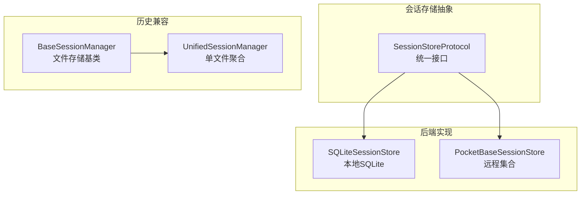
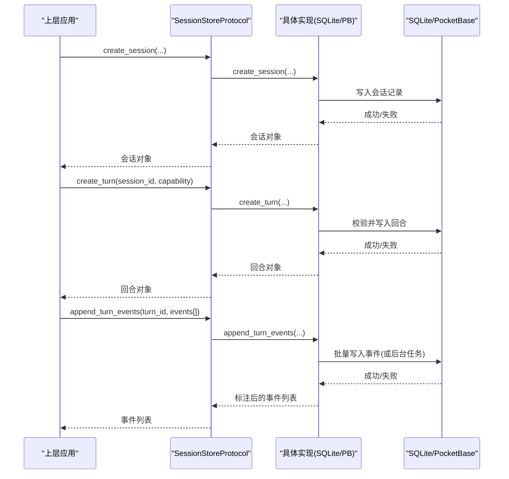
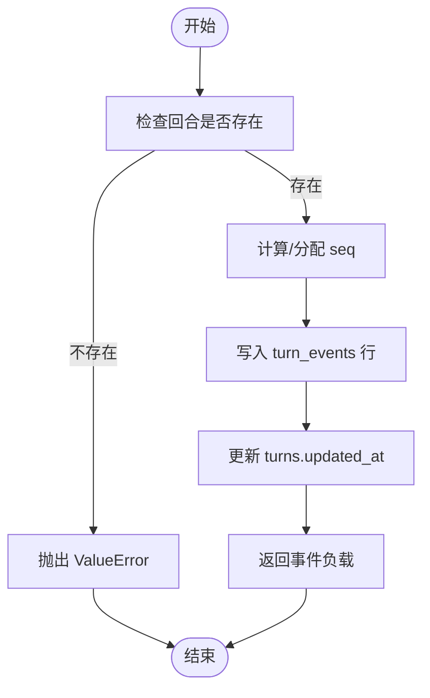
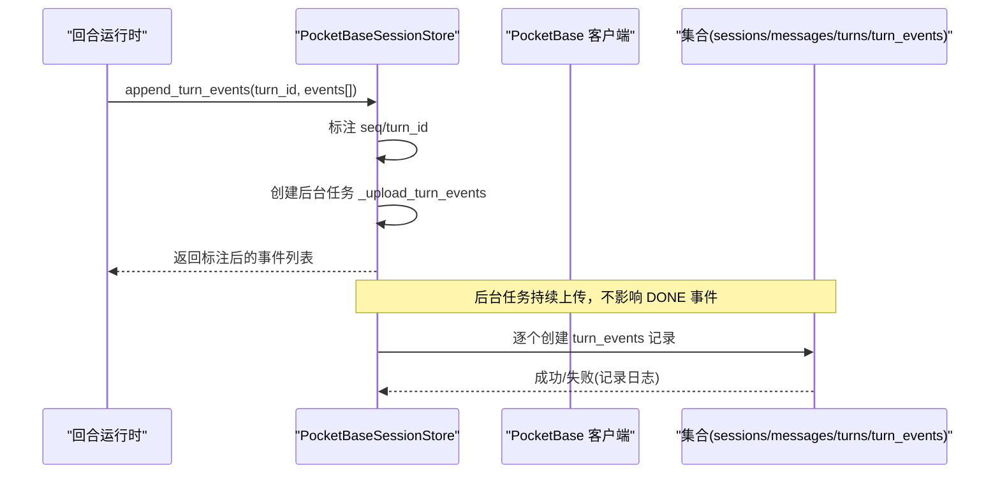
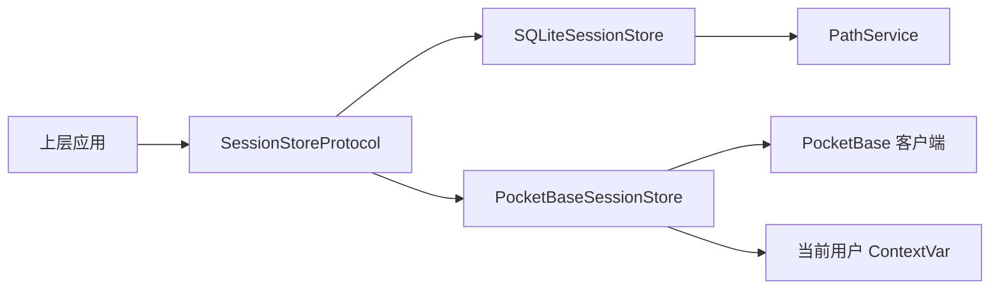

# 存储协议抽象

<cite>
**本文引用的文件**
- [protocol.py](file://deeptutor/services/session/protocol.py)
- [sqlite_store.py](file://deeptutor/services/session/sqlite_store.py)
- [pocketbase_store.py](file://deeptutor/services/session/pocketbase_store.py)
- [base_session_manager.py](file://deeptutor/services/session/base_session_manager.py)
- [unified_session_manager.py](file://deeptutor/services/session/unified_session_manager.py)
- [test_turn_event_store.py](file://tests/core/test_turn_event_store.py)
- [pb_setup.py](file://scripts/pb_setup.py)
</cite>

## 目录
1. [简介](#简介)
2. [项目结构](#项目结构)
3. [核心组件](#核心组件)
4. [架构总览](#架构总览)
5. [详细组件分析](#详细组件分析)
6. [依赖关系分析](#依赖关系分析)
7. [性能考量](#性能考量)
8. [故障排查指南](#故障排查指南)
9. [结论](#结论)
10. [附录](#附录)

## 简介
本文件面向“存储协议抽象层”，系统性说明会话存储的接口契约、多后端实现、会话生命周期与消息操作、回合跟踪、错误处理规范，以及扩展新存储后端的步骤与最佳实践。目标是让业务逻辑与具体存储实现解耦，使上层服务（聊天、问答、笔记等）无需关心数据最终落盘于 SQLite 还是 PocketBase。

## 项目结构
存储协议抽象位于 services/session 目录下：
- 协议定义：SessionStoreProtocol 统一了会话、消息、回合及事件的数据访问方法。
- 后端实现：SQLiteSessionStore（本地 SQLite）、PocketBaseSessionStore（远程集合）。
- 历史兼容：BaseSessionManager / UnifiedSessionManager 提供基于文件的旧版会话管理，用于非统一会话场景。

图表来源
- [protocol.py:13-83](file://deeptutor/services/session/protocol.py#L13-L83)
- [sqlite_store.py:96-106](file://deeptutor/services/session/sqlite_store.py#L96-L106)
- [pocketbase_store.py:103-112](file://deeptutor/services/session/pocketbase_store.py#L103-L112)
- [base_session_manager.py:23-40](file://deeptutor/services/session/base_session_manager.py#L23-L40)
- [unified_session_manager.py:16-36](file://deeptutor/services/session/unified_session_manager.py#L16-L36)

章节来源
- [protocol.py:1-83](file://deeptutor/services/session/protocol.py#L1-83)
- [sqlite_store.py:1-120](file://deeptutor/services/session/sqlite_store.py#L1-L120)
- [pocketbase_store.py:1-112](file://deeptutor/services/session/pocketbase_store.py#L1-L112)
- [base_session_manager.py:1-84](file://deeptutor/services/session/base_session_manager.py#L1-L84)
- [unified_session_manager.py:1-36](file://deeptutor/services/session/unified_session_manager.py#L1-L36)

## 核心组件
- SessionStoreProtocol：定义统一的异步接口，涵盖会话创建/查询/更新/删除、消息增删查、回合创建/状态更新/事件追加与回放、会话摘要与偏好设置、按会话列出会话等。
- SQLiteSessionStore：基于 SQLite 的本地持久化实现，具备表迁移、并发锁、批量写入、分支消息支持等能力。
- PocketBaseSessionStore：基于 PocketBase 的远程集合实现，采用后台任务异步上传事件，保证流式结束后的低延迟完成。
- BaseSessionManager / UnifiedSessionManager：面向旧版文件存储的抽象与统一会话管理器，便于逐步迁移或独立使用。

章节来源
- [protocol.py:13-83](file://deeptutor/services/session/protocol.py#L13-L83)
- [sqlite_store.py:96-106](file://deeptutor/services/session/sqlite_store.py#L96-L106)
- [pocketbase_store.py:103-112](file://deeptutor/services/session/pocketbase_store.py#L103-L112)
- [base_session_manager.py:23-84](file://deeptutor/services/session/base_session_manager.py#L23-L84)
- [unified_session_manager.py:16-66](file://deeptutor/services/session/unified_session_manager.py#L16-L66)

## 架构总览
会话存储抽象通过 Protocol 将上层调用与底层实现解耦。上层仅依赖接口，运行时注入具体实现（SQLite 或 PocketBase），从而在一致性体验下切换存储后端。

图表来源
- [protocol.py:13-83](file://deeptutor/services/session/protocol.py#L13-L83)
- [sqlite_store.py:538-579](file://deeptutor/services/session/sqlite_store.py#L538-L579)
- [sqlite_store.py:657-771](file://deeptutor/services/session/sqlite_store.py#L657-L771)
- [pocketbase_store.py:461-508](file://deeptutor/services/session/pocketbase_store.py#L461-L508)
- [pocketbase_store.py:616-643](file://deeptutor/services/session/pocketbase_store.py#L616-L643)

## 详细组件分析

### 接口契约：SessionStoreProtocol
- 会话生命周期
  - create_session：创建会话，返回会话元信息。
  - get_session / ensure_session：获取或确保会话存在。
  - update_session_title / delete_session / list_sessions：标题更新、删除、分页列出。
  - update_summary / update_session_preferences / get_session_with_messages：摘要、偏好、带消息的会话读取。
- 消息操作
  - add_message：新增消息，支持附件、元数据、父消息ID（分支）。
  - delete_message / get_last_message / get_messages / get_messages_for_context：删除、最近消息、全量消息、上下文裁剪。
- 回合跟踪
  - create_turn / get_turn / get_active_turn / list_active_turns：回合创建、查询、活跃回合。
  - update_turn_status：更新回合状态（running/completed/failed/cancelled）。
  - append_turn_event / get_turn_events：追加事件与增量回放。

章节来源
- [protocol.py:13-83](file://deeptutor/services/session/protocol.py#L13-L83)

### SQLite 后端：SQLiteSessionStore
- 设计要点
  - 并发安全：内部 asyncio.Lock 保护 SQLite 同步 IO。
  - 表结构与迁移：自动建表与字段补齐（如 preferences_json、parent_message_id），兼容旧库。
  - 索引优化：会话更新时间、消息会话+时间、回合会话+状态、事件 turn_id+seq 等索引。
  - 分支消息：messages.parent_message_id 支持编辑分支；迁移时回填线性路径。
  - 批量写入：append_turn_events 使用 executemany 一次事务提交，避免慢盘导致 finalize 卡顿。
- 关键流程
  - 回合创建：校验会话存在且无运行中回合，插入 turns 并返回。
  - 事件追加：计算 seq，写入 turn_events，更新 turns.updated_at。
  - 事件回放：按 after_seq 增量拉取，附带 session_id、turn_id、timestamp。
- 错误处理
  - 会话不存在：抛出 ValueError。
  - 重复活跃回合：抛出 RuntimeError。
  - JSON 解析容错：_json_loads 对异常值回退默认值，避免阻塞。

图表来源
- [sqlite_store.py:657-704](file://deeptutor/services/session/sqlite_store.py#L657-L704)
- [sqlite_store.py:706-771](file://deeptutor/services/session/sqlite_store.py#L706-L771)

章节来源
- [sqlite_store.py:96-120](file://deeptutor/services/session/sqlite_store.py#L96-L120)
- [sqlite_store.py:119-281](file://deeptutor/services/session/sqlite_store.py#L119-L281)
- [sqlite_store.py:538-579](file://deeptutor/services/session/sqlite_store.py#L538-L579)
- [sqlite_store.py:657-771](file://deeptutor/services/session/sqlite_store.py#L657-L771)

### PocketBase 后端：PocketBaseSessionStore
- 设计要点
  - 用户隔离：所有会话查询均附加 user_id 过滤，防止跨用户访问。
  - 事件异步上传：append_turn_events 立即返回标注后的事件，后台任务批量写入 turn_events 集合，避免阻塞 DONE 事件。
  - 健壮性：网络异常捕获并记录日志，失败不阻断主流程。
- 关键流程
  - 会话创建：生成唯一 ID，写入 sessions 集合，填充初始字段。
  - 消息写入：写入 messages 集合，携带 events_json、attachments_json、metadata_json。
  - 回合管理：创建/查询/更新 turns，禁止重复 active turn。
  - 事件回放：按 turn_id 和 seq 过滤，排序返回。
- 错误处理
  - 会话不存在：创建回合前校验并抛出 ValueError。
  - 重复活跃回合：查询 active turns 并抛出 RuntimeError。
  - 网络异常：捕获并记录警告，返回 False 或空结果。

图表来源
- [pocketbase_store.py:616-643](file://deeptutor/services/session/pocketbase_store.py#L616-L643)
- [pocketbase_store.py:645-673](file://deeptutor/services/session/pocketbase_store.py#L645-L673)
- [pocketbase_store.py:461-508](file://deeptutor/services/session/pocketbase_store.py#L461-L508)

章节来源
- [pocketbase_store.py:103-112](file://deeptutor/services/session/pocketbase_store.py#L103-L112)
- [pocketbase_store.py:117-171](file://deeptutor/services/session/pocketbase_store.py#L117-L171)
- [pocketbase_store.py:323-455](file://deeptutor/services/session/pocketbase_store.py#L323-L455)
- [pocketbase_store.py:461-605](file://deeptutor/services/session/pocketbase_store.py#L461-L605)
- [pocketbase_store.py:616-708](file://deeptutor/services/session/pocketbase_store.py#L616-L708)

### 历史兼容：BaseSessionManager 与 UnifiedSessionManager
- BaseSessionManager：抽象文件存储的会话 CRUD，提供统一加载/保存、限制数量、自动排序等能力。
- UnifiedSessionManager：以单一文件聚合多种模式（chat/deep_solve/deep_question 等），便于集中管理。

章节来源
- [base_session_manager.py:23-257](file://deeptutor/services/session/base_session_manager.py#L23-L257)
- [unified_session_manager.py:16-77](file://deeptutor/services/session/unified_session_manager.py#L16-L77)

## 依赖关系分析
- 耦合度
  - 上层仅依赖 SessionStoreProtocol，与具体实现松耦合。
  - SQLite 实现依赖 PathService 定位数据库文件，内置迁移与索引。
  - PocketBase 实现依赖全局 PB 客户端与当前用户 ContextVar，进行用户级隔离。
- 外部依赖
  - SQLite：本地文件数据库，适合单机/容器内部署。
  - PocketBase：HTTP 集合服务，适合多实例共享与云端部署。
- 潜在循环依赖
  - 模块间通过函数导入 PB 客户端，避免启动期循环依赖。

图表来源
- [protocol.py:13-83](file://deeptutor/services/session/protocol.py#L13-L83)
- [sqlite_store.py:96-106](file://deeptutor/services/session/sqlite_store.py#L96-L106)
- [pocketbase_store.py:55-87](file://deeptutor/services/session/pocketbase_store.py#L55-L87)

章节来源
- [protocol.py:13-83](file://deeptutor/services/session/protocol.py#L13-L83)
- [sqlite_store.py:96-106](file://deeptutor/services/session/sqlite_store.py#L96-L106)
- [pocketbase_store.py:55-87](file://deeptutor/services/session/pocketbase_store.py#L55-L87)

## 性能考量
- SQLite
  - 使用 asyncio.Lock 串行化写操作，避免并发写冲突。
  - 批量写入事件减少磁盘 fsync 次数，显著降低慢盘上的 finalize 延迟。
  - 合理索引（会话更新时间、消息会话+时间、事件 turn_id+seq）提升查询效率。
- PocketBase
  - 事件后台上传，避免每个事件一次 HTTP 往返阻塞主流程。
  - 会话/消息/回合的 HTTP 调用频次较低，可接受 ~5–10ms 开销。
  - 用户级过滤保障多租户安全，同时避免额外复杂查询。

[本节为通用性能讨论，不直接分析具体文件]

## 故障排查指南
- 常见错误类型
  - ValueError：会话不存在（例如创建回合前未找到会话）。
  - RuntimeError：同一会话存在多个活跃回合。
  - 网络异常：PocketBase 请求失败，已捕获并记录日志。
- 排查建议
  - 确认会话是否属于当前用户（PocketBase 通过 user_id 过滤）。
  - 检查事件序列号是否连续（SQLite 通过 UNIQUE(turn_id, seq) 约束）。
  - 查看日志中的警告/调试信息，定位具体失败点。
- 验证方法
  - 单元测试覆盖回合事件持久化与回放（见测试用例）。
  - 通过 API 层端到端验证会话创建、消息写入、回合状态流转。

章节来源
- [sqlite_store.py:538-579](file://deeptutor/services/session/sqlite_store.py#L538-L579)
- [sqlite_store.py:657-704](file://deeptutor/services/session/sqlite_store.py#L657-L704)
- [pocketbase_store.py:461-508](file://deeptutor/services/session/pocketbase_store.py#L461-L508)
- [test_turn_event_store.py:8-48](file://tests/core/test_turn_event_store.py#L8-L48)

## 结论
存储协议抽象通过 SessionStoreProtocol 将会话、消息、回合与事件操作标准化，SQLite 与 PocketBase 两种后端遵循同一契约，既满足本地高性能需求，又支持云端多实例共享。结合完善的迁移、索引、并发控制与错误处理，系统实现了高可用、可扩展的会话存储层。

[本节为总结，不直接分析具体文件]

## 附录

### 扩展新存储后端的步骤与要求
- 实现 SessionStoreProtocol 的所有异步方法，确保行为一致：
  - 会话：create/get/ensure/update/delete/list/summary/preferences。
  - 消息：add/delete/get_last/get_messages/get_messages_for_context。
  - 回合：create/get/get_active/list_active/update_status。
  - 事件：append/get（支持增量回放）。
- 数据模型映射
  - 保持返回字典键名与现有实现一致（如 id/session_id/title/created_at/updated_at 等）。
  - 事件需包含 type/source/stage/content/metadata/timestamp/seq/turn_id/session_id。
- 并发与安全
  - 若后端为本地存储，需自行实现并发控制（如锁）。
  - 若后端为远程服务，需实现用户隔离（如 user_id 过滤）。
- 错误处理
  - 对非法输入与资源不存在情况抛出 ValueError/RuntimeError。
  - 对网络/IO 异常捕获并记录日志，必要时返回 False/空结果。
- 测试与兼容性
  - 编写单元测试覆盖会话/消息/回合/事件的关键路径。
  - 复用现有测试思路（如回合事件持久化与回放）验证一致性。

章节来源
- [protocol.py:13-83](file://deeptutor/services/session/protocol.py#L13-L83)
- [sqlite_store.py:96-120](file://deeptutor/services/session/sqlite_store.py#L96-L120)
- [pocketbase_store.py:103-112](file://deeptutor/services/session/pocketbase_store.py#L103-L112)

### 接口使用示例与最佳实践
- 会话生命周期
  - 创建会话后，立即创建回合并开始流式处理。
  - 流结束后更新回合状态为 completed/failed/cancelled。
- 消息与事件
  - 使用 add_message 持久化用户/助手消息，附带 events_json 与 attachments。
  - 使用 append_turn_events 批量追加事件，避免逐条提交。
- 上下文构建
  - 使用 get_messages_for_context 获取线性或分支感知的消息上下文。
- 最佳实践
  - 始终校验会话归属（多用户场景）。
  - 对大事件负载进行截断或压缩（如 content 长度限制）。
  - 利用索引字段（updated_at、seq）进行高效查询与回放。

章节来源
- [protocol.py:13-83](file://deeptutor/services/session/protocol.py#L13-L83)
- [sqlite_store.py:657-771](file://deeptutor/services/session/sqlite_store.py#L657-L771)
- [pocketbase_store.py:323-455](file://deeptutor/services/session/pocketbase_store.py#L323-L455)

### 性能基准测试与兼容性验证方法
- 基准测试
  - SQLite：压测 append_turn_events 批量写入，观察不同磁盘介质下的耗时。
  - PocketBase：评估事件后台上传对 DONE 事件延迟的影响。
- 兼容性验证
  - 使用现有测试用例验证回合事件持久化与回放正确性。
  - 对比 SQLite 与 PocketBase 的会话/消息/回合数据一致性。
  - 验证迁移脚本对旧库字段的兼容（如 preferences_json、parent_message_id）。

章节来源
- [test_turn_event_store.py:8-48](file://tests/core/test_turn_event_store.py#L8-L48)
- [sqlite_store.py:119-281](file://deeptutor/services/session/sqlite_store.py#L119-L281)
- [pocketbase_store.py:616-643](file://deeptutor/services/session/pocketbase_store.py#L616-L643)