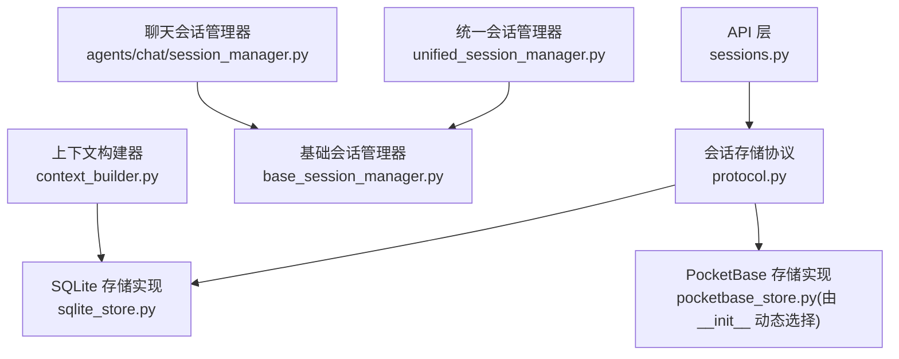
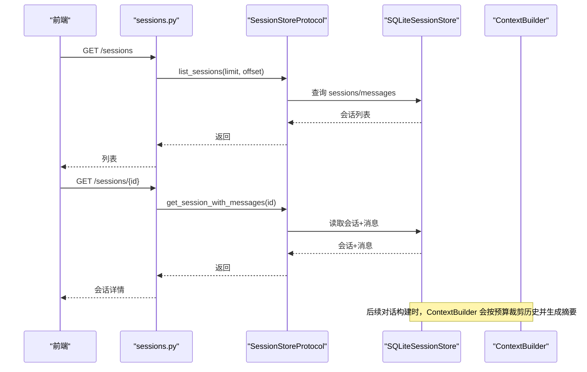
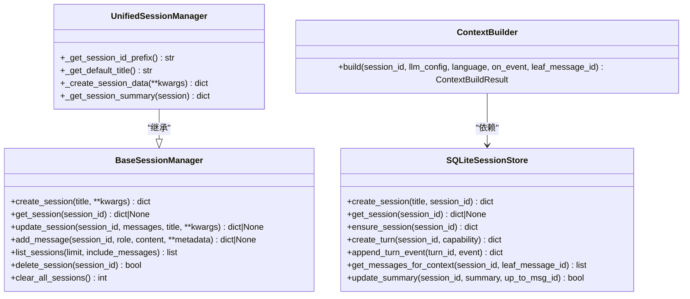
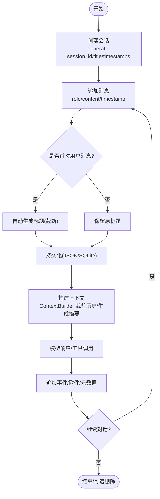
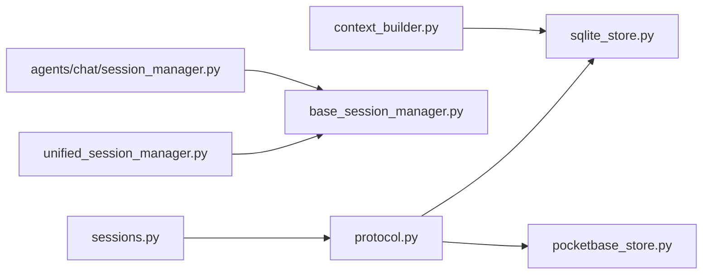

# 会话核心概念

<cite>
**本文引用的文件**
- [deeptutor/agents/chat/session_manager.py](file://deeptutor/agents/chat/session_manager.py)
- [deeptutor/services/session/base_session_manager.py](file://deeptutor/services/session/base_session_manager.py)
- [deeptutor/services/session/unified_session_manager.py](file://deeptutor/services/session/unified_session_manager.py)
- [deeptutor/services/session/protocol.py](file://deeptutor/services/session/protocol.py)
- [deeptutor/services/session/sqlite_store.py](file://deeptutor/services/session/sqlite_store.py)
- [deeptutor/services/session/context_builder.py](file://deeptutor/services/session/context_builder.py)
- [deeptutor/api/routers/sessions.py](file://deeptutor/api/routers/sessions.py)
- [deeptutor/services/session/__init__.py](file://deeptutor/services/session/__init__.py)
</cite>

## 目录
1. [简介](#简介)
2. [项目结构](#项目结构)
3. [核心组件](#核心组件)
4. [架构总览](#架构总览)
5. [详细组件分析](#详细组件分析)
6. [依赖关系分析](#依赖关系分析)
7. [性能考量](#性能考量)
8. [故障排查指南](#故障排查指南)
9. [结论](#结论)
10. [附录](#附录)

## 简介
本文件聚焦智能对话系统中的“会话”核心概念，解释会话如何保持上下文连续性与用户状态，梳理统一会话管理器的多模式支持与持久化策略，并给出从创建到销毁的完整生命周期、数据结构设计要点、最佳实践与性能优化建议。

## 项目结构
围绕会话管理的代码主要分布在以下位置：
- 基础抽象与通用实现：BaseSessionManager（JSON 文件存储）、UnifiedSessionManager（统一模式会话）
- 高性能持久化：SQLiteSessionStore（消息、轮次、事件、笔记条目等）
- 上下文构建：ContextBuilder（按预算裁剪历史、生成滚动摘要）
- API 暴露：sessions 路由（列表、详情、重命名、删除、分支选择、测验结果记录）
- 模块适配：Chat SessionManager（聊天场景的具体实现）

图表来源
- [deeptutor/api/routers/sessions.py:80-140](file://deeptutor/api/routers/sessions.py#L80-L140)
- [deeptutor/services/session/protocol.py:14-83](file://deeptutor/services/session/protocol.py#L14-L83)
- [deeptutor/services/session/sqlite_store.py:96-234](file://deeptutor/services/session/sqlite_store.py#L96-L234)
- [deeptutor/services/session/unified_session_manager.py:16-66](file://deeptutor/services/session/unified_session_manager.py#L16-L66)
- [deeptutor/services/session/base_session_manager.py:23-146](file://deeptutor/services/session/base_session_manager.py#L23-L146)
- [deeptutor/agents/chat/session_manager.py:20-179](file://deeptutor/agents/chat/session_manager.py#L20-L179)
- [deeptutor/services/session/context_builder.py:104-467](file://deeptutor/services/session/context_builder.py#L104-L467)

章节来源
- [deeptutor/services/session/__init__.py:33-47](file://deeptutor/services/session/__init__.py#L33-L47)
- [deeptutor/services/session/base_session_manager.py:23-146](file://deeptutor/services/session/base_session_manager.py#L23-L146)
- [deeptutor/services/session/unified_session_manager.py:16-66](file://deeptutor/services/session/unified_session_manager.py#L16-L66)
- [deeptutor/services/session/sqlite_store.py:96-234](file://deeptutor/services/session/sqlite_store.py#L96-L234)
- [deeptutor/services/session/context_builder.py:104-467](file://deeptutor/services/session/context_builder.py#L104-L467)
- [deeptutor/api/routers/sessions.py:80-140](file://deeptutor/api/routers/sessions.py#L80-L140)

## 核心组件
- BaseSessionManager：提供跨模块一致的 JSON 文件级会话 CRUD、消息追加、自动排序与上限控制。
- UnifiedSessionManager：在单文件中以 mode 字段区分不同对话类型（如 chat、deep_solve、deep_question），统一管理。
- SQLiteSessionStore：基于 SQLite 的高性能会话与消息存储，支持 turn 运行态、事件流、附件与笔记条目。
- ContextBuilder：根据 LLM 上下文窗口与预算，动态裁剪历史并生成滚动摘要，保证上下文连续性。
- sessions API：对外暴露会话列表、详情、重命名、删除、分支选择、测验结果记录等能力。

章节来源
- [deeptutor/services/session/base_session_manager.py:23-257](file://deeptutor/services/session/base_session_manager.py#L23-L257)
- [deeptutor/services/session/unified_session_manager.py:16-77](file://deeptutor/services/session/unified_session_manager.py#L16-L77)
- [deeptutor/services/session/sqlite_store.py:96-800](file://deeptutor/services/session/sqlite_store.py#L96-L800)
- [deeptutor/services/session/context_builder.py:104-467](file://deeptutor/services/session/context_builder.py#L104-L467)
- [deeptutor/api/routers/sessions.py:80-231](file://deeptutor/api/routers/sessions.py#L80-L231)

## 架构总览
会话系统采用“协议 + 多实现 + 高层管理器”的分层设计：
- 协议层：SessionStoreProtocol 定义统一的异步接口，屏蔽底层存储差异。
- 存储层：默认使用 SQLiteSessionStore；当启用 PocketBase 时切换为远程存储。
- 管理层：BaseSessionManager 提供通用 JSON 文件会话管理；UnifiedSessionManager 将多模式会话聚合到单一文件。
- 上下文层：ContextBuilder 负责构造受控的对话历史，确保模型输入不超限且语义连贯。
- API 层：FastAPI 路由暴露会话操作，调用存储层完成数据读写。

图表来源
- [deeptutor/api/routers/sessions.py:80-140](file://deeptutor/api/routers/sessions.py#L80-L140)
- [deeptutor/services/session/protocol.py:14-83](file://deeptutor/services/session/protocol.py#L14-L83)
- [deeptutor/services/session/sqlite_store.py:419-512](file://deeptutor/services/session/sqlite_store.py#L419-L512)
- [deeptutor/services/session/context_builder.py:348-467](file://deeptutor/services/session/context_builder.py#L348-L467)

## 详细组件分析

### 会话数据结构与关键字段
- session_id：唯一标识，用于定位会话。不同管理器使用前缀区分（如 chat_、unified_）。
- title：会话标题，便于展示与检索；首次用户消息可自动作为标题。
- mode：统一会话中的对话类型标记（如 chat、deep_solve、deep_question），用于多模式隔离与差异化处理。
- messages：消息列表，包含 role、content、timestamp 等；SQLite 模式下还包含 events、attachments、metadata、parent_message_id 等。
- settings/metadata：能力或模式相关配置（如 RAG/Web Search 开关、知识基、工具启用列表等）。
- created_at/updated_at：时间戳，用于排序与更新追踪。

章节来源
- [deeptutor/agents/chat/session_manager.py:20-88](file://deeptutor/agents/chat/session_manager.py#L20-L88)
- [deeptutor/services/session/unified_session_manager.py:16-66](file://deeptutor/services/session/unified_session_manager.py#L16-L66)
- [deeptutor/services/session/base_session_manager.py:115-213](file://deeptutor/services/session/base_session_manager.py#L115-L213)
- [deeptutor/services/session/sqlite_store.py:123-148](file://deeptutor/services/session/sqlite_store.py#L123-L148)

### 统一会话管理器的工作原理
- 多模式支持：通过 mode 字段在同一会话集合中区分不同对话类型，便于统一管理与展示。
- 持久化策略：
  - JSON 文件路径：BaseSessionManager 将每个模块的会话保存在独立 JSON 文件中，适合轻量场景。
  - SQLite 数据库：SQLiteSessionStore 提供高并发、强一致的消息与事件存储，支持 turn 运行态与增量事件流。
- 上下文连续性：ContextBuilder 根据 LLM 上下文窗口预算，动态裁剪历史并维护滚动摘要，避免信息丢失与上下文漂移。

图表来源
- [deeptutor/services/session/base_session_manager.py:23-257](file://deeptutor/services/session/base_session_manager.py#L23-L257)
- [deeptutor/services/session/unified_session_manager.py:16-77](file://deeptutor/services/session/unified_session_manager.py#L16-L77)
- [deeptutor/services/session/sqlite_store.py:96-800](file://deeptutor/services/session/sqlite_store.py#L96-L800)
- [deeptutor/services/session/context_builder.py:104-467](file://deeptutor/services/session/context_builder.py#L104-L467)

### 会话生命周期（创建到销毁）

图表来源
- [deeptutor/services/session/base_session_manager.py:115-213](file://deeptutor/services/session/base_session_manager.py#L115-L213)
- [deeptutor/services/session/sqlite_store.py:419-512](file://deeptutor/services/session/sqlite_store.py#L419-L512)
- [deeptutor/services/session/context_builder.py:348-467](file://deeptutor/services/session/context_builder.py#L348-L467)

### 上下文连续性与状态保持
- 预算分配：根据 LLM 的有效上下文窗口，分别计算历史预算、摘要预算与近期消息预算。
- 滚动摘要：对未纳入最近历史的旧消息进行压缩，形成系统提示中的摘要，保障长期对话的连贯性。
- 分支编辑：支持 parent_message_id 的编辑分支，仅包含当前分支祖先链上的消息，避免无关分支污染上下文。
- 防漂移：当重建源文本仍符合预算时，优先从原始消息重建摘要，避免“摘要的摘要”导致细节丢失。

章节来源
- [deeptutor/services/session/context_builder.py:117-138](file://deeptutor/services/session/context_builder.py#L117-L138)
- [deeptutor/services/session/context_builder.py:348-467](file://deeptutor/services/session/context_builder.py#L348-L467)

### API 与外部集成
- 列表与详情：GET /sessions 与 GET /sessions/{session_id} 提供分页列表与完整会话详情（含消息与事件）。
- 重命名与删除：PATCH /sessions/{session_id} 修改标题；DELETE /sessions/{session_id} 删除会话并清理附件。
- 分支选择：PUT /sessions/{session_id}/branch-selection 保存分支选择偏好。
- 测验结果：POST /sessions/{session_id}/quiz-results 记录答题结果并写入笔记条目。

章节来源
- [deeptutor/api/routers/sessions.py:80-231](file://deeptutor/api/routers/sessions.py#L80-L231)

## 依赖关系分析
- 模块耦合：
  - UnifiedSessionManager 与 BaseSessionManager 构成继承关系，复用通用逻辑。
  - SQLiteSessionStore 实现 SessionStoreProtocol，被 API 与 ContextBuilder 共同依赖。
  - Chat SessionManager 继承 BaseSessionManager，专注聊天场景的数据结构与摘要。
- 外部依赖：
  - 路径服务：BaseSessionManager 通过 path_service 获取会话文件路径，支持多用户隔离。
  - 存储后端选择：__init__ 根据配置动态选择 SQLite 或 PocketBase 存储。

图表来源
- [deeptutor/services/session/__init__.py:33-47](file://deeptutor/services/session/__init__.py#L33-L47)
- [deeptutor/services/session/base_session_manager.py:46-55](file://deeptutor/services/session/base_session_manager.py#L46-L55)
- [deeptutor/services/session/protocol.py:14-83](file://deeptutor/services/session/protocol.py#L14-L83)
- [deeptutor/services/session/sqlite_store.py:96-234](file://deeptutor/services/session/sqlite_store.py#L96-L234)

## 性能考量
- 存储层优化：
  - SQLite 事务批量写入：append_turn_events 使用 executemany 减少 fsync 次数，提升慢盘场景下的吞吐。
  - 索引设计：针对 sessions.updated_at、messages.session_id/created_at、turns.session_id/status 等建立索引，加速列表与查询。
  - 大事件裁剪：API 层对 tool_result/observation 等大事件 payload 进行截断，降低网络与渲染开销。
- 上下文构建优化：
  - 预算裁剪：按 token 估算与比例分配历史与摘要预算，避免超出模型上下文限制。
  - 滚动摘要：仅在必要时触发摘要生成，并推进 watermark，减少重复计算。
- 内存与并发：
  - 异步锁：SQLiteSessionStore 使用 asyncio.Lock 保护并发访问，避免竞争条件。
  - 连接管理：每次请求使用 contextmanager 打开/关闭连接，防止 FD 泄漏。

章节来源
- [deeptutor/services/session/sqlite_store.py:706-771](file://deeptutor/services/session/sqlite_store.py#L706-L771)
- [deeptutor/services/session/sqlite_store.py:123-234](file://deeptutor/services/session/sqlite_store.py#L123-L234)
- [deeptutor/api/routers/sessions.py:90-140](file://deeptutor/api/routers/sessions.py#L90-L140)
- [deeptutor/services/session/context_builder.py:117-138](file://deeptutor/services/session/context_builder.py#L117-L138)

## 故障排查指南
- 会话不存在：
  - 现象：API 返回 404。
  - 排查：确认 session_id 是否正确；检查 SQLite 表是否存在对应记录。
  - 参考：[deeptutor/api/routers/sessions.py:133-140](file://deeptutor/api/routers/sessions.py#L133-L140)
- 删除会话失败：
  - 现象：删除后附件未清理。
  - 排查：检查附件存储异常日志；确认 delete_session 调用成功。
  - 参考：[deeptutor/api/routers/sessions.py:153-163](file://deeptutor/api/routers/sessions.py#L153-L163)
- 删除消息冲突：
  - 现象：删除正在运行的 turn 的消息返回 409。
  - 排查：等待 turn 结束或取消后再删除。
  - 参考：[deeptutor/api/routers/sessions.py:180-196](file://deeptutor/api/routers/sessions.py#L180-L196)
- 上下文构建异常：
  - 现象：摘要生成失败或内容过长。
  - 排查：检查 LLM 配置与预算；查看 ContextBuilder 事件流中的错误事件。
  - 参考：[deeptutor/services/session/context_builder.py:182-346](file://deeptutor/services/session/context_builder.py#L182-L346)

## 结论
DeepTutor 的会话系统通过协议抽象、多存储后端与高层管理器实现了灵活、可扩展的会话管理能力。BaseSessionManager 提供轻量 JSON 存储，UnifiedSessionManager 支持多模式统一会话，SQLiteSessionStore 提供高性能持久化，ContextBuilder 保障上下文连续性与稳定性。结合 API 层的丰富操作，系统能够支撑复杂的多轮对话与多能力协作场景。

## 附录
- 最佳实践
  - 使用 UnifiedSessionManager 管理多模式会话，便于统一展示与管理。
  - 在高并发或大数据量场景下优先使用 SQLiteSessionStore。
  - 合理设置 LLM 上下文预算，避免频繁触发摘要生成。
  - 利用分支编辑功能（parent_message_id）进行多路径探索，同时保持上下文纯净。
- 性能优化建议
  - 批量写入事件，减少磁盘 IO 次数。
  - 对大事件 payload 进行裁剪，降低网络与渲染压力。
  - 定期清理过期会话与附件，释放存储空间。