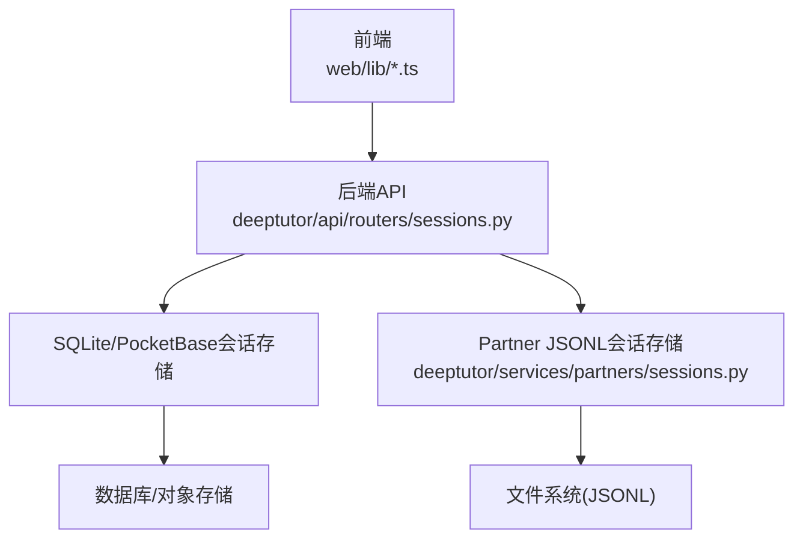
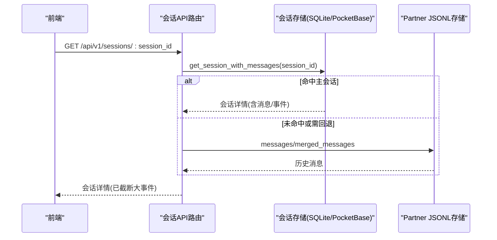
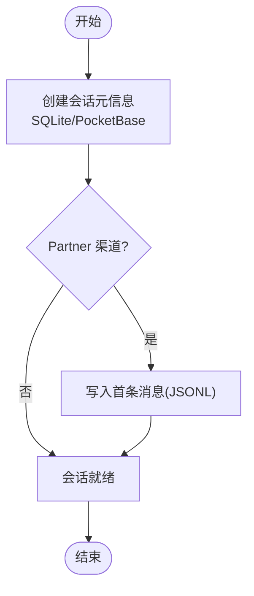
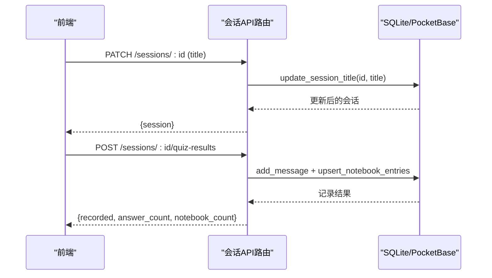
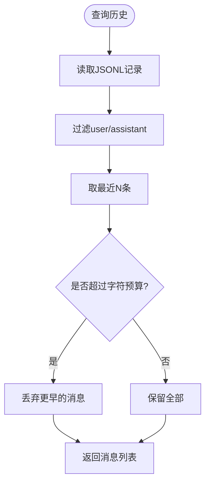
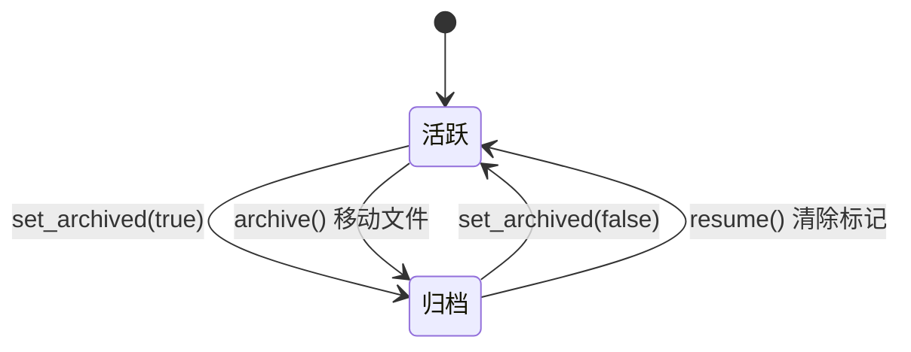
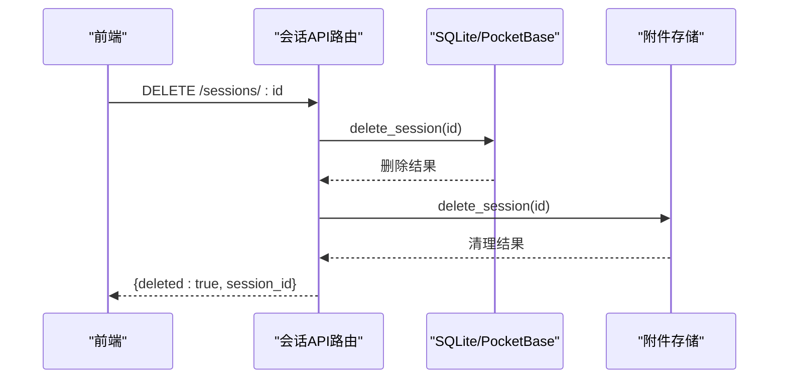
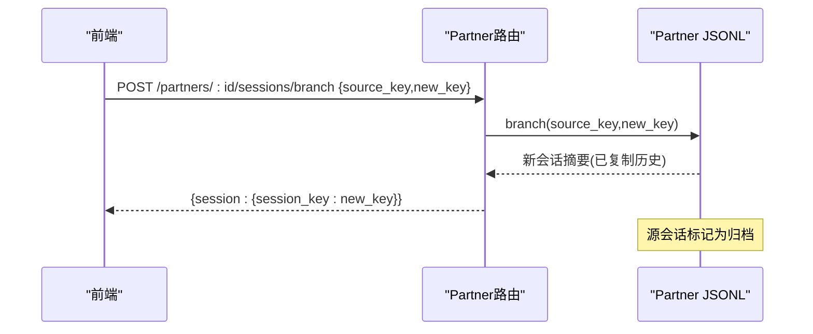
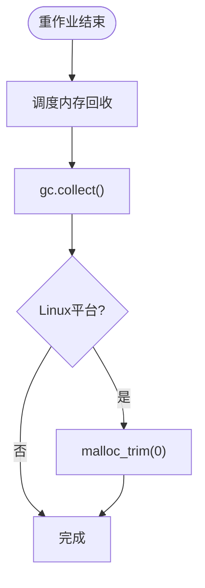
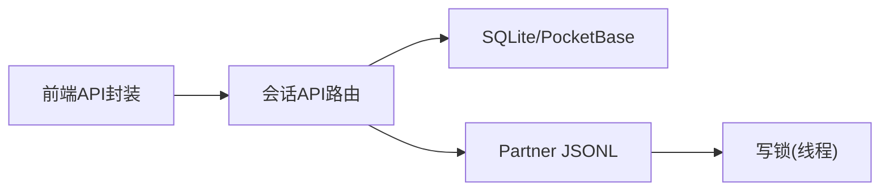

# 会话生命周期

<cite>
**本文引用的文件**
- [deeptutor/api/routers/sessions.py](file://deeptutor/api/routers/sessions.py)
- [deeptutor/services/partners/sessions.py](file://deeptutor/services/partners/sessions.py)
- [web/lib/session-api.ts](file://web/lib/session-api.ts)
- [web/lib/partners-api.ts](file://web/lib/partners-api.ts)
- [web/context/UnifiedChatContext.tsx](file://web/context/UnifiedChatContext.tsx)
- [deeptutor/agents/chat/session_manager.py](file://deeptutor/agents/chat/session_manager.py)
- [scripts/pb_setup.py](file://scripts/pb_setup.py)
- [tests/api/test_partners_router.py](file://tests/api/test_partners_router.py)
- [tests/core/test_turn_event_store.py](file://tests/core/test_turn_event_store.py)
- [deeptutor/runtime/memory_reclaim.py](file://deeptutor/runtime/memory_reclaim.py)
</cite>

## 目录
1. [简介](#简介)
2. [项目结构](#项目结构)
3. [核心组件](#核心组件)
4. [架构总览](#架构总览)
5. [详细组件分析](#详细组件分析)
6. [依赖关系分析](#依赖关系分析)
7. [性能考量](#性能考量)
8. [故障排查指南](#故障排查指南)
9. [结论](#结论)
10. [附录：API参考与批量操作示例](#附录api参考与批量操作示例)

## 简介
本文件系统性说明 DeepTutor 的“会话生命周期”，覆盖创建、初始化、更新、查询、归档、删除、克隆与分支，以及清理与资源回收。文档同时解释活跃会话、历史会话与归档会话的管理策略，并提供 API 参考与批量操作示例，帮助开发者与使用者高效管理对话数据。

## 项目结构
DeepTutor 的会话能力由三层构成：
- Web 前端：负责会话列表、详情加载、标题更新、删除、分支选择等交互。
- 后端 API：提供统一的会话 REST 接口，并路由到不同的存储实现（SQLite/PocketBase/Partner JSONL）。
- 存储层：根据场景使用不同持久化方案
  - SQLite/PocketBase：用于主聊天与会话事件流（turn/events），支持活跃轮次与消息回放。
  - Partner JSONL：用于合作伙伴渠道（如 IM）的轻量会话历史，支持软归档、分支与合并视图。

图表来源
- [deeptutor/api/routers/sessions.py:80-163](file://deeptutor/api/routers/sessions.py#L80-L163)
- [deeptutor/services/partners/sessions.py:28-318](file://deeptutor/services/partners/sessions.py#L28-L318)
- [scripts/pb_setup.py:86-107](file://scripts/pb_setup.py#L86-L107)

章节来源
- [deeptutor/api/routers/sessions.py:80-163](file://deeptutor/api/routers/sessions.py#L80-L163)
- [deeptutor/services/partners/sessions.py:28-318](file://deeptutor/services/partners/sessions.py#L28-L318)
- [scripts/pb_setup.py:86-107](file://scripts/pb_setup.py#L86-L107)

## 核心组件
- 统一会话 API（sessions router）：提供会话列表、详情、重命名、删除、分支选择、按消息删除回合、记录测验结果等接口。
- Partner 会话存储（JSONL）：为合作伙伴渠道提供轻量追加式会话历史，支持软归档、分支、合并视图与历史窗口裁剪。
- 聊天会话管理器（SessionManager）：面向聊天能力的会话封装，继承通用基类，提供创建、追加消息、更新会话等能力。
- 前端会话 API 与上下文：封装会话列表、详情、标题更新、删除、分支选择等调用，并在本地缓存与状态管理中协调 UI 渲染。

章节来源
- [deeptutor/api/routers/sessions.py:21-231](file://deeptutor/api/routers/sessions.py#L21-L231)
- [deeptutor/services/partners/sessions.py:28-318](file://deeptutor/services/partners/sessions.py#L28-L318)
- [deeptutor/agents/chat/session_manager.py:20-179](file://deeptutor/agents/chat/session_manager.py#L20-L179)
- [web/lib/session-api.ts:119-232](file://web/lib/session-api.ts#L119-L232)
- [web/context/UnifiedChatContext.tsx:1313-1355](file://web/context/UnifiedChatContext.tsx#L1313-L1355)

## 架构总览
下图展示一次典型“会话详情获取”的端到端流程，包括前端请求、后端路由、存储读取与响应返回。

图表来源
- [deeptutor/api/routers/sessions.py:133-140](file://deeptutor/api/routers/sessions.py#L133-L140)
- [deeptutor/services/partners/sessions.py:257-275](file://deeptutor/services/partners/sessions.py#L257-L275)

## 详细组件分析

### 会话创建与初始化
- 主会话创建：通过 SQLite/PocketBase 存储创建会话元信息（ID、标题、能力等），并维护用户隔离（每行带 user_id，查询时按当前用户过滤）。
- Partner 会话初始化：以 session_key 为单位在 sessions 目录下生成 JSONL 文件；首次写入即视为初始化完成。
- 聊天会话管理器：提供 create_session/add_message/update_session 等便捷方法，封装默认标题与前缀策略。

图表来源
- [scripts/pb_setup.py:86-107](file://scripts/pb_setup.py#L86-L107)
- [deeptutor/services/partners/sessions.py:136-169](file://deeptutor/services/partners/sessions.py#L136-L169)
- [deeptutor/agents/chat/session_manager.py:94-112](file://deeptutor/agents/chat/session_manager.py#L94-L112)

章节来源
- [scripts/pb_setup.py:86-107](file://scripts/pb_setup.py#L86-L107)
- [deeptutor/services/partners/sessions.py:136-169](file://deeptutor/services/partners/sessions.py#L136-L169)
- [deeptutor/agents/chat/session_manager.py:94-112](file://deeptutor/agents/chat/session_manager.py#L94-L112)

### 会话更新与消息追加
- 主会话：通过 add_message/upsert_notebook_entries 等方法追加消息与测验结果；支持将大事件内容截断后返回给前端。
- Partner 会话：append 方法以追加模式写入 JSONL，包含角色、内容、时间戳、可选通道/发送者/附件/事件等字段。
- 前端：updateSessionTitle、deleteMessage、recordQuizResults 等函数驱动更新与删除。

图表来源
- [deeptutor/api/routers/sessions.py:143-150](file://deeptutor/api/routers/sessions.py#L143-L150)
- [deeptutor/api/routers/sessions.py:199-231](file://deeptutor/api/routers/sessions.py#L199-L231)
- [web/lib/session-api.ts:170-217](file://web/lib/session-api.ts#L170-L217)

章节来源
- [deeptutor/api/routers/sessions.py:143-231](file://deeptutor/api/routers/sessions.py#L143-L231)
- [web/lib/session-api.ts:170-217](file://web/lib/session-api.ts#L170-L217)

### 会话查询与历史窗口
- 列表与详情：list_sessions/get_session 提供分页列表与完整详情；对 tool_result/observation 等大事件进行就地截断，避免前端过载。
- Partner 历史：conversation_history 限制最大消息数与字符数，保证 LLM 输入预算；messages/merged_messages 提供原始记录与跨会话合并视图。

图表来源
- [deeptutor/services/partners/sessions.py:233-255](file://deeptutor/services/partners/sessions.py#L233-L255)
- [deeptutor/api/routers/sessions.py:100-140](file://deeptutor/api/routers/sessions.py#L100-L140)

章节来源
- [deeptutor/services/partners/sessions.py:233-255](file://deeptutor/services/partners/sessions.py#L233-L255)
- [deeptutor/api/routers/sessions.py:100-140](file://deeptutor/api/routers/sessions.py#L100-L140)

### 会话归档与恢复
- Partner 软归档：set_archived 在索引中标记 archived=true；is_archived 会检查索引与旧版 _archived_ 前缀。
- Partner 硬归档：archive 将当前会话文件重命名为带时间戳的归档文件，释放原 key 供新会话复用。
- 恢复：resume_partner_session 清除归档标记，使会话可继续。

图表来源
- [deeptutor/services/partners/sessions.py:84-103](file://deeptutor/services/partners/sessions.py#L84-L103)
- [deeptutor/services/partners/sessions.py:178-208](file://deeptutor/services/partners/sessions.py#L178-L208)

章节来源
- [deeptutor/services/partners/sessions.py:84-103](file://deeptutor/services/partners/sessions.py#L84-L103)
- [deeptutor/services/partners/sessions.py:178-208](file://deeptutor/services/partners/sessions.py#L178-L208)

### 会话删除与清理
- 主会话删除：DELETE /sessions/:id 删除会话记录，并尝试清理关联附件。
- Partner 删除：delete_session 删除 JSONL 文件与索引条目。
- 按消息删除回合：DELETE /sessions/:id/messages/:message_id 删除指定消息及其附件，若对应 turn 正在运行则拒绝。

图表来源
- [deeptutor/api/routers/sessions.py:153-163](file://deeptutor/api/routers/sessions.py#L153-L163)
- [deeptutor/services/partners/sessions.py:105-114](file://deeptutor/services/partners/sessions.py#L105-L114)

章节来源
- [deeptutor/api/routers/sessions.py:153-163](file://deeptutor/api/routers/sessions.py#L153-L163)
- [deeptutor/services/partners/sessions.py:105-114](file://deeptutor/services/partners/sessions.py#L105-L114)

### 会话克隆与分支（实验/A-B测试）
- Partner 分支：branch(source_key, new_key) 复制源会话的全部历史到新 key，并将源会话标记为归档，便于并行实验与对比。
- 分支选择：前端通过 PUT /sessions/:id/branch-selection 保存所选分支，UI 可在多分支间切换。
- 行为验证：测试用例确认分支后源会话被归档且新会话拥有相同历史。

图表来源
- [deeptutor/services/partners/sessions.py:116-132](file://deeptutor/services/partners/sessions.py#L116-L132)
- [web/lib/partners-api.ts:402-419](file://web/lib/partners-api.ts#L402-L419)
- [tests/api/test_partners_router.py:318-330](file://tests/api/test_partners_router.py#L318-L330)

章节来源
- [deeptutor/services/partners/sessions.py:116-132](file://deeptutor/services/partners/sessions.py#L116-L132)
- [web/lib/partners-api.ts:402-419](file://web/lib/partners-api.ts#L402-L419)
- [tests/api/test_partners_router.py:318-330](file://tests/api/test_partners_router.py#L318-L330)

### 内存管理与磁盘空间优化
- 内存回收：schedule_memory_reclaim 在异步任务结束后触发 gc.collect，并在 Linux 上尝试 malloc_trim 释放堆页，降低 RSS。
- 事件载荷截断：对 tool_result/observation 等大事件进行就地截断，减少网络与渲染压力。
- 历史窗口裁剪：Partner conversation_history 限制消息数量与字符数，控制 LLM 输入预算。

图表来源
- [deeptutor/runtime/memory_reclaim.py:17-41](file://deeptutor/runtime/memory_reclaim.py#L17-L41)
- [deeptutor/runtime/memory_reclaim.py:44-70](file://deeptutor/runtime/memory_reclaim.py#L44-L70)
- [deeptutor/api/routers/sessions.py:90-131](file://deeptutor/api/routers/sessions.py#L90-L131)
- [deeptutor/services/partners/sessions.py:233-255](file://deeptutor/services/partners/sessions.py#L233-L255)

章节来源
- [deeptutor/runtime/memory_reclaim.py:17-70](file://deeptutor/runtime/memory_reclaim.py#L17-L70)
- [deeptutor/api/routers/sessions.py:90-131](file://deeptutor/api/routers/sessions.py#L90-L131)
- [deeptutor/services/partners/sessions.py:233-255](file://deeptutor/services/partners/sessions.py#L233-L255)

## 依赖关系分析
- API 路由依赖存储抽象：统一接口背后可能对接 SQLite/PocketBase 或 Partner JSONL。
- 前端依赖后端 API：所有会话操作通过 web/lib/session-api.ts 与 partners-api.ts 发起。
- 存储层内部依赖：Partner JSONL 使用线程锁保护并发写入；SQLite/PocketBase 通过服务工厂与配置注入。

图表来源
- [deeptutor/api/routers/sessions.py:80-163](file://deeptutor/api/routers/sessions.py#L80-L163)
- [deeptutor/services/partners/sessions.py:31-35](file://deeptutor/services/partners/sessions.py#L31-L35)
- [web/lib/session-api.ts:119-232](file://web/lib/session-api.ts#L119-L232)
- [web/lib/partners-api.ts:373-419](file://web/lib/partners-api.ts#L373-L419)

章节来源
- [deeptutor/api/routers/sessions.py:80-163](file://deeptutor/api/routers/sessions.py#L80-L163)
- [deeptutor/services/partners/sessions.py:31-35](file://deeptutor/services/partners/sessions.py#L31-L35)
- [web/lib/session-api.ts:119-232](file://web/lib/session-api.ts#L119-L232)
- [web/lib/partners-api.ts:373-419](file://web/lib/partners-api.ts#L373-L419)

## 性能考量
- 事件载荷截断：避免大对象在网络与前端渲染中造成卡顿。
- 历史窗口裁剪：限制消息数量与字符数，控制模型输入成本。
- 内存回收：在重作业后延迟执行垃圾回收与堆释放，降低峰值内存占用。
- 并发安全：Partner JSONL 写入使用线程锁，防止竞态条件。

[本节为通用指导，不直接分析具体文件]

## 故障排查指南
- 删除消息失败：当对应 turn 仍在运行时，删除消息会返回冲突错误；等待 turn 完成后再试。
- 删除会话失败：若会话不存在，将返回 404；检查 session_id 是否正确。
- 分支失败：若源会话为空，branch 返回空；确保源会话至少有一条消息。
- 归档/恢复异常：检查索引文件是否损坏；必要时重建索引或重新归档。

章节来源
- [deeptutor/api/routers/sessions.py:180-196](file://deeptutor/api/routers/sessions.py#L180-L196)
- [deeptutor/services/partners/sessions.py:116-132](file://deeptutor/services/partners/sessions.py#L116-L132)

## 结论
DeepTutor 的会话生命周期围绕“主会话（SQLite/PocketBase）+ 伙伴会话（JSONL）”双轨设计，既满足高吞吐的实时对话与事件回放，又提供轻量灵活的渠道历史管理。通过软/硬归档、分支与历史窗口裁剪，系统兼顾了功能性与性能。配合内存回收与大事件截断，能够在大规模使用中保持稳定与高效。

## 附录：API参考与批量操作示例

- 会话列表
  - 方法：GET
  - 路径：/api/v1/sessions?limit=50&offset=0
  - 说明：分页列出会话摘要。

- 会话详情
  - 方法：GET
  - 路径：/api/v1/sessions/{session_id}
  - 说明：返回会话详情与消息；大事件会被截断。

- 更新标题
  - 方法：PATCH
  - 路径：/api/v1/sessions/{session_id}
  - 请求体：{ "title": "新标题" }

- 删除会话
  - 方法：DELETE
  - 路径：/api/v1/sessions/{session_id}
  - 说明：删除会话并尝试清理附件。

- 删除消息（回合）
  - 方法：DELETE
  - 路径：/api/v1/sessions/{session_id}/messages/{message_id}
  - 说明：若对应 turn 正在运行，返回冲突错误。

- 记录测验结果
  - 方法：POST
  - 路径：/api/v1/sessions/{session_id}/quiz-results
  - 请求体：{ "answers": [...], "turn_id": "" }

- 分支选择（前端偏好）
  - 方法：PUT
  - 路径：/api/v1/sessions/{session_id}/branch-selection
  - 请求体：{ "selected_branches": { "parent_msg_id": child_id } }

- Partner 会话归档/恢复/删除/分支
  - 归档：POST /api/v1/partners/{partner_id}/sessions/archive { "session_key": "..." }
  - 恢复：POST /api/v1/partners/{partner_id}/sessions/resume { "session_key": "..." }
  - 删除：POST /api/v1/partners/{partner_id}/sessions/delete { "session_key": "..." }
  - 分支：POST /api/v1/partners/{partner_id}/sessions/branch { "source_key": "...", "new_key": "..." }

- 批量操作建议
  - 列表分页拉取：使用 limit/offset 分批获取，避免一次性加载过多。
  - 批量删除：在前端循环调用删除接口，注意处理 404 与并发限流。
  - 批量归档：对历史会话集合调用归档接口，随后在 UI 中隐藏或折叠。
  - 分支实验：基于同一 source_key 创建多个 new_key 分支，比较不同策略效果。

章节来源
- [deeptutor/api/routers/sessions.py:80-231](file://deeptutor/api/routers/sessions.py#L80-L231)
- [web/lib/session-api.ts:119-232](file://web/lib/session-api.ts#L119-L232)
- [web/lib/partners-api.ts:373-419](file://web/lib/partners-api.ts#L373-L419)
- [tests/api/test_partners_router.py:318-342](file://tests/api/test_partners_router.py#L318-L342)