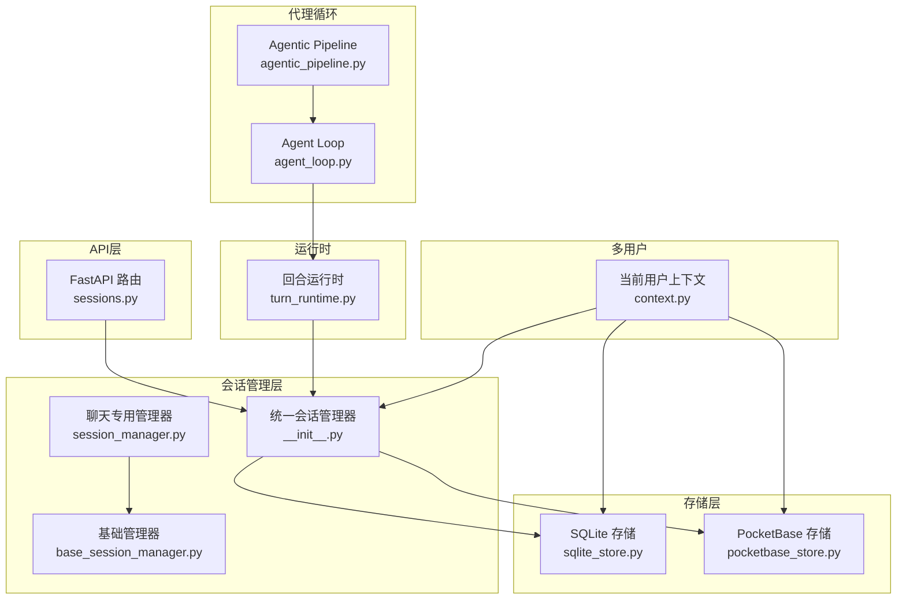
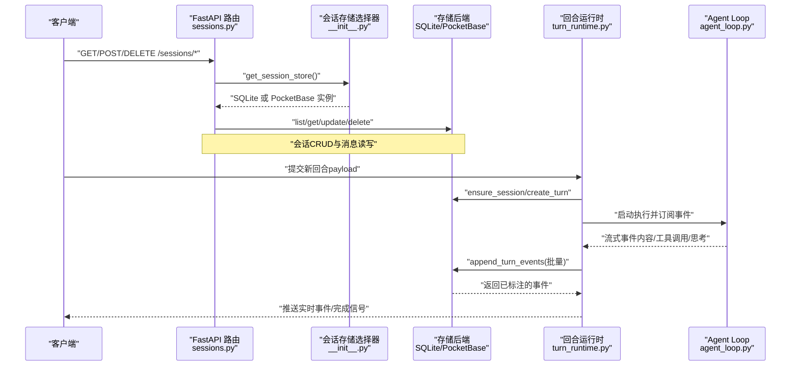
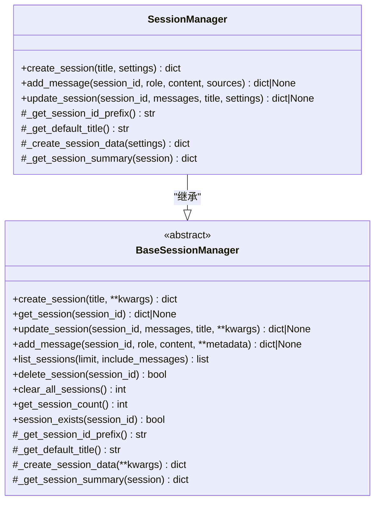
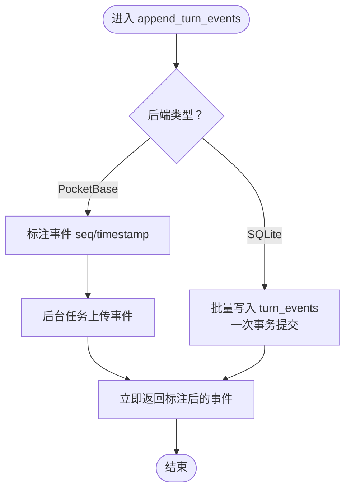
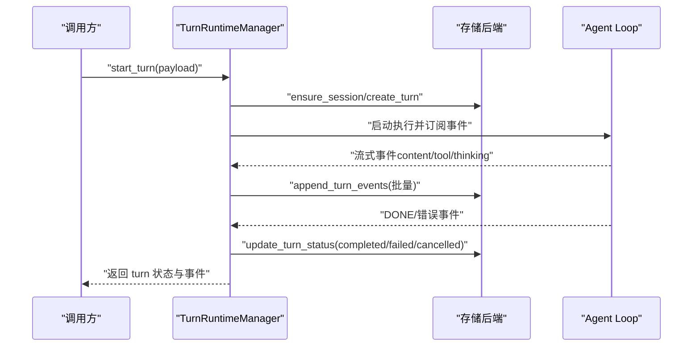
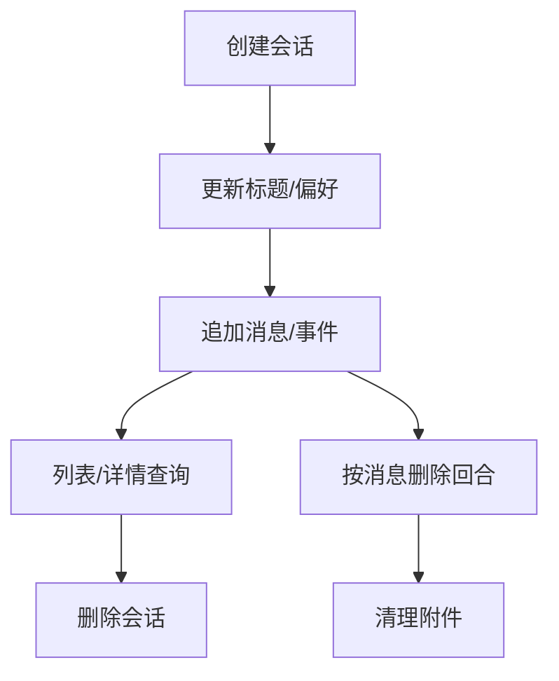
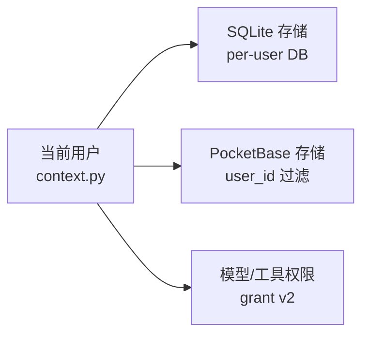
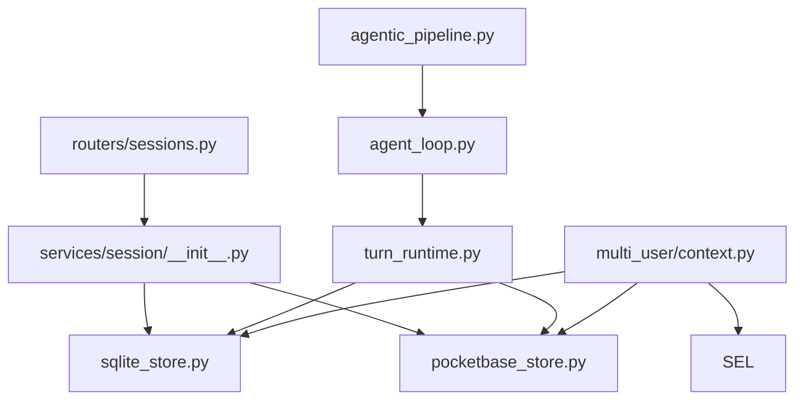

# 会话管理

<cite>
**本文引用的文件**
- [agents/chat/session_manager.py](file://deeptutor/agents/chat/session_manager.py)
- [services/session/__init__.py](file://deeptutor/services/session/__init__.py)
- [services/session/base_session_manager.py](file://deeptutor/services/session/base_session_manager.py)
- [services/session/sqlite_store.py](file://deeptutor/services/session/sqlite_store.py)
- [services/session/pocketbase_store.py](file://deeptutor/services/session/pocketbase_store.py)
- [services/session/turn_runtime.py](file://deeptutor/services/session/turn_runtime.py)
- [api/routers/sessions.py](file://deeptutor/api/routers/sessions.py)
- [agents/chat/agent_loop.py](file://deeptutor/agents/chat/agent_loop.py)
- [agents/chat/agentic_pipeline.py](file://deeptutor/agents/chat/agentic_pipeline.py)
- [multi_user/context.py](file://deeptutor/multi_user/context.py)
</cite>

## 目录
1. [简介](#简介)
2. [项目结构](#项目结构)
3. [核心组件](#核心组件)
4. [架构总览](#架构总览)
5. [详细组件分析](#详细组件分析)
6. [依赖关系分析](#依赖关系分析)
7. [性能考量](#性能考量)
8. [故障排查指南](#故障排查指南)
9. [结论](#结论)
10. [附录：API参考与使用示例](#附录：api参考与使用示例)

## 简介
本文件系统性说明 DeepTutor 的会话管理系统，覆盖以下目标：
- 解释“会话”的概念与重要性：在保持上下文连续性与用户状态中的作用。
- 统一会话管理器设计：多后端支持（SQLite、PocketBase）与持久化策略。
- 回合运行时实现：异步处理、流式响应、取消与恢复机制。
- 会话生命周期：创建、更新、查询、删除操作。
- 会话隔离机制：多用户环境下的数据隔离与权限控制。
- API 参考与使用示例：批量操作与性能优化建议。

## 项目结构
会话相关代码主要分布在以下模块：
- 会话管理器与协议：统一抽象与后端选择
- 存储层：SQLite 本地存储与 PocketBase 远程存储
- 回合运行时：TurnRuntimeManager 负责单轮执行、事件流与持久化
- 聊天代理循环：agent_loop 与 agentic_pipeline 驱动对话流程
- API 路由：对外暴露会话 CRUD 与分支选择、测验结果等接口
- 多用户上下文：当前用户解析与隔离边界

图表来源
- [services/session/__init__.py:33-47](file://deeptutor/services/session/__init__.py#L33-L47)
- [services/session/sqlite_store.py:96-106](file://deeptutor/services/session/sqlite_store.py#L96-L106)
- [services/session/pocketbase_store.py:103-147](file://deeptutor/services/session/pocketbase_store.py#L103-L147)
- [services/session/turn_runtime.py:594-613](file://deeptutor/services/session/turn_runtime.py#L594-L613)
- [agents/chat/agent_loop.py:523-587](file://deeptutor/agents/chat/agent_loop.py#L523-L587)
- [agents/chat/agentic_pipeline.py:459-584](file://deeptutor/agents/chat/agentic_pipeline.py#L459-L584)
- [api/routers/sessions.py:80-163](file://deeptutor/api/routers/sessions.py#L80-L163)
- [multi_user/context.py:14-23](file://deeptutor/multi_user/context.py#L14-L23)

章节来源
- [services/session/__init__.py:33-47](file://deeptutor/services/session/__init__.py#L33-L47)
- [services/session/sqlite_store.py:96-106](file://deeptutor/services/session/sqlite_store.py#L96-L106)
- [services/session/pocketbase_store.py:103-147](file://deeptutor/services/session/pocketbase_store.py#L103-L147)
- [services/session/turn_runtime.py:594-613](file://deeptutor/services/session/turn_runtime.py#L594-L613)
- [agents/chat/agent_loop.py:523-587](file://deeptutor/agents/chat/agent_loop.py#L523-L587)
- [agents/chat/agentic_pipeline.py:459-584](file://deeptutor/agents/chat/agentic_pipeline.py#L459-L584)
- [api/routers/sessions.py:80-163](file://deeptutor/api/routers/sessions.py#L80-L163)
- [multi_user/context.py:14-23](file://deeptutor/multi_user/context.py#L14-L23)

## 核心组件
- 统一会话管理器（BaseSessionManager + 具体实现）
  - 提供一致的会话 CRUD、消息追加、列表与清理能力；路径解析延迟到请求时以适配多用户隔离。
- 存储后端（SQLite / PocketBase）
  - SQLite：进程内本地数据库，适合单机或容器内部署；具备迁移与索引优化。
  - PocketBase：云端集合存储，通过 HTTP 访问；对高频事件采用后台上传以提升吞吐。
- 回合运行时（TurnRuntimeManager）
  - 管理单轮执行任务、订阅者队列、事件缓冲与批写入；支持暂停/恢复、取消与孤儿恢复。
- 聊天会话管理器（SessionManager）
  - 面向聊天场景的会话元数据与摘要生成；继承统一基类行为。
- API 路由（sessions.py）
  - 暴露会话列表、详情、重命名、删除、分支选择、按消息删除回合、记录测验结果等接口。

章节来源
- [services/session/base_session_manager.py:23-83](file://deeptutor/services/session/base_session_manager.py#L23-L83)
- [services/session/sqlite_store.py:96-106](file://deeptutor/services/session/sqlite_store.py#L96-L106)
- [services/session/pocketbase_store.py:103-147](file://deeptutor/services/session/pocketbase_store.py#L103-L147)
- [services/session/turn_runtime.py:594-613](file://deeptutor/services/session/turn_runtime.py#L594-L613)
- [agents/chat/session_manager.py:20-48](file://deeptutor/agents/chat/session_manager.py#L20-L48)
- [api/routers/sessions.py:80-163](file://deeptutor/api/routers/sessions.py#L80-L163)

## 架构总览
下图展示从 API 到存储与运行时的完整调用链，以及多后端选择与用户隔离点。

图表来源
- [api/routers/sessions.py:80-163](file://deeptutor/api/routers/sessions.py#L80-L163)
- [services/session/__init__.py:33-47](file://deeptutor/services/session/__init__.py#L33-L47)
- [services/session/sqlite_store.py:419-454](file://deeptutor/services/session/sqlite_store.py#L419-L454)
- [services/session/pocketbase_store.py:117-171](file://deeptutor/services/session/pocketbase_store.py#L117-L171)
- [services/session/turn_runtime.py:655-800](file://deeptutor/services/session/turn_runtime.py#L655-L800)
- [agents/chat/agent_loop.py:523-587](file://deeptutor/agents/chat/agent_loop.py#L523-L587)

## 详细组件分析

### 统一会话管理器与聊天会话管理器
- BaseSessionManager
  - 定义会话 ID 前缀、默认标题、会话数据结构与摘要生成的抽象方法。
  - 提供文件级会话管理的通用逻辑（创建、更新、追加消息、列表、删除）。
- SessionManager（聊天）
  - 指定模块名为 chat，设置会话 ID 前缀为 chat_，默认标题为 New Chat。
  - 扩展聊天专属字段（如 settings），并提供 add_message、update_session 等便捷方法。

图表来源
- [services/session/base_session_manager.py:23-83](file://deeptutor/services/session/base_session_manager.py#L23-L83)
- [agents/chat/session_manager.py:20-88](file://deeptutor/agents/chat/session_manager.py#L20-L88)

章节来源
- [services/session/base_session_manager.py:23-83](file://deeptutor/services/session/base_session_manager.py#L23-L83)
- [agents/chat/session_manager.py:20-88](file://deeptutor/agents/chat/session_manager.py#L20-L88)

### 存储后端：SQLite 与 PocketBase
- SQLiteSessionStore
  - 本地 SQLite 数据库，包含 sessions、messages、turns、turn_events、notebook_entries 等表。
  - 提供会话、消息、回合及事件的增删改查；支持批量追加事件以减少磁盘同步开销。
  - 自动迁移旧库结构与列，确保兼容性与向后兼容。
- PocketBaseSessionStore
  - 通过 HTTP 访问 PocketBase 集合；所有会话查询均按 user_id 过滤，保证多用户隔离。
  - 对高频 turn_events 采用后台任务批量上传，避免阻塞 DONE 事件与客户端 spinner。

图表来源
- [services/session/sqlite_store.py:706-771](file://deeptutor/services/session/sqlite_store.py#L706-L771)
- [services/session/pocketbase_store.py:616-643](file://deeptutor/services/session/pocketbase_store.py#L616-L643)

章节来源
- [services/session/sqlite_store.py:96-106](file://deeptutor/services/session/sqlite_store.py#L96-L106)
- [services/session/sqlite_store.py:419-454](file://deeptutor/services/session/sqlite_store.py#L419-L454)
- [services/session/sqlite_store.py:706-771](file://deeptutor/services/session/sqlite_store.py#L706-L771)
- [services/session/pocketbase_store.py:103-147](file://deeptutor/services/session/pocketbase_store.py#L103-L147)
- [services/session/pocketbase_store.py:616-643](file://deeptutor/services/session/pocketbase_store.py#L616-L643)

### 回合运行时：异步、流式与取消
- TurnRuntimeManager
  - start_turn：校验配置、解析语言与模型选择、应用权限限制、恢复孤儿运行回合。
  - 维护 _executions 与 _reply_queues，支持 ask_user 暂停与恢复。
  - 事件缓冲与批写入：stream 结束后将事件批量持久化，减少 IO 压力。
  - 取消与恢复：检测无本地执行的 running 回合，标记失败并提示重试。

图表来源
- [services/session/turn_runtime.py:655-800](file://deeptutor/services/session/turn_runtime.py#L655-L800)
- [services/session/sqlite_store.py:538-579](file://deeptutor/services/session/sqlite_store.py#L538-L579)
- [services/session/pocketbase_store.py:461-508](file://deeptutor/services/session/pocketbase_store.py#L461-L508)
- [agents/chat/agent_loop.py:523-587](file://deeptutor/agents/chat/agent_loop.py#L523-L587)

章节来源
- [services/session/turn_runtime.py:655-800](file://deeptutor/services/session/turn_runtime.py#L655-L800)
- [services/session/sqlite_store.py:538-579](file://deeptutor/services/session/sqlite_store.py#L538-L579)
- [services/session/pocketbase_store.py:461-508](file://deeptutor/services/session/pocketbase_store.py#L461-L508)
- [agents/chat/agent_loop.py:523-587](file://deeptutor/agents/chat/agent_loop.py#L523-L587)

### 会话生命周期管理
- 创建
  - 通过 store.ensure_session 或 create_session 创建会话；SQLite 与 PocketBase 分别落库。
- 更新
  - 更新标题、偏好、摘要；消息追加与事件批写。
- 查询
  - 列表分页、获取会话详情（含消息）、活动回合查询。
- 删除
  - 删除会话并清理附件；按消息删除回合时检查是否正在运行。

图表来源
- [services/session/sqlite_store.py:419-454](file://deeptutor/services/session/sqlite_store.py#L419-L454)
- [services/session/pocketbase_store.py:117-171](file://deeptutor/services/session/pocketbase_store.py#L117-L171)
- [api/routers/sessions.py:80-163](file://deeptutor/api/routers/sessions.py#L80-L163)

章节来源
- [services/session/sqlite_store.py:419-454](file://deeptutor/services/session/sqlite_store.py#L419-L454)
- [services/session/pocketbase_store.py:117-171](file://deeptutor/services/session/pocketbase_store.py#L117-L171)
- [api/routers/sessions.py:80-163](file://deeptutor/api/routers/sessions.py#L80-L163)

### 会话隔离机制：多用户与权限控制
- 当前用户上下文
  - 通过 ContextVar 保存当前用户；所有存储操作基于该上下文进行隔离。
- SQLite 隔离
  - 通过 per-user 数据库文件或路径服务实现物理隔离。
- PocketBase 隔离
  - 所有会话查询附加 user_id 过滤条件，防止跨用户读取或修改。
- 模型与工具权限
  - 非管理员用户必须拥有 LLM 模型授权；工具白名单由 grant v2 控制。

图表来源
- [multi_user/context.py:14-23](file://deeptutor/multi_user/context.py#L14-L23)
- [services/session/pocketbase_store.py:69-87](file://deeptutor/services/session/pocketbase_store.py#L69-L87)
- [services/session/pocketbase_store.py:90-100](file://deeptutor/services/session/pocketbase_store.py#L90-L100)

章节来源
- [multi_user/context.py:14-23](file://deeptutor/multi_user/context.py#L14-L23)
- [services/session/pocketbase_store.py:69-87](file://deeptutor/services/session/pocketbase_store.py#L69-L87)
- [services/session/pocketbase_store.py:90-100](file://deeptutor/services/session/pocketbase_store.py#L90-L100)

## 依赖关系分析
- 路由依赖存储选择器，后者根据配置动态返回 SQLite 或 PocketBase。
- 回合运行时依赖存储后端进行会话与事件持久化。
- Agent Loop 与 Pipeline 驱动对话流程，并通过运行时与存储交互。
- 多用户上下文贯穿存储与运行时，确保隔离与权限。

图表来源
- [api/routers/sessions.py:80-163](file://deeptutor/api/routers/sessions.py#L80-L163)
- [services/session/__init__.py:33-47](file://deeptutor/services/session/__init__.py#L33-L47)
- [services/session/sqlite_store.py:96-106](file://deeptutor/services/session/sqlite_store.py#L96-L106)
- [services/session/pocketbase_store.py:103-147](file://deeptutor/services/session/pocketbase_store.py#L103-L147)
- [services/session/turn_runtime.py:655-800](file://deeptutor/services/session/turn_runtime.py#L655-L800)
- [agents/chat/agent_loop.py:523-587](file://deeptutor/agents/chat/agent_loop.py#L523-L587)
- [agents/chat/agentic_pipeline.py:459-584](file://deeptutor/agents/chat/agentic_pipeline.py#L459-L584)
- [multi_user/context.py:14-23](file://deeptutor/multi_user/context.py#L14-L23)

章节来源
- [api/routers/sessions.py:80-163](file://deeptutor/api/routers/sessions.py#L80-L163)
- [services/session/__init__.py:33-47](file://deeptutor/services/session/__init__.py#L33-L47)
- [services/session/sqlite_store.py:96-106](file://deeptutor/services/session/sqlite_store.py#L96-L106)
- [services/session/pocketbase_store.py:103-147](file://deeptutor/services/session/pocketbase_store.py#L103-L147)
- [services/session/turn_runtime.py:655-800](file://deeptutor/services/session/turn_runtime.py#L655-L800)
- [agents/chat/agent_loop.py:523-587](file://deeptutor/agents/chat/agent_loop.py#L523-L587)
- [agents/chat/agentic_pipeline.py:459-584](file://deeptutor/agents/chat/agentic_pipeline.py#L459-L584)
- [multi_user/context.py:14-23](file://deeptutor/multi_user/context.py#L14-L23)

## 性能考量
- 事件批写入
  - SQLite：使用 executemany 批量插入 turn_events，减少事务提交次数。
  - PocketBase：后台任务上传事件，避免 DONE 事件被网络 IO 阻塞。
- 大负载裁剪
  - API 层对 tool_result/observation 等大负载进行截断，降低前端渲染压力。
- 索引与查询优化
  - SQLite 针对 messages、turns、turn_events 建立索引，提升查询效率。
- 连接与事务管理
  - SQLite 连接使用上下文管理器确保事务与连接关闭，避免 FD 泄漏。

章节来源
- [services/session/sqlite_store.py:706-771](file://deeptutor/services/session/sqlite_store.py#L706-L771)
- [services/session/pocketbase_store.py:616-643](file://deeptutor/services/session/pocketbase_store.py#L616-L643)
- [api/routers/sessions.py:90-140](file://deeptutor/api/routers/sessions.py#L90-L140)
- [services/session/sqlite_store.py:120-192](file://deeptutor/services/session/sqlite_store.py#L120-L192)
- [services/session/sqlite_store.py:402-417](file://deeptutor/services/session/sqlite_store.py#L402-L417)

## 故障排查指南
- 孤儿运行回合
  - 服务器重启后，数据库可能仍有 running 状态的回合；运行时会在创建新回合前尝试恢复并标记失败。
- 删除消息冲突
  - 删除某消息对应的回合时，若该回合仍在运行，API 返回冲突错误。
- 附件清理失败
  - 删除会话时附件清理异常会被记录日志但不阻断主流程。
- 模型/工具权限不足
  - 非管理员用户若无 LLM 模型授权或工具白名单限制，会抛出明确错误。

章节来源
- [services/session/turn_runtime.py:634-653](file://deeptutor/services/session/turn_runtime.py#L634-L653)
- [api/routers/sessions.py:180-196](file://deeptutor/api/routers/sessions.py#L180-L196)
- [api/routers/sessions.py:153-163](file://deeptutor/api/routers/sessions.py#L153-L163)
- [services/session/turn_runtime.py:721-745](file://deeptutor/services/session/turn_runtime.py#L721-L745)

## 结论
DeepTutor 的会话管理系统通过统一抽象与多后端存储实现了高可用与可扩展性；回合运行时提供了强大的异步流式处理能力与健壮的错误恢复机制；多用户上下文确保了严格的数据隔离与权限控制。结合 API 层的裁剪与存储层的批处理优化，系统在性能与稳定性方面达到生产级要求。

## 附录：API参考与使用示例
- 会话列表
  - GET /sessions?limit=50&offset=0
  - 返回会话摘要列表，支持分页。
- 会话详情
  - GET /sessions/{session_id}
  - 返回会话与消息；大负载事件会被裁剪。
- 重命名会话
  - PATCH /sessions/{session_id}
  - 请求体包含 title。
- 删除会话
  - DELETE /sessions/{session_id}
  - 同时清理附件。
- 分支选择
  - PUT /sessions/{session_id}/branch-selection
  - 请求体 selected_branches。
- 按消息删除回合
  - DELETE /sessions/{session_id}/messages/{message_id}
  - 若回合正在运行则返回冲突。
- 记录测验结果
  - POST /sessions/{session_id}/quiz-results
  - 请求体 answers 与 turn_id。

使用示例（概念性）
- 创建会话：调用 ensure_session 或 create_session，获得 session_id。
- 追加消息：调用 add_message 或 store 对应方法，传入 role、content、capability 等。
- 启动回合：调用 TurnRuntimeManager.start_turn，传入 capability、config、language 等。
- 监听事件：订阅运行时事件，接收流式内容与工具调用。
- 结束回合：DONE 事件触发后，状态更新为 completed/failed/cancelled。

章节来源
- [api/routers/sessions.py:80-231](file://deeptutor/api/routers/sessions.py#L80-L231)
- [services/session/sqlite_store.py:419-454](file://deeptutor/services/session/sqlite_store.py#L419-L454)
- [services/session/pocketbase_store.py:117-171](file://deeptutor/services/session/pocketbase_store.py#L117-L171)
- [services/session/turn_runtime.py:655-800](file://deeptutor/services/session/turn_runtime.py#L655-L800)