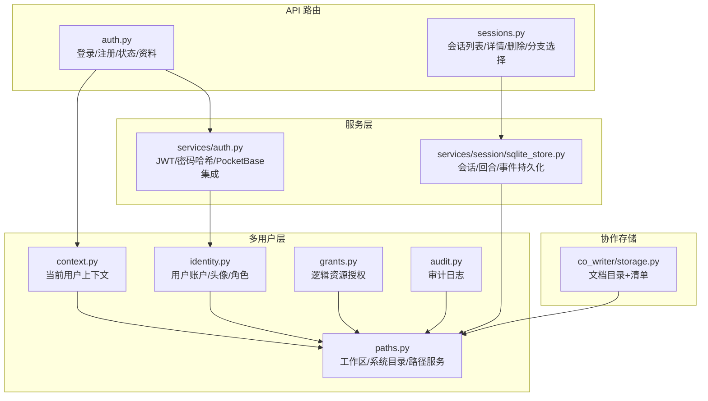
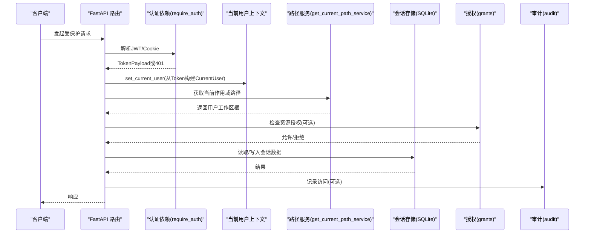
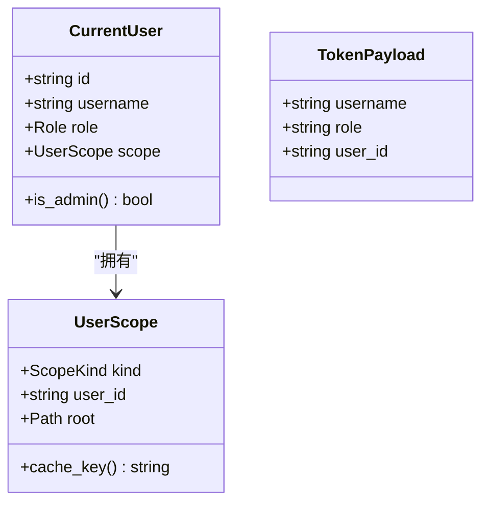
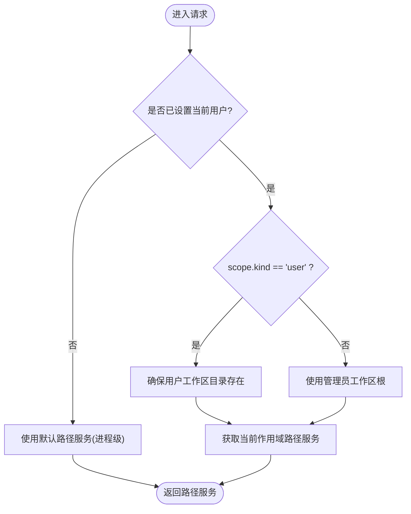
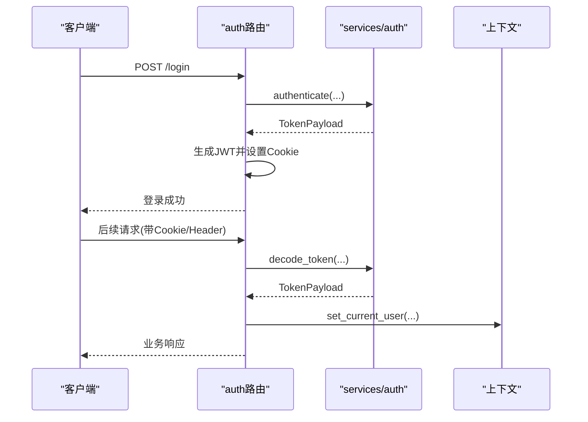
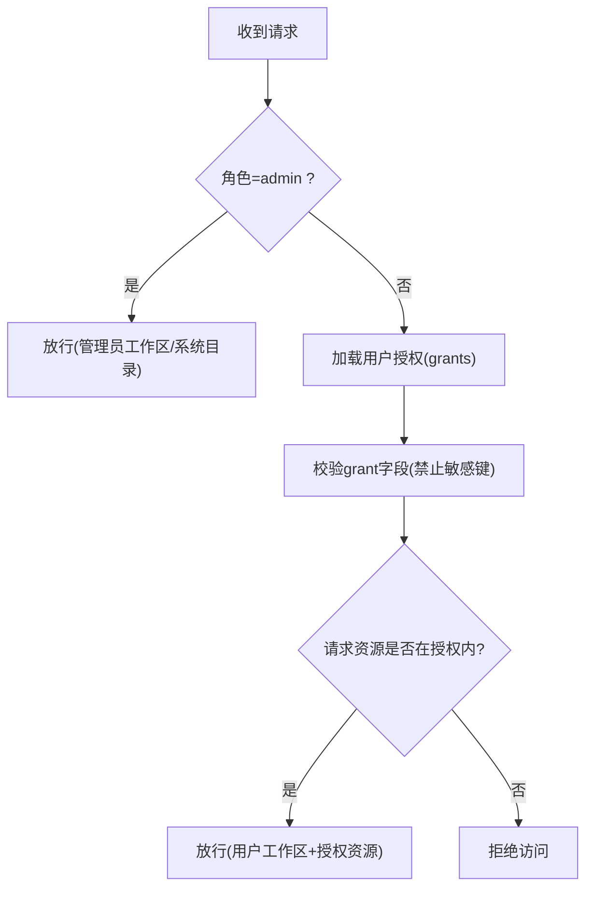
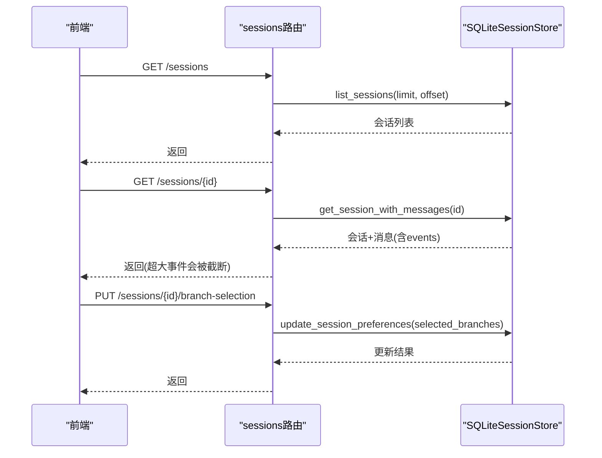
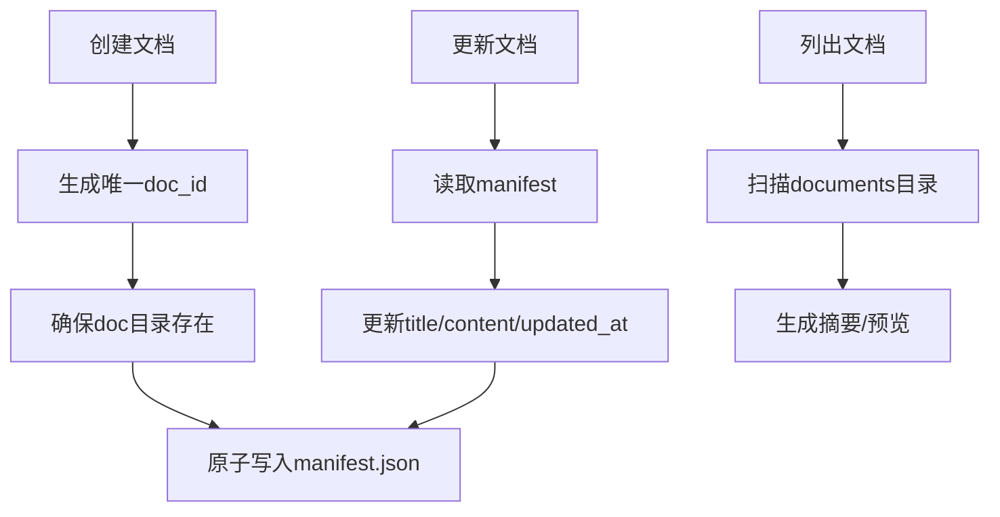
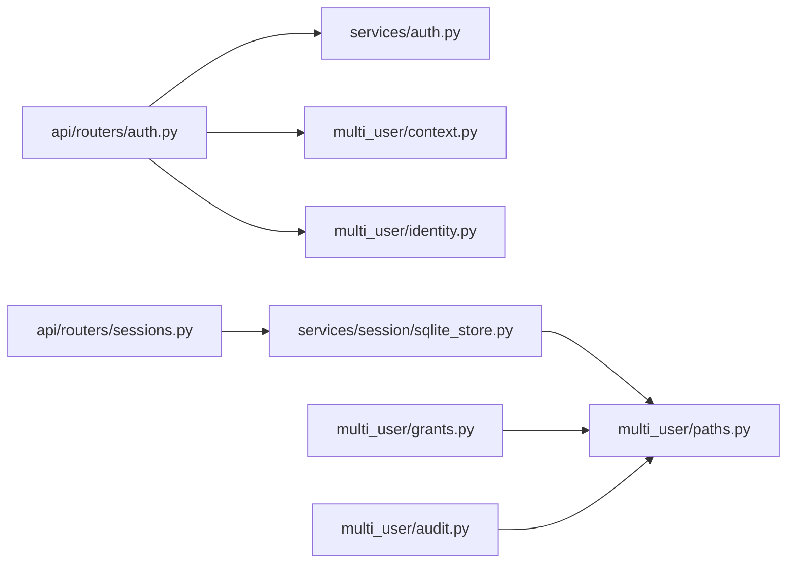

# 会话隔离与权限

<cite>
**本文引用的文件**
- [multi_user/__init__.py](file://deeptutor/multi_user/__init__.py)
- [multi_user/context.py](file://deeptutor/multi_user/context.py)
- [multi_user/identity.py](file://deeptutor/multi_user/identity.py)
- [multi_user/models.py](file://deeptutor/multi_user/models.py)
- [multi_user/paths.py](file://deeptutor/multi_user/paths.py)
- [multi_user/grants.py](file://deeptutor/multi_user/grants.py)
- [multi_user/audit.py](file://deeptutor/multi_user/audit.py)
- [services/auth.py](file://deeptutor/services/auth.py)
- [api/routers/auth.py](file://deeptutor/api/routers/auth.py)
- [api/routers/sessions.py](file://deeptutor/api/routers/sessions.py)
- [services/session/sqlite_store.py](file://deeptutor/services/session/sqlite_store.py)
- [co_writer/storage.py](file://deeptutor/co_writer/storage.py)
</cite>

## 目录
1. [简介](#简介)
2. [项目结构](#项目结构)
3. [核心组件](#核心组件)
4. [架构总览](#架构总览)
5. [详细组件分析](#详细组件分析)
6. [依赖关系分析](#依赖关系分析)
7. [性能考虑](#性能考虑)
8. [故障排查指南](#故障排查指南)
9. [结论](#结论)
10. [附录：配置示例与安全最佳实践](#附录：配置示例与安全最佳实践)

## 简介
本文件聚焦 DeepTutor 在多用户环境下的“会话隔离”与“权限控制”，覆盖以下主题：
- 数据隔离：基于工作区（workspace）与系统目录的严格路径隔离，确保每个用户的会话、知识库、记忆等数据互不可见。
- 访问控制与权限验证：基于 JWT 的身份认证、角色（admin/user）鉴权、以及针对非管理员的逻辑资源授权（grants）。
- 会话级权限管理：通过当前用户上下文（ContextVar）在请求范围内注入身份与作用域，所有资源访问均基于该作用域解析路径。
- 协作与共享：文档协作存储（Co-Writer）按文档目录隔离；版本化与分支选择能力由会话消息树与偏好存储支撑。
- 安全与审计：敏感信息保护（所有者密钥目录）、审计日志记录、上传头像内容校验与尺寸限制。
- 配置示例与最佳实践：提供可操作的部署与运维建议。

## 项目结构
多用户层位于 deeptutor/multi_user，负责身份、作用域、路径与授权；服务层 services 提供认证与会话持久化；API 路由 api/routers 暴露受保护的接口；协作存储 co_writer 提供文档级隔离。

图表来源
- [api/routers/auth.py:216-348](file://deeptutor/api/routers/auth.py#L216-L348)
- [api/routers/sessions.py:80-177](file://deeptutor/api/routers/sessions.py#L80-L177)
- [multi_user/context.py:11-45](file://deeptutor/multi_user/context.py#L11-L45)
- [multi_user/identity.py:124-190](file://deeptutor/multi_user/identity.py#L124-L190)
- [multi_user/paths.py:89-161](file://deeptutor/multi_user/paths.py#L89-L161)
- [multi_user/grants.py:16-112](file://deeptutor/multi_user/grants.py#L16-L112)
- [multi_user/audit.py:19-80](file://deeptutor/multi_user/audit.py#L19-L80)
- [services/auth.py:220-280](file://deeptutor/services/auth.py#L220-L280)
- [services/session/sqlite_store.py:96-234](file://deeptutor/services/session/sqlite_store.py#L96-L234)
- [co_writer/storage.py:96-127](file://deeptutor/co_writer/storage.py#L96-L127)

章节来源
- [multi_user/__init__.py:1-24](file://deeptutor/multi_user/__init__.py#L1-L24)
- [multi_user/paths.py:1-40](file://deeptutor/multi_user/paths.py#L1-L40)

## 核心组件
- 身份与作用域
  - CurrentUser/UserScope：封装当前用户、角色与工作区根路径，用于统一的路径与服务解析。
  - context：使用 ContextVar 维护请求级当前用户，保证并发隔离。
- 用户与角色
  - identity：用户账户、角色、头像、密钥文件的读写；支持迁移与原子写入。
  - models：Role、CurrentUser、UserScope、KnowledgeResource 等数据结构。
- 路径与数据隔离
  - paths：定义 admin/workspace/system 目录布局；为每个用户创建独立 workspace；提供 get_current_path_service/get_owner_path_service。
- 授权与资源访问
  - grants：非管理员的资源授权（模型、知识库、技能、工具、MCP、CLI 应用、执行策略），并做字段白名单校验。
- 认证与鉴权
  - services/auth：JWT 签发/校验、密码哈希、PocketBase 模式兼容。
  - api/routers/auth：登录/登出/状态/个人资料/管理员操作；提供 require_auth/require_admin 依赖。
- 会话持久化
  - services/session/sqlite_store：SQLite 存储会话、消息、回合、事件、笔记条目；支持编辑分支与偏好存储。
- 协作存储
  - co_writer/storage：按文档目录隔离，清单文件持久化，原子写入。
- 审计
  - multi_user/audit：记录普通用户对管理员资源的访问与管理员写操作。

章节来源
- [multi_user/models.py:13-84](file://deeptutor/multi_user/models.py#L13-L84)
- [multi_user/context.py:11-45](file://deeptutor/multi_user/context.py#L11-L45)
- [multi_user/identity.py:124-190](file://deeptutor/multi_user/identity.py#L124-L190)
- [multi_user/paths.py:89-161](file://deeptutor/multi_user/paths.py#L89-L161)
- [multi_user/grants.py:16-112](file://deeptutor/multi_user/grants.py#L16-L112)
- [services/auth.py:220-280](file://deeptutor/services/auth.py#L220-L280)
- [api/routers/auth.py:216-348](file://deeptutor/api/routers/auth.py#L216-L348)
- [services/session/sqlite_store.py:96-234](file://deeptutor/services/session/sqlite_store.py#L96-L234)
- [co_writer/storage.py:96-127](file://deeptutor/co_writer/storage.py#L96-L127)
- [multi_user/audit.py:19-80](file://deeptutor/multi_user/audit.py#L19-L80)

## 架构总览
下图展示从 HTTP/WebSocket 进入，到身份解析、作用域绑定、资源访问与持久化的完整链路。

图表来源
- [api/routers/auth.py:216-348](file://deeptutor/api/routers/auth.py#L216-L348)
- [multi_user/context.py:11-45](file://deeptutor/multi_user/context.py#L11-L45)
- [multi_user/paths.py:153-161](file://deeptutor/multi_user/paths.py#L153-L161)
- [multi_user/grants.py:90-112](file://deeptutor/multi_user/grants.py#L90-L112)
- [multi_user/audit.py:29-80](file://deeptutor/multi_user/audit.py#L29-L80)
- [services/session/sqlite_store.py:419-512](file://deeptutor/services/session/sqlite_store.py#L419-L512)

## 详细组件分析

### 身份与会话上下文
- 使用 ContextVar 保存当前用户，避免跨请求污染；WebSocket 连接需在 finally 中重置。
- 从 TokenPayload 构造 CurrentUser，包含 id、username、role 与 scope（工作区根）。
- 未启用认证时回退到本地管理员身份，便于开发调试。

图表来源
- [multi_user/models.py:13-65](file://deeptutor/multi_user/models.py#L13-L65)
- [services/auth.py:68-75](file://deeptutor/services/auth.py#L68-L75)
- [multi_user/context.py:30-45](file://deeptutor/multi_user/context.py#L30-L45)

章节来源
- [multi_user/context.py:11-45](file://deeptutor/multi_user/context.py#L11-L45)
- [multi_user/models.py:13-65](file://deeptutor/multi_user/models.py#L13-L65)
- [services/auth.py:68-75](file://deeptutor/services/auth.py#L68-L75)

### 数据隔离与路径服务
- 目录布局：data/user（管理员工作区）、data/users/<uid>（普通用户工作区）、data/system（系统状态：auth、grants、audit、indexes）。
- 通过 get_current_path_service 将请求绑定到当前用户的工作区根；get_owner_path_service 用于所有者密钥等“账户级”资产。
- 首次访问会确保工作区目录存在，并创建 knowledge_bases、memory 等子目录。

图表来源
- [multi_user/paths.py:89-161](file://deeptutor/multi_user/paths.py#L89-L161)

章节来源
- [multi_user/paths.py:1-40](file://deeptutor/multi_user/paths.py#L1-L40)
- [multi_user/paths.py:89-161](file://deeptutor/multi_user/paths.py#L89-L161)

### 认证与鉴权流程
- 登录：支持内置 JWT 与 PocketBase 两种模式；成功后设置 Cookie（含 SameSite/Secure 策略）。
- 鉴权：require_auth 从 Header/Cookie 提取令牌，解码后安装当前用户；require_admin 进一步校验角色。
- WebSocket：ws_require_auth 在 accept 前完成鉴权，失败则关闭连接。

图表来源
- [api/routers/auth.py:436-480](file://deeptutor/api/routers/auth.py#L436-L480)
- [api/routers/auth.py:216-348](file://deeptutor/api/routers/auth.py#L216-L348)
- [services/auth.py:220-280](file://deeptutor/services/auth.py#L220-L280)

章节来源
- [api/routers/auth.py:216-348](file://deeptutor/api/routers/auth.py#L216-L348)
- [services/auth.py:220-280](file://deeptutor/services/auth.py#L220-L280)

### 基于角色的访问控制（RBAC）与授权
- 角色：admin 与 user。管理员拥有完整工作区与系统目录访问能力；普通用户仅能访问其工作区与经授权的逻辑资源。
- 授权（grants）：对非管理员用户授予模型、知识库、技能、伙伴、工具、MCP、CLI 应用、执行策略等访问权限；grant 中禁止携带敏感字段（如 api_key、secret 等）。
- 管理员操作需 require_admin 保护；普通用户无法修改自身角色或获得管理员工作区。

图表来源
- [api/routers/auth.py:327-348](file://deeptutor/api/routers/auth.py#L327-L348)
- [multi_user/grants.py:16-112](file://deeptutor/multi_user/grants.py#L16-L112)

章节来源
- [api/routers/auth.py:327-348](file://deeptutor/api/routers/auth.py#L327-L348)
- [multi_user/grants.py:16-112](file://deeptutor/multi_user/grants.py#L16-L112)

### 会话管理与版本控制
- 会话存储：SQLite 表 sessions/messages/turns/turn_events/notebook_entries；支持消息父指针实现编辑分支。
- 会话 API：列出/获取/重命名/删除会话；更新分支选择；删除消息（若回合运行中则拒绝）。
- 版本控制：通过 parent_message_id 形成消息树；selected_branches 偏好持久化以恢复用户选择的分支。

图表来源
- [api/routers/sessions.py:80-177](file://deeptutor/api/routers/sessions.py#L80-L177)
- [services/session/sqlite_store.py:419-512](file://deeptutor/services/session/sqlite_store.py#L419-L512)

章节来源
- [api/routers/sessions.py:80-177](file://deeptutor/api/routers/sessions.py#L80-L177)
- [services/session/sqlite_store.py:96-234](file://deeptutor/services/session/sqlite_store.py#L96-L234)

### 协作与共享（多人编辑与版本）
- 文档隔离：Co-Writer 文档按 doc_{doc_id} 目录隔离，清单 manifest.json 持久化元数据。
- 原子写入：使用原子写入保障清单一致性。
- 列表与预览：支持按更新时间排序与内容预览截取。

图表来源
- [co_writer/storage.py:96-127](file://deeptutor/co_writer/storage.py#L96-L127)
- [co_writer/storage.py:162-233](file://deeptutor/co_writer/storage.py#L162-L233)

章节来源
- [co_writer/storage.py:96-127](file://deeptutor/co_writer/storage.py#L96-L127)
- [co_writer/storage.py:162-233](file://deeptutor/co_writer/storage.py#L162-L233)

### 安全考虑与审计日志
- 敏感信息保护：所有者密钥目录 data/system/user-secrets/<owner_id> 权限严格限制，沙箱不挂载该目录。
- 头像上传：仅接受 PNG/JPEG/WebP，大小限制 1MB，通过魔数检测类型，禁用 SVG 防止 XSS。
- 审计日志：记录普通用户对管理员资源的访问与管理员写操作；写入 data/system/audit/usage.jsonl。

章节来源
- [multi_user/paths.py:211-245](file://deeptutor/multi_user/paths.py#L211-L245)
- [api/routers/auth.py:582-704](file://deeptutor/api/routers/auth.py#L582-L704)
- [multi_user/audit.py:19-80](file://deeptutor/multi_user/audit.py#L19-L80)

## 依赖关系分析
- 路由依赖认证依赖，认证依赖服务层进行 JWT 校验；服务层可能调用多用户层的身份与密钥管理。
- 会话路由依赖 SQLite 存储；存储通过路径服务定位数据库文件，从而受当前用户作用域影响。
- 授权模块校验 grant 内容，防止敏感字段泄露；审计模块记录访问行为。

图表来源
- [api/routers/auth.py:216-348](file://deeptutor/api/routers/auth.py#L216-L348)
- [services/auth.py:220-280](file://deeptutor/services/auth.py#L220-L280)
- [api/routers/sessions.py:80-177](file://deeptutor/api/routers/sessions.py#L80-L177)
- [services/session/sqlite_store.py:96-234](file://deeptutor/services/session/sqlite_store.py#L96-L234)
- [multi_user/grants.py:90-112](file://deeptutor/multi_user/grants.py#L90-L112)
- [multi_user/audit.py:29-80](file://deeptutor/multi_user/audit.py#L29-L80)

章节来源
- [api/routers/auth.py:216-348](file://deeptutor/api/routers/auth.py#L216-L348)
- [api/routers/sessions.py:80-177](file://deeptutor/api/routers/sessions.py#L80-L177)
- [services/session/sqlite_store.py:96-234](file://deeptutor/services/session/sqlite_store.py#L96-L234)
- [multi_user/grants.py:90-112](file://deeptutor/multi_user/grants.py#L90-L112)
- [multi_user/audit.py:29-80](file://deeptutor/multi_user/audit.py#L29-L80)

## 性能考虑
- 会话事件批量写入：SQLite 存储提供 append_turn_events 批量插入，减少事务提交次数，降低慢磁盘场景下的延迟。
- 大事件截断：会话 API 对 tool_result/observation 等大负载进行截断，避免前端渲染压力。
- 路径服务缓存：按作用域缓存 PathService 实例，减少重复初始化开销。
- 头像上传限流：限制文件大小与类型，避免恶意大文件或脚本注入。

章节来源
- [services/session/sqlite_store.py:706-771](file://deeptutor/services/session/sqlite_store.py#L706-L771)
- [api/routers/sessions.py:90-140](file://deeptutor/api/routers/sessions.py#L90-L140)
- [multi_user/paths.py:140-146](file://deeptutor/multi_user/paths.py#L140-L146)
- [api/routers/auth.py:582-704](file://deeptutor/api/routers/auth.py#L582-L704)

## 故障排查指南
- 401 未认证：检查 Cookie/Authorization 头是否正确传递；确认 AUTH_ENABLED 与 TOKEN_EXPIRE_HOURS 配置。
- 403 无管理员权限：确认当前用户角色；管理员操作需 require_admin。
- 会话不存在：检查 session_id 是否有效；删除消息时需确保对应回合不在运行中。
- 授权被拒：检查 grants 是否包含所需资源；避免在 grant 中传入敏感字段导致校验失败。
- 头像上传失败：确认图片格式与大小；PocketBase 模式下不支持上传。

章节来源
- [api/routers/auth.py:237-348](file://deeptutor/api/routers/auth.py#L237-L348)
- [api/routers/sessions.py:133-196](file://deeptutor/api/routers/sessions.py#L133-L196)
- [multi_user/grants.py:115-133](file://deeptutor/multi_user/grants.py#L115-L133)
- [api/routers/auth.py:582-704](file://deeptutor/api/routers/auth.py#L582-L704)

## 结论
DeepTutor 的多用户层通过“上下文+路径服务+授权”的组合实现了严格的会话隔离与细粒度权限控制。JWT 认证与角色鉴权保障入口安全，grants 提供灵活的逻辑资源授权，审计日志增强可观测性。会话与协作存储分别通过 SQLite 与文件系统目录实现数据隔离与版本化，满足多人协作需求。生产部署应遵循最小权限原则，合理配置 grants，并启用审计与敏感目录保护。

## 附录：配置示例与安全最佳实践
- 启用认证
  - 设置 auth.enabled=true；如需单用户快速体验，可配置 username/password_hash；推荐多用户模式并通过 /register 创建首个管理员。
  - 使用 PocketBase 时，设置 integrations.pocketbase_url；注意该模式下默认无 role 字段，视为单用户部署。
- 会话与数据隔离
  - 确保 data/system 不被沙箱挂载；所有者密钥目录权限设置为仅所有者可读写。
  - 定期备份 data 目录；迁移旧版 multi-user 目录至 data 结构。
- 授权策略
  - 为非管理员用户按需授予模型、知识库、技能、工具、MCP、CLI 应用；避免在 grant 中写入敏感字段。
  - 对 exec_enabled 谨慎开启，仅在系统隔离环境下生效。
- 安全加固
  - 头像上传仅允许 PNG/JPEG/WebP，限制大小；禁用 SVG。
  - 使用 HTTPS 与 SameSite=None 的 Cookie；本地开发可使用 Lax 并提示使用 localhost://。
  - 开启审计日志并定期审查 usage.jsonl。
- 协作与版本
  - 利用消息 parent_message_id 与 selected_branches 实现编辑分支与版本切换；定期清理无用分支。
  - 文档协作使用 Co-Writer 存储，保持清单原子写入与目录隔离。

章节来源
- [services/auth.py:1-60](file://deeptutor/services/auth.py#L1-L60)
- [multi_user/paths.py:211-245](file://deeptutor/multi_user/paths.py#L211-L245)
- [multi_user/grants.py:16-112](file://deeptutor/multi_user/grants.py#L16-L112)
- [api/routers/auth.py:23-78](file://deeptutor/api/routers/auth.py#L23-L78)
- [api/routers/auth.py:582-704](file://deeptutor/api/routers/auth.py#L582-L704)
- [multi_user/audit.py:29-80](file://deeptutor/multi_user/audit.py#L29-L80)
- [co_writer/storage.py:96-127](file://deeptutor/co_writer/storage.py#L96-L127)
- [api/routers/sessions.py:166-177](file://deeptutor/api/routers/sessions.py#L166-L177)