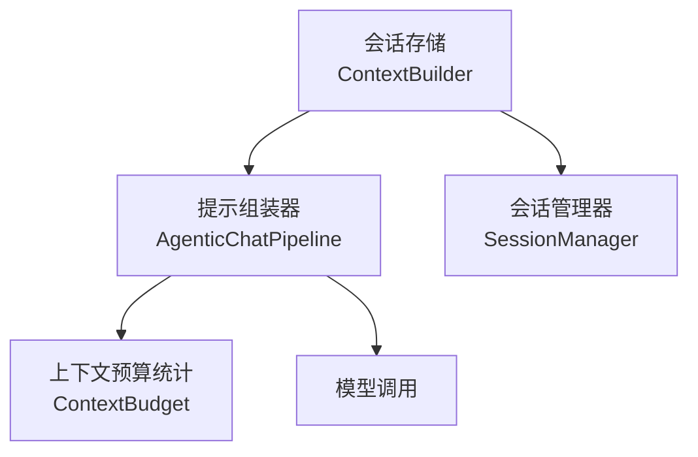
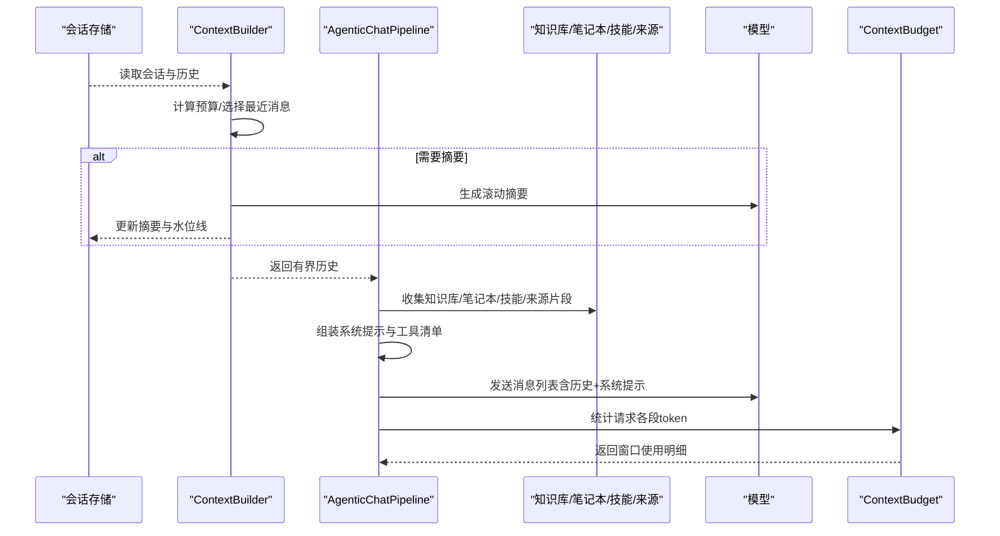
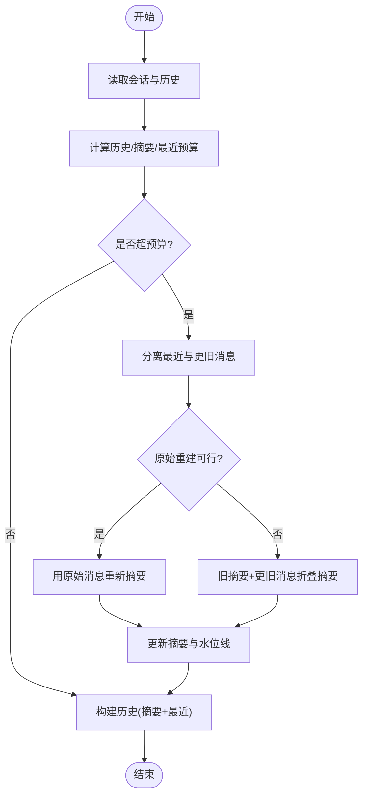
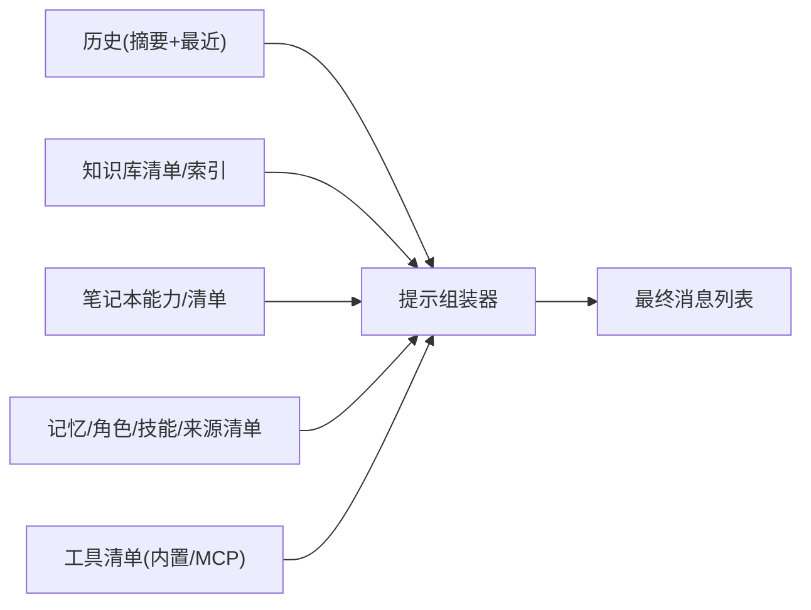
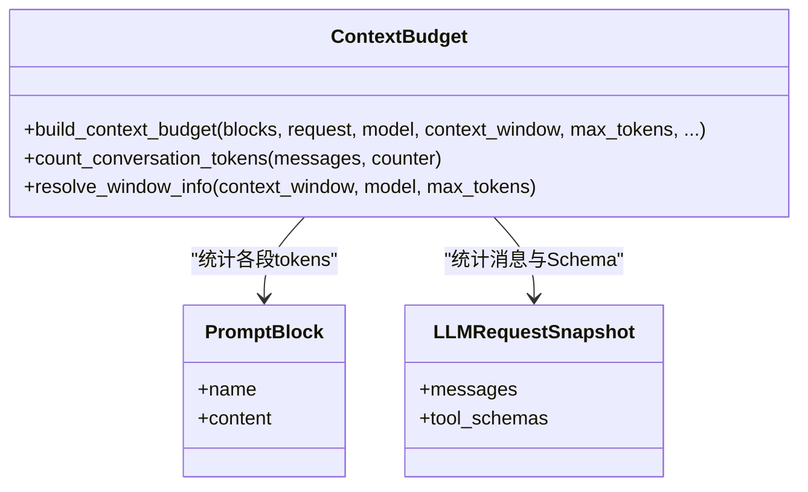
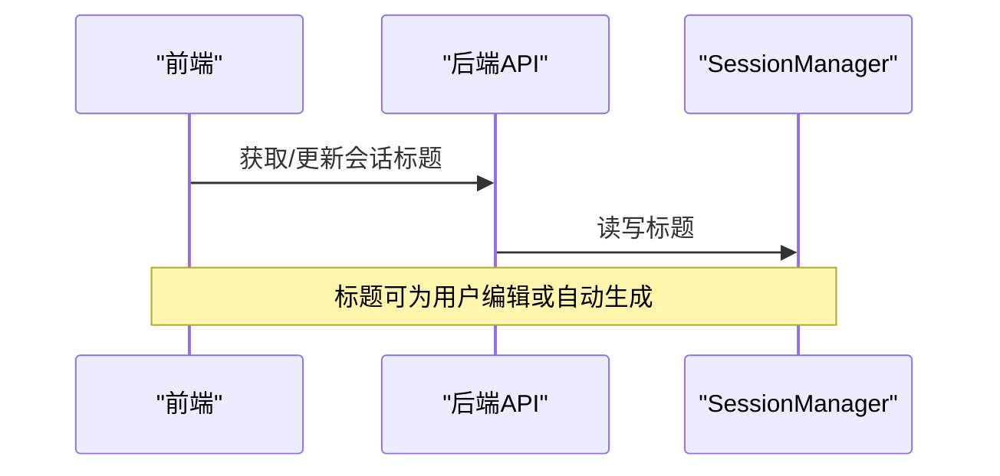
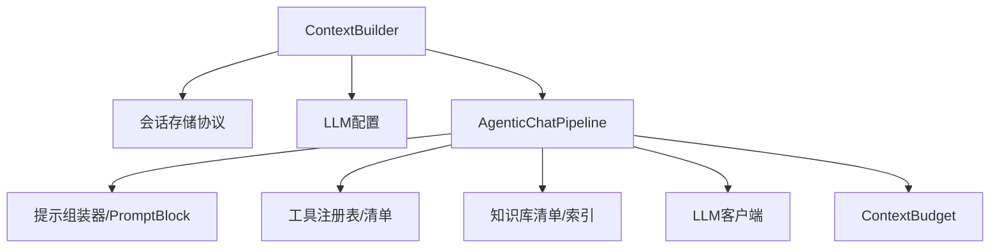

# 上下文构建系统

<cite>
**本文引用的文件**
- [context_builder.py](file://deeptutor/services/session/context_builder.py)
- [agentic_pipeline.py](file://deeptutor/agents/chat/agentic_pipeline.py)
- [context_budget.py](file://deeptutor/agents/chat/context_budget.py)
- [context.py](file://deeptutor/core/context.py)
- [session_manager.py](file://deeptutor/agents/chat/session_manager.py)
- [test_message_build.py](file://tests/agents/chat/test_message_build.py)
</cite>

## 目录
1. [简介](#简介)
2. [项目结构](#项目结构)
3. [核心组件](#核心组件)
4. [架构总览](#架构总览)
5. [详细组件分析](#详细组件分析)
6. [依赖关系分析](#依赖关系分析)
7. [性能与优化](#性能与优化)
8. [故障排查指南](#故障排查指南)
9. [结论](#结论)
10. [附录](#附录)

## 简介
本文件系统性说明 DeepTutor 的上下文构建系统，重点覆盖：
- 消息历史管理与上下文窗口控制
- 多源上下文整合（知识库引用、笔记本参考、历史记录、记忆系统）
- 上下文裁剪与优先级排序算法
- 会话标题生成与内容摘要机制
- 上下文优化的最佳实践与性能调优建议

## 项目结构
上下文构建涉及“会话存储与历史”、“提示组装与工具挂载”、“上下文预算与窗口度量”三大协作层：
- 会话层：负责持久化会话、读取消息、维护压缩摘要水位线
- 组装层：将系统提示、工具清单、知识库/笔记本/技能/来源等模块拼接为最终消息序列
- 预算层：对实际发出的请求进行分块统计，确保可观测性与可控性

**图表来源**
- [context_builder.py:104-467](file://deeptutor/services/session/context_builder.py#L104-L467)
- [agentic_pipeline.py:185-200](file://deeptutor/agents/chat/agentic_pipeline.py#L185-L200)
- [context_budget.py:135-212](file://deeptutor/agents/chat/context_budget.py#L135-L212)
- [session_manager.py:20-179](file://deeptutor/agents/chat/session_manager.py#L20-L179)

**章节来源**
- [context_builder.py:104-467](file://deeptutor/services/session/context_builder.py#L104-L467)
- [agentic_pipeline.py:185-200](file://deeptutor/agents/chat/agentic_pipeline.py#L185-L200)
- [context_budget.py:135-212](file://deeptutor/agents/chat/context_budget.py#L135-L212)
- [session_manager.py:20-179](file://deeptutor/agents/chat/session_manager.py#L20-L179)

## 核心组件
- UnifiedContext：统一上下文数据对象，承载会话ID、用户消息、历史、工具开关、知识基、附件、语言、记忆/角色/技能/来源清单等。
- ContextBuilder：基于会话存储构建有界的历史，维护压缩摘要与水位线，按预算选择最近消息并触发摘要。
- AgenticChatPipeline：组装系统提示、工具清单、知识库/笔记本/技能/来源等模块，构造循环消息列表并驱动探索式 Agent 循环。
- ContextBudget：对已组装的请求进行分块统计（系统提示各段、工具Schema、对话消息），输出窗口使用率与分段明细。
- SessionManager：聊天会话的创建、更新、消息追加与摘要管理。

**章节来源**
- [context.py:15-85](file://deeptutor/core/context.py#L15-L85)
- [context_builder.py:104-467](file://deeptutor/services/session/context_builder.py#L104-L467)
- [agentic_pipeline.py:185-200](file://deeptutor/agents/chat/agentic_pipeline.py#L185-L200)
- [context_budget.py:135-212](file://deeptutor/agents/chat/context_budget.py#L135-L212)
- [session_manager.py:20-179](file://deeptutor/agents/chat/session_manager.py#L20-L179)

## 架构总览
上下文构建的关键流程如下：
1) 从会话存储读取历史与压缩摘要水位线
2) 计算历史预算与摘要预算，选择最近消息
3) 若超出预算则触发摘要（支持原始重建或折叠旧摘要）
4) 组装系统提示与工具清单，注入知识库/笔记本/技能/来源等上下文片段
5) 构造消息列表并进入探索循环
6) 对最终请求进行上下文预算统计，用于前端展示与监控

**图表来源**
- [context_builder.py:348-467](file://deeptutor/services/session/context_builder.py#L348-L467)
- [agentic_pipeline.py:384-410](file://deeptutor/agents/chat/agentic_pipeline.py#L384-L410)
- [context_budget.py:135-212](file://deeptutor/agents/chat/context_budget.py#L135-L212)

## 详细组件分析

### 消息历史管理与上下文窗口控制
- 预算划分：历史预算=有效上下文窗口的固定比例；摘要预算=历史预算的一部分；最近消息预算=历史预算-摘要预算。
- 选择策略：从尾部向前累加最近消息，直到接近最近预算；其余更早消息进入摘要流程。
- 摘要重建：当“原始重建”输入仍小于阈值时，优先用原始消息重新摘要，避免“摘要的摘要”导致信息衰减；否则将旧摘要与更旧消息合并后再次摘要。
- 水位线与分支安全：摘要仅推进到被折叠的最后一条消息ID；编辑分支切换时若水位线不在当前祖先链上，会丢弃旧摘要并重建。
- 截断保护：当摘要接近硬上限时，自动裁剪不完整的尾行，避免携带损坏片段。

**图表来源**
- [context_builder.py:124-137](file://deeptutor/services/session/context_builder.py#L124-L137)
- [context_builder.py:165-180](file://deeptutor/services/session/context_builder.py#L165-L180)
- [context_builder.py:348-467](file://deeptutor/services/session/context_builder.py#L348-L467)

**章节来源**
- [context_builder.py:124-137](file://deeptutor/services/session/context_builder.py#L124-L137)
- [context_builder.py:165-180](file://deeptutor/services/session/context_builder.py#L165-L180)
- [context_builder.py:348-467](file://deeptutor/services/session/context_builder.py#L348-L467)

### 多源上下文整合机制
- 知识库引用：在系统提示中附加知识库清单与检索指引，限制 rag 调用时的 kb_name 范围，并在 PageIndex 类型知识库下提供文档列表与检索指令。
- 笔记本参考：通过工具装配与提示块注入笔记本相关能力，使模型知道可用的笔记本资源与操作方式。
- 历史记录：由 ContextBuilder 输出的有界历史作为对话上下文，包含系统级摘要与最近的 user/assistant 消息。
- 记忆系统：通过统一的 memory_context/persona_context/skills_manifest/source_manifest 字段注入，配合工具白名单控制内置工具挂载。

**图表来源**
- [agentic_pipeline.py:384-410](file://deeptutor/agents/chat/agentic_pipeline.py#L384-L410)
- [agentic_pipeline.py:1405-1472](file://deeptutor/agents/chat/agentic_pipeline.py#L1405-L1472)
- [context.py:33-85](file://deeptutor/core/context.py#L33-L85)

**章节来源**
- [agentic_pipeline.py:384-410](file://deeptutor/agents/chat/agentic_pipeline.py#L384-L410)
- [agentic_pipeline.py:1405-1472](file://deeptutor/agents/chat/agentic_pipeline.py#L1405-L1472)
- [context.py:33-85](file://deeptutor/core/context.py#L33-L85)

### 上下文裁剪与优先级排序
- 优先级顺序：系统提示的各提示块（general/runtime_policy/loop/persona_style/partner_turn_policy/memory/tools/knowledge_base_note/skills/sources/extended_tools/notebooks/workspace）按名称映射到预算分段；未映射的归入“capability”。
- 裁剪策略：先保留系统提示与工具 Schema，再按 token 预算从尾部选择最近消息；必要时回退到仅保留摘要与少量历史。
- 预算统计：对已发送的消息与工具 Schema 进行分块计数，输出 window、used_tokens、free_tokens 与各分段 tokens，便于前端可视化与调参。

**图表来源**
- [context_budget.py:32-51](file://deeptutor/agents/chat/context_budget.py#L32-L51)
- [context_budget.py:135-212](file://deeptutor/agents/chat/context_budget.py#L135-L212)
- [context_budget.py:215-286](file://deeptutor/agents/chat/context_budget.py#L215-L286)

**章节来源**
- [context_budget.py:32-51](file://deeptutor/agents/chat/context_budget.py#L32-L51)
- [context_budget.py:135-212](file://deeptutor/agents/chat/context_budget.py#L135-L212)
- [context_budget.py:215-286](file://deeptutor/agents/chat/context_budget.py#L215-L286)

### 会话标题生成与内容摘要
- 会话标题：前端具备占位标题识别逻辑，后端/前端可在合适时机生成或更新标题；此处以占位判断为例。
- 内容摘要：ContextBuilder 在历史超限时生成滚动摘要，结构化组织目标、事实、决策、进展、待办，并写入会话存储，后续轮次复用。

**图表来源**
- [session_manager.py:42-66](file://deeptutor/agents/chat/session_manager.py#L42-L66)

**章节来源**
- [session_manager.py:42-66](file://deeptutor/agents/chat/session_manager.py#L42-L66)

### 关键实现要点与边界处理
- 系统级摘要必须到达最终消息：测试保证 system role 的摘要不被过滤掉，确保模型可见。
- 知识库清单注入：在系统提示中附带可用知识库与检索约束，防止 rag 调用越界。
- 预算测量一致性：预算统计基于“已发送”的请求快照，避免与渲染过程脱节。

**章节来源**
- [test_message_build.py:1-29](file://tests/agents/chat/test_message_build.py#L1-L29)
- [agentic_pipeline.py:1405-1472](file://deeptutor/agents/chat/agentic_pipeline.py#L1405-L1472)
- [context_budget.py:135-212](file://deeptutor/agents/chat/context_budget.py#L135-L212)

## 依赖关系分析
- ContextBuilder 依赖会话存储协议与 LLM 配置，用于计算有效上下文窗口与预算。
- AgenticChatPipeline 依赖提示组装器、工具注册表、知识库清单、PromptBlock 体系，以及 LLM 客户端。
- ContextBudget 依赖 PromptBlock 与 LLMRequestSnapshot，对已组装内容进行精确统计。
- SessionManager 继承通用会话管理基类，封装聊天场景的默认行为。

**图表来源**
- [context_builder.py:104-137](file://deeptutor/services/session/context_builder.py#L104-L137)
- [agentic_pipeline.py:185-200](file://deeptutor/agents/chat/agentic_pipeline.py#L185-L200)
- [context_budget.py:135-212](file://deeptutor/agents/chat/context_budget.py#L135-L212)

**章节来源**
- [context_builder.py:104-137](file://deeptutor/services/session/context_builder.py#L104-L137)
- [agentic_pipeline.py:185-200](file://deeptutor/agents/chat/agentic_pipeline.py#L185-L200)
- [context_budget.py:135-212](file://deeptutor/agents/chat/context_budget.py#L135-L212)

## 性能与优化
- 预算分配建议
  - 历史预算比例：根据模型上下文窗口与业务需求调整，通常 30%-40% 用于历史，剩余留给摘要与系统提示。
  - 摘要目标：控制在摘要预算的约 80%，留出余量避免硬截断。
- 重建策略
  - 优先“原始重建”以避免摘要级联失真；仅在原始重建不可行时采用“折叠旧摘要”降级。
- 工具与提示块
  - 按需启用工具与提示块，减少不必要的 schema 与文本开销。
  - 知识库清单与索引应精简，仅包含必要元信息与检索指引。
- 监控与调优
  - 利用 ContextBudget 的分段统计定位占用大户（system_prompt、tool_manifest、knowledge_base_note、notebooks 等）。
  - 结合前端展示的窗口使用率，逐步收紧提示块与历史长度。

[本节为通用指导，无需特定文件来源]

## 故障排查指南
- 摘要未送达模型
  - 现象：系统级摘要未出现在最终消息中。
  - 排查：确认历史过滤逻辑允许 system role 的摘要条目。
  - 参考：[test_message_build.py:1-29](file://tests/agents/chat/test_message_build.py#L1-L29)
- 知识库检索越界
  - 现象：rag 调用使用了未挂载的知识库。
  - 排查：检查系统提示中的知识库清单与检索约束是否正确注入。
  - 参考：[agentic_pipeline.py:1405-1472](file://deeptutor/agents/chat/agentic_pipeline.py#L1405-L1472)
- 上下文预算异常
  - 现象：前端显示的使用率与实际不符。
  - 排查：确认预算统计基于已发送的请求快照，且工具 schema 与消息文本均被正确计数。
  - 参考：[context_budget.py:135-212](file://deeptutor/agents/chat/context_budget.py#L135-L212)
- 摘要截断导致内容损坏
  - 现象：摘要末尾出现不完整句子。
  - 排查：启用截断保护，自动裁剪不完整尾行。
  - 参考：[context_builder.py:36-45](file://deeptutor/services/session/context_builder.py#L36-L45)

**章节来源**
- [test_message_build.py:1-29](file://tests/agents/chat/test_message_build.py#L1-L29)
- [agentic_pipeline.py:1405-1472](file://deeptutor/agents/chat/agentic_pipeline.py#L1405-L1472)
- [context_budget.py:135-212](file://deeptutor/agents/chat/context_budget.py#L135-L212)
- [context_builder.py:36-45](file://deeptutor/services/session/context_builder.py#L36-L45)

## 结论
DeepTutor 的上下文构建系统通过“预算驱动的有界历史”“多源上下文整合”“精确的上下文预算统计”形成闭环：在保证模型可用性的同时，最大化信息密度与相关性。通过合理设置历史/摘要预算、精简提示块与工具清单、持续监控预算分布，可以在不同模型与业务场景下获得稳定且高效的上下文体验。

[本节为总结，无需特定文件来源]

## 附录
- 术语
  - 上下文窗口：模型一次请求可处理的 token 总量。
  - 历史预算：用于保留最近对话消息的 token 配额。
  - 摘要预算：用于生成滚动摘要的 token 配额。
  - 提示块：系统提示中的模块化段落（如 general、tools、memory 等）。
  - 水位线：记录已摘要到的最后一条消息 ID，用于增量更新。

[本节为补充说明，无需特定文件来源]