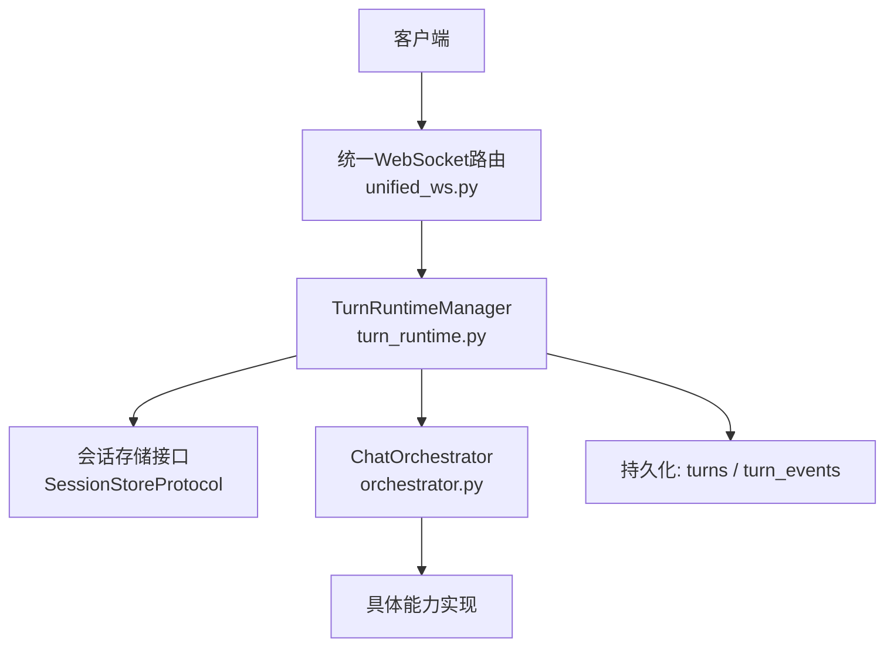
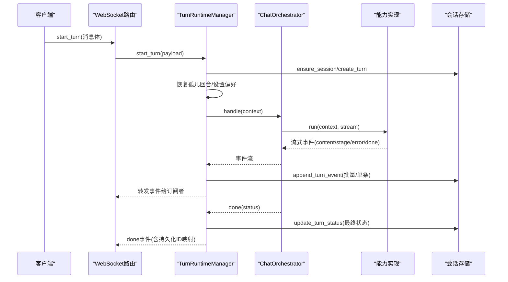
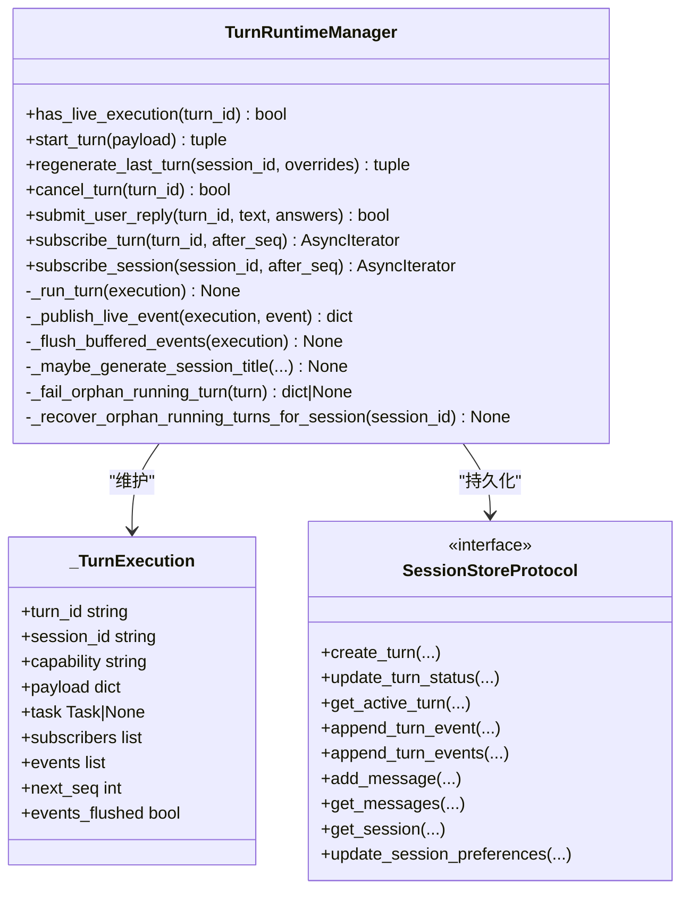
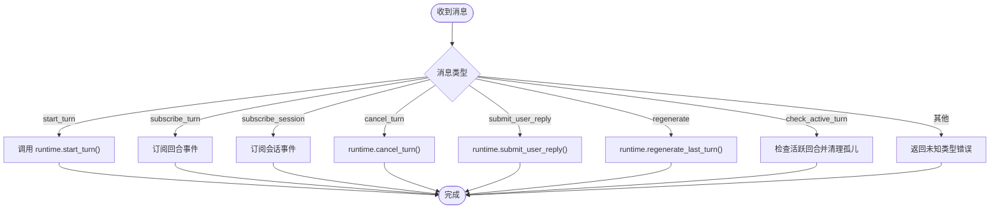
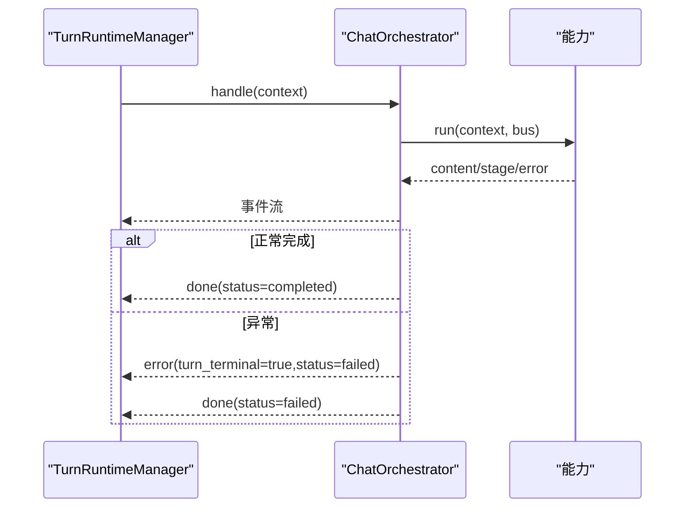
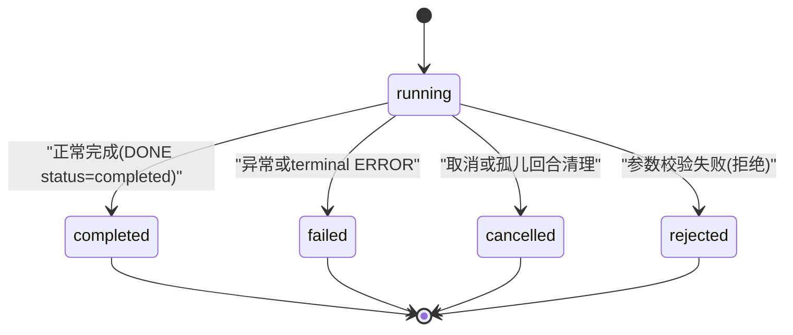
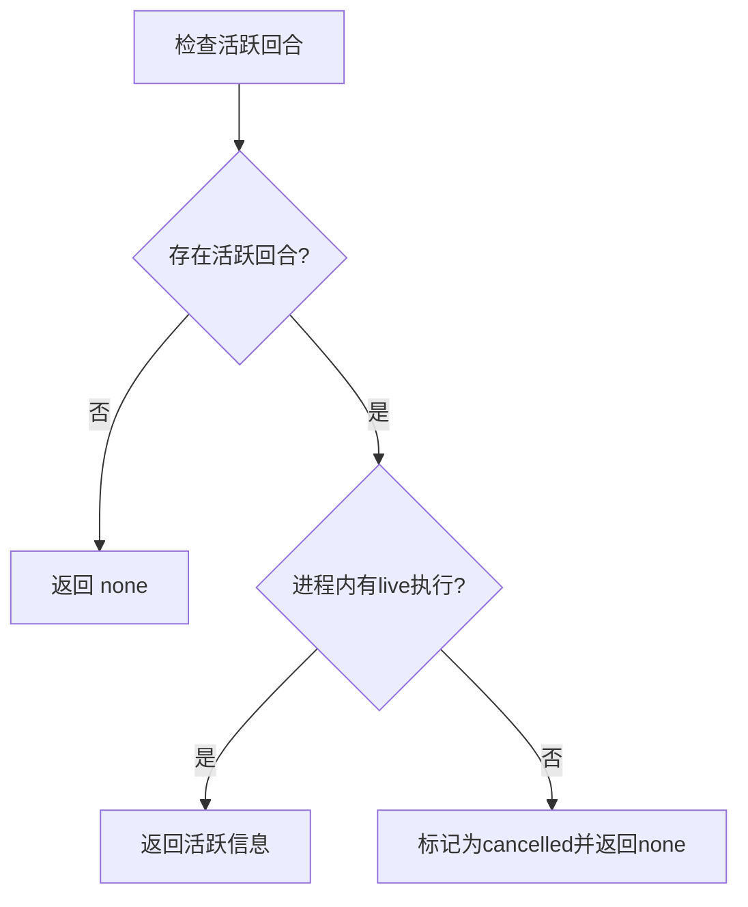
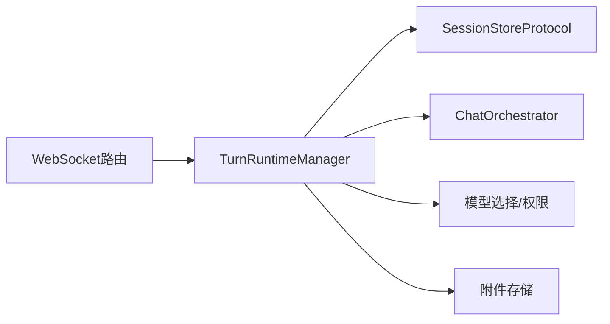

# 回合生命周期管理

<cite>
**本文引用的文件**
- [turn_runtime.py](file://deeptutor/services/session/turn_runtime.py)
- [unified_ws.py](file://deeptutor/api/routers/unified_ws.py)
- [orchestrator.py](file://deeptutor/runtime/orchestrator.py)
- [test_unified_ws_turn_runtime.py](file://tests/api/test_unified_ws_turn_runtime.py)
- [test_orchestrator.py](file://tests/runtime/test_orchestrator.py)
- [pb_setup.py](file://scripts/pb_setup.py)
</cite>

## 目录
1. [简介](#简介)
2. [项目结构](#项目结构)
3. [核心组件](#核心组件)
4. [架构总览](#架构总览)
5. [详细组件分析](#详细组件分析)
6. [依赖关系分析](#依赖关系分析)
7. [性能考量](#性能考量)
8. [故障排查指南](#故障排查指南)
9. [结论](#结论)
10. [附录](#附录)

## 简介
本文件系统性阐述 DeepTutor 中“回合（Turn）”的完整生命周期：从启动、执行、完成到清理，覆盖异步任务管理、并发控制、资源清理、孤儿回合检测与恢复、状态转换规则以及错误处理与异常恢复的最佳实践。重点围绕 TurnRuntimeManager 的设计模式与工作机制展开，并结合 WebSocket 接入层与编排器（Orchestrator）说明端到端的数据流与控制流。

## 项目结构
围绕回合生命周期的关键代码分布在以下位置：
- 会话与回合运行时：deeptutor/services/session/turn_runtime.py
- 统一 WebSocket 接入层：deeptutor/api/routers/unified_ws.py
- 能力编排器：deeptutor/runtime/orchestrator.py
- 持久化表结构定义（示例）：scripts/pb_setup.py
- 相关测试用例：tests/api/test_unified_ws_turn_runtime.py、tests/runtime/test_orchestrator.py

图表来源
- [unified_ws.py:44-325](file://deeptutor/api/routers/unified_ws.py#L44-L325)
- [turn_runtime.py:594-2129](file://deeptutor/services/session/turn_runtime.py#L594-L2129)
- [orchestrator.py:40-114](file://deeptutor/runtime/orchestrator.py#L40-L114)
- [pb_setup.py:135-166](file://scripts/pb_setup.py#L135-L166)

章节来源
- [unified_ws.py:44-325](file://deeptutor/api/routers/unified_ws.py#L44-L325)
- [turn_runtime.py:594-2129](file://deeptutor/services/session/turn_runtime.py#L594-L2129)
- [orchestrator.py:40-114](file://deeptutor/runtime/orchestrator.py#L40-L114)
- [pb_setup.py:135-166](file://scripts/pb_setup.py#L135-L166)

## 核心组件
- TurnRuntimeManager：回合级运行时管理器，负责创建、调度、订阅、取消、恢复与清理回合；维护内存中的执行上下文与事件缓冲；协调持久化与实时推送。
- Unified WebSocket Router：提供统一的 WebSocket 通道，接收 start_turn、subscribe_turn、cancel_turn、submit_user_reply、regenerate、check_active_turn 等消息，并桥接到 TurnRuntimeManager。
- ChatOrchestrator：根据 active_capability 选择并运行具体能力，封装错误与 DONE 事件，向调用方暴露统一的流式事件。
- SessionStoreProtocol（由 SQLite 或 PocketBase 等实现）：提供会话、回合、消息、事件的增删改查与批量追加能力。

章节来源
- [turn_runtime.py:594-2129](file://deeptutor/services/session/turn_runtime.py#L594-L2129)
- [unified_ws.py:44-325](file://deeptutor/api/routers/unified_ws.py#L44-L325)
- [orchestrator.py:40-114](file://deeptutor/runtime/orchestrator.py#L40-L114)

## 架构总览
回合从客户端通过 WebSocket 发起，进入 TurnRuntimeManager 后，进行参数校验、偏好与工具白名单注入、孤儿回合清理、创建持久化回合记录，并在后台 Task 中驱动 ChatOrchestrator 执行能力。执行过程中产生的事件被持久化并推送到订阅者；结束时计算最终状态并写入数据库。

图表来源
- [unified_ws.py:113-134](file://deeptutor/api/routers/unified_ws.py#L113-L134)
- [turn_runtime.py:655-834](file://deeptutor/services/session/turn_runtime.py#L655-L834)
- [turn_runtime.py:1153-1875](file://deeptutor/services/session/turn_runtime.py#L1153-L1875)
- [orchestrator.py:40-114](file://deeptutor/runtime/orchestrator.py#L40-L114)

## 详细组件分析

### TurnRuntimeManager：设计模式与工作机制
- 职责边界
  - 启动：start_turn 负责参数校验、偏好与工具注入、孤儿回合清理、创建持久化回合、发布 SESSION 事件、注册执行对象并启动后台 Task。
  - 执行：_run_turn 构建上下文、调用 ChatOrchestrator，收集内容片段、附件与事件，完成后持久化助手消息与事件，计算最终状态并更新。
  - 订阅：subscribe_turn/subscribe_session 支持断线续传（after_seq），在缺失 DONE 时合成终端事件以保证前端状态一致。
  - 取消：cancel_turn 支持对运行中任务的取消与状态落库。
  - 恢复：_recover_orphan_running_turns_for_session 与 _fail_orphan_running_turn 用于服务器重启后的状态同步。
  - 清理：finally 块确保回复队列、执行对象、订阅者队列清理，并触发内存回收。

- 并发与锁
  - 使用 asyncio.Lock 保护 _executions 字典与事件序列号分配，避免多连接竞态。
  - 每个回合一个 asyncio.Task，内部可暂停等待用户回复（ask_user），通过 per-turn 队列实现协作式暂停/恢复。

- 事件与持久化
  - 事件先入内存缓冲，按 seq 顺序去重与合并，再批量追加到 store（优先批量接口），最后镜像到工作区 events.jsonl。
  - DONE 事件携带 user_message_id 与 assistant_message_id，便于前端就地替换乐观 ID。

- 孤儿回合检测与恢复
  - check_active_turn 会查询活跃回合，若进程内无 live execution，则将其标记为 cancelled，避免后续 start_turn 冲突。
  - subscribe_turn 在无执行对象时也会尝试失败孤儿回合，必要时合成 DONE 事件。

- 状态解析
  - 基于 DONE 元数据与最近 ERROR 事件（带 turn_terminal 标志）解析最终状态，兜底为 completed。

章节来源
- [turn_runtime.py:594-834](file://deeptutor/services/session/turn_runtime.py#L594-L834)
- [turn_runtime.py:946-1091](file://deeptutor/services/session/turn_runtime.py#L946-L1091)
- [turn_runtime.py:1153-1875](file://deeptutor/services/session/turn_runtime.py#L1153-L1875)
- [turn_runtime.py:1876-2129](file://deeptutor/services/session/turn_runtime.py#L1876-L2129)

#### 类图（TurnRuntimeManager 及其关联）

图表来源
- [turn_runtime.py:576-613](file://deeptutor/services/session/turn_runtime.py#L576-L613)
- [turn_runtime.py:594-2129](file://deeptutor/services/session/turn_runtime.py#L594-L2129)

### WebSocket 接入层：消息分发与状态同步
- 支持的客户端消息类型：message/start_turn、subscribe_turn、subscribe_session、resume_from、unsubscribe、cancel_turn、submit_user_reply、regenerate、user_input、check_active_turn、ping。
- 错误与终止：start_turn/regenerate 抛出 RuntimeError 时，返回带有 turn_terminal 与 status=rejected 的错误事件，保证前端能正确结束流。
- 孤儿回合清理：check_active_turn 发现无 live execution 的 running 回合，将其置为 cancelled，避免阻塞新回合。

图表来源
- [unified_ws.py:113-312](file://deeptutor/api/routers/unified_ws.py#L113-L312)

章节来源
- [unified_ws.py:44-325](file://deeptutor/api/routers/unified_ws.py#L44-L325)

### 编排器：能力执行与错误传播
- 自动分配 session_id，默认能力为 chat。
- 未知能力直接发送 ERROR 与 DONE(status=failed)。
- 捕获能力异常，发送 terminal ERROR 与 DONE(status=failed)，并在 finally 中关闭 StreamBus。

图表来源
- [orchestrator.py:40-114](file://deeptutor/runtime/orchestrator.py#L40-L114)

章节来源
- [orchestrator.py:40-114](file://deeptutor/runtime/orchestrator.py#L40-L114)

### 状态转换规则与触发条件
- 初始：创建回合后，数据库行处于 running（由上层逻辑或默认值决定）。
- completed：能力正常完成且未出现 terminal ERROR；DONE 元数据 status 为 completed。
- failed：能力抛出异常或发送了带 turn_terminal=true 的 ERROR；DONE 元数据 status 为 failed。
- cancelled：显式 cancel_turn 或服务器重启后检测到孤儿 running 回合。
- rejected：start_turn/regenerate 参数校验失败（如模型选择无效、无 LLM 权限等），返回错误事件并拒绝回合。

图表来源
- [turn_runtime.py:51-74](file://deeptutor/services/session/turn_runtime.py#L51-L74)
- [turn_runtime.py:946-962](file://deeptutor/services/session/turn_runtime.py#L946-L962)
- [unified_ws.py:117-133](file://deeptutor/api/routers/unified_ws.py#L117-L133)

章节来源
- [turn_runtime.py:51-74](file://deeptutor/services/session/turn_runtime.py#L51-L74)
- [turn_runtime.py:946-962](file://deeptutor/services/session/turn_runtime.py#L946-L962)
- [unified_ws.py:117-133](file://deeptutor/api/routers/unified_ws.py#L117-L133)

### 孤儿回合检测与恢复机制
- 服务器重启后，数据库可能残留 running 状态的回合，但进程内无对应 Task。
- check_active_turn 会验证 has_live_execution；若无，则将回合置为 cancelled，并通知前端无活跃回合。
- subscribe_turn 在无执行对象时也会尝试失败孤儿回合，并在必要时合成 DONE 事件，确保前端状态机收敛。

图表来源
- [unified_ws.py:160-193](file://deeptutor/api/routers/unified_ws.py#L160-L193)
- [turn_runtime.py:634-654](file://deeptutor/services/session/turn_runtime.py#L634-L654)
- [turn_runtime.py:1046-1091](file://deeptutor/services/session/turn_runtime.py#L1046-L1091)

章节来源
- [unified_ws.py:160-193](file://deeptutor/api/routers/unified_ws.py#L160-L193)
- [turn_runtime.py:634-654](file://deeptutor/services/session/turn_runtime.py#L634-L654)
- [turn_runtime.py:1046-1091](file://deeptutor/services/session/turn_runtime.py#L1046-L1091)

### 异步任务管理与资源清理
- 每个回合一个 asyncio.Task，Task 结束后清理 reply_queues、subscribers、_executions，并触发内存回收。
- 取消路径下，尽力保存已生成的内容与附件，并将状态写为 cancelled。
- 事件持久化采用批量优先策略，降低慢盘场景下的延迟；同时镜像到工作区 events.jsonl 供调试。

章节来源
- [turn_runtime.py:1153-1875](file://deeptutor/services/session/turn_runtime.py#L1153-L1875)
- [turn_runtime.py:2022-2109](file://deeptutor/services/session/turn_runtime.py#L2022-L2109)

### 错误处理与异常恢复最佳实践
- 参数校验失败（如模型选择无效、无 LLM 权限）应在 start_turn 阶段抛出 RuntimeError，并由 WebSocket 层转换为带 turn_terminal 与 status=rejected 的错误事件。
- 能力执行异常应通过编排器统一转为 terminal ERROR 与 DONE(status=failed)。
- 持久化失败（如删除会话导致 turn 不存在）需容忍并跳过剩余事件，避免级联失败。
- 取消时应尽量保留已生成的可见结果，并明确写出 cancelled 状态，防止被误判为孤儿。

章节来源
- [turn_runtime.py:679-764](file://deeptutor/services/session/turn_runtime.py#L679-L764)
- [unified_ws.py:117-133](file://deeptutor/api/routers/unified_ws.py#L117-L133)
- [orchestrator.py:83-103](file://deeptutor/runtime/orchestrator.py#L83-L103)
- [turn_runtime.py:1774-1855](file://deeptutor/services/session/turn_runtime.py#L1774-L1855)

## 依赖关系分析
- TurnRuntimeManager 依赖：
  - SessionStoreProtocol：会话、回合、消息、事件存取。
  - ChatOrchestrator：能力编排与事件流。
  - 模型选择与权限：应用 llm_selection、工具白名单、个人模型合并。
  - 附件存储：上传与预览文本提取。
- WebSocket 路由依赖 TurnRuntimeManager 提供的 start_turn、subscribe_*、cancel_turn、submit_user_reply、regenerate。
- 测试用例覆盖：
  - 非法模型选择拒绝、模型切换、事件持久化、标题生成等。
  - 编排器错误事件与 DONE 行为。

图表来源
- [turn_runtime.py:594-2129](file://deeptutor/services/session/turn_runtime.py#L594-L2129)
- [unified_ws.py:44-325](file://deeptutor/api/routers/unified_ws.py#L44-L325)

章节来源
- [turn_runtime.py:594-2129](file://deeptutor/services/session/turn_runtime.py#L594-L2129)
- [unified_ws.py:44-325](file://deeptutor/api/routers/unified_ws.py#L44-L325)
- [test_unified_ws_turn_runtime.py:430-471](file://tests/api/test_unified_ws_turn_runtime.py#L430-L471)
- [test_orchestrator.py:148-205](file://tests/runtime/test_orchestrator.py#L148-L205)

## 性能考量
- 事件批量持久化：优先使用 append_turn_events 减少 fsync 次数，降低慢盘导致的卡顿。
- 内存回收：回合结束后主动调度内存回收，释放大附件解析与临时提示。
- 工作区事件镜像：使用线程池写入 events.jsonl，避免阻塞事件循环。
- 订阅续传：after_seq 机制避免重复回放，提升重连效率。

[本节为通用指导，不直接分析具体文件]

## 故障排查指南
- 症状：客户端长时间显示“进行中”，但后端已结束
  - 检查是否有 DONE 事件丢失；subscribe_turn 会在缺失 DONE 时合成终端事件，确认前端是否消费。
  - 参考：[turn_runtime.py:1092-1140](file://deeptutor/services/session/turn_runtime.py#L1092-L1140)
- 症状：服务器重启后仍有“running”回合
  - 使用 check_active_turn 清理孤儿回合；确认 has_live_execution 判断逻辑。
  - 参考：[unified_ws.py:160-193](file://deeptutor/api/routers/unified_ws.py#L160-L193)、[turn_runtime.py:634-654](file://deeptutor/services/session/turn_runtime.py#L634-L654)
- 症状：start_turn 立即失败
  - 检查模型选择与权限；查看 rejected 错误事件。
  - 参考：[turn_runtime.py:702-764](file://deeptutor/services/session/turn_runtime.py#L702-L764)、[unified_ws.py:117-133](file://deeptutor/api/routers/unified_ws.py#L117-L133)
- 症状：能力执行异常
  - 查看编排器的 terminal ERROR 与 DONE(status=failed)。
  - 参考：[orchestrator.py:83-103](file://deeptutor/runtime/orchestrator.py#L83-L103)

章节来源
- [turn_runtime.py:1092-1140](file://deeptutor/services/session/turn_runtime.py#L1092-L1140)
- [unified_ws.py:160-193](file://deeptutor/api/routers/unified_ws.py#L160-L193)
- [turn_runtime.py:634-654](file://deeptutor/services/session/turn_runtime.py#L634-L654)
- [turn_runtime.py:702-764](file://deeptutor/services/session/turn_runtime.py#L702-L764)
- [unified_ws.py:117-133](file://deeptutor/api/routers/unified_ws.py#L117-L133)
- [orchestrator.py:83-103](file://deeptutor/runtime/orchestrator.py#L83-L103)

## 结论
TurnRuntimeManager 以“会话-回合-事件”为核心抽象，结合 WebSocket 接入层与编排器，实现了高可靠、可恢复、可观测的回合生命周期管理。其关键特性包括：
- 明确的启动-执行-完成-清理四阶段流程
- 健壮的孤儿回合检测与恢复
- 严格的参数校验与权限控制
- 完善的错误传播与状态一致性保障
- 面向性能的批量持久化与内存回收

这些机制共同确保了在多连接、多回合并发场景下的稳定性与用户体验。

[本节为总结性内容，不直接分析具体文件]

## 附录

### 持久化表结构（示例）
- turns：包含 turn_id、session_id、capability、status、error、时间戳等字段。
- turn_events：包含 turn_id 及事件载荷，用于回放与审计。

章节来源
- [pb_setup.py:135-166](file://scripts/pb_setup.py#L135-L166)