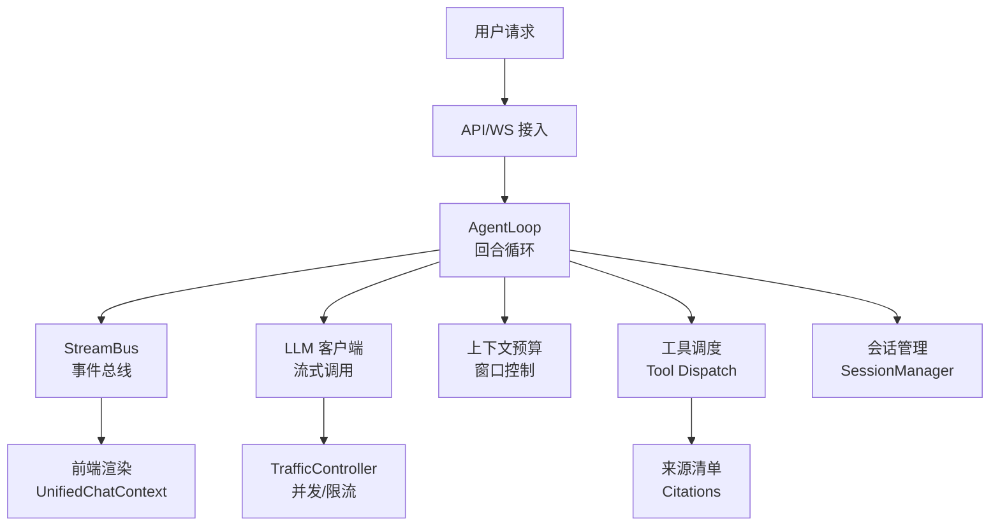
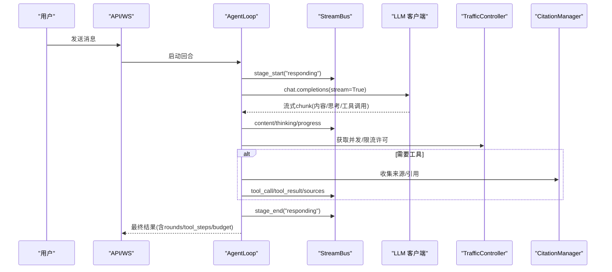
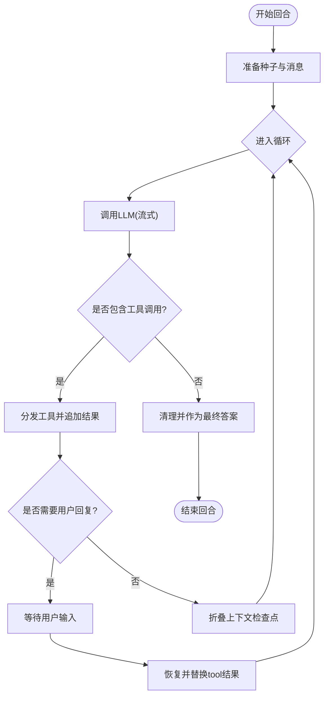
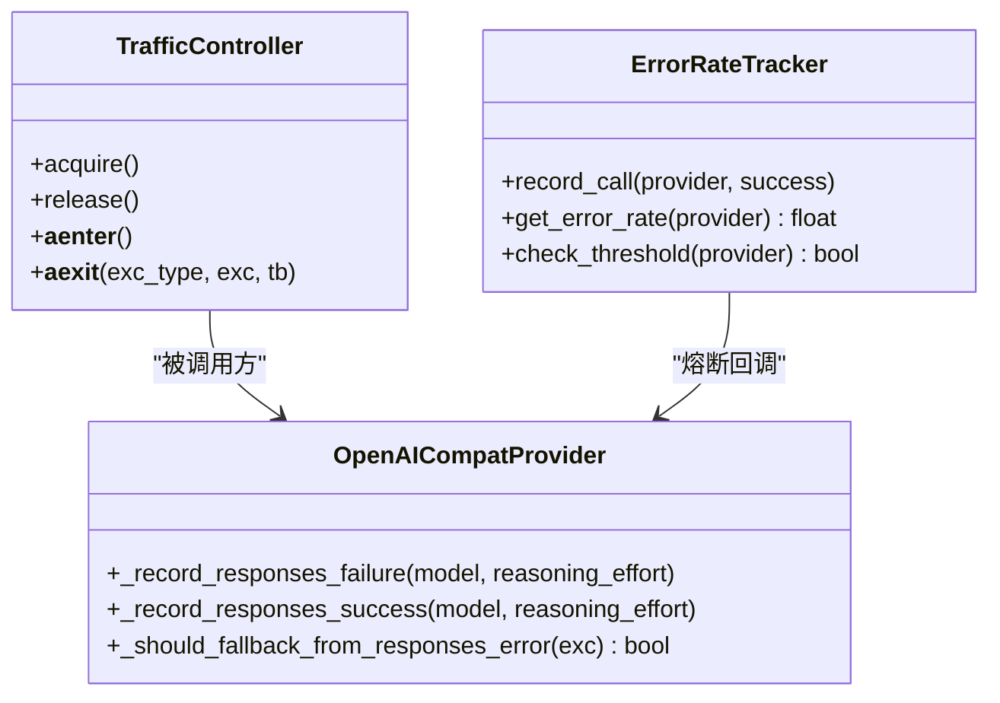
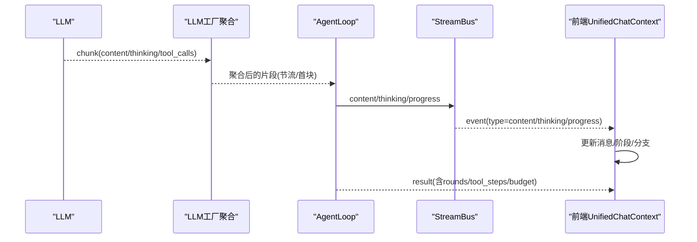
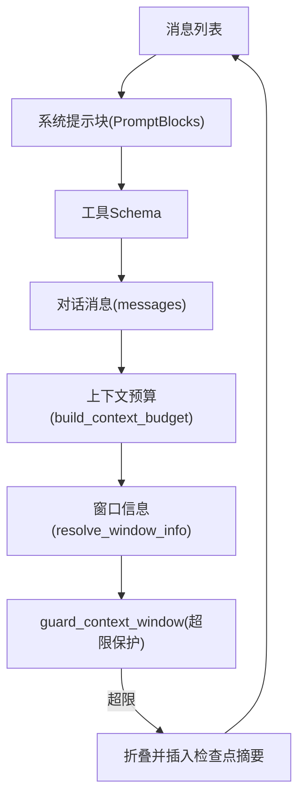
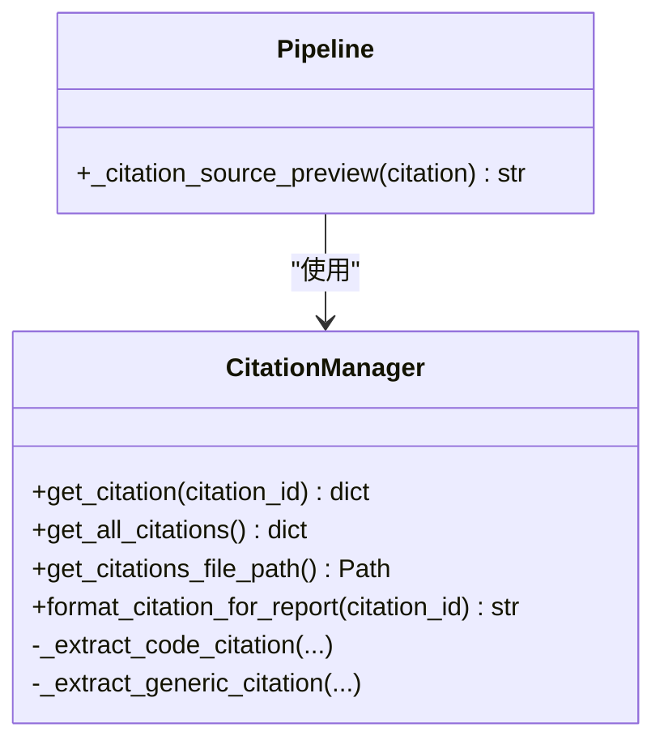
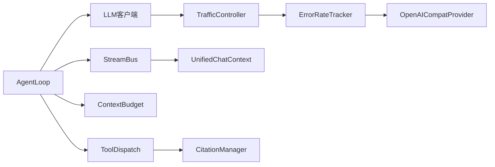

# 回合运行时

<cite>
**本文引用的文件**
- [agent_loop.py](file://deeptutor/agents/chat/agent_loop.py)
- [stream_bus.py](file://deeptutor/core/stream_bus.py)
- [stream.py](file://deeptutor/core/stream.py)
- [context_budget.py](file://deeptutor/agents/chat/context_budget.py)
- [session_manager.py](file://deeptutor/agents/chat/session_manager.py)
- [factory.py](file://deeptutor/services/llm/factory.py)
- [openai_compat_provider.py](file://deeptutor/services/llm/provider_core/openai_compat_provider.py)
- [traffic_control.py](file://deeptutor/services/llm/traffic_control.py)
- [error_rate_tracker.py](file://deeptutor/utils/error_rate_tracker.py)
- [UnifiedChatContext.tsx](file://web/context/UnifiedChatContext.tsx)
- [message-branches.ts](file://web/lib/message-branches.ts)
- [citation_manager.py](file://deeptutor/agents/research/utils/citation_manager.py)
- [pipeline.py](file://deeptutor/agents/research/pipeline.py)
</cite>

## 目录
1. [简介](#简介)
2. [项目结构](#项目结构)
3. [核心组件](#核心组件)
4. [架构总览](#架构总览)
5. [详细组件分析](#详细组件分析)
6. [依赖关系分析](#依赖关系分析)
7. [性能考量](#性能考量)
8. [故障排查指南](#故障排查指南)
9. [结论](#结论)
10. [附录](#附录)

## 简介
本文件聚焦 DeepTutor 的“回合运行时”，解释“回合”的概念、单轮对话处理机制、异步与并发控制、超时与错误恢复、流式响应（增量输出与实时交互）、上下文构建器（消息历史管理与上下文窗口控制），以及来源清单系统（引用追踪与证据管理）。目标是帮助读者理解从用户输入到最终回答的完整运行路径，并掌握关键调优与监控要点。

## 项目结构
围绕回合运行的关键代码分布在以下模块：
- 回合循环与编排：deeptutor/agents/chat/agent_loop.py
- 事件总线与流协议：deeptutor/core/stream_bus.py, deeptutor/core/stream.py
- 上下文预算与窗口：deeptutor/agents/chat/context_budget.py
- 会话持久化：deeptutor/agents/chat/session_manager.py
- LLM 流式聚合与节流：deeptutor/services/llm/factory.py
- 并发与限流：deeptutor/services/llm/traffic_control.py
- 错误率与熔断：deeptutor/utils/error_rate_tracker.py, deeptutor/services/llm/provider_core/openai_compat_provider.py
- 前端会话状态与分支：web/context/UnifiedChatContext.tsx, web/lib/message-branches.ts
- 引用与来源：deeptutor/agents/research/utils/citation_manager.py, deeptutor/agents/research/pipeline.py

图表来源
- [agent_loop.py:172-227](file://deeptutor/agents/chat/agent_loop.py#L172-L227)
- [stream_bus.py:31-104](file://deeptutor/core/stream_bus.py#L31-L104)
- [factory.py:533-567](file://deeptutor/services/llm/factory.py#L533-L567)
- [traffic_control.py:78-125](file://deeptutor/services/llm/traffic_control.py#L78-L125)
- [context_budget.py:135-212](file://deeptutor/agents/chat/context_budget.py#L135-L212)
- [session_manager.py:20-67](file://deeptutor/agents/chat/session_manager.py#L20-L67)
- [UnifiedChatContext.tsx:499-543](file://web/context/UnifiedChatContext.tsx#L499-L543)

章节来源
- [agent_loop.py:172-227](file://deeptutor/agents/chat/agent_loop.py#L172-L227)
- [stream_bus.py:31-104](file://deeptutor/core/stream_bus.py#L31-L104)
- [context_budget.py:135-212](file://deeptutor/agents/chat/context_budget.py#L135-L212)
- [session_manager.py:20-67](file://deeptutor/agents/chat/session_manager.py#L20-L67)

## 核心组件
- AgentLoop：实现“一轮对话=一个循环”的核心逻辑，包含多轮 LLM 调用、工具调用分发、暂停与恢复、强制结束与兜底回答。
- StreamBus：回合内的事件总线，提供 content/thinking/tool_call/tool_result/progress/sources/result/error/wait_for_input 等事件通道，支持阶段 STAGE_START/STAGE_END 包裹。
- Context Budget：对单次请求的上下文窗口进行细粒度统计（system prompt、tool schemas、messages 等），用于展示与决策。
- Session Manager：聊天会话的创建、更新、查询与摘要，承载消息历史与设置。
- LLM 工厂流聚合：对流式 chunk 进行合并、节流、首块快速下发、控制令牌处理与异常透传。
- Traffic Controller：并发信号量 + 速率令牌，防止过载；获取失败时抛出超时异常。
- Error Rate Tracker & Circuit Breaker：按 provider 滑动窗口统计错误率，触发熔断回调。
- 前端 UnifiedChatContext：维护会话状态、分支选择、流事件处理、超时与断线重连。

章节来源
- [agent_loop.py:151-227](file://deeptutor/agents/chat/agent_loop.py#L151-L227)
- [stream_bus.py:31-326](file://deeptutor/core/stream_bus.py#L31-L326)
- [context_budget.py:135-212](file://deeptutor/agents/chat/context_budget.py#L135-L212)
- [session_manager.py:20-180](file://deeptutor/agents/chat/session_manager.py#L20-L180)
- [factory.py:533-567](file://deeptutor/services/llm/factory.py#L533-L567)
- [traffic_control.py:78-125](file://deeptutor/services/llm/traffic_control.py#L78-L125)
- [error_rate_tracker.py:14-111](file://deeptutor/utils/error_rate_tracker.py#L14-L111)
- [UnifiedChatContext.tsx:499-543](file://web/context/UnifiedChatContext.tsx#L499-L543)

## 架构总览
回合运行时以 AgentLoop 为中心，串联上下文构建、LLM 流式调用、工具调度、来源收集与结果汇总，并通过 StreamBus 将中间态与最终结果推送给前端。

图表来源
- [agent_loop.py:172-227](file://deeptutor/agents/chat/agent_loop.py#L172-L227)
- [agent_loop.py:438-637](file://deeptutor/agents/chat/agent_loop.py#L438-L637)
- [stream_bus.py:78-104](file://deeptutor/core/stream_bus.py#L78-L104)
- [factory.py:533-567](file://deeptutor/services/llm/factory.py#L533-L567)
- [traffic_control.py:78-125](file://deeptutor/services/llm/traffic_control.py#L78-L125)
- [citation_manager.py:493-530](file://deeptutor/agents/research/utils/citation_manager.py#L493-L530)

## 详细组件分析

### 回合循环与单轮对话处理
- 回合定义：一次用户请求对应一个 AgentLoop，内部可能多次调用 LLM（每轮一次），直到模型返回无工具调用的“完成轮”。
- 流程要点：
  - 预简报与种子信息：能力前置简报、知识库种子、能力种子拼接为初始上下文。
  - 构建消息列表：根据启用工具、KB 种子、工具清单生成 messages。
  - 循环执行：每轮调用 LLM，若存在工具调用则分发执行并将结果追加进消息继续下一轮；若无工具调用，则本轮文本即为用户可见的最终答案。
  - 空回答提示：当仅产生内部推理（如 <thinking>）而无用户可见内容时，会插入提示让模型继续行动或给出答案。
  - 强制结束：达到最大轮次或遇到错误时，禁用工具再调用一次以产出兜底回答。
  - 上下文检查点：在工具执行后，可折叠上下文并插入“上下文检查点”摘要，控制消息增长。
  - 指标上报：最终结果包含 rounds、tool_steps、context_budget 等元数据。

图表来源
- [agent_loop.py:172-227](file://deeptutor/agents/chat/agent_loop.py#L172-L227)
- [agent_loop.py:234-357](file://deeptutor/agents/chat/agent_loop.py#L234-L357)
- [agent_loop.py:359-434](file://deeptutor/agents/chat/agent_loop.py#L359-L434)

章节来源
- [agent_loop.py:172-357](file://deeptutor/agents/chat/agent_loop.py#L172-L357)
- [agent_loop.py:359-434](file://deeptutor/agents/chat/agent_loop.py#L359-L434)

### 异步处理架构：并发控制、超时与错误恢复
- 并发与限流：
  - TrafficController 使用信号量限制并发，并在获取失败时抛出超时异常；随后再获取速率令牌，避免长时间占用并发槽。
- 超时处理：
  - 前端统一会话上下文维护连接超时检测，超时后发出错误事件并断开连接。
  - StreamBus.wait_for_input 支持可选超时，CLI/headless 场景下超时返回空字符串。
- 错误恢复：
  - AgentLoop 在循环中捕获 LLM 异常：若已积累有效工作，则强制结束并尝试兜底回答；首轮失败则向上抛出。
  - LLM 客户端在工具模式、图像输入等不被支持时自动降级重试。
  - Provider 层记录响应失败次数，超过阈值触发熔断，降低后续压力。
  - ErrorRateTracker 按 provider 滑动窗口统计错误率，可联动熔断回调。

图表来源
- [traffic_control.py:78-125](file://deeptutor/services/llm/traffic_control.py#L78-L125)
- [error_rate_tracker.py:14-111](file://deeptutor/utils/error_rate_tracker.py#L14-L111)
- [openai_compat_provider.py:345-364](file://deeptutor/services/llm/provider_core/openai_compat_provider.py#L345-L364)

章节来源
- [traffic_control.py:78-125](file://deeptutor/services/llm/traffic_control.py#L78-L125)
- [UnifiedChatContext.tsx:1455-1478](file://web/context/UnifiedChatContext.tsx#L1455-L1478)
- [agent_loop.py:250-272](file://deeptutor/agents/chat/agent_loop.py#L250-L272)
- [openai_compat_provider.py:345-364](file://deeptutor/services/llm/provider_core/openai_compat_provider.py#L345-L364)
- [error_rate_tracker.py:14-111](file://deeptutor/utils/error_rate_tracker.py#L14-L111)

### 流式响应：增量输出与实时交互
- 后端流式聚合：
  - 工厂层对流式 chunk 进行缓冲与合并，支持首次文本块立即下发、控制令牌直通、节流参数（秒/字符）与超时退出。
  - AgentLoop 在 LLM 调用中持续消费流，拆分 thinking/content，处理 DSML 工具标记，累积 usage，并在结束时标注 call_role（narration/finish）。
- 前端实时渲染：
  - UnifiedChatContext 接收 stream_event，更新当前阶段、消息内容与事件序列，支持删除轮次、分支切换与会话缓存。
  - message-branches 计算兄弟分支、可见路径与最新子消息 ID，保证编辑与重发时的正确链式关系。

图表来源
- [factory.py:533-567](file://deeptutor/services/llm/factory.py#L533-L567)
- [agent_loop.py:524-637](file://deeptutor/agents/chat/agent_loop.py#L524-L637)
- [stream_bus.py:106-213](file://deeptutor/core/stream_bus.py#L106-L213)
- [UnifiedChatContext.tsx:499-543](file://web/context/UnifiedChatContext.tsx#L499-L543)
- [message-branches.ts:31-159](file://web/lib/message-branches.ts#L31-L159)

章节来源
- [factory.py:533-567](file://deeptutor/services/llm/factory.py#L533-L567)
- [agent_loop.py:524-637](file://deeptutor/agents/chat/agent_loop.py#L524-L637)
- [UnifiedChatContext.tsx:499-543](file://web/context/UnifiedChatContext.tsx#L499-L543)
- [message-branches.ts:31-159](file://web/lib/message-branches.ts#L31-L159)

### 上下文构建器：消息历史管理与上下文窗口控制
- 上下文预算：
  - 通过 PromptBlock、tool_schemas、messages 快照精确统计各段 token 用量，区分 system_prompt、memory、tool_manifest、capability 等。
  - 报告 window、used_tokens、free_tokens、counter 类型（tiktoken/heuristic）与 segments 排名。
- 窗口控制：
  - 在循环中调用 guard_context_window 校验消息长度，必要时折叠上下文并插入检查点摘要，避免超出模型窗口。
  - 强制结束轮次禁用工具，确保模型必须给出最终回答。

图表来源
- [context_budget.py:135-212](file://deeptutor/agents/chat/context_budget.py#L135-L212)
- [context_budget.py:215-286](file://deeptutor/agents/chat/context_budget.py#L215-L286)
- [agent_loop.py:359-377](file://deeptutor/agents/chat/agent_loop.py#L359-L377)

章节来源
- [context_budget.py:135-212](file://deeptutor/agents/chat/context_budget.py#L135-L212)
- [agent_loop.py:359-377](file://deeptutor/agents/chat/agent_loop.py#L359-L377)

### 来源清单系统：引用追踪与证据管理
- 来源收集：
  - 工具执行过程中收集 sources，并在回合结束时通过 StreamBus.sources 统一上报。
  - CitationManager 负责提取不同工具类型的引用信息（网页搜索、论文搜索、RAG、代码执行等），并提供格式化与文件路径。
- 预览与呈现：
  - pipeline 中的 _citation_source_preview 根据工具类型生成简要预览，便于 UI 展示。

图表来源
- [citation_manager.py:493-530](file://deeptutor/agents/research/utils/citation_manager.py#L493-L530)
- [pipeline.py:2097-2130](file://deeptutor/agents/research/pipeline.py#L2097-L2130)
- [agent_loop.py:204-210](file://deeptutor/agents/chat/agent_loop.py#L204-L210)

章节来源
- [citation_manager.py:493-530](file://deeptutor/agents/research/utils/citation_manager.py#L493-L530)
- [pipeline.py:2097-2130](file://deeptutor/agents/research/pipeline.py#L2097-L2130)
- [agent_loop.py:204-210](file://deeptutor/agents/chat/agent_loop.py#L204-L210)

### 会话管理与分支
- 后端 SessionManager 负责聊天会话的创建、更新、摘要与消息追加，继承通用 BaseSessionManager。
- 前端 UnifiedChatContext 维护会话状态、流事件处理、删除轮次、分支选择、缓存与会话加载，确保多分支对话的正确显示与编辑。

章节来源
- [session_manager.py:20-180](file://deeptutor/agents/chat/session_manager.py#L20-L180)
- [UnifiedChatContext.tsx:680-775](file://web/context/UnifiedChatContext.tsx#L680-L775)
- [UnifiedChatContext.tsx:1480-1666](file://web/context/UnifiedChatContext.tsx#L1480-L1666)
- [message-branches.ts:31-159](file://web/lib/message-branches.ts#L31-L159)

## 依赖关系分析
- AgentLoop 依赖 StreamBus 进行事件广播，依赖 LLM 客户端进行流式调用，依赖上下文预算模块进行窗口控制，依赖工具调度进行工具执行与来源收集。
- StreamBus 提供统一事件协议，解耦生产者（能力/工具/插件）与消费者（CLI/WebSocket/JSON写入）。
- LLM 工厂聚合流式 chunk，结合 TrafficController 控制并发与速率，ErrorRateTracker 与 Provider 层协同实现熔断。
- 前端 UnifiedChatContext 订阅事件，维护会话状态与分支，处理超时与断线。

图表来源
- [agent_loop.py:172-227](file://deeptutor/agents/chat/agent_loop.py#L172-L227)
- [stream_bus.py:31-104](file://deeptutor/core/stream_bus.py#L31-L104)
- [traffic_control.py:78-125](file://deeptutor/services/llm/traffic_control.py#L78-L125)
- [error_rate_tracker.py:14-111](file://deeptutor/utils/error_rate_tracker.py#L14-L111)
- [openai_compat_provider.py:345-364](file://deeptutor/services/llm/provider_core/openai_compat_provider.py#L345-L364)
- [citation_manager.py:493-530](file://deeptutor/agents/research/utils/citation_manager.py#L493-L530)

章节来源
- [agent_loop.py:172-227](file://deeptutor/agents/chat/agent_loop.py#L172-L227)
- [stream_bus.py:31-104](file://deeptutor/core/stream_bus.py#L31-L104)
- [traffic_control.py:78-125](file://deeptutor/services/llm/traffic_control.py#L78-L125)
- [error_rate_tracker.py:14-111](file://deeptutor/utils/error_rate_tracker.py#L14-L111)
- [openai_compat_provider.py:345-364](file://deeptutor/services/llm/provider_core/openai_compat_provider.py#L345-L364)
- [citation_manager.py:493-530](file://deeptutor/agents/research/utils/citation_manager.py#L493-L530)

## 性能考量
- 流式节流：合理设置 stream_coalesce_seconds 与 stream_coalesce_chars，平衡首包延迟与网络开销。
- 并发与限流：根据 provider 能力调整 max_concurrency 与 acquisition_timeout，避免排队过长导致超时。
- 上下文窗口：利用 context_budget 监控 used_tokens/free_tokens，及时折叠上下文或精简 PromptBlock。
- 错误率与熔断：关注 ErrorRateTracker 的滑动窗口错误率，结合 Provider 层熔断阈值，减少雪崩风险。
- 前端渲染：避免频繁重排，使用分支与消息索引优化渲染性能。

[本节为通用指导，不直接分析具体文件]

## 故障排查指南
- 回合中途 LLM 失败：
  - 现象：循环中捕获异常，若已有工作则强制结束并尝试兜底回答。
  - 排查：查看 progress 事件中的 call_status 与 call_role，确认是否为 narration 或 finish。
- 工具调用未生效：
  - 现象：模型未返回 tool_calls，或工具 schema 不被支持。
  - 排查：检查 tool_schema_fallback 提示与重试逻辑，确认工具清单是否正确注入。
- 流式卡顿或首包慢：
  - 现象：前端长时间无内容。
  - 排查：调整节流参数，检查上游 provider 流式行为，确认首次文本块是否尽快下发。
- 上下文溢出：
  - 现象：报错或截断。
  - 排查：查看 context_budget 的 segments 与 free_tokens，必要时折叠上下文或缩短 PromptBlock。
- 并发过高导致超时：
  - 现象：TrafficController 获取信号量超时。
  - 排查：降低 max_concurrency 或提高 acquisition_timeout，观察排队时间日志。
- 错误率飙升：
  - 现象：ErrorRateTracker 检测到高错误率，触发熔断。
  - 排查：检查 provider 健康状态与配置，临时降级或切换模型。

章节来源
- [agent_loop.py:250-272](file://deeptutor/agents/chat/agent_loop.py#L250-L272)
- [agent_loop.py:647-689](file://deeptutor/agents/chat/agent_loop.py#L647-L689)
- [factory.py:533-567](file://deeptutor/services/llm/factory.py#L533-L567)
- [context_budget.py:135-212](file://deeptutor/agents/chat/context_budget.py#L135-L212)
- [traffic_control.py:78-125](file://deeptutor/services/llm/traffic_control.py#L78-L125)
- [error_rate_tracker.py:14-111](file://deeptutor/utils/error_rate_tracker.py#L14-L111)

## 结论
DeepTutor 的回合运行时以 AgentLoop 为核心，结合 StreamBus 的事件驱动、上下文预算的窗口控制、LLM 流式聚合与并发限流，实现了稳定、可扩展且可观测的单轮对话处理。来源清单系统提供了完整的引用追踪与证据管理能力。通过合理的节流、并发与熔断策略，以及前端的状态管理与分支支持，系统在真实场景中具备良好的性能与鲁棒性。

[本节为总结，不直接分析具体文件]

## 附录
- 术语说明：
  - 回合：一次用户请求对应的完整处理过程，可能包含多轮 LLM 调用与工具执行。
  - 轮次：AgentLoop 中的一轮 LLM 调用，可能产生工具调用或最终答案。
  - 上下文窗口：模型能一次性处理的 token 上限，需通过预算与折叠控制。
  - 流式响应：增量输出的响应方式，提升用户体验与资源利用率。
  - 来源清单：工具执行产生的引用与证据集合，用于溯源与展示。

[本节为概念说明，不直接分析具体文件]