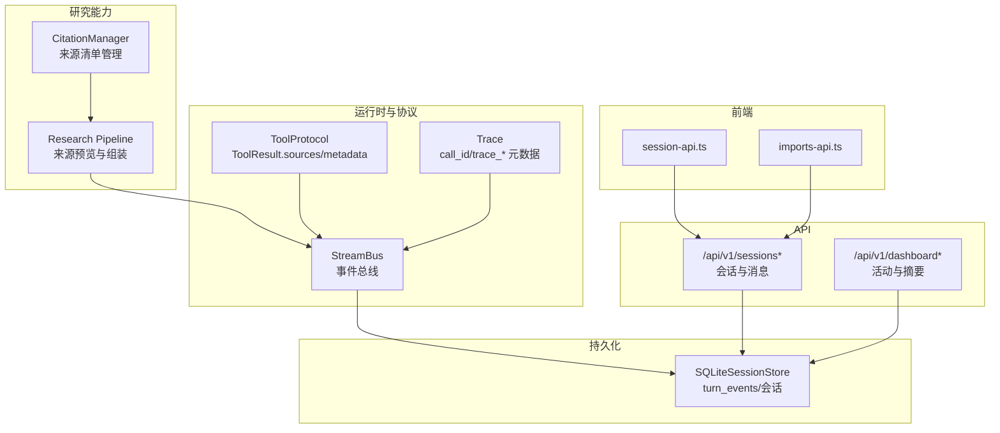
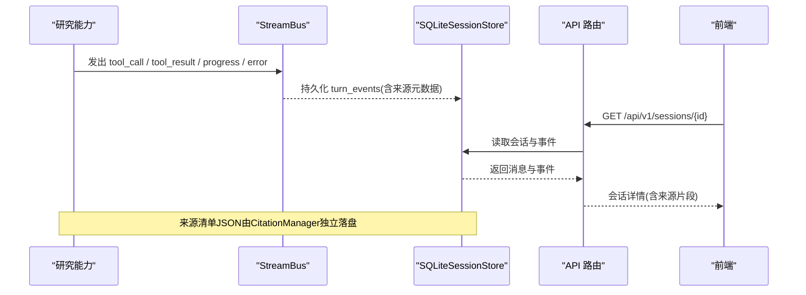
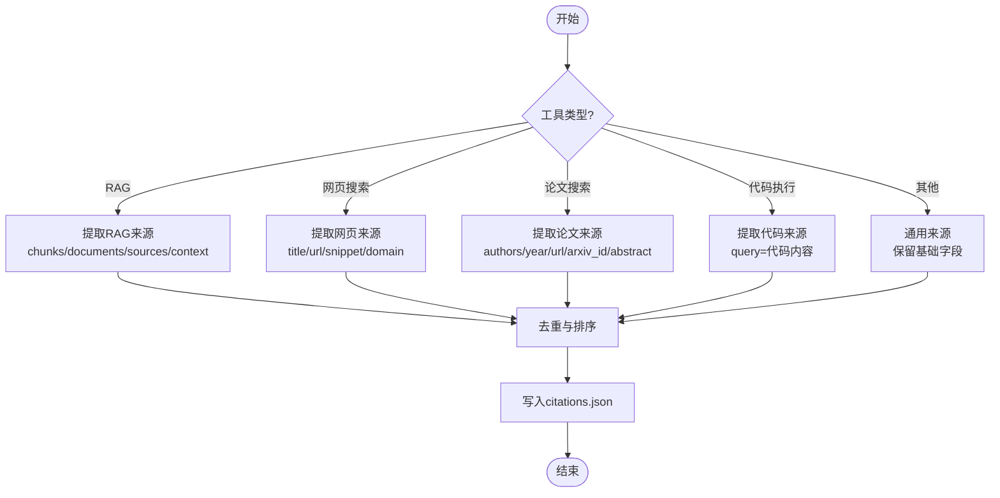
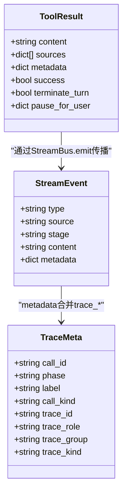
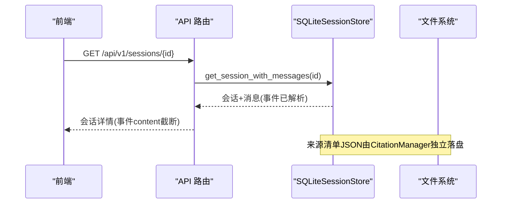
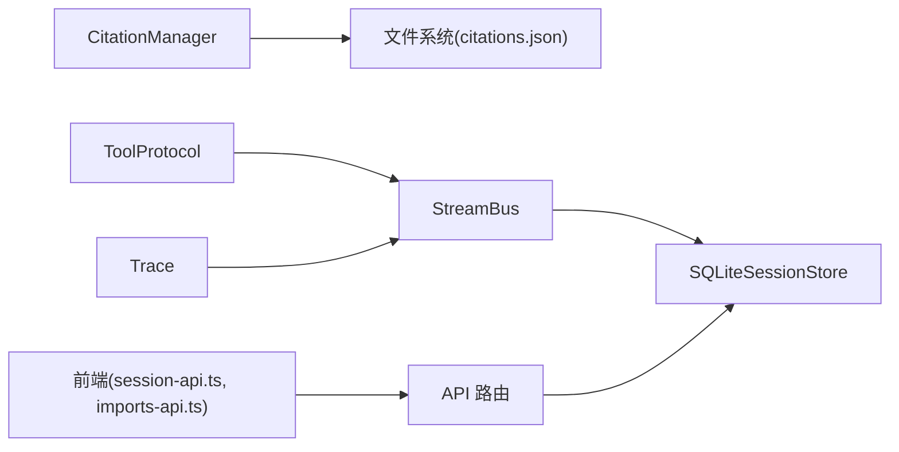

# 来源清单系统

<cite>
**本文引用的文件**
- [citation_manager.py](file://deeptutor/agents/research/utils/citation_manager.py)
- [sqlite_store.py](file://deeptutor/services/session/sqlite_store.py)
- [stream_bus.py](file://deeptutor/core/stream_bus.py)
- [tool_protocol.py](file://deeptutor/core/tool_protocol.py)
- [trace.py](file://deeptutor/core/trace.py)
- [sessions.py](file://deeptutor/api/routers/sessions.py)
- [dashboard.py](file://deeptutor/api/routers/dashboard.py)
- [session-api.ts](file://web/lib/session-api.ts)
- [imports-api.ts](file://web/lib/imports-api.ts)
- [pipeline.py](file://deeptutor/agents/research/pipeline.py)
- [test_turn_event_store.py](file://tests/core/test_turn_event_store.py)
</cite>

## 目录
1. [简介](#简介)
2. [项目结构](#项目结构)
3. [核心组件](#核心组件)
4. [架构总览](#架构总览)
5. [详细组件分析](#详细组件分析)
6. [依赖关系分析](#依赖关系分析)
7. [性能考量](#性能考量)
8. [故障排查指南](#故障排查指南)
9. [结论](#结论)
10. [附录](#附录)

## 简介
本文件面向 DeepTutor 的“来源清单系统”，系统性说明以下能力：
- 来源追踪机制：如何识别、分类与管理引用来源（如 RAG、网页搜索、论文搜索、代码执行等）。
- 证据链构建：将知识来源、工具调用与外部 API 响应关联，形成可追溯的执行时间线与结构化来源记录。
- 来源验证与可信度评估：校验文本中的引用标记是否有效，提供去重与排序策略，并支持格式化输出。
- 持久化存储与查询接口：来源清单 JSON 与统一会话事件在 SQLite 中的落盘方式，以及前后端访问路径。
- 调试与监控：通过流式事件、跟踪元数据与日志定位问题，辅助开发者排查来源相关问题。

## 项目结构
来源清单系统横跨“研究能力”、“会话与事件总线”、“工具协议”、“API 路由”和“前端交互”五个层次：
- 研究能力层：负责从工具调用中抽取来源信息，生成并维护 citation 清单。
- 会话与事件总线：以 StreamBus 为枢纽，将工具调用、结果、进度、错误等事件广播到订阅者；SQLite 持久化 turn_events 用于回放与审计。
- 工具协议层：定义 ToolResult.sources/metadata 等标准字段，作为来源信息的载体。
- API 路由层：暴露会话列表、详情、消息删除、测验结果写入等接口，供前端消费。
- 前端交互层：通过 session-api.ts、imports-api.ts 等模块发起请求，渲染来源卡片与引用链接。

图表来源
- [citation_manager.py:18-48](file://deeptutor/agents/research/utils/citation_manager.py#L18-L48)
- [stream_bus.py:31-75](file://deeptutor/core/stream_bus.py#L31-L75)
- [tool_protocol.py:121-154](file://deeptutor/core/tool_protocol.py#L121-L154)
- [trace.py:14-41](file://deeptutor/core/trace.py#L14-L41)
- [sqlite_store.py:119-233](file://deeptutor/services/session/sqlite_store.py#L119-L233)
- [sessions.py:80-140](file://deeptutor/api/routers/sessions.py#L80-L140)
- [dashboard.py:12-61](file://deeptutor/api/routers/dashboard.py#L12-L61)
- [session-api.ts:131-168](file://web/lib/session-api.ts#L131-L168)
- [imports-api.ts:22-69](file://web/lib/imports-api.ts#L22-L69)

章节来源
- [citation_manager.py:18-48](file://deeptutor/agents/research/utils/citation_manager.py#L18-L48)
- [sqlite_store.py:119-233](file://deeptutor/services/session/sqlite_store.py#L119-L233)
- [stream_bus.py:31-75](file://deeptutor/core/stream_bus.py#L31-L75)
- [tool_protocol.py:121-154](file://deeptutor/core/tool_protocol.py#L121-L154)
- [trace.py:14-41](file://deeptutor/core/trace.py#L14-L41)
- [sessions.py:80-140](file://deeptutor/api/routers/sessions.py#L80-L140)
- [dashboard.py:12-61](file://deeptutor/api/routers/dashboard.py#L12-L61)
- [session-api.ts:131-168](file://web/lib/session-api.ts#L131-L168)
- [imports-api.ts:22-69](file://web/lib/imports-api.ts#L22-L69)

## 核心组件
- CitationManager：负责来源清单的生命周期管理，包括 ID 分配、来源提取、去重、排序、校验与持久化。
- StreamBus：统一的异步事件总线，承载 tool_call、tool_result、progress、error、sources 等事件，贯穿运行期与 UI。
- SQLiteSessionStore：统一会话与事件存储，持久化 turns 与 turn_events，支持增量回放与批量写入。
- ToolProtocol：标准化工具返回结构，包含 sources 与 metadata，作为来源信息的载体。
- Trace：为每次调用生成稳定的 call_id 与 trace_* 元数据，便于前端渲染与跨阶段关联。
- API 路由：对外暴露会话与活动查询接口，前端据此拉取来源相关上下文与展示数据。

章节来源
- [citation_manager.py:18-48](file://deeptutor/agents/research/utils/citation_manager.py#L18-L48)
- [stream_bus.py:31-75](file://deeptutor/core/stream_bus.py#L31-L75)
- [sqlite_store.py:96-233](file://deeptutor/services/session/sqlite_store.py#L96-L233)
- [tool_protocol.py:121-154](file://deeptutor/core/tool_protocol.py#L121-L154)
- [trace.py:14-41](file://deeptutor/core/trace.py#L14-L41)
- [sessions.py:80-140](file://deeptutor/api/routers/sessions.py#L80-L140)

## 架构总览
来源清单系统在“工具调用 → 事件总线 → 来源提取 → 持久化 → 查询展示”的链路中协作：
- 工具执行产生 ToolResult，携带 sources/metadata。
- 研究管线根据工具类型（RAG、网页搜索、论文搜索、代码执行）抽取结构化来源。
- 事件通过 StreamBus 广播，SQLite 持久化 turn_events，形成可回放的时间线。
- 前端通过 REST 接口获取会话与活动，渲染来源卡片与引用链接。

图表来源
- [stream_bus.py:40-75](file://deeptutor/core/stream_bus.py#L40-L75)
- [sqlite_store.py:657-704](file://deeptutor/services/session/sqlite_store.py#L657-L704)
- [sessions.py:133-140](file://deeptutor/api/routers/sessions.py#L133-L140)
- [session-api.ts:159-168](file://web/lib/session-api.ts#L159-L168)

## 详细组件分析

### 来源识别、分类与管理（CitationManager）
- 来源识别：根据工具类型分派到不同提取器（RAG、网页搜索、论文搜索、代码执行、通用）。
- 来源分类：按工具类型组织来源字段（如 web_sources、papers、sources、query、summary、timestamp）。
- 管理功能：
  - ID 分配：规划阶段 PLAN-XX，研究阶段 CIT-X-XX，支持并发安全锁。
  - 去重与排序：基于标题与作者的去重键，按阶段与序号排序。
  - 校验与修复：正则匹配 [[ID]] 引用，校验有效性并移除无效引用。
  - 持久化：写入 citations.json，保存 research_id、updated_at、citations、counters。
  - 报告格式化：APA 风格论文条目、网页链接列表、RAG 来源摘要。

图表来源
- [citation_manager.py:234-286](file://deeptutor/agents/research/utils/citation_manager.py#L234-L286)
- [citation_manager.py:288-342](file://deeptutor/agents/research/utils/citation_manager.py#L288-L342)
- [citation_manager.py:344-414](file://deeptutor/agents/research/utils/citation_manager.py#L344-L414)
- [citation_manager.py:416-491](file://deeptutor/agents/research/utils/citation_manager.py#L416-L491)
- [citation_manager.py:493-515](file://deeptutor/agents/research/utils/citation_manager.py#L493-L515)
- [citation_manager.py:158-173](file://deeptutor/agents/research/utils/citation_manager.py#L158-L173)

章节来源
- [citation_manager.py:18-48](file://deeptutor/agents/research/utils/citation_manager.py#L18-L48)
- [citation_manager.py:158-173](file://deeptutor/agents/research/utils/citation_manager.py#L158-L173)
- [citation_manager.py:175-232](file://deeptutor/agents/research/utils/citation_manager.py#L175-L232)
- [citation_manager.py:234-286](file://deeptutor/agents/research/utils/citation_manager.py#L234-L286)
- [citation_manager.py:651-800](file://deeptutor/agents/research/utils/citation_manager.py#L651-L800)

### 证据链构建（工具调用、知识来源、外部API响应）
- 工具调用事件：通过 StreamBus.tool_call 与 tool_result 建立调用与结果的对应关系，附带 args 与 tool 名称。
- 知识来源：RAG 工具返回的 chunks/documents/sources 被解析为 sources 列表，附加 kb_name、score、page 等元信息。
- 外部 API 响应：网页搜索与论文搜索的结果通过 metadata.citations/results/papers 或 raw_answer 解析，统一归入来源清单。
- 跟踪元数据：使用 build_trace_metadata/merge_trace_metadata 注入 call_id、trace_role、trace_group、trace_kind，使前端能渲染子调用卡片。

图表来源
- [tool_protocol.py:121-154](file://deeptutor/core/tool_protocol.py#L121-L154)
- [stream_bus.py:157-191](file://deeptutor/core/stream_bus.py#L157-L191)
- [trace.py:14-41](file://deeptutor/core/trace.py#L14-L41)

章节来源
- [tool_protocol.py:121-154](file://deeptutor/core/tool_protocol.py#L121-L154)
- [stream_bus.py:157-191](file://deeptutor/core/stream_bus.py#L157-L191)
- [trace.py:14-41](file://deeptutor/core/trace.py#L14-L41)

### 来源验证与可信度评估
- 引用校验：validate_citation_references 扫描文本中的 [[ID]] 标记，区分有效与无效引用，返回统计与布尔判定。
- 引用修复：fix_invalid_citations 移除无效引用标记，保证输出一致性。
- 可信度指标：
  - RAG 来源包含 score/similarity/page/chunk_id，可用于排序与筛选。
  - 网页搜索与论文搜索提供 title、url、snippet、authors、year、arxiv_id、doi 等字段，便于可信度判断。
  - 去重键与排序键确保重复来源仅出现一次，并按阶段与序号稳定排序。

章节来源
- [citation_manager.py:175-232](file://deeptutor/agents/research/utils/citation_manager.py#L175-L232)
- [citation_manager.py:651-800](file://deeptutor/agents/research/utils/citation_manager.py#L651-L800)

### 持久化存储与查询接口
- 来源清单 JSON：
  - 位置：任务工作区下的 citations.json。
  - 内容：research_id、updated_at、citations、counters（plan_counter、block_counters）。
  - 读写：_load_citations/_save_citations，异常时降级处理。
- 会话与事件：
  - 表结构：sessions、messages、turns、turn_events、notebook_entries。
  - 写入：append_turn_event/append_turn_events，支持单条与批量写入，自动 seq 递增。
  - 读取：get_turn_events(after_seq) 支持增量回放。
- API 接口：
  - GET /api/v1/sessions：列出会话。
  - GET /api/v1/sessions/{id}：获取会话详情（消息与事件），对超大 payload 进行截断。
  - PATCH /api/v1/sessions/{id}：重命名会话。
  - DELETE /api/v1/sessions/{id}：删除会话及附件。
  - POST /api/v1/sessions/{id}/quiz-results：记录测验结果并写入笔记条目。
  - GET /api/v1/dashboard/recent：最近活动列表。
  - GET /api/v1/dashboard/{entry_id}：活动详情（含消息与状态）。

图表来源
- [sessions.py:80-140](file://deeptutor/api/routers/sessions.py#L80-L140)
- [sqlite_store.py:657-704](file://deeptutor/services/session/sqlite_store.py#L657-L704)
- [sqlite_store.py:773-800](file://deeptutor/services/session/sqlite_store.py#L773-L800)
- [citation_manager.py:158-173](file://deeptutor/agents/research/utils/citation_manager.py#L158-L173)

章节来源
- [sessions.py:80-140](file://deeptutor/api/routers/sessions.py#L80-L140)
- [dashboard.py:12-61](file://deeptutor/api/routers/dashboard.py#L12-L61)
- [sqlite_store.py:119-233](file://deeptutor/services/session/sqlite_store.py#L119-L233)
- [sqlite_store.py:657-704](file://deeptutor/services/session/sqlite_store.py#L657-L704)
- [sqlite_store.py:773-800](file://deeptutor/services/session/sqlite_store.py#L773-L800)
- [citation_manager.py:158-173](file://deeptutor/agents/research/utils/citation_manager.py#L158-L173)

### 调试与监控工具使用指南
- 流式事件：
  - 使用 StreamBus.stage/content/thinking/observation/tool_call/tool_result/progress/error/sources 标注阶段与来源。
  - 通过 merge_trace_metadata 注入 trace_kind、call_state、protocol_violation 等诊断字段。
- 事件回放：
  - SQLiteSessionStore.get_turn_events(turn_id, after_seq) 支持增量回放，测试用例验证了 seq 顺序与内容回放。
- 日志与错误：
  - 研究管线在来源预览与解析失败时打印警告，便于快速定位。
  - API 路由对超大事件 payload 进行截断，避免前端卡顿。
- 前端调试：
  - 使用 session-api.ts 与 imports-api.ts 发起请求，观察返回结构与缓存失效行为。

章节来源
- [stream_bus.py:78-229](file://deeptutor/core/stream_bus.py#L78-L229)
- [trace.py:44-82](file://deeptutor/core/trace.py#L44-L82)
- [test_turn_event_store.py:8-48](file://tests/core/test_turn_event_store.py#L8-L48)
- [pipeline.py:2097-2130](file://deeptutor/agents/research/pipeline.py#L2097-L2130)
- [sessions.py:90-131](file://deeptutor/api/routers/sessions.py#L90-L131)
- [session-api.ts:131-168](file://web/lib/session-api.ts#L131-L168)
- [imports-api.ts:22-69](file://web/lib/imports-api.ts#L22-L69)

## 依赖关系分析
- CitationManager 依赖路径服务与 JSON 解析工具，负责来源清单的生成与持久化。
- StreamBus 依赖 trace 工具生成一致的元数据，支撑前端渲染与后端审计。
- SQLiteSessionStore 提供会话与事件的持久化，API 路由通过它暴露查询能力。
- 前端通过 session-api.ts 与 imports-api.ts 调用 API，获取会话与导入结果。

图表来源
- [citation_manager.py:158-173](file://deeptutor/agents/research/utils/citation_manager.py#L158-L173)
- [stream_bus.py:40-75](file://deeptutor/core/stream_bus.py#L40-L75)
- [sqlite_store.py:657-704](file://deeptutor/services/session/sqlite_store.py#L657-L704)
- [sessions.py:80-140](file://deeptutor/api/routers/sessions.py#L80-L140)
- [session-api.ts:131-168](file://web/lib/session-api.ts#L131-L168)
- [imports-api.ts:22-69](file://web/lib/imports-api.ts#L22-L69)

章节来源
- [citation_manager.py:158-173](file://deeptutor/agents/research/utils/citation_manager.py#L158-L173)
- [stream_bus.py:40-75](file://deeptutor/core/stream_bus.py#L40-L75)
- [sqlite_store.py:657-704](file://deeptutor/services/session/sqlite_store.py#L657-L704)
- [sessions.py:80-140](file://deeptutor/api/routers/sessions.py#L80-L140)
- [session-api.ts:131-168](file://web/lib/session-api.ts#L131-L168)
- [imports-api.ts:22-69](file://web/lib/imports-api.ts#L22-L69)

## 性能考量
- 批量写入：SQLiteSessionStore.append_turn_events 使用 executemany 减少事务开销，提升最终化速度。
- 事件载荷截断：API 路由对 tool_result/observation 的 content 进行截断，避免前端渲染压力。
- 来源清单大小控制：RAG 来源限制最多 5 个文档，网页与论文来源也做适度截取，降低 JSON 体积。
- 并发安全：CitationManager 使用 asyncio.Lock 保护并行模式下的计数与写入。

章节来源
- [sqlite_store.py:706-766](file://deeptutor/services/session/sqlite_store.py#L706-L766)
- [sessions.py:90-131](file://deeptutor/api/routers/sessions.py#L90-L131)
- [citation_manager.py:288-342](file://deeptutor/agents/research/utils/citation_manager.py#L288-L342)
- [citation_manager.py:416-491](file://deeptutor/agents/research/utils/citation_manager.py#L416-L491)
- [citation_manager.py:18-48](file://deeptutor/agents/research/utils/citation_manager.py#L18-L48)

## 故障排查指南
- 引用无效：
  - 使用 validate_citation_references 检查文本中的 [[ID]] 是否匹配现有来源。
  - 使用 fix_invalid_citations 清理无效引用，确保输出一致性。
- 来源缺失：
  - 检查工具返回的 metadata.citations/results/papers 是否正确设置。
  - 确认 RAG 返回的 chunks/documents/sources 字段是否存在且非空。
- 事件丢失：
  - 通过 SQLiteSessionStore.get_turn_events 回放事件，核对 seq 顺序与内容。
  - 检查 StreamBus 是否正确 emit 并关闭，确保订阅者收到 DONE 事件。
- 前端显示异常：
  - 查看 API 返回的事件 payload 是否被截断，必要时调整 MAX_EVENT_PAYLOAD。
  - 确认前端缓存失效逻辑（invalidateClientCache）是否生效。

章节来源
- [citation_manager.py:175-232](file://deeptutor/agents/research/utils/citation_manager.py#L175-L232)
- [sqlite_store.py:773-800](file://deeptutor/services/session/sqlite_store.py#L773-L800)
- [stream_bus.py:70-75](file://deeptutor/core/stream_bus.py#L70-L75)
- [sessions.py:90-131](file://deeptutor/api/routers/sessions.py#L90-L131)
- [session-api.ts:170-190](file://web/lib/session-api.ts#L170-L190)

## 结论
DeepTutor 的来源清单系统通过 CitationManager、StreamBus、SQLiteSessionStore 与 API 路由协同工作，实现了从工具调用到来源提取、验证、持久化与查询展示的完整闭环。其设计兼顾了可扩展性（多工具类型）、可靠性（去重与校验）、性能（批量写入与载荷截断）与可观测性（流式事件与跟踪元数据）。开发者可依据本文档快速定位问题并优化来源处理能力。

## 附录
- 关键数据结构：
  - ToolResult：content、sources、metadata、success、terminate_turn、pause_for_user。
  - StreamEvent：type、source、stage、content、metadata。
  - TraceMeta：call_id、phase、label、call_kind、trace_id、trace_role、trace_group、trace_kind。
- 常用接口：
  - GET /api/v1/sessions、GET /api/v1/sessions/{id}、PATCH /api/v1/sessions/{id}、DELETE /api/v1/sessions/{id}、POST /api/v1/sessions/{id}/quiz-results。
  - GET /api/v1/dashboard/recent、GET /api/v1/dashboard/{entry_id}。
- 前端模块：
  - session-api.ts：会话列表、详情、更新、删除、测验结果记录。
  - imports-api.ts：聊天历史导入与会话列表。

章节来源
- [tool_protocol.py:121-154](file://deeptutor/core/tool_protocol.py#L121-L154)
- [stream_bus.py:40-75](file://deeptutor/core/stream_bus.py#L40-L75)
- [trace.py:14-41](file://deeptutor/core/trace.py#L14-L41)
- [sessions.py:80-231](file://deeptutor/api/routers/sessions.py#L80-L231)
- [dashboard.py:12-61](file://deeptutor/api/routers/dashboard.py#L12-L61)
- [session-api.ts:131-217](file://web/lib/session-api.ts#L131-L217)
- [imports-api.ts:22-69](file://web/lib/imports-api.ts#L22-L69)