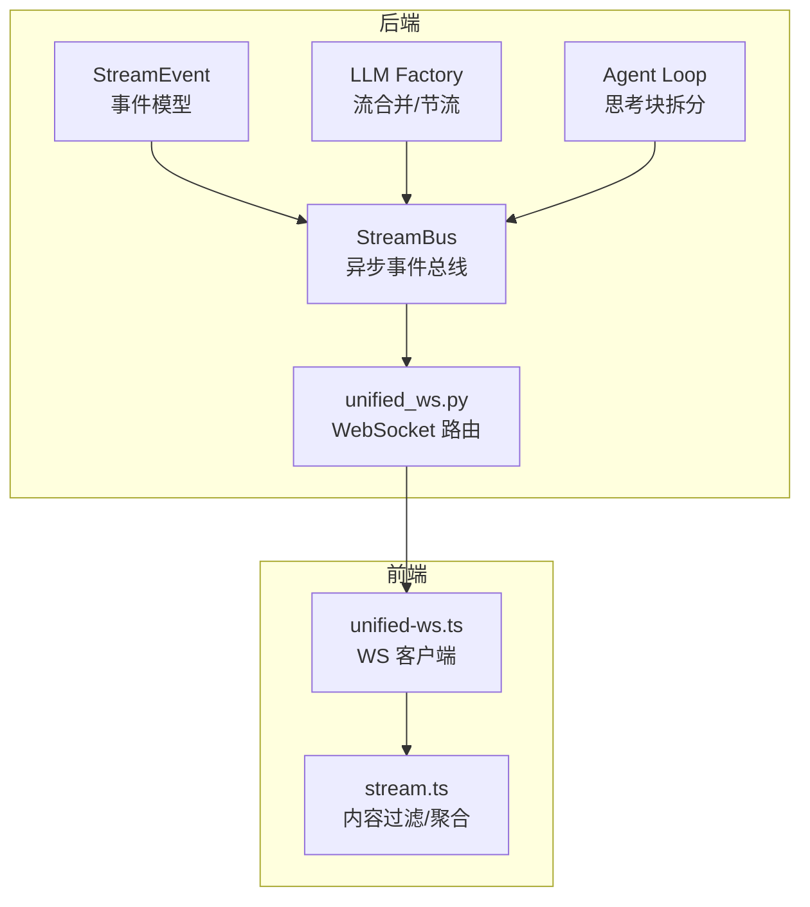
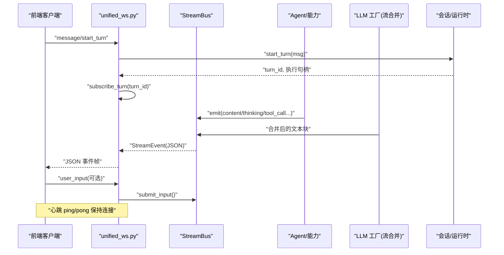
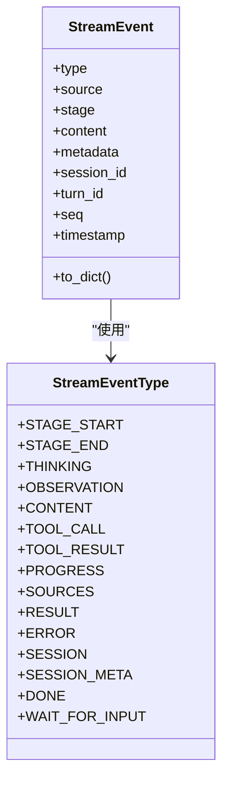
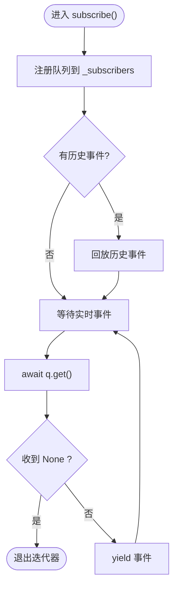
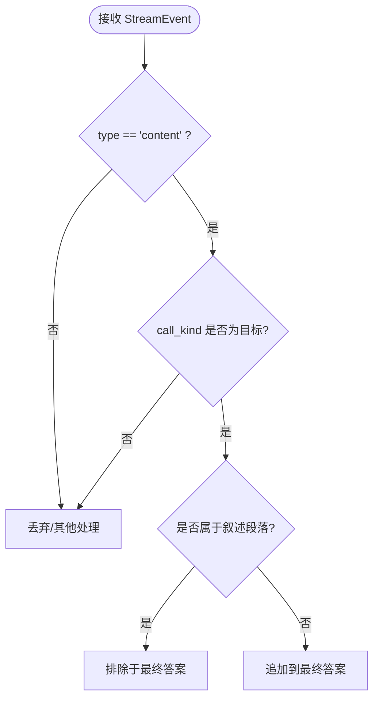
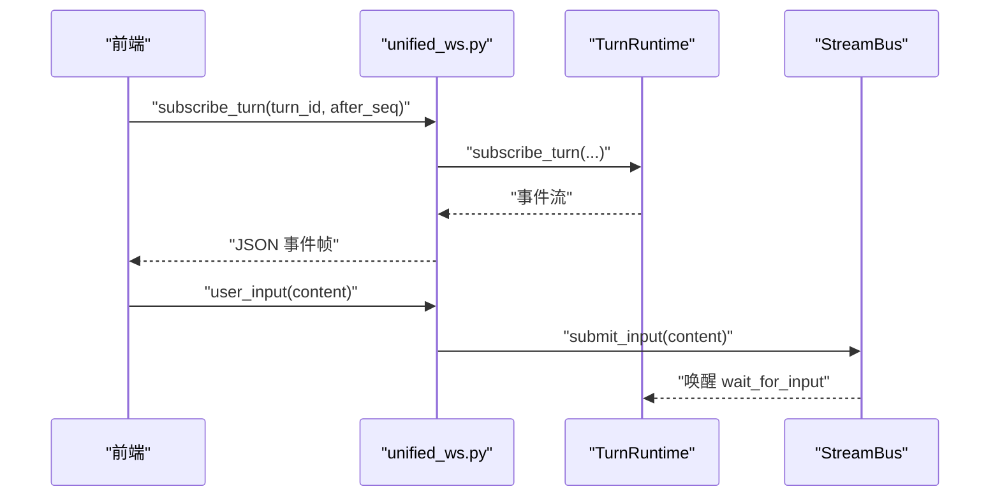
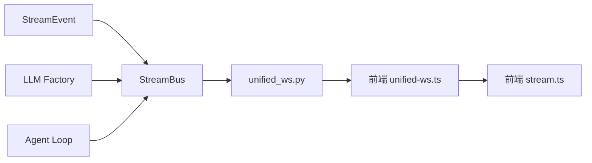

# 流式响应协议

<cite>
**本文引用的文件**
- [deeptutor/core/stream.py](file://deeptutor/core/stream.py)
- [deeptutor/core/stream_bus.py](file://deeptutor/core/stream_bus.py)
- [deeptutor/api/routers/unified_ws.py](file://deeptutor/api/routers/unified_ws.py)
- [web/lib/stream.ts](file://web/lib/stream.ts)
- [web/lib/unified-ws.ts](file://web/lib/unified-ws.ts)
- [tests/core/test_stream_bus.py](file://tests/core/test_stream_bus.py)
- [tests/agents/chat/test_agent_loop.py](file://tests/agents/chat/test_agent_loop.py)
- [deeptutor/agents/chat/agent_loop.py](file://deeptutor/agents/chat/agent_loop.py)
- [deeptutor/services/llm/factory.py](file://deeptutor/services/llm/factory.py)
</cite>

## 目录
1. [简介](#简介)
2. [项目结构](#项目结构)
3. [核心组件](#核心组件)
4. [架构总览](#架构总览)
5. [详细组件分析](#详细组件分析)
6. [依赖关系分析](#依赖关系分析)
7. [性能考量](#性能考量)
8. [故障排查指南](#故障排查指南)
9. [结论](#结论)
10. [附录：客户端集成与最佳实践](#附录客户端集成与最佳实践)

## 简介
本文件系统性说明 DeepTutor 的流式响应协议，覆盖增量数据传输、实时交互机制、事件类型系统（StreamEvent）、订阅者模式（StreamBus）、流数据过滤与聚合策略（答案提取与噪音过滤），以及客户端集成与性能优化建议。目标是帮助后端开发者、前端集成者与运维人员理解并正确使用该协议。

## 项目结构
与流式协议相关的关键位置如下：
- 事件模型与类型定义：deeptutor/core/stream.py
- 异步事件总线（生产者/消费者）：deeptutor/core/stream_bus.py
- WebSocket 统一端点（路由与消息分发）：deeptutor/api/routers/unified_ws.py
- 前端流处理与过滤：web/lib/stream.ts、web/lib/unified-ws.ts
- 流式 LLM 合并与节流：deeptutor/services/llm/factory.py
- 思考块拆分与内容净化：deeptutor/agents/chat/agent_loop.py
- 行为验证测试：tests/core/test_stream_bus.py、tests/agents/chat/test_agent_loop.py

图表来源
- [deeptutor/core/stream.py:17-34](file://deeptutor/core/stream.py#L17-L34)
- [deeptutor/core/stream_bus.py:31-75](file://deeptutor/core/stream_bus.py#L31-L75)
- [deeptutor/api/routers/unified_ws.py:44-110](file://deeptutor/api/routers/unified_ws.py#L44-L110)
- [deeptutor/services/llm/factory.py:533-567](file://deeptutor/services/llm/factory.py#L533-L567)
- [deeptutor/agents/chat/agent_loop.py:60-79](file://deeptutor/agents/chat/agent_loop.py#L60-L79)
- [web/lib/unified-ws.ts:157-242](file://web/lib/unified-ws.ts#L157-L242)
- [web/lib/stream.ts:15-75](file://web/lib/stream.ts#L15-L75)

章节来源
- [deeptutor/core/stream.py:1-73](file://deeptutor/core/stream.py#L1-L73)
- [deeptutor/core/stream_bus.py:1-326](file://deeptutor/core/stream_bus.py#L1-L326)
- [deeptutor/api/routers/unified_ws.py:1-325](file://deeptutor/api/routers/unified_ws.py#L1-L325)
- [web/lib/stream.ts:1-76](file://web/lib/stream.ts#L1-L76)
- [web/lib/unified-ws.ts:157-242](file://web/lib/unified-ws.ts#L157-L242)

## 核心组件
- StreamEvent 与 StreamEventType：统一的流事件数据模型与枚举类型，承载 type/source/stage/content/metadata 等字段，支持序列化到 JSON。
- StreamBus：单轮对话内的异步事件总线，提供 emit/subscribe/close 及多种便捷方法（content/thinking/tool_call/tool_result/progress/sources/result/error/wait_for_input）。
- unified_ws.py：单一 WebSocket 端点，负责鉴权、消息路由、任务订阅/取消、用户输入回传、重连恢复等。
- 前端流处理：unified-ws.ts 维护 WS 连接、心跳、断线重连、按 turn_id/seq 恢复；stream.ts 实现“仅追加最终答案”的过滤与“叙述性段落”剔除。
- LLM 流合并与节流：factory.py 将底层 LLM 的细粒度 chunk 合并为更友好的推送节奏，避免 UI 抖动。
- 思考块拆分：agent_loop.py 中的 InlineThinkFilter 在流式阶段将 <think>...</think> 或 <thinking>...</thinking> 从正文中剥离，分别输出到 thinking 与 content。

章节来源
- [deeptutor/core/stream.py:17-73](file://deeptutor/core/stream.py#L17-L73)
- [deeptutor/core/stream_bus.py:31-306](file://deeptutor/core/stream_bus.py#L31-L306)
- [deeptutor/api/routers/unified_ws.py:44-325](file://deeptutor/api/routers/unified_ws.py#L44-L325)
- [web/lib/unified-ws.ts:157-242](file://web/lib/unified-ws.ts#L157-L242)
- [web/lib/stream.ts:15-75](file://web/lib/stream.ts#L15-L75)
- [deeptutor/services/llm/factory.py:533-567](file://deeptutor/services/llm/factory.py#L533-L567)
- [deeptutor/agents/chat/agent_loop.py:60-79](file://deeptutor/agents/chat/agent_loop.py#L60-L79)

## 架构总览
下图展示一次典型的用户请求到流式响应的端到端流程：

图表来源
- [deeptutor/api/routers/unified_ws.py:113-150](file://deeptutor/api/routers/unified_ws.py#L113-L150)
- [deeptutor/core/stream_bus.py:40-75](file://deeptutor/core/stream_bus.py#L40-L75)
- [deeptutor/services/llm/factory.py:533-567](file://deeptutor/services/llm/factory.py#L533-L567)

章节来源
- [deeptutor/api/routers/unified_ws.py:44-325](file://deeptutor/api/routers/unified_ws.py#L44-L325)
- [deeptutor/core/stream_bus.py:31-306](file://deeptutor/core/stream_bus.py#L31-L306)

## 详细组件分析

### 事件类型系统与 StreamEvent
- 事件类型涵盖阶段开始/结束、思考、观察、内容、工具调用/结果、进度、来源、结果、错误、会话信息、完成、等待输入等。
- StreamEvent 包含语义化字段：type/source/stage/content/metadata/session_id/turn_id/seq/timestamp，并提供 to_dict() 用于 JSON 序列化。
- 通过 StreamBus 的便捷方法，生产者可快速发出不同语义的事件，便于前端差异化渲染。

图表来源
- [deeptutor/core/stream.py:17-73](file://deeptutor/core/stream.py#L17-L73)

章节来源
- [deeptutor/core/stream.py:17-73](file://deeptutor/core/stream.py#L17-L73)

### 订阅者模式与事件分发（StreamBus）
- 多订阅者扇出：每个 subscribe() 返回一个异步迭代器，内部使用 asyncio.Queue 进行事件投递。
- 历史回放：新订阅者在注册时会回放已发生的历史事件，确保“迟到订阅者”不丢事件。
- 生命周期管理：close() 向所有队列发送终止信号；emit() 在关闭后忽略后续事件。
- 便捷 API：content/thinking/observation/tool_call/tool_result/progress/sources/result/error/wait_for_input 等方法封装了常见事件构造。
- 用户输入通道：wait_for_input 暂停能力执行并等待前端通过 user_input 提交回复，支持超时。

图表来源
- [deeptutor/core/stream_bus.py:48-75](file://deeptutor/core/stream_bus.py#L48-L75)

章节来源
- [deeptutor/core/stream_bus.py:31-306](file://deeptutor/core/stream_bus.py#L31-L306)
- [tests/core/test_stream_bus.py:18-112](file://tests/core/test_stream_bus.py#L18-L112)

### 流式数据的过滤与聚合策略
- 前端过滤规则（stream.ts）：
  - shouldAppendEventContent：仅当类型为 content 且元数据标记为 llm_final_response 或 agent_loop_round 时才追加到最终答案。
  - collectNarrationCallIds/recomputeAnswerContent：收集“叙述性”段落标记并从答案中剔除，保证最终答案纯净。
  - isNarrationMarker：识别每轮的状态标记事件，用于触发答案重建。
- 后端思考块拆分（agent_loop.py）：
  - InlineThinkFilter 在流式阶段将 <think>...</think> 或 <thinking>...</thinking> 从正文中分离，分别输出到 thinking 与 content，避免思考过程污染最终答案。
- LLM 流合并与节流（factory.py）：
  - 将底层细粒度 chunk 合并为更合适的推送节奏，减少 UI 抖动与网络开销。

图表来源
- [web/lib/stream.ts:15-75](file://web/lib/stream.ts#L15-L75)
- [deeptutor/agents/chat/agent_loop.py:60-79](file://deeptutor/agents/chat/agent_loop.py#L60-L79)
- [deeptutor/services/llm/factory.py:533-567](file://deeptutor/services/llm/factory.py#L533-L567)

章节来源
- [web/lib/stream.ts:15-75](file://web/lib/stream.ts#L15-L75)
- [tests/agents/chat/test_agent_loop.py:198-225](file://tests/agents/chat/test_agent_loop.py#L198-L225)
- [deeptutor/services/llm/factory.py:533-567](file://deeptutor/services/llm/factory.py#L533-L567)

### WebSocket 统一端点与实时交互
- 单一 /api/v1/ws 端点，支持 message/start_turn、subscribe_turn、subscribe_session、resume_from、unsubscribe、cancel_turn、submit_user_reply、regenerate、check_active_turn、user_input 等消息类型。
- 安全与健壮性：
  - 鉴权失败直接拒绝。
  - safe_send 对非可序列化值做兜底，防止阻塞整个推送通道。
  - 心跳 ping/pong 维持连接活跃。
- 重连与恢复：
  - 客户端携带 turn_id 与 lastSeq，服务端根据 after_seq 恢复事件流，避免重复或丢失。
- 用户输入：
  - user_input 通过 get_bus(turn_id).submit_input() 注入到 wait_for_input 的等待队列，使能力流程继续。

图表来源
- [deeptutor/api/routers/unified_ws.py:79-210](file://deeptutor/api/routers/unified_ws.py#L79-L210)
- [deeptutor/core/stream_bus.py:262-298](file://deeptutor/core/stream_bus.py#L262-L298)

章节来源
- [deeptutor/api/routers/unified_ws.py:44-325](file://deeptutor/api/routers/unified_ws.py#L44-L325)

## 依赖关系分析
- StreamEvent 被 StreamBus 使用以构建事件对象。
- StreamBus 被 unified_ws.py 通过 TurnRuntime 间接消费，同时作为用户输入的中转站。
- 前端 unified-ws.ts 解析后端推送的 JSON 事件，并根据 stream.ts 的规则进行内容过滤与聚合。
- LLM factory 对底层流进行合并，降低前端渲染压力。
- Agent loop 的 InlineThinkFilter 在后端侧预处理内容，减少前端过滤负担。

图表来源
- [deeptutor/core/stream.py:17-73](file://deeptutor/core/stream.py#L17-L73)
- [deeptutor/core/stream_bus.py:31-306](file://deeptutor/core/stream_bus.py#L31-L306)
- [deeptutor/api/routers/unified_ws.py:44-325](file://deeptutor/api/routers/unified_ws.py#L44-L325)
- [web/lib/unified-ws.ts:157-242](file://web/lib/unified-ws.ts#L157-L242)
- [web/lib/stream.ts:15-75](file://web/lib/stream.ts#L15-L75)
- [deeptutor/services/llm/factory.py:533-567](file://deeptutor/services/llm/factory.py#L533-L567)
- [deeptutor/agents/chat/agent_loop.py:60-79](file://deeptutor/agents/chat/agent_loop.py#L60-L79)

章节来源
- [deeptutor/core/stream.py:17-73](file://deeptutor/core/stream.py#L17-L73)
- [deeptutor/core/stream_bus.py:31-306](file://deeptutor/core/stream_bus.py#L31-L306)
- [deeptutor/api/routers/unified_ws.py:44-325](file://deeptutor/api/routers/unified_ws.py#L44-L325)
- [web/lib/unified-ws.ts:157-242](file://web/lib/unified-ws.ts#L157-L242)
- [web/lib/stream.ts:15-75](file://web/lib/stream.ts#L15-L75)
- [deeptutor/services/llm/factory.py:533-567](file://deeptutor/services/llm/factory.py#L533-L567)
- [deeptutor/agents/chat/agent_loop.py:60-79](file://deeptutor/agents/chat/agent_loop.py#L60-L79)

## 性能考量
- 事件合并与节流：LLM 工厂层对细粒度 chunk 进行合并，减少网络与渲染频率，提升用户体验。
- 前端平滑显示：结合节流与逐帧揭示策略，避免长停顿后的大块内容导致卡顿。
- 历史回放与队列容量：StreamBus 使用内存队列与历史列表，适合单轮对话；对于超长会话需关注内存占用。
- 字节上限与缓冲裁剪：部分日志/任务流管理器具备近似字节上限，避免无限增长。
- 心跳与重连：前端心跳与断线重连机制保障长连接稳定性，减少无效事件与重复渲染。

[本节为通用性能讨论，不直接分析具体文件]

## 故障排查指南
- 无法收到事件：
  - 检查 WS 是否成功建立并发送了 subscribe_turn/subscribe_session。
  - 确认 after_seq 是否正确，避免遗漏或重复。
- 事件乱序或重复：
  - 核对客户端 lastSeq 更新逻辑，确保每次收到事件都更新。
  - 检查服务端 resume_from 参数与历史回放范围。
- 内容污染（思考过程出现在答案中）：
  - 确认前端 shouldAppendEventContent 与 narration 过滤逻辑生效。
  - 检查后端 InlineThinkFilter 是否正确拆分 think 标签。
- 用户输入未生效：
  - 确认 turn_id 正确，且 bus 已注册。
  - 检查 submit_user_reply/user_input 是否到达 StreamBus.submit_input。
- 连接断开与重连：
  - 前端 onclose 应触发 attemptReconnect，并在 onopen 时发送 resume_from。
  - 服务端 safe_send 异常会关闭 socket，需检查事件序列化。

章节来源
- [deeptutor/api/routers/unified_ws.py:136-210](file://deeptutor/api/routers/unified_ws.py#L136-L210)
- [web/lib/unified-ws.ts:190-242](file://web/lib/unified-ws.ts#L190-L242)
- [web/lib/stream.ts:15-75](file://web/lib/stream.ts#L15-L75)
- [deeptutor/core/stream_bus.py:262-298](file://deeptutor/core/stream_bus.py#L262-L298)

## 结论
DeepTutor 的流式响应协议通过统一的事件模型与异步事件总线，实现了高内聚、低耦合的增量数据传输与实时交互。StreamEvent 提供清晰的语义分类，StreamBus 提供可靠的订阅与回放机制，unified_ws.py 提供健壮的 WebSocket 接入与用户输入通道，前端则通过精细的过滤与聚合策略保证最终答案的纯净与流畅。配合 LLM 流合并与思考块拆分，整体方案兼顾性能与体验。

[本节为总结性内容，不直接分析具体文件]

## 附录：客户端集成与最佳实践
- 连接与会话：
  - 使用 UnifiedWSClient 建立连接，设置 activeTurnId 与 lastSeq，以便重连后恢复。
  - 发送 message/start_turn 启动一轮对话，随后 subscribe_turn 订阅事件。
- 事件处理：
  - 过滤 content 事件，仅接受 llm_final_response 或 agent_loop_round。
  - 监听 call_status 标记，识别并剔除叙述性段落。
- 用户输入：
  - 当后端发出 WAIT_FOR_INPUT 时，通过 user_input 提交回复，使能力流程继续。
- 性能优化：
  - 合理设置合并与节流参数，避免过细粒度的推送。
  - 控制历史回放长度，避免大段历史一次性回放造成卡顿。
  - 使用心跳与重连机制，提高长连接稳定性。

章节来源
- [web/lib/unified-ws.ts:157-242](file://web/lib/unified-ws.ts#L157-L242)
- [web/lib/stream.ts:15-75](file://web/lib/stream.ts#L15-L75)
- [deeptutor/api/routers/unified_ws.py:225-310](file://deeptutor/api/routers/unified_ws.py#L225-L310)
- [deeptutor/core/stream_bus.py:262-298](file://deeptutor/core/stream_bus.py#L262-L298)