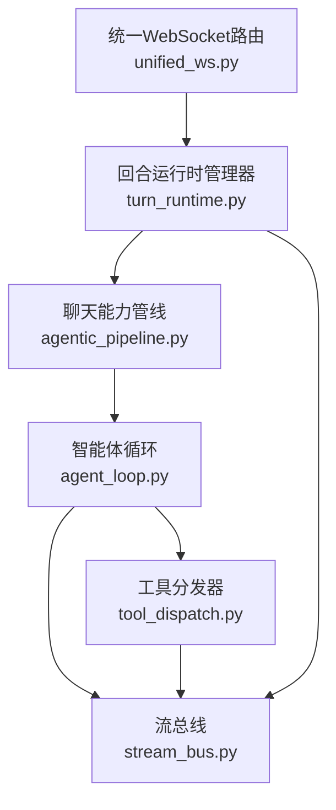
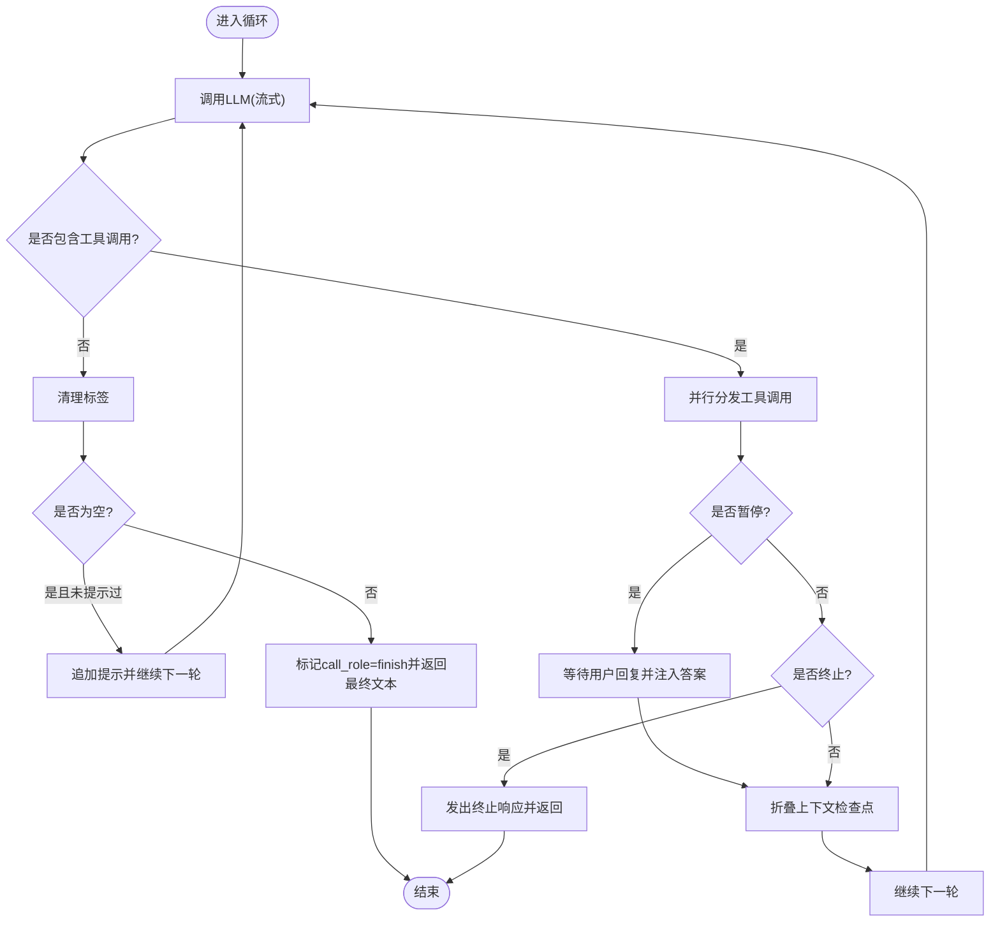
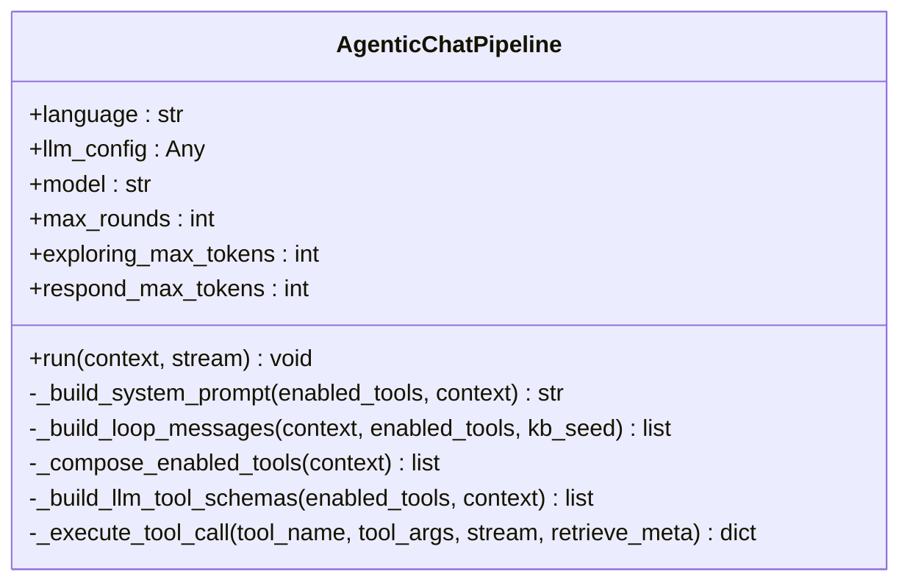
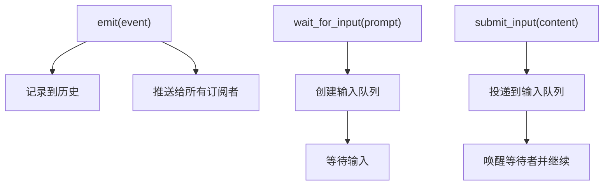
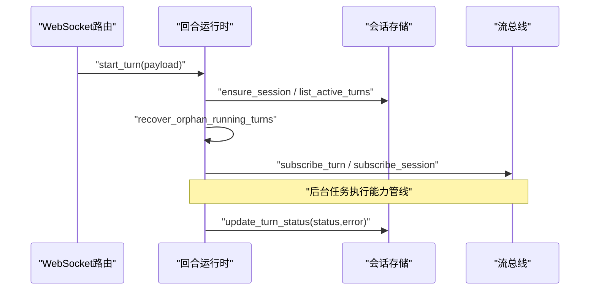
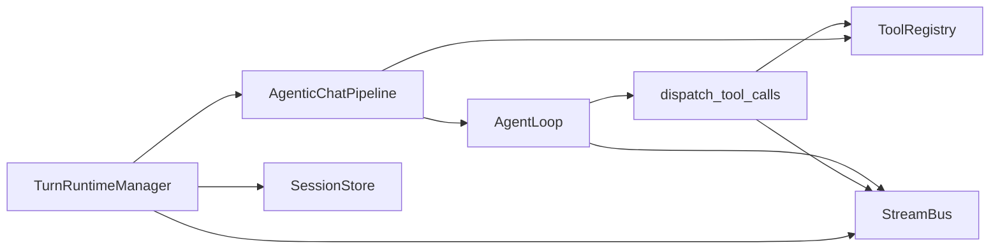

# 智能体循环

<cite>
**本文引用的文件**
- [agent_loop.py](file://deeptutor/agents/chat/agent_loop.py)
- [agentic_pipeline.py](file://deeptutor/agents/chat/agentic_pipeline.py)
- [tool_dispatch.py](file://deeptutor/core/agentic/tool_dispatch.py)
- [loop.py](file://deeptutor/core/agentic/loop.py)
- [unified_ws.py](file://deeptutor/api/routers/unified_ws.py)
- [turn_runtime.py](file://deeptutor/services/session/turn_runtime.py)
- [stream_bus.py](file://deeptutor/core/stream_bus.py)
</cite>

## 目录
1. [简介](#简介)
2. [项目结构](#项目结构)
3. [核心组件](#核心组件)
4. [架构总览](#架构总览)
5. [详细组件分析](#详细组件分析)
6. [依赖关系分析](#依赖关系分析)
7. [性能考量](#性能考量)
8. [故障排查指南](#故障排查指南)
9. [结论](#结论)
10. [附录：使用示例与最佳实践](#附录使用示例与最佳实践)

## 简介
本文件系统性阐述 DeepTutor 的“智能体循环”机制，聚焦于探索-响应的双阶段循环工作原理、TurnRequest 处理流程、消息传递机制、状态管理、错误处理与重试策略，并提供面向对话开发的实践指引。该机制以“一轮 LLM 调用 + 工具调度”为基本单元，在单轮对话中持续迭代，直到模型决定不再调用工具并输出最终回答；若遇到需要用户确认或补充信息的场景，则暂停并等待用户回复后继续执行。

## 项目结构
围绕智能体循环的关键代码分布在以下模块：
- 会话与回合运行时：负责启动回合、事件订阅、用户输入注入、持久化等
- 能力装配管线：组装系统提示、工具清单、知识库种子、能力前置信息
- 智能体循环：驱动“探索-响应”主循环，流式输出内容、思考片段与工具结果
- 工具分发器：并行执行工具调用，生成 role=tool 消息，处理暂停/终止信号
- 流总线：统一的事件通道，承载 content/thinking/tool_call/tool_result/progress/sources/result/error/wait_for_input 等事件



图表来源
- [unified_ws.py:44-134](file://deeptutor/api/routers/unified_ws.py#L44-L134)
- [turn_runtime.py:594-800](file://deeptutor/services/session/turn_runtime.py#L594-L800)
- [agentic_pipeline.py:185-346](file://deeptutor/agents/chat/agentic_pipeline.py#L185-L346)
- [agent_loop.py:151-228](file://deeptutor/agents/chat/agent_loop.py#L151-L228)
- [tool_dispatch.py:78-207](file://deeptutor/core/agentic/tool_dispatch.py#L78-L207)
- [stream_bus.py:31-243](file://deeptutor/core/stream_bus.py#L31-L243)

章节来源
- [unified_ws.py:44-134](file://deeptutor/api/routers/unified_ws.py#L44-L134)
- [turn_runtime.py:594-800](file://deeptutor/services/session/turn_runtime.py#L594-L800)
- [agentic_pipeline.py:185-346](file://deeptutor/agents/chat/agentic_pipeline.py#L185-L346)
- [agent_loop.py:151-228](file://deeptutor/agents/chat/agent_loop.py#L151-L228)
- [tool_dispatch.py:78-207](file://deeptutor/core/agentic/tool_dispatch.py#L78-L207)
- [stream_bus.py:31-243](file://deeptutor/core/stream_bus.py#L31-L243)

## 核心组件
- 回合运行时（TurnRuntimeManager）：维护进程内运行中的回合、事件订阅、用户输入队列、状态恢复与清理
- 聊天能力管线（AgenticChatPipeline）：构建系统提示、用户消息、工具清单与能力前置信息，创建并驱动 AgentLoop
- 智能体循环（AgentLoop）：实现“探索-响应”主循环，流式输出内容/思考，处理工具调用、暂停、强制结束
- 工具分发器（dispatch_tool_calls）：并行执行工具，收集结果，构造 role=tool 消息，处理暂停/终止
- 流总线（StreamBus）：统一事件通道，支持 stage/content/thinking/tool_call/tool_result/progress/sources/result/error/wait_for_input
- 标签驱动循环（run_agentic_loop）：通用标签协议循环，用于其他能力复用（chat 当前采用自研 loop）

章节来源
- [turn_runtime.py:594-800](file://deeptutor/services/session/turn_runtime.py#L594-L800)
- [agentic_pipeline.py:185-346](file://deeptutor/agents/chat/agentic_pipeline.py#L185-L346)
- [agent_loop.py:151-228](file://deeptutor/agents/chat/agent_loop.py#L151-L228)
- [tool_dispatch.py:78-207](file://deeptutor/core/agentic/tool_dispatch.py#L78-L207)
- [stream_bus.py:31-243](file://deeptutor/core/stream_bus.py#L31-L243)
- [loop.py:173-372](file://deeptutor/core/agentic/loop.py#L173-L372)

## 架构总览
下图展示从 WebSocket 请求到智能体循环执行的端到端流程，包括事件流与用户交互点。

```mermaid
sequenceDiagram
participant Client as "客户端"
participant WS as "统一WebSocket路由"
participant TRM as "回合运行时管理器"
participant PIPE as "聊天能力管线"
participant LOOP as "智能体循环"
participant LLM as "LLM客户端"
participant TD as "工具分发器"
participant SB as "流总线"
Client->>WS : "start_turn / message"
WS->>TRM : "start_turn(payload)"
TRM->>PIPE : "run(context, stream)"
PIPE->>LOOP : "构造messages并启动循环"
LOOP->>SB : "stage(responding)"
LOOP->>LLM : "chat.completions(stream=True)"
LLM-->>LOOP : "content/thinking/tool_calls(流式)"
LOOP->>SB : "content/thinking(progress)"
alt 有工具调用
LOOP->>TD : "dispatch_tool_calls(tool_calls)"
TD->>SB : "tool_call(tool_name,args)"
TD-->>LOOP : "tool_messages + pause/terminate"
LOOP->>SB : "tool_result(result)"
opt 暂停
LOOP->>TRM : "await_user_reply_and_resolve()"
TRM->>SB : "wait_for_input(prompt)"
Client->>TRM : "submit_user_reply(text/answers)"
TRM->>LOOP : "注入用户答案并继续"
end
else 无工具调用
LOOP->>SB : "call_role=finish"
end
LOOP-->>PIPE : "final_text, completed"
PIPE-->>TRM : "emit_capability_result"
TRM-->>Client : "事件流(内容/进度/来源/结果)"
```

图表来源
- [unified_ws.py:113-134](file://deeptutor/api/routers/unified_ws.py#L113-L134)
- [turn_runtime.py:655-800](file://deeptutor/services/session/turn_runtime.py#L655-L800)
- [agentic_pipeline.py:326-346](file://deeptutor/agents/chat/agentic_pipeline.py#L326-L346)
- [agent_loop.py:172-228](file://deeptutor/agents/chat/agent_loop.py#L172-L228)
- [tool_dispatch.py:78-207](file://deeptutor/core/agentic/tool_dispatch.py#L78-L207)
- [stream_bus.py:78-243](file://deeptutor/core/stream_bus.py#L78-L243)

## 详细组件分析

### 智能体循环（AgentLoop）：探索-响应双阶段
- 一轮 = 一次 LLM 调用；文本流式输出为用户可见内容，工具调用结果以 role=tool 追加进对话
- 若本轮包含工具调用，视为“叙述性”前导，循环继续；若无工具调用，则为“完成”，文本即最终回答
- 预算耗尽时强制一次无工具的“完成”轮次
- ask_user 暂停：轮次暂停，等待用户回复后在协议内恢复
- 流式处理：
  - 将 <think>/<thinking> 片段分流至 thinking 通道，保持 content 对用户友好
  - 对不支持原生 tool schema 的提供商进行降级重试
  - 对图像输入不支持的情况自动剥离图片并重试
- 上下文检查点：根据工具结果中的 _context_checkpoint 摘要折叠消息历史，控制上下文窗口



图表来源
- [agent_loop.py:234-357](file://deeptutor/agents/chat/agent_loop.py#L234-L357)
- [agent_loop.py:438-637](file://deeptutor/agents/chat/agent_loop.py#L438-L637)

章节来源
- [agent_loop.py:151-228](file://deeptutor/agents/chat/agent_loop.py#L151-L228)
- [agent_loop.py:234-357](file://deeptutor/agents/chat/agent_loop.py#L234-L357)
- [agent_loop.py:438-637](file://deeptutor/agents/chat/agent_loop.py#L438-L637)

### 能力管线（AgenticChatPipeline）：TurnRequest 解析与能力路由
- 准备延迟工具视图与知识库清单，计算启用工具集与是否使用原生工具调用
- 构建系统提示与用户消息，合并知识库种子、能力前置种子与简报
- 组装 LLM 工具模式（如 rag 查询最小长度、笔记本枚举等）
- 创建 AgentLoop 并执行 run()
- 工具执行封装：通过 execute_tool_call 执行单个工具，便于能力内部直接调用



图表来源
- [agentic_pipeline.py:185-346](file://deeptutor/agents/chat/agentic_pipeline.py#L185-L346)
- [agentic_pipeline.py:348-418](file://deeptutor/agents/chat/agentic_pipeline.py#L348-L418)
- [agentic_pipeline.py:586-738](file://deeptutor/agents/chat/agentic_pipeline.py#L586-L738)
- [agentic_pipeline.py:789-800](file://deeptutor/agents/chat/agentic_pipeline.py#L789-L800)

章节来源
- [agentic_pipeline.py:185-346](file://deeptutor/agents/chat/agentic_pipeline.py#L185-L346)
- [agentic_pipeline.py:348-418](file://deeptutor/agents/chat/agentic_pipeline.py#L348-L418)
- [agentic_pipeline.py:586-738](file://deeptutor/agents/chat/agentic_pipeline.py#L586-L738)
- [agentic_pipeline.py:789-800](file://deeptutor/agents/chat/agentic_pipeline.py#L789-L800)

### 工具分发器（dispatch_tool_calls）：并行执行与结果聚合
- 限制最大并行度，去重重复调用（尤其 ask_user）
- 为每个工具调用建立子追踪元数据，发送 tool_call 事件
- 执行工具并收集结果，构造 role=tool 消息
- 汇总 sources、pause/terminate 信号，供上层循环决策

```mermaid
sequenceDiagram
participant Loop as "智能体循环"
participant TD as "工具分发器"
participant Reg as "工具注册表"
participant SB as "流总线"
Loop->>TD : "dispatch_tool_calls(tool_calls, ...)"
TD->>SB : "tool_call(name,args)"
TD->>Reg : "execute(name,args,event_sink)"
Reg-->>TD : "result(content,sources,metadata,pause/terminate)"
TD->>SB : "tool_result(result)"
TD-->>Loop : "DispatchOutcome(tool_messages,sources,pause/terminate)"
```

图表来源
- [tool_dispatch.py:78-207](file://deeptutor/core/agentic/tool_dispatch.py#L78-L207)
- [tool_dispatch.py:436-588](file://deeptutor/core/agentic/tool_dispatch.py#L436-L588)
- [tool_dispatch.py:591-674](file://deeptutor/core/agentic/tool_dispatch.py#L591-L674)

章节来源
- [tool_dispatch.py:78-207](file://deeptutor/core/agentic/tool_dispatch.py#L78-L207)
- [tool_dispatch.py:436-588](file://deeptutor/core/agentic/tool_dispatch.py#L436-L588)
- [tool_dispatch.py:591-674](file://deeptutor/core/agentic/tool_dispatch.py#L591-L674)

### 流总线（StreamBus）：事件通道与用户输入
- 提供 content/thinking/tool_call/tool_result/progress/sources/result/error/wait_for_input 等方法
- 支持 stage 上下文（STAGE_START/STAGE_END），便于前端分组显示
- wait_for_input 与 submit_input 配合实现暂停-恢复的用户交互



图表来源
- [stream_bus.py:31-243](file://deeptutor/core/stream_bus.py#L31-L243)
- [stream_bus.py:262-298](file://deeptutor/core/stream_bus.py#L262-L298)

章节来源
- [stream_bus.py:31-243](file://deeptutor/core/stream_bus.py#L31-L243)
- [stream_bus.py:262-298](file://deeptutor/core/stream_bus.py#L262-L298)

### 回合运行时（TurnRuntimeManager）：TurnRequest 处理与状态管理
- start_turn：校验配置、选择模型、恢复孤儿运行回合、创建执行任务、订阅事件
- 事件过滤：仅捕获 assistant 的 content 事件作为答案内容，排除“叙述性”轮次的文本
- 用户输入注入：通过 _reply_queues 接收前端 submit_user_reply，注入到等待的 ask_user 暂停处
- 状态持久化：根据终端事件与错误事件确定 turn 的最终状态与错误信息



图表来源
- [turn_runtime.py:594-800](file://deeptutor/services/session/turn_runtime.py#L594-L800)
- [turn_runtime.py:41-89](file://deeptutor/services/session/turn_runtime.py#L41-L89)
- [unified_ws.py:113-134](file://deeptutor/api/routers/unified_ws.py#L113-L134)

章节来源
- [turn_runtime.py:41-89](file://deeptutor/services/session/turn_runtime.py#L41-L89)
- [turn_runtime.py:594-800](file://deeptutor/services/session/turn_runtime.py#L594-L800)
- [unified_ws.py:113-134](file://deeptutor/api/routers/unified_ws.py#L113-L134)

## 依赖关系分析
- 耦合关系
  - AgentLoop 依赖 AgenticChatPipeline 提供的消息构建、工具分发、能力前置钩子
  - AgenticChatPipeline 依赖工具注册表与延迟工具视图，动态装配可用工具
  - TurnRuntimeManager 依赖会话存储与流总线，管理回合生命周期与事件流
  - 工具分发器依赖工具注册表与流总线，负责并行执行与事件上报
- 外部依赖
  - LLM 客户端（OpenAI/Azure兼容）：流式补全、工具调用、usage 统计
  - 会话存储（SQLite/PocketBase）：持久化会话、消息、回合状态
  - 前端 WebSocket：事件订阅、用户输入注入、取消/重生成



图表来源
- [agentic_pipeline.py:185-346](file://deeptutor/agents/chat/agentic_pipeline.py#L185-L346)
- [agent_loop.py:151-228](file://deeptutor/agents/chat/agent_loop.py#L151-L228)
- [tool_dispatch.py:78-207](file://deeptutor/core/agentic/tool_dispatch.py#L78-L207)
- [turn_runtime.py:594-800](file://deeptutor/services/session/turn_runtime.py#L594-L800)
- [stream_bus.py:31-243](file://deeptutor/core/stream_bus.py#L31-L243)

章节来源
- [agentic_pipeline.py:185-346](file://deeptutor/agents/chat/agentic_pipeline.py#L185-L346)
- [agent_loop.py:151-228](file://deeptutor/agents/chat/agent_loop.py#L151-L228)
- [tool_dispatch.py:78-207](file://deeptutor/core/agentic/tool_dispatch.py#L78-L207)
- [turn_runtime.py:594-800](file://deeptutor/services/session/turn_runtime.py#L594-L800)
- [stream_bus.py:31-243](file://deeptutor/core/stream_bus.py#L31-L243)

## 性能考量
- 流式输出：每轮文本与思考片段实时推送，降低首字延迟，提升用户体验
- 并行工具调用：最多并发数限制，避免资源争用；重复调用去重，减少冗余执行
- 上下文窗口保护：在进入 LLM 调用前检查并裁剪消息，必要时插入上下文检查点摘要
- 预算控制：每轮 token 上限与最大轮数限制，防止无限循环
- 降级策略：对不支持的工具 schema、图像输入等进行自动降级重试，提高兼容性

[本节为通用指导，不直接分析具体文件]

## 故障排查指南
- 网络异常与模型超时
  - 中间轮失败会触发“强制完成”，保留已收集的工作成果，避免整轮丢失
  - 首次轮失败则向上抛出，由上层处理
- 提供商限制
  - 不支持 stream_options 或工具 schema 时自动降级重试
  - 不支持图像输入时剥离图片并重试
- 业务逻辑错误
  - 工具参数缺失会在分发层拦截并返回结构化错误，引导模型修正
  - 未知工具名或定义构建失败交由注册表报告，分发层关闭子追踪行
- 暂停与恢复
  - ask_user 暂停时，前端需通过 submit_user_reply 注入答案；若未恢复，回合以未完成状态结束
- 状态恢复
  - 服务器重启后，孤儿运行回合会被标记为失败，避免假活

章节来源
- [agent_loop.py:260-273](file://deeptutor/agents/chat/agent_loop.py#L260-L273)
- [agent_loop.py:379-419](file://deeptutor/agents/chat/agent_loop.py#L379-L419)
- [agent_loop.py:639-689](file://deeptutor/agents/chat/agent_loop.py#L639-L689)
- [tool_dispatch.py:279-343](file://deeptutor/core/agentic/tool_dispatch.py#L279-L343)
- [tool_dispatch.py:546-588](file://deeptutor/core/agentic/tool_dispatch.py#L546-L588)
- [turn_runtime.py:634-654](file://deeptutor/services/session/turn_runtime.py#L634-L654)

## 结论
DeepTutor 的智能体循环以“一轮一调”为核心，结合流式输出、并行工具执行、上下文保护与预算控制，实现了稳定高效的探索-响应双阶段机制。通过统一的流总线与回合运行时，系统在交互性、可观测性与鲁棒性方面达到良好平衡。开发者可基于此机制快速构建具备工具调用、用户交互与多轮推理能力的对话应用。

[本节为总结，不直接分析具体文件]

## 附录：使用示例与最佳实践
- 启动回合
  - 通过 WebSocket 发送 start_turn/message，携带 capability、tools、knowledge_bases、language 等字段
  - 后端校验配置并启动后台任务，订阅事件流
- 构建消息与上下文
  - 使用 AgenticChatPipeline._build_loop_messages 组装 system/user 消息，合并知识库种子与能力前置信息
  - 通过 _capability_pre_loop_briefings 执行可选的前置异步钩子，增强 grounding
- 工具调用与暂停
  - 当模型返回 tool_calls 时，交由 dispatch_tool_calls 并行执行；如需用户确认，使用 ask_user 暂停
  - 前端通过 submit_user_reply 注入答案，后端注入 role=tool 消息并继续循环
- 流式输出处理
  - 监听 content/thinking/tool_call/tool_result/progress/sources/result/error 事件，实时更新 UI
  - 注意 call_role 标记：narration 表示叙述性前导，finish 表示最终回答
- 错误处理与重试
  - 捕获网络异常与提供商限制，利用内置降级与强制完成策略保证回合可用性
  - 对工具参数缺失与未知工具名，依据错误信息进行修正提示

章节来源
- [unified_ws.py:113-134](file://deeptutor/api/routers/unified_ws.py#L113-L134)
- [agentic_pipeline.py:326-346](file://deeptutor/agents/chat/agentic_pipeline.py#L326-L346)
- [agentic_pipeline.py:666-697](file://deeptutor/agents/chat/agentic_pipeline.py#L666-L697)
- [agent_loop.py:234-357](file://deeptutor/agents/chat/agent_loop.py#L234-L357)
- [tool_dispatch.py:78-207](file://deeptutor/core/agentic/tool_dispatch.py#L78-L207)
- [stream_bus.py:78-243](file://deeptutor/core/stream_bus.py#L78-L243)