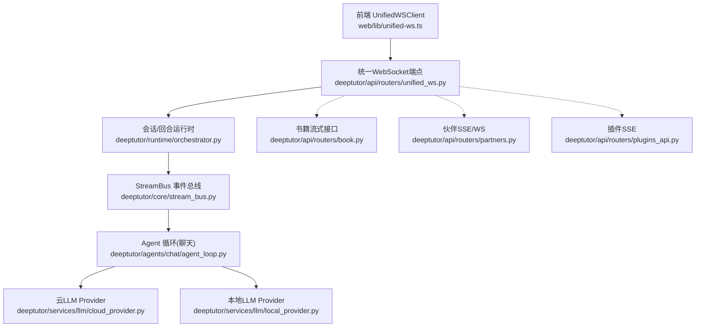
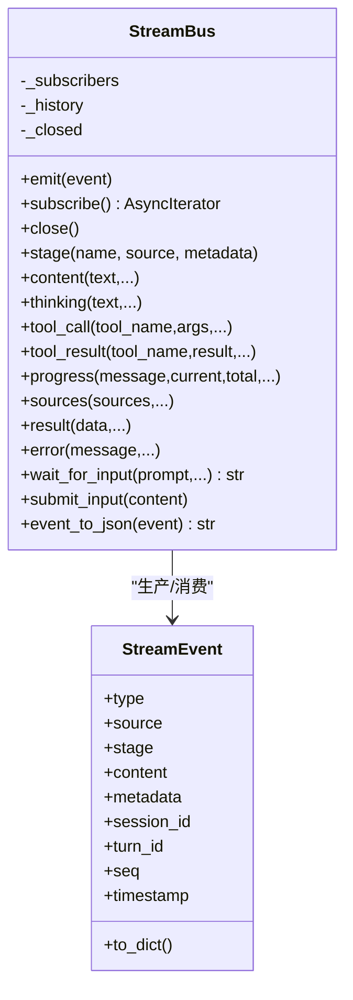
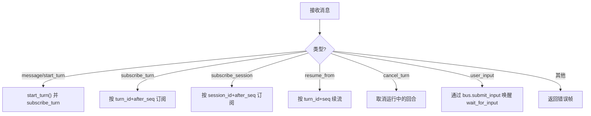
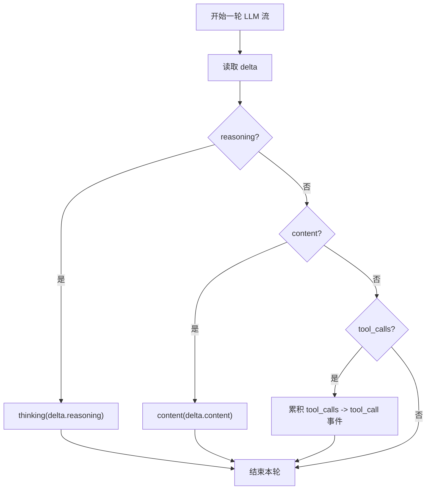
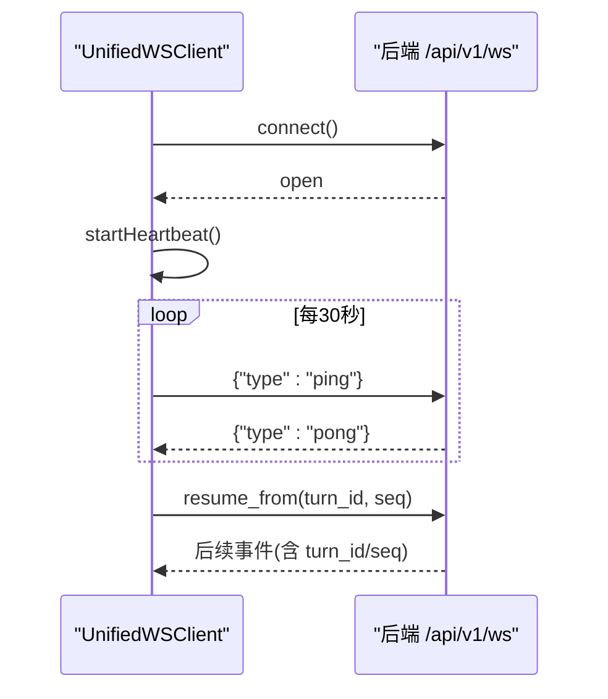
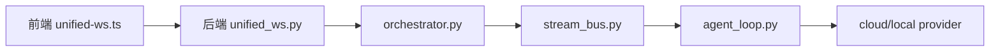

# 流式输出处理

<cite>
**本文引用的文件**
- [stream.py](file://deeptutor/core/stream.py)
- [stream_bus.py](file://deeptutor/core/stream_bus.py)
- [unified_ws.py](file://deeptutor/api/routers/unified_ws.py)
- [unified-ws.ts](file://web/lib/unified-ws.ts)
- [agent_loop.py](file://deeptutor/agents/chat/agent_loop.py)
- [cloud_provider.py](file://deeptutor/services/llm/cloud_provider.py)
- [local_provider.py](file://deeptutor/services/llm/local_provider.py)
- [book.py](file://deeptutor/api/routers/book.py)
- [partners.py](file://deeptutor/api/routers/partners.py)
- [plugins_api.py](file://deeptutor/api/routers/plugins_api.py)
- [orchestrator.py](file://deeptutor/runtime/orchestrator.py)
- [stream.ts](file://web/lib/stream.ts)
</cite>

## 目录
1. [简介](#简介)
2. [项目结构](#项目结构)
3. [核心组件](#核心组件)
4. [架构总览](#架构总览)
5. [详细组件分析](#详细组件分析)
6. [依赖关系分析](#依赖关系分析)
7. [性能考虑](#性能考虑)
8. [故障排查指南](#故障排查指南)
9. [结论](#结论)
10. [附录](#附录)

## 简介
本文件聚焦 DeepTutor 的“智能体循环流式输出处理”，覆盖从后端 LLM 流式响应、Agent 循环分块、统一事件总线到前端 WebSocket 实时渲染的全链路。重点说明：
- SSE/WS 连接管理与心跳、重连与续流
- 文本、工具调用、多媒体内容的分块解析与实时渲染
- 背压控制、内存与带宽优化策略
- 自定义流式处理器与前端组件集成方法（以代码片段路径指引）

## 项目结构
DeepTutor 的流式处理由“协议定义 + 事件总线 + 统一 WS 网关 + Agent 循环 + LLM Provider + 前端客户端”组成，形成端到端的低延迟、可恢复的流式通道。



图表来源
- [unified-ws.ts:157-315](file://web/lib/unified-ws.ts#L157-L315)
- [unified_ws.py:44-325](file://deeptutor/api/routers/unified_ws.py#L44-L325)
- [orchestrator.py:40-81](file://deeptutor/runtime/orchestrator.py#L40-L81)
- [stream_bus.py:31-326](file://deeptutor/core/stream_bus.py#L31-L326)
- [agent_loop.py:151-714](file://deeptutor/agents/chat/agent_loop.py#L151-L714)
- [cloud_provider.py:587-608](file://deeptutor/services/llm/cloud_provider.py#L587-L608)
- [local_provider.py:240-300](file://deeptutor/services/llm/local_provider.py#L240-L300)
- [book.py:521-553](file://deeptutor/api/routers/book.py#L521-L553)
- [partners.py:961-993](file://deeptutor/api/routers/partners.py#L961-L993)
- [plugins_api.py:304-432](file://deeptutor/api/routers/plugins_api.py#L304-L432)

章节来源
- [unified-ws.ts:157-315](file://web/lib/unified-ws.ts#L157-L315)
- [unified_ws.py:44-325](file://deeptutor/api/routers/unified_ws.py#L44-L325)
- [stream_bus.py:31-326](file://deeptutor/core/stream_bus.py#L31-L326)

## 核心组件
- 统一事件协议与数据结构：定义所有流式事件的类型、字段与序列化方式，确保 CLI、WS、SDK 一致消费。
- 异步事件总线 StreamBus：单轮内的生产者-消费者模型，支持阶段标记、进度、工具调用/结果、等待用户输入等。
- 统一 WebSocket 网关：单一 /api/v1/ws 入口，承载回合启动、订阅、续流、取消、用户回复注入等。
- Agent 循环：将 LLM 流式增量转换为 content/thinking/tool_call/tool_result/progress 等事件，并维护“叙述 vs 最终答案”的语义。
- LLM Provider：对 SSE/JSON 流进行行级解析、容错、思考标签拆分与降级策略。
- 前端客户端：心跳、断线重连、指数退避、续流 resume_from、事件过滤与状态同步。

章节来源
- [stream.py:17-73](file://deeptutor/core/stream.py#L17-L73)
- [stream_bus.py:31-326](file://deeptutor/core/stream_bus.py#L31-L326)
- [unified_ws.py:44-325](file://deeptutor/api/routers/unified_ws.py#L44-L325)
- [agent_loop.py:151-714](file://deeptutor/agents/chat/agent_loop.py#L151-L714)
- [cloud_provider.py:587-608](file://deeptutor/services/llm/cloud_provider.py#L587-L608)
- [local_provider.py:240-300](file://deeptutor/services/llm/local_provider.py#L240-L300)
- [unified-ws.ts:157-315](file://web/lib/unified-ws.ts#L157-L315)

## 架构总览
下图展示一次完整的“消息发送 → 流式返回 → 前端渲染”的时序。

```mermaid
sequenceDiagram
participant FE as "前端 UnifiedWSClient"
participant WS as "统一WebSocket端点"
participant ORCH as "回合运行时"
participant BUS as "StreamBus"
participant LOOP as "Agent循环"
participant LLM as "LLM Provider"
FE->>WS : "message/start_turn"
WS->>ORCH : start_turn()
ORCH->>BUS : 创建并注册 per-turn bus
ORCH->>LOOP : run(messages)
LOOP->>LLM : chat.completions.create(stream=true)
LLM-->>LOOP : delta(content/tool_calls/reasoning)
LOOP->>BUS : content/thinking/tool_call/progress
BUS-->>WS : 事件迭代转发
WS-->>FE : JSON 事件(含 turn_id/seq)
Note over FE,WS : 心跳 ping/pong 维持连接
FE->>WS : 可选 cancel_turn / user_input
```

图表来源
- [unified_ws.py:113-134](file://deeptutor/api/routers/unified_ws.py#L113-L134)
- [orchestrator.py:40-81](file://deeptutor/runtime/orchestrator.py#L40-L81)
- [agent_loop.py:500-637](file://deeptutor/agents/chat/agent_loop.py#L500-L637)
- [cloud_provider.py:587-608](file://deeptutor/services/llm/cloud_provider.py#L587-L608)
- [unified-ws.ts:183-242](file://web/lib/unified-ws.ts#L183-L242)

## 详细组件分析

### 统一事件协议与数据模型
- 事件类型枚举：stage_start/stage_end/thinking/observation/content/tool_call/tool_result/progress/sources/result/error/session/session_meta/done/wait_for_input
- 事件对象包含 source、stage、content、metadata、session_id、turn_id、seq、timestamp，并提供 to_dict 用于 NDJSON 序列化

用途：为 CLI、WS、插件、书籍生成等提供统一的事件契约，便于多端消费与回放。

章节来源
- [stream.py:17-73](file://deeptutor/core/stream.py#L17-L73)

### 异步事件总线 StreamBus
- 单轮内 fan-out：emit 推送到所有订阅者队列；subscribe 支持历史回放与关闭信号
- 便捷 API：stage/content/thinking/observation/tool_call/tool_result/progress/sources/result/error/wait_for_input/submit_input
- 每轮 bus 注册表：按 turn_id 路由 user_input 到 wait_for_input 阻塞处



图表来源
- [stream.py:17-73](file://deeptutor/core/stream.py#L17-L73)
- [stream_bus.py:31-326](file://deeptutor/core/stream_bus.py#L31-L326)

章节来源
- [stream_bus.py:31-326](file://deeptutor/core/stream_bus.py#L31-L326)

### 统一 WebSocket 网关
- 单一入口 /api/v1/ws，支持 message/start_turn、subscribe_turn、subscribe_session、resume_from、unsubscribe、cancel_turn、check_active_turn、user_input、regenerate 等
- 安全发送 safe_send：异常时置 closed，避免污染推送通道
- 订阅管理：每个 turn/session 一个任务，支持停止与取消
- 续流：客户端携带 turn_id/seq 请求 resume_from，服务端按 after_seq 回放



图表来源
- [unified_ws.py:102-312](file://deeptutor/api/routers/unified_ws.py#L102-L312)

章节来源
- [unified_ws.py:44-325](file://deeptutor/api/routers/unified_ws.py#L44-L325)

### Agent 循环与内容分块处理
- 逐轮 LLM 流：delta.content → content 事件；delta.reasoning_content/reasoning → thinking 事件；delta.tool_calls → 累积 tool_call 事件
- 叙述 vs 最终答案：当一轮无工具调用时为 finish（用户可见答案），否则为 narration（仅追踪/中间过程）
- 思考标签拆分：InlineThinkFilter 在流中切分 <think>/<thinking> 段，保持 content 为用户可见
- DSML 兼容：若 provider 未原生 function calling，会在 content 中以 DSML 标记工具调用，循环结束后解析并转为真实 tool_calls
- 使用量统计：record_streamed_usage 汇总输入/输出字符数



图表来源
- [agent_loop.py:500-637](file://deeptutor/agents/chat/agent_loop.py#L500-L637)

章节来源
- [agent_loop.py:151-714](file://deeptutor/agents/chat/agent_loop.py#L151-L714)

### LLM Provider 流式解析与容错
- 云 Provider：按行解析 SSE，提取 choices[0].delta.content，处理多种 think 标记风格
- 本地 Provider：兼容非 SSE JSON 流，跳过畸形 chunk，失败时回退为非流式
- 通用：遇到不可用能力（如图片输入、工具 schema）自动降级并重试

章节来源
- [cloud_provider.py:587-608](file://deeptutor/services/llm/cloud_provider.py#L587-L608)
- [local_provider.py:240-300](file://deeptutor/services/llm/local_provider.py#L240-L300)
- [agent_loop.py:639-689](file://deeptutor/agents/chat/agent_loop.py#L639-L689)

### 书籍/插件/伙伴的流式接口
- 书籍：WS 订阅 Book 引擎的 StreamBus，按 stage 转发事件，支持多阶段任务
- 伙伴：HTTP SSE 或 WS 模式，队列驱动的事件推送，完成后发送 done
- 插件：SSE 流式执行 capability，输出日志/trace/最终结果

章节来源
- [book.py:521-553](file://deeptutor/api/routers/book.py#L521-L553)
- [partners.py:961-993](file://deeptutor/api/routers/partners.py#L961-L993)
- [plugins_api.py:304-432](file://deeptutor/api/routers/plugins_api.py#L304-L432)

### 前端集成：WebSocket 连接、事件订阅与实时更新
- 连接与心跳：30s ping，45s 无响应判定死连接；自动重连最多 5 次，指数退避
- 续流：重连后发送 resume_from(turn_id, seq)，服务端按 after_seq 回放缺失事件
- 事件过滤：忽略 ping/pong，更新 activeTurnId/lastSeq，再回调 onEvent
- 取消与清理：disconnect 主动关闭并重置状态；上下文层支持 cancel_turn



图表来源
- [unified-ws.ts:183-315](file://web/lib/unified-ws.ts#L183-L315)
- [unified_ws.py:136-201](file://deeptutor/api/routers/unified_ws.py#L136-L201)

章节来源
- [unified-ws.ts:157-315](file://web/lib/unified-ws.ts#L157-L315)

### 前端内容组装与叙事过滤
- shouldAppendEventContent：仅追加特定 call_kind 的 content 事件
- collectNarrationCallIds/isNarrationMarker：根据 call_status.complete.call_role=narration 过滤掉“叙述”段落
- recomputeAnswerContent：在收到叙事标记后重新计算最终答案文本

章节来源
- [stream.ts:1-76](file://web/lib/stream.ts#L1-L76)

## 依赖关系分析
- 耦合性：
  - unified_ws 强依赖 orchestrator 的 turn 生命周期管理
  - agent_loop 依赖 stream_bus 作为唯一事件出口
  - 前端 unified-ws.ts 与后端 unified_ws.py 通过统一的 JSON 事件协议解耦
- 外部依赖：
  - LLM Provider 的 SSE/JSON 流格式差异通过 Provider 层适配
  - 书籍/插件/伙伴通过各自的流式适配器接入统一 WS 或 SSE



图表来源
- [unified-ws.ts:157-315](file://web/lib/unified-ws.ts#L157-L315)
- [unified_ws.py:44-325](file://deeptutor/api/routers/unified_ws.py#L44-L325)
- [orchestrator.py:40-81](file://deeptutor/runtime/orchestrator.py#L40-L81)
- [stream_bus.py:31-326](file://deeptutor/core/stream_bus.py#L31-L326)
- [agent_loop.py:151-714](file://deeptutor/agents/chat/agent_loop.py#L151-L714)

章节来源
- [unified_ws.py:44-325](file://deeptutor/api/routers/unified_ws.py#L44-L325)
- [stream_bus.py:31-326](file://deeptutor/core/stream_bus.py#L31-L326)

## 性能考虑
- 背压控制
  - 前端心跳与超时检测避免僵尸连接占用资源
  - 后端 safe_send 捕获写异常，防止单个事件阻塞整个 socket
  - StreamBus 使用 asyncio.Queue 做缓冲，订阅者在消费侧控制速率
- 内存管理
  - StreamBus 保留历史事件用于回放，但仅在订阅期间持有；订阅结束移除队列
  - Agent 循环累积 text_parts 与 tool_acc，结束时释放；记录 usage 避免重复统计
  - Provider 层对畸形 chunk 直接跳过，避免异常放大
- 带宽优化
  - 区分 content 与 thinking，减少不必要的前端渲染压力
  - 过滤 ping/pong，避免无效事件进入 UI
  - SSE/WS 头部禁用缓存，降低代理层缓冲带来的延迟
- 可靠性
  - 指数退避重连与 resume_from 续流，保障长任务不中断
  - 能力降级（工具 schema/图片输入）自动重试，提升成功率

[本节为通用指导，不直接分析具体文件]

## 故障排查指南
- 无法建立连接或频繁断开
  - 检查前端心跳是否触发 pong；确认网络与代理配置
  - 查看 unified_ws.py 的 safe_send 是否因异常置 closed
- 流中断或丢失事件
  - 确认前端已发送 resume_from(turn_id, seq)；核对 lastSeq 是否正确递增
  - 检查后端 subscribe_turn/subscribe_session 的 after_seq 参数
- 内容显示异常（叙述混入答案）
  - 检查前端 stream.ts 的 shouldAppendEventContent 与 collectNarrationCallIds 逻辑
  - 确认后端 progress(call_state=complete, call_role=narration/finish) 是否正确发出
- 工具调用未生效
  - 检查 agent_loop 的 tool_calls 累积与 DSML 解析分支
  - 确认 tool_call/tool_result 事件是否经 StreamBus 正确发出
- 长任务卡顿
  - 观察 Provider 层是否发生降级或重试
  - 检查 StreamBus 订阅者消费速度，必要时增加批处理或节流

章节来源
- [unified_ws.py:57-78](file://deeptutor/api/routers/unified_ws.py#L57-L78)
- [unified-ws.ts:257-315](file://web/lib/unified-ws.ts#L257-L315)
- [stream.ts:15-76](file://web/lib/stream.ts#L15-L76)
- [agent_loop.py:500-637](file://deeptutor/agents/chat/agent_loop.py#L500-L637)
- [cloud_provider.py:587-608](file://deeptutor/services/llm/cloud_provider.py#L587-L608)
- [local_provider.py:277-300](file://deeptutor/services/llm/local_provider.py#L277-L300)

## 结论
DeepTutor 通过统一事件协议与异步事件总线，将 LLM 流式增量、工具调用与进度信息标准化地推向任意消费端。统一 WebSocket 网关提供强大的回合生命周期管理能力，配合前端的连接健康检查、断线续流与事件过滤，实现了高可靠、低延迟的实时交互体验。结合 Provider 层的容错与降级策略，系统在不同环境与模型下均能稳定工作。

[本节为总结性内容，不直接分析具体文件]

## 附录

### 自定义流式处理器示例（后端）
- 目标：将任意异步数据源转换为 StreamBus 事件并经由统一 WS 推送
- 步骤：
  1) 在业务逻辑中创建 StreamBus 实例，并通过 register_bus 注册到 turn_id
  2) 使用 bus.stage/content/tool_call/tool_result/progress 等便捷方法产出事件
  3) 在 WS 路由中通过 runtime.subscribe_turn 订阅该 turn 的事件并转发
- 参考路径
  - 事件定义与序列化：[stream.py:17-73](file://deeptutor/core/stream.py#L17-L73)
  - 事件总线与便捷方法：[stream_bus.py:78-305](file://deeptutor/core/stream_bus.py#L78-L305)
  - 统一 WS 订阅转发：[unified_ws.py:79-100](file://deeptutor/api/routers/unified_ws.py#L79-L100)
  - 回合注册与 bus 绑定：[orchestrator.py:69-81](file://deeptutor/runtime/orchestrator.py#L69-L81)

### 自定义前端组件集成方法
- 目标：在 React/Vue 中订阅统一 WS 事件并实时更新 UI
- 步骤：
  1) 使用 UnifiedWSClient.connect() 建立连接，设置 onEvent 回调
  2) 发送 message/start_turn 启动回合，或 resume_from 续流
  3) 在 onEvent 中根据 event.type 与 metadata.call_role 决定渲染策略
  4) 监听 onClose 进行重连与状态恢复
- 参考路径
  - 客户端封装与心跳/重连：[unified-ws.ts:157-315](file://web/lib/unified-ws.ts#L157-L315)
  - 内容追加与叙事过滤：[stream.ts:15-76](file://web/lib/stream.ts#L15-L76)