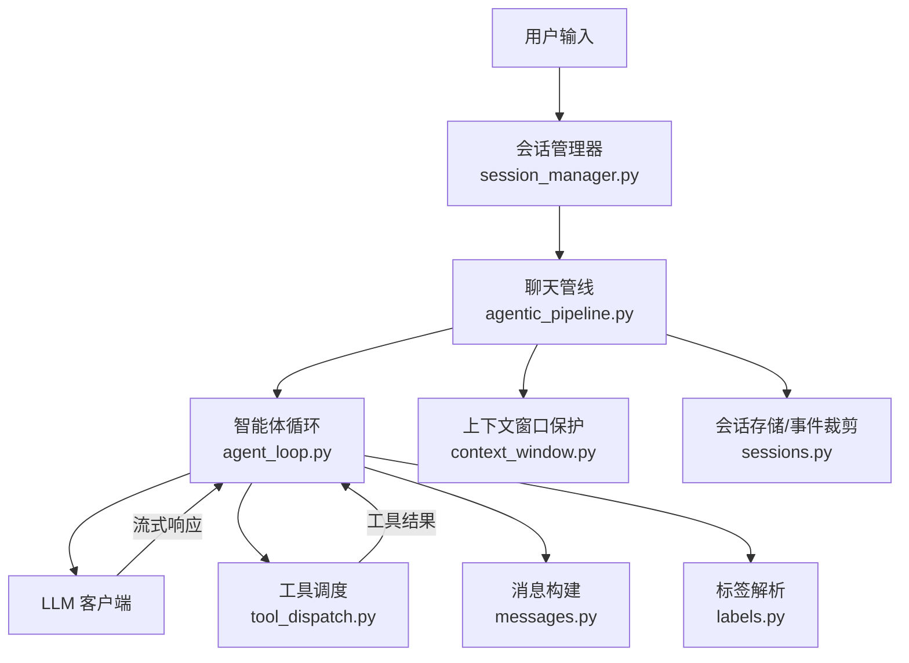
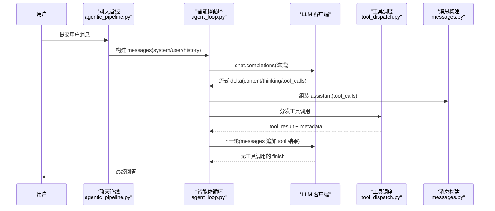
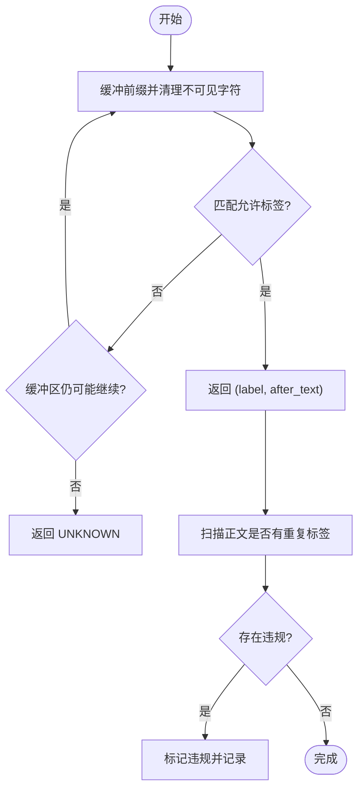
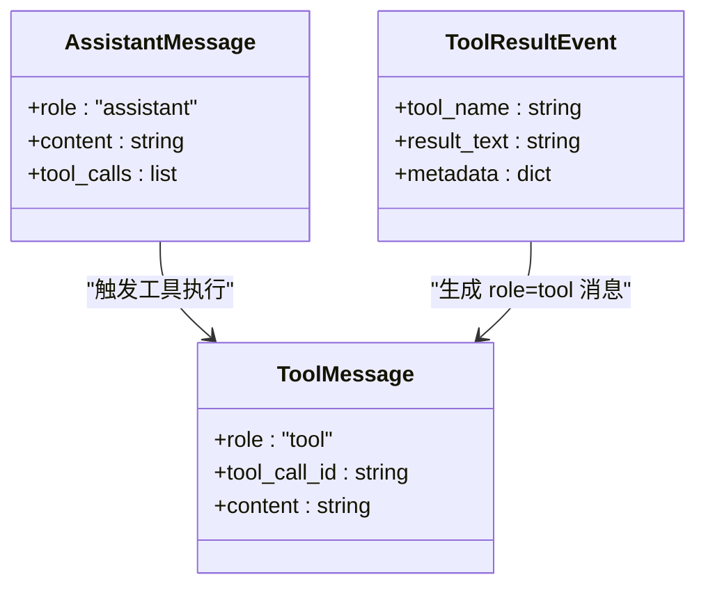
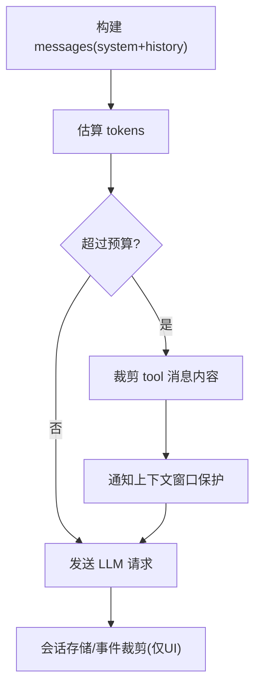
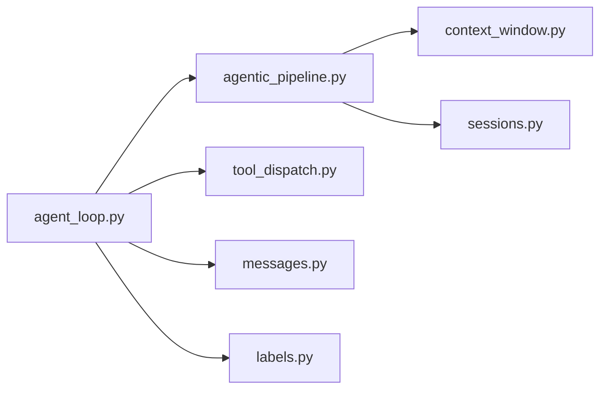

# 消息处理机制

<cite>
**本文引用的文件**
- [agent_loop.py](file://deeptutor/agents/chat/agent_loop.py)
- [agentic_pipeline.py](file://deeptutor/agents/chat/agentic_pipeline.py)
- [labels.py](file://deeptutor/core/agentic/labels.py)
- [messages.py](file://deeptutor/core/agentic/messages.py)
- [tool_dispatch.py](file://deeptutor/core/agentic/tool_dispatch.py)
- [context_window.py](file://deeptutor/services/llm/context_window.py)
- [sessions.py](file://deeptutor/api/routers/sessions.py)
- [session_manager.py](file://deeptutor/agents/chat/session_manager.py)
- [chat_agent.py](file://deeptutor/agents/chat/chat_agent.py)
</cite>

## 目录
1. [简介](#简介)
2. [项目结构](#项目结构)
3. [核心组件](#核心组件)
4. [架构总览](#架构总览)
5. [详细组件分析](#详细组件分析)
6. [依赖关系分析](#依赖关系分析)
7. [性能考量](#性能考量)
8. [故障排查指南](#故障排查指南)
9. [结论](#结论)
10. [附录](#附录)

## 简介
本文件聚焦智能体循环中的消息处理机制，覆盖以下主题：
- 用户消息、助手消息与系统消息的结构定义与流转
- 标签识别机制：从流式响应中识别协议标签、校验合法性与违规处理
- 消息构建过程：工具调用结果到消息的转换、流式响应的组装
- 消息历史管理：上下文窗口限制、截断策略与历史维护
- 完整流程与错误处理的代码级示例（以路径引用形式）

## 项目结构
围绕“消息处理”的关键模块分布如下：
- 智能体循环与轮次控制：agent_loop.py
- 聊天能力装配与消息构建：agentic_pipeline.py
- 协议标签解析：labels.py
- 消息构造工具：messages.py
- 工具调度与结果回写：tool_dispatch.py
- 上下文窗口计算与保护：context_window.py
- 会话持久化与事件载荷裁剪：sessions.py、session_manager.py
- 历史截断策略（旧实现参考）：chat_agent.py



图表来源
- [agent_loop.py:172-227](file://deeptutor/agents/chat/agent_loop.py#L172-L227)
- [agentic_pipeline.py:384-408](file://deeptutor/agents/chat/agentic_pipeline.py#L384-L408)
- [tool_dispatch.py:591-631](file://deeptutor/core/agentic/tool_dispatch.py#L591-L631)
- [messages.py:8-27](file://deeptutor/core/agentic/messages.py#L8-L27)
- [labels.py:34-95](file://deeptutor/core/agentic/labels.py#L34-L95)
- [context_window.py:53-66](file://deeptutor/services/llm/context_window.py#L53-L66)
- [sessions.py:90-115](file://deeptutor/api/routers/sessions.py#L90-L115)

章节来源
- [agent_loop.py:172-227](file://deeptutor/agents/chat/agent_loop.py#L172-L227)
- [agentic_pipeline.py:384-408](file://deeptutor/agents/chat/agentic_pipeline.py#L384-L408)

## 核心组件
- 智能体循环（AgentLoop）：驱动一轮或多轮 LLM 调用，处理文本流、工具调用流、思考内容分流、完成判定与强制收尾。
- 聊天管线（AgenticChatPipeline）：组装系统提示、用户消息、历史消息；提供上下文窗口保护与预算度量。
- 标签解析器（labels.py）：在流式响应首行识别协议标签（如 FINISH/TOOL/THINK），支持包裹与裸标签兼容，检测正文内重复标签违规。
- 消息构建器（messages.py）：将工具调用结果封装为标准的 assistant 消息，供后续对话使用。
- 工具调度（tool_dispatch.py）：并发执行工具，收集结果并生成 tool_result 事件与 role=tool 消息，支持暂停/终止语义。
- 上下文窗口（context_window.py）：根据模型与配置计算有效上下文窗口，用于保护策略。
- 会话与事件裁剪（sessions.py, session_manager.py）：持久化会话、对超大事件载荷进行前端渲染裁剪。
- 历史截断（chat_agent.py）：按 token 上限保留最近消息（旧实现参考）。

章节来源
- [agent_loop.py:151-227](file://deeptutor/agents/chat/agent_loop.py#L151-L227)
- [agentic_pipeline.py:185-200](file://deeptutor/agents/chat/agentic_pipeline.py#L185-L200)
- [labels.py:1-120](file://deeptutor/core/agentic/labels.py#L1-L120)
- [messages.py:1-31](file://deeptutor/core/agentic/messages.py#L1-L31)
- [tool_dispatch.py:591-631](file://deeptutor/core/agentic/tool_dispatch.py#L591-L631)
- [context_window.py:53-66](file://deeptutor/services/llm/context_window.py#L53-L66)
- [sessions.py:90-115](file://deeptutor/api/routers/sessions.py#L90-L115)
- [chat_agent.py:89-134](file://deeptutor/agents/chat/chat_agent.py#L89-L134)

## 架构总览
下图展示一次“用户提问→智能体循环→工具调用→最终回答”的端到端消息流。



图表来源
- [agent_loop.py:438-637](file://deeptutor/agents/chat/agent_loop.py#L438-L637)
- [messages.py:8-27](file://deeptutor/core/agentic/messages.py#L8-L27)
- [tool_dispatch.py:591-631](file://deeptutor/core/agentic/tool_dispatch.py#L591-L631)
- [agentic_pipeline.py:384-408](file://deeptutor/agents/chat/agentic_pipeline.py#L384-L408)

## 详细组件分析

### 消息结构与角色
- 系统消息（system）：由聊天管线在每轮开始时注入，包含工具清单、行为约束等。
- 用户消息（user）：来自会话或上游入口，携带文本与可选附件。
- 助手消息（assistant）：包含文本与工具调用列表；当无工具调用时即为最终回答。
- 工具消息（role=tool）：由工具调度产生，承载工具执行结果与元数据。

章节来源
- [agentic_pipeline.py:384-408](file://deeptutor/agents/chat/agentic_pipeline.py#L384-L408)
- [messages.py:8-27](file://deeptutor/core/agentic/messages.py#L8-L27)
- [tool_dispatch.py:591-631](file://deeptutor/core/agentic/tool_dispatch.py#L591-L631)

### 标签识别机制
- 协议要求：每条回复首行必须有一个允许的标签（如 FINISH/TOOL/THINK），可被反引号包裹，也容忍裸标签加分隔符的形式。
- 流式探测：classify_label 会逐步缓冲前缀，直到满足匹配条件或超过探测阈值；final=True 时允许精确裸标签结束。
- 违规检测：find_inline_labels 扫描正文中是否出现第二个标签位置，若发现则视为违规，可用于告警或修复。
- 常见容错：忽略不可见前导字符、吞掉标签后的空白/标点，避免多余换行进入正文。



图表来源
- [labels.py:24-95](file://deeptutor/core/agentic/labels.py#L24-L95)
- [labels.py:98-119](file://deeptutor/core/agentic/labels.py#L98-L119)

章节来源
- [labels.py:24-95](file://deeptutor/core/agentic/labels.py#L24-L95)
- [labels.py:98-119](file://deeptutor/core/agentic/labels.py#L98-L119)

### 消息构建与流式组装
- 流式文本与思考分流：content 通道输出用户可见内容，thinking 通道输出推理片段；遇到 <think> 标签时自动拆分。
- 工具调用流式聚合：按 index 累积 id/name/arguments，完成后统一组装为 tool_calls。
- DSML 降级：当原生工具调用不可用时，从 content 中抽取 DSML 标记的工具调用并清理正文。
- 完成判定：若本轮无工具调用，则视为 finish；否则作为 narration 继续下一轮。

```mermaid
sequenceDiagram
participant L as "智能体循环"
participant M as "LLM"
participant F as "思考过滤器"
participant A as "工具累加器"
L->>M : 发起流式请求
loop 接收 delta
M-->>L : delta.content / reasoning_content / tool_calls
L->>F : 过滤 <think> 片段
F-->>L : 分段(content/thinking)
L->>A : 聚合 tool_calls(index→id/name/args)
end
L->>L : 若无 tool_calls → finish; 否则 → 下一轮
```

图表来源
- [agent_loop.py:504-637](file://deeptutor/agents/chat/agent_loop.py#L504-L637)

章节来源
- [agent_loop.py:504-637](file://deeptutor/agents/chat/agent_loop.py#L504-L637)

### 工具调用结果到消息的转换
- 助手消息封装：assistant_message_with_tool_calls 将 text 与 tool_calls 组合为标准 assistant 消息，供后续对话追加。
- 工具结果事件：tool_dispatch 将每个工具的结果以 tool_result 事件形式发出，并生成 role=tool 的消息回写到 messages。
- 暂停与终止：工具可返回 pause_for_user 或 terminate_turn，循环据此暂停等待用户或提前结束。



图表来源
- [messages.py:8-27](file://deeptutor/core/agentic/messages.py#L8-L27)
- [tool_dispatch.py:591-631](file://deeptutor/core/agentic/tool_dispatch.py#L591-L631)

章节来源
- [messages.py:8-27](file://deeptutor/core/agentic/messages.py#L8-L27)
- [tool_dispatch.py:591-631](file://deeptutor/core/agentic/tool_dispatch.py#L591-L631)

### 消息历史管理与上下文窗口
- 历史组装：聊天管线将 system、历史 user/assistant/system 摘要拼接为 messages，KB 种子放入用户消息。
- 上下文窗口保护：在每次 LLM 调用前估算 tokens，超过阈值的 tool 消息内容会被替换为占位标记，降低风险。
- 会话事件裁剪：对 UI 返回的 tool_result/observation 等大载荷进行裁剪，仅影响前端渲染，不影响模型输入。
- 历史截断（旧实现）：按 token 上限从新到旧保留消息，超出部分丢弃。



图表来源
- [agentic_pipeline.py:1232-1267](file://deeptutor/agents/chat/agentic_pipeline.py#L1232-L1267)
- [context_window.py:53-66](file://deeptutor/services/llm/context_window.py#L53-L66)
- [sessions.py:90-115](file://deeptutor/api/routers/sessions.py#L90-L115)
- [chat_agent.py:89-134](file://deeptutor/agents/chat/chat_agent.py#L89-L134)

章节来源
- [agentic_pipeline.py:1232-1267](file://deeptutor/agents/chat/agentic_pipeline.py#L1232-L1267)
- [context_window.py:53-66](file://deeptutor/services/llm/context_window.py#L53-L66)
- [sessions.py:90-115](file://deeptutor/api/routers/sessions.py#L90-L115)
- [chat_agent.py:89-134](file://deeptutor/agents/chat/chat_agent.py#L89-L134)

### 错误处理与恢复
- 轮次失败兜底：中间轮次 LLM 异常时，若已积累工作成果，则强制 finish 返回已有信息。
- 空回答提示：若 finish 轮未产出可用文本，则注入默认提示并引导继续。
- 工具执行异常：捕获工具异常并返回友好错误消息，同时记录元数据。
- 事件载荷过大：对 tool_result/observation 进行裁剪，避免前端卡顿。

章节来源
- [agent_loop.py:250-357](file://deeptutor/agents/chat/agent_loop.py#L250-L357)
- [agent_loop.py:379-434](file://deeptutor/agents/chat/agent_loop.py#L379-L434)
- [tool_dispatch.py:561-588](file://deeptutor/core/agentic/tool_dispatch.py#L561-L588)
- [sessions.py:90-115](file://deeptutor/api/routers/sessions.py#L90-L115)

## 依赖关系分析
- agent_loop 依赖 agentic_pipeline 提供的消息构建与上下文保护，依赖 tool_dispatch 执行工具，依赖 messages 构造标准消息。
- labels 被上层调用以解析流式响应标签，确保协议一致性。
- context_window 为 pipeline 提供窗口大小计算，保障安全边界。
- sessions 负责 UI 侧事件裁剪，不影响模型输入。



图表来源
- [agent_loop.py:172-227](file://deeptutor/agents/chat/agent_loop.py#L172-L227)
- [agentic_pipeline.py:1232-1267](file://deeptutor/agents/chat/agentic_pipeline.py#L1232-L1267)
- [tool_dispatch.py:591-631](file://deeptutor/core/agentic/tool_dispatch.py#L591-L631)
- [messages.py:8-27](file://deeptutor/core/agentic/messages.py#L8-L27)
- [context_window.py:53-66](file://deeptutor/services/llm/context_window.py#L53-L66)
- [sessions.py:90-115](file://deeptutor/api/routers/sessions.py#L90-L115)
- [labels.py:34-95](file://deeptutor/core/agentic/labels.py#L34-L95)

章节来源
- [agent_loop.py:172-227](file://deeptutor/agents/chat/agent_loop.py#L172-L227)
- [agentic_pipeline.py:1232-1267](file://deeptutor/agents/chat/agentic_pipeline.py#L1232-L1267)

## 性能考量
- 流式处理：文本与工具调用增量聚合，减少内存峰值与延迟。
- 上下文窗口保护：通过裁剪大 tool 消息内容，避免超出模型限制导致失败。
- 事件载荷裁剪：仅影响 UI 渲染，不改变模型输入，平衡体验与稳定性。
- 并发工具调用：工具调度支持并行执行，缩短整体时延。

[本节为通用指导，无需具体文件分析]

## 故障排查指南
- 标签违规：检查 find_inline_labels 是否检测到正文中出现重复标签；必要时调整提示词或模型输出格式。
- 空回答：确认 _finalize_finish 是否触发了默认提示；检查 _clean 是否清除了全部可见内容。
- 工具失败：查看 tool_dispatch 的错误元数据与日志，定位具体工具与参数问题。
- 上下文溢出：观察 _guard_context_window 是否触发裁剪；评估是否需要进一步压缩历史或 KB 种子。
- 前端卡顿：确认 sessions 的事件裁剪是否生效；检查 tool_result/observation 的大小。

章节来源
- [labels.py:98-119](file://deeptutor/core/agentic/labels.py#L98-L119)
- [agent_loop.py:421-434](file://deeptutor/agents/chat/agent_loop.py#L421-L434)
- [tool_dispatch.py:561-588](file://deeptutor/core/agentic/tool_dispatch.py#L561-L588)
- [agentic_pipeline.py:1232-1267](file://deeptutor/agents/chat/agentic_pipeline.py#L1232-L1267)
- [sessions.py:90-115](file://deeptutor/api/routers/sessions.py#L90-L115)

## 结论
该消息处理机制通过严格的协议标签解析、流式组装、工具调度与上下文窗口保护，实现了稳定且可扩展的智能体循环。系统在异常情况下具备良好兜底能力，并在 UI 层面对大数据量事件进行裁剪，兼顾性能与用户体验。

[本节为总结性内容，无需具体文件分析]

## 附录
- 关键流程路径参考：
  - 智能体循环主流程：[agent_loop.py:172-227](file://deeptutor/agents/chat/agent_loop.py#L172-L227)
  - 流式响应处理与工具调用聚合：[agent_loop.py:504-637](file://deeptutor/agents/chat/agent_loop.py#L504-L637)
  - 助手消息构建：[messages.py:8-27](file://deeptutor/core/agentic/messages.py#L8-L27)
  - 工具结果事件与 role=tool 消息：[tool_dispatch.py:591-631](file://deeptutor/core/agentic/tool_dispatch.py#L591-L631)
  - 标签解析与违规检测：[labels.py:34-95](file://deeptutor/core/agentic/labels.py#L34-L95), [labels.py:98-119](file://deeptutor/core/agentic/labels.py#L98-L119)
  - 上下文窗口保护：[agentic_pipeline.py:1232-1267](file://deeptutor/agents/chat/agentic_pipeline.py#L1232-L1267), [context_window.py:53-66](file://deeptutor/services/llm/context_window.py#L53-L66)
  - 事件载荷裁剪：[sessions.py:90-115](file://deeptutor/api/routers/sessions.py#L90-L115)
  - 历史截断（旧实现）：[chat_agent.py:89-134](file://deeptutor/agents/chat/chat_agent.py#L89-L134)