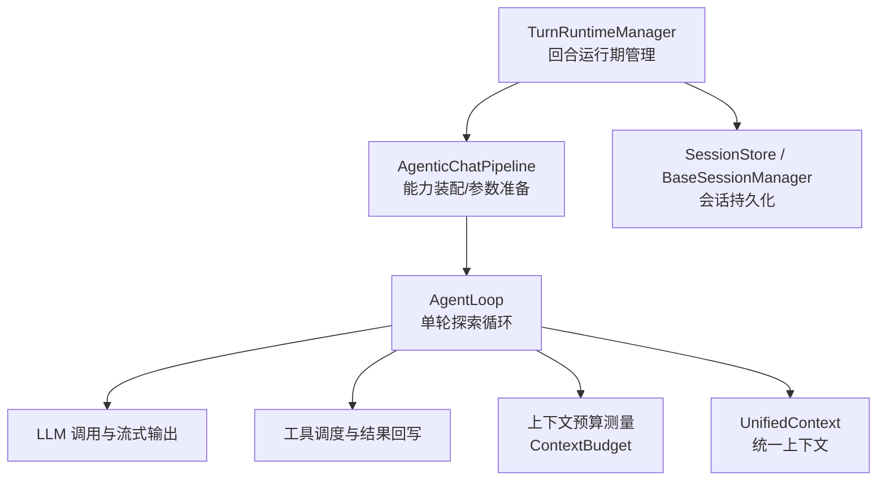
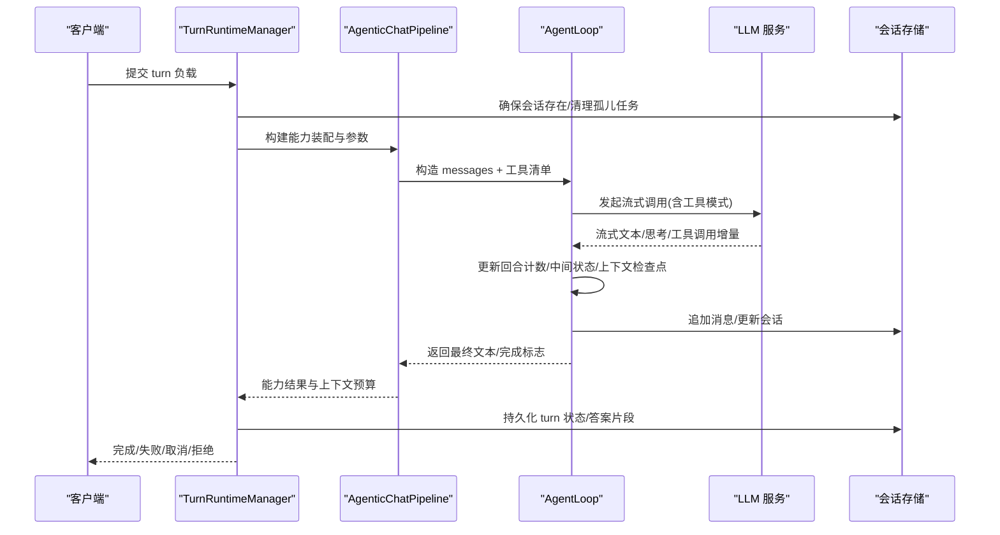
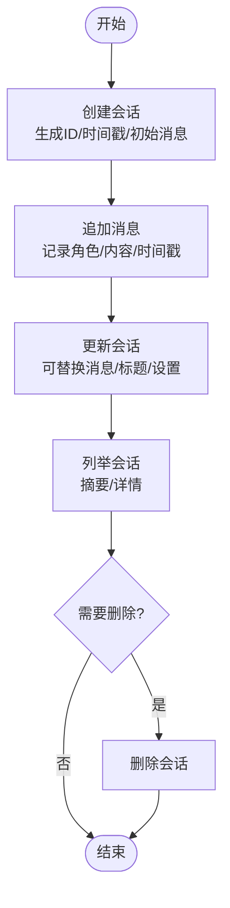
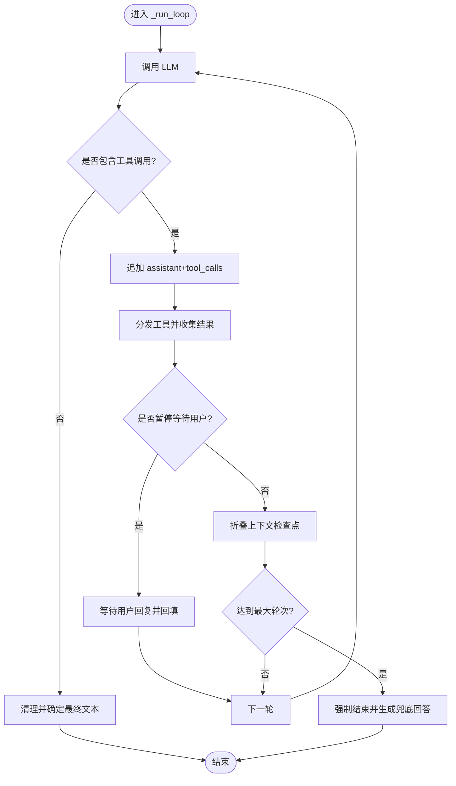
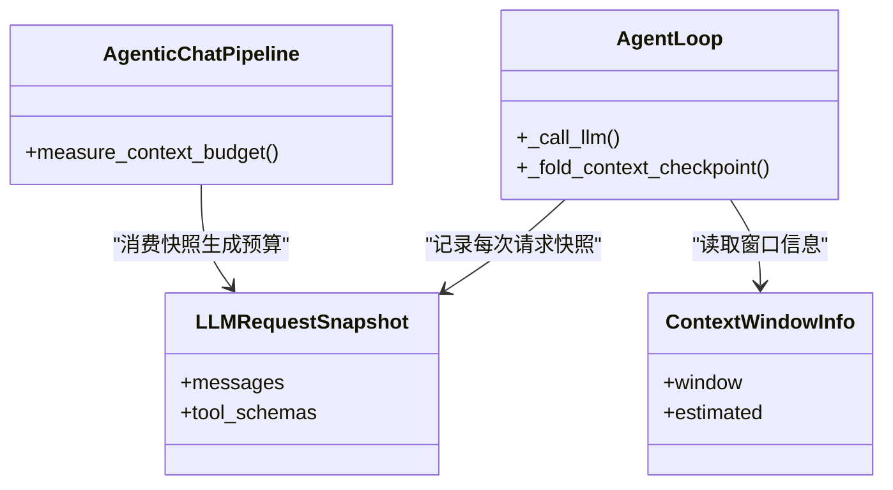
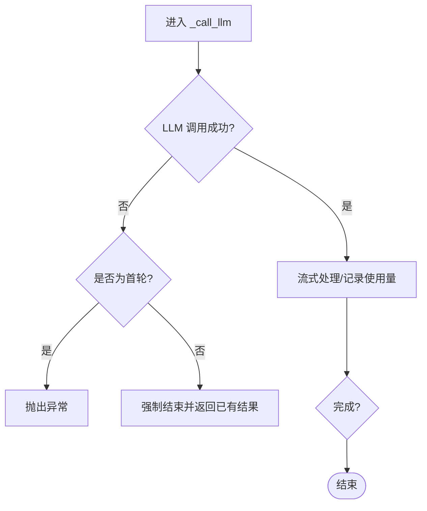
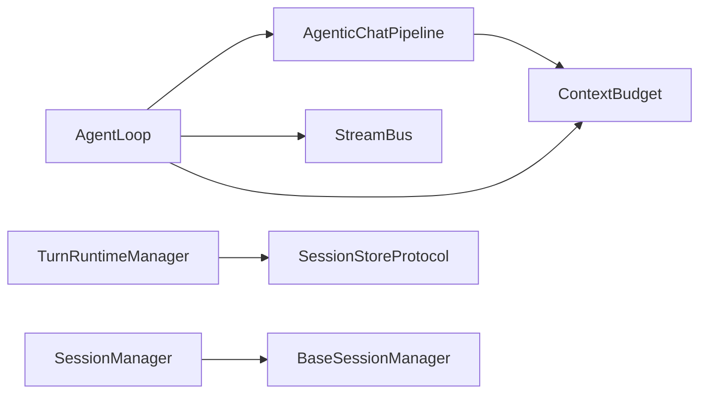

# 状态管理机制

<cite>
**本文引用的文件**
- [agent_loop.py](file://deeptutor/agents/chat/agent_loop.py)
- [context_budget.py](file://deeptutor/agents/chat/context_budget.py)
- [agentic_pipeline.py](file://deeptutor/agents/chat/agentic_pipeline.py)
- [session_manager.py](file://deeptutor/agents/chat/session_manager.py)
- [base_session_manager.py](file://deeptutor/services/session/base_session_manager.py)
- [turn_runtime.py](file://deeptutor/services/session/turn_runtime.py)
- [__init__.py](file://deeptutor/services/session/__init__.py)
- [context.py](file://deeptutor/core/context.py)
- [errors.py](file://deeptutor/core/errors.py)
</cite>

## 目录
1. [简介](#简介)
2. [项目结构](#项目结构)
3. [核心组件](#核心组件)
4. [架构总览](#架构总览)
5. [详细组件分析](#详细组件分析)
6. [依赖关系分析](#依赖关系分析)
7. [性能考量](#性能考量)
8. [故障排查指南](#故障排查指南)
9. [结论](#结论)
10. [附录](#附录)

## 简介
本文件聚焦于智能体循环的状态管理机制，覆盖会话生命周期管理、回合状态跟踪、上下文窗口与消息历史维护、错误处理与恢复策略，以及最佳实践。内容基于代码仓库中的聊天智能体循环、会话持久化、上下文预算与运行时管理器实现进行系统化梳理，帮助读者理解从“一轮对话”到“多轮探索”的完整状态流转。

## 项目结构
围绕状态管理的核心模块分布在以下位置：
- 智能体循环与回合控制：deeptutor/agents/chat/agent_loop.py
- 上下文预算与窗口测量：deeptutor/agents/chat/context_budget.py
- 能力装配与工具调度入口：deeptutor/agents/chat/agentic_pipeline.py
- 会话持久化（聊天专用）：deeptutor/agents/chat/session_manager.py
- 通用会话基类与存储后端选择：deeptutor/services/session/base_session_manager.py, deeptutor/services/session/__init__.py
- 回合级运行期管理与事件落盘：deeptutor/services/session/turn_runtime.py
- 统一上下文对象：deeptutor/core/context.py
- 错误类型定义：deeptutor/core/errors.py

图表来源
- [turn_runtime.py:594-800](file://deeptutor/services/session/turn_runtime.py#L594-L800)
- [agentic_pipeline.py:185-200](file://deeptutor/agents/chat/agentic_pipeline.py#L185-L200)
- [agent_loop.py:151-228](file://deeptutor/agents/chat/agent_loop.py#L151-L228)
- [context_budget.py:54-64](file://deeptutor/agents/chat/context_budget.py#L54-L64)
- [base_session_manager.py:23-55](file://deeptutor/services/session/base_session_manager.py#L23-L55)
- [context.py:33-85](file://deeptutor/core/context.py#L33-L85)

章节来源
- [turn_runtime.py:594-800](file://deeptutor/services/session/turn_runtime.py#L594-L800)
- [agentic_pipeline.py:185-200](file://deeptutor/agents/chat/agentic_pipeline.py#L185-L200)
- [agent_loop.py:151-228](file://deeptutor/agents/chat/agent_loop.py#L151-L228)
- [context_budget.py:54-64](file://deeptutor/agents/chat/context_budget.py#L54-L64)
- [base_session_manager.py:23-55](file://deeptutor/services/session/base_session_manager.py#L23-L55)
- [context.py:33-85](file://deeptutor/core/context.py#L33-L85)

## 核心组件
- AgentLoop：封装“一轮对话”的探索循环，负责 LLM 调用、工具调用分发、中间状态记录、最终答案确定与强制结束。
- ContextBudget：对一次真实请求的上下文窗口使用情况进行度量，包括系统提示块、工具模式、消息列表等，并生成预算报告。
- AgenticChatPipeline：组装提示块、工具清单、模型参数，驱动 AgentLoop 执行，并在结束时汇总上下文预算。
- TurnRuntimeManager：在进程内管理单个 turn 的生命周期，收集流事件、持久化答案、处理中断恢复与孤儿任务清理。
- BaseSessionManager/SessionManager：提供跨模块一致的会话 CRUD 与消息追加、标题自动推导、会话上限控制等。
- UnifiedContext：贯穿 orchestrator 到工具/能力的统一上下文载体，包含会话 ID、历史消息、工具白名单、知识库、附件、语言等。
- 错误体系：统一的异常层次，便于上层捕获与分类处理。

章节来源
- [agent_loop.py:121-149](file://deeptutor/agents/chat/agent_loop.py#L121-L149)
- [context_budget.py:54-64](file://deeptutor/agents/chat/context_budget.py#L54-L64)
- [agentic_pipeline.py:185-200](file://deeptutor/agents/chat/agentic_pipeline.py#L185-L200)
- [turn_runtime.py:594-800](file://deeptutor/services/session/turn_runtime.py#L594-L800)
- [base_session_manager.py:23-55](file://deeptutor/services/session/base_session_manager.py#L23-L55)
- [context.py:33-85](file://deeptutor/core/context.py#L33-L85)
- [errors.py:10-58](file://deeptutor/core/errors.py#L10-L58)

## 架构总览
下图展示“一轮对话”从进入运行期到完成落盘的端到端流程，重点标注了状态推进的关键节点。

图表来源
- [turn_runtime.py:594-800](file://deeptutor/services/session/turn_runtime.py#L594-L800)
- [agentic_pipeline.py:185-200](file://deeptutor/agents/chat/agentic_pipeline.py#L185-L200)
- [agent_loop.py:172-228](file://deeptutor/agents/chat/agent_loop.py#L172-L228)
- [base_session_manager.py:115-146](file://deeptutor/services/session/base_session_manager.py#L115-L146)

## 详细组件分析

### 会话生命周期管理（创建、更新、删除、恢复）
- 创建会话：BaseSessionManager.create_session 生成带时间戳和唯一前缀的 session_id，写入 sessions.json（或远程存储），并限制最大会话数。
- 更新与会话合并：update_session 支持批量替换消息、更新标题与自定义字段，同时刷新 updated_at。
- 消息追加：add_message 为每条消息附加时间戳与元数据；当首条用户消息时自动推导会话标题。
- 会话列举与删除：list_sessions 支持摘要视图；delete_session 安全移除。
- 聊天专用扩展：SessionManager 继承基类并注入 chat 前缀、默认标题与摘要字段。

图表来源
- [base_session_manager.py:115-146](file://deeptutor/services/session/base_session_manager.py#L115-L146)
- [base_session_manager.py:155-183](file://deeptutor/services/session/base_session_manager.py#L155-L183)
- [base_session_manager.py:185-213](file://deeptutor/services/session/base_session_manager.py#L185-L213)
- [base_session_manager.py:215-237](file://deeptutor/services/session/base_session_manager.py#L215-L237)
- [session_manager.py:20-88](file://deeptutor/agents/chat/session_manager.py#L20-L88)

章节来源
- [base_session_manager.py:115-146](file://deeptutor/services/session/base_session_manager.py#L115-L146)
- [base_session_manager.py:155-183](file://deeptutor/services/session/base_session_manager.py#L155-L183)
- [base_session_manager.py:185-213](file://deeptutor/services/session/base_session_manager.py#L185-L213)
- [base_session_manager.py:215-237](file://deeptutor/services/session/base_session_manager.py#L215-L237)
- [session_manager.py:20-88](file://deeptutor/agents/chat/session_manager.py#L20-L88)

### 回合状态跟踪（迭代计数、中间状态、最终状态）
- 回合计数器：AgentLoopState 维护 rounds 与 tool_steps，用于统计 LLM 调用次数与工具步骤数。
- 中间状态记录：每轮 LLM 调用后，若包含工具调用则追加 assistant 消息与 tool 结果；若无工具调用则视为 finish。
- 最终状态确定：无工具调用的轮次即为最终回答；若达到最大轮次仍请求工具，则触发强制结束并生成兜底回答。
- 空回答引导：当模型仅输出内部推理（如 think 标签）而无用户可见内容时，会追加提示继续行动。

图表来源
- [agent_loop.py:234-358](file://deeptutor/agents/chat/agent_loop.py#L234-L358)
- [agent_loop.py:379-434](file://deeptutor/agents/chat/agent_loop.py#L379-L434)

章节来源
- [agent_loop.py:121-149](file://deeptutor/agents/chat/agent_loop.py#L121-L149)
- [agent_loop.py:234-358](file://deeptutor/agents/chat/agent_loop.py#L234-L358)
- [agent_loop.py:379-434](file://deeptutor/agents/chat/agent_loop.py#L379-L434)

### 上下文状态管理（消息历史、上下文窗口、压缩策略）
- 消息历史维护：每轮将 assistant 消息与 tool 结果追加到 messages，形成不断增长的对话历史。
- 上下文窗口测量：通过 LLMRequestSnapshot 记录每次真实请求携带的消息与工具模式，结合 PromptBlock 渲染后的系统提示，计算各段 token 用量与剩余空间。
- 动态调整与压缩：
  - 在工具调用后，若检测到工具结果中包含上下文检查点摘要，则将历史折叠为“前缀 + 检查点摘要”，减少后续请求长度。
  - 在 LLM 调用前进行上下文窗口保护，必要时降级或裁剪输入（例如移除图片）。
- 预算报告：在 turn 结束时输出 context_budget，包含 window、used_tokens、segments 等，便于前端展示与监控。

图表来源
- [context_budget.py:54-64](file://deeptutor/agents/chat/context_budget.py#L54-L64)
- [context_budget.py:74-99](file://deeptutor/agents/chat/context_budget.py#L74-L99)
- [agent_loop.py:359-377](file://deeptutor/agents/chat/agent_loop.py#L359-L377)
- [agent_loop.py:438-494](file://deeptutor/agents/chat/agent_loop.py#L438-L494)

章节来源
- [context_budget.py:54-64](file://deeptutor/agents/chat/context_budget.py#L54-L64)
- [context_budget.py:118-164](file://deeptutor/agents/chat/context_budget.py#L118-L164)
- [agent_loop.py:359-377](file://deeptutor/agents/chat/agent_loop.py#L359-L377)
- [agent_loop.py:438-494](file://deeptutor/agents/chat/agent_loop.py#L438-L494)

### 错误状态处理（异常捕获、状态回滚与恢复）
- 循环内异常处理：若在首轮即发生 LLM 异常，直接上抛；若已积累若干轮工作，则强制结束并返回已收集的结果，避免丢失有用进展。
- 强制结束兜底：当轮次耗尽或错误导致无法继续时，禁用工具再次调用模型以生成最终回答；若仍失败，则输出协议级兜底文案。
- 运行期恢复：TurnRuntimeManager 在服务重启后会扫描数据库中的 running 状态 turn，若无本地执行任务则标记为 failed 并附带中断原因。
- 错误类型体系：通过 DeepTutorError 及其子类（如 LLMServiceError、LLMContextError）统一异常语义，便于上层分类处理。

图表来源
- [agent_loop.py:250-273](file://deeptutor/agents/chat/agent_loop.py#L250-L273)
- [agent_loop.py:379-434](file://deeptutor/agents/chat/agent_loop.py#L379-L434)
- [turn_runtime.py:634-654](file://deeptutor/services/session/turn_runtime.py#L634-L654)
- [errors.py:10-58](file://deeptutor/core/errors.py#L10-L58)

章节来源
- [agent_loop.py:250-273](file://deeptutor/agents/chat/agent_loop.py#L250-L273)
- [agent_loop.py:379-434](file://deeptutor/agents/chat/agent_loop.py#L379-L434)
- [turn_runtime.py:634-654](file://deeptutor/services/session/turn_runtime.py#L634-L654)
- [errors.py:10-58](file://deeptutor/core/errors.py#L10-L58)

### 最佳实践与示例路径
- 会话创建与消息追加：参考会话管理器接口，确保每个 turn 有稳定的 session_id，并在完成后追加 assistant 消息。
  - 参考路径：[session_manager.py:94-164](file://deeptutor/agents/chat/session_manager.py#L94-L164), [base_session_manager.py:115-213](file://deeptutor/services/session/base_session_manager.py#L115-L213)
- 回合控制与最终答案：遵循“无工具调用即 finish”的原则，合理设置最大轮次以避免无限循环。
  - 参考路径：[agent_loop.py:234-358](file://deeptutor/agents/chat/agent_loop.py#L234-L358)
- 上下文预算与窗口保护：在每次 LLM 调用前记录请求快照，并在 turn 结束时输出预算；必要时折叠历史。
  - 参考路径：[context_budget.py:135-212](file://deeptutor/agents/chat/context_budget.py#L135-L212), [agent_loop.py:359-377](file://deeptutor/agents/chat/agent_loop.py#L359-L377)
- 运行期恢复与事件落盘：利用 TurnRuntimeManager 的孤儿任务清理与终端状态解析，保证服务重启后状态一致。
  - 参考路径：[turn_runtime.py:634-654](file://deeptutor/services/session/turn_runtime.py#L634-L654), [turn_runtime.py:51-74](file://deeptutor/services/session/turn_runtime.py#L51-L74)

## 依赖关系分析
- AgentLoop 依赖 AgenticChatPipeline 提供的工具清单、提示块与上下文预算测量；同时依赖 StreamBus 进行流式输出与进度上报。
- ContextBudget 依赖 PromptBlock 与 LLMRequestSnapshot，确保预算读数与实际发送请求一致。
- TurnRuntimeManager 依赖 SessionStoreProtocol 抽象，可在 SQLite 与 PocketBase 之间切换；并通过统一的事件流聚合 turn 的最终状态。
- BaseSessionManager 被多个 agent 模块复用，提供一致的会话行为；SessionManager 针对聊天场景定制前缀与摘要。

图表来源
- [agent_loop.py:151-228](file://deeptutor/agents/chat/agent_loop.py#L151-L228)
- [context_budget.py:54-64](file://deeptutor/agents/chat/context_budget.py#L54-L64)
- [turn_runtime.py:594-800](file://deeptutor/services/session/turn_runtime.py#L594-L800)
- [session_manager.py:20-88](file://deeptutor/agents/chat/session_manager.py#L20-L88)
- [base_session_manager.py:23-55](file://deeptutor/services/session/base_session_manager.py#L23-L55)

章节来源
- [agent_loop.py:151-228](file://deeptutor/agents/chat/agent_loop.py#L151-L228)
- [context_budget.py:54-64](file://deeptutor/agents/chat/context_budget.py#L54-L64)
- [turn_runtime.py:594-800](file://deeptutor/services/session/turn_runtime.py#L594-L800)
- [session_manager.py:20-88](file://deeptutor/agents/chat/session_manager.py#L20-L88)
- [base_session_manager.py:23-55](file://deeptutor/services/session/base_session_manager.py#L23-L55)

## 性能考量
- 流式输出与增量统计：在 LLM 流式响应中实时统计输出字符与工具调用增量，减少内存占用并提升交互体验。
- 上下文折叠：通过上下文检查点摘要将长历史压缩为关键信息，降低后续请求长度与成本。
- 工具模式降级：当提供者不支持工具模式或图像输入时，自动降级并重试，提高鲁棒性。
- 会话上限：BaseSessionManager 限制最大会话数量，防止磁盘膨胀。

[本节为一般性指导，不直接分析具体文件]

## 故障排查指南
- 轮次耗尽或错误导致的强制结束：检查日志中的“loop budget exhausted”或“loop error finish”提示，确认是否达到最大轮次或出现网络/超时问题。
- 空回答引导：若模型仅输出内部推理，系统将追加提示继续行动；若仍无用户可见内容，将输出协议级兜底文案。
- 运行期恢复：服务重启后，若数据库中存在 running 状态的 turn 但本地无执行任务，将被标记为 failed 并附带中断原因。
- 上下文窗口超限：关注 LLMContextError 及上下文预算报告，必要时裁剪输入或启用历史折叠。

章节来源
- [agent_loop.py:250-273](file://deeptutor/agents/chat/agent_loop.py#L250-L273)
- [agent_loop.py:379-434](file://deeptutor/agents/chat/agent_loop.py#L379-L434)
- [turn_runtime.py:634-654](file://deeptutor/services/session/turn_runtime.py#L634-L654)
- [errors.py:42-58](file://deeptutor/core/errors.py#L42-L58)

## 结论
DeepTutor 的智能体循环状态管理以 AgentLoop 为核心，结合 TurnRuntimeManager 的进程内运行期管理、BaseSessionManager 的持久化能力与 ContextBudget 的上下文测量，形成了稳健的会话生命周期、回合状态跟踪与上下文窗口控制机制。通过异常捕获、强制结束与运行期恢复策略，系统在复杂环境下仍能保持高可用性与一致性。建议在实际使用中遵循“无工具即 finish”的约定、合理使用上下文折叠与预算报告，并结合运行期恢复机制保障服务稳定性。

[本节为总结性内容，不直接分析具体文件]

## 附录
- 统一上下文对象字段说明：session_id、user_message、conversation_history、enabled_tools、allowed_builtin_tools、active_capability、knowledge_bases、attachments、config_overrides、language、memory_context、persona_context、skills_manifest、source_manifest、metadata。
  - 参考路径：[context.py:33-85](file://deeptutor/core/context.py#L33-L85)
- 会话存储后端选择：根据配置自动选择 SQLite 或 PocketBase 存储。
  - 参考路径：[__init__.py:33-47](file://deeptutor/services/session/__init__.py#L33-L47)

章节来源
- [context.py:33-85](file://deeptutor/core/context.py#L33-L85)
- [__init__.py:33-47](file://deeptutor/services/session/__init__.py#L33-L47)