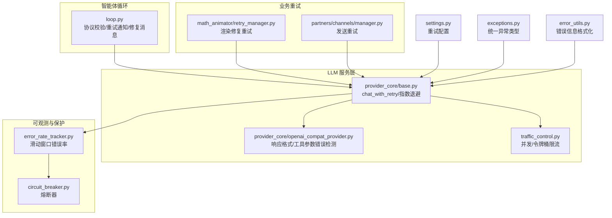
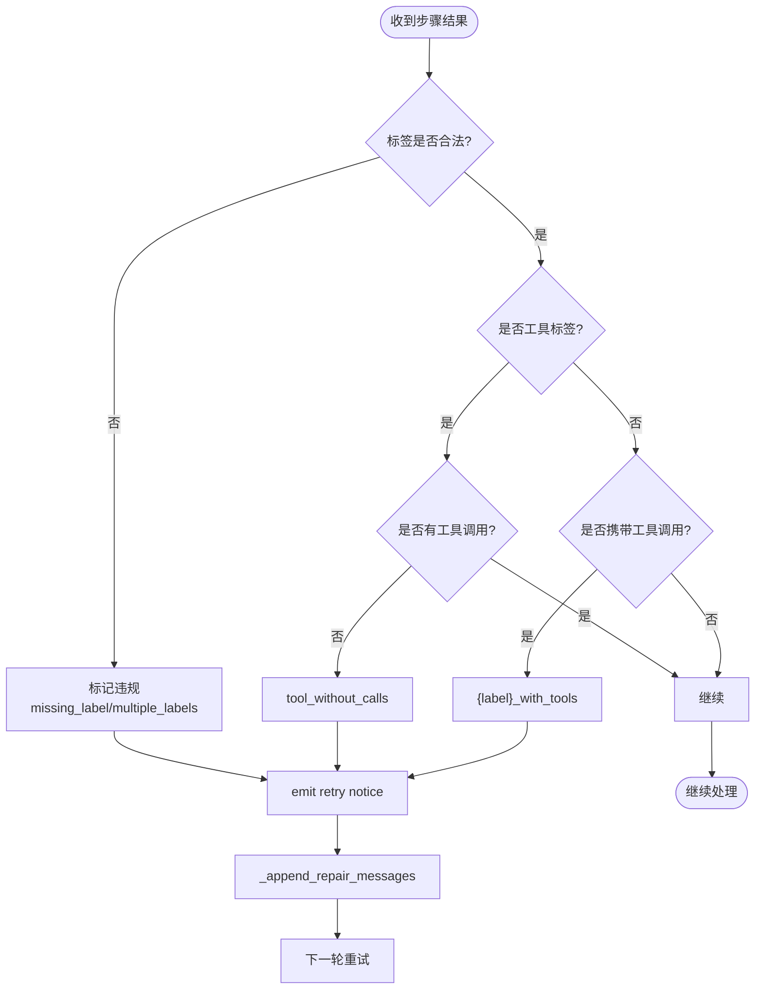
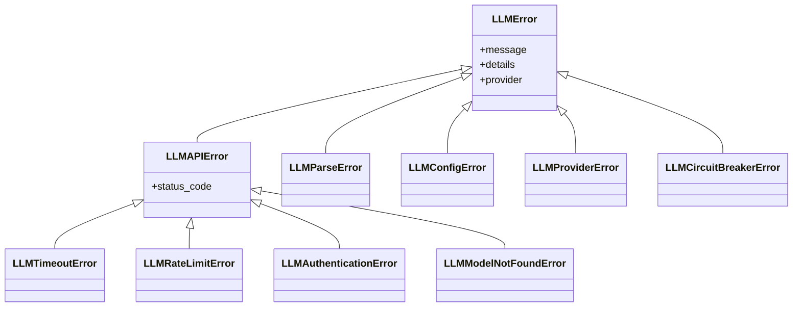
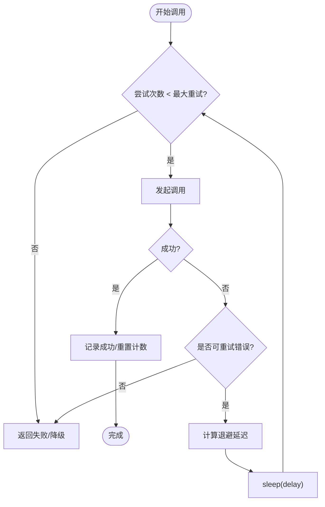
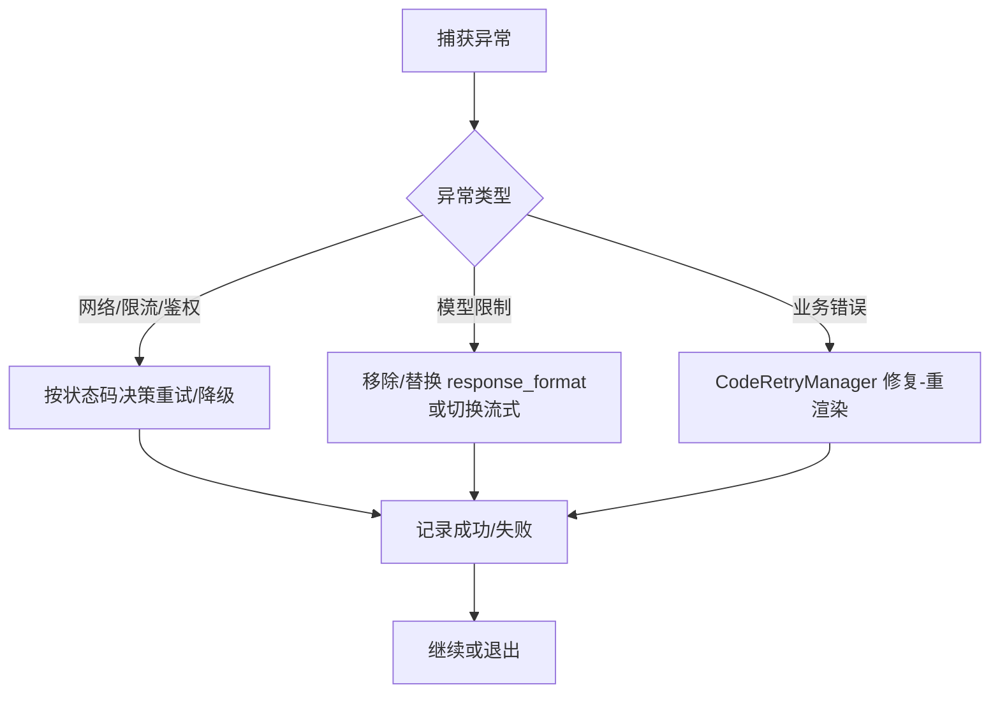
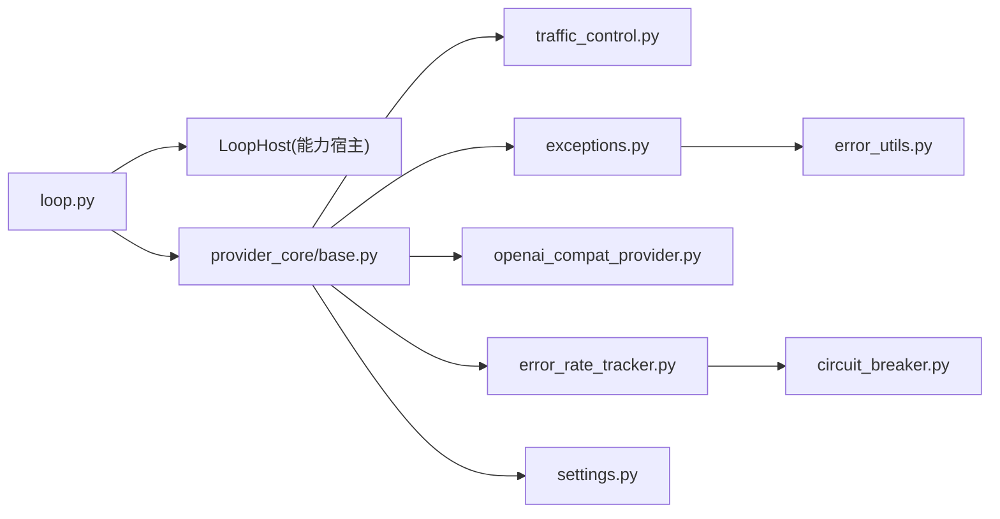

# 错误处理与重试

<cite>
**本文引用的文件**
- [deeptutor/core/agentic/loop.py](file://deeptutor/core/agentic/loop.py)
- [deeptutor/services/llm/exceptions.py](file://deeptutor/services/llm/exceptions.py)
- [deeptutor/utils/error_utils.py](file://deeptutor/utils/error_utils.py)
- [deeptutor/config/settings.py](file://deeptutor/config/settings.py)
- [deeptutor/utils/network/circuit_breaker.py](file://deeptutor/utils/network/circuit_breaker.py)
- [deeptutor/utils/error_rate_tracker.py](file://deeptutor/utils/error_rate_tracker.py)
- [deeptutor/services/llm/provider_core/base.py](file://deeptutor/services/llm/provider_core/base.py)
- [deeptutor/services/llm/provider_core/openai_compat_provider.py](file://deeptutor/services/llm/provider_core/openai_compat_provider.py)
- [deeptutor/services/llm/traffic_control.py](file://deeptutor/services/llm/traffic_control.py)
- [deeptutor/agents/math_animator/retry_manager.py](file://deeptutor/agents/math_animator/retry_manager.py)
- [deeptutor/partners/channels/manager.py](file://deeptutor/partners/channels/manager.py)
</cite>

## 目录
1. [简介](#简介)
2. [项目结构](#项目结构)
3. [核心组件](#核心组件)
4. [架构总览](#架构总览)
5. [详细组件分析](#详细组件分析)
6. [依赖关系分析](#依赖关系分析)
7. [性能考量](#性能考量)
8. [故障排查指南](#故障排查指南)
9. [结论](#结论)
10. [附录](#附录)

## 简介
本文件系统性梳理 DeepTutor 智能体循环中的“协议违规检测、错误分类、重试策略与错误恢复”机制，覆盖标签格式验证、工具调用检查、响应格式校验；网络错误、模型限制错误与业务逻辑错误的识别与处理；指数退避、最大重试次数控制与失败条件判断；以及上下文修复、消息重建与状态重置等恢复手段。文档同时提供具体代码位置指引，便于快速定位实现细节。

## 项目结构
围绕错误处理与重试的关键模块分布如下：
- 智能体循环与协议校验：core/agentic/loop.py
- LLM 异常体系：services/llm/exceptions.py
- 错误信息格式化：utils/error_utils.py
- 重试配置：config/settings.py
- 熔断器与错误率追踪：utils/network/circuit_breaker.py、utils/error_rate_tracker.py
- LLM 提供者重试与降级：services/llm/provider_core/base.py、openai_compat_provider.py
- 流量控制（并发与限流）：services/llm/traffic_control.py
- 渲染重试工作流：agents/math_animator/retry_manager.py
- 通道发送重试：partners/channels/manager.py



**图表来源**
- [deeptutor/core/agentic/loop.py:173-372](file://deeptutor/core/agentic/loop.py#L173-L372)
- [deeptutor/services/llm/provider_core/base.py:346-372](file://deeptutor/services/llm/provider_core/base.py#L346-L372)
- [deeptutor/services/llm/provider_core/openai_compat_provider.py:345-408](file://deeptutor/services/llm/provider_core/openai_compat_provider.py#L345-L408)
- [deeptutor/services/llm/traffic_control.py:42-125](file://deeptutor/services/llm/traffic_control.py#L42-L125)
- [deeptutor/utils/error_rate_tracker.py:14-111](file://deeptutor/utils/error_rate_tracker.py#L14-L111)
- [deeptutor/utils/network/circuit_breaker.py:13-89](file://deeptutor/utils/network/circuit_breaker.py#L13-L89)
- [deeptutor/agents/math_animator/retry_manager.py:21-161](file://deeptutor/agents/math_animator/retry_manager.py#L21-L161)
- [deeptutor/partners/channels/manager.py:296-301](file://deeptutor/partners/channels/manager.py#L296-L301)
- [deeptutor/config/settings.py:19-46](file://deeptutor/config/settings.py#L19-L46)
- [deeptutor/services/llm/exceptions.py:11-161](file://deeptutor/services/llm/exceptions.py#L11-L161)
- [deeptutor/utils/error_utils.py:46-82](file://deeptutor/utils/error_utils.py#L46-L82)

**章节来源**
- [deeptutor/core/agentic/loop.py:173-372](file://deeptutor/core/agentic/loop.py#L173-L372)
- [deeptutor/services/llm/provider_core/base.py:346-372](file://deeptutor/services/llm/provider_core/base.py#L346-L372)
- [deeptutor/services/llm/provider_core/openai_compat_provider.py:345-408](file://deeptutor/services/llm/provider_core/openai_compat_provider.py#L345-L408)
- [deeptutor/services/llm/traffic_control.py:42-125](file://deeptutor/services/llm/traffic_control.py#L42-L125)
- [deeptutor/utils/error_rate_tracker.py:14-111](file://deeptutor/utils/error_rate_tracker.py#L14-L111)
- [deeptutor/utils/network/circuit_breaker.py:13-89](file://deeptutor/utils/network/circuit_breaker.py#L13-L89)
- [deeptutor/agents/math_animator/retry_manager.py:21-161](file://deeptutor/agents/math_animator/retry_manager.py#L21-L161)
- [deeptutor/partners/channels/manager.py:296-301](file://deeptutor/partners/channels/manager.py#L296-L301)
- [deeptutor/config/settings.py:19-46](file://deeptutor/config/settings.py#L19-L46)
- [deeptutor/services/llm/exceptions.py:11-161](file://deeptutor/services/llm/exceptions.py#L11-L161)
- [deeptutor/utils/error_utils.py:46-82](file://deeptutor/utils/error_utils.py#L46-L82)

## 核心组件
- 协议校验与修复：在智能体循环中对标签、工具调用与响应进行严格校验，发现违规即触发重试通知并注入修复提示。
- 错误分类：基于异常层次与 HTTP 状态码/错误体关键字，区分网络错误、模型限制错误与业务逻辑错误。
- 重试策略：支持指数退避、最大重试次数、失败条件判定；结合熔断器与错误率追踪，避免雪崩。
- 错误恢复：通过消息重建、上下文修复、强制结束与状态重置等手段保证流程最终收敛。

**章节来源**
- [deeptutor/core/agentic/loop.py:375-433](file://deeptutor/core/agentic/loop.py#L375-L433)
- [deeptutor/services/llm/exceptions.py:11-161](file://deeptutor/services/llm/exceptions.py#L11-L161)
- [deeptutor/services/llm/provider_core/base.py:346-372](file://deeptutor/services/llm/provider_core/base.py#L346-L372)
- [deeptutor/services/llm/provider_core/openai_compat_provider.py:345-408](file://deeptutor/services/llm/provider_core/openai_compat_provider.py#L345-L408)
- [deeptutor/utils/error_rate_tracker.py:14-111](file://deeptutor/utils/error_rate_tracker.py#L14-L111)
- [deeptutor/utils/network/circuit_breaker.py:13-89](file://deeptutor/utils/network/circuit_breaker.py#L13-L89)

## 架构总览
下图展示从智能体循环到 LLM 提供者、再到重试与保护的完整链路：

```mermaid
sequenceDiagram
participant Host as "LoopHost(能力宿主)"
participant Loop as "run_agentic_loop"
participant Step as "labeled_step"
participant Provider as "Provider(chat_with_retry)"
participant Traffic as "TrafficController"
participant CB as "CircuitBreaker/ErrorRateTracker"
Host->>Loop : 启动循环(初始消息, 协议)
Loop->>Step : 执行一次带标签的推理
Step-->>Loop : 返回步骤结果(label, tool_calls, text)
Loop->>Loop : 协议校验(_protocol_violation)
alt 违规
Loop->>Host : protocol_retry_notice()
Loop->>Loop : _append_repair_messages(修复消息)
Loop->>Step : 下一轮重试
else 正常
Loop->>Provider : chat_with_retry(messages, tools, ...)
Provider->>Traffic : 获取并发/限流许可
Traffic-->>Provider : 允许或等待
Provider->>CB : 记录成功/失败
Provider-->>Loop : LLMResponse
Loop->>Host : 工具调度/终止/中间输出
end
```

**图表来源**
- [deeptutor/core/agentic/loop.py:173-372](file://deeptutor/core/agentic/loop.py#L173-L372)
- [deeptutor/services/llm/provider_core/base.py:346-372](file://deeptutor/services/llm/provider_core/base.py#L346-L372)
- [deeptutor/services/llm/traffic_control.py:42-125](file://deeptutor/services/llm/traffic_control.py#L42-L125)
- [deeptutor/utils/error_rate_tracker.py:14-111](file://deeptutor/utils/error_rate_tracker.py#L14-L111)
- [deeptutor/utils/network/circuit_breaker.py:13-89](file://deeptutor/utils/network/circuit_breaker.py#L13-L89)

## 详细组件分析

### 协议违规检测与修复
- 标签格式验证：检测未知标签、重复内联标签、工具标签缺失或误用。
- 工具调用检查：当使用工具标签时，必须包含工具调用；非工具标签不得携带工具调用。
- 响应格式校验：在提供者层对 response_format 与工具参数 JSON 进行识别与降级/重试。
- 修复流程：检测到违规后，向宿主请求“重试通知”文案，并将“修复提示”追加到消息历史，驱动下一轮重试。



**图表来源**
- [deeptutor/core/agentic/loop.py:375-433](file://deeptutor/core/agentic/loop.py#L375-L433)

**章节来源**
- [deeptutor/core/agentic/loop.py:375-433](file://deeptutor/core/agentic/loop.py#L375-L433)

### 错误分类机制
- 网络错误：超时、连接异常、HTTP 状态码（如 408、429、401、404 等），通过统一的异常层次表达。
- 模型限制错误：response_format 不被支持、工具参数 JSON 不合法、上下文窗口超限等，通过关键字匹配与状态码识别。
- 业务逻辑错误：渲染失败、视觉质量审查未通过、工具执行失败等，由业务层抛出特定异常并进入重试或降级路径。



**图表来源**
- [deeptutor/services/llm/exceptions.py:11-161](file://deeptutor/services/llm/exceptions.py#L11-L161)

**章节来源**
- [deeptutor/services/llm/exceptions.py:11-161](file://deeptutor/services/llm/exceptions.py#L11-L161)
- [deeptutor/services/llm/provider_core/openai_compat_provider.py:345-408](file://deeptutor/services/llm/provider_core/openai_compat_provider.py#L345-L408)
- [deeptutor/services/llm/provider_core/openai_compat_provider.py:647-663](file://deeptutor/services/llm/provider_core/openai_compat_provider.py#L647-L663)

### 重试策略：指数退避、最大重试次数与失败条件
- 指数退避：在提供者层的重试中按延迟序列休眠并重试，日志记录当前尝试次数与延迟时间。
- 最大重试次数：通过配置项控制（默认值与开关），可在环境变量中调整。
- 失败条件判断：依据 HTTP 状态码、错误体关键字（如 response_format、function.arguments 等）决定是否重试或降级。
- 熔断与错误率：错误率追踪器在滑动窗口内统计失败比例，超过阈值触发熔断器，阻断后续调用直至恢复。



**图表来源**
- [deeptutor/services/llm/provider_core/base.py:346-372](file://deeptutor/services/llm/provider_core/base.py#L346-L372)
- [deeptutor/config/settings.py:19-46](file://deeptutor/config/settings.py#L19-L46)
- [deeptutor/services/llm/provider_core/openai_compat_provider.py:345-408](file://deeptutor/services/llm/provider_core/openai_compat_provider.py#L345-L408)
- [deeptutor/utils/error_rate_tracker.py:14-111](file://deeptutor/utils/error_rate_tracker.py#L14-L111)
- [deeptutor/utils/network/circuit_breaker.py:13-89](file://deeptutor/utils/network/circuit_breaker.py#L13-L89)

**章节来源**
- [deeptutor/services/llm/provider_core/base.py:346-372](file://deeptutor/services/llm/provider_core/base.py#L346-L372)
- [deeptutor/config/settings.py:19-46](file://deeptutor/config/settings.py#L19-L46)
- [deeptutor/services/llm/provider_core/openai_compat_provider.py:345-408](file://deeptutor/services/llm/provider_core/openai_compat_provider.py#L345-L408)
- [deeptutor/utils/error_rate_tracker.py:14-111](file://deeptutor/utils/error_rate_tracker.py#L14-L111)
- [deeptutor/utils/network/circuit_breaker.py:13-89](file://deeptutor/utils/network/circuit_breaker.py#L13-L89)

### 错误恢复机制：上下文修复、消息重建与状态重置
- 上下文修复：在协议违规时，将模型上一轮的草稿文本作为助手消息保留，并追加用户侧修复提示，使下一轮能基于正确约束生成。
- 消息重建：工具调用失败或需要修正时，通过 host 的修复消息模板重建对话上下文。
- 状态重置：达到最大迭代次数时，强制结束流程，收集已学内容并输出最终结果；或在渲染/视觉审查失败时，回退到最佳可用结果。

```mermaid
sequenceDiagram
participant Loop as "循环"
participant Host as "宿主"
participant Stream as "流总线"
Loop->>Stream : 发出重试通知(protocol_retry_notice)
Loop->>Loop : 附加修复消息(_append_repair_messages)
Loop->>Host : 可选 validate_terminal / force_finalize
alt 达到最大迭代
Loop->>Host : force_finalize(收集最终内容)
Host-->>Loop : 最终文本/完成标志
else 继续
Loop->>Loop : 下一轮重试
end
```

**图表来源**
- [deeptutor/core/agentic/loop.py:251-372](file://deeptutor/core/agentic/loop.py#L251-L372)
- [deeptutor/core/agentic/loop.py:375-433](file://deeptutor/core/agentic/loop.py#L375-L433)

**章节来源**
- [deeptutor/core/agentic/loop.py:251-372](file://deeptutor/core/agentic/loop.py#L251-L372)
- [deeptutor/core/agentic/loop.py:375-433](file://deeptutor/core/agentic/loop.py#L375-L433)

### 自定义错误处理器与场景示例
- 网络错误：捕获 LLMAPIError 子类（如 LLMTimeoutError、LLMRateLimitError），根据 status_code 决定重试或降级。
- 模型限制错误：检测 response_format 不支持或工具参数 JSON 非法，自动移除 response_format 或切换为流式以避免解析失败。
- 业务逻辑错误：渲染失败或视觉审查未通过时，进入 CodeRetryManager 的修复-重渲染循环，直到达到最大重试次数。



**图表来源**
- [deeptutor/services/llm/exceptions.py:11-161](file://deeptutor/services/llm/exceptions.py#L11-L161)
- [deeptutor/services/llm/provider_core/openai_compat_provider.py:345-408](file://deeptutor/services/llm/provider_core/openai_compat_provider.py#L345-L408)
- [deeptutor/agents/math_animator/retry_manager.py:21-161](file://deeptutor/agents/math_animator/retry_manager.py#L21-L161)

**章节来源**
- [deeptutor/services/llm/exceptions.py:11-161](file://deeptutor/services/llm/exceptions.py#L11-L161)
- [deeptutor/services/llm/provider_core/openai_compat_provider.py:345-408](file://deeptutor/services/llm/provider_core/openai_compat_provider.py#L345-L408)
- [deeptutor/agents/math_animator/retry_manager.py:21-161](file://deeptutor/agents/math_animator/retry_manager.py#L21-L161)

## 依赖关系分析
- 循环与宿主：循环负责通用流程，宿主提供协议文案、工具调度、强制结束等能力。
- 提供者与流量控制：提供者调用前通过 TrafficController 获取并发与速率令牌，避免过载。
- 错误率与熔断：错误率追踪器与熔断器联动，高错误率时阻断调用，降低系统风险。
- 配置与重试：通过 settings 集中管理重试参数，影响 provider 的重试行为。



**图表来源**
- [deeptutor/core/agentic/loop.py:173-372](file://deeptutor/core/agentic/loop.py#L173-L372)
- [deeptutor/services/llm/provider_core/base.py:346-372](file://deeptutor/services/llm/provider_core/base.py#L346-L372)
- [deeptutor/services/llm/provider_core/openai_compat_provider.py:345-408](file://deeptutor/services/llm/provider_core/openai_compat_provider.py#L345-L408)
- [deeptutor/services/llm/traffic_control.py:42-125](file://deeptutor/services/llm/traffic_control.py#L42-L125)
- [deeptutor/utils/error_rate_tracker.py:14-111](file://deeptutor/utils/error_rate_tracker.py#L14-L111)
- [deeptutor/utils/network/circuit_breaker.py:13-89](file://deeptutor/utils/network/circuit_breaker.py#L13-L89)
- [deeptutor/config/settings.py:19-46](file://deeptutor/config/settings.py#L19-L46)
- [deeptutor/services/llm/exceptions.py:11-161](file://deeptutor/services/llm/exceptions.py#L11-L161)
- [deeptutor/utils/error_utils.py:46-82](file://deeptutor/utils/error_utils.py#L46-L82)

**章节来源**
- [deeptutor/core/agentic/loop.py:173-372](file://deeptutor/core/agentic/loop.py#L173-L372)
- [deeptutor/services/llm/provider_core/base.py:346-372](file://deeptutor/services/llm/provider_core/base.py#L346-L372)
- [deeptutor/services/llm/provider_core/openai_compat_provider.py:345-408](file://deeptutor/services/llm/provider_core/openai_compat_provider.py#L345-L408)
- [deeptutor/services/llm/traffic_control.py:42-125](file://deeptutor/services/llm/traffic_control.py#L42-L125)
- [deeptutor/utils/error_rate_tracker.py:14-111](file://deeptutor/utils/error_rate_tracker.py#L14-L111)
- [deeptutor/utils/network/circuit_breaker.py:13-89](file://deeptutor/utils/network/circuit_breaker.py#L13-L89)
- [deeptutor/config/settings.py:19-46](file://deeptutor/config/settings.py#L19-L46)
- [deeptutor/services/llm/exceptions.py:11-161](file://deeptutor/services/llm/exceptions.py#L11-L161)
- [deeptutor/utils/error_utils.py:46-82](file://deeptutor/utils/error_utils.py#L46-L82)

## 性能考量
- 并发与限流：TrafficController 通过信号量与令牌桶控制并发与速率，避免资源争用与过载。
- 重试成本：指数退避减少瞬时拥塞压力；最大重试次数防止无限重试。
- 熔断保护：错误率追踪与熔断器在高错误率时快速失败，保护下游服务。
- 流式输出：在部分场景下使用流式响应规避工具参数 JSON 解析失败问题。

[本节为通用指导，无需引用具体文件]

## 故障排查指南
- 协议违规：查看循环中的违规键（missing_label、multiple_labels、tool_without_calls、{label}_with_tools），确认宿主修复消息是否正确注入。
- 模型限制错误：检查 response_format 是否被拒绝，必要时移除该字段或切换为流式；关注工具参数 JSON 合法性。
- 网络错误：根据异常类型与状态码定位（超时、限流、鉴权失败、模型不存在），调整重试参数或降级策略。
- 渲染失败：进入 CodeRetryManager 的修复-重渲染循环，关注超时与不可重试的环境错误（如缺少 LaTeX）。
- 通道发送失败：使用发送重试逻辑，确保指数退避与最大重试次数生效。

**章节来源**
- [deeptutor/core/agentic/loop.py:375-433](file://deeptutor/core/agentic/loop.py#L375-L433)
- [deeptutor/services/llm/provider_core/openai_compat_provider.py:345-408](file://deeptutor/services/llm/provider_core/openai_compat_provider.py#L345-L408)
- [deeptutor/services/llm/provider_core/openai_compat_provider.py:647-663](file://deeptutor/services/llm/provider_core/openai_compat_provider.py#L647-L663)
- [deeptutor/agents/math_animator/retry_manager.py:21-161](file://deeptutor/agents/math_animator/retry_manager.py#L21-L161)
- [deeptutor/partners/channels/manager.py:296-301](file://deeptutor/partners/channels/manager.py#L296-L301)

## 结论
DeepTutor 的智能体循环通过严格的协议校验与修复机制，结合提供者层的重试、降级与流量控制，构建了稳健的错误处理与恢复体系。错误分类清晰，重试策略可控，熔断与错误率追踪保障系统稳定性。业务层（如数学动画渲染）也具备完善的修复-重渲染闭环，确保在复杂场景下的最终一致性。

[本节为总结性内容，无需引用具体文件]

## 附录
- 配置项说明：可通过环境变量设置最大重试次数、基础延迟与是否启用指数退避。
- 关键函数路径：
  - 协议校验与修复：[loop.py:375-433](file://deeptutor/core/agentic/loop.py#L375-L433)
  - 重试入口与退避：[base.py:346-372](file://deeptutor/services/llm/provider_core/base.py#L346-L372)
  - 模型限制错误识别：[openai_compat_provider.py:345-408](file://deeptutor/services/llm/provider_core/openai_compat_provider.py#L345-L408)
  - 错误率与熔断：[error_rate_tracker.py:14-111](file://deeptutor/utils/error_rate_tracker.py#L14-L111)、[circuit_breaker.py:13-89](file://deeptutor/utils/network/circuit_breaker.py#L13-L89)
  - 渲染重试：[retry_manager.py:21-161](file://deeptutor/agents/math_animator/retry_manager.py#L21-L161)
  - 发送重试：[manager.py:296-301](file://deeptutor/partners/channels/manager.py#L296-L301)

**章节来源**
- [deeptutor/config/settings.py:19-46](file://deeptutor/config/settings.py#L19-L46)
- [deeptutor/core/agentic/loop.py:375-433](file://deeptutor/core/agentic/loop.py#L375-L433)
- [deeptutor/services/llm/provider_core/base.py:346-372](file://deeptutor/services/llm/provider_core/base.py#L346-L372)
- [deeptutor/services/llm/provider_core/openai_compat_provider.py:345-408](file://deeptutor/services/llm/provider_core/openai_compat_provider.py#L345-L408)
- [deeptutor/utils/error_rate_tracker.py:14-111](file://deeptutor/utils/error_rate_tracker.py#L14-L111)
- [deeptutor/utils/network/circuit_breaker.py:13-89](file://deeptutor/utils/network/circuit_breaker.py#L13-L89)
- [deeptutor/agents/math_animator/retry_manager.py:21-161](file://deeptutor/agents/math_animator/retry_manager.py#L21-L161)
- [deeptutor/partners/channels/manager.py:296-301](file://deeptutor/partners/channels/manager.py#L296-L301)