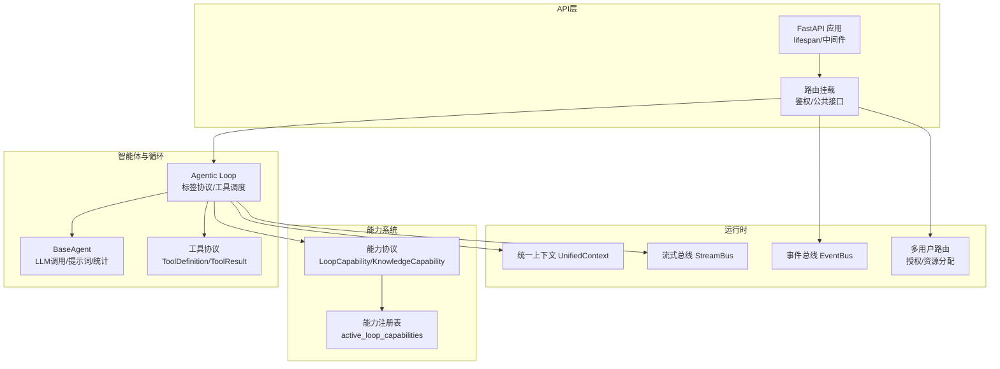
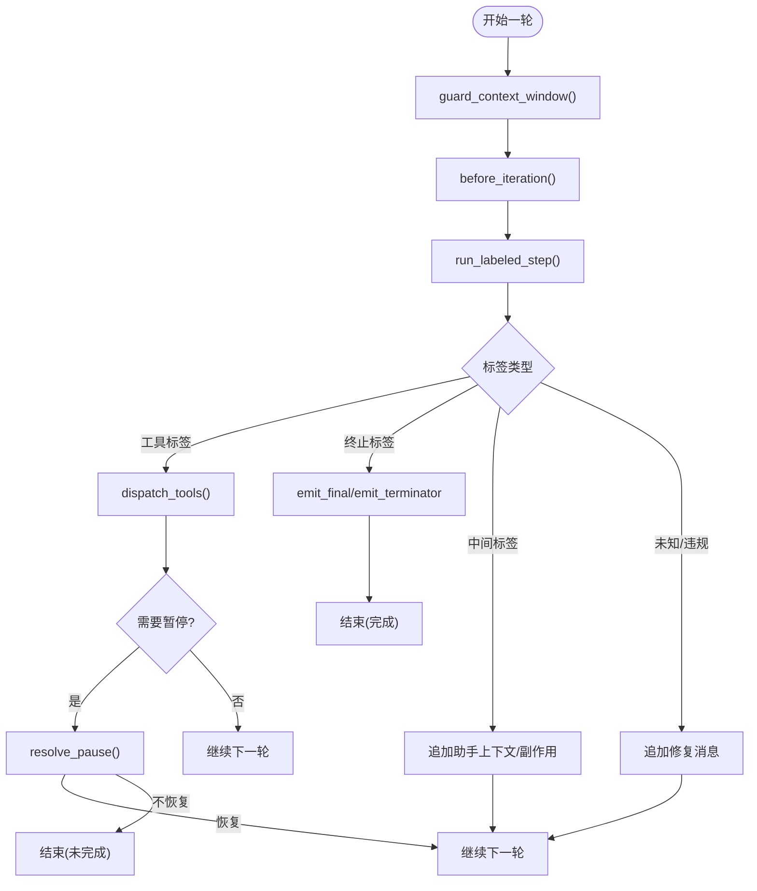
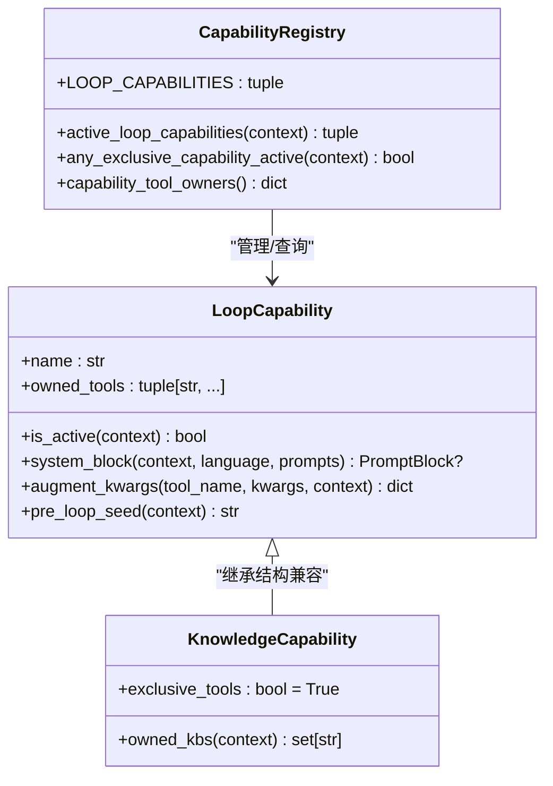
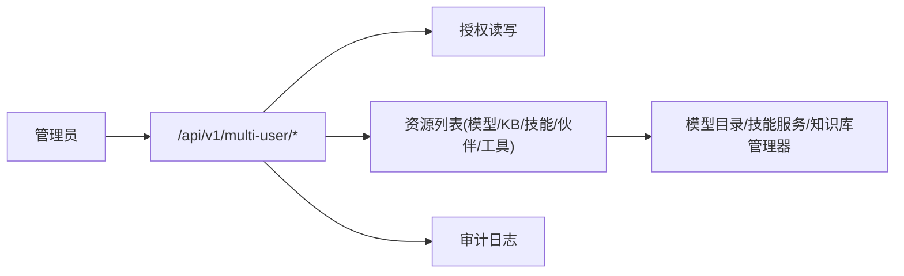
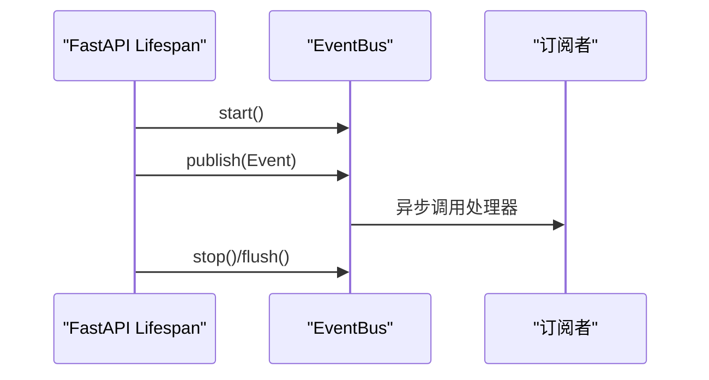
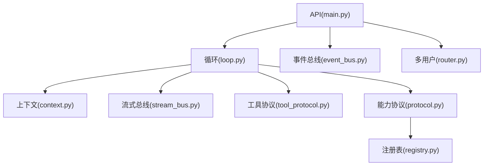

# 核心架构

<cite>
**本文引用的文件**
- [deeptutor/api/main.py](file://deeptutor/api/main.py)
- [deeptutor/core/agentic/loop.py](file://deeptutor/core/agentic/loop.py)
- [deeptutor/capabilities/registry.py](file://deeptutor/capabilities/registry.py)
- [deeptutor/capabilities/protocol.py](file://deeptutor/capabilities/protocol.py)
- [deeptutor/core/context.py](file://deeptutor/core/context.py)
- [deeptutor/events/event_bus.py](file://deeptutor/events/event_bus.py)
- [deeptutor/core/stream_bus.py](file://deeptutor/core/stream_bus.py)
- [deeptutor/multi_user/router.py](file://deeptutor/multi_user/router.py)
- [deeptutor/core/tool_protocol.py](file://deeptutor/core/tool_protocol.py)
- [deeptutor/agents/base_agent.py](file://deeptutor/agents/base_agent.py)
</cite>

## 目录
1. [简介](#简介)
2. [项目结构](#项目结构)
3. [核心组件](#核心组件)
4. [架构总览](#架构总览)
5. [详细组件分析](#详细组件分析)
6. [依赖关系分析](#依赖关系分析)
7. [性能考量](#性能考量)
8. [故障排查指南](#故障排查指南)
9. [结论](#结论)
10. [附录：扩展点与最佳实践](#附录扩展点与最佳实践)

## 简介
本文件面向DeepTutor后端核心架构，系统性阐述分层架构、插件化能力系统、事件驱动机制以及智能体循环（探索-响应双阶段）的工作原理。文档覆盖会话管理、上下文传递、消息处理、多用户隔离与权限控制、资源管理与工具注册发现等关键主题，并提供架构图与数据流图，帮助读者理解组件交互与扩展方式。

## 项目结构
DeepTutor采用清晰的分层与模块化组织：
- API网关层：FastAPI应用装配、生命周期管理、CORS与静态输出访问控制、路由挂载与鉴权策略。
- 智能体与循环层：统一的BaseAgent抽象、标签驱动的Agentic Loop、工具协议与调度。
- 能力系统：LoopCapability/KnowledgeCapability协议与内置能力注册表，支持“增强”或“独占”工具面。
- 运行时基础设施：事件总线、流式总线、统一上下文对象、会话服务、多用户授权与资源分配。
- 服务层：LLM客户端、RAG、记忆、技能、MCP、子代理等可插拔服务。



图表来源
- [deeptutor/api/main.py:116-246](file://deeptutor/api/main.py#L116-L246)
- [deeptutor/core/agentic/loop.py:173-372](file://deeptutor/core/agentic/loop.py#L173-L372)
- [deeptutor/capabilities/protocol.py:19-116](file://deeptutor/capabilities/protocol.py#L19-L116)
- [deeptutor/capabilities/registry.py:13-44](file://deeptutor/capabilities/registry.py#L13-L44)
- [deeptutor/core/context.py:33-85](file://deeptutor/core/context.py#L33-L85)
- [deeptutor/core/stream_bus.py:31-326](file://deeptutor/core/stream_bus.py#L31-L326)
- [deeptutor/events/event_bus.py:61-206](file://deeptutor/events/event_bus.py#L61-L206)
- [deeptutor/multi_user/router.py:118-229](file://deeptutor/multi_user/router.py#L118-L229)

章节来源
- [deeptutor/api/main.py:116-246](file://deeptutor/api/main.py#L116-L246)
- [deeptutor/core/agentic/loop.py:173-372](file://deeptutor/core/agentic/loop.py#L173-L372)

## 核心组件
- FastAPI应用与生命周期：启动时初始化日志、校验配置一致性、启动事件总线、自动启动合作伙伴、定时任务、PocketBase连通性检查、内存迁移；关闭时有序停止各子系统并释放连接池。
- 统一上下文：贯穿一次用户请求的完整上下文对象，包含会话ID、用户消息、历史对话、启用工具、允许内置工具、激活能力、知识库、附件、配置覆盖、语言、记忆/人设上下文、技能清单、源清单与元数据。
- 工具协议：定义工具参数、定义、别名、提示、结果、查找器与基类，支持延迟披露与外部提供者标识。
- 能力协议与注册：LoopCapability用于增强聊天工具面，KnowledgeCapability用于独占工具面；注册表提供按上下文筛选活跃能力、判断是否独占、工具归属映射。
- 事件总线：异步发布订阅，后台任务队列处理，支持启动/停止/刷新。
- 流式总线：单轮内的广播通道，支持内容、思考、观察、工具调用/结果、进度、来源、结果、错误、等待输入等事件类型，支持回放与输入注入。
- BaseAgent：统一LLM调用封装、提示词加载、Token统计、追踪回调、模型/温度/最大令牌获取与刷新。

章节来源
- [deeptutor/api/main.py:116-246](file://deeptutor/api/main.py#L116-L246)
- [deeptutor/core/context.py:33-85](file://deeptutor/core/context.py#L33-L85)
- [deeptutor/core/tool_protocol.py:16-275](file://deeptutor/core/tool_protocol.py#L16-L275)
- [deeptutor/capabilities/protocol.py:19-116](file://deeptutor/capabilities/protocol.py#L19-L116)
- [deeptutor/capabilities/registry.py:13-44](file://deeptutor/capabilities/registry.py#L13-L44)
- [deeptutor/events/event_bus.py:61-206](file://deeptutor/events/event_bus.py#L61-L206)
- [deeptutor/core/stream_bus.py:31-326](file://deeptutor/core/stream_bus.py#L31-L326)
- [deeptutor/agents/base_agent.py:32-769](file://deeptutor/agents/base_agent.py#L32-L769)

## 架构总览
DeepTutor采用“API网关 + 智能体循环 + 能力系统 + 运行时基础设施”的分层设计：
- API层负责请求接入、鉴权、CORS、静态输出安全访问、路由挂载与生命周期管理。
- 智能体循环以标签协议驱动LLM迭代，解析工具调用并交由宿主实现调度，支持暂停/终止、强制收尾、协议违规修复。
- 能力系统通过协议与注册表在每次请求中动态选择活跃能力，决定工具面是“增强”还是“独占”。
- 运行时提供统一上下文、流式总线、事件总线、多用户授权与资源分配，确保跨模块解耦与可扩展。

```mermaid
sequenceDiagram
participant Client as "客户端"
participant API as "FastAPI应用"
participant Loop as "Agentic Loop"
participant Host as "能力宿主(LoopHost)"
participant Tools as "工具调度"
participant Bus as "StreamBus"
participant Event as "EventBus"
Client->>API : HTTP请求(含会话/上下文)
API->>Event : 启动/停止事件总线(生命周期)
API->>Loop : 传入初始消息/协议/工具Schema
Loop->>Bus : 发送阶段/思考/进度事件
Loop->>Host : guard_context_window/before_iteration
Loop->>Loop : run_labeled_step(标签+工具)
alt 工具调用
Loop->>Host : dispatch_tools(tool_calls)
Host->>Tools : 执行工具
Tools-->>Host : ToolResult/暂停/终止
Host-->>Loop : tool_messages/sources/pause/terminate
Loop->>Bus : 工具调用/结果事件
else 终止标签
Loop->>Host : emit_final/emit_terminator
end
API-->>Client : 响应/流式事件
```

图表来源
- [deeptutor/api/main.py:116-246](file://deeptutor/api/main.py#L116-L246)
- [deeptutor/core/agentic/loop.py:173-372](file://deeptutor/core/agentic/loop.py#L173-L372)
- [deeptutor/core/stream_bus.py:31-326](file://deeptutor/core/stream_bus.py#L31-L326)
- [deeptutor/events/event_bus.py:61-206](file://deeptutor/events/event_bus.py#L61-L206)

## 详细组件分析

### 智能体循环（探索-响应双阶段）
- 标签协议：声明允许的标签集合、终止标签、中间标签、最终标签与工具标签。
- 迭代流程：每轮调用run_labeled_step，校验协议，若为工具标签则追加助手消息并调度工具；若为终止标签则可选流式输出并退出；若为中间标签则追加助手上下文并可触发副作用钩子。
- 宿主钩子：上下文窗口保护、迭代前注入、工具调度、暂停恢复、终止内容发射、协议违规修复、强制收尾。
- 协议违规：检测缺失标签、多重标签、工具无调用、非工具标签携带工具调用等，生成修复消息并继续重试。



图表来源
- [deeptutor/core/agentic/loop.py:173-372](file://deeptutor/core/agentic/loop.py#L173-L372)

章节来源
- [deeptutor/core/agentic/loop.py:173-372](file://deeptutor/core/agentic/loop.py#L173-L372)

### 能力系统与注册发现
- 协议：LoopCapability用于增强聊天工具面；KnowledgeCapability用于独占工具面（exclusive_tools=True）。
- 注册表：集中维护LOOP_CAPABILITIES，提供active_loop_capabilities(context)过滤活跃能力、any_exclusive_capability_active(context)判断是否独占、capability_tool_owners()工具归属映射。
- 作用：在每次请求中根据上下文选择能力，决定工具面组合与系统提示块注入。



图表来源
- [deeptutor/capabilities/protocol.py:19-116](file://deeptutor/capabilities/protocol.py#L19-L116)
- [deeptutor/capabilities/registry.py:13-44](file://deeptutor/capabilities/registry.py#L13-L44)

章节来源
- [deeptutor/capabilities/protocol.py:19-116](file://deeptutor/capabilities/protocol.py#L19-L116)
- [deeptutor/capabilities/registry.py:13-44](file://deeptutor/capabilities/registry.py#L13-L44)

### 会话管理、上下文传递与消息处理
- 统一上下文：在一次请求内承载会话ID、用户消息、历史、工具开关、知识基、附件、配置覆盖、语言、记忆/人设上下文、技能清单、源清单与元数据。
- 消息处理：API层接收请求后构建上下文，进入智能体循环；循环通过宿主将工具结果、暂停/终止信号回传；流式总线实时推送事件到前端。
- 流式总线：支持内容、思考、观察、工具调用/结果、进度、来源、结果、错误、等待输入等事件；支持按turn_id注册/注销，WS可投递用户输入。

```mermaid
sequenceDiagram
participant API as "API路由"
participant Ctx as "UnifiedContext"
participant Loop as "Agentic Loop"
participant SB as "StreamBus"
participant WS as "WebSocket/前端"
API->>Ctx : 构建上下文(会话/消息/工具/能力/附件)
API->>Loop : 运行循环(初始消息/协议/工具Schema)
Loop->>SB : 发送阶段/思考/进度/工具事件
SB-->>WS : 推送事件(NDJSON)
WS->>SB : submit_input(用户回复)
SB-->>Loop : wait_for_input返回
Loop-->>API : 完成(终止/工具产出)
```

图表来源
- [deeptutor/core/context.py:33-85](file://deeptutor/core/context.py#L33-L85)
- [deeptutor/core/stream_bus.py:31-326](file://deeptutor/core/stream_bus.py#L31-L326)
- [deeptutor/core/agentic/loop.py:173-372](file://deeptutor/core/agentic/loop.py#L173-L372)

章节来源
- [deeptutor/core/context.py:33-85](file://deeptutor/core/context.py#L33-L85)
- [deeptutor/core/stream_bus.py:31-326](file://deeptutor/core/stream_bus.py#L31-L326)
- [deeptutor/core/agentic/loop.py:173-372](file://deeptutor/core/agentic/loop.py#L173-L372)

### 多用户隔离、权限控制与资源管理
- 多用户路由：提供管理员API，列出可分配资源（模型、知识库、技能、伙伴、工具/MCP工具），并以require_admin保护写操作。
- 授权与审计：保存/读取用户授权grant，记录管理员操作审计日志；限制管理员用户不可被分配。
- 资源视图：基于管理员路径服务与技能服务、知识库管理器、模型目录服务聚合资源摘要。



图表来源
- [deeptutor/multi_user/router.py:118-229](file://deeptutor/multi_user/router.py#L118-L229)

章节来源
- [deeptutor/multi_user/router.py:118-229](file://deeptutor/multi_user/router.py#L118-L229)

### 工具调用流程与状态管理
- 工具协议：定义参数、定义、别名、提示、结果、查找器与基类；支持延迟披露与外部提供者标识。
- 循环集成：当标签为工具标签时，循环追加助手消息并调用宿主dispatch_tools执行工具；工具可返回暂停/终止信号，循环据此调整后续行为。
- 状态管理：通过上下文与流式总线维持状态；工具结果可能包含sources、metadata、pause_for_user、terminate_turn等字段影响后续流程。

```mermaid
sequenceDiagram
participant Loop as "Agentic Loop"
participant Host as "LoopHost"
participant Tool as "BaseTool.execute"
participant SB as "StreamBus"
Loop->>Host : dispatch_tools(tool_calls)
Host->>Tool : execute(**kwargs)
Tool-->>Host : ToolResult(content/success/pause/terminate)
Host-->>Loop : tool_messages/sources/pause/terminate
Tool->>SB : tool_call/tool_result事件
Loop->>SB : progress/result/error事件
```

图表来源
- [deeptutor/core/tool_protocol.py:16-275](file://deeptutor/core/tool_protocol.py#L16-L275)
- [deeptutor/core/agentic/loop.py:173-372](file://deeptutor/core/agentic/loop.py#L173-L372)
- [deeptutor/core/stream_bus.py:31-326](file://deeptutor/core/stream_bus.py#L31-L326)

章节来源
- [deeptutor/core/tool_protocol.py:16-275](file://deeptutor/core/tool_protocol.py#L16-L275)
- [deeptutor/core/agentic/loop.py:173-372](file://deeptutor/core/agentic/loop.py#L173-L372)

### 事件驱动架构
- 事件总线：异步发布订阅，后台任务队列处理，支持启动/停止/刷新；事件类型包括SOLVE_COMPLETE、QUESTION_COMPLETE、CAPABILITY_COMPLETE。
- 应用生命周期：FastAPI lifespan中启动/停止事件总线，与其他子系统协同。



图表来源
- [deeptutor/events/event_bus.py:61-206](file://deeptutor/events/event_bus.py#L61-L206)
- [deeptutor/api/main.py:116-246](file://deeptutor/api/main.py#L116-L246)

章节来源
- [deeptutor/events/event_bus.py:61-206](file://deeptutor/events/event_bus.py#L61-L206)
- [deeptutor/api/main.py:116-246](file://deeptutor/api/main.py#L116-L246)

## 依赖关系分析
- API层依赖：日志配置、运行时设置、路径服务、CORS、静态输出安全访问、路由模块、多用户路由。
- 循环层依赖：标签协议、消息构造、工具调度、使用量跟踪、流式总线。
- 能力层依赖：统一上下文、协议、注册表。
- 运行时依赖：事件总线、流式总线、多用户授权。



图表来源
- [deeptutor/api/main.py:116-246](file://deeptutor/api/main.py#L116-L246)
- [deeptutor/core/agentic/loop.py:173-372](file://deeptutor/core/agentic/loop.py#L173-L372)
- [deeptutor/core/context.py:33-85](file://deeptutor/core/context.py#L33-L85)
- [deeptutor/core/stream_bus.py:31-326](file://deeptutor/core/stream_bus.py#L31-L326)
- [deeptutor/core/tool_protocol.py:16-275](file://deeptutor/core/tool_protocol.py#L16-L275)
- [deeptutor/capabilities/protocol.py:19-116](file://deeptutor/capabilities/protocol.py#L19-L116)
- [deeptutor/capabilities/registry.py:13-44](file://deeptutor/capabilities/registry.py#L13-L44)
- [deeptutor/events/event_bus.py:61-206](file://deeptutor/events/event_bus.py#L61-L206)
- [deeptutor/multi_user/router.py:118-229](file://deeptutor/multi_user/router.py#L118-L229)

章节来源
- [deeptutor/api/main.py:116-246](file://deeptutor/api/main.py#L116-L246)
- [deeptutor/core/agentic/loop.py:173-372](file://deeptutor/core/agentic/loop.py#L173-L372)

## 性能考量
- 流式输出：通过StreamBus实时推送内容/思考/进度，降低首字延迟感知。
- 工具并行：LoopHost.dispatch_tools可并行执行工具调用，提升吞吐。
- 上下文窗口保护：guard_context_window避免超出模型窗口导致失败。
- 资源释放：生命周期中关闭MCP连接、LLM提供商池、Agentic客户端池，防止资源泄漏。
- 日志优化：选择性访问日志抑制高频200请求噪音，聚焦异常。

[本节为通用指导，不直接分析具体文件]

## 故障排查指南
- 配置漂移：启动时校验能力清单引用的工具是否在运行时工具注册表中存在，不存在则抛出配置漂移错误。
- 事件总线：启动/停止/刷新超时与队列积压警告；处理器异常会记录错误但不中断主流程。
- 流式总线：关闭后不再投递；wait_for_input超时返回空字符串，需在前端处理。
- 多用户授权：管理员用户不可被分配；安装技能时捕获Hub/导入/命名错误并返回相应HTTP状态码。

章节来源
- [deeptutor/api/main.py:57-82](file://deeptutor/api/main.py#L57-L82)
- [deeptutor/events/event_bus.py:108-185](file://deeptutor/events/event_bus.py#L108-L185)
- [deeptutor/core/stream_bus.py:70-298](file://deeptutor/core/stream_bus.py#L70-L298)
- [deeptutor/multi_user/router.py:170-223](file://deeptutor/multi_user/router.py#L170-L223)

## 结论
DeepTutor通过分层架构与插件化能力系统实现了高内聚、低耦合的智能体编排。标签驱动的Agentic Loop将LLM推理与工具调用解耦，结合统一上下文、流式总线与事件总线，提供了可扩展、可观测、可交互的AI学习平台。多用户路由与授权机制保障了资源隔离与安全。遵循本文档的扩展点说明，可便捷地添加新能力与工具。

[本节为总结，不直接分析具体文件]

## 附录：扩展点与最佳实践
- 新增能力
  - 实现LoopCapability或KnowledgeCapability协议，声明name、owned_tools、is_active、system_block、augment_kwargs、pre_loop_seed。
  - 在注册表中加入实例，或通过active_loop_capabilities(context)动态生效。
  - 若为KnowledgeCapability，注意exclusive_tools将替换工具面，需自行提供检索/创作工具链。
- 新增工具
  - 继承BaseTool，实现get_definition与execute；必要时设置deferred以延迟披露。
  - 通过ToolResult.content/success/pause_for_user/terminate_turn控制循环行为。
  - 使用StreamBus发出tool_call/tool_result/progress等事件，便于前端展示与调试。
- 会话与上下文
  - 在API层构建UnifiedContext，确保enabled_tools、allowed_builtin_tools、active_capability、knowledge_bases等字段正确设置。
  - 使用StreamBus.wait_for_input实现交互式工具（如ask_user），并通过submit_input注入用户回复。
- 事件与监控
  - 通过EventBus.publish发布领域事件，订阅者异步处理，避免阻塞主流程。
  - 利用BaseAgent.set_trace_callback与LLM调用追踪，记录模型调用细节与耗时。
- 多用户与权限
  - 使用multi_user路由进行资源分配与授权管理；管理员操作需require_admin保护。
  - 关注资源可见性与隔离，确保用户仅能访问已授权的工具、技能与知识库。

章节来源
- [deeptutor/capabilities/protocol.py:19-116](file://deeptutor/capabilities/protocol.py#L19-L116)
- [deeptutor/capabilities/registry.py:13-44](file://deeptutor/capabilities/registry.py#L13-L44)
- [deeptutor/core/tool_protocol.py:16-275](file://deeptutor/core/tool_protocol.py#L16-L275)
- [deeptutor/core/stream_bus.py:31-326](file://deeptutor/core/stream_bus.py#L31-L326)
- [deeptutor/agents/base_agent.py:32-769](file://deeptutor/agents/base_agent.py#L32-L769)
- [deeptutor/multi_user/router.py:118-229](file://deeptutor/multi_user/router.py#L118-L229)