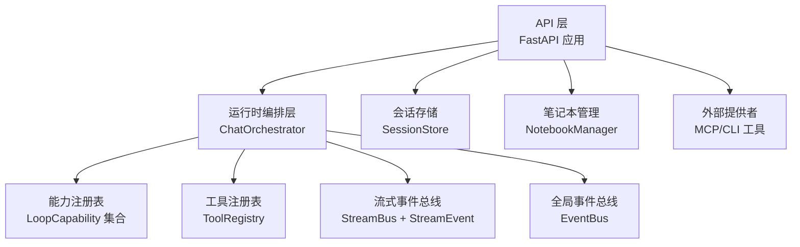
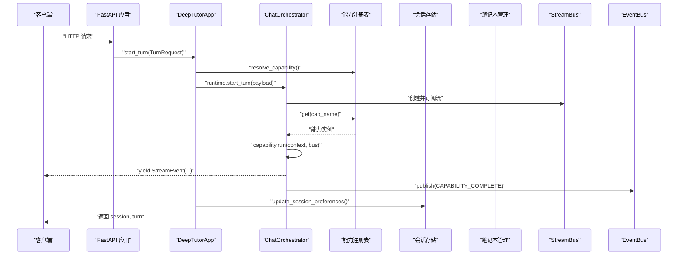
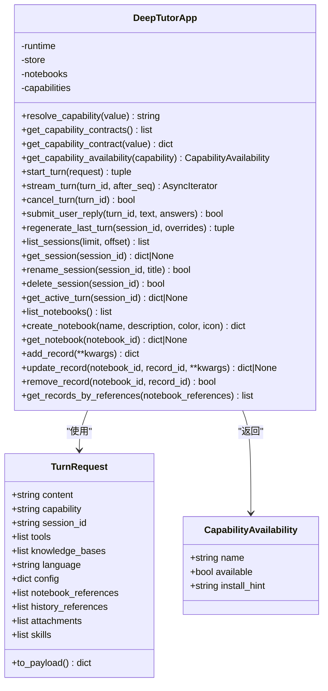
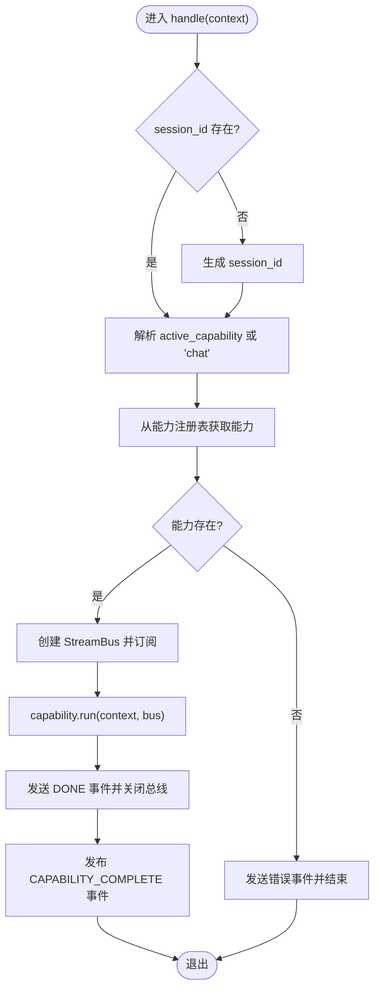
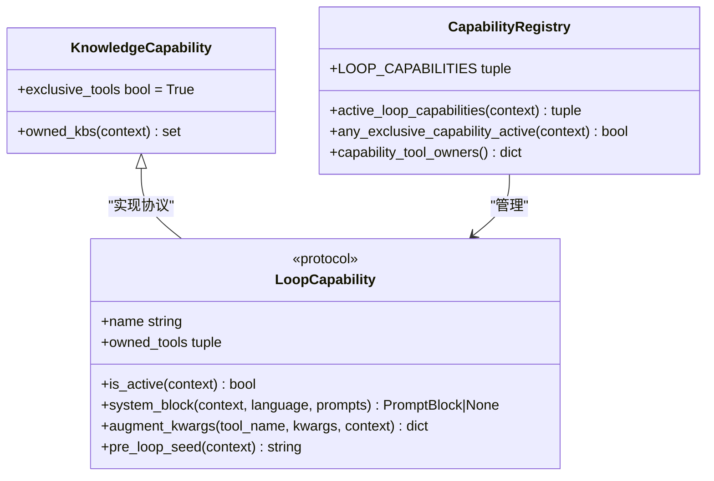
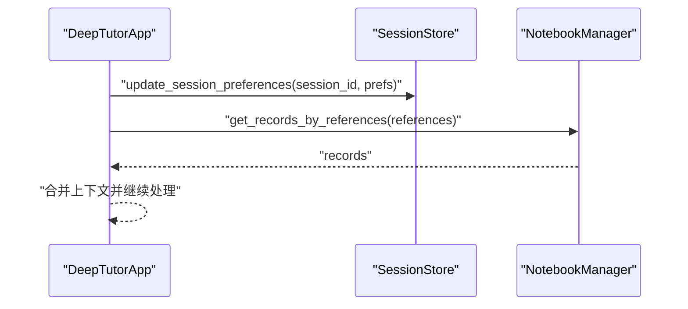
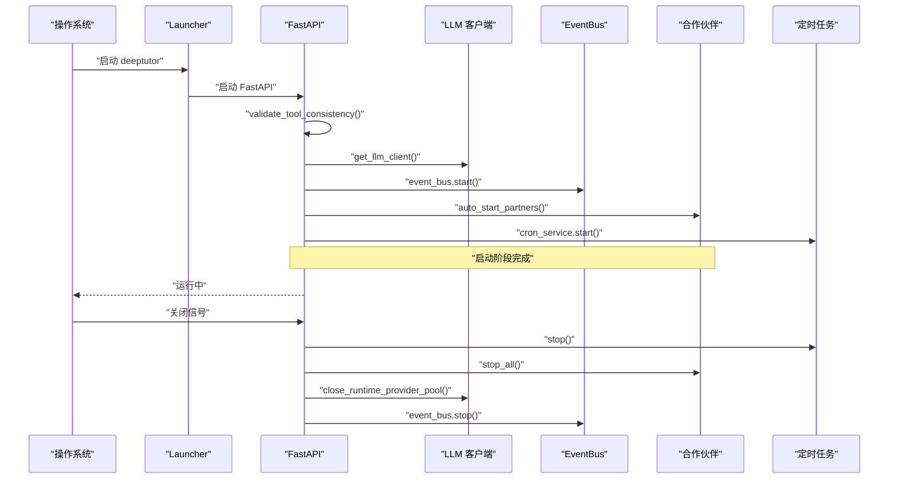
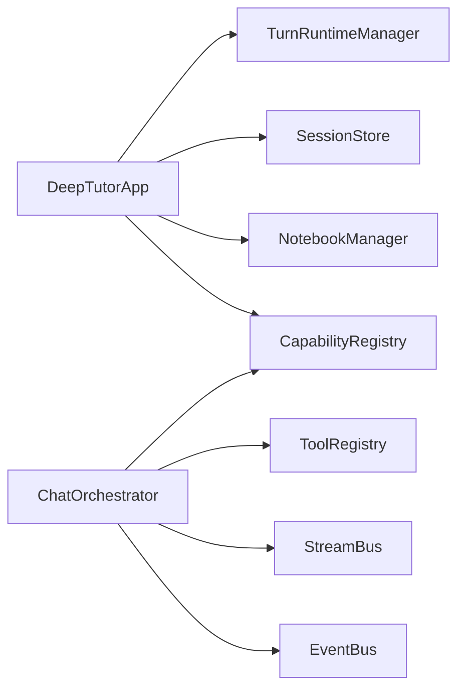

# 系统概览

<cite>
**本文引用的文件**
- [facade.py](file://deeptutor/app/facade.py)
- [orchestrator.py](file://deeptutor/runtime/orchestrator.py)
- [registry.py](file://deeptutor/capabilities/registry.py)
- [main.py](file://deeptutor/api/main.py)
- [__init__.py](file://deeptutor/services/notebook/__init__.py)
- [context.py](file://deeptutor/core/context.py)
- [event_bus.py](file://deeptutor/events/event_bus.py)
- [protocol.py](file://deeptutor/capabilities/protocol.py)
- [stream.py](file://deeptutor/core/stream.py)
- [launcher.py](file://deeptutor/runtime/launcher.py)
- [__init__.py](file://deeptutor/services/session/__init__.py)
</cite>

## 目录
1. [简介](#简介)
2. [项目结构](#项目结构)
3. [核心组件](#核心组件)
4. [架构总览](#架构总览)
5. [详细组件分析](#详细组件分析)
6. [依赖关系分析](#依赖关系分析)
7. [性能考量](#性能考量)
8. [故障排查指南](#故障排查指南)
9. [结论](#结论)
10. [附录：扩展点与最佳实践](#附录：扩展点与最佳实践)

## 简介
本概览面向首次接触 DeepTutor 的读者，聚焦系统的整体架构与关键设计思想：分层架构、插件化能力体系、事件驱动通信。文档重点解释门面类 DeepTutorApp 的职责边界、TurnRequest 数据结构、能力解析机制与会话管理接口；并说明运行时管理器、会话存储、笔记本管理与能力注册表之间的协作方式。最后给出启动流程、初始化过程、依赖注入机制以及扩展新能力/工具的指引。

## 项目结构
DeepTutor 采用清晰的分层组织：
- API 层：FastAPI 应用、路由挂载、生命周期管理（启动/关闭）、CORS、静态资源安全暴露等。
- 运行时编排层：统一入口 ChatOrchestrator，负责将请求路由到具体能力，管理流式事件总线，发布完成事件。
- 能力与工具层：能力协议 LoopCapability/KnowledgeCapability、内置能力注册表、工具注册与外部提供者抽象。
- 服务层：会话存储、笔记本管理、LLM、RAG、记忆、MCP、技能等可插拔服务。
- 基础设施：事件总线 EventBus、流式事件 StreamEvent、统一上下文 UnifiedContext。

图表来源
- [main.py:116-247](file://deeptutor/api/main.py#L116-L247)
- [orchestrator.py:26-147](file://deeptutor/runtime/orchestrator.py#L26-L147)
- [registry.py:13-44](file://deeptutor/capabilities/registry.py#L13-L44)
- [event_bus.py:61-185](file://deeptutor/events/event_bus.py#L61-L185)
- [stream.py:17-73](file://deeptutor/core/stream.py#L17-L73)

章节来源
- [main.py:116-247](file://deeptutor/api/main.py#L116-L247)
- [orchestrator.py:26-147](file://deeptutor/runtime/orchestrator.py#L26-L147)
- [registry.py:13-44](file://deeptutor/capabilities/registry.py#L13-L44)
- [event_bus.py:61-185](file://deeptutor/events/event_bus.py#L61-L185)
- [stream.py:17-73](file://deeptutor/core/stream.py#L17-L73)

## 核心组件
- 门面类 DeepTutorApp：对外提供稳定接口，封装运行时、会话、笔记本、能力注册表的访问；负责 TurnRequest 校验与能力解析、会话偏好更新、轮次启动/取消/重生成、笔记本 CRUD 等。
- 统一上下文 UnifiedContext：贯穿一次用户轮次的完整上下文，包含会话ID、消息历史、启用工具、知识基、附件、配置覆盖、语言、记忆/人设上下文、技能清单、来源清单、元数据等。
- 能力协议 LoopCapability/KnowledgeCapability：定义可选的“循环能力”扩展点，支持系统提示块注入、工具增强、预循环种子文本；KnowledgeCapability 表示独占工具的知识型能力。
- 能力注册表：维护内置能力列表、活跃能力筛选、独占能力判断、能力自有工具归属映射。
- 运行时编排器 ChatOrchestrator：接收 UnifiedContext，选择能力，创建并管理 StreamBus，执行能力 run，捕获异常，发送 DONE，发布 CAPABILITY_COMPLETE 事件。
- 会话存储 SessionStore：提供会话列表、查询、重命名、删除、活动轮次获取、偏好更新等。
- 笔记本管理 NotebookManager：提供笔记本列表、创建、记录增删改查、按引用获取记录等。
- 事件总线 EventBus：进程内异步事件分发，支持订阅/发布、后台处理队列、启动/停止/刷新。
- 流式事件 StreamEvent：统一的流式事件类型与载荷，用于 CLI/WebSocket/SDK 消费。

章节来源
- [facade.py:15-215](file://deeptutor/app/facade.py#L15-L215)
- [context.py:15-85](file://deeptutor/core/context.py#L15-L85)
- [protocol.py:11-117](file://deeptutor/capabilities/protocol.py#L11-L117)
- [registry.py:13-44](file://deeptutor/capabilities/registry.py#L13-L44)
- [orchestrator.py:26-147](file://deeptutor/runtime/orchestrator.py#L26-L147)
- [__init__.py:33-47](file://deeptutor/services/session/__init__.py#L33-L47)
- [__init__.py:1-20](file://deeptutor/services/notebook/__init__.py#L1-L20)
- [event_bus.py:61-185](file://deeptutor/events/event_bus.py#L61-L185)
- [stream.py:17-73](file://deeptutor/core/stream.py#L17-L73)

## 架构总览
DeepTutor 采用分层+插件化+事件驱动的混合架构：
- 分层架构：API 层仅负责 HTTP/WebSocket 接入与路由；运行时编排层解耦业务逻辑；能力与工具以插件形式注册；服务层提供持久化、检索、模型调用等能力。
- 插件化设计：能力通过协议扩展，工具通过注册表与外部提供者（如 MCP）动态装配；设置界面可按能力分组展示工具。
- 事件驱动：能力执行期间通过 StreamBus 推送细粒度进度；完成后通过 EventBus 发布 CAPABILITY_COMPLETE，供监控、审计、统计等模块订阅。

图表来源
- [facade.py:114-134](file://deeptutor/app/facade.py#L114-L134)
- [orchestrator.py:36-114](file://deeptutor/runtime/orchestrator.py#L36-L114)
- [event_bus.py:101-151](file://deeptutor/events/event_bus.py#L101-L151)
- [registry.py:22-44](file://deeptutor/capabilities/registry.py#L22-L44)

章节来源
- [facade.py:114-134](file://deeptutor/app/facade.py#L114-L134)
- [orchestrator.py:36-114](file://deeptutor/runtime/orchestrator.py#L36-L114)
- [event_bus.py:101-151](file://deeptutor/events/event_bus.py#L101-L151)
- [registry.py:22-44](file://deeptutor/capabilities/registry.py#L22-L44)

## 详细组件分析

### DeepTutorApp 门面类
职责与模式
- 门面模式：聚合运行时、会话、笔记本、能力注册表，屏蔽内部复杂性，提供稳定 API。
- 能力解析：根据 capability 名称或别名解析为实际能力名，未知时抛出明确错误并列出可用能力。
- 会话管理：启动轮次后更新会话偏好（语言、笔记本引用、历史引用），并提供会话 CRUD 与活动轮次查询。
- 笔记本管理：提供笔记本列表、创建、记录增删改查、按引用获取记录。
- 流式交互：提供 stream_turn、cancel_turn、submit_user_reply、regenerate_last_turn 等接口。

TurnRequest 数据结构
- 字段包括内容、能力、会话ID、工具、知识基、语言、配置、笔记本引用、历史引用、附件、技能等。
- 提供 to_payload 方法转换为字典，便于传递给运行时。

能力可用性检查
- 针对特定能力（如 math_animator）检测依赖是否安装，并返回安装提示。

图表来源
- [facade.py:15-215](file://deeptutor/app/facade.py#L15-L215)

章节来源
- [facade.py:15-215](file://deeptutor/app/facade.py#L15-L215)

### 运行时编排器 ChatOrchestrator
职责与流程
- 接收 UnifiedContext，若未设置 session_id 则生成。
- 根据 active_capability 或默认 chat 从能力注册表获取能力。
- 创建 StreamBus，注册/注销 turn 级总线，执行能力 run，捕获异常并发送错误与 DONE 事件。
- 完成后通过 EventBus 发布 CAPABILITY_COMPLETE 事件，携带任务ID、会话ID、轮次ID、能力名等元信息。

图表来源
- [orchestrator.py:36-114](file://deeptutor/runtime/orchestrator.py#L36-L114)
- [event_bus.py:101-151](file://deeptutor/events/event_bus.py#L101-L151)

章节来源
- [orchestrator.py:36-114](file://deeptutor/runtime/orchestrator.py#L36-L114)
- [event_bus.py:101-151](file://deeptutor/events/event_bus.py#L101-L151)

### 能力协议与注册表
协议要点
- LoopCapability：定义 name、owned_tools、is_active、system_block、augment_kwargs、pre_loop_seed 等扩展点；支持在聊天循环中注入系统提示块、增强工具参数、追加初始种子文本。
- KnowledgeCapability：标记 exclusive_tools=True，表示该能力独占工具表面，替代内置工具集，适合基于知识库的推理与创作。

注册表功能
- 维护 LOOP_CAPABILITIES 列表，提供 active_loop_capabilities 过滤当前轮次活跃能力。
- any_exclusive_capability_active 判断是否存在独占能力，影响工具分支与 RAG 脚手架抑制。
- capability_tool_owners 建立能力自有工具到能力名的映射，用于设置界面分组。

图表来源
- [protocol.py:11-117](file://deeptutor/capabilities/protocol.py#L11-L117)
- [registry.py:13-44](file://deeptutor/capabilities/registry.py#L13-L44)

章节来源
- [protocol.py:11-117](file://deeptutor/capabilities/protocol.py#L11-L117)
- [registry.py:13-44](file://deeptutor/capabilities/registry.py#L13-L44)

### 会话存储与笔记本管理
会话存储
- get_session_store 根据配置返回 PocketBase 或 SQLite 实现，提供会话列表、查询、重命名、删除、活动轮次获取、偏好更新等。
- TurnRuntimeManager 由门面类持有，负责 start_turn、subscribe_turn、cancel_turn、submit_user_reply、regenerate_last_turn。

笔记本管理
- NotebookManager 提供笔记本列表、创建、记录增删改查、按引用获取记录等，被门面类直接委托。

图表来源
- [facade.py:126-134](file://deeptutor/app/facade.py#L126-L134)
- [facade.py:160-210](file://deeptutor/app/facade.py#L160-L210)
- [__init__.py:33-47](file://deeptutor/services/session/__init__.py#L33-L47)
- [__init__.py:1-20](file://deeptutor/services/notebook/__init__.py#L1-L20)

章节来源
- [facade.py:126-134](file://deeptutor/app/facade.py#L126-L134)
- [facade.py:160-210](file://deeptutor/app/facade.py#L160-L210)
- [__init__.py:33-47](file://deeptutor/services/session/__init__.py#L33-L47)
- [__init__.py:1-20](file://deeptutor/services/notebook/__init__.py#L1-L20)

### 启动流程与初始化
FastAPI 生命周期
- lifespan 钩子在启动时：验证工具一致性、初始化 LLM 客户端、启动 EventBus、自动启动合作伙伴、启动定时任务、探测 PocketBase、迁移旧版记忆文件。
- 关闭时：停止定时任务、停止合作伙伴、关闭 MCP 连接、关闭 LLM 提供商池、关闭 Agentic 客户端池、停止 EventBus。

本地启动器
- launcher 负责后端与前端进程管理、端口冲突解决、健康检查、构建缓存、环境变量注入等。

图表来源
- [main.py:116-247](file://deeptutor/api/main.py#L116-L247)
- [launcher.py:453-474](file://deeptutor/runtime/launcher.py#L453-L474)

章节来源
- [main.py:116-247](file://deeptutor/api/main.py#L116-L247)
- [launcher.py:453-474](file://deeptutor/runtime/launcher.py#L453-L474)

### 依赖注入机制
- 门面类通过工厂函数获取单例或共享实例：get_turn_runtime_manager、get_session_store、get_notebook_manager、get_capability_registry。
- 运行时编排器通过 get_capability_registry、get_tool_registry 获取注册表。
- 事件总线通过 get_event_bus 获取单例。
- 这种松耦合方式使各模块无需硬编码依赖，便于测试与替换实现。

章节来源
- [facade.py:59-64](file://deeptutor/app/facade.py#L59-L64)
- [orchestrator.py:32-35](file://deeptutor/runtime/orchestrator.py#L32-L35)
- [event_bus.py:200-205](file://deeptutor/events/event_bus.py#L200-L205)

## 依赖关系分析
- 门面类依赖运行时、会话、笔记本、能力注册表，形成稳定的上层接口。
- 编排器依赖能力与工具注册表，并通过流式事件总线与全局事件总线进行通信。
- 能力协议与注册表构成插件化核心，允许新增能力而不改动现有流程。
- 会话存储与笔记本管理作为服务层，被门面类与服务层其他模块复用。

图表来源
- [facade.py:59-64](file://deeptutor/app/facade.py#L59-L64)
- [orchestrator.py:32-35](file://deeptutor/runtime/orchestrator.py#L32-L35)
- [registry.py:13-44](file://deeptutor/capabilities/registry.py#L13-L44)

章节来源
- [facade.py:59-64](file://deeptutor/app/facade.py#L59-L64)
- [orchestrator.py:32-35](file://deeptutor/runtime/orchestrator.py#L32-L35)
- [registry.py:13-44](file://deeptutor/capabilities/registry.py#L13-L44)

## 性能考量
- 流式事件：通过 StreamBus 实时推送细粒度事件，避免阻塞主线程，提升用户体验。
- 事件总线：后台任务队列处理事件，非阻塞发布，降低对主流程的影响。
- 启动优化：懒加载路由与模块，仅在需要时导入；启动阶段捕获异常并降级，保证服务可用性。
- 资源清理：关闭时显式释放 LLM 提供商池、Agentic 客户端池、MCP 连接，防止资源泄漏。

[本节为通用指导，不直接分析具体文件]

## 故障排查指南
- 能力未知错误：编排器在能力不存在时发送错误事件并结束，检查能力名称与注册表。
- 工具不一致：启动时 validate_tool_consistency 会校验能力清单中的工具是否在工具注册表中，缺失将抛出运行时错误。
- 事件总线异常：处理器捕获异常并记录日志，不影响发布者；可通过日志定位订阅者错误。
- 启动失败：lifespan 中各步骤均捕获异常并记录警告，查看日志确定失败环节（LLM、EventBus、合作伙伴、定时任务、PocketBase）。

章节来源
- [orchestrator.py:49-67](file://deeptutor/runtime/orchestrator.py#L49-L67)
- [main.py:57-82](file://deeptutor/api/main.py#L57-L82)
- [event_bus.py:122-143](file://deeptutor/events/event_bus.py#L122-L143)
- [main.py:116-247](file://deeptutor/api/main.py#L116-L247)

## 结论
DeepTutor 通过分层架构、插件化能力与事件驱动通信，实现了高内聚、低耦合的系统设计。门面类 DeepTutorApp 提供稳定接口，编排器 ChatOrchestrator 负责能力调度与流式事件，能力协议与注册表支撑可扩展性，会话与笔记本管理服务保障状态与数据。启动流程健壮且可观测，便于在生产环境中部署与维护。

[本节为总结，不直接分析具体文件]

## 附录：扩展点与最佳实践
- 添加新能力
  - 实现 LoopCapability 或 KnowledgeCapability 协议，定义 name、owned_tools、is_active、system_block、augment_kwargs、pre_loop_seed。
  - 将能力实例加入 LOOP_CAPABILITIES 或通过注册机制纳入能力注册表。
  - 如需独占工具，继承 KnowledgeCapability 并设置 exclusive_tools=True。
- 添加新工具
  - 在工具注册表中注册工具，确保能力清单中引用的工具已存在，避免启动时一致性校验失败。
  - 外部工具可通过 providers 层（MCP/CLI）披露，遵循声明式清单与延迟加载模式。
- 订阅事件
  - 使用 EventBus.subscribe 订阅 CAPABILITY_COMPLETE、SOLVE_COMPLETE、QUESTION_COMPLETE 等事件，实现监控、审计、统计等功能。
- 流式输出
  - 能力内部通过 StreamBus 推送 STAGE_START/END、THINKING、OBSERVATION、CONTENT、TOOL_CALL/RESULT、PROGRESS、SOURCES、RESULT、ERROR、SESSION/META、DONE、WAIT_FOR_INPUT 等事件。
- 最佳实践
  - 保持能力幂等与健壮，捕获异常并上报错误事件。
  - 合理拆分系统提示块，避免过长导致上下文溢出。
  - 使用 UnifiedContext 传递必要上下文，避免全局状态污染。
  - 在关闭阶段释放外部资源，确保进程优雅退出。

[本节为通用指导，不直接分析具体文件]