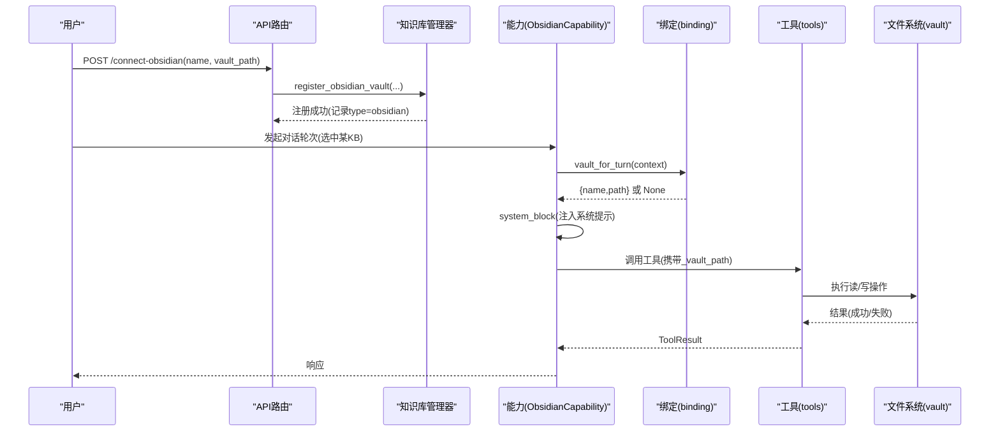
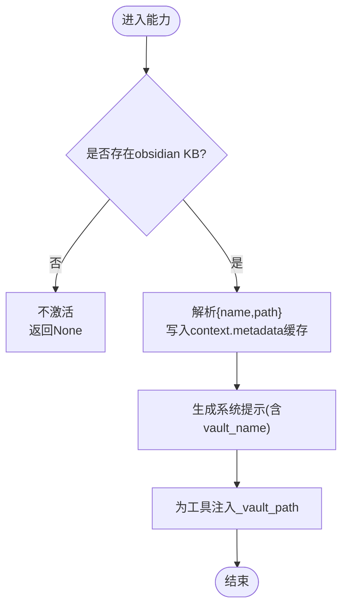
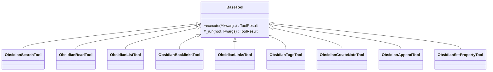
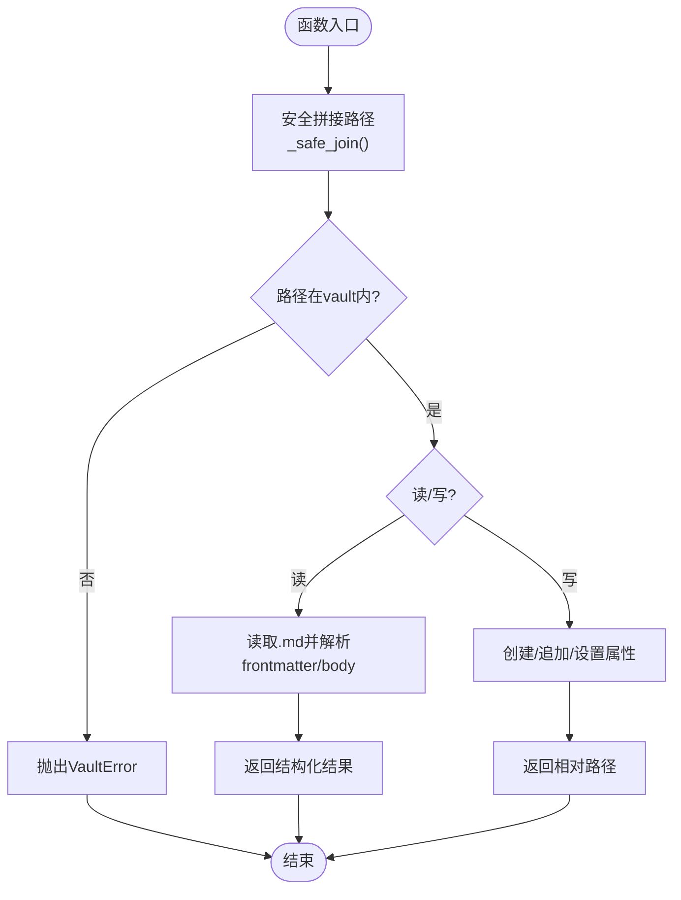
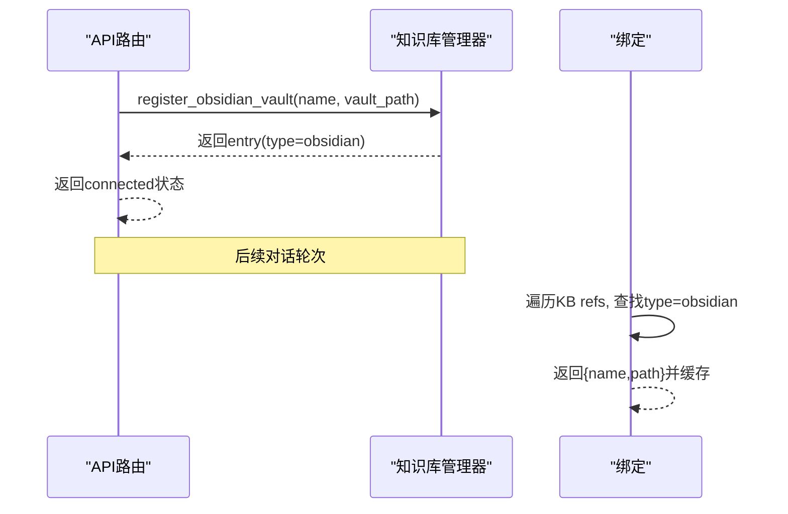
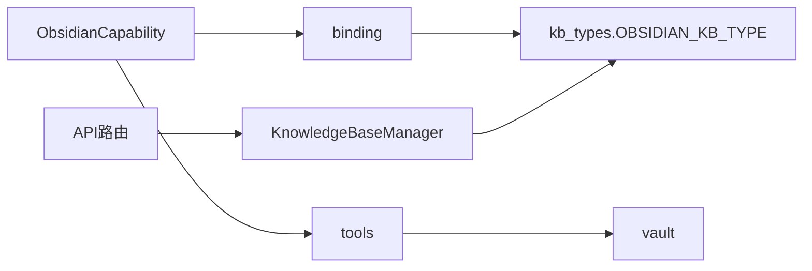

# Obsidian集成能力

<cite>
**本文引用的文件**
- [capabilities/obsidian/__init__.py](file://deeptutor/capabilities/obsidian/__init__.py)
- [capabilities/obsidian/capability.py](file://deeptutor/capabilities/obsidian/capability.py)
- [capabilities/obsidian/binding.py](file://deeptutor/capabilities/obsidian/binding.py)
- [capabilities/obsidian/vault.py](file://deeptutor/capabilities/obsidian/vault.py)
- [capabilities/obsidian/tools.py](file://deeptutor/capabilities/obsidian/tools.py)
- [knowledge/kb_types.py](file://deeptutor/knowledge/kb_types.py)
- [api/routers/knowledge.py](file://deeptutor/api/routers/knowledge.py)
- [knowledge/manager.py](file://deeptutor/knowledge/manager.py)
- [capabilities/obsidian/prompts/en/system.md](file://deeptutor/capabilities/obsidian/prompts/en/system.md)
- [tests/capabilities/test_obsidian_capability.py](file://tests/capabilities/test_obsidian_capability.py)
</cite>

## 目录
1. [简介](#简介)
2. [项目结构](#项目结构)
3. [核心组件](#核心组件)
4. [架构总览](#架构总览)
5. [详细组件分析](#详细组件分析)
6. [依赖关系分析](#依赖关系分析)
7. [性能与一致性](#性能与一致性)
8. [故障排查指南](#故障排查指南)
9. [结论](#结论)
10. [附录：配置示例](#附录：配置示例)

## 简介
本文件系统性说明 DeepTutor 对 Obsidian 的双向集成能力：通过“知识库绑定（binding）”将用户选中的 Obsidian 保险库（vault）注入到对话轮次中，并以一组工具（tools）直接读写本地 Markdown 笔记、管理元数据与链接。该能力以“独占式工具循环”运行，确保模型在单轮内仅通过 Obsidian 工具与真实文件系统交互，避免越权访问。

## 项目结构
Obsidian 集成位于 capabilities/obsidian 下，按职责拆分为：
- capability.py：能力入口，决定何时激活、如何注入系统提示与参数
- binding.py：从当前上下文的知识库选择解析出绑定的 vault 路径并缓存
- tools.py：暴露九项工具（搜索、读取、列出、反向链接、外链、标签、创建、追加、设置属性）
- vault.py：纯文件系统操作层，封装 Obsidian 约定（frontmatter、wikilink、忽略目录等）
- prompts/*：系统提示模板（中英），用于指导模型使用工具

```mermaid
graph TB
subgraph "能力层"
C["capability.py"]
B["binding.py"]
T["tools.py"]
V["vault.py"]
end
subgraph "知识基座"
KB["kb_types.py"]
MGR["knowledge/manager.py"]
end
subgraph "API"
API["api/routers/knowledge.py"]
end
C --> B
C --> T
T --> V
B --> KB
API --> MGR
MGR --> KB
```

图表来源
- [capabilities/obsidian/capability.py:24-68](file://deeptutor/capabilities/obsidian/capability.py#L24-L68)
- [capabilities/obsidian/binding.py:22-69](file://deeptutor/capabilities/obsidian/binding.py#L22-L69)
- [capabilities/obsidian/tools.py:24-36](file://deeptutor/capabilities/obsidian/tools.py#L24-L36)
- [capabilities/obsidian/vault.py:1-14](file://deeptutor/capabilities/obsidian/vault.py#L1-L14)
- [knowledge/kb_types.py:46-103](file://deeptutor/knowledge/kb_types.py#L46-L103)
- [api/routers/knowledge.py:1504-1533](file://deeptutor/api/routers/knowledge.py#L1504-L1533)
- [knowledge/manager.py:691-723](file://deeptutor/knowledge/manager.py#L691-L723)

章节来源
- [capabilities/obsidian/__init__.py:1-6](file://deeptutor/capabilities/obsidian/__init__.py#L1-L6)
- [capabilities/obsidian/capability.py:24-68](file://deeptutor/capabilities/obsidian/capability.py#L24-L68)
- [capabilities/obsidian/binding.py:22-69](file://deeptutor/capabilities/obsidian/binding.py#L22-L69)
- [capabilities/obsidian/tools.py:24-36](file://deeptutor/capabilities/obsidian/tools.py#L24-L36)
- [capabilities/obsidian/vault.py:1-14](file://deeptutor/capabilities/obsidian/vault.py#L1-L14)
- [knowledge/kb_types.py:46-103](file://deeptutor/knowledge/kb_types.py#L46-L103)
- [api/routers/knowledge.py:1504-1533](file://deeptutor/api/routers/knowledge.py#L1504-L1533)
- [knowledge/manager.py:691-723](file://deeptutor/knowledge/manager.py#L691-L723)

## 核心组件
- ObsidianCapability：能力主体，负责判断是否激活、注入系统提示、为工具调用注入服务器端控制的 _vault_path，并声明拥有的工具集合。
- Binding：从上下文中已选择的知识库条目里识别 type=obsidian 的条目，解析 vault_path 并缓存，供 is_active/augment_kwargs/system_block 复用。
- Tools：九项工具统一继承基础类，自动校验 vault root，捕获 VaultError 并返回结构化失败结果；读操作覆盖搜索、读取、列表、反向链接、外链、标签；写操作遵循“只增不改”原则（创建、追加、设置属性）。
- Vault：纯文件系统层，实现 Obsidian 约定：.md 文件、YAML frontmatter、[[wikilink]]、忽略 .obsidian/.trash/.git 等内部目录；提供安全的路径拼接与解析。

章节来源
- [capabilities/obsidian/capability.py:24-68](file://deeptutor/capabilities/obsidian/capability.py#L24-L68)
- [capabilities/obsidian/binding.py:22-69](file://deeptutor/capabilities/obsidian/binding.py#L22-L69)
- [capabilities/obsidian/tools.py:62-76](file://deeptutor/capabilities/obsidian/tools.py#L62-L76)
- [capabilities/obsidian/vault.py:24-66](file://deeptutor/capabilities/obsidian/vault.py#L24-L66)

## 架构总览
Obsidian 集成的关键流程如下：
- 连接阶段：通过 API 将本地 Obsidian 目录注册为“连接型知识库”（type=obsidian），不触发索引。
- 绑定阶段：对话轮次开始时，根据上下文所选 KB 解析出首个 obsidian 类型条目，得到 {name, path} 并缓存。
- 执行阶段：能力激活后，系统提示引导模型仅使用 Obsidian 工具；每次工具调用由能力注入 _vault_path，工具层再调用 vault 层进行安全的文件读写。



图表来源
- [api/routers/knowledge.py:1504-1533](file://deeptutor/api/routers/knowledge.py#L1504-L1533)
- [knowledge/manager.py:691-723](file://deeptutor/knowledge/manager.py#L691-L723)
- [capabilities/obsidian/capability.py:39-68](file://deeptutor/capabilities/obsidian/capability.py#L39-L68)
- [capabilities/obsidian/binding.py:22-45](file://deeptutor/capabilities/obsidian/binding.py#L22-L45)
- [capabilities/obsidian/tools.py:62-76](file://deeptutor/capabilities/obsidian/tools.py#L62-L76)
- [capabilities/obsidian/vault.py:55-66](file://deeptutor/capabilities/obsidian/vault.py#L55-L66)

## 详细组件分析

### 能力与绑定（ObsidianCapability 与 binding）
- 激活判定：当上下文中存在可解析的 obsidian 类型 KB 时激活。
- 系统提示：根据语言加载对应 system.md，并将 {vault_name} 替换为实际名称。
- 参数增强：对所有 Obsidian 工具强制注入 _vault_path，覆盖任何模型传入值，防止越权。
- 绑定缓存：同一轮次内多次查询共享缓存，减少重复解析。



图表来源
- [capabilities/obsidian/capability.py:30-68](file://deeptutor/capabilities/obsidian/capability.py#L30-L68)
- [capabilities/obsidian/binding.py:22-45](file://deeptutor/capabilities/obsidian/binding.py#L22-L45)
- [capabilities/obsidian/prompts/en/system.md:1-33](file://deeptutor/capabilities/obsidian/prompts/en/system.md#L1-L33)

章节来源
- [capabilities/obsidian/capability.py:30-68](file://deeptutor/capabilities/obsidian/capability.py#L30-L68)
- [capabilities/obsidian/binding.py:22-69](file://deeptutor/capabilities/obsidian/binding.py#L22-L69)
- [capabilities/obsidian/prompts/en/system.md:1-33](file://deeptutor/capabilities/obsidian/prompts/en/system.md#L1-L33)

### 工具层（Tools）
- 统一基类：所有工具在执行前解析 _vault_path，若缺失则返回不可用结果；捕获 vault_ops.VaultError 并转为失败响应。
- 读工具：搜索、读取、列出、反向链接、外链、标签。
- 写工具：创建（拒绝覆盖）、追加（末尾添加）、设置属性（修改 frontmatter）。
- 参数校验：限制 limit 范围、必填字段检查等。



图表来源
- [capabilities/obsidian/tools.py:62-76](file://deeptutor/capabilities/obsidian/tools.py#L62-L76)
- [capabilities/obsidian/tools.py:78-358](file://deeptutor/capabilities/obsidian/tools.py#L78-L358)

章节来源
- [capabilities/obsidian/tools.py:24-36](file://deeptutor/capabilities/obsidian/tools.py#L24-L36)
- [capabilities/obsidian/tools.py:62-76](file://deeptutor/capabilities/obsidian/tools.py#L62-L76)
- [capabilities/obsidian/tools.py:78-358](file://deeptutor/capabilities/obsidian/tools.py#L78-L358)

### 保险库操作（Vault）
- 安全边界：所有路径通过 _safe_join 校验，拒绝逃逸 vault 根目录。
- 约定处理：忽略 .obsidian/.trash/.git；支持 YAML frontmatter；解析 [[wikilink]] 与 inline #tag。
- 读操作：read_note、search_notes、list_notes、outgoing_links、backlinks、collect_tags。
- 写操作：create_note（不覆盖）、append_note（追加）、set_property（更新 frontmatter）。



图表来源
- [capabilities/obsidian/vault.py:55-66](file://deeptutor/capabilities/obsidian/vault.py#L55-L66)
- [capabilities/obsidian/vault.py:130-274](file://deeptutor/capabilities/obsidian/vault.py#L130-L274)

章节来源
- [capabilities/obsidian/vault.py:24-66](file://deeptutor/capabilities/obsidian/vault.py#L24-L66)
- [capabilities/obsidian/vault.py:130-274](file://deeptutor/capabilities/obsidian/vault.py#L130-L274)

### 知识库绑定与注册（Binding & Manager）
- 类型标识：OBSIDIAN_KB_TYPE 表示连接型 Obsidian 知识库，无本地索引。
- 注册流程：API 接收 name 与 vault_path，校验路径合法性后，调用 manager.register_obsidian_vault 持久化 entry（type=obsidian，包含 vault_path）。
- 解析流程：binding 遍历上下文所选 KB，找到第一个 type=obsidian 且 vault_path 非空者，返回 {name, path} 并缓存。



图表来源
- [api/routers/knowledge.py:1504-1533](file://deeptutor/api/routers/knowledge.py#L1504-L1533)
- [knowledge/manager.py:691-723](file://deeptutor/knowledge/manager.py#L691-L723)
- [knowledge/kb_types.py:46-103](file://deeptutor/knowledge/kb_types.py#L46-L103)
- [capabilities/obsidian/binding.py:22-45](file://deeptutor/capabilities/obsidian/binding.py#L22-L45)

章节来源
- [knowledge/kb_types.py:46-103](file://deeptutor/knowledge/kb_types.py#L46-L103)
- [api/routers/knowledge.py:1504-1533](file://deeptutor/api/routers/knowledge.py#L1504-L1533)
- [knowledge/manager.py:691-723](file://deeptutor/knowledge/manager.py#L691-L723)
- [capabilities/obsidian/binding.py:22-45](file://deeptutor/capabilities/obsidian/binding.py#L22-L45)

### 文件同步流程（导入/导出、元数据映射、格式转换）
- 导入：Obsidian 作为“连接型知识库”，不进行本地复制与索引；对话期间直接读取 vault 中的 .md 文件。
- 导出：写操作均为“只增不改”——创建新笔记、追加内容、设置 frontmatter 属性；不会删除或覆盖已有正文。
- 元数据映射：frontmatter 使用 YAML，支持 tags、aliases、status 等；工具 set_property 可新增或更新单个键。
- 格式转换：遵循 Obsidian Flavored Markdown，支持 wikilink [[...]]、嵌入 ![[...]]、callouts > [!note] 等；系统提示明确指导模型输出规范。

章节来源
- [capabilities/obsidian/vault.py:93-111](file://deeptutor/capabilities/obsidian/vault.py#L93-L111)
- [capabilities/obsidian/vault.py:234-274](file://deeptutor/capabilities/obsidian/vault.py#L234-L274)
- [capabilities/obsidian/prompts/en/system.md:20-33](file://deeptutor/capabilities/obsidian/prompts/en/system.md#L20-L33)

### 工具能力矩阵（搜索、编辑、链接管理）
- 搜索：obsidian_search 全文检索标题与正文，返回片段与路径。
- 编辑：obsidian_create_note（新建）、obsidian_append（追加）、obsidian_set_property（设置 frontmatter 键值）。
- 链接管理：obsidian_links（出站链接）、obsidian_backlinks（入站链接）、obsidian_tags（标签统计）。

章节来源
- [capabilities/obsidian/tools.py:78-358](file://deeptutor/capabilities/obsidian/tools.py#L78-L358)

### 保险库操作（目录结构、权限控制、版本同步）
- 目录结构：忽略 .obsidian/.trash/.git；仅扫描 .md 文件。
- 权限控制：所有路径通过 _safe_join 校验，拒绝路径穿越；工具层若无 _vault_path 直接返回不可用。
- 版本同步：不维护额外版本索引；写操作为追加与属性更新，避免破坏现有内容；如需版本管理建议结合外部 Git 策略。

章节来源
- [capabilities/obsidian/vault.py:24-66](file://deeptutor/capabilities/obsidian/vault.py#L24-L66)
- [capabilities/obsidian/tools.py:39-59](file://deeptutor/capabilities/obsidian/tools.py#L39-L59)

### 与 Obsidian API 的集成方式
- 当前实现基于本地文件系统直读/直写，未调用 Obsidian 官方 API。
- 实时同步：由于直接操作磁盘文件，Obsidian 客户端可即时看到变更；但本项目未实现事件监听或冲突解决机制。
- 事件监听与冲突：不在本实现范围内；如需强一致性与并发控制，需引入外部锁或消息队列。

章节来源
- [capabilities/obsidian/vault.py:1-14](file://deeptutor/capabilities/obsidian/vault.py#L1-L14)
- [capabilities/obsidian/tools.py:1-13](file://deeptutor/capabilities/obsidian/tools.py#L1-L13)

## 依赖关系分析
- 能力依赖绑定：ObsidianCapability 通过 binding 解析 vault，并在 augment_kwargs 中注入 _vault_path。
- 工具依赖 vault：所有工具最终调用 vault 层的纯函数完成 I/O。
- 知识库类型：OBSIDIAN_KB_TYPE 使管理器跳过索引流程，保持“连接型”语义。
- API 与管理器：API 路由负责校验与调用 manager.register_obsidian_vault，持久化连接信息。



图表来源
- [capabilities/obsidian/capability.py:24-68](file://deeptutor/capabilities/obsidian/capability.py#L24-L68)
- [capabilities/obsidian/tools.py:24-36](file://deeptutor/capabilities/obsidian/tools.py#L24-L36)
- [capabilities/obsidian/vault.py:1-14](file://deeptutor/capabilities/obsidian/vault.py#L1-L14)
- [knowledge/kb_types.py:46-103](file://deeptutor/knowledge/kb_types.py#L46-L103)
- [api/routers/knowledge.py:1504-1533](file://deeptutor/api/routers/knowledge.py#L1504-L1533)
- [knowledge/manager.py:691-723](file://deeptutor/knowledge/manager.py#L691-L723)

章节来源
- [capabilities/obsidian/capability.py:24-68](file://deeptutor/capabilities/obsidian/capability.py#L24-L68)
- [capabilities/obsidian/tools.py:24-36](file://deeptutor/capabilities/obsidian/tools.py#L24-L36)
- [capabilities/obsidian/vault.py:1-14](file://deeptutor/capabilities/obsidian/vault.py#L1-L14)
- [knowledge/kb_types.py:46-103](file://deeptutor/knowledge/kb_types.py#L46-L103)
- [api/routers/knowledge.py:1504-1533](file://deeptutor/api/routers/knowledge.py#L1504-L1533)
- [knowledge/manager.py:691-723](file://deeptutor/knowledge/manager.py#L691-L723)

## 性能与一致性
- 性能特征：
  - 搜索与列表采用顺序扫描 .md 文件，适合中小规模 vault；可通过 limit 控制结果数量。
  - 绑定解析在 context.metadata 中缓存，避免重复开销。
  - 写操作为追加与属性更新，I/O 量小。
- 一致性保证：
  - 路径安全：_safe_join 阻止路径穿越。
  - 幂等性：create_note 拒绝覆盖；append_note 仅在末尾追加；set_property 仅更新指定键。
  - 错误隔离：VaultError 被工具层捕获并返回结构化失败，不影响其他工具。

[本节为通用指导，不直接分析具体文件]

## 故障排查指南
- 常见错误：
  - 未连接 vault：工具返回不可用提示，确认已调用 /connect-obsidian 并正确注册。
  - 找不到笔记：read_note/backlinks 会抛出 VaultError，检查 note 引用是否为有效名称或路径。
  - 路径穿越：尝试 ../escape.md 会被拒绝，修正为 vault 内的相对路径。
  - 覆盖保护：create_note 对已存在路径报错，应改用 append_note。
- 定位方法：
  - 查看工具返回的 content 与 success 字段。
  - 检查 context.knowledge_bases 是否正确指向 obsidian 类型 KB。
  - 验证 vault 目录是否存在且包含 .md 文件。

章节来源
- [capabilities/obsidian/tools.py:47-59](file://deeptutor/capabilities/obsidian/tools.py#L47-L59)
- [capabilities/obsidian/vault.py:130-137](file://deeptutor/capabilities/obsidian/vault.py#L130-L137)
- [capabilities/obsidian/vault.py:234-249](file://deeptutor/capabilities/obsidian/vault.py#L234-L249)
- [tests/capabilities/test_obsidian_capability.py:144-174](file://tests/capabilities/test_obsidian_capability.py#L144-L174)

## 结论
DeepTutor 的 Obsidian 集成以“连接型知识库 + 独占工具循环”的方式，实现对本地 Obsidian vault 的安全、可控、双向读写。通过 binding 解析与缓存、能力参数注入、工具层统一错误处理以及 vault 层的安全路径与约定处理，系统在易用性与安全性之间取得平衡。对于需要更高并发与冲突解决的场景，可在上层引入外部锁或事件机制。

[本节为总结性内容，不直接分析具体文件]

## 附录：配置示例
- 连接保险库（API）
  - 请求体字段：name（字符串）、vault_path（字符串）
  - 行为：校验路径、注册 type=obsidian 的 KB 条目，不触发索引
  - 参考路径：[api/routers/knowledge.py:1504-1533](file://deeptutor/api/routers/knowledge.py#L1504-L1533)
- 注册逻辑（管理器）
  - 方法：register_obsidian_vault(name, vault_path, description)
  - 行为：保存 entry（type=obsidian，包含 vault_path），返回持久化结果
  - 参考路径：[knowledge/manager.py:691-723](file://deeptutor/knowledge/manager.py#L691-L723)
- 类型定义
  - OBSIDIAN_KB_TYPE = "obsidian"
  - external_root_of 支持 vault_path 字段
  - 参考路径：[knowledge/kb_types.py:46-103](file://deeptutor/knowledge/kb_types.py#L46-L103)
- 系统提示（中英）
  - 英文模板路径：prompts/en/system.md
  - 中文模板：同目录下 zh 子目录（如存在）
  - 参考路径：[capabilities/obsidian/prompts/en/system.md:1-33](file://deeptutor/capabilities/obsidian/prompts/en/system.md#L1-L33)
- 工具选项（示例）
  - obsidian_search：query（必填）、limit（可选，默认20，范围1-100）
  - obsidian_list：folder（可选）、limit（可选，默认200，范围1-1000）
  - obsidian_create_note：path（必填）、content（必填）、properties（可选字典）
  - obsidian_append：note（必填）、content（必填）
  - obsidian_set_property：note（必填）、key（必填）、value（必填）
  - 参考路径：[capabilities/obsidian/tools.py:78-358](file://deeptutor/capabilities/obsidian/tools.py#L78-L358)

章节来源
- [api/routers/knowledge.py:1504-1533](file://deeptutor/api/routers/knowledge.py#L1504-L1533)
- [knowledge/manager.py:691-723](file://deeptutor/knowledge/manager.py#L691-L723)
- [knowledge/kb_types.py:46-103](file://deeptutor/knowledge/kb_types.py#L46-L103)
- [capabilities/obsidian/prompts/en/system.md:1-33](file://deeptutor/capabilities/obsidian/prompts/en/system.md#L1-L33)
- [capabilities/obsidian/tools.py:78-358](file://deeptutor/capabilities/obsidian/tools.py#L78-L358)