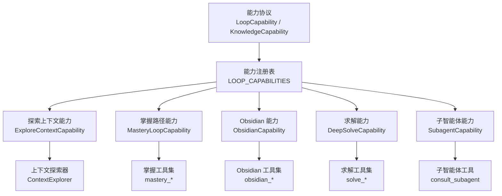
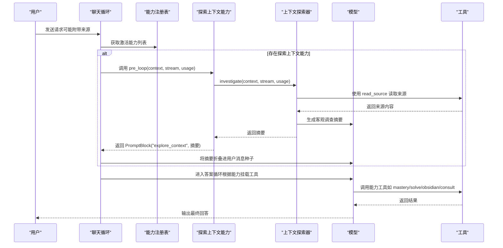
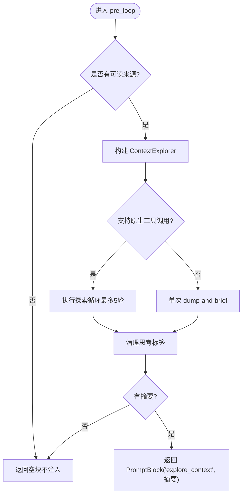
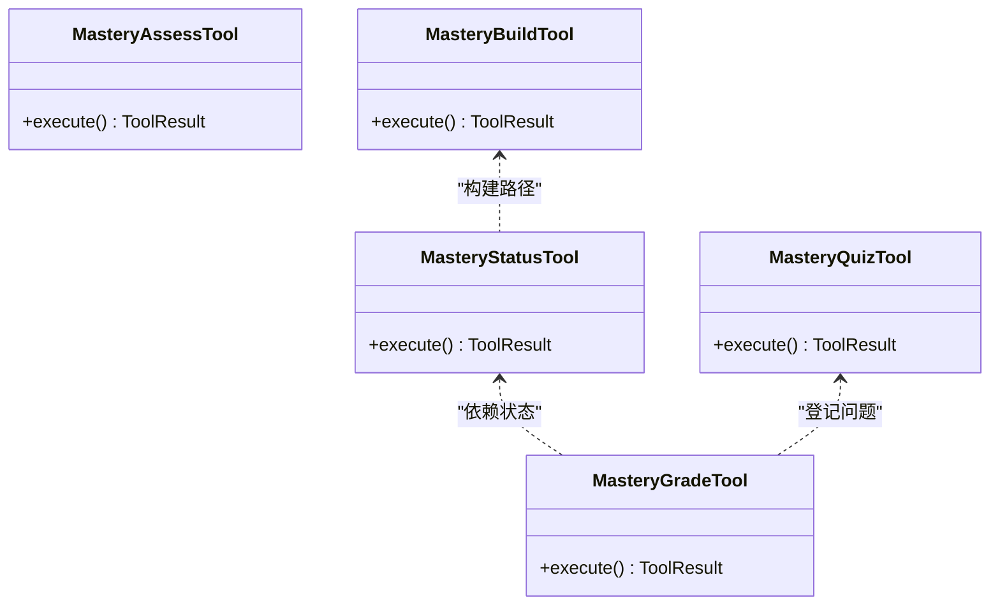
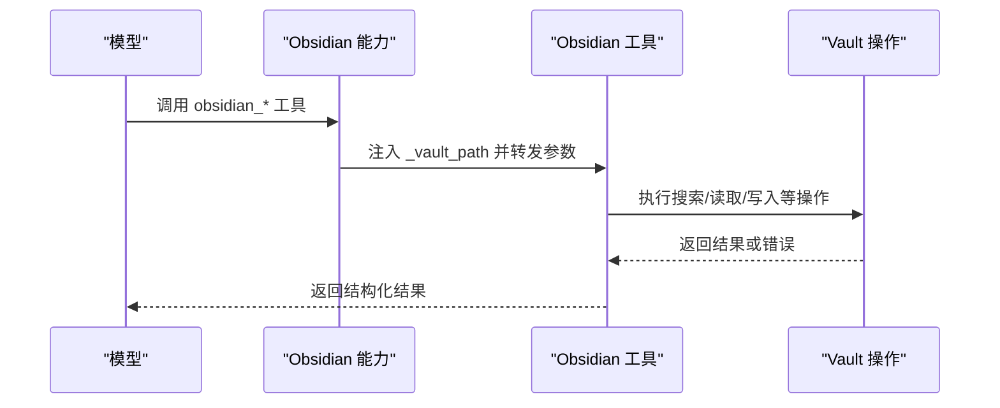
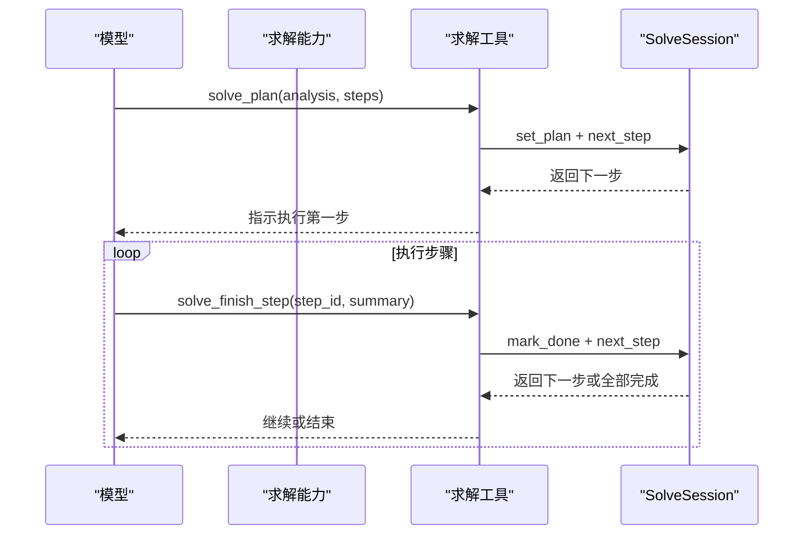
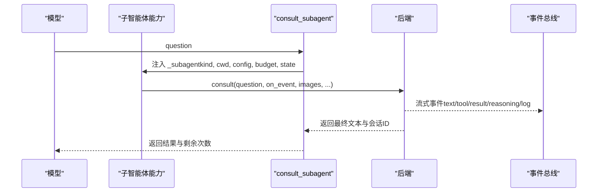
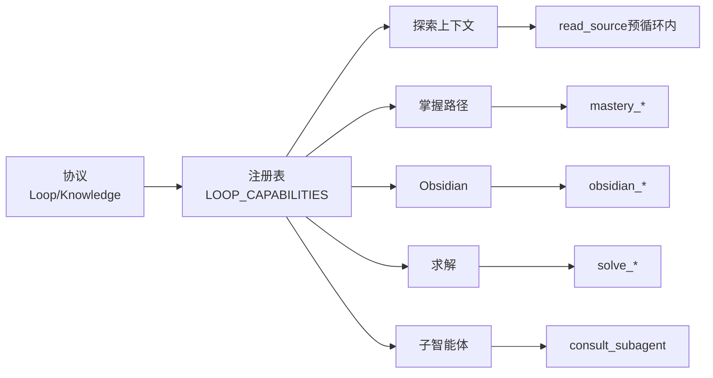

# 内置能力

<cite>
**本文引用的文件**
- [capabilities/__init__.py](file://deeptutor/capabilities/__init__.py)
- [capabilities/protocol.py](file://deeptutor/capabilities/protocol.py)
- [capabilities/registry.py](file://deeptutor/capabilities/registry.py)
- [capabilities/explore_context/capability.py](file://deeptutor/capabilities/explore_context/capability.py)
- [capabilities/explore_context/explorer.py](file://deeptutor/capabilities/explore_context/explorer.py)
- [capabilities/mastery/capability.py](file://deeptutor/capabilities/mastery/capability.py)
- [capabilities/mastery/loop.py](file://deeptutor/capabilities/mastery/loop.py)
- [capabilities/mastery/tools.py](file://deeptutor/capabilities/mastery/tools.py)
- [capabilities/obsidian/capability.py](file://deeptutor/capabilities/obsidian/capability.py)
- [capabilities/obsidian/tools.py](file://deeptutor/capabilities/obsidian/tools.py)
- [capabilities/solve/capability.py](file://deeptutor/capabilities/solve/capability.py)
- [capabilities/solve/tools.py](file://deeptutor/capabilities/solve/tools.py)
- [capabilities/subagent/capability.py](file://deeptutor/capabilities/subagent/capability.py)
- [capabilities/subagent/tools.py](file://deeptutor/capabilities/subagent/tools.py)
- [services/config/capabilities_settings.py](file://deeptutor/services/config/capabilities_settings.py)
</cite>

## 目录
1. [简介](#简介)
2. [项目结构](#项目结构)
3. [核心组件](#核心组件)
4. [架构总览](#架构总览)
5. [详细组件分析](#详细组件分析)
6. [依赖关系分析](#依赖关系分析)
7. [性能考量](#性能考量)
8. [故障排查指南](#故障排查指南)
9. [结论](#结论)
10. [附录：配置与最佳实践](#附录配置与最佳实践)

## 简介
本文件系统化梳理 DeepTutor 的“内置能力”体系，覆盖探索上下文能力、掌握路径能力、Obsidian 集成能力、求解能力与子智能体能力。文档从架构到实现细节、数据流、工具调用、错误处理与性能特征进行说明，并提供可操作的配置示例与最佳实践，帮助读者理解各能力的职责边界、协作方式与通信机制。

## 项目结构
- 能力注册与协议
  - 统一协议定义 LoopCapability/KnowledgeCapability/PromptBlock，规范能力如何参与聊天循环、是否独占工具面、如何注入系统提示与参数。
  - 能力注册表集中声明所有内置能力实例，按稳定顺序提供激活判断与工具归属映射。
- 能力实现
  - 每个能力位于独立子包，包含 capability（能力入口）、tools（能力专属工具）、可选 prompts/system.md（系统提示）等。
  - 部分能力通过 pre_loop 钩子在答案循环前执行一次性前置任务（如上下文探索）。
- 配置与运行时
  - 能力设置由配置层统一读写，暴露给前端设置页；求解能力在运行时读取配置并注入到聊天循环。

**图表来源**
- [capabilities/protocol.py:19-116](file://deeptutor/capabilities/protocol.py#L19-L116)
- [capabilities/registry.py:13-44](file://deeptutor/capabilities/registry.py#L13-L44)
- [capabilities/explore_context/capability.py:82-141](file://deeptutor/capabilities/explore_context/capability.py#L82-L141)
- [capabilities/explore_context/explorer.py:87-147](file://deeptutor/capabilities/explore_context/explorer.py#L87-L147)
- [capabilities/mastery/loop.py:13-55](file://deeptutor/capabilities/mastery/loop.py#L13-L55)
- [capabilities/mastery/tools.py:57-65](file://deeptutor/capabilities/mastery/tools.py#L57-L65)
- [capabilities/obsidian/capability.py:24-72](file://deeptutor/capabilities/obsidian/capability.py#L24-L72)
- [capabilities/obsidian/tools.py:24-36](file://deeptutor/capabilities/obsidian/tools.py#L24-L36)
- [capabilities/solve/capability.py:59-88](file://deeptutor/capabilities/solve/capability.py#L59-L88)
- [capabilities/solve/tools.py:24-30](file://deeptutor/capabilities/solve/tools.py#L24-L30)
- [capabilities/subagent/capability.py:32-121](file://deeptutor/capabilities/subagent/capability.py#L32-L121)
- [capabilities/subagent/tools.py:42-74](file://deeptutor/capabilities/subagent/tools.py#L42-L74)

**章节来源**
- [capabilities/__init__.py:1-29](file://deeptutor/capabilities/__init__.py#L1-L29)
- [capabilities/protocol.py:1-116](file://deeptutor/capabilities/protocol.py#L1-L116)
- [capabilities/registry.py:1-53](file://deeptutor/capabilities/registry.py#L1-L53)

## 核心组件
- 能力协议
  - LoopCapability：每轮可扩展的能力，复用聊天完整工具面，并可追加 owned_tools、system_block、augment_kwargs、pre_loop_seed 等。
  - KnowledgeCapability：知识类能力独占本轮工具面（exclusive_tools），通过 owned_kbs 排除被其工具直接消费的 KB，避免与 rag 冲突。
  - PromptBlock：能力贡献的系统提示片段，用于注入本轮系统提示或用户消息种子。
- 能力注册表
  - LOOP_CAPABILITIES：集中声明所有内置能力实例，按固定顺序返回激活集合。
  - active_loop_capabilities：根据当前上下文筛选激活能力。
  - any_exclusive_capability_active：判断是否存在独占工具面的知识类能力。
  - capability_tool_owners：将能力拥有的工具名映射到能力名，供设置界面分组展示。

**章节来源**
- [capabilities/protocol.py:11-116](file://deeptutor/capabilities/protocol.py#L11-L116)
- [capabilities/registry.py:13-44](file://deeptutor/capabilities/registry.py#L13-L44)

## 架构总览
能力通过统一的协议接入聊天循环，运行期依据上下文决定哪些能力激活；知识类能力会替换工具面，普通能力则叠加工具。探索上下文能力在首轮 LLM 调用前执行一次只读探索，产出客观摘要作为答案循环的上下文基础。掌握路径、求解、Obsidian、子智能体分别通过各自工具集驱动学习、解题、笔记库与外部代理的工作流。

**图表来源**
- [capabilities/explore_context/capability.py:118-141](file://deeptutor/capabilities/explore_context/capability.py#L118-L141)
- [capabilities/explore_context/explorer.py:112-147](file://deeptutor/capabilities/explore_context/explorer.py#L112-L147)
- [capabilities/registry.py:22-35](file://deeptutor/capabilities/registry.py#L22-L35)

## 详细组件分析

### 探索上下文能力（ExploreContextCapability）
- 功能特性
  - 当本轮携带可读来源（文档、笔记本记录、书籍节选、题库条目、对话历史等）时自动激活。
  - 在答案循环首次 LLM 调用之前执行只读探索，使用 read_source 按需加载来源，生成第三人称客观摘要，并注入到用户消息种子。
  - 不向答案循环暴露 read_source，避免弱模型跳过阅读。
- 工作原理
  - is_active：检查上下文的 source_index 是否为非空字典。
  - pre_loop：延迟导入 ContextExplorer，构造语言与提示，调用 investigate 生成摘要；若为空则不注入。
  - ContextExplorer：优先尝试原生工具调用循环（最多 5 轮，最后一轮禁用工具强制结束），失败或非原生提供者回退为单次 dump-and-brief 模式；输出经清理后附加标题头。
- 使用场景
  - 需要模型先理解附件材料再回答，尤其是对话转录等易导致角色混淆的场景。
- 配置选项
  - 无显式能力级开关；行为受上下文来源与 LLM 配置影响。
- 最佳实践
  - 确保来源索引有效且文本可读；控制来源数量与长度以避免超限。
  - 关注探索阶段的 thinking 流，便于调试与追踪。

**图表来源**
- [capabilities/explore_context/capability.py:90-141](file://deeptutor/capabilities/explore_context/capability.py#L90-L141)
- [capabilities/explore_context/explorer.py:112-147](file://deeptutor/capabilities/explore_context/explorer.py#L112-L147)
- [capabilities/explore_context/explorer.py:151-241](file://deeptutor/capabilities/explore_context/explorer.py#L151-L241)
- [capabilities/explore_context/explorer.py:365-439](file://deeptutor/capabilities/explore_context/explorer.py#L365-L439)

**章节来源**
- [capabilities/explore_context/capability.py:1-145](file://deeptutor/capabilities/explore_context/capability.py#L1-L145)
- [capabilities/explore_context/explorer.py:1-532](file://deeptutor/capabilities/explore_context/explorer.py#L1-L532)

### 掌握路径能力（MasteryCapability）
- 功能特性
  - 标记本轮为掌握模式，解析学习路径 ID，复用聊天工具面并挂载掌握工具（mastery_status、mastery_quiz、mastery_grade、mastery_assess、mastery_build）。
  - 纯引擎负责门限判定与间隔重复计算；模型负责教学策略与提问设计。
- 学习路径规划与进度跟踪
  - mastery_status：读取当前目标、待答题、复习项与知识点状态图。
  - mastery_quiz：登记问题与期望答案（支持选择/简答/开放），交由引擎存储。
  - mastery_grade：对答案进行确定性评分，更新掌握度与间隔重复，并返回下一目标。
  - mastery_assess：对概念/设计类目标进行定性门限评估。
  - mastery_build：创建或扩展模块与知识点树，服务器端生成稳定 ID。
- 使用场景
  - 自适应教学、分类型掌握门限、间隔复习与学习路径可视化。
- 配置选项
  - 通过能力设置页写入 agents.yaml 与 main 配置；求解能力读取 get_solve_params 的方式类似，但掌握路径本身主要依赖工具与引擎。
- 最佳实践
  - 每次掌握轮次先调用 mastery_status；选择题需传入完整选项体与正确标签；构建路径时使用 replace 或 append 明确意图。

**图表来源**
- [capabilities/mastery/tools.py:176-655](file://deeptutor/capabilities/mastery/tools.py#L176-L655)
- [capabilities/mastery/loop.py:13-55](file://deeptutor/capabilities/mastery/loop.py#L13-L55)

**章节来源**
- [capabilities/mastery/capability.py:1-77](file://deeptutor/capabilities/mastery/capability.py#L1-L77)
- [capabilities/mastery/loop.py:1-74](file://deeptutor/capabilities/mastery/loop.py#L1-L74)
- [capabilities/mastery/tools.py:1-655](file://deeptutor/capabilities/mastery/tools.py#L1-L655)

### Obsidian 集成能力（ObsidianCapability）
- 功能特性
  - 当所选知识库为已连接的 Obsidian 保险库时激活，独占本轮工具面，仅暴露 Obsidian 工具与 ask_user。
  - 通过 augment_kwargs 注入服务端拥有的 _vault_path，防止越权访问。
  - system_block 注入系统提示，告知本轮连接了哪个 vault。
- 工作流程与文件同步
  - 搜索、读取、列出、反向链接、正向链接、标签统计、创建笔记、追加内容、设置 frontmatter 属性。
  - 所有操作基于 vault 根目录，工具内部封装错误处理与参数校验。
- 使用场景
  - 在用户本地笔记库中进行知识检索、导航与增量创作，保持 Markdown 与 wikilink 生态。
- 配置选项
  - 无需额外开关；激活条件由绑定层决定。
- 最佳实践
  - 使用 obsidian_search 定位目标，再用 obsidian_read 深入；写操作遵循幂等与安全约束（create 不覆盖现有路径）。

**图表来源**
- [capabilities/obsidian/capability.py:24-72](file://deeptutor/capabilities/obsidian/capability.py#L24-L72)
- [capabilities/obsidian/tools.py:62-76](file://deeptutor/capabilities/obsidian/tools.py#L62-L76)
- [capabilities/obsidian/tools.py:78-338](file://deeptutor/capabilities/obsidian/tools.py#L78-L338)

**章节来源**
- [capabilities/obsidian/capability.py:1-91](file://deeptutor/capabilities/obsidian/capability.py#L1-L91)
- [capabilities/obsidian/tools.py:1-362](file://deeptutor/capabilities/obsidian/tools.py#L1-L362)

### 求解能力（SolveCapability）
- 功能特性
  - 标记本轮为求解模式，解析会话 ID，挂载求解工具（solve_plan、solve_finish_step、solve_replan）及通用工具（rag、code_execution、geogebra_analysis、reason）。
  - 通过 SolveSession 维护计划、步骤门限与重规划预算；模型负责推理与工具使用。
- 问题解决流程
  - solve_plan：提交分析与有序步骤，锁定计划并开始执行第一步。
  - solve_finish_step：标记步骤完成并推进，折叠中间过程为一行摘要以节省上下文。
  - solve_replan：在方法受阻时重置计划，受预算限制。
- 使用场景
  - 多步复杂问题求解，需要强约束的计划执行与可控的重规划。
- 配置选项
  - 通过 get_solve_params 读取 temperature、max_tokens、max_rounds、max_replans，并注入聊天循环。
- 最佳实践
  - 严格遵循计划顺序，避免跳步；仅在必要时重规划；充分利用 finish_step 的摘要机制控制上下文规模。

**图表来源**
- [capabilities/solve/capability.py:59-88](file://deeptutor/capabilities/solve/capability.py#L59-L88)
- [capabilities/solve/tools.py:77-203](file://deeptutor/capabilities/solve/tools.py#L77-L203)

**章节来源**
- [capabilities/solve/capability.py:1-92](file://deeptutor/capabilities/solve/capability.py#L1-L92)
- [capabilities/solve/tools.py:1-292](file://deeptutor/capabilities/solve/tools.py#L1-L292)
- [services/config/capabilities_settings.py:435-448](file://deeptutor/services/config/capabilities_settings.py#L435-L448)

### 子智能体能力（SubagentCapability）
- 功能特性
  - 当所选知识库为已连接的子智能体时激活，独占本轮工具面，仅暴露 consult_subagent 与 ask_user。
  - 通过 augment_kwargs 注入后端类型、工作目录、配置、预算与会话状态；模型仅能传递 question。
  - 系统提示告知本轮连接到何种代理（本地 CLI 或伙伴），并强调委派而非交互。
- 协调与执行机制
  - 预算控制：每轮咨询次数上限，超出后拒绝调用并提示作答。
  - 会话延续：跨轮次记住后端 session_id，使多次咨询保持上下文连贯。
  - 事件流：将子智能体的原生事件（文本、工具、结果、推理、日志）实时透传到侧边栏，形成忠实于原生的运行记录。
  - 图片转发：按后端配置将图像附件暂存为文件供 CLI 消费，运行结束后清理。
- 使用场景
  - 委派代码审查、复现问题、运行脚本、利用伙伴的知识与技能解答问题。
- 配置选项
  - 预算可通过上下文配置覆盖；默认来自子智能体设置。
- 最佳实践
  - 明确限定问题范围，充分利用上下文连续性；注意预算与剩余次数提示；避免冒充子智能体身份作答。

**图表来源**
- [capabilities/subagent/capability.py:32-121](file://deeptutor/capabilities/subagent/capability.py#L32-L121)
- [capabilities/subagent/tools.py:42-203](file://deeptutor/capabilities/subagent/tools.py#L42-L203)

**章节来源**
- [capabilities/subagent/capability.py:1-218](file://deeptutor/capabilities/subagent/capability.py#L1-L218)
- [capabilities/subagent/tools.py:1-231](file://deeptutor/capabilities/subagent/tools.py#L1-L231)

## 依赖关系分析
- 能力与协议
  - 所有能力均满足 LoopCapability 或 KnowledgeCapability 的结构契约；KnowledgeCapability 子类设置 exclusive_tools=True。
- 能力与工具
  - 每个能力拥有 own_tools 元组，注册表据此建立工具到能力的归属映射。
  - 能力通过 augment_kwargs 注入服务端私有参数（如 _vault_path、_solve_session_id、_mastery_path_id、_subagent）。
- 能力与配置
  - 能力设置通过 capabilities_settings 统一读写；求解能力在运行时读取 get_solve_params 并注入聊天循环。
- 潜在循环与解耦
  - 探索上下文能力延迟导入 explorer 以避免循环依赖；掌握/求解/子智能体工具在调用时惰性导入服务层。

**图表来源**
- [capabilities/protocol.py:19-116](file://deeptutor/capabilities/protocol.py#L19-L116)
- [capabilities/registry.py:13-44](file://deeptutor/capabilities/registry.py#L13-L44)
- [capabilities/mastery/tools.py:57-65](file://deeptutor/capabilities/mastery/tools.py#L57-L65)
- [capabilities/obsidian/tools.py:24-36](file://deeptutor/capabilities/obsidian/tools.py#L24-L36)
- [capabilities/solve/tools.py:24-30](file://deeptutor/capabilities/solve/tools.py#L24-L30)
- [capabilities/subagent/tools.py:34-34](file://deeptutor/capabilities/subagent/tools.py#L34-L34)

**章节来源**
- [capabilities/protocol.py:19-116](file://deeptutor/capabilities/protocol.py#L19-L116)
- [capabilities/registry.py:13-44](file://deeptutor/capabilities/registry.py#L13-L44)

## 性能考量
- 探索上下文
  - 原生工具调用循环限制最大轮数与 token 上限；失败时回退到单次模式，保证鲁棒性。
  - 来源裁剪与截断控制输入规模，避免溢出。
- 掌握路径
  - 工具调用轻量，核心计算在引擎；问答登记与评分高效，适合高频交互。
- Obsidian
  - 文件系统操作受限于 vault 根目录；批量列举与搜索建议限制 limit。
- 求解
  - 计划执行与 finish_step 摘要减少上下文膨胀；重规划预算控制反复试错成本。
- 子智能体
  - 事件流实时透传，注意带宽与渲染开销；图像转发临时文件及时清理。

[本节为通用指导，不直接分析具体文件]

## 故障排查指南
- 探索上下文未生效
  - 检查上下文 source_index 是否为非空字典；确认来源可读且未被过滤。
  - 查看探索阶段 thinking 流与进度状态，定位原生循环或单次模式失败原因。
- 掌握路径工具不可用
  - 确认 mastery_mode 已设置且 mastery_path_id 解析成功；检查工具参数（如 knowledge_point_id、expected_answer）。
- Obsidian 工具报错
  - 确认 _vault_path 注入成功且路径存在；检查 note/path 参数合法性；留意 VaultError 异常信息。
- 求解工具报错
  - 确保先调用 solve_plan；finish_step 的 step_id 必须存在于计划中；replan 预算耗尽时需停止重规划。
- 子智能体咨询受限
  - 检查预算计数与剩余次数；确认后端可用与配置正确；关注事件流中的错误与最终文本缺失。

**章节来源**
- [capabilities/explore_context/explorer.py:112-147](file://deeptutor/capabilities/explore_context/explorer.py#L112-L147)
- [capabilities/mastery/tools.py:176-655](file://deeptutor/capabilities/mastery/tools.py#L176-L655)
- [capabilities/obsidian/tools.py:62-76](file://deeptutor/capabilities/obsidian/tools.py#L62-L76)
- [capabilities/solve/tools.py:77-203](file://deeptutor/capabilities/solve/tools.py#L77-L203)
- [capabilities/subagent/tools.py:76-203](file://deeptutor/capabilities/subagent/tools.py#L76-L203)

## 结论
DeepTutor 的内置能力体系以统一协议为核心，通过注册表管理激活与工具归属，结合能力专属工具与服务端参数注入，实现了灵活而安全的扩展点。探索上下文能力保障答案质量，掌握路径能力提供严谨的学习门限与复习机制，Obsidian 能力无缝对接本地笔记生态，求解能力以强约束计划驱动复杂问题解决，子智能体能力将外部代理纳入统一工作流。各能力间通过上下文元数据、工具调用与事件流协同，既保持职责清晰又具备高度可组合性。

[本节为总结性内容，不直接分析具体文件]

## 附录：配置与最佳实践
- 能力设置读写
  - 通过 capabilities_settings 统一读取与保存；求解能力使用 get_solve_params 获取温度、token、轮次与重规划预算。
- 常见配置键
  - solve：temperature、max_tokens、max_rounds、max_replans。
  - research/question：researching/exploring 相关运行时参数。
- 最佳实践
  - 探索上下文：合理组织来源，避免过大输入；关注探索阶段输出。
  - 掌握路径：先 status 再 quiz/assess；构建路径时明确 replace/append。
  - Obsidian：使用 search/list/backlinks 导航；写操作遵循安全与幂等。
  - 求解：严格遵循计划；善用 finish_step 摘要；谨慎重规划。
  - 子智能体：明确问题范围；关注预算与事件流；避免冒充代理身份。

**章节来源**
- [services/config/capabilities_settings.py:1-456](file://deeptutor/services/config/capabilities_settings.py#L1-L456)