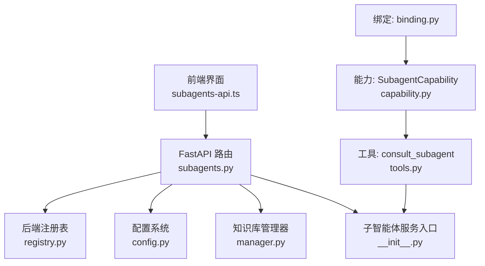
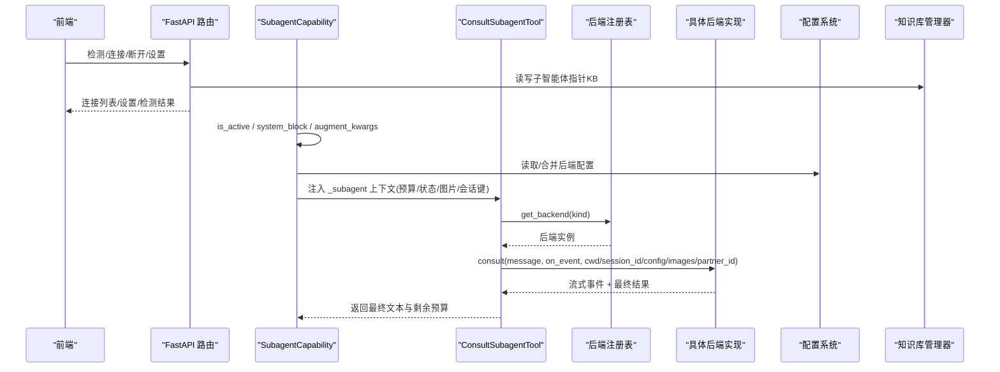
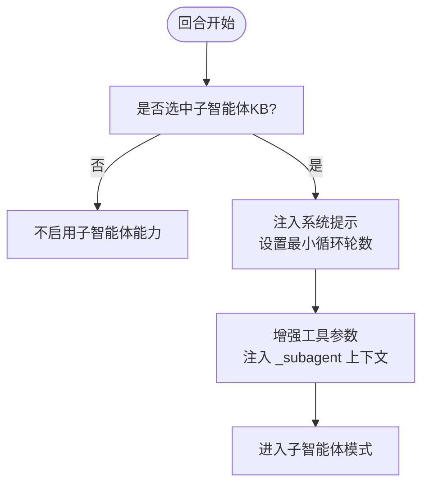
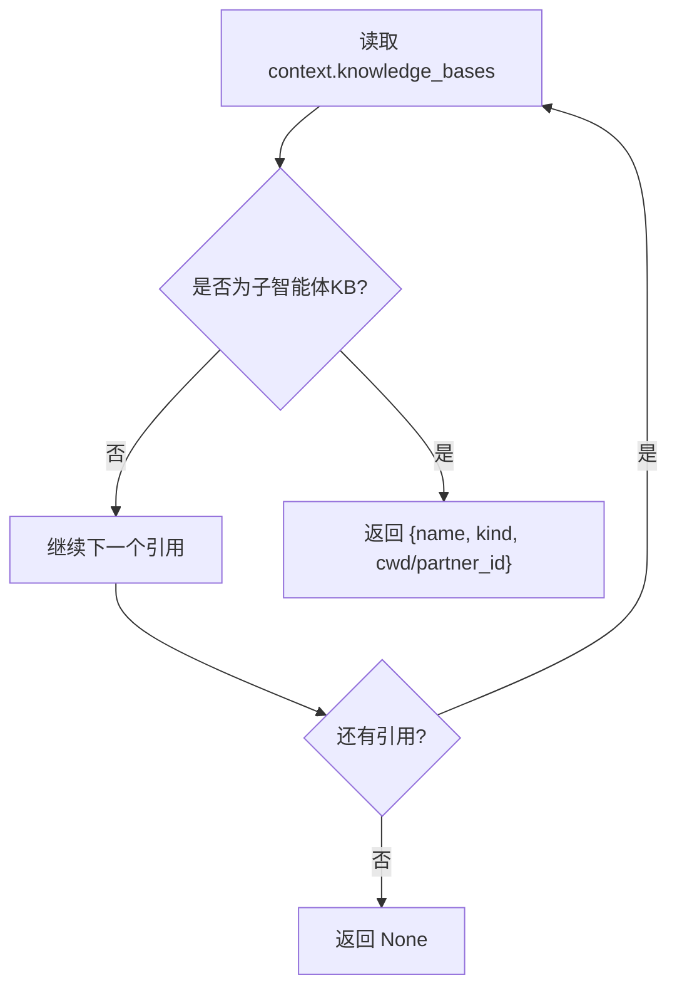
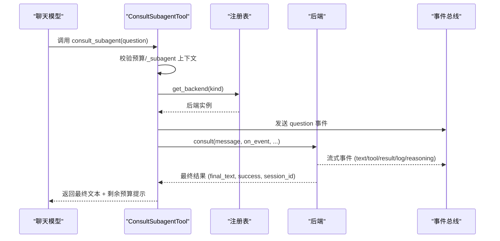
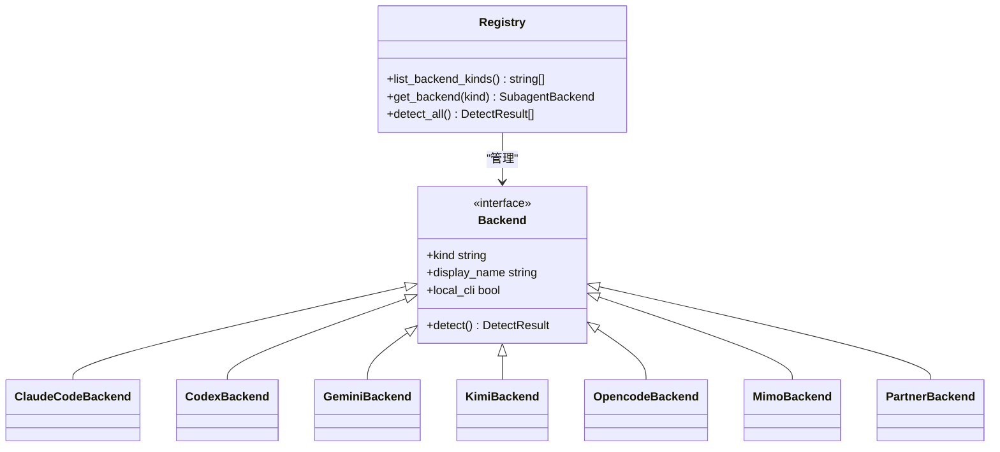
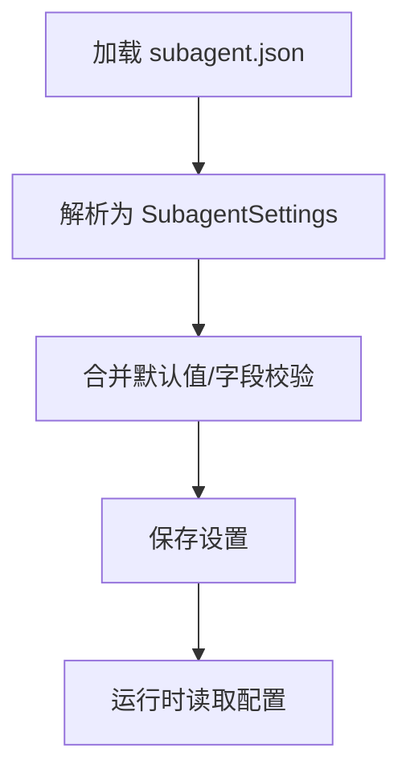
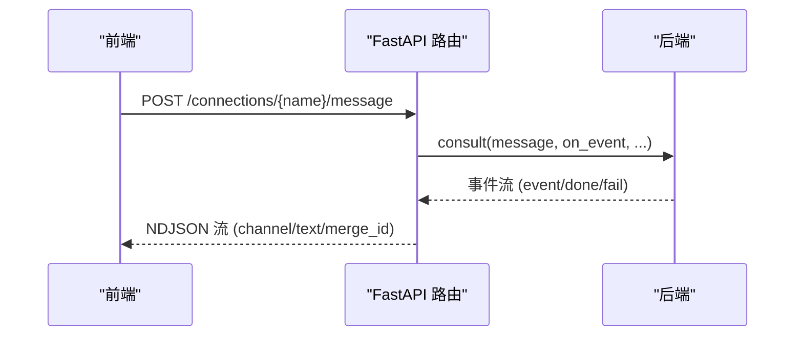
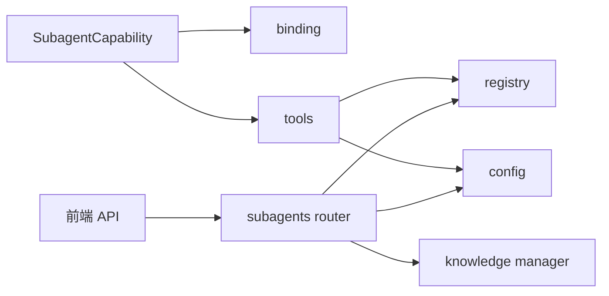

# 子智能体能力

<cite>
**本文引用的文件**
- [capabilities/subagent/capability.py](file://deeptutor/capabilities/subagent/capability.py)
- [capabilities/subagent/binding.py](file://deeptutor/capabilities/subagent/binding.py)
- [capabilities/subagent/tools.py](file://deeptutor/capabilities/subagent/tools.py)
- [api/routers/subagents.py](file://deeptutor/api/routers/subagents.py)
- [services/subagent/__init__.py](file://deeptutor/services/subagent/__init__.py)
- [services/subagent/registry.py](file://deeptutor/services/subagent/registry.py)
- [services/subagent/config.py](file://deeptutor/services/subagent/config.py)
- [knowledge/manager.py](file://deeptutor/knowledge/manager.py)
- [web/lib/subagents-api.ts](file://web/lib/subagents-api.ts)
</cite>

## 目录
1. [简介](#简介)
2. [项目结构](#项目结构)
3. [核心组件](#核心组件)
4. [架构总览](#架构总览)
5. [详细组件分析](#详细组件分析)
6. [依赖关系分析](#依赖关系分析)
7. [性能考量](#性能考量)
8. [故障排查指南](#故障排查指南)
9. [结论](#结论)
10. [附录：配置示例与最佳实践](#附录配置示例与最佳实践)

## 简介
本文件系统性阐述 DeepTutor 的“子智能体能力”（SubagentCapability），覆盖以下主题：
- 子智能体的发现、注册与生命周期管理
- 绑定（binding）机制如何实现主智能体与子智能体的通信协议与参数传递
- 子智能体工具（tools）如何封装复杂异步任务，包括远程调用、并发执行与结果聚合
- 子智能体注册表（registry）的动态加载、版本管理与依赖解析
- 配置系统（config）对多种后端的支持（本地进程、远程服务、容器化部署）
- 错误处理策略：超时控制、重试机制与故障转移
- 前端 API 与流式交互

## 项目结构
子智能体能力由“能力层—工具层—服务层—API层—前端”五层协作完成：
- 能力层：SubagentCapability 负责回合级激活、系统提示注入、预算控制与上下文增强
- 绑定层：从当前对话的知识库选择中解析出目标子智能体连接
- 工具层：consult_subagent 工具将模型问题投递给具体后端并流式回传事件
- 服务层：后端注册表、配置、会话持久化、类型定义等
- API 层：连接管理、设置读写、消息流式接口
- 前端：连接检测、连接/断开、流式消息读取

**图表来源**
- [api/routers/subagents.py:1-326](file://deeptutor/api/routers/subagents.py#L1-L326)
- [capabilities/subagent/capability.py:1-218](file://deeptutor/capabilities/subagent/capability.py#L1-L218)
- [capabilities/subagent/binding.py:1-80](file://deeptutor/capabilities/subagent/binding.py#L1-L80)
- [capabilities/subagent/tools.py:1-231](file://deeptutor/capabilities/subagent/tools.py#L1-L231)
- [services/subagent/registry.py:1-80](file://deeptutor/services/subagent/registry.py#L1-L80)
- [services/subagent/config.py:1-190](file://deeptutor/services/subagent/config.py#L1-L190)
- [knowledge/manager.py:790-814](file://deeptutor/knowledge/manager.py#L790-L814)
- [web/lib/subagents-api.ts:1-217](file://web/lib/subagents-api.ts#L1-L217)

**章节来源**
- [api/routers/subagents.py:1-326](file://deeptutor/api/routers/subagents.py#L1-L326)
- [capabilities/subagent/capability.py:1-218](file://deeptutor/capabilities/subagent/capability.py#L1-L218)
- [capabilities/subagent/binding.py:1-80](file://deeptutor/capabilities/subagent/binding.py#L1-L80)
- [capabilities/subagent/tools.py:1-231](file://deeptutor/capabilities/subagent/tools.py#L1-L231)
- [services/subagent/registry.py:1-80](file://deeptutor/services/subagent/registry.py#L1-L80)
- [services/subagent/config.py:1-190](file://deeptutor/services/subagent/config.py#L1-L190)
- [knowledge/manager.py:790-814](file://deeptutor/knowledge/manager.py#L790-L814)
- [web/lib/subagents-api.ts:1-217](file://web/lib/subagents-api.ts#L1-L217)

## 核心组件
- SubagentCapability：回合级能力，决定何时启用子智能体模式，注入系统提示，维护每轮预算与最小循环轮数，向工具注入服务端上下文
- Binding：从当前对话的知识库选择中解析出目标子智能体连接（名称、kind、cwd/partner_id），并缓存于上下文元数据
- ConsultSubagentTool：唯一对外暴露的工具，负责校验预算、调用后端、流式转发事件、聚合最终答案并记录会话延续
- Registry：集中注册所有子智能体后端（本地 CLI 与伙伴后端），提供检测、枚举与获取实例
- Config：集中管理咨询预算与每个后端的运行参数（模型、推理强度、权限模式、沙箱、网络访问、图片转发等）
- API Router：提供连接管理、设置读写、消息流式接口，支撑前端连接与对话
- Knowledge Manager：以“子智能体指针知识库”形式持久化连接信息（不索引内容）

**章节来源**
- [capabilities/subagent/capability.py:32-117](file://deeptutor/capabilities/subagent/capability.py#L32-L117)
- [capabilities/subagent/binding.py:23-52](file://deeptutor/capabilities/subagent/binding.py#L23-L52)
- [capabilities/subagent/tools.py:42-202](file://deeptutor/capabilities/subagent/tools.py#L42-L202)
- [services/subagent/registry.py:24-76](file://deeptutor/services/subagent/registry.py#L24-L76)
- [services/subagent/config.py:36-88](file://deeptutor/services/subagent/config.py#L36-L88)
- [api/routers/subagents.py:132-209](file://deeptutor/api/routers/subagents.py#L132-L209)
- [knowledge/manager.py:790-814](file://deeptutor/knowledge/manager.py#L790-L814)

## 架构总览
子智能体能力的端到端流程如下：
- 前端通过 API 检测可用后端、列出可连接伙伴、创建/删除连接
- 能力层在回合开始时根据所选知识库解析绑定，注入系统提示与预算
- 工具层在模型调用时检查预算，调用对应后端，流式转发事件，聚合结果
- 服务层负责后端发现、配置加载与会话续接
- API 层提供消息流式接口，支持侧边栏直接对话同一会话

**图表来源**
- [api/routers/subagents.py:63-107](file://deeptutor/api/routers/subagents.py#L63-L107)
- [api/routers/subagents.py:132-209](file://deeptutor/api/routers/subagents.py#L132-L209)
- [api/routers/subagents.py:216-298](file://deeptutor/api/routers/subagents.py#L216-L298)
- [capabilities/subagent/capability.py:38-117](file://deeptutor/capabilities/subagent/capability.py#L38-L117)
- [capabilities/subagent/tools.py:76-202](file://deeptutor/capabilities/subagent/tools.py#L76-L202)
- [services/subagent/registry.py:38-76](file://deeptutor/services/subagent/registry.py#L38-L76)
- [services/subagent/config.py:156-176](file://deeptutor/services/subagent/config.py#L156-L176)
- [knowledge/manager.py:790-814](file://deeptutor/knowledge/manager.py#L790-L814)

## 详细组件分析

### 子智能体能力（SubagentCapability）
- 回合激活：当当前对话选择了“子智能体指针知识库”时激活
- 系统提示：注入语言相关的引导语，说明本轮最多可咨询次数，并要求模型在掌握足够信息后自行回答
- 预算控制：计算本轮最大咨询次数，确保循环有足够余量用于收尾回答
- 上下文增强：为工具注入服务端上下文（后端 kind、工作目录或伙伴 ID、预算、配置、图片附件、会话键等）

**图表来源**
- [capabilities/subagent/capability.py:38-63](file://deeptutor/capabilities/subagent/capability.py#L38-L63)
- [capabilities/subagent/capability.py:65-117](file://deeptutor/capabilities/subagent/capability.py#L65-L117)
- [capabilities/subagent/capability.py:148-162](file://deeptutor/capabilities/subagent/capability.py#L148-L162)

**章节来源**
- [capabilities/subagent/capability.py:32-117](file://deeptutor/capabilities/subagent/capability.py#L32-L117)
- [capabilities/subagent/capability.py:148-162](file://deeptutor/capabilities/subagent/capability.py#L148-L162)

### 绑定机制（Binding）
- 解析逻辑：遍历当前对话的知识库引用，找到第一个类型为“子智能体”的条目，提取 name、kind、cwd/partner_id
- 缓存策略：将解析结果缓存到上下文元数据，避免重复解析
- 排除 RAG：收集所有子智能体引用并从 RAG 选择中排除，确保真实知识库仍可检索

**图表来源**
- [capabilities/subagent/binding.py:23-52](file://deeptutor/capabilities/subagent/binding.py#L23-L52)
- [capabilities/subagent/binding.py:55-76](file://deeptutor/capabilities/subagent/binding.py#L55-L76)

**章节来源**
- [capabilities/subagent/binding.py:23-76](file://deeptutor/capabilities/subagent/binding.py#L23-L76)

### 子智能体工具（ConsultSubagentTool）
- 参数注入：由能力层注入 _subagent 上下文（后端 kind、cwd/partner_id、预算、配置、图片、会话键、状态计数器）
- 预算校验：超过预算则拒绝调用并提示模型自行回答
- 后端调用：通过注册表获取后端实例，调用 consult，传入消息、回调、工作目录、会话 ID、配置、图片、伙伴 ID
- 事件流式：将后端事件按统一 trace_kind 转交给 event_sink，附带 subagent_kind/name/channel/merge_id 等元数据
- 结果聚合：保存 session_id 以便跨轮续接；返回最终文本与剩余预算提示

**图表来源**
- [capabilities/subagent/tools.py:76-202](file://deeptutor/capabilities/subagent/tools.py#L76-L202)

**章节来源**
- [capabilities/subagent/tools.py:42-202](file://deeptutor/capabilities/subagent/tools.py#L42-L202)

### 子智能体注册表（Registry）
- 后端集合：集中注册 Claude Code、Codex、Gemini CLI、Kimi CLI、opencode、MiMo Code、Partner 后端
- 检测机制：并行探测本地 CLI 是否安装可用，非 CLI 后端不参与检测
- 获取接口：提供 list_backend_kinds、get_backend 供工具与 API 使用

**图表来源**
- [services/subagent/registry.py:24-76](file://deeptutor/services/subagent/registry.py#L24-L76)

**章节来源**
- [services/subagent/registry.py:24-76](file://deeptutor/services/subagent/registry.py#L24-L76)

### 配置系统（Config）
- 全局配置：consult_budget（默认值与上下限）、per-backend 配置字典
- 后端配置项：enabled、model、effort、system_prompt、permission_mode、sandbox、approval、network_access、ephemeral、auto_approve、thinking、forward_images、extra_args
- 持久化：读取/写入用户 settings 目录下的 subagent.json，失败时回退到默认值
- 安全默认：默认避免阻塞审批，保证无头运行顺畅

**图表来源**
- [services/subagent/config.py:143-176](file://deeptutor/services/subagent/config.py#L143-L176)

**章节来源**
- [services/subagent/config.py:36-88](file://deeptutor/services/subagent/config.py#L36-L88)
- [services/subagent/config.py:143-176](file://deeptutor/services/subagent/config.py#L143-L176)

### API 与前端集成
- 连接管理：检测后端、列出可连接伙伴、创建/删除连接（以子智能体指针知识库形式存储）
- 设置管理：读取/更新全局预算与 per-backend 配置（管理员保护）
- 消息流式：POST /connections/{name}/message 返回 NDJSON 流，包含用户问题、后端事件、完成/失败信号
- 前端 API：封装连接、断开、检测、列表、流式消息读取等函数，支持 AbortSignal 取消

**图表来源**
- [api/routers/subagents.py:216-298](file://deeptutor/api/routers/subagents.py#L216-L298)
- [web/lib/subagents-api.ts:70-118](file://web/lib/subagents-api.ts#L70-L118)
- [web/lib/subagents-api.ts:178-217](file://web/lib/subagents-api.ts#L178-L217)

**章节来源**
- [api/routers/subagents.py:63-107](file://deeptutor/api/routers/subagents.py#L63-L107)
- [api/routers/subagents.py:132-209](file://deeptutor/api/routers/subagents.py#L132-L209)
- [api/routers/subagents.py:216-298](file://deeptutor/api/routers/subagents.py#L216-L298)
- [web/lib/subagents-api.ts:70-118](file://web/lib/subagents-api.ts#L70-L118)
- [web/lib/subagents-api.ts:178-217](file://web/lib/subagents-api.ts#L178-L217)

## 依赖关系分析
- 能力层依赖绑定层解析连接，依赖配置层加载后端参数，依赖工具层执行咨询
- 工具层依赖注册表获取后端实例，依赖配置层获取 per-backend 配置
- API 层依赖知识库管理器持久化连接，依赖注册表与配置层，依赖服务入口协调后端
- 前端依赖 API 层提供的 REST/NDJSON 接口进行连接与流式交互

**图表来源**
- [capabilities/subagent/capability.py:18-22](file://deeptutor/capabilities/subagent/capability.py#L18-L22)
- [capabilities/subagent/tools.py:27-34](file://deeptutor/capabilities/subagent/tools.py#L27-L34)
- [services/subagent/registry.py:15-22](file://deeptutor/services/subagent/registry.py#L15-L22)
- [services/subagent/config.py:25-26](file://deeptutor/services/subagent/config.py#L25-L26)
- [api/routers/subagents.py:26-38](file://deeptutor/api/routers/subagents.py#L26-L38)
- [web/lib/subagents-api.ts:1-3](file://web/lib/subagents-api.ts#L1-L3)

**章节来源**
- [capabilities/subagent/capability.py:18-22](file://deeptutor/capabilities/subagent/capability.py#L18-L22)
- [capabilities/subagent/tools.py:27-34](file://deeptutor/capabilities/subagent/tools.py#L27-L34)
- [services/subagent/registry.py:15-22](file://deeptutor/services/subagent/registry.py#L15-L22)
- [services/subagent/config.py:25-26](file://deeptutor/services/subagent/config.py#L25-L26)
- [api/routers/subagents.py:26-38](file://deeptutor/api/routers/subagents.py#L26-L38)
- [web/lib/subagents-api.ts:1-3](file://web/lib/subagents-api.ts#L1-L3)

## 性能考量
- 流式事件：后端事件通过 event_sink 实时推送，减少等待时间，提升用户体验
- 并行检测：后端检测使用并发 gather，缩短启动时的可用性探测时间
- 预算控制：严格限制每轮咨询次数，防止无限循环导致资源耗尽
- 图片暂存：仅在需要时临时写入图片文件并在完成后清理，降低内存占用
- 会话续接：跨轮共享 session_id，避免重复初始化，提高连续对话效率

[本节为通用指导，无需特定文件引用]

## 故障排查指南
- 连接失败：检查 agent_kind 是否在注册表中存在，确认路径/伙伴 ID 有效
- 预算耗尽：若工具返回“已达预算”，请调整 consult_budget 或优化提问策略
- 后端不可用：通过 /detect 查看后端可用性；非 CLI 后端（partner）不参与检测
- 流式中断：前端可使用 AbortSignal 取消请求；后端异常会输出 error channel 并结束流
- 会话丢失：若跨轮上下文未保留，检查 session_key 与 remember_session 是否生效

**章节来源**
- [api/routers/subagents.py:63-94](file://deeptutor/api/routers/subagents.py#L63-L94)
- [api/routers/subagents.py:132-182](file://deeptutor/api/routers/subagents.py#L132-L182)
- [api/routers/subagents.py:216-298](file://deeptutor/api/routers/subagents.py#L216-L298)
- [capabilities/subagent/tools.py:92-108](file://deeptutor/capabilities/subagent/tools.py#L92-L108)
- [capabilities/subagent/tools.py:154-176](file://deeptutor/capabilities/subagent/tools.py#L154-L176)

## 结论
子智能体能力通过清晰的分层与职责划分，实现了主智能体与外部代理的高效协作。绑定机制确保正确的连接解析，工具层提供统一的咨询接口与事件流式传输，注册表与配置系统支持多后端灵活接入与细粒度控制。结合前端 API，用户可以便捷地连接与管理子智能体，获得流畅的交互式体验。

[本节为总结性内容，无需特定文件引用]

## 附录：配置示例与最佳实践
以下为常见配置场景与要点（基于配置数据结构与默认值）：
- 全局预算：consult_budget 建议设置在 1–12 之间，默认 5
- 本地 CLI 后端（如 Claude Code/Codex/Gemini/Kimi/opencode/Mimo）：
  - permission_mode/sandbox/approval：设置为非阻塞值以避免无头运行挂起
  - network_access：按需开启，注意安全风险
  - forward_images：如需图像输入，需显式开启
  - extra_args：透传额外命令行参数
- 伙伴后端（partner）：
  - 通过 partner_id 绑定，无需 cwd
  - 会话自动归档至伙伴历史，适合长期知识协作
- 资源限制：
  - 通过 budget 控制每轮最大咨询次数
  - 合理设置 effort/model 以平衡质量与成本
- 最佳实践：
  - 明确提问，充分利用跨轮上下文
  - 在预算内分层追问，逐步收敛答案
  - 使用流式事件观察中间步骤，便于调试与监控

[本节为概念性指导，无需特定文件引用]