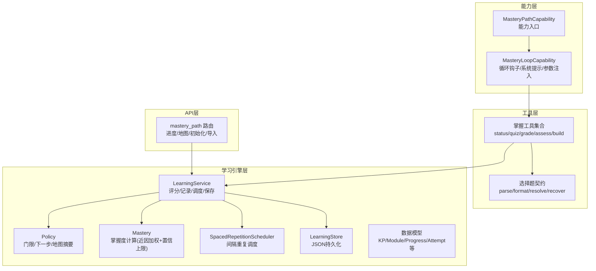
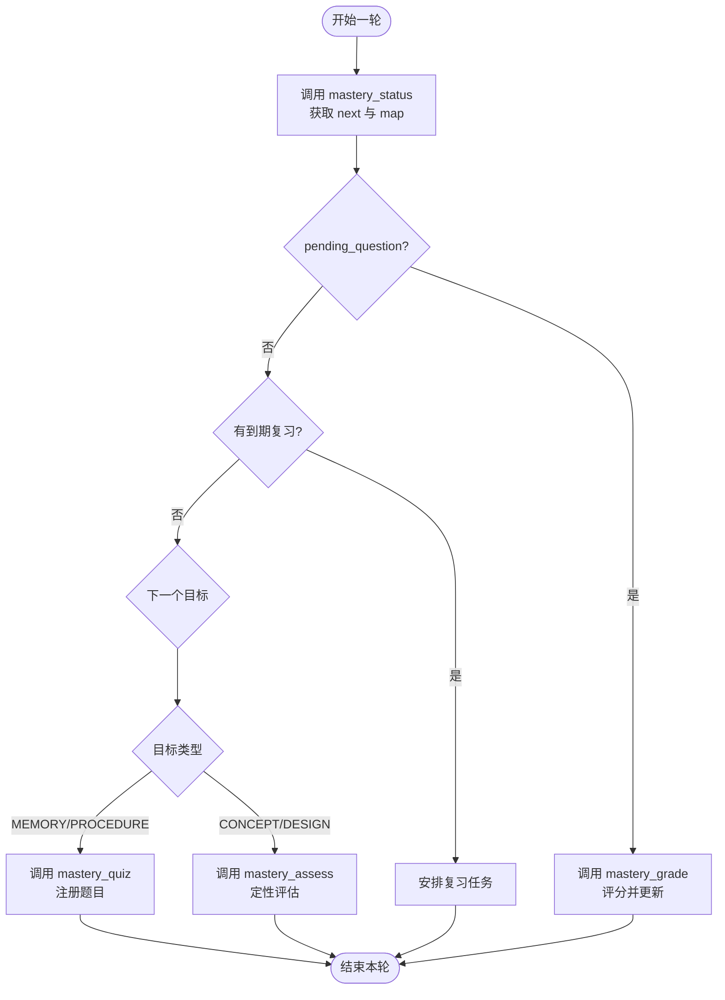
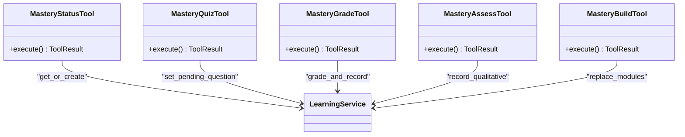
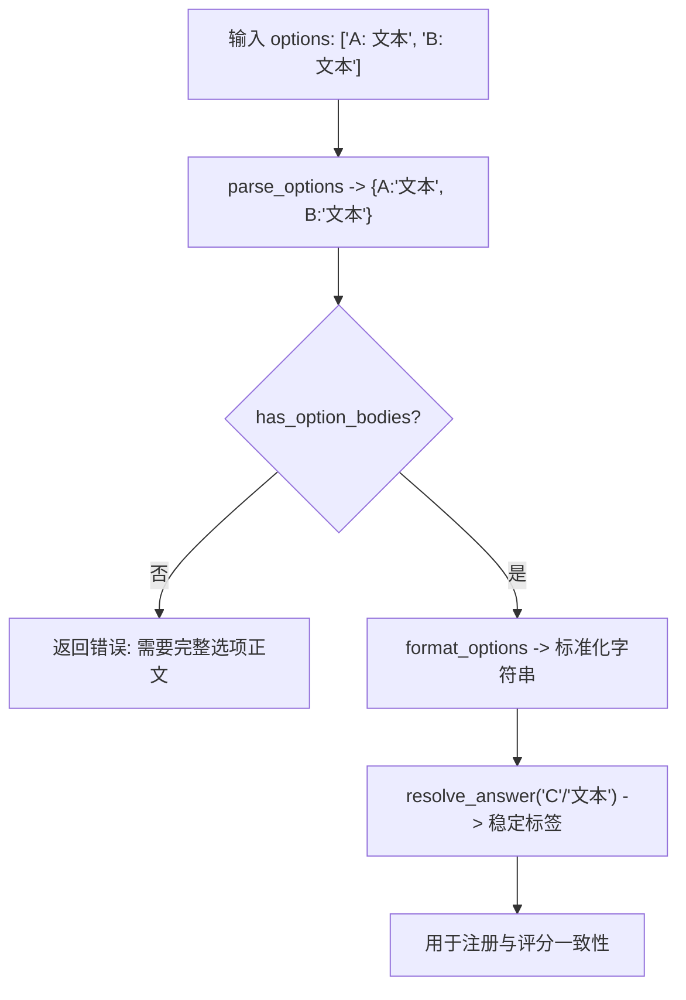
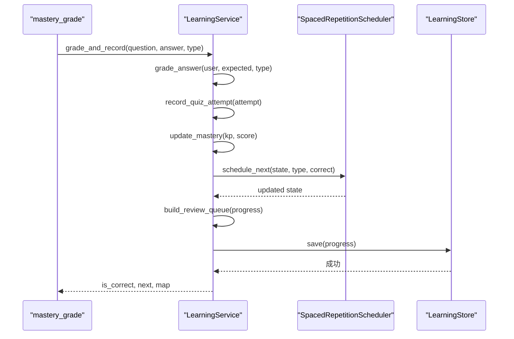
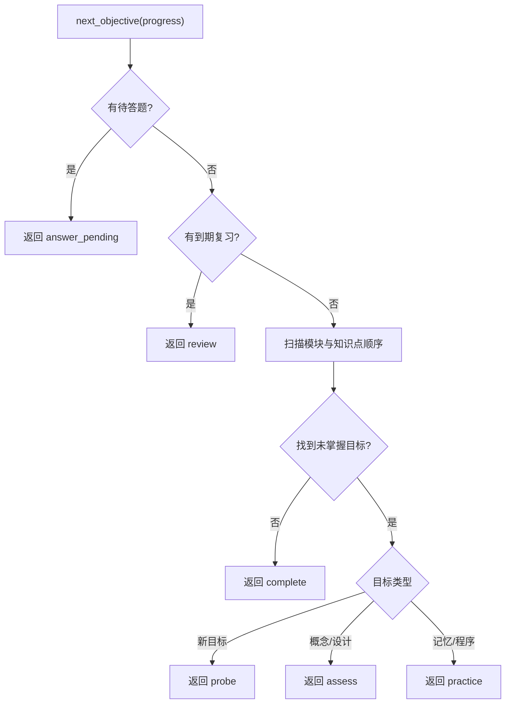
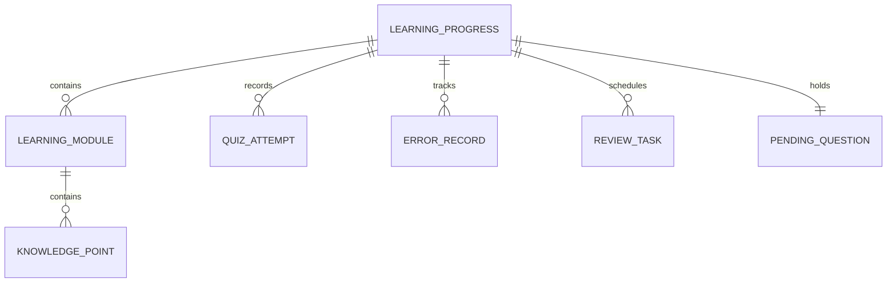
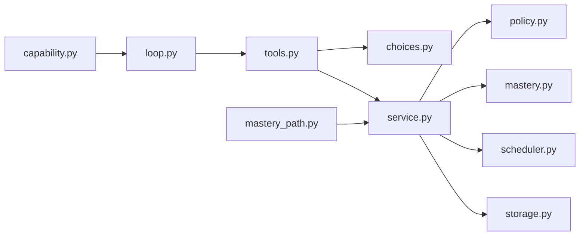

# 掌握路径能力

<cite>
**本文引用的文件**
- [capability.py](file://deeptutor/capabilities/mastery/capability.py)
- [loop.py](file://deeptutor/capabilities/mastery/loop.py)
- [tools.py](file://deeptutor/capabilities/mastery/tools.py)
- [choices.py](file://deeptutor/capabilities/mastery/choices.py)
- [service.py](file://deeptutor/learning/service.py)
- [models.py](file://deeptutor/learning/models.py)
- [policy.py](file://deeptutor/learning/policy.py)
- [mastery.py](file://deeptutor/learning/mastery.py)
- [scheduler.py](file://deeptutor/learning/scheduler.py)
- [storage.py](file://deeptutor/learning/storage.py)
- [mastery_path.py](file://deeptutor/api/routers/mastery_path.py)
- [mastery_tool.py](file://deeptutor/tools/mastery_tool.py)
</cite>

## 目录
1. [简介](#简介)
2. [项目结构](#项目结构)
3. [核心组件](#核心组件)
4. [架构总览](#架构总览)
5. [详细组件分析](#详细组件分析)
6. [依赖关系分析](#依赖关系分析)
7. [性能考虑](#性能考虑)
8. [故障排查指南](#故障排查指南)
9. [结论](#结论)
10. [附录：配置示例](#附录：配置示例)

## 简介
本文件系统性阐述 DeepTutor 的“掌握路径能力”（Mastery Path Capability），覆盖学习路径规划、技能掌握度评估、学习进度跟踪与个性化路径生成；解释掌握循环（loop）的工作流程（知识检查、练习生成、反馈收集）；说明掌握工具（tools）如何实现评估、进度更新与建议；介绍选择系统（choices）如何管理不同难度级别的学习内容；并详细说明与学习服务（LearningService）的集成方式，包括数据存储、政策执行与调度机制。文末提供可操作的配置示例，涵盖阈值设置、练习类型选择与评估标准定制。

## 项目结构
掌握路径能力由“能力层 + 工具层 + 学习引擎层 + API 路由层”组成：
- 能力层：定义 mastery 模式的能力入口与循环钩子，负责挂载工具、注入上下文。
- 工具层：暴露 mastery_status / mastery_quiz / mastery_grade / mastery_assess / mastery_build 等工具，驱动学习引擎。
- 学习引擎层：包含模型、策略（门限、下一步决策）、评分算法、间隔重复调度器与持久化存储。
- API 路由层：提供 REST 接口用于初始化模块、导入章节、查询进度与地图等。



图表来源
- [capability.py:57-73](file://deeptutor/capabilities/mastery/capability.py#L57-L73)
- [loop.py:13-51](file://deeptutor/capabilities/mastery/loop.py#L13-L51)
- [tools.py:59-65](file://deeptutor/capabilities/mastery/tools.py#L59-L65)
- [service.py:25-35](file://deeptutor/learning/service.py#L25-L35)
- [policy.py:158-233](file://deeptutor/learning/policy.py#L158-L233)
- [mastery.py:24-37](file://deeptutor/learning/mastery.py#L24-L37)
- [scheduler.py:28-98](file://deeptutor/learning/scheduler.py#L28-L98)
- [storage.py:16-52](file://deeptutor/learning/storage.py#L16-L52)
- [mastery_path.py:105-180](file://deeptutor/api/routers/mastery_path.py#L105-L180)

章节来源
- [capability.py:57-73](file://deeptutor/capabilities/mastery/capability.py#L57-L73)
- [loop.py:13-51](file://deeptutor/capabilities/mastery/loop.py#L13-L51)
- [tools.py:59-65](file://deeptutor/capabilities/mastery/tools.py#L59-L65)
- [mastery_path.py:105-180](file://deeptutor/api/routers/mastery_path.py#L105-L180)

## 核心组件
- MasteryPathCapability：将当前对话标记为“掌握模式”，解析并注入 mastery_path_id，随后进入标准聊天智能体管道，由管道挂载掌握工具与提示词。
- MasteryLoopCapability：在掌握模式下激活，注入系统提示，并为掌握工具调用注入 _mastery_path_id/_session_id/_turn_id 等上下文参数。
- 掌握工具（tools）：
  - mastery_status：读取当前目标、待答题、复习队列与全量地图快照。
  - mastery_quiz：注册一道题（含期望答案与选项），供后续确定性评分。
  - mastery_grade：对上一题作答进行评分，更新掌握度、间隔重复状态与复习队列。
  - mastery_assess：记录概念/设计类目标的定性通过（费曼检查）。
  - mastery_build：创建或扩展模块与知识点树（支持 replace/append）。
- 选择系统（choices）：统一选择题的数据契约，处理标签与正文映射、期望答案归一化、历史兼容恢复。
- LearningService：掌握路径的核心服务，封装评分、记录尝试、更新掌握度、调度复习、保存进度。
- Policy：纯策略函数，决定“是否掌握”、“下一步做什么”、“地图摘要”。
- Mastery 评分：基于近因加权的准确率，带低置信度上限，避免一次正确即“掌握”。
- SpacedRepetitionScheduler：按知识点类型维护间隔序列与优先级，构建复习任务队列。
- Storage：以 JSON 文件形式持久化每个 book_id 的学习进度。
- API 路由：提供进度查询、地图、模块初始化、从书本/笔记导入等接口。

章节来源
- [capability.py:57-73](file://deeptutor/capabilities/mastery/capability.py#L57-L73)
- [loop.py:23-51](file://deeptutor/capabilities/mastery/loop.py#L23-L51)
- [tools.py:176-589](file://deeptutor/capabilities/mastery/tools.py#L176-L589)
- [choices.py:36-95](file://deeptutor/capabilities/mastery/choices.py#L36-L95)
- [service.py:161-245](file://deeptutor/learning/service.py#L161-L245)
- [policy.py:60-233](file://deeptutor/learning/policy.py#L60-L233)
- [mastery.py:24-37](file://deeptutor/learning/mastery.py#L24-L37)
- [scheduler.py:28-98](file://deeptutor/learning/scheduler.py#L28-L98)
- [storage.py:16-52](file://deeptutor/learning/storage.py#L16-L52)
- [mastery_path.py:105-180](file://deeptutor/api/routers/mastery_path.py#L105-L180)

## 架构总览
掌握路径采用“能力驱动 + 工具编排 + 引擎决策”的分层架构：
- 能力层仅做模式切换与上下文注入，不持有业务状态。
- 工具层是模型与引擎之间的“安全边界”，所有判定与持久化都在引擎完成。
- 引擎层提供纯策略与可替换算法（如掌握度计算、间隔重复），保证可维护性与可扩展性。
- API 层提供外部可观测与可操作接口，便于前端仪表盘与构建向导使用。

```mermaid
sequenceDiagram
participant Client as "客户端/前端"
participant Router as "mastery_path 路由"
participant Cap as "MasteryPathCapability"
participant Loop as "MasteryLoopCapability"
participant Tool as "掌握工具"
participant Service as "LearningService"
participant Store as "LearningStore"
Client->>Router : 请求进度/地图/初始化
Router->>Service : get_or_create / list_progress
Service->>Store : load/save
Store-->>Service : 进度对象
Service-->>Router : 结果
Client->>Cap : 发起掌握模式对话
Cap->>Loop : 注入 mastery_mode/path_id
Loop->>Tool : 挂载掌握工具并注入上下文
Tool->>Service : grade_and_record / record_qualitative / save
Service->>Store : 原子写入
Store-->>Service : 成功
Service-->>Tool : is_correct/next/map
Tool-->>Client : 返回结果/建议
```

图表来源
- [mastery_path.py:105-180](file://deeptutor/api/routers/mastery_path.py#L105-L180)
- [capability.py:69-73](file://deeptutor/capabilities/mastery/capability.py#L69-L73)
- [loop.py:39-51](file://deeptutor/capabilities/mastery/loop.py#L39-L51)
- [tools.py:374-427](file://deeptutor/capabilities/mastery/tools.py#L374-L427)
- [service.py:161-210](file://deeptutor/learning/service.py#L161-L210)
- [storage.py:26-32](file://deeptutor/learning/storage.py#L26-L32)

## 详细组件分析

### 掌握循环（loop）工作流程
掌握循环在每个对话轮次中遵循“先查状态 → 再出题/复习 → 后评分/更新”的闭环：
- 知识检查：调用 mastery_status 获取 next_objective 与 map_summary，判断是否有待答题、到期复习或未掌握目标。
- 练习生成：根据 next_objective.action 决定 probe/practice/assess/review/answer_pending。对于 MEMORY/PROCEDURE 使用 mastery_quiz 注册题目；对于 CONCEPT/DESIGN 使用 mastery_assess 进行定性评估。
- 反馈收集：学习者作答后，调用 mastery_grade 进行确定性评分，更新掌握度、错误记录与复习队列；必要时同步到问题库以便复盘。



图表来源
- [tools.py:192-214](file://deeptutor/capabilities/mastery/tools.py#L192-L214)
- [tools.py:276-349](file://deeptutor/capabilities/mastery/tools.py#L276-L349)
- [tools.py:374-427](file://deeptutor/capabilities/mastery/tools.py#L374-L427)
- [policy.py:158-233](file://deeptutor/learning/policy.py#L158-L233)

章节来源
- [loop.py:23-51](file://deeptutor/capabilities/mastery/loop.py#L23-L51)
- [tools.py:192-427](file://deeptutor/capabilities/mastery/tools.py#L192-L427)
- [policy.py:158-233](file://deeptutor/learning/policy.py#L158-L233)

### 掌握工具（tools）详解
- mastery_status：若路径为空则提示需先构建；否则返回 next 与 map。
- mastery_quiz：校验题目与选项格式，注册 PendingQuestion，返回 ask_user 展示指令。
- mastery_grade：读取待答题，执行评分，更新掌握度与复习队列，清理待答题，返回掌握度与下一步。
- mastery_assess：仅适用于 CONCEPT/DESIGN，记录定性通过与否，调整显示掌握度。
- mastery_build：解析模块与知识点，支持 replace/append，重建进度指针。



图表来源
- [tools.py:176-589](file://deeptutor/capabilities/mastery/tools.py#L176-L589)
- [service.py:25-35](file://deeptutor/learning/service.py#L25-L35)

章节来源
- [tools.py:176-589](file://deeptutor/capabilities/mastery/tools.py#L176-L589)

### 选择系统（choices）契约
- parse_options：将字符串列表解析为 {label: body} 映射，支持显式标签、单字符标签与自动编号。
- has_option_bodies：确保选项包含真实正文而非仅标签。
- format_options：将映射格式化回标准字符串。
- resolve_answer：将模型提供的期望答案归一化为稳定标签，支持精确匹配、前缀匹配与全文包含匹配。
- recover_options_from_turn：从历史会话事件恢复旧版只存标签的选项正文，保障向后兼容。



图表来源
- [choices.py:36-95](file://deeptutor/capabilities/mastery/choices.py#L36-L95)
- [choices.py:103-143](file://deeptutor/capabilities/mastery/choices.py#L103-L143)

章节来源
- [choices.py:36-95](file://deeptutor/capabilities/mastery/choices.py#L36-L95)
- [choices.py:103-143](file://deeptutor/capabilities/mastery/choices.py#L103-L143)

### 学习服务（LearningService）集成
- 掌握度计算：calculate_mastery 基于最近尝试的正确率加权，结合置信度上限，避免偶然正确导致误判。
- 评分与记录：grade_and_record 完成答题判定、错误分类、尝试记录、掌握度更新、间隔重复调度与队列重建，最终持久化。
- 定性评估：record_qualitative 记录概念/设计目标的通过与否，并调整显示掌握度。
- 待答题管理：set_pending_question / clear_pending_question 确保跨轮次的确定性评分。



图表来源
- [service.py:161-210](file://deeptutor/learning/service.py#L161-L210)
- [scheduler.py:45-98](file://deeptutor/learning/scheduler.py#L45-L98)
- [storage.py:26-32](file://deeptutor/learning/storage.py#L26-L32)

章节来源
- [service.py:161-245](file://deeptutor/learning/service.py#L161-L245)
- [mastery.py:24-37](file://deeptutor/learning/mastery.py#L24-L37)
- [scheduler.py:45-98](file://deeptutor/learning/scheduler.py#L45-L98)

### 策略与门限（Policy）
- 定量门限：MEMORY/PROCEDURE 需要达到较高掌握度（默认约 0.9）才视为掌握。
- 定性门限：CONCEPT/DESIGN 通过 mastery_assess 记录通过，不以字符串匹配为准。
- 下一步决策：优先处理待答题 → 到期复习 → 第一个未掌握目标（新目标先探测，概念/设计走评估，其余练习）→ 全部完成。
- 地图摘要：统计 mastered/learning/new 数量与完成状态，供仪表盘渲染。



图表来源
- [policy.py:158-233](file://deeptutor/learning/policy.py#L158-L233)

章节来源
- [policy.py:60-233](file://deeptutor/learning/policy.py#L60-L233)

### 数据模型（Models）
- KnowledgePoint/LearningModule：知识点与模块定义，包含 id、name、type、order、pass_threshold 等。
- LearningProgress：全局进度，包含模块、阶段、掌握度、尝试记录、错误记录、复习队列、待答题、费曼重试与失败计数等。
- QuizAttempt/ErrorRecord/RetryAttempt：尝试与错误追踪，支持重试历史与状态迁移。
- RepetitionState/ReviewTask：间隔重复状态与任务，包含优先级与到期时间。



图表来源
- [models.py:80-213](file://deeptutor/learning/models.py#L80-L213)

章节来源
- [models.py:80-213](file://deeptutor/learning/models.py#L80-L213)

### API 路由（REST）
- GET /progress：列出所有学习路径摘要。
- GET /progress/{book_id}：获取指定路径详情。
- GET /progress/{book_id}/map：获取地图与下一步决策。
- POST /progress/{book_id}/init-modules：初始化模块（替换语义）。
- POST /progress/{book_id}/import-from-book：从书本章节导入为概念型知识点。
- DELETE /progress/{book_id}：删除进度。
- POST /progress/{book_id}/redo：重置进度至诊断阶段。
- POST /progress/{book_id}/generate-from-notebook：从笔记记录生成模块与知识点。

章节来源
- [mastery_path.py:105-309](file://deeptutor/api/routers/mastery_path.py#L105-L309)

## 依赖关系分析
- 能力层依赖 loop 钩子与工具名称清单，确保只在掌握模式挂载对应工具。
- 工具层依赖 choices 契约与服务层，避免直接访问存储，保持职责清晰。
- 服务层依赖策略、评分、调度与存储，形成“决策—执行—持久化”的闭环。
- API 路由与服务层解耦，通过工厂方法每请求创建独立 store/service，避免并发竞争。



图表来源
- [capability.py:57-73](file://deeptutor/capabilities/mastery/capability.py#L57-L73)
- [loop.py:23-51](file://deeptutor/capabilities/mastery/loop.py#L23-L51)
- [tools.py:59-65](file://deeptutor/capabilities/mastery/tools.py#L59-L65)
- [service.py:25-35](file://deeptutor/learning/service.py#L25-L35)
- [mastery_path.py:28-31](file://deeptutor/api/routers/mastery_path.py#L28-L31)

章节来源
- [capability.py:57-73](file://deeptutor/capabilities/mastery/capability.py#L57-L73)
- [tools.py:59-65](file://deeptutor/capabilities/mastery/tools.py#L59-L65)
- [service.py:25-35](file://deeptutor/learning/service.py#L25-L35)
- [mastery_path.py:28-31](file://deeptutor/api/routers/mastery_path.py#L28-L31)

## 性能考虑
- 每轮工具调用均构造新的 LearningService/LearningStore，避免共享对象导致的并发竞争。
- 存储层使用原子写入与 CAS 锁，保证多进程/多线程下的数据一致性。
- 掌握度计算仅关注最近若干次尝试，降低复杂度；置信度上限防止过拟合单次正确。
- 间隔重复调度按类型维护固定区间序列，构建复习队列时仅遍历已有状态，避免全量扫描。
- API 路由在初始化/导入前主动取消活跃学习轮次，减少状态冲突与资源占用。

[本节为通用性能指导，无需特定文件引用]

## 故障排查指南
- 无掌握路径激活：当 mastery_* 工具在无 mastery_mode 的上下文中被调用，会返回“无掌握路径可用”的错误。请确认能力已启用且上下文注入了 mastery_path_id。
- 未知知识点 ID：mastery_quiz/assess/grade 若传入无效 kp_id，会返回错误并提示先调用 mastery_status 获取有效 ID。
- 选择题选项缺失正文：mastery_quiz 要求 choice 类型必须提供完整选项正文，否则会拒绝注册。
- 评分失败：若无待答题却调用 mastery_grade，将返回错误；若有预期答案但为空，评分将被记为错误（fail-closed）。
- 存储异常：若同步问题库失败，会记录警告日志但不中断主流程；可检查会话存储可用性。

章节来源
- [tools.py:169-173](file://deeptutor/capabilities/mastery/tools.py#L169-L173)
- [tools.py:280-324](file://deeptutor/capabilities/mastery/tools.py#L280-L324)
- [tools.py:374-389](file://deeptutor/capabilities/mastery/tools.py#L374-L389)
- [tools.py:407-415](file://deeptutor/capabilities/mastery/tools.py#L407-L415)

## 结论
掌握路径能力通过“能力 + 工具 + 引擎 + API”的分层设计，实现了以掌握度为核心的自适应学习路径。其关键优势在于：
- 明确的门限与策略：不同类型目标采用定量或定性门限，确保掌握判定严谨。
- 可替换算法：掌握度计算与间隔重复策略可独立演进，不影响上层工具与 API。
- 强一致性与可观测性：服务层集中执行业务逻辑，API 层提供全面的状态查询与操作。
- 面向模型的协作：模型负责教学与提问策略，引擎负责确定性的评估与推进，分工清晰。

[本节为总结性内容，无需特定文件引用]

## 附录：配置示例
以下为掌握路径相关的关键配置点与示例，便于在实际部署中定制行为：

- 掌握度阈值（定量门限）
  - 位置：policy.py 中的 QUANTITATIVE_GATE
  - 示例：MEMORY 与 PROCEDURE 默认约为 0.9；可根据学科特性调高或调低。
  - 参考：[policy.py:34-37](file://deeptutor/learning/policy.py#L34-L37)

- 间隔重复区间（复习节奏）
  - 位置：scheduler.py 中的 INTERVAL_SEQUENCES
  - 示例：MEMORY 使用 [0,1,3,7,14,30,60] 天；CONCEPT 使用 [3,7,14,30] 天；可按用户群体调整。
  - 参考：[scheduler.py:13-18](file://deeptutor/learning/scheduler.py#L13-L18)

- 置信度上限（防过拟合）
  - 位置：mastery.py 中的 _CONFIDENCE_CAP
  - 示例：1 次正确上限 0.5，2 次正确上限 0.8；随证据积累逐步放宽。
  - 参考：[mastery.py:19-21](file://deeptutor/learning/mastery.py#L19-L21)

- 练习类型选择
  - 位置：tools.py 中的 _QUESTION_TYPES
  - 示例：choice/short/open；短答 ≤30 字符可使用模糊匹配，开放题使用关键词重叠。
  - 参考：[tools.py:67-98](file://deeptutor/capabilities/mastery/tools.py#L67-L98)

- 评估标准定制
  - 定量目标：通过 mastery_quiz + mastery_grade 实现确定性评分。
  - 定性目标：通过 mastery_assess 记录费曼检查通过与否。
  - 参考：[tools.py:217-349](file://deeptutor/capabilities/mastery/tools.py#L217-L349), [tools.py:430-498](file://deeptutor/capabilities/mastery/tools.py#L430-L498)

- 路径构建与导入
  - 通过 API 初始化模块或从书本/笔记导入，自动生成知识点与模块。
  - 参考：[mastery_path.py:134-180](file://deeptutor/api/routers/mastery_path.py#L134-L180), [mastery_path.py:231-309](file://deeptutor/api/routers/mastery_path.py#L231-L309)

- 调试模式（间隔单位）
  - 环境变量 LEARNING_DEBUG=1/true/yes 使间隔单位为秒，便于测试。
  - 参考：[scheduler.py:29-34](file://deeptutor/learning/scheduler.py#L29-L34)

章节来源
- [policy.py:34-37](file://deeptutor/learning/policy.py#L34-L37)
- [scheduler.py:13-34](file://deeptutor/learning/scheduler.py#L13-L34)
- [mastery.py:19-21](file://deeptutor/learning/mastery.py#L19-L21)
- [tools.py:67-98](file://deeptutor/capabilities/mastery/tools.py#L67-L98)
- [tools.py:217-498](file://deeptutor/capabilities/mastery/tools.py#L217-L498)
- [mastery_path.py:134-309](file://deeptutor/api/routers/mastery_path.py#L134-L309)