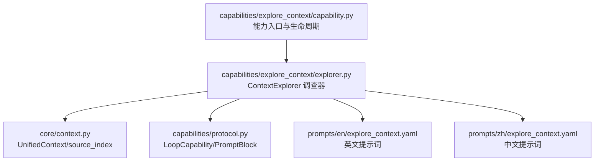
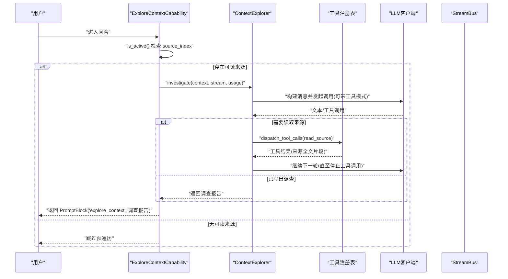
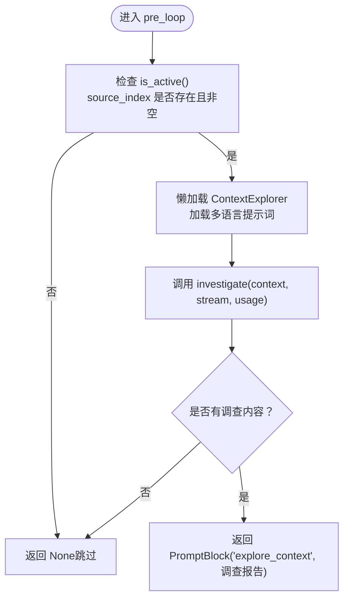
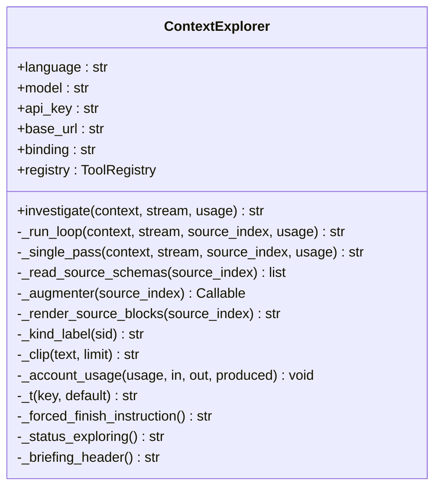
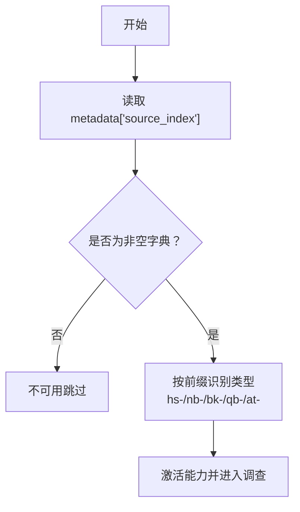
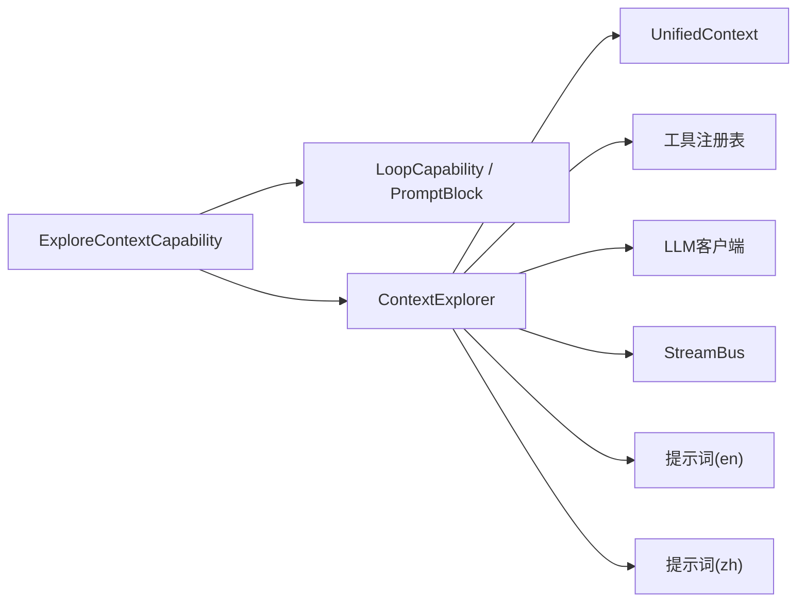

# 探索上下文能力

<cite>
**本文引用的文件**
- [capability.py](file://deeptutor/capabilities/explore_context/capability.py)
- [explorer.py](file://deeptutor/capabilities/explore_context/explorer.py)
- [protocol.py](file://deeptutor/capabilities/protocol.py)
- [context.py](file://deeptutor/core/context.py)
- [explore_context.yaml（英文）](file://deeptutor/capabilities/explore_context/prompts/en/explore_context.yaml)
- [explore_context.yaml（中文）](file://deeptutor/capabilities/explore_context/prompts/zh/explore_context.yaml)
- [test_explore_context_capability.py](file://tests/capabilities/test_explore_context_capability.py)
</cite>

## 目录
1. [简介](#简介)
2. [项目结构](#项目结构)
3. [核心组件](#核心组件)
4. [架构总览](#架构总览)
5. [详细组件分析](#详细组件分析)
6. [依赖关系分析](#依赖关系分析)
7. [性能考量](#性能考量)
8. [故障排查指南](#故障排查指南)
9. [结论](#结论)
10. [附录：配置与最佳实践](#附录配置与最佳实践)

## 简介
探索上下文能力是一种“近隐形”的循环能力，用于在聊天回合的答案生成之前，先对当前回合附带的可读来源进行客观、第三人称的调查。它通过预遍历钩子 pre_loop 执行，使用 read_source 工具按需读取附件全文，产出供答案循环使用的背景依据，从而避免模型将附带材料中的对话记录误认为自身行为或采用其第一人称口吻。

该能力不向答案循环暴露任何工具，也不注入系统提示块；它仅通过 pre_loop 返回一个 PromptBlock，作为用户消息种子的一部分被折叠进后续回答流程。

## 项目结构
围绕探索上下文能力的代码主要分布在 capabilities/explore_context 目录下，包含能力入口、调查器实现以及多语言提示词。相关协议与上下文定义位于 core 与 capabilities 公共模块中。

**图表来源**
- [capability.py:82-141](file://deeptutor/capabilities/explore_context/capability.py#L82-L141)
- [explorer.py:87-147](file://deeptutor/capabilities/explore_context/explorer.py#L87-L147)
- [context.py:60-85](file://deeptutor/core/context.py#L60-L85)
- [protocol.py:11-55](file://deeptutor/capabilities/protocol.py#L11-L55)
- [explore_context.yaml（英文）:11-115](file://deeptutor/capabilities/explore_context/prompts/en/explore_context.yaml#L11-L115)
- [explore_context.yaml（中文）:9-89](file://deeptutor/capabilities/explore_context/prompts/zh/explore_context.yaml#L9-L89)

**章节来源**
- [capability.py:1-29](file://deeptutor/capabilities/explore_context/capability.py#L1-L29)
- [explorer.py:1-23](file://deeptutor/capabilities/explore_context/explorer.py#L1-L23)
- [protocol.py:19-55](file://deeptutor/capabilities/protocol.py#L19-L55)
- [context.py:60-85](file://deeptutor/core/context.py#L60-L85)

## 核心组件
- ExploreContextCapability：能力注册点，负责判断是否激活、提供 pre_loop 钩子，并在激活时调用 ContextExplorer 完成调查。
- ContextExplorer：实际执行调查的类，支持两条路径：
  - 原生工具调用循环（优先）：多次 LLM 调用 + read_source 工具调度，直到写出调查结论。
  - 单趟兜底（弱模型或失败回退）：将来源全文裁剪后一次性投喂，产出简报。
- PromptBlock：pre_loop 返回的数据结构，名称为 explore_context，内容即调查报告。
- UnifiedContext.source_index：每回合的可读来源映射 {source_id: full_text}，是检测与读取的依据。

**章节来源**
- [capability.py:82-141](file://deeptutor/capabilities/explore_context/capability.py#L82-L141)
- [explorer.py:87-147](file://deeptutor/capabilities/explore_context/explorer.py#L87-L147)
- [protocol.py:11-55](file://deeptutor/capabilities/protocol.py#L11-L55)
- [context.py:60-85](file://deeptutor/core/context.py#L60-L85)

## 架构总览
探索上下文能力在聊天回合的生命周期中扮演“预遍历”角色：当检测到有可读来源时，在答案循环首次 LLM 调用前运行一次独立调查，产出客观的第三人称报告，随后答案循环基于此报告作答。

**图表来源**
- [capability.py:118-141](file://deeptutor/capabilities/explore_context/capability.py#L118-L141)
- [explorer.py:112-147](file://deeptutor/capabilities/explore_context/explorer.py#L112-L147)
- [explorer.py:151-241](file://deeptutor/capabilities/explore_context/explorer.py#L151-L241)
- [explorer.py:333-361](file://deeptutor/capabilities/explore_context/explorer.py#L333-L361)

## 详细组件分析

### ExploreContextCapability：近隐形循环能力
- 设计理念
  - “近隐形”：不暴露工具、不注入系统提示，仅在 pre_loop 阶段工作。
  - “循环能力”：复用聊天回合的工具表面，但本能力 own_tools 为空，工具由调查器内部使用。
- 触发机制
  - is_active：检查 context.metadata["source_index"] 是否为非空字典。只要存在可读来源（无论本轮新附还是历史携带），即激活。
  - system_block：始终返回 None，避免污染系统提示。
  - pre_loop_seed：返回空字符串，不追加额外种子。
  - pre_loop：懒加载 ContextExplorer，传入 language 与 prompts，调用 investigate 并返回 PromptBlock。
- 作用与时机
  - 在答案循环第一次 LLM 调用之前执行，确保答案循环获得客观背景，避免混淆第三方材料的第一人称叙述。

**图表来源**
- [capability.py:90-141](file://deeptutor/capabilities/explore_context/capability.py#L90-L141)

**章节来源**
- [capability.py:1-29](file://deeptutor/capabilities/explore_context/capability.py#L1-L29)
- [capability.py:68-141](file://deeptutor/capabilities/explore_context/capability.py#L68-L141)

### ContextExplorer：上下文探索器
- 双执行路径
  - 原生工具调用循环（_run_loop）：最多 MAX_LOOP_ROUNDS=5 轮，最后一轮强制关闭工具以结束。
  - 单趟兜底（_single_pass）：当不支持原生工具调用或循环失败时，裁剪来源全文后单次生成简报。
- 工具与调度
  - 通过工具注册表获取 read_source 的 OpenAI schema，并将 source_index 注入到 tool 参数中，限制 source_id 枚举值。
  - 使用 dispatch_tool_calls 调度工具，将结果拼接回消息序列，驱动下一轮。
- 输出与流式
  - 所有中间输出走 thinking 通道，绝不发送 CONTENT 事件，避免被误认为用户可见答案。
  - 最终产出经 clean_thinking_tags 清理，并加上 briefing_header 作为答案循环的背景。
- 预算与裁剪
  - 循环路径：LOOP_MAX_TOKENS=2000，严格限制每轮输出。
  - 单趟路径：MAX_SOURCES=12，CHARS_PER_SOURCE=8000，TOTAL_CHARS=48000，BRIEFING_MAX_TOKENS=1400。
- 类型识别
  - 根据 source_id 前缀识别来源类型：hs-（对话记录）、nb-（笔记本记录）、bk-（书籍节选）、qb-（题库条目）、at-（文档）。

**图表来源**
- [explorer.py:87-147](file://deeptutor/capabilities/explore_context/explorer.py#L87-L147)
- [explorer.py:151-241](file://deeptutor/capabilities/explore_context/explorer.py#L151-L241)
- [explorer.py:333-361](file://deeptutor/capabilities/explore_context/explorer.py#L333-L361)
- [explorer.py:365-439](file://deeptutor/capabilities/explore_context/explorer.py#L365-L439)
- [explorer.py:441-519](file://deeptutor/capabilities/explore_context/explorer.py#L441-L519)

**章节来源**
- [explorer.py:1-23](file://deeptutor/capabilities/explore_context/explorer.py#L1-L23)
- [explorer.py:87-147](file://deeptutor/capabilities/explore_context/explorer.py#L87-L147)
- [explorer.py:151-241](file://deeptutor/capabilities/explore_context/explorer.py#L151-L241)
- [explorer.py:333-361](file://deeptutor/capabilities/explore_context/explorer.py#L333-L361)
- [explorer.py:365-439](file://deeptutor/capabilities/explore_context/explorer.py#L365-L439)
- [explorer.py:441-519](file://deeptutor/capabilities/explore_context/explorer.py#L441-L519)

### 预遍历时机与作用
- 时机：在答案循环的首次 LLM 调用之前执行一次 pre_loop。
- 作用：
  - 将附件材料的理解与回答解耦，避免模型混用附件中的第一人称叙述。
  - 强制弱模型先完成“阅读与理解”，再进入“回答”。
  - 通过 thinking 通道展示进度，不干扰用户可见答案。

**章节来源**
- [protocol.py:34-55](file://deeptutor/capabilities/protocol.py#L34-L55)
- [capability.py:118-141](file://deeptutor/capabilities/explore_context/capability.py#L118-L141)
- [explorer.py:112-147](file://deeptutor/capabilities/explore_context/explorer.py#L112-L147)

### 检测可读源文件（source_index 机制）
- 来源清单：UnifiedContext.source_manifest 提供可读来源的清单（id/name/type/preview）。
- 索引映射：context.metadata["source_index"] 提供 {source_id: full_text} 的映射，用于快速读取。
- 检测逻辑：is_active 仅当 source_index 为非空字典时激活；图片附件不会进入 source_index，因此图片回合不触发。
- 类型识别：根据 source_id 前缀区分对话记录、笔记本记录、书籍节选、题库条目、文档等。

**图表来源**
- [capability.py:68-79](file://deeptutor/capabilities/explore_context/capability.py#L68-L79)
- [explorer.py:70-77](file://deeptutor/capabilities/explore_context/explorer.py#L70-L77)
- [context.py:60-85](file://deeptutor/core/context.py#L60-L85)

**章节来源**
- [capability.py:68-79](file://deeptutor/capabilities/explore_context/capability.py#L68-L79)
- [explorer.py:70-77](file://deeptutor/capabilities/explore_context/explorer.py#L70-L77)
- [context.py:60-85](file://deeptutor/core/context.py#L60-L85)

### 处理不同类型附件
- 对话记录（hs-）：可能包含用户与其他 AI agent 的对话，需保持第三人称，禁止采用其口吻。
- 笔记本记录（nb-）：笔记条目，聚焦与请求相关的要点。
- 书籍节选（bk-）：章节片段，提取关键事实与决策。
- 题库条目（qb-）：题目与解析，关注问题结构与答案要点。
- 文档（at-）：通用文档，提取与任务相关的内容。

**章节来源**
- [explorer.py:70-77](file://deeptutor/capabilities/explore_context/explorer.py#L70-L77)
- [explore_context.yaml（英文）:11-115](file://deeptutor/capabilities/explore_context/prompts/en/explore_context.yaml#L11-L115)
- [explore_context.yaml（中文）:9-89](file://deeptutor/capabilities/explore_context/prompts/zh/explore_context.yaml#L9-L89)

## 依赖关系分析
- 能力层：ExploreContextCapability 依赖 LoopCapability 协议与 PromptBlock。
- 调查器：ContextExplorer 依赖统一上下文、工具注册表、LLM 客户端与流总线。
- 提示词：多语言 YAML 提示词决定调查策略与输出风格。
- 测试：单元测试覆盖激活条件、流事件约束、循环与兜底路径。

**图表来源**
- [capability.py:82-141](file://deeptutor/capabilities/explore_context/capability.py#L82-L141)
- [explorer.py:87-147](file://deeptutor/capabilities/explore_context/explorer.py#L87-L147)
- [protocol.py:11-55](file://deeptutor/capabilities/protocol.py#L11-L55)
- [context.py:60-85](file://deeptutor/core/context.py#L60-L85)
- [explore_context.yaml（英文）:11-115](file://deeptutor/capabilities/explore_context/prompts/en/explore_context.yaml#L11-L115)
- [explore_context.yaml（中文）:9-89](file://deeptutor/capabilities/explore_context/prompts/zh/explore_context.yaml#L9-L89)

**章节来源**
- [capability.py:82-141](file://deeptutor/capabilities/explore_context/capability.py#L82-L141)
- [explorer.py:87-147](file://deeptutor/capabilities/explore_context/explorer.py#L87-L147)
- [protocol.py:11-55](file://deeptutor/capabilities/protocol.py#L11-L55)
- [context.py:60-85](file://deeptutor/core/context.py#L60-L85)

## 性能考量
- 预算控制
  - 循环路径：最大 5 轮，每轮最多 2000 tokens；最后一轮禁用工具强制结束。
  - 单趟路径：限制来源数量与字符数，简报最大 1400 tokens。
- 流式输出
  - 全部中间输出走 thinking 通道，避免占用内容通道，减少 UI 噪音。
- 资源访问
  - 通过 read_source 按需读取，避免无脑全量加载；裁剪过长来源，防止上下文溢出。
- 错误降级
  - 循环失败自动回退至单趟路径，保证答案循环始终有背景信息可用。

[本节为通用指导，无需具体文件引用]

## 故障排查指南
- 常见问题
  - 未触发预遍历：检查 source_index 是否为空；确认附件为可读文本而非图片。
  - 调查内容为空：检查提示词是否成功加载；确认 LLM 调用是否返回有效文本。
  - 出现 CONTENT 事件：确认调查器仅使用 thinking 通道；检查 StreamBus 事件类型。
  - 工具调用失败：查看 dispatch_tool_calls 日志；确认 read_source schema 与 source_index 正确注入。
- 定位方法
  - 启用 tracing：利用 stage 与 trace metadata 观察探索阶段。
  - 单元测试参考：对照 test_explore_context_capability.py 的行为断言。

**章节来源**
- [explorer.py:179-238](file://deeptutor/capabilities/explore_context/explorer.py#L179-L238)
- [explorer.py:398-439](file://deeptutor/capabilities/explore_context/explorer.py#L398-L439)
- [test_explore_context_capability.py:107-155](file://tests/capabilities/test_explore_context_capability.py#L107-L155)
- [test_explore_context_capability.py:231-295](file://tests/capabilities/test_explore_context_capability.py#L231-L295)

## 结论
探索上下文能力通过“近隐形”的预遍历设计，将“理解附件”和“回答问题”解耦，确保答案循环基于客观、第三人称的背景信息进行推理。它在强模型上采用高效的工具调用循环，在弱模型上提供稳健的单趟兜底，兼顾性能与鲁棒性。配合 source_index 机制与多语言提示词，能够可靠地处理多种类型的附件，提升问答质量与一致性。

[本节为总结，无需具体文件引用]

## 附录：配置与最佳实践
- 语言支持
  - 提示词分为 en 与 zh，根据 context.language 选择；中文提示词强调简体中文输出与规则。
  - 建议保持 prompt 与目标语言一致，以获得更自然的调查结论。
- 性能优化
  - 合理设置模型 token 上限；利用循环路径的预算控制与最后一轮强制结束。
  - 避免过大附件；必要时在上游裁剪或分片。
- 错误处理策略
  - 捕获异常并回退到单趟路径；记录警告日志以便追踪。
  - 确保思考通道不被误用为内容通道，避免前端误渲染。
- 配置示例（概念性说明）
  - 在 UnifiedContext 中维护 source_manifest 与 metadata.source_index。
  - 在能力注册表中挂载 read_source 工具，并确保 schema 支持 source_id 枚举。
  - 在 StreamBus 中监听 stage 与 thinking 事件，用于前端状态展示。
- 最佳实践
  - 保持附件精简且与请求相关；避免无关大文本。
  - 在提示词中明确“第三人称、不臆造、不替用户回答”的规则。
  - 使用测试用例验证行为：激活条件、流事件、循环与兜底路径。

**章节来源**
- [explore_context.yaml（英文）:11-115](file://deeptutor/capabilities/explore_context/prompts/en/explore_context.yaml#L11-L115)
- [explore_context.yaml（中文）:9-89](file://deeptutor/capabilities/explore_context/prompts/zh/explore_context.yaml#L9-L89)
- [explorer.py:57-68](file://deeptutor/capabilities/explore_context/explorer.py#L57-L68)
- [explorer.py:333-361](file://deeptutor/capabilities/explore_context/explorer.py#L333-L361)
- [test_explore_context_capability.py:34-54](file://tests/capabilities/test_explore_context_capability.py#L34-L54)
- [test_explore_context_capability.py:107-155](file://tests/capabilities/test_explore_context_capability.py#L107-L155)
- [test_explore_context_capability.py:231-295](file://tests/capabilities/test_explore_context_capability.py#L231-L295)