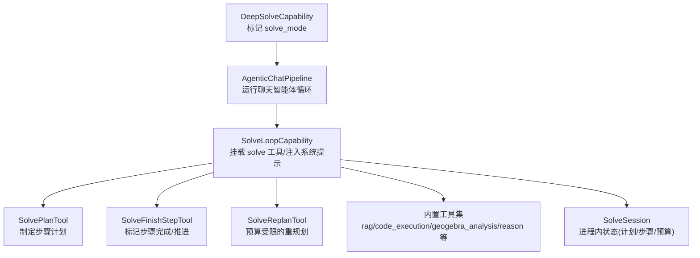
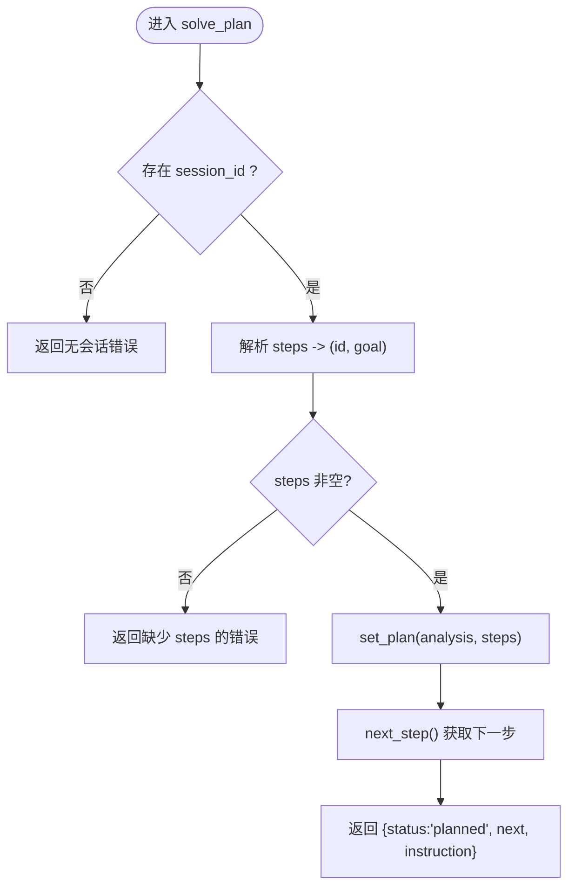
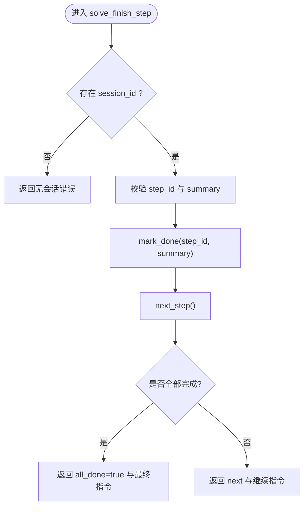
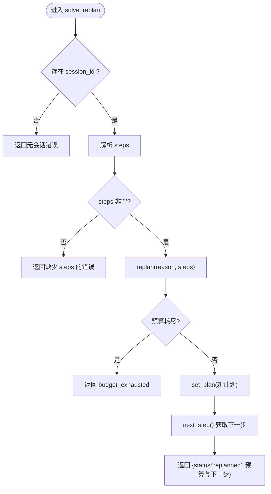
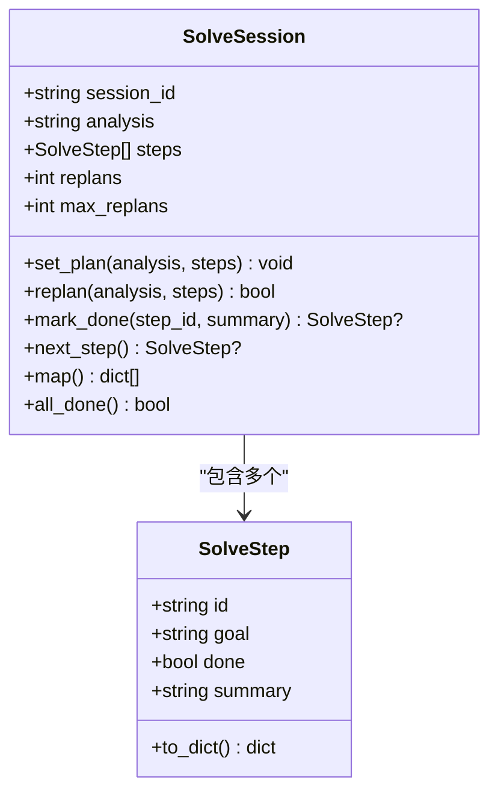
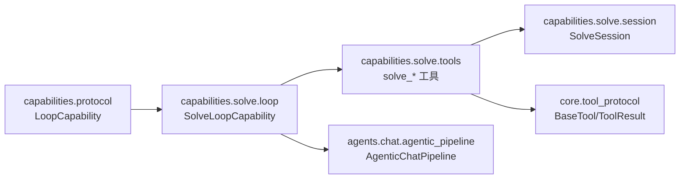

# 求解能力

<cite>
**本文引用的文件**
- [capability.py](file://deeptutor/capabilities/solve/capability.py)
- [loop.py](file://deeptutor/capabilities/solve/loop.py)
- [tools.py](file://deeptutor/capabilities/solve/tools.py)
- [session.py](file://deeptutor/capabilities/solve/session.py)
- [system.md](file://deeptutor/capabilities/solve/prompts/zh/system.md)
- [agentic_pipeline.py](file://deeptutor/agents/chat/agentic_pipeline.py)
- [protocol.py](file://deeptutor/capabilities/protocol.py)
- [tool_protocol.py](file://deeptutor/core/tool_protocol.py)
- [solve_tool.py](file://deeptutor/tools/solve_tool.py)
</cite>

## 目录
1. [简介](#简介)
2. [项目结构](#项目结构)
3. [核心组件](#核心组件)
4. [架构总览](#架构总览)
5. [详细组件分析](#详细组件分析)
6. [依赖关系分析](#依赖关系分析)
7. [性能考虑](#性能考虑)
8. [故障排查指南](#故障排查指南)
9. [结论](#结论)
10. [附录：配置与集成示例](#附录配置与集成示例)

## 简介
本文件系统性说明 DeepTutor 的“求解能力”（Deep Solve），聚焦以下目标：
- 问题解决流程：问题解析、策略选择、方案生成。
- 求解循环（loop）工作机制：多步推理、工具调用、结果验证。
- 求解工具（tools）：数学计算、代码执行、逻辑推理等能力的接入方式。
- 会话（session）管理：求解状态持久化、中间结果存储、错误恢复。
- 外部求解器集成：API 调用、参数传递、结果格式化。
- 配置示例：算法选择、超时设置、重试策略。
- 性能优化：缓存机制、并行处理、资源管理。

## 项目结构
求解能力由“能力入口 + 循环钩子 + 工具 + 会话状态 + 提示词”构成，并通过聊天智能体管道统一编排：
- 能力入口：将本轮标记为 solve_mode，注入 session id 和求解参数，并启动 AgenticChatPipeline。
- 循环钩子：在 chat loop 中挂载 solve 专属工具，注入系统提示词，并在工具调用时注入 session id 与预算。
- 工具：solve_plan / solve_finish_step / solve_replan，驱动“计划—执行—收尾/重规划”的确定性骨架。
- 会话：进程内有界字典保存单轮求解状态（计划、步骤、重规划预算）。
- 提示词：中文/英文 system prompt，指导模型先规划再逐步求解，必要时重规划。



图表来源
- [capability.py:59-88](file://deeptutor/capabilities/solve/capability.py#L59-L88)
- [loop.py:21-73](file://deeptutor/capabilities/solve/loop.py#L21-L73)
- [tools.py:77-282](file://deeptutor/capabilities/solve/tools.py#L77-L282)
- [session.py:25-92](file://deeptutor/capabilities/solve/session.py#L25-L92)
- [agentic_pipeline.py:185-200](file://deeptutor/agents/chat/agentic_pipeline.py#L185-L200)

章节来源
- [capability.py:59-88](file://deeptutor/capabilities/solve/capability.py#L59-L88)
- [loop.py:21-73](file://deeptutor/capabilities/solve/loop.py#L21-L73)
- [tools.py:77-282](file://deeptutor/capabilities/solve/tools.py#L77-L282)
- [session.py:25-92](file://deeptutor/capabilities/solve/session.py#L25-L92)
- [agentic_pipeline.py:185-200](file://deeptutor/agents/chat/agentic_pipeline.py#L185-L200)

## 核心组件
- DeepSolveCapability：将本轮切换为 solve_mode，解析并注入求解参数（max_rounds、temperature、max_tokens、max_replans），启动 AgenticChatPipeline。
- SolveLoopCapability：当 solve_mode 激活时，提供系统提示块、挂载 solve 工具，并在工具调用时注入 _solve_session_id 与 max_replans。
- 求解工具：
  - solve_plan：首次调用，提交分析与有序步骤；返回下一步。
  - solve_finish_step：记录步骤完成与摘要，推进到下一步或结束。
  - solve_replan：在思路卡壳时进行重规划，受预算限制。
- SolveSession：进程内有界存储，维护 plan、steps、replans 与 max_replans，提供 next_step/all_done 等查询。
- 提示词：中文 system.md 明确“先规划、再逐步求解、必要时重规划、最后输出答案”的工作流。

章节来源
- [capability.py:59-88](file://deeptutor/capabilities/solve/capability.py#L59-L88)
- [loop.py:21-73](file://deeptutor/capabilities/solve/loop.py#L21-L73)
- [tools.py:77-282](file://deeptutor/capabilities/solve/tools.py#L77-L282)
- [session.py:25-92](file://deeptutor/capabilities/solve/session.py#L25-L92)
- [system.md:1-14](file://deeptutor/capabilities/solve/prompts/zh/system.md#L1-L14)

## 架构总览
求解能力复用聊天智能体循环作为“求解引擎”，通过 LoopCapability 协议扩展 turn 的行为：
- 协议层：LoopCapability/KnowledgeCapability 定义 turn 级扩展点（owned_tools、system_block、augment_kwargs、pre_loop_seed）。
- 管道层：AgenticChatPipeline 负责组装工具、构建上下文窗口、调度 LLM 与工具调用、控制轮次与上下文预算。
- 能力层：DeepSolveCapability 标记 solve_mode 并启动 pipeline；SolveLoopCapability 在 solve 模式下挂载 solve 工具与系统提示。
- 工具层：BaseTool/ToolDefinition/ToolResult 统一工具元数据与执行契约；solve 工具通过 ToolResult 的 metadata 携带结构化信息（如 solve_plan、_context_checkpoint）。
- 会话层：SolveSession 以进程内有序字典管理单轮状态，支持最大步骤数与最大重规划次数保护。

```mermaid
sequenceDiagram
participant U as "用户"
participant Cap as "DeepSolveCapability"
participant Pipe as "AgenticChatPipeline"
participant Loop as "SolveLoopCapability"
participant Tools as "solve_* 工具"
participant Sess as "SolveSession"
U->>Cap : 发起求解请求
Cap->>Pipe : run(context, stream)
Pipe->>Loop : 检测 is_active(solve_mode)
Loop-->>Pipe : 返回 owned_tools/system_block/augment_kwargs
Pipe->>Tools : 调用 solve_plan
Tools->>Sess : set_plan()/next_step()
Sess-->>Tools : 返回下一步
Tools-->>Pipe : ToolResult{solve_plan}
Pipe->>Tools : 调用 solve_finish_step
Tools->>Sess : mark_done()/next_step()
Sess-->>Tools : 返回下一步或 all_done
Tools-->>Pipe : ToolResult{solve_finish_step/_context_checkpoint}
alt 需要重规划
Pipe->>Tools : 调用 solve_replan
Tools->>Sess : replan()
Sess-->>Tools : 返回新计划/预算状态
Tools-->>Pipe : ToolResult{solve_replan}
end
Pipe-->>U : 最终答案与过程
```

图表来源
- [capability.py:59-88](file://deeptutor/capabilities/solve/capability.py#L59-L88)
- [loop.py:21-73](file://deeptutor/capabilities/solve/loop.py#L21-L73)
- [tools.py:77-282](file://deeptutor/capabilities/solve/tools.py#L77-L282)
- [session.py:25-92](file://deeptutor/capabilities/solve/session.py#L25-L92)
- [agentic_pipeline.py:185-200](file://deeptutor/agents/chat/agentic_pipeline.py#L185-L200)

## 详细组件分析

### 问题解析与策略选择（SolvePlanTool）
- 输入：analysis（简短分析）、steps（有序步骤列表，每项包含 goal）。
- 行为：校验 steps，生成服务器端步骤 ID（S1、S2…），写入 SolveSession，返回下一步。
- 约束：步骤上限（_MAX_STEPS），空步骤将被丢弃。
- 输出：ToolResult 含 solve_plan 元数据，供 UI/日志使用。



图表来源
- [tools.py:77-136](file://deeptutor/capabilities/solve/tools.py#L77-L136)
- [session.py:48-70](file://deeptutor/capabilities/solve/session.py#L48-L70)

章节来源
- [tools.py:77-136](file://deeptutor/capabilities/solve/tools.py#L77-L136)
- [session.py:48-70](file://deeptutor/capabilities/solve/session.py#L48-L70)

### 多步推理与工具调用（solve_finish_step）
- 作用：标记当前步骤完成，附带摘要；推进到下一步或结束。
- 行为：校验 step_id，更新步骤 done 与 summary，返回 next 或 all_done。
- 上下文折叠：通过 ToolResult.metadata._context_checkpoint 携带一步总结，便于循环将中间工具消息折叠为紧凑上下文。



图表来源
- [tools.py:139-203](file://deeptutor/capabilities/solve/tools.py#L139-L203)
- [session.py:61-76](file://deeptutor/capabilities/solve/session.py#L61-L76)

章节来源
- [tools.py:139-203](file://deeptutor/capabilities/solve/tools.py#L139-L203)
- [session.py:61-76](file://deeptutor/capabilities/solve/session.py#L61-L76)

### 重规划与预算控制（SolveReplanTool）
- 触发条件：当前思路卡住或被证明错误。
- 行为：校验 steps，尝试 replan；若达到 max_replans，返回 budget_exhausted 并禁止再次重规划。
- 输出：包含 replans_used、replans_max、新步骤与下一步。



图表来源
- [tools.py:206-275](file://deeptutor/capabilities/solve/tools.py#L206-L275)
- [session.py:52-59](file://deeptutor/capabilities/solve/session.py#L52-L59)

章节来源
- [tools.py:206-275](file://deeptutor/capabilities/solve/tools.py#L206-L275)
- [session.py:52-59](file://deeptutor/capabilities/solve/session.py#L52-L59)

### 会话管理与状态持久化
- 生命周期：单轮（turn-scoped），进程内有序字典存储，键为 _solve_session_id。
- 容量保护：最大会话数 _MAX_SESSIONS=256，超出时按 FIFO 淘汰最旧会话。
- 步骤上限：_MAX_STEPS=12，防止过长计划。
- 重规划预算：默认 DEFAULT_MAX_REPLANS=2，可通过 context.metadata.solve_max_replans 覆盖。
- 中间结果：每步摘要保存在步骤 summary；_context_checkpoint 用于上下文折叠。



图表来源
- [session.py:25-92](file://deeptutor/capabilities/solve/session.py#L25-L92)

章节来源
- [session.py:25-92](file://deeptutor/capabilities/solve/session.py#L25-L92)

### 与聊天智能体循环的集成
- 激活条件：context.metadata.solve_mode 为真时，SolveLoopCapability 生效。
- 工具装配：在 augment_kwargs 中向 solve_* 工具注入 _solve_session_id 与 max_replans。
- 系统提示：根据语言加载 prompts/zh/system.md 或 prompts/en/system.md，指导模型工作流。
- 管道参数：max_rounds、temperature、max_tokens 从求解配置传入 pipeline。

章节来源
- [loop.py:21-73](file://deeptutor/capabilities/solve/loop.py#L21-L73)
- [capability.py:59-88](file://deeptutor/capabilities/solve/capability.py#L59-L88)
- [system.md:1-14](file://deeptutor/capabilities/solve/prompts/zh/system.md#L1-L14)

### 工具协议与结果格式
- BaseTool：所有工具必须实现 get_definition 与 execute。
- ToolDefinition：描述工具名称、描述与参数 JSON Schema，支持 raw_parameters 透传。
- ToolResult：标准化返回内容、来源、元数据、成功标志、终止轮次与暂停交互。
- 事件通道：ToolEventSink 允许工具流式上报内部进度。

章节来源
- [tool_protocol.py:16-275](file://deeptutor/core/tool_protocol.py#L16-L275)

### 外部求解器集成方式
- 工具即集成点：任何外部求解器均可封装为 BaseTool，通过 ToolDefinition 暴露参数，execute 中调用外部 API。
- 参数传递：通过 ToolParameter 声明参数类型与必填项；raw_parameters 可透传上游 JSON Schema。
- 结果格式化：外部 API 响应在 execute 中转换为 ToolResult.content/metadata/sources。
- 延迟加载：deferred=True 的工具可在运行时按需加载完整 schema（MCP 等场景）。

章节来源
- [tool_protocol.py:16-275](file://deeptutor/core/tool_protocol.py#L16-L275)

## 依赖关系分析
- 能力协议：LoopCapability/KnowledgeCapability 定义 turn 级扩展点。
- 管道：AgenticChatPipeline 负责工具装配、LLM 调用、上下文预算与轮次控制。
- 工具注册：solve_* 工具通过 tools.py 暴露名称与类型，兼容导出路径 tools/solve_tool.py。
- 会话：SolveSession 被 solve_* 工具共享，保证单轮状态一致性。



图表来源
- [protocol.py:19-116](file://deeptutor/capabilities/protocol.py#L19-L116)
- [loop.py:21-73](file://deeptutor/capabilities/solve/loop.py#L21-L73)
- [tools.py:77-282](file://deeptutor/capabilities/solve/tools.py#L77-L282)
- [session.py:25-92](file://deeptutor/capabilities/solve/session.py#L25-L92)
- [agentic_pipeline.py:185-200](file://deeptutor/agents/chat/agentic_pipeline.py#L185-L200)
- [tool_protocol.py:206-275](file://deeptutor/core/tool_protocol.py#L206-L275)

章节来源
- [protocol.py:19-116](file://deeptutor/capabilities/protocol.py#L19-L116)
- [loop.py:21-73](file://deeptutor/capabilities/solve/loop.py#L21-L73)
- [tools.py:77-282](file://deeptutor/capabilities/solve/tools.py#L77-L282)
- [session.py:25-92](file://deeptutor/capabilities/solve/session.py#L25-L92)
- [agentic_pipeline.py:185-200](file://deeptutor/agents/chat/agentic_pipeline.py#L185-L200)
- [tool_protocol.py:206-275](file://deeptutor/core/tool_protocol.py#L206-L275)

## 性能考虑
- 上下文窗口保护：pipeline 维护 CONTEXT_WINDOW_GUARD_RATIO，避免上下文溢出。
- 轮次限制：DEFAULT_MAX_ROUNDS 控制一轮中的最大 LLM 轮次，减少无效循环。
- 会话与步骤上限：_MAX_SESSIONS=256、_MAX_STEPS=12，防止内存泄漏与过长计划。
- 工具并行：MAX_PARALLEL_TOOL_CALLS 限制并发工具调用，平衡吞吐与稳定性。
- 建议：
  - 合理设置 max_rounds/max_tokens/temperature，避免过度消耗。
  - 对耗时工具增加超时与重试退避。
  - 利用 _context_checkpoint 折叠中间结果，降低上下文压力。

[本节为通用性能建议，不直接分析具体文件]

## 故障排查指南
- 无会话错误：当 solve_* 工具未检测到 _solve_session_id 时，返回 success=False 的提示。检查 capability 是否正确设置 solve_mode 与 session id。
- 步骤无效：solve_finish_step 传入未知 step_id 会失败，需确保来自 solve_plan 返回的步骤列表。
- 重规划预算耗尽：solve_replan 返回 budget_exhausted，应基于现有结果收尾。
- 上下文过大：若出现上下文窗口告警，减少步骤数量或更精简的摘要。
- 工具不可用：确认用户启用了所需内置工具（如 code_execution、rag、web_search 等）。

章节来源
- [tools.py:37-54](file://deeptutor/capabilities/solve/tools.py#L37-L54)
- [tools.py:166-203](file://deeptutor/capabilities/solve/tools.py#L166-L203)
- [tools.py:237-275](file://deeptutor/capabilities/solve/tools.py#L237-L275)
- [agentic_pipeline.py:98-104](file://deeptutor/agents/chat/agentic_pipeline.py#L98-L104)

## 结论
DeepTutor 的求解能力以聊天智能体循环为核心，通过确定性骨架（计划—执行—收尾/重规划）与丰富的内置工具，实现了稳健的多步推理与问题解决。进程内会话管理保障单轮状态一致性与资源可控，协议化工具接口便于扩展外部求解器。结合合理的配置与性能优化，可在复杂题目上稳定产出高质量解答。

[本节为总结性内容，不直接分析具体文件]

## 附录：配置与集成示例
- 求解参数（通过能力配置读取）：
  - max_rounds：控制一轮最大 LLM 轮次。
  - temperature/max_tokens：控制 LLM 生成行为。
  - max_replans：重规划预算上限（默认 2）。
- 超时与重试：
  - 在工具 execute 中为外部 API 调用设置超时与指数退避重试。
  - 对网络/IO 密集型工具启用熔断与降级。
- 外部求解器集成：
  - 实现 BaseTool.get_definition 与 execute，将外部 API 封装为工具。
  - 使用 ToolParameter/raw_parameters 声明参数；在 execute 中调用外部服务并返回 ToolResult。
  - 如需延迟加载，设置 deferred=True 并通过 load_tools 按需暴露。
- 结果格式化：
  - content：文本结果（LLM 可见）。
  - sources：引用来源（stream.sources）。
  - metadata：结构化信息（如 solve_plan、_context_checkpoint）。
  - pause_for_user：交互式暂停（如 ask_user）。

章节来源
- [capability.py:69-88](file://deeptutor/capabilities/solve/capability.py#L69-L88)
- [tool_protocol.py:16-275](file://deeptutor/core/tool_protocol.py#L16-L275)
- [solve_tool.py:1-23](file://deeptutor/tools/solve_tool.py#L1-L23)