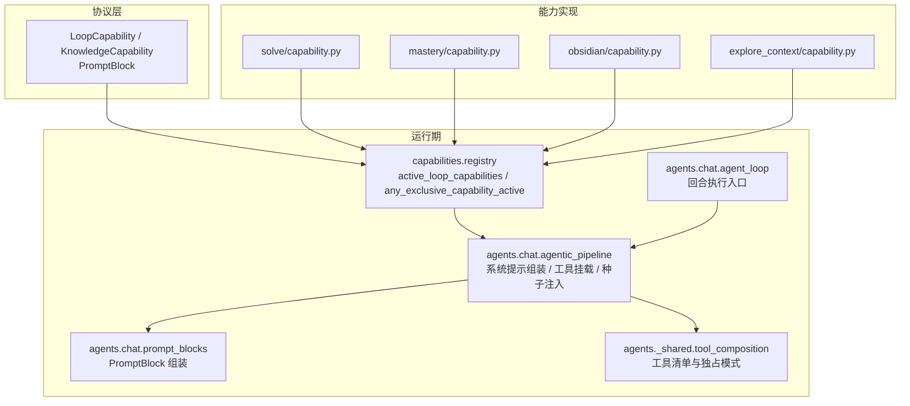
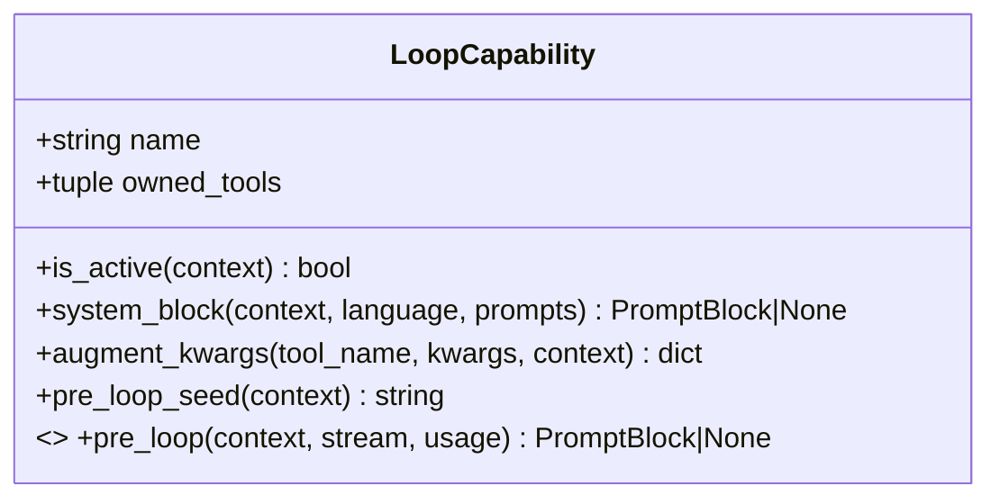
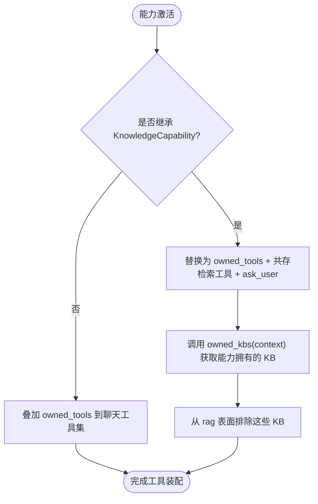
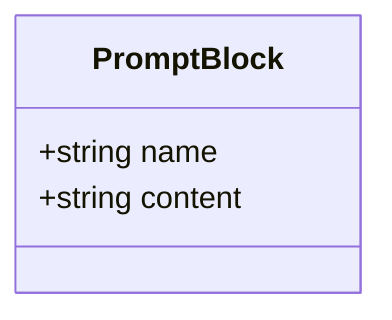
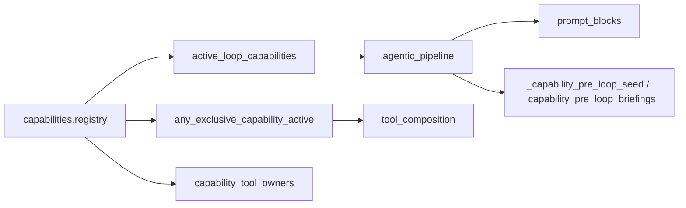

# 能力协议定义

<cite>
**本文引用的文件**
- [deeptutor/capabilities/protocol.py](file://deeptutor/capabilities/protocol.py)
- [deeptutor/capabilities/registry.py](file://deeptutor/capabilities/registry.py)
- [deeptutor/agents/chat/agentic_pipeline.py](file://deeptutor/agents/chat/agentic_pipeline.py)
- [deeptutor/agents/chat/prompt_blocks.py](file://deeptutor/agents/chat/prompt_blocks.py)
- [deeptutor/agents/chat/agent_loop.py](file://deeptutor/agents/chat/agent_loop.py)
- [deeptutor/agents/_shared/tool_composition.py](file://deeptutor/agents/_shared/tool_composition.py)
- [deeptutor/capabilities/solve/capability.py](file://deeptutor/capabilities/solve/capability.py)
- [deeptutor/capabilities/mastery/capability.py](file://deeptutor/capabilities/mastery/capability.py)
- [deeptutor/capabilities/obsidian/capability.py](file://deeptutor/capabilities/obsidian/capability.py)
- [deeptutor/capabilities/explore_context/capability.py](file://deeptutor/capabilities/explore_context/capability.py)
- [deeptutor/core/capability_protocol.py](file://deeptutor/core/capability_protocol.py)
</cite>

## 目录
1. [简介](#简介)
2. [项目结构](#项目结构)
3. [核心组件](#核心组件)
4. [架构总览](#架构总览)
5. [详细组件分析](#详细组件分析)
6. [依赖关系分析](#依赖关系分析)
7. [性能考虑](#性能考虑)
8. [故障排查指南](#故障排查指南)
9. [结论](#结论)
10. [附录](#附录)

## 简介
本文件聚焦于“能力协议”的设计与实现，围绕 LoopCapability 与 KnowledgeCapability 两个核心协议展开，解释其设计理念、职责边界与差异；详细说明 LoopCapability 的必需方法与可选钩子函数（is_active、system_block、augment_kwargs、pre_loop_seed）的作用与实现要求；阐述 KnowledgeCapability 的特殊性（exclusive_tools 与 owned_kbs）及其使用场景；说明 PromptBlock 数据类的作用与使用方式；并提供协议实现的完整示例路径与最佳实践。最后给出协议版本兼容性与向后兼容性建议。

## 项目结构
能力协议位于 capabilities 包中，由 chat 智能体循环在运行时动态发现并调用。关键文件与职责：
- 协议定义：LoopCapability、KnowledgeCapability、PromptBlock
- 注册与选择：active_loop_capabilities、any_exclusive_capability_active、capability_tool_owners
- 运行期集成：agentic_pipeline、agent_loop、prompt_blocks、tool_composition
- 典型实现：solve、mastery、obsidian、explore_context



图表来源
- [deeptutor/capabilities/protocol.py:19-116](file://deeptutor/capabilities/protocol.py#L19-L116)
- [deeptutor/capabilities/registry.py:38-52](file://deeptutor/capabilities/registry.py#L38-L52)
- [deeptutor/agents/chat/agentic_pipeline.py:626-697](file://deeptutor/agents/chat/agentic_pipeline.py#L626-L697)
- [deeptutor/agents/chat/prompt_blocks.py:57-87](file://deeptutor/agents/chat/prompt_blocks.py#L57-L87)
- [deeptutor/agents/chat/agent_loop.py:172-202](file://deeptutor/agents/chat/agent_loop.py#L172-L202)
- [deeptutor/agents/_shared/tool_composition.py:149-176](file://deeptutor/agents/_shared/tool_composition.py#L149-L176)

章节来源
- [deeptutor/capabilities/protocol.py:1-116](file://deeptutor/capabilities/protocol.py#L1-L116)
- [deeptutor/capabilities/registry.py:38-52](file://deeptutor/capabilities/registry.py#L38-L52)
- [deeptutor/agents/chat/agentic_pipeline.py:626-697](file://deeptutor/agents/chat/agentic_pipeline.py#L626-L697)
- [deeptutor/agents/chat/prompt_blocks.py:57-87](file://deeptutor/agents/chat/prompt_blocks.py#L57-L87)
- [deeptutor/agents/chat/agent_loop.py:172-202](file://deeptutor/agents/chat/agent_loop.py#L172-L202)
- [deeptutor/agents/_shared/tool_composition.py:149-176](file://deeptutor/agents/_shared/tool_composition.py#L149-L176)

## 核心组件
- PromptBlock：不可变的数据类，表示一个带名称的系统提示片段，用于拼装到回合的系统提示或用户消息种子中。
- LoopCapability：每回合可选扩展点，复用聊天全部工具表面，并在激活时叠加 owned_tools；提供 is_active、system_block、augment_kwargs、pre_loop_seed 等接口，以及可选异步 pre_loop 钩子。
- KnowledgeCapability：知识型能力基类，设置 exclusive_tools=True，当激活时“拥有回合”，以自身 owned_tools 替换聊天内置工具集；通过 owned_kbs 声明该能力直接消费的 KB 引用，避免与 rag 冲突。

章节来源
- [deeptutor/capabilities/protocol.py:11-16](file://deeptutor/capabilities/protocol.py#L11-L16)
- [deeptutor/capabilities/protocol.py:19-85](file://deeptutor/capabilities/protocol.py#L19-L85)
- [deeptutor/capabilities/protocol.py:87-113](file://deeptutor/capabilities/protocol.py#L87-L113)

## 架构总览
能力协议与聊天循环的协作流程如下：
- 回合启动时，agent_loop 先执行可选的 pre_loop 预简报（如 explore_context），再拼接 KB 种子与 capability 的 pre_loop_seed，生成最终用户消息种子。
- agentic_pipeline 根据 active_loop_capabilities 决定工具挂载策略：普通能力叠加工具；知识型能力独占工具，仅保留共存的检索工具（rag、kb_files）与 ask_user。
- system_block 由各能力返回的 PromptBlock 拼入系统提示，按顺序插入到通用策略之后，确保能力剧本优先生效。
- augment_kwargs 为能力自有工具注入服务端私有参数（如 Obsidian 的 _vault_path）。

```mermaid
sequenceDiagram
participant Client as "客户端"
participant Loop as "AgentLoop"
participant Pipeline as "AgenticChatPipeline"
participant Registry as "capabilities.registry"
participant Cap as "LoopCapability/KnowledgeCapability"
participant Assembler as "PromptBlocks"
Client->>Loop : 发起回合
Loop->>Pipeline : 构建消息与工具
Pipeline->>Registry : active_loop_capabilities(context)
Registry-->>Pipeline : 激活的能力列表
Pipeline->>Cap : system_block(context, language, prompts)
Cap-->>Pipeline : PromptBlock | None
Pipeline->>Assembler : blocks(..., capability_blocks)
Assembler-->>Pipeline : 渲染后的系统提示
Loop->>Pipeline : _capability_pre_loop_briefings()
Pipeline->>Cap : pre_loop(context, stream, usage) (可选)
Cap-->>Pipeline : PromptBlock | None
Loop->>Pipeline : _capability_pre_loop_seed(context)
Pipeline-->>Loop : 合并后的种子与消息
Loop->>Pipeline : 进入回答循环
```

图表来源
- [deeptutor/agents/chat/agent_loop.py:172-202](file://deeptutor/agents/chat/agent_loop.py#L172-L202)
- [deeptutor/agents/chat/agentic_pipeline.py:626-697](file://deeptutor/agents/chat/agentic_pipeline.py#L626-L697)
- [deeptutor/agents/chat/prompt_blocks.py:57-87](file://deeptutor/agents/chat/prompt_blocks.py#L57-L87)
- [deeptutor/capabilities/registry.py:38-52](file://deeptutor/capabilities/registry.py#L38-L52)

## 详细组件分析

### LoopCapability：设计要点与接口
- 设计目标：在不破坏聊天默认工具表面的前提下，为特定回合增加“能力剧本”和“能力工具”。
- 必需字段与方法：
  - name：能力标识，用于 UI 分组与日志。
  - owned_tools：能力在激活时追加的工具名元组。
  - is_active(context)：判断当前回合是否启用该能力。
  - system_block(context, *, language, prompts) -> PromptBlock|None：返回系统提示片段，为空则不插入。
  - augment_kwargs(tool_name, kwargs, context) -> dict：为能力自有工具注入服务端私有参数。
  - pre_loop_seed(context) -> str：附加到初始用户消息种子的文本。
- 可选钩子：
  - pre_loop(context, stream, *, usage=None) -> PromptBlock|None：在首轮 LLM 调用前执行一次预简报，将结果折叠进用户消息种子；失败需被吞掉，不能影响回合。



图表来源
- [deeptutor/capabilities/protocol.py:19-85](file://deeptutor/capabilities/protocol.py#L19-L85)

章节来源
- [deeptutor/capabilities/protocol.py:19-85](file://deeptutor/capabilities/protocol.py#L19-L85)
- [deeptutor/agents/chat/agentic_pipeline.py:658-697](file://deeptutor/agents/chat/agentic_pipeline.py#L658-L697)

### KnowledgeCapability：独占回合与 KB 所有权
- 特殊属性：
  - exclusive_tools = True：当能力激活时，用 owned_tools 替换聊天内置工具集，仅保留与 KB 共存的检索工具（rag、kb_files）与 ask_user。
- 方法：
  - owned_kbs(context) -> set[str]：声明该能力直接消费的 KB 引用，这些 KB 将从 rag 表面排除，避免被静默丢弃。
- 行为约束：
  - 子类仍满足 LoopCapability 的结构面（name、owned_tools、is_active、system_block、augment_kwargs、pre_loop_seed）。
  - 通过 category membership（继承 KnowledgeCapability）决定独占性，而非实例级开关。



图表来源
- [deeptutor/capabilities/protocol.py:87-113](file://deeptutor/capabilities/protocol.py#L87-L113)
- [deeptutor/agents/_shared/tool_composition.py:149-176](file://deeptutor/agents/_shared/tool_composition.py#L149-L176)
- [deeptutor/agents/chat/agentic_pipeline.py:1369-1392](file://deeptutor/agents/chat/agentic_pipeline.py#L1369-L1392)

章节来源
- [deeptutor/capabilities/protocol.py:87-113](file://deeptutor/capabilities/protocol.py#L87-L113)
- [deeptutor/agents/_shared/tool_composition.py:149-176](file://deeptutor/agents/_shared/tool_composition.py#L149-L176)
- [deeptutor/agents/chat/agentic_pipeline.py:1369-1392](file://deeptutor/agents/chat/agentic_pipeline.py#L1369-L1392)

### PromptBlock：系统提示片段
- 作用：作为不可变的命名片段，参与系统提示或用户消息种子的拼装。
- 使用位置：
  - 能力通过 system_block 返回 PromptBlock，插入到通用策略之后。
  - 可选 pre_loop 钩子返回 PromptBlock，内容会被折叠进用户消息种子。
- 计费与统计：按块名进行 token 计数，便于上下文预算归因。



图表来源
- [deeptutor/capabilities/protocol.py:11-16](file://deeptutor/capabilities/protocol.py#L11-L16)
- [deeptutor/agents/chat/prompt_blocks.py:57-87](file://deeptutor/agents/chat/prompt_blocks.py#L57-L87)

章节来源
- [deeptutor/capabilities/protocol.py:11-16](file://deeptutor/capabilities/protocol.py#L11-L16)
- [deeptutor/agents/chat/prompt_blocks.py:57-87](file://deeptutor/agents/chat/prompt_blocks.py#L57-L87)

### 典型实现示例与参考路径
- 解算能力（Deep Solve）：标记 solve_mode，设置会话键，调用 AgenticChatPipeline 驱动回答循环；其 loop 能力负责挂载 solve 工具与内置工具集。
  - 参考路径：[deeptutor/capabilities/solve/capability.py:59-88](file://deeptutor/capabilities/solve/capability.py#L59-L88)
- 掌握路径能力（Mastery Path）：标记 mastery_mode，解析路径 ID，调用 AgenticChatPipeline；loop 能力挂载 mastery 工具与内置工具集。
  - 参考路径：[deeptutor/capabilities/mastery/capability.py:57-73](file://deeptutor/capabilities/mastery/capability.py#L57-L73)
- 知识型能力（Obsidian）：继承 KnowledgeCapability，设置 exclusive_tools，声明 owned_kbs，注入 _vault_path，返回系统提示块。
  - 参考路径：[deeptutor/capabilities/obsidian/capability.py:24-72](file://deeptutor/capabilities/obsidian/capability.py#L24-L72)
- 探索上下文能力（Explore Context）：无答案循环工具，通过可选 pre_loop 钩子在首轮 LLM 前执行只读预调查，将结果折叠进种子。
  - 参考路径：[deeptutor/capabilities/explore_context/capability.py:82-141](file://deeptutor/capabilities/explore_context/capability.py#L82-L141)

章节来源
- [deeptutor/capabilities/solve/capability.py:59-88](file://deeptutor/capabilities/solve/capability.py#L59-L88)
- [deeptutor/capabilities/mastery/capability.py:57-73](file://deeptutor/capabilities/mastery/capability.py#L57-L73)
- [deeptutor/capabilities/obsidian/capability.py:24-72](file://deeptutor/capabilities/obsidian/capability.py#L24-L72)
- [deeptutor/capabilities/explore_context/capability.py:82-141](file://deeptutor/capabilities/explore_context/capability.py#L82-L141)

### 运行期调用时序（含 pre_loop 与种子拼接）
```mermaid
sequenceDiagram
participant Loop as "AgentLoop"
participant Pipe as "AgenticChatPipeline"
participant Cap as "LoopCapability"
participant Reg as "registry"
Loop->>Pipe : run(context, stream)
Pipe->>Reg : active_loop_capabilities(context)
Reg-->>Pipe : 激活能力列表
Loop->>Pipe : _capability_pre_loop_briefings()
Pipe->>Cap : pre_loop(context, stream, usage) (可选)
Cap-->>Pipe : PromptBlock|None
Loop->>Pipe : _capability_pre_loop_seed(context)
Cap-->>Pipe : 字符串种子
Pipe-->>Loop : 合并后的种子与消息
Loop->>Pipe : 进入回答循环
```

图表来源
- [deeptutor/agents/chat/agent_loop.py:172-202](file://deeptutor/agents/chat/agent_loop.py#L172-L202)
- [deeptutor/agents/chat/agentic_pipeline.py:658-697](file://deeptutor/agents/chat/agentic_pipeline.py#L658-L697)

## 依赖关系分析
- 能力注册与选择：
  - active_loop_capabilities：基于上下文筛选激活的能力集合。
  - any_exclusive_capability_active：判断是否存在知识型独占能力。
  - capability_tool_owners：静态映射工具到能力名，供设置 UI 分组。
- 工具装配：
  - tool_composition：在独占模式下，仅保留 rag/kb_files 与 ask_user 作为共存工具。
- 提示组装：
  - prompt_blocks：将能力返回的 PromptBlock 插入到系统提示中。
- 种子注入：
  - agentic_pipeline：收集 pre_loop 与 pre_loop_seed，合并为最终种子。



图表来源
- [deeptutor/capabilities/registry.py:38-52](file://deeptutor/capabilities/registry.py#L38-L52)
- [deeptutor/agents/_shared/tool_composition.py:149-176](file://deeptutor/agents/_shared/tool_composition.py#L149-L176)
- [deeptutor/agents/chat/prompt_blocks.py:57-87](file://deeptutor/agents/chat/prompt_blocks.py#L57-L87)
- [deeptutor/agents/chat/agentic_pipeline.py:626-697](file://deeptutor/agents/chat/agentic_pipeline.py#L626-L697)

章节来源
- [deeptutor/capabilities/registry.py:38-52](file://deeptutor/capabilities/registry.py#L38-L52)
- [deeptutor/agents/_shared/tool_composition.py:149-176](file://deeptutor/agents/_shared/tool_composition.py#L149-L176)
- [deeptutor/agents/chat/prompt_blocks.py:57-87](file://deeptutor/agents/chat/prompt_blocks.py#L57-L87)
- [deeptutor/agents/chat/agentic_pipeline.py:626-697](file://deeptutor/agents/chat/agentic_pipeline.py#L626-L697)

## 性能考虑
- 预简报（pre_loop）应轻量且可失败：若失败不应影响回合；建议捕获异常并记录警告。
- 种子拼接应避免过长：pre_loop_seed 与 pre_loop 返回的内容会进入模型上下文，需控制长度与相关性。
- 工具装配最小化：独占模式下仅挂载必要工具，减少工具清单体积与推理开销。
- 提示块拆分：利用 PromptBlock 的名称分段统计 token，便于上下文预算分析与优化。

## 故障排查指南
- 能力未生效：
  - 检查 is_active 逻辑是否正确识别上下文条件。
  - 确认 active_loop_capabilities 返回了预期能力。
- 工具未挂载或被抑制：
  - 普通能力：确认 owned_tools 已正确声明。
  - 知识型能力：确认 exclusive_tools 为 True，且共存工具（rag、kb_files）按需挂载。
- 系统提示未插入：
  - system_block 返回 None 或空内容将被忽略；请确保返回有效的 PromptBlock。
- pre_loop 失败：
  - 框架会捕获异常并记录警告；检查 pre_loop 内部依赖初始化顺序与资源可用性。
- KB 访问异常：
  - 知识型能力需实现 owned_kbs，避免与 rag 冲突；检查返回的 KB 引用是否与所选一致。

章节来源
- [deeptutor/agents/chat/agentic_pipeline.py:658-697](file://deeptutor/agents/chat/agentic_pipeline.py#L658-L697)
- [deeptutor/agents/_shared/tool_composition.py:149-176](file://deeptutor/agents/_shared/tool_composition.py#L149-L176)
- [deeptutor/agents/chat/prompt_blocks.py:57-87](file://deeptutor/agents/chat/prompt_blocks.py#L57-L87)
- [deeptutor/capabilities/protocol.py:87-113](file://deeptutor/capabilities/protocol.py#L87-L113)

## 结论
LoopCapability 与 KnowledgeCapability 构成了 DeepTutor 能力体系的核心抽象：前者以“叠加”的方式增强聊天回合，后者以“独占”的方式接管回合并声明 KB 所有权。通过 PromptBlock 与一系列钩子（is_active、system_block、augment_kwargs、pre_loop_seed、可选 pre_loop），能力可以在不侵入主循环的前提下，灵活地注入系统提示、工具与种子信息。遵循上述设计与最佳实践，可实现稳定、可观测、可扩展的多能力协同。

## 附录
- 版本与向后兼容建议：
  - 新增可选钩子（如 pre_loop）应保持向后兼容：通过 getattr(cap, "pre_loop", None) 读取，避免对旧实现造成破坏。
  - 新增属性（如 exclusive_tools）应提供默认值，并通过 getattr(cap, "exclusive_tools", False) 读取。
  - 能力注册表与工具映射应支持新增能力而不影响既有能力。
  - 建议在发布说明中明确能力协议变更，并提供迁移指引。