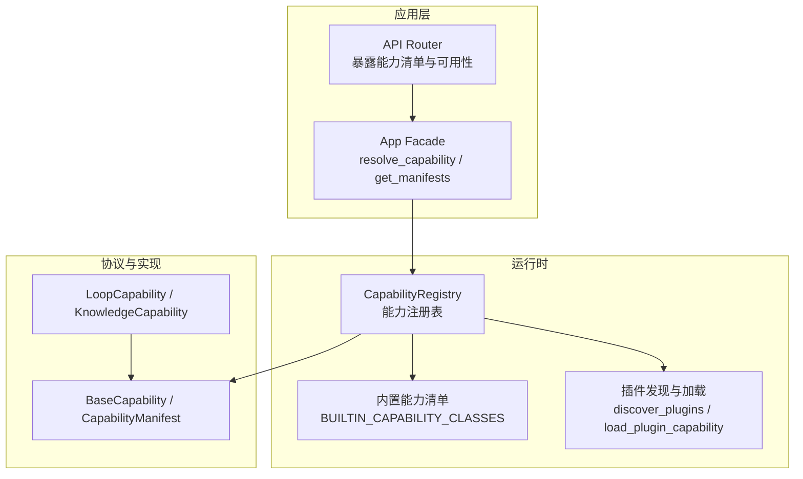
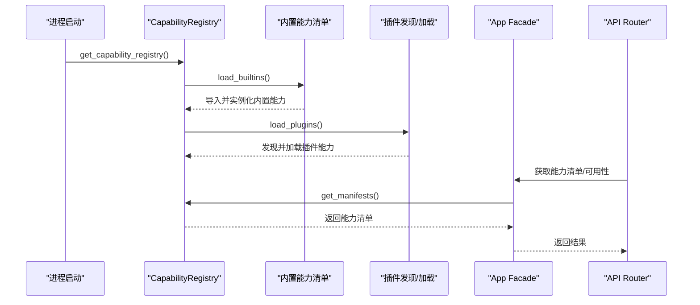
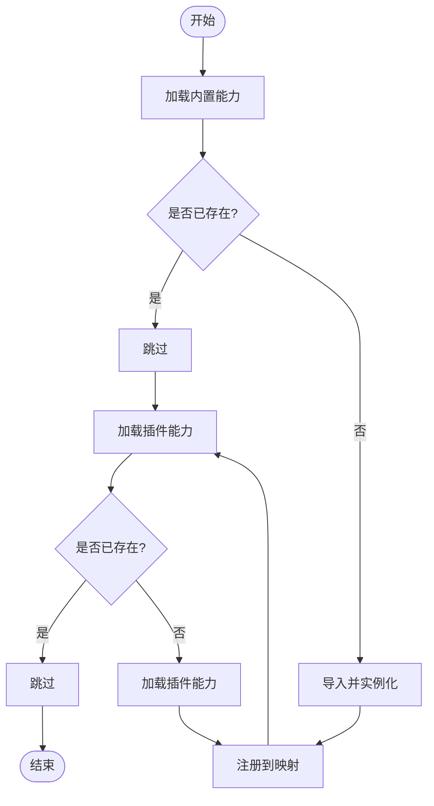
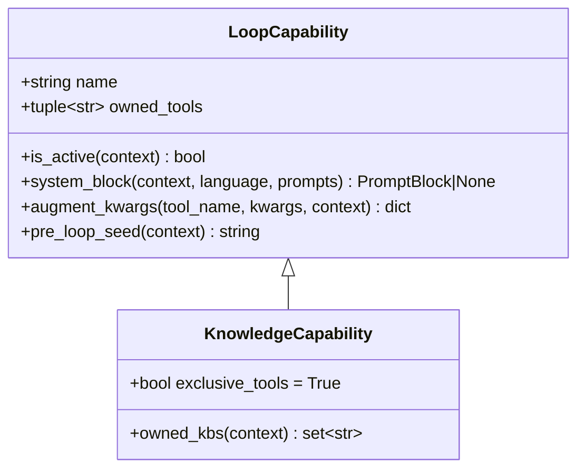
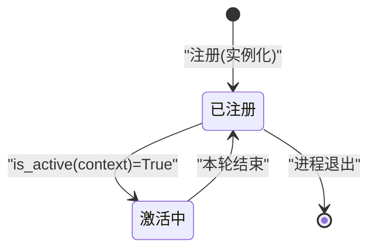
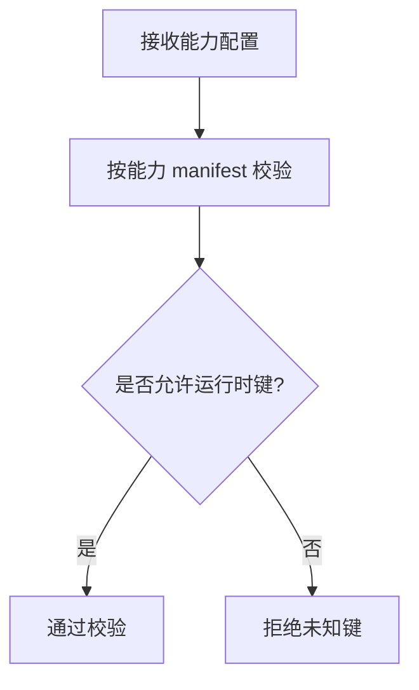
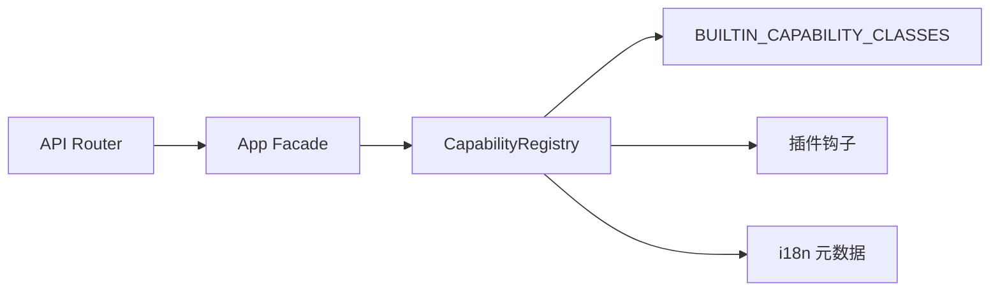

# 能力注册表

<cite>
**本文引用的文件**
- [deeptutor/runtime/registry/capability_registry.py](file://deeptutor/runtime/registry/capability_registry.py)
- [deeptutor/core/capability_protocol.py](file://deeptutor/core/capability_protocol.py)
- [deeptutor/capabilities/protocol.py](file://deeptutor/capabilities/protocol.py)
- [deeptutor/capabilities/registry.py](file://deeptutor/capabilities/registry.py)
- [deeptutor/app/facade.py](file://deeptutor/app/facade.py)
- [deeptutor/api/main.py](file://deeptutor/api/main.py)
- [deeptutor/capabilities/solve/capability.py](file://deeptutor/capabilities/solve/capability.py)
- [deeptutor/capabilities/mastery/capability.py](file://deeptutor/capabilities/mastery/capability.py)
- [tests/runtime/test_request_contracts_subagent.py](file://tests/runtime/test_request_contracts_subagent.py)
</cite>

## 目录
1. [简介](#简介)
2. [项目结构](#项目结构)
3. [核心组件](#核心组件)
4. [架构总览](#架构总览)
5. [详细组件分析](#详细组件分析)
6. [依赖关系分析](#依赖关系分析)
7. [性能考量](#性能考量)
8. [故障排查指南](#故障排查指南)
9. [结论](#结论)
10. [附录](#附录)

## 简介
本文件围绕 DeepTutor 的“能力注册表”进行系统化说明，覆盖能力的发现、注册与管理流程；能力注册表的 API（如 add_capability、get_capability、list_capabilities）与使用方式；能力的生命周期管理（初始化、激活、销毁）；依赖检测与冲突解决；配置管理与参数校验；以及自定义能力注册的完整示例（装饰器与手动注册）。同时给出错误处理与异常情况的处理方式。

## 项目结构
DeepTutor 的能力体系分为两层：
- 运行时能力注册表（CapabilityRegistry）：集中管理所有可用能力（内置与插件），提供注册、查询、清单导出等接口。
- 对话循环能力（LoopCapability/KnowledgeCapability）：在聊天循环中按轮次动态启用，决定工具集与系统提示注入。

图表来源
- [deeptutor/runtime/registry/capability_registry.py:39-114](file://deeptutor/runtime/registry/capability_registry.py#L39-L114)
- [deeptutor/core/capability_protocol.py:20-69](file://deeptutor/core/capability_protocol.py#L20-L69)
- [deeptutor/capabilities/protocol.py:19-116](file://deeptutor/capabilities/protocol.py#L19-L116)
- [deeptutor/app/facade.py:65-96](file://deeptutor/app/facade.py#L65-L96)
- [deeptutor/api/main.py:63-66](file://deeptutor/api/main.py#L63-L66)

章节来源
- [deeptutor/runtime/registry/capability_registry.py:39-114](file://deeptutor/runtime/registry/capability_registry.py#L39-L114)
- [deeptutor/core/capability_protocol.py:20-69](file://deeptutor/core/capability_protocol.py#L20-L69)
- [deeptutor/capabilities/protocol.py:19-116](file://deeptutor/capabilities/protocol.py#L19-L116)
- [deeptutor/app/facade.py:65-96](file://deeptutor/app/facade.py#L65-L96)
- [deeptutor/api/main.py:63-66](file://deeptutor/api/main.py#L63-L66)

## 核心组件
- 能力基类与清单
  - BaseCapability：定义能力抽象，要求实现 run(context, stream)，并提供 name/stages 等元数据访问。
  - CapabilityManifest：描述能力的静态元数据（名称、描述、阶段、使用的工具、CLI 别名、请求 schema、配置默认值）。
- 运行时能力注册表
  - CapabilityRegistry：维护能力实例字典，支持 register/get/list_capabilities/get_manifests，并负责加载内置与插件能力。
  - get_capability_registry：全局单例获取注册表，首次调用时自动加载内置与插件。
- 对话循环能力协议
  - LoopCapability：每轮可启用的扩展点，声明 owned_tools、is_active、system_block、augment_kwargs、pre_loop_seed 等。
  - KnowledgeCapability：知识型能力基类，标记 exclusive_tools=True，表示该能力独占工具表面。
- 内置能力示例
  - DeepSolveCapability、MasteryPathCapability：通过 BaseCapability 实现，将模式标志写入上下文，并驱动 AgenticChatPipeline。

章节来源
- [deeptutor/core/capability_protocol.py:20-69](file://deeptutor/core/capability_protocol.py#L20-L69)
- [deeptutor/runtime/registry/capability_registry.py:39-114](file://deeptutor/runtime/registry/capability_registry.py#L39-L114)
- [deeptutor/capabilities/protocol.py:19-116](file://deeptutor/capabilities/protocol.py#L19-L116)
- [deeptutor/capabilities/solve/capability.py:59-88](file://deeptutor/capabilities/solve/capability.py#L59-L88)
- [deeptutor/capabilities/mastery/capability.py:57-73](file://deeptutor/capabilities/mastery/capability.py#L57-L73)

## 架构总览
能力注册表在启动时完成“发现—加载—注册”，并在运行期提供查询与清单导出。应用层通过 Facade 解析能力名（含别名），API 层对外暴露能力清单与可用性信息。

图表来源
- [deeptutor/runtime/registry/capability_registry.py:108-114](file://deeptutor/runtime/registry/capability_registry.py#L108-L114)
- [deeptutor/runtime/registry/capability_registry.py:49-78](file://deeptutor/runtime/registry/capability_registry.py#L49-L78)
- [deeptutor/app/facade.py:65-96](file://deeptutor/app/facade.py#L65-L96)
- [deeptutor/api/main.py:63-66](file://deeptutor/api/main.py#L63-L66)

## 详细组件分析

### 能力注册表（CapabilityRegistry）
- 职责
  - 维护能力实例映射（name -> instance）。
  - 加载内置能力：从 BUILTIN_CAPABILITY_CLASSES 导入类并实例化注册。
  - 加载插件能力：通过插件钩子 discover_plugins/load_plugin_capability 发现并注册。
  - 提供查询接口：get、list_capabilities、get_manifests。
- 关键行为
  - 重复注册保护：同名能力仅注册一次。
  - 失败容错：加载失败记录警告日志，不中断整体启动。
  - 清单导出：包含 i18n 描述、阶段、工具、CLI 别名、请求 schema、配置默认值。

图表来源
- [deeptutor/runtime/registry/capability_registry.py:49-78](file://deeptutor/runtime/registry/capability_registry.py#L49-L78)

章节来源
- [deeptutor/runtime/registry/capability_registry.py:39-114](file://deeptutor/runtime/registry/capability_registry.py#L39-L114)

### 能力协议与对话循环能力
- LoopCapability
  - 用于每轮对话的扩展点，声明 owned_tools、is_active、system_block、augment_kwargs、pre_loop_seed。
  - 可选 pre_loop 钩子在首轮 LLM 调用前执行，产出 PromptBlock 作为种子上下文。
- KnowledgeCapability
  - 继承自 LoopCapability 的结构，但设置 exclusive_tools=True，表示该能力独占工具表面（替换而非增强）。
- 活跃能力选择
  - active_loop_capabilities：根据当前 UnifiedContext 过滤出 is_active 为真的能力。
  - any_exclusive_capability_active：判断是否存在独占工具的能力，影响管道分支与 RAG 脚手架抑制。
  - capability_tool_owners：构建“工具名 -> 能力名”的静态映射，供设置 UI 分组。

图表来源
- [deeptutor/capabilities/protocol.py:19-116](file://deeptutor/capabilities/protocol.py#L19-L116)

章节来源
- [deeptutor/capabilities/protocol.py:19-116](file://deeptutor/capabilities/protocol.py#L19-L116)
- [deeptutor/capabilities/registry.py:22-44](file://deeptutor/capabilities/registry.py#L22-L44)

### 能力生命周期管理
- 初始化
  - 进程启动时通过 get_capability_registry() 创建并加载内置与插件能力。
  - 每个能力实例在注册时即被创建（内置通过 importlib 导入类后实例化）。
- 激活
  - 对话循环中依据 is_active(context) 决定是否参与本轮。
  - 若存在 KnowledgeCapability 且激活，则进入独占工具分支。
- 销毁
  - 能力实例随进程生命周期存在；无显式销毁接口。
  - 资源释放由具体能力内部实现（例如会话清理、缓存释放等）。

图表来源
- [deeptutor/runtime/registry/capability_registry.py:45-57](file://deeptutor/runtime/registry/capability_registry.py#L45-L57)
- [deeptutor/capabilities/protocol.py:63-84](file://deeptutor/capabilities/protocol.py#L63-L84)

章节来源
- [deeptutor/runtime/registry/capability_registry.py:45-57](file://deeptutor/runtime/registry/capability_registry.py#L45-L57)
- [deeptutor/capabilities/protocol.py:63-84](file://deeptutor/capabilities/protocol.py#L63-L84)

### 依赖检测与冲突解决
- 依赖检测
  - 插件加载失败会记录警告日志并继续启动，避免单点故障。
  - 内置能力导入失败同样记录警告并跳过。
- 冲突解决
  - 同名能力仅注册一次，后续重复注册会被忽略。
  - 对话循环中，KnowledgeCapability 通过 exclusive_tools 控制是否独占工具表面，避免与 chat 内置工具冲突。
  - 工具归属映射 capability_tool_owners 帮助 UI 正确分组，避免误判。

章节来源
- [deeptutor/runtime/registry/capability_registry.py:49-78](file://deeptutor/runtime/registry/capability_registry.py#L49-L78)
- [deeptutor/capabilities/protocol.py:87-113](file://deeptutor/capabilities/protocol.py#L87-L113)
- [deeptutor/capabilities/registry.py:38-44](file://deeptutor/capabilities/registry.py#L38-L44)

### 配置管理与参数验证
- 能力清单中的 request_schema 与 config_defaults 描述了能力所需的请求结构与默认配置。
- 应用层 Facade 提供 resolve_capability（支持别名）、get_capability_contract（含可用性）等方法。
- 运行时对请求配置的校验遵循“额外字段禁止”的策略，但允许某些运行时专用键（如 subagent_consult_budget）不被拒绝。

图表来源
- [deeptutor/app/facade.py:65-96](file://deeptutor/app/facade.py#L65-L96)
- [tests/runtime/test_request_contracts_subagent.py:19-27](file://tests/runtime/test_request_contracts_subagent.py#L19-L27)

章节来源
- [deeptutor/app/facade.py:65-96](file://deeptutor/app/facade.py#L65-L96)
- [tests/runtime/test_request_contracts_subagent.py:19-27](file://tests/runtime/test_request_contracts_subagent.py#L19-L27)

### 自定义能力注册示例
- 方式一：装饰器注册（基于插件机制）
  - 通过插件发现与加载钩子，将自定义能力以插件形式注册到 CapabilityRegistry。
  - 插件入口需满足约定（非 tool.py），并在加载时返回能力实例。
- 方式二：手动注册
  - 直接调用 CapabilityRegistry.register(capability) 将自定义能力加入注册表。
  - 适用于内嵌扩展或测试场景。

注意：以上两种方式均要求能力实现 BaseCapability（至少提供 manifest 与 run），并确保 name 唯一以避免冲突。

章节来源
- [deeptutor/runtime/registry/capability_registry.py:45-78](file://deeptutor/runtime/registry/capability_registry.py#L45-L78)
- [deeptutor/core/capability_protocol.py:20-69](file://deeptutor/core/capability_protocol.py#L20-L69)

## 依赖关系分析
- CapabilityRegistry 依赖
  - 内置能力清单（BUILTIN_CAPABILITY_CLASSES）：通过字符串路径动态导入类。
  - 插件钩子（discover_plugins、load_plugin_capability）：可选依赖，缺失时安全降级。
  - i18n 元数据：为能力描述提供多语言支持。
- 应用层依赖
  - App Facade 依赖 CapabilityRegistry 获取清单与可用性。
  - API Router 通过 Facade 暴露能力相关接口。

图表来源
- [deeptutor/runtime/registry/capability_registry.py:14-18](file://deeptutor/runtime/registry/capability_registry.py#L14-L18)
- [deeptutor/runtime/registry/capability_registry.py:49-78](file://deeptutor/runtime/registry/capability_registry.py#L49-L78)
- [deeptutor/app/facade.py:65-96](file://deeptutor/app/facade.py#L65-L96)
- [deeptutor/api/main.py:63-66](file://deeptutor/api/main.py#L63-L66)

章节来源
- [deeptutor/runtime/registry/capability_registry.py:14-18](file://deeptutor/runtime/registry/capability_registry.py#L14-L18)
- [deeptutor/runtime/registry/capability_registry.py:49-78](file://deeptutor/runtime/registry/capability_registry.py#L49-L78)
- [deeptutor/app/facade.py:65-96](file://deeptutor/app/facade.py#L65-L96)
- [deeptutor/api/main.py:63-66](file://deeptutor/api/main.py#L63-L66)

## 性能考量
- 注册阶段一次性导入与实例化，避免重复开销。
- 插件加载失败不影响主流程，提升鲁棒性。
- 对话循环中按轮次过滤活跃能力，减少不必要的计算。
- 工具归属映射为静态计算，便于 UI 快速分组。

[本节为通用指导，无需特定文件引用]

## 故障排查指南
- 能力加载失败
  - 现象：日志中出现“Failed to load capability ...”警告。
  - 原因：模块导入失败、类不存在、实例化异常。
  - 处理：检查能力路径、依赖环境、异常堆栈。
- 插件不可用
  - 现象：日志显示“Plugin loader unavailable; skipping plugin discovery.”
  - 原因：插件模块未安装或缺失。
  - 处理：确认插件包安装与入口函数存在。
- 能力名解析失败
  - 现象：resolve_capability 抛出“Unknown capability ...”。
  - 原因：传入的名称不在清单或别名中。
  - 处理：核对可用能力列表与别名。
- 配置校验失败
  - 现象：校验抛出“Extra inputs are not permitted”。
  - 原因：包含未在 schema 中定义的键。
  - 处理：移除未知键或使用运行时专用键（如 subagent_consult_budget）。

章节来源
- [deeptutor/runtime/registry/capability_registry.py:49-78](file://deeptutor/runtime/registry/capability_registry.py#L49-L78)
- [deeptutor/app/facade.py:65-75](file://deeptutor/app/facade.py#L65-L75)
- [tests/runtime/test_request_contracts_subagent.py:19-27](file://tests/runtime/test_request_contracts_subagent.py#L19-L27)

## 结论
DeepTutor 的能力注册表提供了统一的能力发现、注册与管理机制，结合对话循环能力协议实现了灵活的工具集扩展与系统提示注入。通过内置与插件双通道加载、严格的配置校验与清晰的冲突解决策略，系统在可扩展性与稳定性之间取得平衡。开发者可通过装饰器或手动注册方式扩展能力，并利用 Facade 与 API 层提供的接口进行集成与展示。

## 附录
- 常用 API 速查
  - CapabilityRegistry.register(capability)：注册能力实例。
  - CapabilityRegistry.get(name)：按名称获取能力实例。
  - CapabilityRegistry.list_capabilities()：列出所有能力名称。
  - CapabilityRegistry.get_manifests()：导出能力清单（含 i18n 描述、阶段、工具、别名、schema、默认配置）。
  - get_capability_registry()：获取全局注册表（懒加载，首次调用时自动加载内置与插件）。
  - App Facade.resolve_capability(value)：解析能力名（支持别名）。
  - App Facade.get_capability_contract(value)：获取能力契约（含可用性）。
- 典型流程
  - 启动：get_capability_registry() -> load_builtins() -> load_plugins()。
  - 运行：active_loop_capabilities(context) -> 选择 owned_tools -> 执行 pipeline。
  - 配置：validate_capability_config / validate_chat_request_config -> 按 schema 校验。

[本节为补充说明，无需特定文件引用]