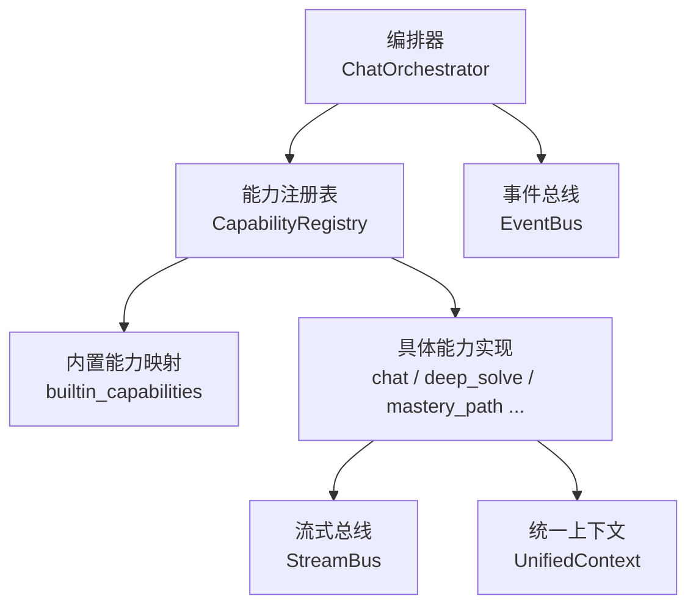
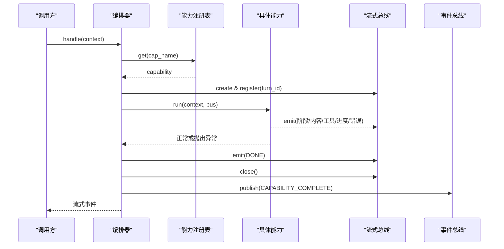
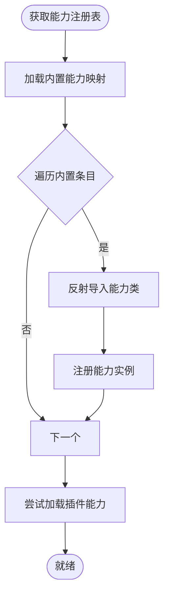
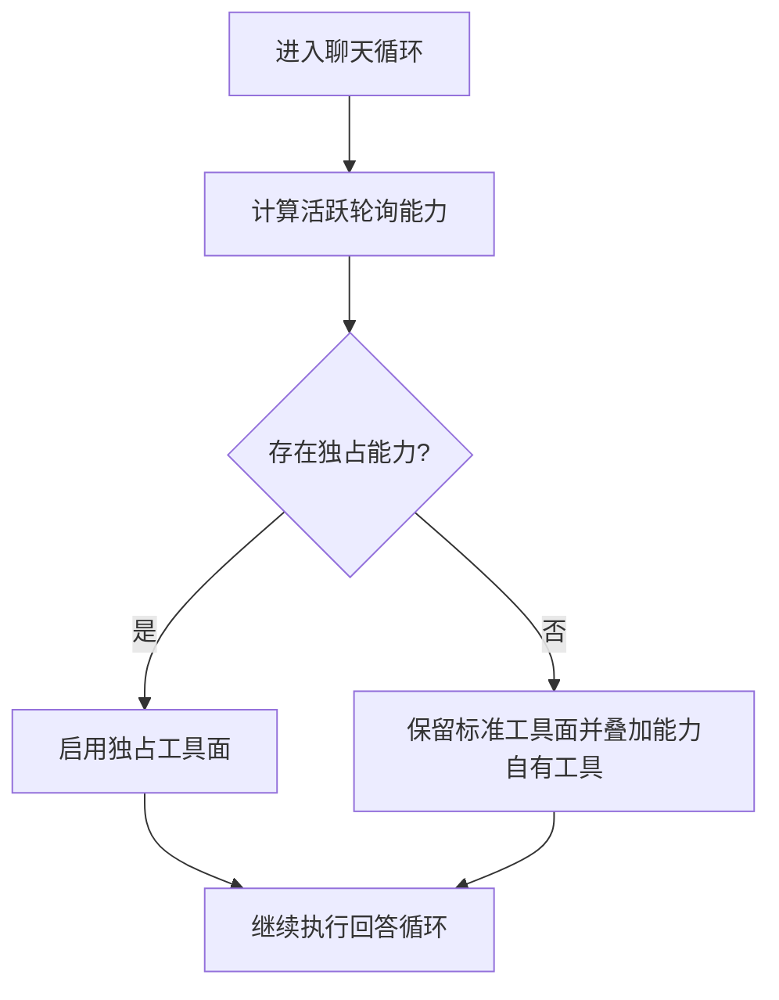
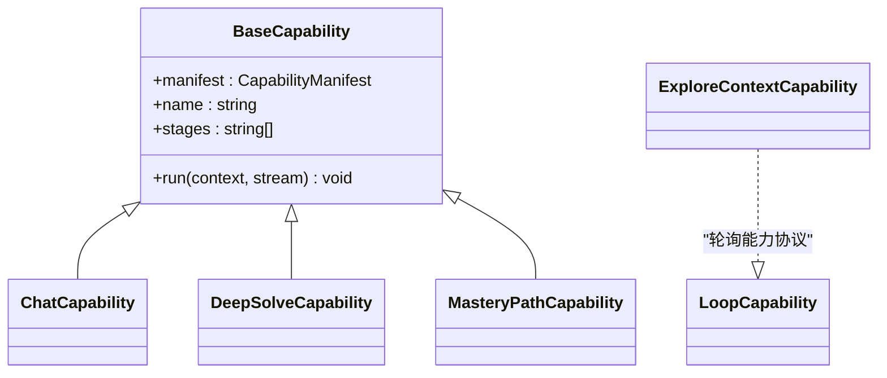
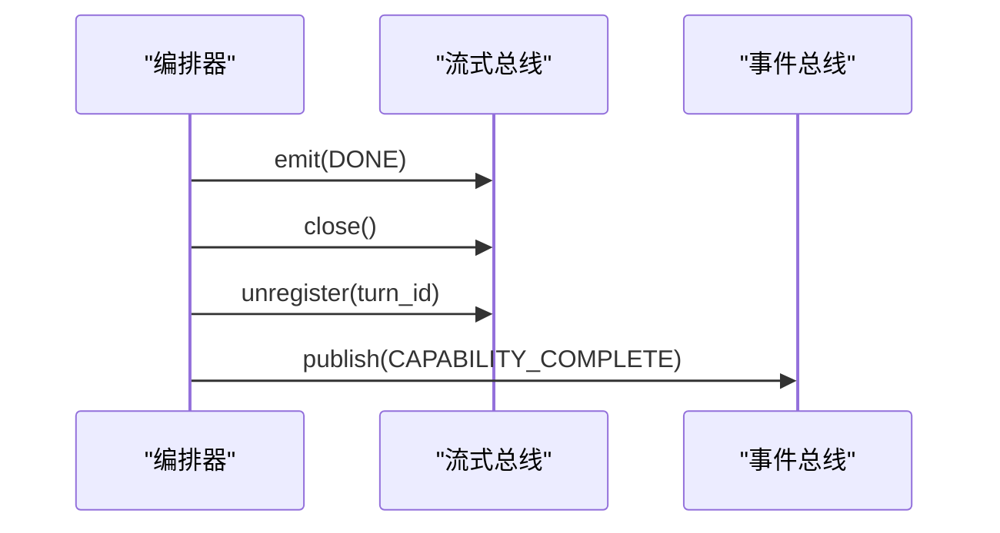
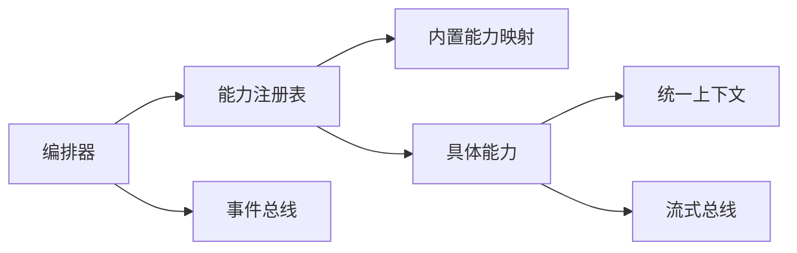

# 能力生命周期

<cite>
**本文引用的文件**
- [deeptutor/runtime/orchestrator.py](file://deeptutor/runtime/orchestrator.py)
- [deeptutor/runtime/registry/capability_registry.py](file://deeptutor/runtime/registry/capability_registry.py)
- [deeptutor/runtime/bootstrap/builtin_capabilities.py](file://deeptutor/runtime/bootstrap/builtin_capabilities.py)
- [deeptutor/core/capability_protocol.py](file://deeptutor/core/capability_protocol.py)
- [deeptutor/core/context.py](file://deeptutor/core/context.py)
- [deeptutor/core/stream_bus.py](file://deeptutor/core/stream_bus.py)
- [deeptutor/events/event_bus.py](file://deeptutor/events/event_bus.py)
- [deeptutor/capabilities/protocol.py](file://deeptutor/capabilities/protocol.py)
- [deeptutor/capabilities/registry.py](file://deeptutor/capabilities/registry.py)
- [deeptutor/agents/chat/capability.py](file://deeptutor/agents/chat/capability.py)
- [deeptutor/capabilities/solve/capability.py](file://deeptutor/capabilities/solve/capability.py)
- [deeptutor/capabilities/mastery/capability.py](file://deeptutor/capabilities/mastery/capability.py)
- [deeptutor/capabilities/explore_context/capability.py](file://deeptutor/capabilities/explore_context/capability.py)
- [deeptutor/core/errors.py](file://deeptutor/core/errors.py)
</cite>

## 目录
1. [简介](#简介)
2. [项目结构](#项目结构)
3. [核心组件](#核心组件)
4. [架构总览](#架构总览)
5. [详细组件分析](#详细组件分析)
6. [依赖关系分析](#依赖关系分析)
7. [性能考虑](#性能考虑)
8. [故障排查指南](#故障排查指南)
9. [结论](#结论)
10. [附录](#附录)

## 简介
本文面向 DeepTutor 的“能力（Capability）”体系，系统化阐述其完整生命周期：加载、初始化、激活、执行与销毁。重点说明能力启动时的依赖检查与资源准备、激活条件与优先级处理、执行过程中的状态管理与错误恢复、销毁时的资源清理与状态保存，以及监控调试方法与性能优化实践。读者无需深入源码即可理解并正确使用该机制。

## 项目结构
DeepTutor 的能力系统由“编排器 + 注册表 + 协议 + 具体能力实现 + 流式总线 + 事件总线”构成：
- 编排器负责路由请求到指定能力，管理流式总线生命周期，并发布完成事件。
- 注册表集中维护所有内置与插件能力，支持动态发现与加载。
- 协议定义能力的元数据、阶段、工具清单与运行接口。
- 具体能力实现以“能力类”形式提供 run 方法，驱动内部流水线。
- 流式总线用于能力执行期间的细粒度事件输出（内容、思考、工具调用、进度等）。
- 事件总线用于跨模块的异步事件通信（如能力完成事件）。

**图表来源**
- [deeptutor/runtime/orchestrator.py:26-147](file://deeptutor/runtime/orchestrator.py#L26-L147)
- [deeptutor/runtime/registry/capability_registry.py:39-115](file://deeptutor/runtime/registry/capability_registry.py#L39-L115)
- [deeptutor/runtime/bootstrap/builtin_capabilities.py:1-12](file://deeptutor/runtime/bootstrap/builtin_capabilities.py#L1-L12)
- [deeptutor/core/stream_bus.py:31-326](file://deeptutor/core/stream_bus.py#L31-L326)
- [deeptutor/events/event_bus.py:61-206](file://deeptutor/events/event_bus.py#L61-L206)
- [deeptutor/core/context.py:15-85](file://deeptutor/core/context.py#L15-L85)

**章节来源**
- [deeptutor/runtime/orchestrator.py:26-147](file://deeptutor/runtime/orchestrator.py#L26-L147)
- [deeptutor/runtime/registry/capability_registry.py:39-115](file://deeptutor/runtime/registry/capability_registry.py#L39-L115)
- [deeptutor/runtime/bootstrap/builtin_capabilities.py:1-12](file://deeptutor/runtime/bootstrap/builtin_capabilities.py#L1-L12)
- [deeptutor/core/stream_bus.py:31-326](file://deeptutor/core/stream_bus.py#L31-L326)
- [deeptutor/events/event_bus.py:61-206](file://deeptutor/events/event_bus.py#L61-L206)
- [deeptutor/core/context.py:15-85](file://deeptutor/core/context.py#L15-L85)

## 核心组件
- 能力协议与元数据：通过 CapabilityManifest 描述能力名称、描述、阶段、使用工具、CLI 别名、请求模式与配置默认值；BaseCapability 抽象出统一的 run 接口。
- 统一上下文：承载会话 ID、用户消息、历史、工具开关、知识基、附件、语言、技能清单、源清单与扩展元数据，贯穿整个能力执行链路。
- 流式总线：为单次对话回合提供事件通道，支持阶段、内容、思考、观察、工具调用/结果、进度、来源、结果、错误、等待输入等事件类型，并提供按 turn_id 的注册/注销。
- 事件总线：全局单例，异步发布/订阅能力完成等跨模块事件。
- 能力注册表：集中管理内置与插件能力，支持懒加载与异常隔离。
- 编排器：根据上下文选择能力，创建并管理流式总线，捕获异常并发送完成事件。

**章节来源**
- [deeptutor/core/capability_protocol.py:20-69](file://deeptutor/core/capability_protocol.py#L20-L69)
- [deeptutor/core/context.py:15-85](file://deeptutor/core/context.py#L15-L85)
- [deeptutor/core/stream_bus.py:31-326](file://deeptutor/core/stream_bus.py#L31-L326)
- [deeptutor/events/event_bus.py:61-206](file://deeptutor/events/event_bus.py#L61-L206)
- [deeptutor/runtime/registry/capability_registry.py:39-115](file://deeptutor/runtime/registry/capability_registry.py#L39-L115)
- [deeptutor/runtime/orchestrator.py:26-147](file://deeptutor/runtime/orchestrator.py#L26-L147)

## 架构总览
下图展示一次能力调用的端到端流程：从编排器接收上下文，解析能力，创建流式总线，执行能力，捕获异常，发送完成事件，最后释放总线资源。

**图表来源**
- [deeptutor/runtime/orchestrator.py:36-147](file://deeptutor/runtime/orchestrator.py#L36-L147)
- [deeptutor/runtime/registry/capability_registry.py:80-115](file://deeptutor/runtime/registry/capability_registry.py#L80-L115)
- [deeptutor/core/stream_bus.py:40-75](file://deeptutor/core/stream_bus.py#L40-L75)
- [deeptutor/events/event_bus.py:101-151](file://deeptutor/events/event_bus.py#L101-L151)

## 详细组件分析

### 能力加载与初始化
- 加载时机：首次获取能力注册表时，自动加载内置能力映射，再尝试加载插件能力。
- 加载策略：通过字符串路径反射导入能力类并实例化；若失败则记录警告并跳过，避免影响整体启动。
- 初始化要点：注册表仅持有能力实例；能力自身在构造时不重载外部资源，关键服务在运行时按需引入，降低冷启动成本。

**图表来源**
- [deeptutor/runtime/registry/capability_registry.py:49-79](file://deeptutor/runtime/registry/capability_registry.py#L49-L79)
- [deeptutor/runtime/bootstrap/builtin_capabilities.py:1-12](file://deeptutor/runtime/bootstrap/builtin_capabilities.py#L1-L12)

**章节来源**
- [deeptutor/runtime/registry/capability_registry.py:49-79](file://deeptutor/runtime/registry/capability_registry.py#L49-L79)
- [deeptutor/runtime/bootstrap/builtin_capabilities.py:1-12](file://deeptutor/runtime/bootstrap/builtin_capabilities.py#L1-L12)

### 能力激活与优先级
- 轮询能力（LoopCapability）：在聊天循环中，按固定顺序评估 is_active，返回活跃能力集合；其中 KnowledgeCapability 子类具有 exclusive_tools 标记，可独占工具面。
- 轮询能力注册：内置轮询能力按稳定顺序组织，active_loop_capabilities 过滤后返回；any_exclusive_capability_active 判断是否存在独占型能力。
- 普通能力（BaseCapability）：通过 active_capability 字段由编排器直接选择，无优先级排序；若未设置则回退到 chat。

**图表来源**
- [deeptutor/capabilities/registry.py:22-44](file://deeptutor/capabilities/registry.py#L22-L44)
- [deeptutor/capabilities/protocol.py:19-116](file://deeptutor/capabilities/protocol.py#L19-L116)

**章节来源**
- [deeptutor/capabilities/registry.py:22-44](file://deeptutor/capabilities/registry.py#L22-L44)
- [deeptutor/capabilities/protocol.py:19-116](file://deeptutor/capabilities/protocol.py#L19-L116)

### 能力执行与状态管理
- 编排器职责：分配 session_id，解析能力名，创建 StreamBus 并注册到 turn_id，异步执行能力 run，捕获异常并发送 DONE，关闭总线，发布 CAPABILITY_COMPLETE。
- 流式总线：提供 stage/content/thinking/tool_call/tool_result/progress/sources/result/error/wait_for_input 等事件；支持 replay 历史事件，确保订阅者一致性。
- 上下文传递：UnifiedContext 携带会话、消息、工具开关、知识基、附件、语言、技能清单、源清单与扩展元数据，贯穿能力与工具链。
- 典型能力实现：
  - chat：声明 stages=["exploring","responding"]，驱动 AgenticChatPipeline。
  - deep_solve：设置 solve_mode 与 solve_session_id，读取参数并驱动 AgenticChatPipeline。
  - mastery_path：设置 mastery_mode 与 mastery_path_id，驱动 AgenticChatPipeline。
  - explore_context：作为轮询能力，当存在可读附件时进行前置探索，产出 PromptBlock 注入首轮种子。

**图表来源**
- [deeptutor/core/capability_protocol.py:20-69](file://deeptutor/core/capability_protocol.py#L20-L69)
- [deeptutor/agents/chat/capability.py:12-28](file://deeptutor/agents/chat/capability.py#L12-L28)
- [deeptutor/capabilities/solve/capability.py:59-89](file://deeptutor/capabilities/solve/capability.py#L59-L89)
- [deeptutor/capabilities/mastery/capability.py:57-74](file://deeptutor/capabilities/mastery/capability.py#L57-L74)
- [deeptutor/capabilities/explore_context/capability.py:82-145](file://deeptutor/capabilities/explore_context/capability.py#L82-L145)

**章节来源**
- [deeptutor/runtime/orchestrator.py:36-147](file://deeptutor/runtime/orchestrator.py#L36-L147)
- [deeptutor/core/stream_bus.py:40-326](file://deeptutor/core/stream_bus.py#L40-L326)
- [deeptutor/core/context.py:15-85](file://deeptutor/core/context.py#L15-L85)
- [deeptutor/agents/chat/capability.py:12-28](file://deeptutor/agents/chat/capability.py#L12-L28)
- [deeptutor/capabilities/solve/capability.py:59-89](file://deeptutor/capabilities/solve/capability.py#L59-L89)
- [deeptutor/capabilities/mastery/capability.py:57-74](file://deeptutor/capabilities/mastery/capability.py#L57-L74)
- [deeptutor/capabilities/explore_context/capability.py:82-145](file://deeptutor/capabilities/explore_context/capability.py#L82-L145)

### 能力销毁与资源清理
- 流式总线关闭：编排器在 finally 块中发送 DONE 并关闭总线，确保所有订阅者收到结束信号。
- 总线注销：按 turn_id 将总线从全局注册表中移除，避免后续消息误投递。
- 事件总线停止：能力完成后发布 CAPABILITY_COMPLETE；事件总线后台任务在 stop/flush 时安全退出。
- 异常路径：捕获异常后仍会发送 DONE 并关闭总线，保证资源释放。

**图表来源**
- [deeptutor/runtime/orchestrator.py:83-114](file://deeptutor/runtime/orchestrator.py#L83-L114)
- [deeptutor/core/stream_bus.py:70-75](file://deeptutor/core/stream_bus.py#L70-L75)
- [deeptutor/events/event_bus.py:101-151](file://deeptutor/events/event_bus.py#L101-L151)

**章节来源**
- [deeptutor/runtime/orchestrator.py:83-114](file://deeptutor/runtime/orchestrator.py#L83-L114)
- [deeptutor/core/stream_bus.py:70-75](file://deeptutor/core/stream_bus.py#L70-L75)
- [deeptutor/events/event_bus.py:101-151](file://deeptutor/events/event_bus.py#L101-L151)

### 依赖检查与资源准备
- 依赖检查：能力通过 manifest.tools_used 声明所需工具；编排器侧通过工具注册表暴露可用工具列表；轮询能力通过 owned_tools 声明自有工具。
- 资源准备：能力在 run 中按需读取配置（如 solve 参数），并通过 UnifiedContext.metadata 注入运行时参数（如 solve_session_id、mastery_path_id）。
- 前置探索：explore_context 在 pre_loop 中基于 source_index 判断是否具备可读附件，必要时执行只读前置探索，并将结果折叠为首轮种子。

**章节来源**
- [deeptutor/core/capability_protocol.py:20-69](file://deeptutor/core/capability_protocol.py#L20-L69)
- [deeptutor/capabilities/solve/capability.py:69-89](file://deeptutor/capabilities/solve/capability.py#L69-L89)
- [deeptutor/capabilities/mastery/capability.py:69-74](file://deeptutor/capabilities/mastery/capability.py#L69-L74)
- [deeptutor/capabilities/explore_context/capability.py:68-145](file://deeptutor/capabilities/explore_context/capability.py#L68-L145)

### 错误恢复策略
- 统一异常体系：提供 DeepTutorError 及其子类（ConfigurationError、ValidationError、ServiceError、LLMServiceError、LLMContextError、EnvironmentConfigError）。
- 编排器容错：捕获能力执行异常，记录日志，发送 ERROR 事件并标记 turn_terminal，随后发送 DONE 并关闭总线。
- 流式总线错误：提供 error 便捷方法，便于能力内部上报错误。

**章节来源**
- [deeptutor/core/errors.py:10-58](file://deeptutor/core/errors.py#L10-L58)
- [deeptutor/runtime/orchestrator.py:83-103](file://deeptutor/runtime/orchestrator.py#L83-L103)
- [deeptutor/core/stream_bus.py:245-260](file://deeptutor/core/stream_bus.py#L245-L260)

## 依赖关系分析
- 耦合度：编排器与注册表松耦合，通过接口与命名查找能力；能力与上下文强耦合但边界清晰；流式总线与事件总线解耦，分别承担“单次回合事件”和“跨模块事件”。
- 直接依赖：orchestrator -> registry/capability_registry；capability -> context/stream_bus；registry -> builtin_capabilities。
- 间接依赖：能力通过工具注册表与 LLM/RAG/搜索等服务交互（由各自能力实现决定）。
- 潜在循环：通过延迟导入（如 explore_context 在 pre_loop 内导入 explorer）避免循环依赖。

**图表来源**
- [deeptutor/runtime/orchestrator.py:26-147](file://deeptutor/runtime/orchestrator.py#L26-L147)
- [deeptutor/runtime/registry/capability_registry.py:39-115](file://deeptutor/runtime/registry/capability_registry.py#L39-L115)
- [deeptutor/runtime/bootstrap/builtin_capabilities.py:1-12](file://deeptutor/runtime/bootstrap/builtin_capabilities.py#L1-L12)
- [deeptutor/core/context.py:15-85](file://deeptutor/core/context.py#L15-L85)
- [deeptutor/core/stream_bus.py:31-326](file://deeptutor/core/stream_bus.py#L31-L326)
- [deeptutor/events/event_bus.py:61-206](file://deeptutor/events/event_bus.py#L61-L206)

**章节来源**
- [deeptutor/runtime/orchestrator.py:26-147](file://deeptutor/runtime/orchestrator.py#L26-L147)
- [deeptutor/runtime/registry/capability_registry.py:39-115](file://deeptutor/runtime/registry/capability_registry.py#L39-L115)
- [deeptutor/runtime/bootstrap/builtin_capabilities.py:1-12](file://deeptutor/runtime/bootstrap/builtin_capabilities.py#L1-L12)
- [deeptutor/core/context.py:15-85](file://deeptutor/core/context.py#L15-L85)
- [deeptutor/core/stream_bus.py:31-326](file://deeptutor/core/stream_bus.py#L31-L326)
- [deeptutor/events/event_bus.py:61-206](file://deeptutor/events/event_bus.py#L61-L206)

## 性能考虑
- 懒加载与按需导入：能力注册表仅在首次使用时加载；explore_context 在 pre_loop 时才导入重型模块，减少冷启动开销。
- 流式事件回放：StreamBus 对历史事件进行快照回放，避免重复与丢失，提升消费端稳定性。
- 并发与异步：编排器使用 asyncio.create_task 异步执行能力，非阻塞地转发事件；事件总线后台任务批量处理，避免阻塞发布者。
- 资源隔离：每个 turn 独立 StreamBus，通过 turn_id 隔离，防止跨请求污染。
- 配置缓存：探索能力对提示词进行语言级缓存，减少重复 I/O。

[本节为通用性能建议，不直接分析具体文件]

## 故障排查指南
- 常见错误定位：
  - 未知能力：编排器会返回错误事件并列出可用能力，检查 active_capability 与注册表。
  - 能力执行异常：查看 ERROR 事件与日志，确认能力内部是否正确上报错误。
  - 事件未送达：检查 StreamBus 是否已关闭、turn_id 是否正确注册。
- 诊断步骤：
  - 启用详细日志，关注 orchestrator 与能力名称相关日志。
  - 订阅流式事件，观察 STAGE_START/STAGE_END、TOOL_CALL/TOOL_RESULT、PROGRESS、ERROR、DONE 的顺序与内容。
  - 检查 UnifiedContext 中的 metadata 是否包含必要参数（如 solve_session_id、mastery_path_id）。
- 恢复策略：
  - 对于可重试的外部服务错误，可在能力内部捕获并重试，同时通过 progress 更新进度。
  - 对于配置错误，使用 ConfigurationError/EnvironmentConfigError 明确分类，便于上层处理。

**章节来源**
- [deeptutor/runtime/orchestrator.py:46-67](file://deeptutor/runtime/orchestrator.py#L46-L67)
- [deeptutor/runtime/orchestrator.py:83-103](file://deeptutor/runtime/orchestrator.py#L83-L103)
- [deeptutor/core/stream_bus.py:245-260](file://deeptutor/core/stream_bus.py#L245-L260)
- [deeptutor/core/errors.py:10-58](file://deeptutor/core/errors.py#L10-L58)

## 结论
DeepTutor 的能力生命周期围绕“编排器 + 注册表 + 协议 + 流式总线 + 事件总线”构建，实现了清晰的加载、初始化、激活、执行与销毁流程。通过统一上下文与流式事件，能力在执行过程中具备良好的可观测性与可控性；通过异常分类与兜底逻辑，系统在错误场景下仍能保持资源释放与状态一致。遵循本文的最佳实践，可有效提升能力系统的稳定性与性能。

## 附录
- 术语对照：
  - 能力（Capability）：封装特定业务模式的智能体流水线。
  - 轮询能力（LoopCapability）：在聊天循环中按条件激活的扩展点。
  - 流式总线（StreamBus）：单次回合的事件通道。
  - 事件总线（EventBus）：跨模块异步事件通信。
- 参考路径：
  - 能力协议与基础：[deeptutor/core/capability_protocol.py](file://deeptutor/core/capability_protocol.py)
  - 统一上下文：[deeptutor/core/context.py](file://deeptutor/core/context.py)
  - 流式总线：[deeptutor/core/stream_bus.py](file://deeptutor/core/stream_bus.py)
  - 事件总线：[deeptutor/events/event_bus.py](file://deeptutor/events/event_bus.py)
  - 能力注册表：[deeptutor/runtime/registry/capability_registry.py](file://deeptutor/runtime/registry/capability_registry.py)
  - 内置能力映射：[deeptutor/runtime/bootstrap/builtin_capabilities.py](file://deeptutor/runtime/bootstrap/builtin_capabilities.py)
  - 编排器：[deeptutor/runtime/orchestrator.py](file://deeptutor/runtime/orchestrator.py)
  - 轮询能力协议与注册：[deeptutor/capabilities/protocol.py](file://deeptutor/capabilities/protocol.py), [deeptutor/capabilities/registry.py](file://deeptutor/capabilities/registry.py)
  - 典型能力实现：[deeptutor/agents/chat/capability.py](file://deeptutor/agents/chat/capability.py), [deeptutor/capabilities/solve/capability.py](file://deeptutor/capabilities/solve/capability.py), [deeptutor/capabilities/mastery/capability.py](file://deeptutor/capabilities/mastery/capability.py), [deeptutor/capabilities/explore_context/capability.py](file://deeptutor/capabilities/explore_context/capability.py)
  - 错误体系：[deeptutor/core/errors.py](file://deeptutor/core/errors.py)