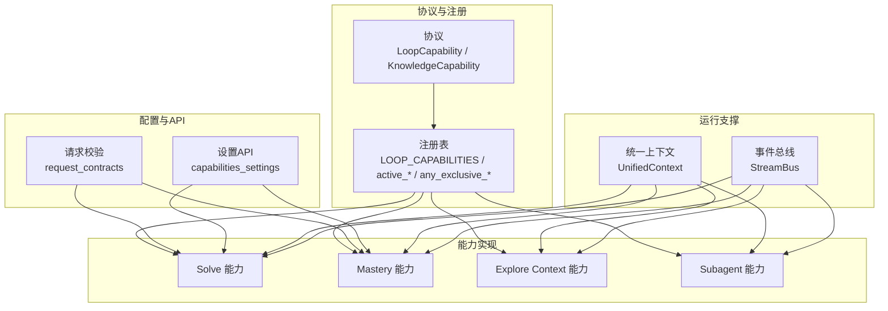
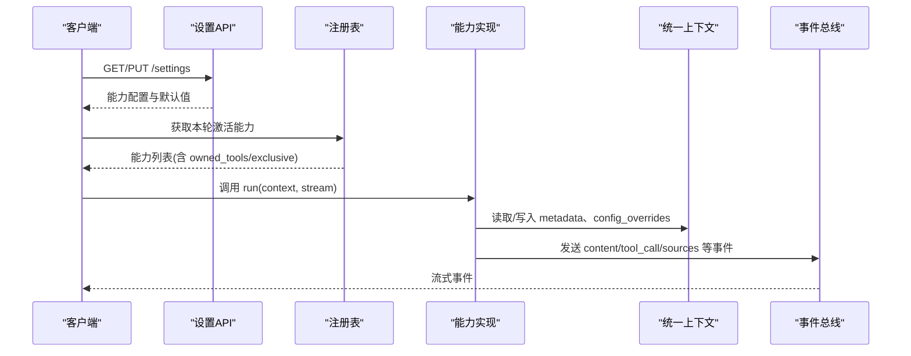
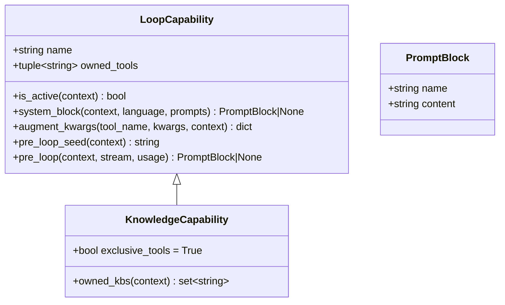
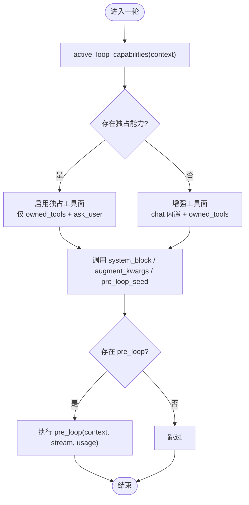
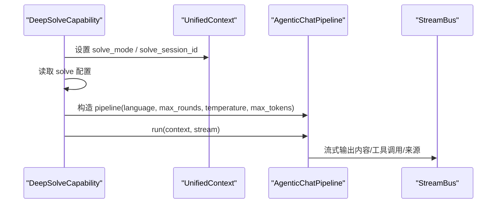
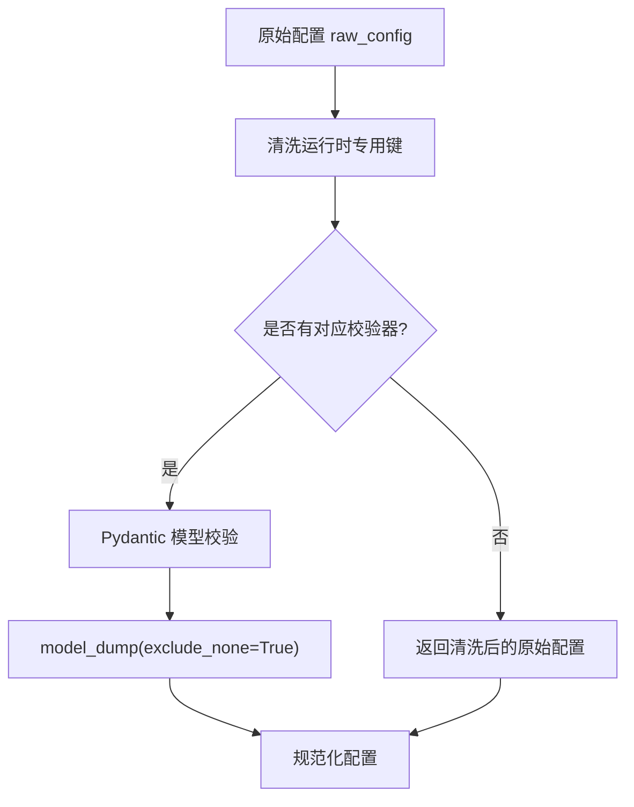
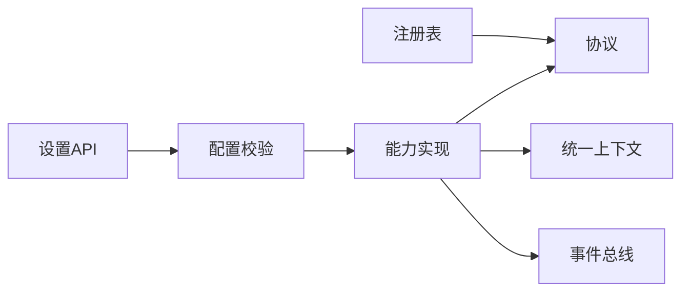

# 能力系统

<cite>
**本文引用的文件**
- [deeptutor/capabilities/protocol.py](file://deeptutor/capabilities/protocol.py)
- [deeptutor/capabilities/registry.py](file://deeptutor/capabilities/registry.py)
- [deeptutor/core/capability_protocol.py](file://deeptutor/core/capability_protocol.py)
- [deeptutor/capabilities/__init__.py](file://deeptutor/capabilities/__init__.py)
- [deeptutor/capabilities/solve/capability.py](file://deeptutor/capabilities/solve/capability.py)
- [deeptutor/capabilities/mastery/capability.py](file://deeptutor/capabilities/mastery/capability.py)
- [deeptutor/capabilities/explore_context/capability.py](file://deeptutor/capabilities/explore_context/capability.py)
- [deeptutor/capabilities/subagent/capability.py](file://deeptutor/capabilities/subagent/capability.py)
- [deeptutor/api/routers/capabilities_settings.py](file://deeptutor/api/routers/capabilities_settings.py)
- [deeptutor/runtime/request_contracts.py](file://deeptutor/runtime/request_contracts.py)
- [deeptutor/core/context.py](file://deeptutor/core/context.py)
- [tests/capabilities/test_solve_capability.py](file://tests/capabilities/test_solve_capability.py)
- [tests/core/test_capabilities_runtime.py](file://tests/core/test_capabilities_runtime.py)
</cite>

## 目录
1. [简介](#简介)
2. [项目结构](#项目结构)
3. [核心组件](#核心组件)
4. [架构总览](#架构总览)
5. [详细组件分析](#详细组件分析)
6. [依赖关系分析](#依赖关系分析)
7. [性能考量](#性能考量)
8. [故障排查指南](#故障排查指南)
9. [结论](#结论)
10. [附录](#附录)

## 简介
本文件系统性阐述 DeepTutor 的“能力系统”，包括：
- 能力的概念与设计理念：将复杂智能行为封装为可插拔、可组合的能力模块，既支持“对话循环增强型”（LoopCapability），也支持“知识基座独占型”（KnowledgeCapability）。
- 能力注册表：集中管理内置能力实例，提供按轮次激活、工具归属映射与独占模式判定。
- 能力协议：定义必需方法与可选钩子（如 pre_loop、system_block、augment_kwargs、pre_loop_seed）。
- 可用性检查：基于上下文（UnifiedContext）的条件检测与依赖判断，实现条件加载与按需激活。
- 配置管理：请求参数校验、默认值合并与运行时清理，确保前后端契约一致。
- 自定义能力指南：从实现、注册到测试的最佳实践。
- 能力间通信与依赖：通过 UnifiedContext、StreamBus、工具集与系统提示块进行解耦协作。

## 项目结构
能力系统由“协议层 + 注册表 + 具体能力实现 + 配置与API”组成：
- 协议层：定义 LoopCapability/KnowledgeCapability/PromptBlock 等接口与数据模型。
- 注册表：集中维护 LOOP_CAPABILITIES，并提供 active_loop_capabilities、any_exclusive_capability_active、capability_tool_owners 等查询方法。
- 能力实现：solve、mastery、explore_context、subagent 等具体能力，分别挂载自有工具与提示片段。
- 配置与API：request_contracts 提供 Pydantic 校验与 JSON Schema；capabilities_settings 暴露设置读写接口。
- 上下文与流：UnifiedContext 承载轮次级状态；StreamBus 用于事件流式输出。

图表来源
- [deeptutor/capabilities/protocol.py:19-116](file://deeptutor/capabilities/protocol.py#L19-L116)
- [deeptutor/capabilities/registry.py:13-44](file://deeptutor/capabilities/registry.py#L13-L44)
- [deeptutor/runtime/request_contracts.py:28-160](file://deeptutor/runtime/request_contracts.py#L28-L160)
- [deeptutor/api/routers/capabilities_settings.py:27-38](file://deeptutor/api/routers/capabilities_settings.py#L27-L38)
- [deeptutor/core/context.py:33-85](file://deeptutor/core/context.py#L33-L85)

章节来源
- [deeptutor/capabilities/protocol.py:1-116](file://deeptutor/capabilities/protocol.py#L1-L116)
- [deeptutor/capabilities/registry.py:1-53](file://deeptutor/capabilities/registry.py#L1-L53)
- [deeptutor/runtime/request_contracts.py:1-178](file://deeptutor/runtime/request_contracts.py#L1-L178)
- [deeptutor/api/routers/capabilities_settings.py:1-39](file://deeptutor/api/routers/capabilities_settings.py#L1-L39)
- [deeptutor/core/context.py:1-85](file://deeptutor/core/context.py#L1-L85)

## 核心组件
- 能力协议
  - LoopCapability：每轮可扩展的对话循环能力，复用聊天工具面并叠加 owned_tools；支持 system_block、augment_kwargs、pre_loop_seed 以及可选异步 pre_loop 钩子。
  - KnowledgeCapability：知识类能力，独占本轮工具面（exclusive_tools=True），通过 owned_kbs 排除被其占用的知识库引用，避免与普通 rag 冲突。
- 注册表
  - LOOP_CAPABILITIES：内置能力实例元组，顺序稳定。
  - active_loop_capabilities(context)：按注册顺序返回当前轮次激活的能力集合。
  - any_exclusive_capability_active(context)：判断是否存在独占能力，驱动流水线切换至独占工具分支。
  - capability_tool_owners()：静态映射“能力名 -> 拥有工具名”，供设置界面分组展示。
- 基础能力抽象（Level 2）
  - BaseCapability/CapabilityManifest：声明能力元信息（名称、描述、阶段、使用工具、CLI别名、请求Schema、配置默认值），并要求实现 run(context, stream)。
- 统一上下文与事件总线
  - UnifiedContext：贯穿 orchestrator、工具、能力、插件的统一数据载体，包含会话、消息、工具开关、知识库、附件、语言、技能清单、源清单、元数据等。
  - StreamBus：能力执行期间的事件通道，用于流式输出内容、工具调用、来源等。

章节来源
- [deeptutor/capabilities/protocol.py:19-116](file://deeptutor/capabilities/protocol.py#L19-L116)
- [deeptutor/capabilities/registry.py:13-44](file://deeptutor/capabilities/registry.py#L13-L44)
- [deeptutor/core/capability_protocol.py:20-69](file://deeptutor/core/capability_protocol.py#L20-L69)
- [deeptutor/core/context.py:33-85](file://deeptutor/core/context.py#L33-L85)

## 架构总览
能力系统采用“协议 + 注册表 + 能力实现”的分层设计：
- 协议层定义最小必要接口与扩展点，保证能力可插拔、可替换。
- 注册表集中发现与筛选能力，决定本轮参与的能力集合与工具面策略（增强或独占）。
- 能力实现聚焦业务逻辑，通过注入的工具、系统提示块和上下文完成工作。
- 配置层通过 Pydantic 模型与 JSON Schema 保障请求参数正确性，并通过 API 暴露设置读写。
- 运行期通过 UnifiedContext 传递轮次级状态，通过 StreamBus 输出事件。

图表来源
- [deeptutor/api/routers/capabilities_settings.py:27-38](file://deeptutor/api/routers/capabilities_settings.py#L27-L38)
- [deeptutor/capabilities/registry.py:22-44](file://deeptutor/capabilities/registry.py#L22-L44)
- [deeptutor/core/context.py:33-85](file://deeptutor/core/context.py#L33-L85)

## 详细组件分析

### 能力协议与生命周期
- LoopCapability
  - name/owned_tools：能力标识与本轮拥有的工具名集合。
  - is_active(context)：决定是否参与本轮。
  - system_block(context, language, prompts)：可选的系统提示块。
  - augment_kwargs(tool_name, kwargs, context)：为特定工具注入私有参数。
  - pre_loop_seed(context)：追加到首轮用户消息种子文本。
  - pre_loop(context, stream, usage=None)：可选异步钩子，在首轮 LLM 调用前执行，产出 PromptBlock 作为 grounding。
- KnowledgeCapability
  - exclusive_tools=True：当激活时替换工具面，仅保留 owned_tools 与 ask_user 地板工具。
  - owned_kbs(context)：返回本轮被该能力占用的知识库引用，避免与 rag 冲突。

图表来源
- [deeptutor/capabilities/protocol.py:11-116](file://deeptutor/capabilities/protocol.py#L11-L116)

章节来源
- [deeptutor/capabilities/protocol.py:19-116](file://deeptutor/capabilities/protocol.py#L19-L116)

### 能力注册表与工作流
- 注册表职责
  - 维护 LOOP_CAPABILITIES 实例元组（顺序稳定）。
  - active_loop_capabilities(context)：过滤出 is_active(context)==True 的能力。
  - any_exclusive_capability_active(context)：判断是否存在独占能力，影响流水线是否启用独占工具分支。
  - capability_tool_owners()：生成“工具名 -> 能力名”的静态映射，便于设置界面分组。
- 典型流程
  - 启动时导入 capabilities 包，触发注册表初始化。
  - 每轮调用 active_loop_capabilities 得到候选能力集合。
  - 根据 any_exclusive_capability_active 选择工具面组装策略。
  - 对每个能力调用 system_block/augment_kwargs/pre_loop_seed 等钩子。

图表来源
- [deeptutor/capabilities/registry.py:22-44](file://deeptutor/capabilities/registry.py#L22-L44)
- [deeptutor/capabilities/protocol.py:34-85](file://deeptutor/capabilities/protocol.py#L34-L85)

章节来源
- [deeptutor/capabilities/registry.py:13-44](file://deeptutor/capabilities/registry.py#L13-L44)

### 能力实现示例

#### Solve 能力（Deep Solve）
- 角色定位：以对话循环作为求解器，标记 solve_mode，解析 session id，然后运行标准 agentic chat pipeline；SolveLoopCapability 挂载 solve_plan/solve_finish_step/solve_replan 等工具与提示。
- 关键行为
  - 设置 context.metadata.solve_mode 与 solve_session_id。
  - 读取 solve 配置（max_rounds、temperature、max_tokens、max_replans）并注入 pipeline。
  - 通过 AgenticChatPipeline.run 驱动实际推理与工具调用。

图表来源
- [deeptutor/capabilities/solve/capability.py:59-88](file://deeptutor/capabilities/solve/capability.py#L59-L88)

章节来源
- [deeptutor/capabilities/solve/capability.py:1-92](file://deeptutor/capabilities/solve/capability.py#L1-L92)

#### Mastery 能力（Mastery Path）
- 角色定位：以对话循环驱动掌握路径教学，标记 mastery_mode，解析 mastery_path_id，然后运行标准 agentic chat pipeline；MasteryLoopCapability 挂载 mastery_status/mastery_quiz/mastery_grade/mastery_assess/mastery_build 等工具与提示。
- 关键行为
  - 设置 context.metadata.mastery_mode 与 mastery_path_id。
  - 通过 AgenticChatPipeline.run 驱动教学问答与评估。

章节来源
- [deeptutor/capabilities/mastery/capability.py:1-77](file://deeptutor/capabilities/mastery/capability.py#L1-L77)

#### Explore Context 能力
- 角色定位：当本轮携带可读附件（非图片）时，在首轮 LLM 调用前执行一次只读预探查，将客观的第三方视角摘要折叠进用户消息种子，避免模型误用第一人称。
- 关键行为
  - is_active：检测 source_index 是否非空。
  - pre_loop：懒加载 explorer，调用 investigate 产出 PromptBlock。
  - 不贡献系统块与答案循环工具，仅通过 pre_loop 钩子生效。

章节来源
- [deeptutor/capabilities/explore_context/capability.py:1-145](file://deeptutor/capabilities/explore_context/capability.py#L1-L145)

#### Subagent 能力
- 角色定位：当所选知识库为已连接的本地子代理时，独占本轮工具面，仅允许 consult_subagent（及 ask_user），由主模型委派任务给外部智能体。
- 关键行为
  - is_active：connection_for_turn(context) 非空。
  - owned_kbs：排除被 subagent 占用的引用，避免与 rag 冲突。
  - system_block：注入系统提示与最小轮次预算（budget + headroom）。
  - augment_kwargs：注入 _subagent 私有参数（kind、cwd、budget、config、state、images、session_key）。
  - pre_loop_seed：为空字符串。

章节来源
- [deeptutor/capabilities/subagent/capability.py:1-218](file://deeptutor/capabilities/subagent/capability.py#L1-L218)

### 配置管理与验证
- 请求配置校验
  - 通过 Pydantic 模型（如 DeepSolveRequestConfig、VisualizeRequestConfig）定义字段、默认值与约束。
  - CAPABILITY_CONFIG_VALIDATORS 映射能力名到校验函数；CAPABILITY_REQUEST_SCHEMAS 提供 JSON Schema。
  - validate_capability_config(capability, raw_config)：清洗运行时专用键后校验并返回规范化配置。
- 设置API
  - GET/PUT /api/v1/settings：读取/保存能力相关调优参数（温度、最大令牌、阶段预算等），后端负责合并默认值与持久化。

图表来源
- [deeptutor/runtime/request_contracts.py:74-160](file://deeptutor/runtime/request_contracts.py#L74-L160)
- [deeptutor/api/routers/capabilities_settings.py:27-38](file://deeptutor/api/routers/capabilities_settings.py#L27-L38)

章节来源
- [deeptutor/runtime/request_contracts.py:28-160](file://deeptutor/runtime/request_contracts.py#L28-L160)
- [deeptutor/api/routers/capabilities_settings.py:1-39](file://deeptutor/api/routers/capabilities_settings.py#L1-L39)

### 能力间通信与依赖管理
- 通过 UnifiedContext 共享轮次级状态：
  - metadata：能力专属附加信息（如 solve_session_id、mastery_path_id、_subagent_state、_min_loop_rounds）。
  - config_overrides：请求级覆盖（如 subagent_consult_budget）。
  - enabled_tools/allowed_builtin_tools：控制工具挂载范围。
- 通过 StreamBus 进行事件通信：
  - content/tool_call/sources 等事件，供前端与日志追踪消费。
- 通过工具集与系统提示块协作：
  - 能力通过 owned_tools 声明本轮可用工具；system_block 注入领域提示；augment_kwargs 注入私有参数。
- 依赖检测与条件加载：
  - is_active 基于上下文条件（如 source_index、connection_for_turn）决定能力是否激活。
  - 独占能力通过 exclusive_tools 切换工具面策略，避免与其他能力冲突。

章节来源
- [deeptutor/core/context.py:33-85](file://deeptutor/core/context.py#L33-L85)
- [deeptutor/capabilities/protocol.py:34-116](file://deeptutor/capabilities/protocol.py#L34-L116)
- [deeptutor/capabilities/registry.py:22-44](file://deeptutor/capabilities/registry.py#L22-L44)

## 依赖关系分析
- 组件耦合
  - 注册表依赖协议定义与具体能力实现；能力实现依赖上下文与事件总线。
  - 配置层独立于能力实现，通过能力名映射提供校验与 Schema。
- 直接/间接依赖
  - 能力实现可能引入服务层（如 subagent、llm、knowledge）但通过延迟导入避免循环依赖。
- 外部集成点
  - API 路由暴露能力设置；运行时通过 request_contracts 提供公共契约。
- 循环依赖规避
  - explore_context 在 pre_loop 中懒加载 explorer，避免在包导入时形成循环。

图表来源
- [deeptutor/capabilities/registry.py:13-44](file://deeptutor/capabilities/registry.py#L13-L44)
- [deeptutor/capabilities/protocol.py:19-116](file://deeptutor/capabilities/protocol.py#L19-L116)
- [deeptutor/runtime/request_contracts.py:128-160](file://deeptutor/runtime/request_contracts.py#L128-L160)
- [deeptutor/api/routers/capabilities_settings.py:27-38](file://deeptutor/api/routers/capabilities_settings.py#L27-L38)

章节来源
- [deeptutor/capabilities/registry.py:13-44](file://deeptutor/capabilities/registry.py#L13-L44)
- [deeptutor/capabilities/protocol.py:19-116](file://deeptutor/capabilities/protocol.py#L19-L116)
- [deeptutor/runtime/request_contracts.py:128-160](file://deeptutor/runtime/request_contracts.py#L128-L160)
- [deeptutor/api/routers/capabilities_settings.py:27-38](file://deeptutor/api/routers/capabilities_settings.py#L27-L38)

## 性能考量
- 懒加载与避免冷启动开销：
  - explore_context 在 pre_loop 中懒加载 explorer，避免包导入时的重依赖。
- 预算与轮次控制：
  - subagent 通过 budget + headroom 确保回答阶段不被截断；solve 通过 max_replans 限制重规划次数。
- 工具面裁剪：
  - 独占能力减少无关工具挂载，降低模型决策复杂度。
- 配置校验前置：
  - 在入口处进行 Pydantic 校验，尽早失败，避免无效请求进入深层处理。

[本节为通用指导，无需特定文件来源]

## 故障排查指南
- 能力未激活
  - 检查 is_active 条件（如 source_index 是否为空、connection_for_turn 是否返回连接）。
  - 确认注册表顺序与 active_loop_capabilities 过滤结果。
- 工具未挂载或私有参数泄漏
  - 核对 owned_tools 与 augment_kwargs 的 tool_name 匹配；确保仅对能力自有工具注入私有参数。
- 配置错误
  - 查看 validate_capability_config 抛出的异常详情；确认 raw_config 是否包含运行时专用键。
- 独占模式导致 rag 不可用
  - 确认 owned_kbs 是否正确排除被能力占用的知识库引用，避免与 rag 冲突。
- 测试参考
  - 使用 tests/capabilities/test_solve_capability.py 与 tests/core/test_capabilities_runtime.py 中的用例验证能力钩子、工具与事件流。

章节来源
- [tests/capabilities/test_solve_capability.py:29-129](file://tests/capabilities/test_solve_capability.py#L29-L129)
- [tests/core/test_capabilities_runtime.py:69-171](file://tests/core/test_capabilities_runtime.py#L69-L171)

## 结论
DeepTutor 的能力系统通过清晰的协议、稳定的注册表与灵活的钩子机制，实现了能力的可插拔与可组合。能力既可增强对话循环，也可独占本轮工具面；通过 UnifiedContext 与 StreamBus 实现解耦通信；借助 Pydantic 与 API 完成配置校验与设置管理。遵循本文档的设计与实践，可高效开发、集成与测试自定义能力。

[本节为总结，无需特定文件来源]

## 附录

### 创建自定义能力的完整指南
- 步骤概览
  1) 定义能力类：继承 LoopCapability 或 KnowledgeCapability，实现 is_active/system_block/augment_kwargs/pre_loop_seed 等；如需预探查，实现 pre_loop。
  2) 声明 owned_tools：列出本轮拥有的工具名；若为知识类能力，实现 owned_kbs 排除被占用的知识库。
  3) 注册能力：在 LOOP_CAPABILITIES 中添加实例，保持顺序稳定。
  4) 配置与校验：在 request_contracts 中为能力添加 Pydantic 模型与校验器，并在能力 manifest 中引用 get_capability_request_schema。
  5) 测试：编写单元测试验证 is_active、owned_tools、system_block、augment_kwargs、pre_loop 与事件流。
- 最佳实践
  - 仅在必要时实现 pre_loop，避免不必要的 LLM 调用。
  - 使用 augment_kwargs 注入私有参数，避免污染公共工具调用。
  - 通过 metadata 传递轮次级状态，避免全局变量。
  - 使用 StreamBus 输出结构化事件，便于前端与日志追踪。
  - 对独占能力明确 owned_kbs，避免与 rag 冲突。

章节来源
- [deeptutor/core/capability_protocol.py:20-69](file://deeptutor/core/capability_protocol.py#L20-L69)
- [deeptutor/capabilities/protocol.py:19-116](file://deeptutor/capabilities/protocol.py#L19-L116)
- [deeptutor/capabilities/registry.py:13-44](file://deeptutor/capabilities/registry.py#L13-L44)
- [deeptutor/runtime/request_contracts.py:128-160](file://deeptutor/runtime/request_contracts.py#L128-L160)
- [tests/core/test_capabilities_runtime.py:69-171](file://tests/core/test_capabilities_runtime.py#L69-L171)