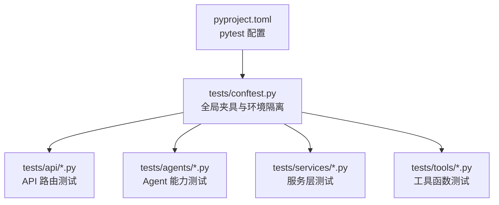
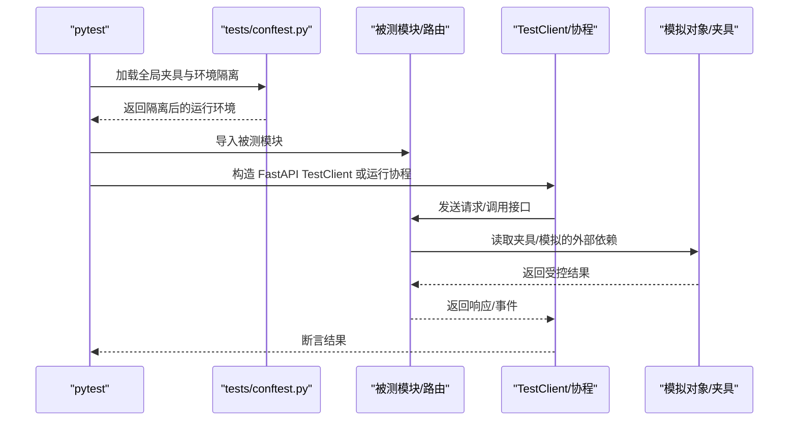
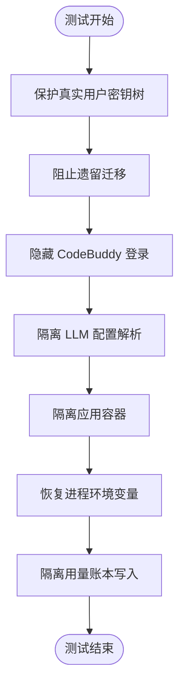
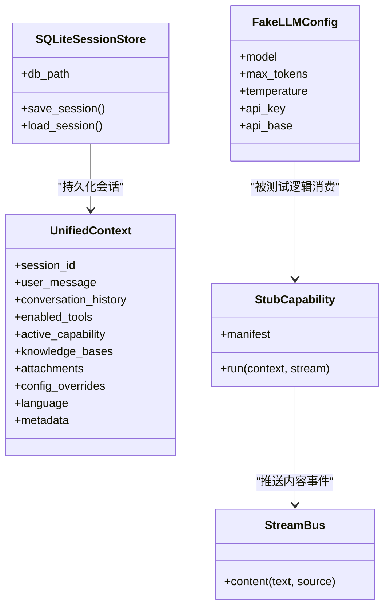
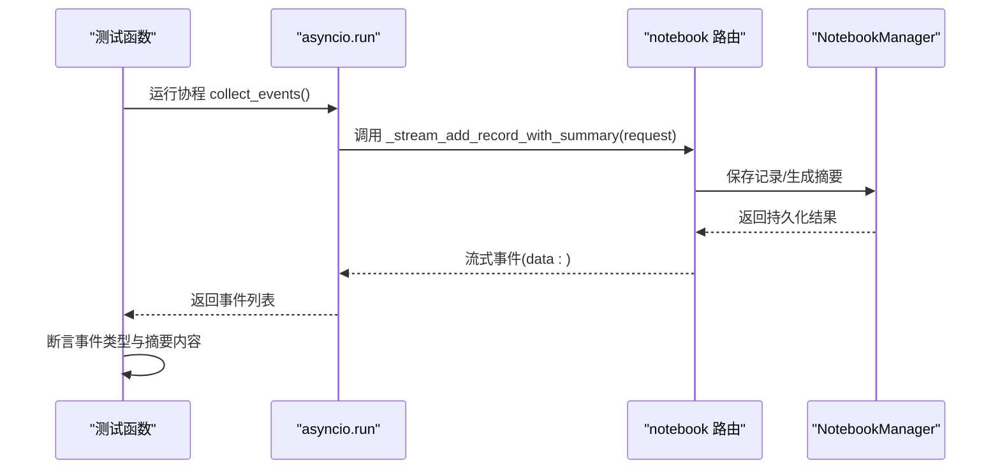
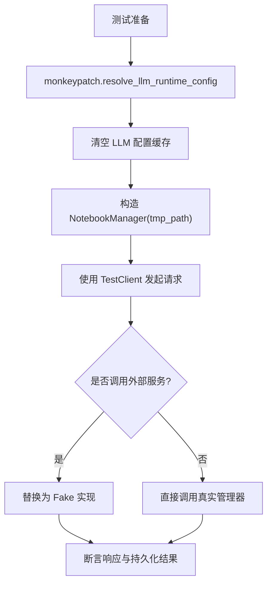
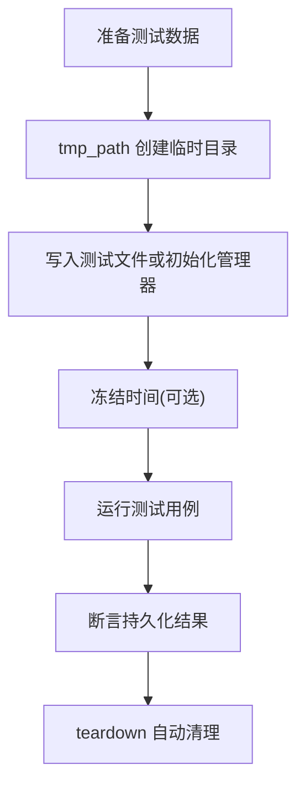
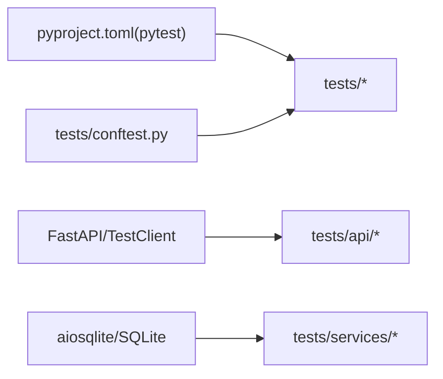

# 单元测试

<cite>
**本文引用的文件**   
- [pyproject.toml](file://pyproject.toml)
- [tests/conftest.py](file://tests/conftest.py)
- [tests/api/test_main_notebook_router.py](file://tests/api/test_main_notebook_router.py)
- [tests/agents/chat/test_runtime_context.py](file://tests/agents/chat/test_runtime_context.py)
- [deeptutor/services/session/sqlite_store.py](file://deeptutor/services/session/sqlite_store.py)
- [deeptutor/services/pocketbase_client.py](file://deeptutor/services/pocketbase_client.py)
- [tests/fixtures/lightrag_bridge/capture_current_mineru.py](file://tests/fixtures/lightrag_bridge/capture_current_mineru.py)
</cite>

## 目录
1. [简介](#简介)
2. [项目结构](#项目结构)
3. [核心组件](#核心组件)
4. [架构总览](#架构总览)
5. [详细组件分析](#详细组件分析)
6. [依赖关系分析](#依赖关系分析)
7. [性能考虑](#性能考虑)
8. [故障排查指南](#故障排查指南)
9. [结论](#结论)
10. [附录](#附录)

## 简介
本文件面向 DeepTutor 项目的 Python 单元测试，聚焦 pytest 测试框架的配置与使用、测试组织规范、夹具策略、异步测试、外部依赖模拟、覆盖率配置与报告生成、测试数据与环境隔离、以及常见场景与调试技巧。文档以仓库现有测试代码为依据，提供可追溯的源码引用和可视化图示，帮助读者快速理解并扩展测试体系。

## 项目结构
DeepTutor 的 Python 测试集中在 tests 目录，并按功能域划分子目录（如 agents、api、services、tools 等）。根级 conftest.py 提供全局夹具和环境隔离；pyproject.toml 中集中配置 pytest、标记、异步行为等。

**图表来源**
- [pyproject.toml:277-293](file://pyproject.toml#L277-L293)
- [tests/conftest.py:1-312](file://tests/conftest.py#L1-L312)

**章节来源**
- [pyproject.toml:277-293](file://pyproject.toml#L277-L293)
- [tests/conftest.py:1-312](file://tests/conftest.py#L1-L312)

## 核心组件
- pytest 配置：定义测试路径、Python 路径、自定义标记、异步默认循环作用域与常用启动参数。
- 全局夹具与环境隔离：保护真实用户密钥树、迁移入口、CodeBuddy 登录状态、LLM 配置缓存、应用容器单例、进程环境变量、用量账本写入路径等。
- 领域夹具：StreamBus、UnifiedContext、SQLiteSessionStore、Fake LLM 配置、最小/丰富上下文、Stub Capability。
- API 测试示例：FastAPI TestClient 构造应用、注入 NotebookManager、断言 HTTP 响应与业务结果。
- 异步测试示例：在测试中使用 asyncio.run 或 pytest-asyncio 运行协程。
- 外部依赖模拟：通过 monkeypatch 替换模块属性、环境变量、类与方法，避免真实网络与数据库访问。
- 测试数据管理：临时目录、固定时间、捕获产物脚本。

**章节来源**
- [pyproject.toml:277-293](file://pyproject.toml#L277-L293)
- [tests/conftest.py:48-116](file://tests/conftest.py#L48-L116)
- [tests/conftest.py:124-204](file://tests/conftest.py#L124-L204)
- [tests/conftest.py:212-312](file://tests/conftest.py#L212-L312)
- [tests/api/test_main_notebook_router.py:25-38](file://tests/api/test_main_notebook_router.py#L25-L38)
- [tests/api/test_main_notebook_router.py:41-161](file://tests/api/test_main_notebook_router.py#L41-L161)
- [tests/agents/chat/test_runtime_context.py:38-49](file://tests/agents/chat/test_runtime_context.py#L38-L49)

## 架构总览
下图展示测试执行时关键组件的交互：pytest 加载配置与 conftest，构建测试环境，调用被测模块，并通过夹具与模拟对象控制外部依赖。

**图表来源**
- [pyproject.toml:277-293](file://pyproject.toml#L277-L293)
- [tests/conftest.py:48-116](file://tests/conftest.py#L48-L116)
- [tests/api/test_main_notebook_router.py:25-38](file://tests/api/test_main_notebook_router.py#L25-L38)

## 详细组件分析

### pytest 配置与测试约定
- 测试路径与 Python 路径：指定 tests 与 deeptutor/learning/tests 为测试入口，并将项目根加入 Python 路径。
- 自定义标记：asyncio、integration、redis_integration、real_llm_resolver。
- 异步默认循环作用域：function，确保每个异步测试拥有独立事件循环。
- 启动参数：严格模式、禁用警告、短回溯、importlib 导入模式。

建议的测试命名与组织规范：
- 文件名：test_<模块名>.py，位于对应功能域下（如 tests/api、tests/agents）。
- 测试函数：test_<场景>_<预期>，例如 test_create_and_list_notebook。
- 断言最佳实践：先断言状态码，再断言数据结构字段；对错误分支断言结构化错误码；对副作用（如文件写入）断言持久化结果。

**章节来源**
- [pyproject.toml:277-293](file://pyproject.toml#L277-L293)
- [tests/api/test_main_notebook_router.py:41-161](file://tests/api/test_main_notebook_router.py#L41-L161)

### 全局夹具与环境隔离策略
- 保护真实用户密钥树：自动检测并清理意外写入，失败时明确提示需要重定向路径常量。
- 阻止遗留多用户迁移：将迁移入口指向不存在路径，重置一次性标志。
- 隐藏 CodeBuddy 登录会话：覆盖认证文件路径与本地存储目录，删除相关环境变量。
- 隔离 LLM 配置解析：用固定 fake 配置替换真实解析器，清空模块级缓存，避免跨测试污染。
- 隔离应用容器：重置进程级容器单例，避免 Redis 等后端设置影响后续测试。
- 恢复进程环境变量：捕获 os.environ 快照并在 teardown 恢复，防止子进程误用临时 HOME。
- 隔离用量账本：将用量 SQLite 路径指向 tmp_path，避免写入开发者机器。

**图表来源**
- [tests/conftest.py:48-116](file://tests/conftest.py#L48-L116)
- [tests/conftest.py:224-312](file://tests/conftest.py#L224-L312)

**章节来源**
- [tests/conftest.py:48-116](file://tests/conftest.py#L48-L116)
- [tests/conftest.py:224-312](file://tests/conftest.py#L224-L312)

### 领域夹具：数据库、API 客户端与模拟对象
- 数据库夹具：tmp_db_path 与 sqlite_store 基于临时目录创建 SQLiteSessionStore，避免污染真实数据库。
- API 客户端夹具：在 API 测试中通过 _build_app 构造 FastAPI 应用，注入 NotebookManager 实例，并使用 TestClient 发起请求。
- 模拟对象夹具：fake_llm_config 提供固定 LLM 配置；_StubCapability 用于验证流式内容输出；FrozenDateTime 冻结时间以稳定日期相关断言。

**图表来源**
- [tests/conftest.py:124-204](file://tests/conftest.py#L124-L204)
- [tests/conftest.py:170-181](file://tests/conftest.py#L170-L181)
- [deeptutor/services/session/sqlite_store.py:398-417](file://deeptutor/services/session/sqlite_store.py#L398-L417)

**章节来源**
- [tests/conftest.py:124-204](file://tests/conftest.py#L124-L204)
- [tests/conftest.py:170-181](file://tests/conftest.py#L170-L181)
- [deeptutor/services/session/sqlite_store.py:398-417](file://deeptutor/services/session/sqlite_store.py#L398-L417)

### 异步测试与并发处理
- 在 API 测试中，使用 asyncio.run 运行协程收集流式事件，并断言最终结果与持久化数据。
- 在 Agent 测试中，通过冻结 datetime 的方式保证相对时间语义稳定，同时保持异步调用链不变。

**图表来源**
- [tests/api/test_main_notebook_router.py:119-161](file://tests/api/test_main_notebook_router.py#L119-L161)
- [tests/agents/chat/test_runtime_context.py:38-49](file://tests/agents/chat/test_runtime_context.py#L38-L49)

**章节来源**
- [tests/api/test_main_notebook_router.py:119-161](file://tests/api/test_main_notebook_router.py#L119-L161)
- [tests/agents/chat/test_runtime_context.py:38-49](file://tests/agents/chat/test_runtime_context.py#L38-L49)

### 模拟外部依赖（LLM API、数据库连接等）
- LLM 配置模拟：通过 monkeypatch 替换 resolve_llm_runtime_config 并清空缓存，使所有测试获得一致的 fake 配置。
- 数据库连接模拟：使用 tmp_path 下的 SQLite 文件作为存储后端，避免真实数据库。
- 第三方服务模拟：在 API 测试中用内部类替代外部服务（如 NotebookSummarizeAgent），仅保留必要接口。
- PocketBase 客户端：当未配置 integrations.pocketbase_url 时抛出运行时异常，测试中应避免触发真实连接。

**图表来源**
- [tests/conftest.py:224-267](file://tests/conftest.py#L224-L267)
- [tests/api/test_main_notebook_router.py:31-38](file://tests/api/test_main_notebook_router.py#L31-L38)
- [tests/api/test_main_notebook_router.py:119-161](file://tests/api/test_main_notebook_router.py#L119-L161)
- [deeptutor/services/pocketbase_client.py:47-86](file://deeptutor/services/pocketbase_client.py#L47-L86)

**章节来源**
- [tests/conftest.py:224-267](file://tests/conftest.py#L224-L267)
- [tests/api/test_main_notebook_router.py:31-38](file://tests/api/test_main_notebook_router.py#L31-L38)
- [tests/api/test_main_notebook_router.py:119-161](file://tests/api/test_main_notebook_router.py#L119-L161)
- [deeptutor/services/pocketbase_client.py:47-86](file://deeptutor/services/pocketbase_client.py#L47-L86)

### 测试数据管理与环境隔离
- 临时目录：使用 pytest 内置 tmp_path 生成测试专用路径，确保每次测试环境干净。
- 固定时间：通过自定义 FrozenDateTime 类冻结当前时间，稳定日期相关断言。
- 捕获产物：fixtures/lightrag_bridge/capture_current_mineru.py 用于从真实服务捕获解析产物，生成带校验和的 fixture 数据，便于离线测试。

**图表来源**
- [tests/api/test_main_notebook_router.py:31-38](file://tests/api/test_main_notebook_router.py#L31-L38)
- [tests/agents/chat/test_runtime_context.py:38-49](file://tests/agents/chat/test_runtime_context.py#L38-L49)
- [tests/fixtures/lightrag_bridge/capture_current_mineru.py:29-70](file://tests/fixtures/lightrag_bridge/capture_current_mineru.py#L29-L70)

**章节来源**
- [tests/api/test_main_notebook_router.py:31-38](file://tests/api/test_main_notebook_router.py#L31-L38)
- [tests/agents/chat/test_runtime_context.py:38-49](file://tests/agents/chat/test_runtime_context.py#L38-L49)
- [tests/fixtures/lightrag_bridge/capture_current_mineru.py:29-70](file://tests/fixtures/lightrag_bridge/capture_current_mineru.py#L29-L70)

## 依赖关系分析
- 测试对 pyproject.toml 的 pytest 配置存在强依赖（测试路径、标记、异步默认循环作用域）。
- 测试对 tests/conftest.py 的全局夹具存在强依赖（环境隔离、LLM 配置、容器、环境变量、用量账本）。
- API 测试对 FastAPI 与 TestClient 存在依赖，并通过 monkeypatch 注入被测模块中的管理器实例。
- 数据库测试对 aiosqlite/SQLite 存储后端存在依赖，但通过 tmp_path 隔离。

**图表来源**
- [pyproject.toml:277-293](file://pyproject.toml#L277-L293)
- [tests/conftest.py:1-312](file://tests/conftest.py#L1-L312)
- [tests/api/test_main_notebook_router.py:25-38](file://tests/api/test_main_notebook_router.py#L25-L38)
- [deeptutor/services/session/sqlite_store.py:398-417](file://deeptutor/services/session/sqlite_store.py#L398-L417)

**章节来源**
- [pyproject.toml:277-293](file://pyproject.toml#L277-L293)
- [tests/conftest.py:1-312](file://tests/conftest.py#L1-L312)
- [tests/api/test_main_notebook_router.py:25-38](file://tests/api/test_main_notebook_router.py#L25-L38)
- [deeptutor/services/session/sqlite_store.py:398-417](file://deeptutor/services/session/sqlite_store.py#L398-L417)

## 性能考虑
- 使用临时目录与内存对象减少 I/O 开销。
- 通过 monkeypatch 替换昂贵的外部调用（LLM、网络、数据库），提升测试速度。
- 使用 importlib.import_module 按需导入模块，避免不必要的初始化成本。
- 在流式处理测试中，仅收集必要事件并尽快断言，减少事件数量。

[本节为通用指导，不直接分析具体文件]

## 故障排查指南
- 若测试写入真实用户密钥树：检查 autouse 夹具是否生效，确认 paths.SYSTEM_ROOT 与 paths.ADMIN_WORKSPACE_ROOT 已重定向到 fixture 路径。
- 若 LLM 配置解析失败：确认 _isolate_llm_config 已替换 resolve_llm_runtime_config 并清空缓存；如需测试真实解析，使用 real_llm_resolver 标记。
- 若异步测试报错事件循环问题：确认 pytest-asyncio 已安装且 asyncio_default_fixture_loop_scope=function；必要时在测试内使用 asyncio.run。
- 若 API 测试出现路由冲突：检查健康端点与参数化路由声明顺序，确保字面量路径优先匹配。
- 若第三方服务连接异常：检查集成配置（如 pocketbase_url）是否缺失，避免在生产路径上触发真实连接。

**章节来源**
- [tests/conftest.py:48-116](file://tests/conftest.py#L48-L116)
- [tests/conftest.py:224-267](file://tests/conftest.py#L224-L267)
- [tests/api/test_main_notebook_router.py:164-175](file://tests/api/test_main_notebook_router.py#L164-L175)
- [deeptutor/services/pocketbase_client.py:47-86](file://deeptutor/services/pocketbase_client.py#L47-L86)

## 结论
DeepTutor 的测试体系以 pytest 为核心，通过 pyproject.toml 统一配置，借助 tests/conftest.py 提供强大的全局夹具与环境隔离，确保测试稳定、可重复且安全。API 测试采用 FastAPI TestClient 与模块级 monkeypatch 注入，结合临时数据库与固定时间等策略，有效隔离外部依赖。异步测试通过 asyncio.run 与 pytest-asyncio 协同工作，保障流式与并发场景的正确性。整体测试设计兼顾可读性、可维护性与性能，适合持续集成与团队协作。

[本节为总结性内容，不直接分析具体文件]

## 附录
- 覆盖率配置与报告生成：当前仓库未在 pyproject.toml 中启用 pytest-cov；建议在开发环境中安装 pytest-cov 并通过命令行参数 --cov=deeptutor --cov-report=term-missing 生成覆盖率报告。
- 常用 pytest 命令：
  - 运行全部测试：pytest
  - 仅运行异步测试：pytest -m asyncio
  - 仅运行集成测试：pytest -m integration
  - 生成覆盖率：pytest --cov=deeptutor --cov-report=term-missing

[本节为通用指导，不直接分析具体文件]