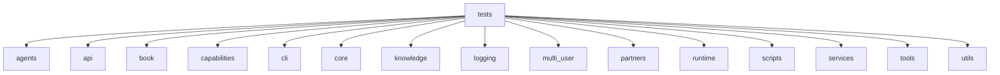
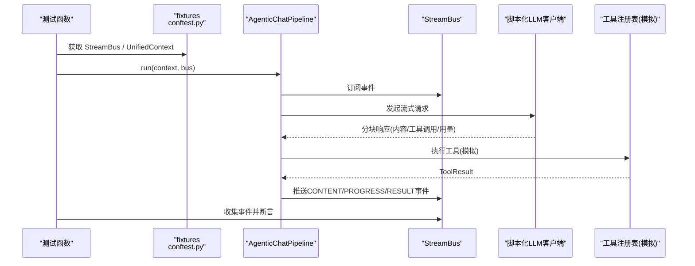
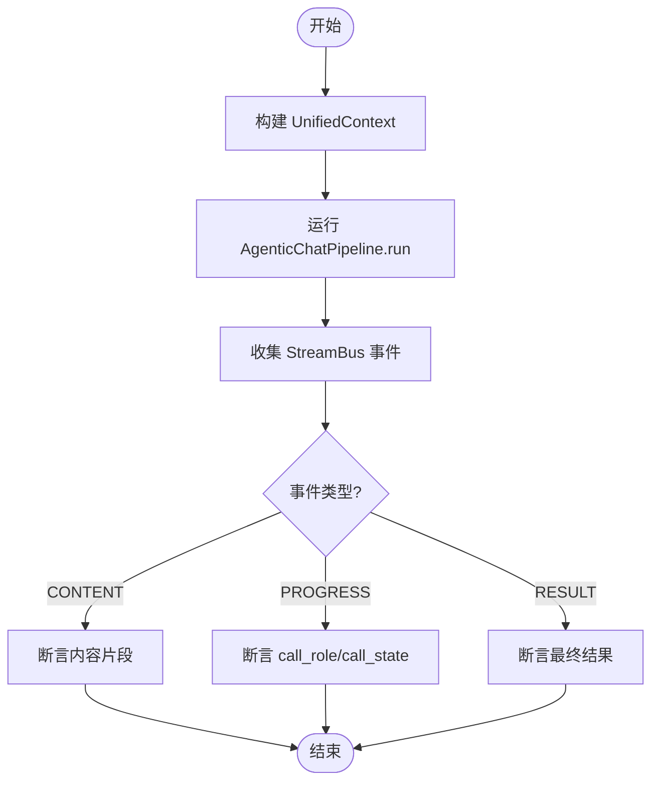
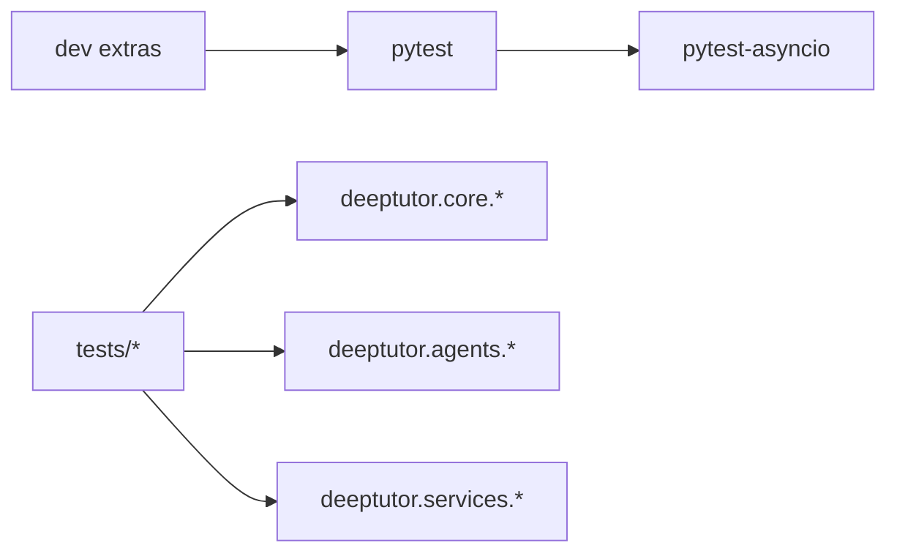

# 单元测试

<cite>
**本文引用的文件**
- [pyproject.toml](file://pyproject.toml)
- [tests/conftest.py](file://tests/conftest.py)
- [tests/agents/chat/test_agent_loop.py](file://tests/agents/chat/test_agent_loop.py)
- [.github/workflows/tests.yml](file://.github/workflows/tests.yml)
</cite>

## 目录
1. [简介](#简介)
2. [项目结构](#项目结构)
3. [核心组件](#核心组件)
4. [架构总览](#架构总览)
5. [详细组件分析](#详细组件分析)
6. [依赖关系分析](#依赖关系分析)
7. [性能考量](#性能考量)
8. [故障排查指南](#故障排查指南)
9. [结论](#结论)
10. [附录](#附录)

## 简介
本文件面向DeepTutor的单元测试体系，聚焦以下目标：
- 解释测试架构与框架选择（pytest、pytest-asyncio）
- 说明如何为智能体、工具、服务组件编写高质量单测
- 给出Mock与Stub策略（外部API、数据库、文件系统）
- 覆盖异步代码测试技巧（asyncio、协程）
- 讲解测试数据管理与fixtures使用
- 提供边界条件、异常处理与性能优化的测试示例指引
- 汇总覆盖率分析与持续集成配置要点

## 项目结构
测试根目录位于 tests，按功能域组织：agents、api、book、capabilities、cli、core、knowledge、logging、multi_user、partners、runtime、scripts、services、tools、utils。每个子目录对应源码模块，便于定位被测单元与相关用例。

**章节来源**
- [pyproject.toml:415-428](file://pyproject.toml#L415-L428)

## 核心组件
- 测试运行器与配置
  - pytest 作为主测试框架，配合 pytest-asyncio 支持异步测试
  - 通过 pyproject.toml 统一配置测试路径、标记、导入模式等
- 共享夹具与保护机制
  - tests/conftest.py 提供全局 fixtures：StreamBus、UnifiedContext、SQLiteSessionStore、Fake LLM配置、能力存根等
  - 自动守卫防止测试写入真实用户密钥树或触发遗留迁移
- 典型异步流式测试
  - 以 agents/chat 的 agent loop 为例，展示如何构造脚本化LLM响应、收集流事件、断言结果与调用顺序

**章节来源**
- [pyproject.toml:213-227](file://pyproject.toml#L213-L227)
- [pyproject.toml:415-428](file://pyproject.toml#L415-L428)
- [tests/conftest.py:1-195](file://tests/conftest.py#L1-L195)
- [tests/agents/chat/test_agent_loop.py:1-200](file://tests/agents/chat/test_agent_loop.py#L1-L200)

## 架构总览
下图展示了“测试执行”到“被测系统”的关键交互：pytest 驱动测试函数，通过 fixtures 注入 StreamBus、上下文、临时存储；被测管道消费流事件并产出结果；测试侧收集并断言。

**图表来源**
- [tests/agents/chat/test_agent_loop.py:20-176](file://tests/agents/chat/test_agent_loop.py#L20-L176)
- [tests/conftest.py:97-155](file://tests/conftest.py#L97-L155)

**章节来源**
- [tests/agents/chat/test_agent_loop.py:1-200](file://tests/agents/chat/test_agent_loop.py#L1-L200)
- [tests/conftest.py:1-195](file://tests/conftest.py#L1-L195)

## 详细组件分析

### 智能体（Agent）测试：聊天循环与流式事件
- 设计要点
  - 使用脚本化LLM客户端生成预定义的分块响应，避免真实网络调用
  - 通过 StreamBus 收集流事件，断言内容、进度标记与最终结果
  - 用本地 Registry 模拟工具执行，验证工具调用参数与返回结构
- 关键流程
  - 构建上下文 UnifiedContext
  - 启动管道 AgenticChatPipeline.run
  - 收集并过滤事件类型（CONTENT/PROGRESS/RESULT）
  - 断言轮次、工具调用次数与完成状态

**图表来源**
- [tests/agents/chat/test_agent_loop.py:20-176](file://tests/agents/chat/test_agent_loop.py#L20-L176)

**章节来源**
- [tests/agents/chat/test_agent_loop.py:1-200](file://tests/agents/chat/test_agent_loop.py#L1-L200)

### 工具（Tool）测试：外部依赖隔离
- 策略
  - 对网络IO（HTTP/搜索/下载）使用 unittest.mock.patch 或自定义 Stub
  - 对文件系统操作使用 tmp_path 或内存路径，避免污染磁盘
  - 对第三方SDK（如OpenAI/LLM客户端）使用轻量替代对象，仅暴露必要接口
- 示例思路
  - 构造失败场景：超时、限流、非法输入
  - 校验重试与退避逻辑（结合 tenacity）
  - 验证错误码与异常传播

[本节为通用指导，不直接分析具体文件]

### 服务（Service）测试：数据库与配置
- 数据库
  - 使用 SQLiteSessionStore + 临时db路径进行读写测试
  - 覆盖并发、事务回滚、数据一致性
- 配置
  - 通过 monkeypatch 替换配置读取路径或环境变量
  - 验证默认值、合并策略、敏感字段脱敏

**章节来源**
- [tests/conftest.py:143-155](file://tests/conftest.py#L143-L155)

### Mock与Stub策略
- 何时使用Mock
  - 外部API、网络请求、时间、随机数、进程/线程
- 何时使用Stub
  - 需要固定行为与可预测输出的简单实现（如 _ScriptedChatClient、_Registry）
- 注意事项
  - 尽量靠近边界打桩，保持被测单元职责单一
  - 避免过度mock导致测试脆弱

[本节为通用指导，不直接分析具体文件]

### 异步代码测试技巧
- 使用 pytest-asyncio 管理事件循环
- 在测试中创建任务并 await 清理（如 StreamBus 消费者任务）
- 对协程函数使用 @pytest.mark.asyncio 或直接 async def 测试函数
- 注意事件竞态：必要时引入短暂 sleep 或显式等待

**章节来源**
- [pyproject.toml:213-227](file://pyproject.toml#L213-L227)
- [tests/agents/chat/test_agent_loop.py:20-176](file://tests/agents/chat/test_agent_loop.py#L20-L176)

### 测试数据与Fixture管理
- 共享fixture
  - stream_bus：每次测试独立实例
  - minimal_context/rich_context：不同复杂度的上下文
  - sqlite_store：基于临时文件的会话存储
  - fake_llm_config：模拟LLM配置
- 安全守卫
  - 自动检测并清理可能写入真实用户密钥树的文件
  - 阻止遗留多用户迁移误写开发者环境

**章节来源**
- [tests/conftest.py:47-90](file://tests/conftest.py#L47-L90)
- [tests/conftest.py:97-155](file://tests/conftest.py#L97-L155)

### 边界条件、异常与性能优化测试
- 边界条件
  - 空输入、超长消息、缺失必填字段
  - 工具调用为空、多次调用、部分失败
- 异常处理
  - 网络异常、解析失败、权限不足
  - 验证是否降级或抛出明确错误
- 性能优化
  - 限制LLM调用次数（脚本化响应耗尽即报错）
  - 控制流事件数量，避免无界增长
  - 使用最小上下文减少开销

**章节来源**
- [tests/agents/chat/test_agent_loop.py:81-150](file://tests/agents/chat/test_agent_loop.py#L81-L150)

## 依赖关系分析
- 测试框架依赖
  - pytest、pytest-asyncio 由 dev 可选依赖提供
  - 测试路径包含 tests 与 deeptutor/learning/tests
- 运行时依赖
  - FastAPI、aiohttp、httpx、aiosqlite 等用于服务与异步IO
- 工具链
  - Ruff、Black、Bandit、MyPy 等质量工具

**图表来源**
- [pyproject.toml:213-227](file://pyproject.toml#L213-L227)
- [pyproject.toml:415-428](file://pyproject.toml#L415-L428)

**章节来源**
- [pyproject.toml:213-227](file://pyproject.toml#L213-L227)
- [pyproject.toml:415-428](file://pyproject.toml#L415-L428)

## 性能考量
- 控制外部调用：使用脚本化客户端与本地注册表，避免真实网络延迟
- 事件流收敛：及时关闭 StreamBus 并等待消费者任务，防止资源泄漏
- 数据量控制：使用最小上下文与有限工具调用，缩短测试时长
- 并发测试：谨慎使用多线程/多进程，优先基于事件循环的异步并发

[本节为通用指导，不直接分析具体文件]

## 故障排查指南
- 常见问题
  - 测试写入真实用户密钥树：检查 paths 重定向与安全守卫
  - 遗留迁移误触发：确认 LEGACY_MULTI_USER_ROOT 指向不存在路径
  - 异步测试卡死：确保所有协程 await 且事件总线已关闭
- 定位方法
  - 查看 pytest 输出与堆栈
  - 逐步缩小范围，先跑最小用例集
  - 打印关键变量与事件序列

**章节来源**
- [tests/conftest.py:47-90](file://tests/conftest.py#L47-L90)

## 结论
DeepTutor的测试体系以pytest为核心，结合pytest-asyncio与丰富的fixtures，形成了稳定、可扩展的单测生态。通过脚本化外部依赖、严格的数据隔离与流式事件断言，能够高效覆盖智能体、工具与服务的关键路径。建议在新增功能时同步补充边界与异常用例，并关注异步资源清理与性能指标。

[本节为总结性内容，不直接分析具体文件]

## 附录

### 持续集成与覆盖率
- CI工作流
  - .github/workflows/tests.yml 负责在CI中执行测试套件
- 覆盖率建议
  - 可在CI中启用 coverage 报告，针对核心模块设定阈值
  - 将覆盖率报告纳入PR检查，保障回归质量

**章节来源**
- [.github/workflows/tests.yml](file://.github/workflows/tests.yml)