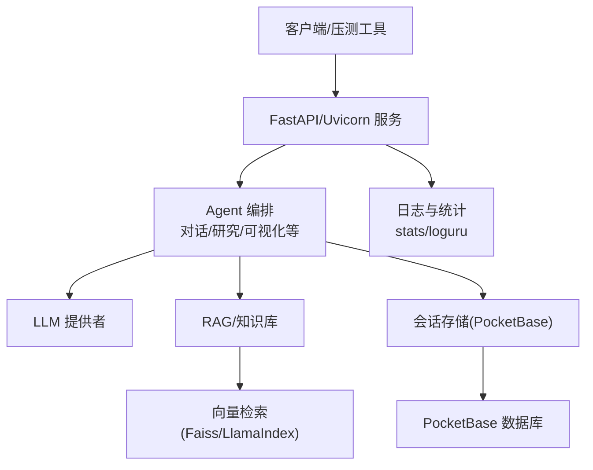
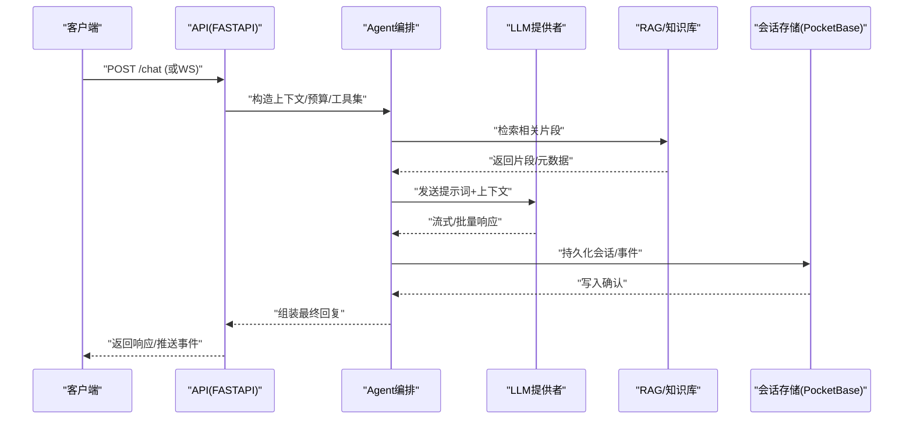
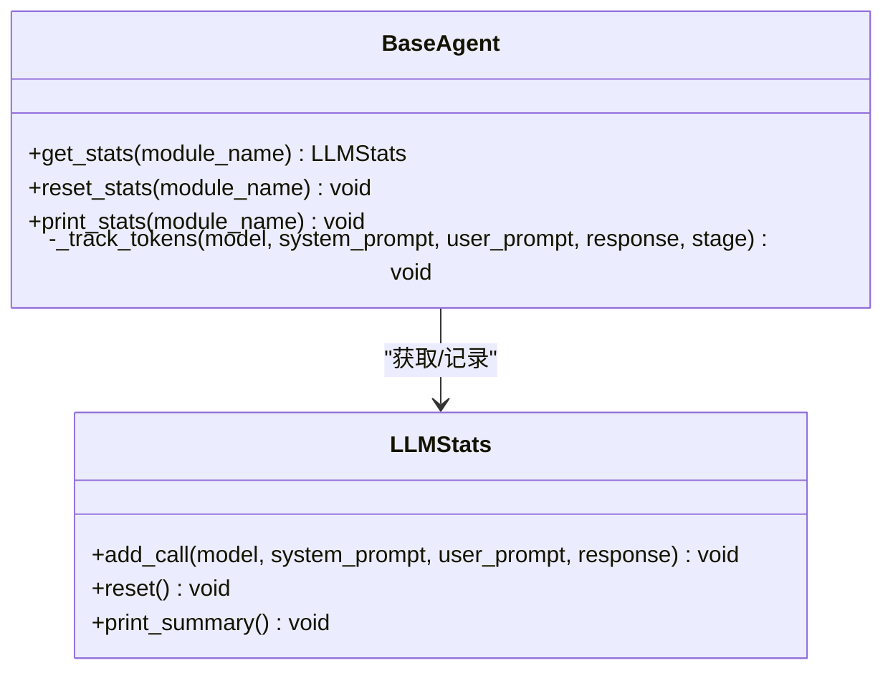
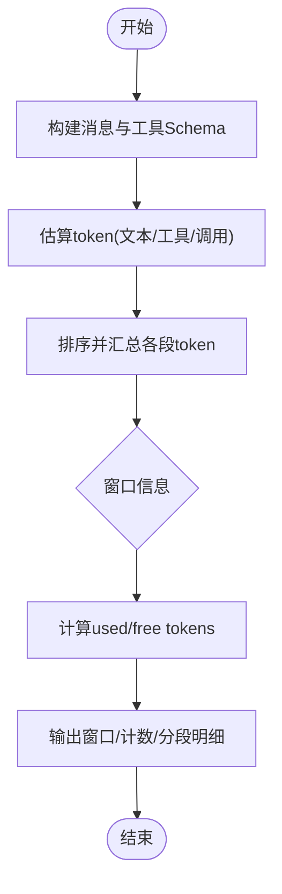
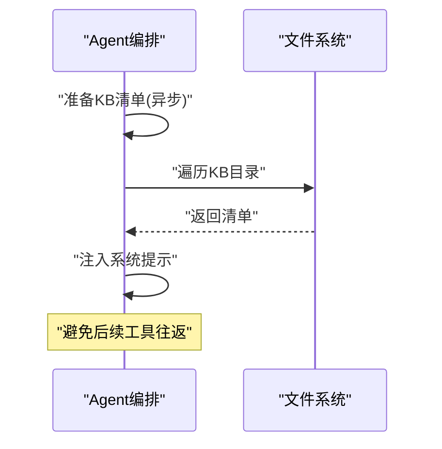
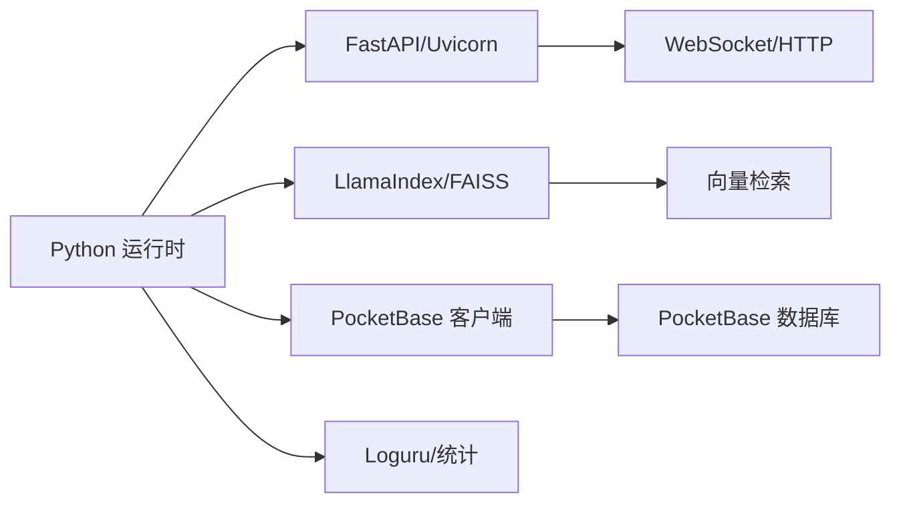

# 性能测试

<cite>
**本文引用的文件**
- [pyproject.toml](file://pyproject.toml)
- [requirements.txt](file://requirements.txt)
- [docker-compose.yml](file://docker-compose.yml)
- [compose.yaml](file://compose.yaml)
- [CONTAINERIZATION.md](file://CONTAINERIZATION.md)
- [deeptutor/agents/base_agent.py](file://deeptutor/agents/base_agent.py)
- [deeptutor/agents/chat/context_budget.py](file://deeptutor/agents/chat/context_budget.py)
- [deeptutor/agents/chat/agentic_pipeline.py](file://deeptutor/agents/chat/agentic_pipeline.py)
- [deeptutor/services/config/loader.py](file://deeptutor/services/config/loader.py)
- [deeptutor/logging/stats/__init__.py](file://deeptutor/logging/stats/__init__.py)
- [deeptutor/services/session/pocketbase_store.py](file://deeptutor/services/session/pocketbase_store.py)
</cite>

## 目录
1. [简介](#简介)
2. [项目结构](#项目结构)
3. [核心组件](#核心组件)
4. [架构总览](#架构总览)
5. [详细组件分析](#详细组件分析)
6. [依赖关系分析](#依赖关系分析)
7. [性能考量](#性能考量)
8. [故障排查指南](#故障排查指南)
9. [结论](#结论)
10. [附录](#附录)

## 简介
本文件面向DeepTutor的性能测试与基准评估，覆盖目标与指标定义、负载/压力/稳定性测试方法、基准建立与回归检测、内存泄漏检测、CPU使用率分析、数据库查询优化、分布式系统（微服务）性能监控策略，以及Locust/JMeter等工具的使用建议与结果分析方法。文档同时结合仓库中已有的可观测性、配置与部署能力，给出可落地的实践路径。

## 项目结构
DeepTutor采用多模块后端（FastAPI + Uvicorn）、Agent/能力层、RAG/知识库、会话存储（PocketBase）与前端Next.js的解耦架构。性能测试需围绕以下关键面展开：
- API网关与路由层：承载HTTP/WebSocket请求入口
- Agent与能力编排：LLM调用、工具链、上下文预算控制
- RAG与知识库：向量检索、文档解析、索引构建
- 会话与持久化：PocketBase存储、事件日志与追踪
- 运行与部署：Docker/Podman容器编排、网络与端口映射

图表来源
- [docker-compose.yml:1-19](file://docker-compose.yml#L1-L19)
- [compose.yaml:1-30](file://compose.yaml#L1-L30)
- [deeptutor/agents/base_agent.py:248-346](file://deeptutor/agents/base_agent.py#L248-L346)
- [deeptutor/services/session/pocketbase_store.py:1-20](file://deeptutor/services/session/pocketbase_store.py#L1-L20)

章节来源
- [docker-compose.yml:1-19](file://docker-compose.yml#L1-L19)
- [compose.yaml:1-30](file://compose.yaml#L1-L30)
- [CONTAINERIZATION.md:224-249](file://CONTAINERIZATION.md#L224-L249)

## 核心组件
- 令牌与用量统计：Agent层提供共享统计与外部TokenTracker接入点，便于采集模型调用量、阶段级耗时与成本。
- 上下文预算：对话流程中对消息、工具Schema、tool_calls等进行token计数，输出窗口大小、已用/剩余token及分段明细，为吞吐与延迟优化提供依据。
- 知识清单预取：在单轮处理前异步读取KB清单，避免后续工具往返带来的额外RTT。
- 配置与性能日志：配置加载器暴露“performance_log_dir”用于集中存放性能日志。
- 会话存储：PocketBase作为轻量数据库，关注其读写延迟与并发影响。

章节来源
- [deeptutor/agents/base_agent.py:248-346](file://deeptutor/agents/base_agent.py#L248-L346)
- [deeptutor/agents/chat/context_budget.py:185-212](file://deeptutor/agents/chat/context_budget.py#L185-L212)
- [deeptutor/agents/chat/context_budget.py:255-286](file://deeptutor/agents/chat/context_budget.py#L255-L286)
- [deeptutor/agents/chat/agentic_pipeline.py:1426-1451](file://deeptutor/agents/chat/agentic_pipeline.py#L1426-L1451)
- [deeptutor/services/config/loader.py:60-80](file://deeptutor/services/config/loader.py#L60-L80)
- [deeptutor/logging/stats/__init__.py:1-20](file://deeptutor/logging/stats/__init__.py#L1-L20)
- [deeptutor/services/session/pocketbase_store.py:1-20](file://deeptutor/services/session/pocketbase_store.py#L1-L20)

## 架构总览
下图展示一次典型对话请求从进入API到返回响应的关键路径，并标注了可用于性能观测的断点（如LLM调用、RAG检索、DB写入）。

图表来源
- [deeptutor/agents/chat/agentic_pipeline.py:1426-1451](file://deeptutor/agents/chat/agentic_pipeline.py#L1426-L1451)
- [deeptutor/agents/base_agent.py:297-346](file://deeptutor/agents/base_agent.py#L297-L346)
- [deeptutor/services/session/pocketbase_store.py:1-20](file://deeptutor/services/session/pocketbase_store.py#L1-L20)

## 详细组件分析

### 令牌统计与用量追踪
- 设计要点：通过共享统计对象按模块聚合调用次数、模型名、输入输出规模；支持外部TokenTracker扩展，便于对接计费与审计。
- 性能意义：可量化不同Agent/阶段的token消耗，辅助容量规划与成本优化。
- 回归检测：对比基线版本的每阶段token均值/分位，异常增长触发告警。

图表来源
- [deeptutor/agents/base_agent.py:248-346](file://deeptutor/agents/base_agent.py#L248-L346)

章节来源
- [deeptutor/agents/base_agent.py:248-346](file://deeptutor/agents/base_agent.py#L248-L346)

### 上下文预算与Token估算
- 设计要点：对消息内容、工具Schema、tool_calls进行token估算，输出窗口大小、已用/剩余token、各段贡献度与使用的计数器名称。
- 性能意义：避免超长上下文导致的LLM超时与高延迟；指导裁剪与缓存策略。
- 回归检测：监控used_tokens与free_tokens分布，突增可能意味着Prompt膨胀或工具Schema过大。

图表来源
- [deeptutor/agents/chat/context_budget.py:185-212](file://deeptutor/agents/chat/context_budget.py#L185-L212)
- [deeptutor/agents/chat/context_budget.py:255-286](file://deeptutor/agents/chat/context_budget.py#L255-L286)

章节来源
- [deeptutor/agents/chat/context_budget.py:185-212](file://deeptutor/agents/chat/context_budget.py#L185-L212)
- [deeptutor/agents/chat/context_budget.py:255-286](file://deeptutor/agents/chat/context_budget.py#L255-L286)

### 知识清单预取与RAG性能
- 设计要点：在单轮开始前异步收集KB清单，将文件系统事实注入系统提示，减少后续工具往返。
- 性能意义：降低RTT与尾部延迟，提升首包时间。
- 回归检测：监控清单构建耗时与失败率，异常升高需检查磁盘IO或权限。

图表来源
- [deeptutor/agents/chat/agentic_pipeline.py:1426-1451](file://deeptutor/agents/chat/agentic_pipeline.py#L1426-L1451)

章节来源
- [deeptutor/agents/chat/agentic_pipeline.py:1426-1451](file://deeptutor/agents/chat/agentic_pipeline.py#L1426-L1451)

### 配置与性能日志
- 设计要点：配置项包含性能日志目录，便于统一收集压测与运行时指标。
- 实践建议：将压测脚本输出、APM探针、系统指标（CPU/Mem/IO/Net）汇聚至该目录，配合时序数据库或看板分析。

章节来源
- [deeptutor/services/config/loader.py:60-80](file://deeptutor/services/config/loader.py#L60-L80)

## 依赖关系分析
- 运行时依赖：FastAPI/Uvicorn、WebSockets、异步HTTP客户端、Pydantic、Loguru等。
- RAG/向量：LlamaIndex、FAISS等，影响检索延迟与吞吐。
- 会话存储：PocketBase，关注写放大与锁竞争。
- 容器编排：Docker/Podman Compose，决定资源隔离与网络拓扑。

图表来源
- [pyproject.toml:21-71](file://pyproject.toml#L21-L71)
- [requirements.txt:1-23](file://requirements.txt#L1-L23)

章节来源
- [pyproject.toml:21-71](file://pyproject.toml#L21-L71)
- [requirements.txt:1-23](file://requirements.txt#L1-L23)

## 性能考量
- 指标定义
  - 响应时间：端到端P50/P95/P99、首字节时间(TTFB)、流式增量间隔
  - 吞吐量：QPS/TPS、并发连接数、长连接保持率
  - 资源利用率：CPU、内存RSS/堆、GC停顿、磁盘IO、网络带宽
  - 质量指标：错误率、重试率、超时率、降级开关触发率
- 负载/压力/稳定性
  - 负载测试：逐步增加并发，观察RT与吞吐拐点
  - 压力测试：冲击峰值并发，验证限流/熔断/队列行为
  - 稳定性测试：长时间恒定负载（如24h），观察内存泄漏与抖动
- 基准与回归
  - 建立基线：固定数据集/模型/硬件，记录关键指标分位
  - 回归检测：CI中自动执行，阈值告警（如P95 RT上升>10%）
- 内存泄漏检测
  - 使用tracemalloc/objgraph定期采样，比较RSS与堆增长
  - 关注大对象（提示词、中间结果）是否及时释放
- CPU使用率分析
  - 热点定位：火焰图/采样器，识别阻塞I/O与同步调用
  - 异步化：将重任务移出事件循环（如to_thread）
- 数据库查询优化
  - 索引与批写：减少N+1查询，合并写入
  - 连接池与事务边界：避免长事务与锁竞争
- 分布式/微服务监控
  - 链路追踪：跨服务TraceID关联
  - 指标上报：Prometheus/Grafana，设置SLO与告警
  - 网络拓扑：容器间延迟与丢包监测

[本节为通用指导，不直接分析具体文件]

## 故障排查指南
- 常见问题
  - 高延迟：检查LLM提供商限流/排队、RAG检索慢、DB锁等待
  - 内存上涨：排查未释放的大对象、重复缓存、日志累积
  - 吞吐下降：线程/进程瓶颈、GIL争用、外部依赖超时
- 定位手段
  - 启用性能日志目录，集中收集指标
  - 使用Agent统计与上下文预算输出，定位Prompt膨胀或工具Schema过大
  - 容器内top/htop、psutil、perf等工具定位热点
- 恢复策略
  - 快速降级：关闭非核心能力、缩短上下文、切换轻量模型
  - 扩容与限流：水平扩展实例、开启请求限速与队列

章节来源
- [deeptutor/services/config/loader.py:60-80](file://deeptutor/services/config/loader.py#L60-L80)
- [deeptutor/agents/base_agent.py:248-346](file://deeptutor/agents/base_agent.py#L248-L346)
- [deeptutor/agents/chat/context_budget.py:185-212](file://deeptutor/agents/chat/context_budget.py#L185-L212)

## 结论
DeepTutor具备完善的Agent统计、上下文预算与配置化性能日志能力，适合开展系统化性能测试。建议以“指标基线+自动化回归”为主线，结合容器化部署与分布式监控，持续优化响应时间、吞吐与资源效率，确保在复杂AI工作负载下的稳定表现。

## 附录

### 性能测试实施方法与工具示例
- Locust
  - 场景建模：登录、创建会话、发送消息、流式接收
  - 指标采集：自定义事件记录RT、TTFB、错误码、token用量
  - 报告：HTML报告+导出CSV，纳入CI
- JMeter
  - HTTP/WS采样器：模拟并发用户与阶梯加压
  - 监听器：聚合报告、图形化趋势
  - 参数化：用户/会话/提示词模板
- 容器与环境
  - 使用Compose启动后端与依赖，固定资源限制（CPU/内存）
  - 通过host.docker.internal访问本地LLM/Embedding服务
- 结果分析与优化建议
  - 若P95 RT升高：优先检查RAG检索与LLM排队
  - 若内存持续增长：检查大对象生命周期与缓存策略
  - 若吞吐不足：评估并行度、连接池、外部依赖超时与重试

章节来源
- [CONTAINERIZATION.md:224-249](file://CONTAINERIZATION.md#L224-L249)
- [docker-compose.yml:1-19](file://docker-compose.yml#L1-L19)
- [compose.yaml:1-30](file://compose.yaml#L1-L30)