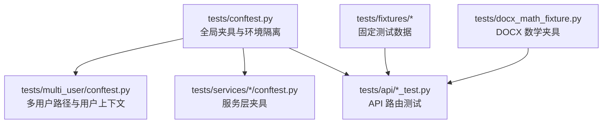
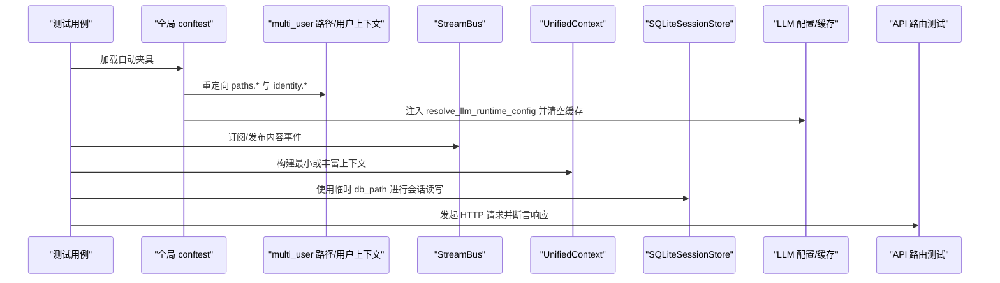
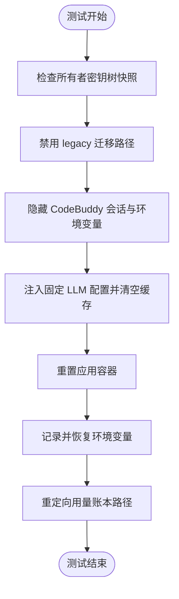
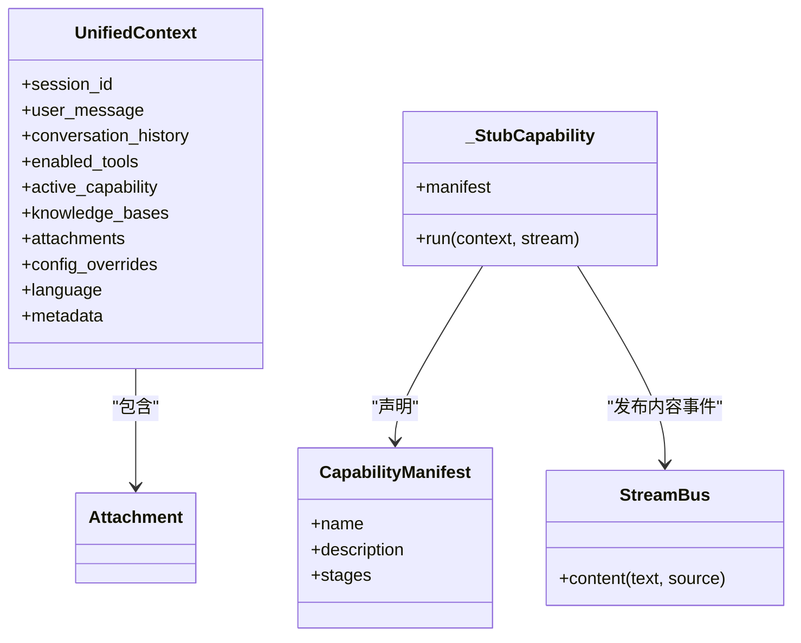
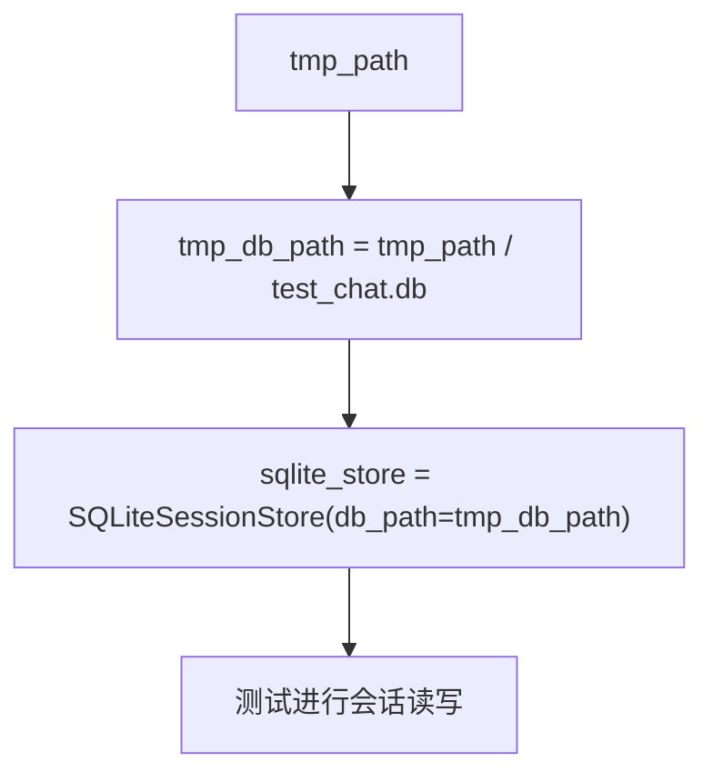
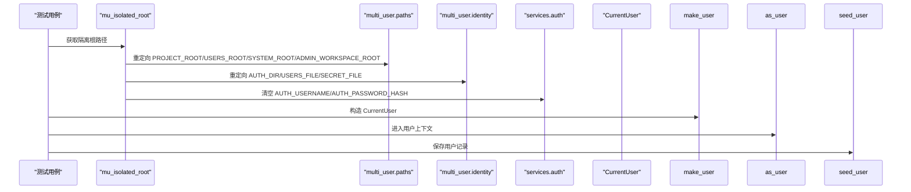
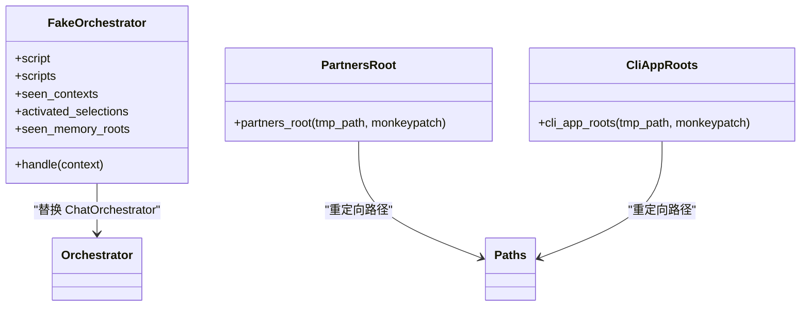
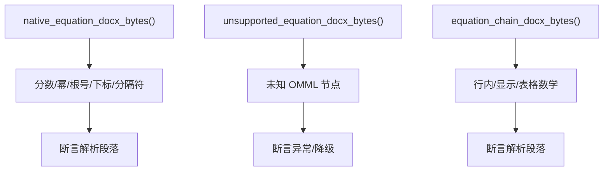
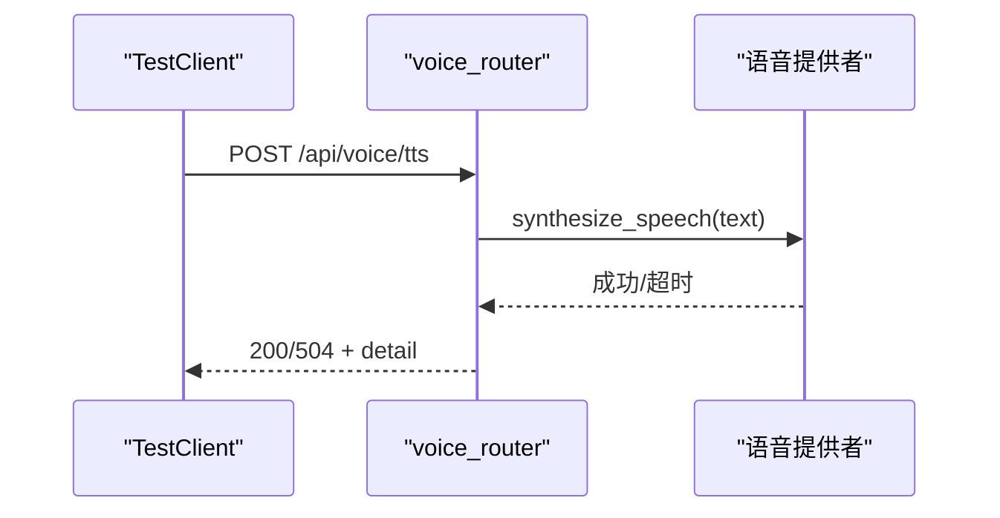
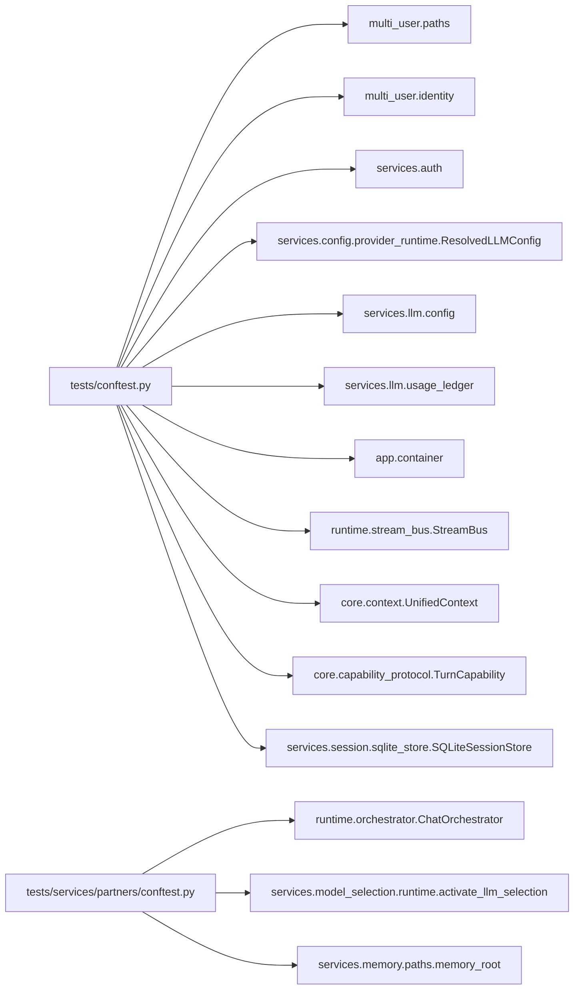

# 测试工具和辅助

<cite>
**本文引用的文件**   
- [tests/conftest.py](file://tests/conftest.py)
- [tests/multi_user/conftest.py](file://tests/multi_user/conftest.py)
- [tests/services/cli_apps/conftest.py](file://tests/services/cli_apps/conftest.py)
- [tests/services/partners/conftest.py](file://tests/services/partners/conftest.py)
- [tests/services/rag/conftest.py](file://tests/services/rag/conftest.py)
- [tests/docx_math_fixture.py](file://tests/docx_math_fixture.py)
- [tests/fixtures/lightrag_bridge/README.md](file://tests/fixtures/lightrag_bridge/README.md)
- [tests/api/test_voice_routes.py](file://tests/api/test_voice_routes.py)
- [deeptutor/core/capability_protocol.py](file://deeptutor/core/capability_protocol.py)
- [deeptutor/core/context.py](file://deeptutor/core/context.py)
- [deeptutor/runtime/stream_bus.py](file://deeptutor/runtime/stream_bus.py)
- [deeptutor/services/session/sqlite_store.py](file://deeptutor/services/session/sqlite_store.py)
- [deeptutor/app/__init__.py](file://deeptutor/app/__init__.py)
- [deeptutor/services/config/provider_runtime.py](file://deeptutor/services/config/provider_runtime.py)
- [deeptutor/services/llm/config.py](file://deeptutor/services/llm/config.py)
- [deeptutor/services/llm/usage_ledger.py](file://deeptutor/services/llm/usage_ledger.py)
- [deeptutor/multi_user/context.py](file://deeptutor/multi_user/context.py)
- [deeptutor/multi_user/models.py](file://deeptutor/multi_user/models.py)
- [deeptutor/multi_user/paths.py](file://deeptutor/multi_user/paths.py)
- [deeptutor/multi_user/identity.py](file://deeptutor/multi_user/identity.py)
- [deeptutor/multi_user/grants.py](file://deeptutor/multi_user/grants.py)
- [deeptutor/multi_user/guardians.py](file://deeptutor/multi_user/guardians.py)
- [deeptutor/multi_user/audit.py](file://deeptutor/multi_user/audit.py)
- [deeptutor/multi_user/device_credentials.py](file://deeptutor/multi_user/device_credentials.py)
- [deeptutor/services/auth.py](file://deeptutor/services/auth.py)
- [deeptutor/services/codebuddy_credentials.py](file://deeptutor/services/codebuddy_credentials.py)
- [deeptutor/runtime/orchestrator.py](file://deeptutor/runtime/orchestrator.py)
- [deeptutor/services/model_selection/runtime.py](file://deeptutor/services/model_selection/runtime.py)
- [deeptutor/services/memory/paths.py](file://deeptutor/services/memory/paths.py)
</cite>

## 目录
1. [引言](#引言)
2. [项目结构](#项目结构)
3. [核心组件](#核心组件)
4. [架构总览](#架构总览)
5. [详细组件分析](#详细组件分析)
6. [依赖关系分析](#依赖关系分析)
7. [性能考虑](#性能考虑)
8. [故障排查指南](#故障排查指南)
9. [结论](#结论)
10. [附录](#附录)

## 引言
本文件面向 DeepTutor 项目的测试工具与辅助能力，聚焦以下目标：
- 测试夹具库的设计与实现：通用夹具、业务领域夹具、外部依赖夹具的分类管理。
- 测试数据生成工具：随机数据、固定测试数据、边界条件数据的创建方法。
- 测试辅助函数封装：API 调用助手、数据库操作助手、文件操作助手。
- 架构约束测试：导入边界检查与模块依赖验证。
- 测试性能优化：并行执行、测试数据缓存、内存使用监控。
- 测试环境配置：环境变量注入、测试资源清理。
- 自定义断言、测试报告与持续集成集成实践。

## 项目结构
DeepTutor 的测试代码集中在 tests 目录下，采用“按功能域组织”的结构：
- 根级 conftest.py 提供全局隔离、进程级状态清理、流总线、上下文、SQLite 存储、LLM 配置隔离等通用夹具。
- multi_user、services、api、agents、book、runtime 等子目录分别维护各自领域的夹具和测试用例。
- fixtures 目录存放固定测试数据（如 LighRAG 桥接示例、模型目录清单、UI 语言包快照）。
- docx_math_fixture.py 提供真实 DOCX 数学公式结构的构造器，用于解析与转换测试。

图表来源
- [tests/conftest.py:1-312](file://tests/conftest.py#L1-L312)
- [tests/multi_user/conftest.py:1-142](file://tests/multi_user/conftest.py#L1-L142)
- [tests/services/partners/conftest.py:1-107](file://tests/services/partners/conftest.py#L1-L107)
- [tests/docx_math_fixture.py:1-189](file://tests/docx_math_fixture.py#L1-L189)

章节来源
- [tests/conftest.py:1-312](file://tests/conftest.py#L1-L312)
- [tests/multi_user/conftest.py:1-142](file://tests/multi_user/conftest.py#L1-L142)
- [tests/services/partners/conftest.py:1-107](file://tests/services/partners/conftest.py#L1-L107)
- [tests/docx_math_fixture.py:1-189](file://tests/docx_math_fixture.py#L1-L189)

## 核心组件
本节梳理测试基础设施中的关键组件及其职责：
- 全局隔离与保护：防止测试写入开发者真实数据树、清理环境变量、重置应用容器与 LLM 配置缓存。
- 流总线与统一上下文：为 Agent 能力测试提供轻量事件通道与会话上下文。
- SQLite 会话存储：基于临时文件的会话持久化夹具。
- 多用户路径与用户上下文：将 multi_user 相关路径重定向到 tmp_path，并提供 CurrentUser 上下文管理器。
- CLI 应用与 Partners 服务夹具：隔离安装目录与偏好设置目录，提供脚本化编排器以模拟聊天循环事件。
- RAG 集成选项：通过 pytest_addoption 注册 --pipeline 参数，控制不同 RAG 管线测试。
- DOCX 数学夹具：构造包含 OMML 的真实文档字节流，覆盖分数、幂、根号、下标、分隔符等复杂场景。

章节来源
- [tests/conftest.py:18-117](file://tests/conftest.py#L18-L117)
- [tests/conftest.py:124-204](file://tests/conftest.py#L124-L204)
- [tests/conftest.py:170-181](file://tests/conftest.py#L170-L181)
- [tests/conftest.py:224-266](file://tests/conftest.py#L224-L266)
- [tests/multi_user/conftest.py:20-83](file://tests/multi_user/conftest.py#L20-L83)
- [tests/multi_user/conftest.py:86-142](file://tests/multi_user/conftest.py#L86-L142)
- [tests/services/cli_apps/conftest.py:17-28](file://tests/services/cli_apps/conftest.py#L17-L28)
- [tests/services/partners/conftest.py:18-57](file://tests/services/partners/conftest.py#L18-L57)
- [tests/services/partners/conftest.py:60-106](file://tests/services/partners/conftest.py#L60-L106)
- [tests/services/rag/conftest.py:11-18](file://tests/services/rag/conftest.py#L11-L18)
- [tests/docx_math_fixture.py:82-189](file://tests/docx_math_fixture.py#L82-L189)

## 架构总览
下图展示测试基础设施如何与生产代码交互，包括路径隔离、LLM 配置注入、流总线事件、以及 API 路由测试的调用链。

图表来源
- [tests/conftest.py:48-117](file://tests/conftest.py#L48-L117)
- [tests/conftest.py:124-204](file://tests/conftest.py#L124-L204)
- [tests/conftest.py:170-181](file://tests/conftest.py#L170-L181)
- [tests/conftest.py:224-266](file://tests/conftest.py#L224-L266)
- [tests/multi_user/conftest.py:20-83](file://tests/multi_user/conftest.py#L20-L83)
- [tests/api/test_voice_routes.py:88-111](file://tests/api/test_voice_routes.py#L88-L111)

## 详细组件分析

### 通用夹具与进程级隔离
- 所有者密钥树保护：在导入时捕获真实 owner secret 树快照，测试结束后检测新增文件并删除，失败提示需重定向 paths.SYSTEM_ROOT 与 ADMIN_WORKSPACE_ROOT。
- 多用户迁移保护：强制 LEGACY_MULTI_USER_ROOT 指向不存在路径，并重置迁移标志，避免迁移逻辑污染真实 tree。
- CodeBuddy 登录隔离：隐藏开发者的 OAuth 会话，删除相关环境变量，并重写本地存储目录。
- LLM 配置隔离：注入固定的 ResolvedLLMConfig 解析器，清空模块级缓存，确保测试顺序无关性。
- 应用容器隔离：重置默认容器，避免 Redis 等后端状态跨测试泄漏。
- 环境变量恢复：记录 os.environ 快照并在 teardown 中恢复，防止子进程读取残留变量。
- 用量账本隔离：将 usage ledger 路径指向 tmp_path，避免写入真实统计数据库。

图表来源
- [tests/conftest.py:48-117](file://tests/conftest.py#L48-L117)
- [tests/conftest.py:224-266](file://tests/conftest.py#L224-L266)
- [tests/conftest.py:269-312](file://tests/conftest.py#L269-L312)

章节来源
- [tests/conftest.py:18-117](file://tests/conftest.py#L18-L117)
- [tests/conftest.py:224-312](file://tests/conftest.py#L224-L312)

### 流总线与统一上下文夹具
- StreamBus：每个测试获取新实例，用于发布 content 事件。
- UnifiedContext：提供 minimal_context 与 rich_context，后者包含对话历史、启用工具、活跃能力、知识库、附件与配置覆盖。
- StubCapability：演示 TurnCapability 的最小实现，向 StreamBus 发送一条内容事件。

图表来源
- [tests/conftest.py:124-204](file://tests/conftest.py#L124-L204)
- [deeptutor/core/capability_protocol.py](file://deeptutor/core/capability_protocol.py)
- [deeptutor/core/context.py](file://deeptutor/core/context.py)
- [deeptutor/runtime/stream_bus.py](file://deeptutor/runtime/stream_bus.py)

章节来源
- [tests/conftest.py:124-204](file://tests/conftest.py#L124-L204)

### SQLite 会话存储夹具
- tmp_db_path：基于 pytest 的 tmp_path 生成临时数据库路径。
- sqlite_store：返回 SQLiteSessionStore 实例，所有读写均发生在临时文件中。

图表来源
- [tests/conftest.py:170-181](file://tests/conftest.py#L170-L181)
- [deeptutor/services/session/sqlite_store.py](file://deeptutor/services/session/sqlite_store.py)

章节来源
- [tests/conftest.py:170-181](file://tests/conftest.py#L170-L181)

### 多用户路径与用户上下文夹具
- mu_isolated_root：将 PROJECT_ROOT、USERS_ROOT、SYSTEM_ROOT、ADMIN_WORKSPACE_ROOT、LEGACY_MULTI_USER_ROOT 全部重定向到 tmp_path，并清理 _path_services 缓存；同时重定向 identity.* 的文件常量。
- make_user：根据 uid 与 role 构造 CurrentUser，admin 使用 admin_scope，普通用户使用 UserScope。
- as_user：上下文管理器，推送 CurrentUser 到 contextvar，并在退出时复位。
- seed_user：在磁盘上保存用户记录并返回记录字典。

图表来源
- [tests/multi_user/conftest.py:20-83](file://tests/multi_user/conftest.py#L20-L83)
- [tests/multi_user/conftest.py:86-142](file://tests/multi_user/conftest.py#L86-L142)
- [deeptutor/multi_user/paths.py](file://deeptutor/multi_user/paths.py)
- [deeptutor/multi_user/identity.py](file://deeptutor/multi_user/identity.py)
- [deeptutor/services/auth.py](file://deeptutor/services/auth.py)

章节来源
- [tests/multi_user/conftest.py:20-142](file://tests/multi_user/conftest.py#L20-L142)

### CLI 应用与 Partners 服务夹具
- cli_app_roots：将 CLI 应用涉及的两个根（data/cli-apps 与 data/system）都重定向到 tmp_path，避免只重定向一个导致另一侧写入真实目录。
- partners_root：重定向 partners 层访问的所有路径，并通过 user_context 切换到本地管理员作用域，确保 workspace-aware 服务解析到临时 root。
- fake_orchestrator：用脚本化的事件序列替代真实聊天循环，记录 seen_contexts、activated_selections、seen_memory_roots，便于断言编排行为。

图表来源
- [tests/services/cli_apps/conftest.py:17-28](file://tests/services/cli_apps/conftest.py#L17-L28)
- [tests/services/partners/conftest.py:18-57](file://tests/services/partners/conftest.py#L18-L57)
- [tests/services/partners/conftest.py:60-106](file://tests/services/partners/conftest.py#L60-L106)
- [deeptutor/runtime/orchestrator.py](file://deeptutor/runtime/orchestrator.py)
- [deeptutor/services/model_selection/runtime.py](file://deeptutor/services/model_selection/runtime.py)

章节来源
- [tests/services/cli_apps/conftest.py:17-28](file://tests/services/cli_apps/conftest.py#L17-L28)
- [tests/services/partners/conftest.py:18-106](file://tests/services/partners/conftest.py#L18-L106)

### RAG 集成选项
- pytest_addoption：在 conftest 中注册 --pipeline 参数，允许集成测试选择 llamaindex 或其他管线。

章节来源
- [tests/services/rag/conftest.py:11-18](file://tests/services/rag/conftest.py#L11-L18)

### DOCX 数学夹具
- native_equation_docx_bytes：构造包含分数、幂、根号、下标、嵌套分式等的有效 DOCX 字节流。
- unsupported_equation_docx_bytes：构造包含未知 OMML 节点的 DOCX，用于错误处理与降级路径测试。
- equation_chain_docx_bytes：覆盖行内、显示、分隔符与表格内的数学表达式。
- EXPECTED_EQUATION_PARAGRAPHS / EXPECTED_CHAIN_PARAGRAPHS：期望文本，用于断言解析结果。

图表来源
- [tests/docx_math_fixture.py:82-189](file://tests/docx_math_fixture.py#L82-L189)

章节来源
- [tests/docx_math_fixture.py:82-189](file://tests/docx_math_fixture.py#L82-L189)

### API 调用助手与路由测试
- voice_routes 测试展示了如何通过 monkeypatch 替换路由内部函数，注入超时与转写行为，并断言 HTTP 状态码与响应体字段。
- 这类模式可抽象为统一的 API 调用助手：封装 TestClient 请求、断言状态码、解析 JSON、校验字段存在性与类型。

图表来源
- [tests/api/test_voice_routes.py:88-111](file://tests/api/test_voice_routes.py#L88-L111)

章节来源
- [tests/api/test_voice_routes.py:88-111](file://tests/api/test_voice_routes.py#L88-L111)

## 依赖关系分析
测试夹具对生产模块的依赖主要集中在路径解析、身份认证、流总线、LLM 配置与应用容器。下图展示主要依赖方向：

图表来源
- [tests/conftest.py:124-204](file://tests/conftest.py#L124-L204)
- [tests/conftest.py:224-266](file://tests/conftest.py#L224-L266)
- [tests/conftest.py:269-312](file://tests/conftest.py#L269-L312)
- [tests/services/partners/conftest.py:60-106](file://tests/services/partners/conftest.py#L60-L106)
- [deeptutor/multi_user/paths.py](file://deeptutor/multi_user/paths.py)
- [deeptutor/multi_user/identity.py](file://deeptutor/multi_user/identity.py)
- [deeptutor/services/auth.py](file://deeptutor/services/auth.py)
- [deeptutor/services/config/provider_runtime.py](file://deeptutor/services/config/provider_runtime.py)
- [deeptutor/services/llm/config.py](file://deeptutor/services/llm/config.py)
- [deeptutor/services/llm/usage_ledger.py](file://deeptutor/services/llm/usage_ledger.py)
- [deeptutor/app/__init__.py](file://deeptutor/app/__init__.py)
- [deeptutor/runtime/stream_bus.py](file://deeptutor/runtime/stream_bus.py)
- [deeptutor/core/context.py](file://deeptutor/core/context.py)
- [deeptutor/core/capability_protocol.py](file://deeptutor/core/capability_protocol.py)
- [deeptutor/services/session/sqlite_store.py](file://deeptutor/services/session/sqlite_store.py)
- [deeptutor/runtime/orchestrator.py](file://deeptutor/runtime/orchestrator.py)
- [deeptutor/services/model_selection/runtime.py](file://deeptutor/services/model_selection/runtime.py)
- [deeptutor/services/memory/paths.py](file://deeptutor/services/memory/paths.py)

章节来源
- [tests/conftest.py:124-312](file://tests/conftest.py#L124-L312)
- [tests/services/partners/conftest.py:60-106](file://tests/services/partners/conftest.py#L60-L106)

## 性能考虑
- 并行测试执行：pytest-xdist 可并行运行测试；由于全局 conftest 已做进程级状态隔离（LLM 缓存、应用容器、环境变量），并行风险较低。建议结合 -n auto 与标记慢测试。
- 测试数据缓存：fixtures/lightrag_bridge 下的固定数据可复用，避免每次测试重新生成 PDF 或解析 MinerU 输出。
- 内存使用监控：结合 runtime/memory_probe 与 memory_reclaim 的测试，可在 CI 中收集峰值内存与回收效果，定位内存泄漏。
- LLM 调用开销：通过 fake_llm_config 与 _isolate_llm_config 避免真实网络调用，显著缩短测试时间。
- SQLite 临时文件：使用 tmp_path 作为数据库路径，避免磁盘竞争与清理成本。

[本节为一般性指导，不直接分析具体文件]

## 故障排查指南
- 测试意外写入真实目录：
  - 现象：测试通过后开发者 data/ 或 multi-user/ 出现新文件。
  - 原因：未正确重定向 paths.* 或 identity.*，或遗漏 _path_services 缓存清理。
  - 解决：使用 mu_isolated_root 或 cli_app_roots，并确保 fixture 在 autouse 中生效。
- LLM 配置错误：
  - 现象：某些测试因缺少模型配置而抛出 LLMConfigError。
  - 原因：LLM 配置缓存被前一个测试填充。
  - 解决：依赖 _isolate_llm_config，必要时标记 real_llm_resolver 以绕过注入。
- 环境变量残留：
  - 现象：子进程读取到上一个测试设置的 DEEPTUTOR_HOME 等变量。
  - 原因：直接赋值 os.environ 未被 monkeypatch 还原。
  - 解决：依赖 _restore_process_env，确保 teardown 恢复环境变量。
- 用量账本污染：
  - 现象：测试产生 usage.sqlite3 文件。
  - 原因：未重定向 usage_ledger.ledger_path。
  - 解决：依赖 _isolate_usage_ledger，将路径指向 tmp_path。

章节来源
- [tests/conftest.py:48-117](file://tests/conftest.py#L48-L117)
- [tests/conftest.py:224-312](file://tests/conftest.py#L224-L312)
- [tests/multi_user/conftest.py:20-83](file://tests/multi_user/conftest.py#L20-L83)
- [tests/services/cli_apps/conftest.py:17-28](file://tests/services/cli_apps/conftest.py#L17-L28)

## 结论
DeepTutor 的测试基础设施通过分层夹具与严格的进程级隔离，确保了测试的可重复性与安全性。通用夹具负责环境与状态隔离，业务领域夹具专注路径与作用域重定向，外部依赖夹具则屏蔽第三方服务与网络调用。配合固定测试数据与 DOCX 数学夹具，测试覆盖了从 API 路由到文档解析的多类场景。建议在后续迭代中继续完善 API 调用助手、数据库操作助手与文件操作助手的封装，并引入更丰富的自定义断言与测试报告机制，以提升可观测性与可维护性。

[本节为总结性内容，不直接分析具体文件]

## 附录
- 固定测试数据位置：tests/fixtures/lightrag_bridge/README.md 描述了 MinerU 示例数据的生成与版本管理。
- 测试矩阵与打包元数据：tests/test_matrix_requirements.py 与 tests/test_packaging_metadata.py 可用于验证依赖与元数据一致性。

章节来源
- [tests/fixtures/lightrag_bridge/README.md](file://tests/fixtures/lightrag_bridge/README.md)
- [tests/test_matrix_requirements.py](file://tests/test_matrix_requirements.py)
- [tests/test_packaging_metadata.py](file://tests/test_packaging_metadata.py)